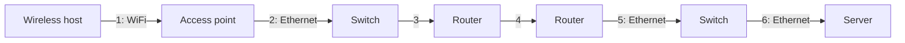
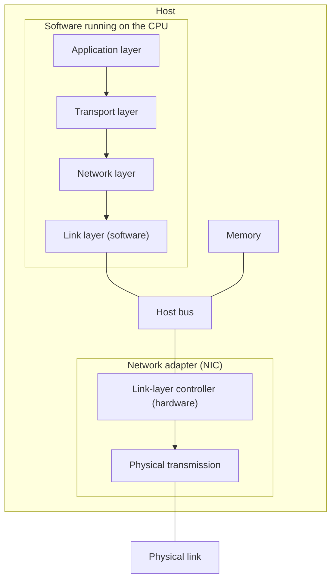
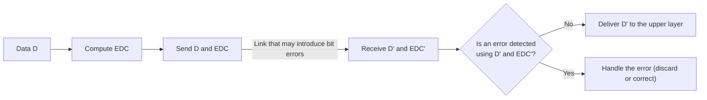
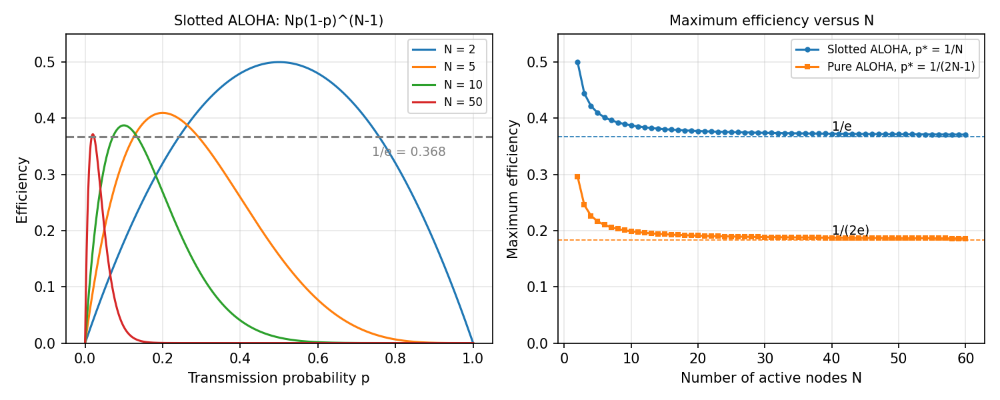
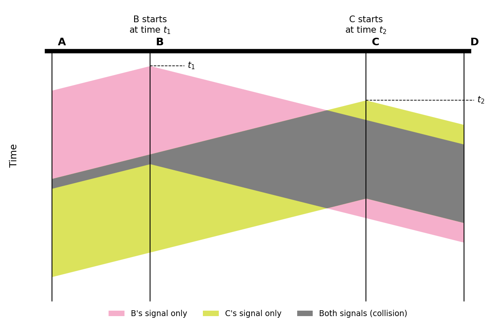
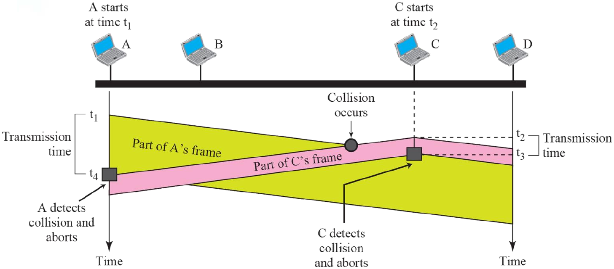
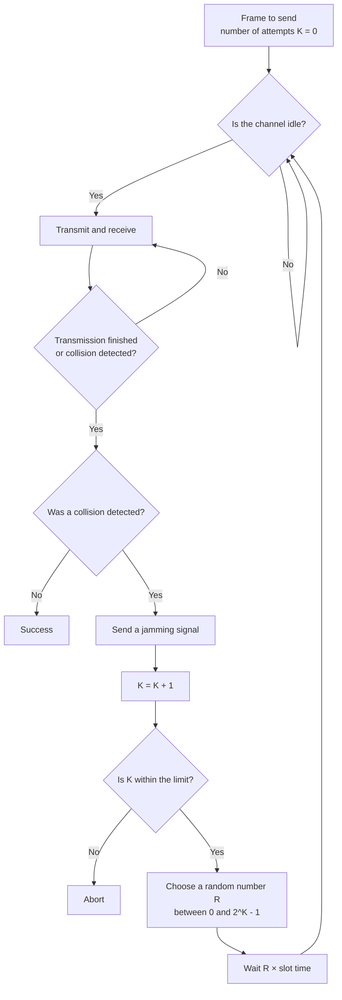
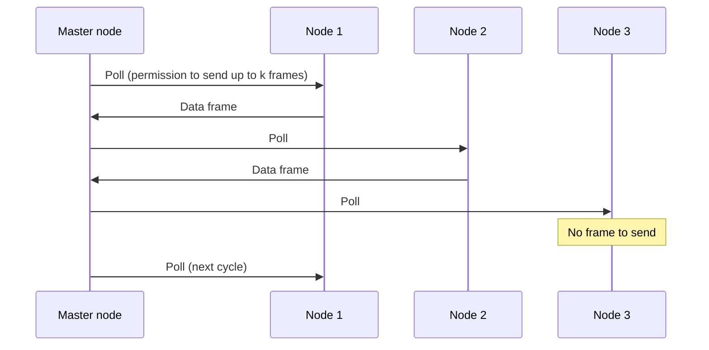
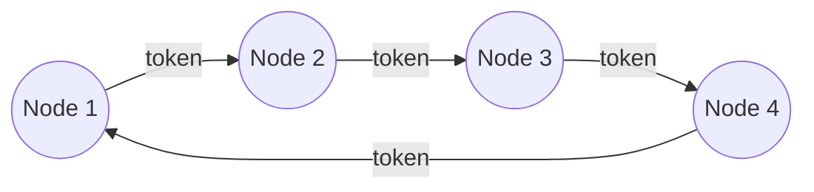

# Chapter 18 — Link Layer, Error Detection, and Multiple Access

[Repository Guide](../../README.md) | [English](Concepts_Lecture.md) | [한국어](Concepts_Lecture.ko.md)

> **Last Updated:** 2026-11-18
>
> Computer Networking: A Top-Down Approach, Kurose and Ross, Ch 6; TCP/IP Protocol Suite, Forouzan, Ch 3

> **Learning Objectives:**
> 1. Explain the services that the link layer provides and where the link layer is implemented
> 2. Compute error-detection bits with parity checks, checksums, and CRC, and compare the detection power of the three techniques
> 3. Classify multiple access protocols into channel partitioning, random access, and taking-turns protocols, and explain their strengths and weaknesses
> 4. Derive the efficiency of slotted and pure ALOHA, and explain how CSMA/CD and binary exponential backoff work
> 5. Explain why CSMA/CD needs a minimum frame size and compute that size
> 6. Explain how DOCSIS combines several multiple access techniques

---

## Table of Contents

- [1. Introduction to the Link Layer](#1-introduction-to-the-link-layer)
  - [1.1 Nodes and Links](#11-nodes-and-links)
  - [1.2 Services Provided by the Link Layer](#12-services-provided-by-the-link-layer)
  - [1.3 Where the Link Layer Is Implemented](#13-where-the-link-layer-is-implemented)
- [2. Error-Detection and -Correction Techniques](#2-error-detection-and--correction-techniques)
  - [2.1 The Setting of Error Detection](#21-the-setting-of-error-detection)
  - [2.2 Parity Checks](#22-parity-checks)
  - [2.3 Two-Dimensional Parity and Forward Error Correction](#23-two-dimensional-parity-and-forward-error-correction)
  - [2.4 Checksums](#24-checksums)
  - [2.5 Cyclic Redundancy Check (CRC)](#25-cyclic-redundancy-check-crc)
  - [2.6 Comparison of the Three Techniques](#26-comparison-of-the-three-techniques)
- [3. Multiple Access Links and Protocols](#3-multiple-access-links-and-protocols)
  - [3.1 Point-to-Point Links and Broadcast Links](#31-point-to-point-links-and-broadcast-links)
  - [3.2 The Multiple Access Problem and Collisions](#32-the-multiple-access-problem-and-collisions)
  - [3.3 Classes and Desirable Properties of Multiple Access Protocols](#33-classes-and-desirable-properties-of-multiple-access-protocols)
- [4. Channel Partitioning Protocols](#4-channel-partitioning-protocols)
  - [4.1 Time-Division Multiplexing (TDM)](#41-time-division-multiplexing-tdm)
  - [4.2 Frequency-Division Multiplexing (FDM)](#42-frequency-division-multiplexing-fdm)
  - [4.3 Code Division Multiple Access (CDMA)](#43-code-division-multiple-access-cdma)
- [5. Random Access Protocols](#5-random-access-protocols)
  - [5.1 Slotted ALOHA](#51-slotted-aloha)
  - [5.2 Efficiency of Slotted ALOHA](#52-efficiency-of-slotted-aloha)
  - [5.3 Pure ALOHA](#53-pure-aloha)
  - [5.4 Carrier Sense Multiple Access (CSMA)](#54-carrier-sense-multiple-access-csma)
  - [5.5 CSMA with Collision Detection (CSMA/CD)](#55-csma-with-collision-detection-csmacd)
  - [5.6 Binary Exponential Backoff](#56-binary-exponential-backoff)
  - [5.7 Minimum Frame Size](#57-minimum-frame-size)
  - [5.8 Efficiency of CSMA/CD](#58-efficiency-of-csmacd)
- [6. Taking-Turns Protocols](#6-taking-turns-protocols)
  - [6.1 Polling Protocol](#61-polling-protocol)
  - [6.2 Token-Passing Protocol](#62-token-passing-protocol)
  - [6.3 Comparison of the Three Classes](#63-comparison-of-the-three-classes)
- [7. DOCSIS: The Link-Layer Protocol for Cable Internet Access](#7-docsis-the-link-layer-protocol-for-cable-internet-access)
- [Concept Applications](#concept-applications)
- [Summary](#summary)
- [Self-Check Questions](#self-check-questions)

---

<br>

## 1. Introduction to the Link Layer

### 1.1 Nodes and Links

Any device that runs a link-layer (layer 2) protocol is called a **node**. Hosts, routers, switches, and the access points (APs) of wireless LANs are all nodes. The communication channel that connects two adjacent nodes along a communication path is called a **link**. For a datagram to travel from the source host to the destination host, it must cross, one after another, each of the links that make up the end-to-end path.

For example, when a wireless host in a company network sends a datagram to a server in the data center, the datagram passes through six links, as Figure 1 shows. Over each link, the transmitting node encapsulates the datagram in a **link-layer frame** and sends it into the link, and the receiving node extracts the datagram from the frame and hands it to the next link.



*Figure 1. Six links that a datagram crosses from a wireless host to a server*

The relation between the link layer and the network layer can be understood through a travel analogy. Suppose that a travel agent plans a trip for a tourist from Princeton, New Jersey, to Lausanne, Switzerland. The agent books a limousine from Princeton to JFK airport, a plane from JFK to Geneva airport, and a train from Geneva airport to the Lausanne station. Once the bookings are made, each segment becomes the responsibility of the limousine company, the airline, and the Swiss railway. The three segments are run by different companies with different modes of transport, but each provides the same basic service of moving the passenger from one location to an adjacent location.

| Travel analogy | Network |
|:-----|:-----|
| Tourist | Datagram |
| Each transportation segment | Link |
| Transportation mode (limousine, plane, train) | Link-layer protocol |
| Travel agent | Routing protocol |

*Table 1. Correspondence between the travel analogy and network components*

As the analogy shows, a single datagram may be carried by a different link-layer protocol over each link of its path. The first link may be WiFi and the next one Ethernet, and the services that these protocols provide may also differ.

### 1.2 Services Provided by the Link Layer

The basic service of every link layer is to move a datagram from one node to an adjacent node over a single link. Which further services are offered depends on the protocol, and the possible services are the following four.

> **Definition:** **Framing** is the act of placing a network-layer datagram in the data field of a link-layer frame and adding header fields to form the unit that is sent over the link. The structure of the frame is specified by the link-layer protocol.

- **Framing:** Almost all link-layer protocols encapsulate a datagram in a frame before transmission. The structure of the Ethernet frame is covered in Chapter 20, and that of the 802.11 frame in Chapter 22.
- **Link access:** A **medium access control (MAC)** protocol specifies the rules by which a frame is transmitted onto the link. On a point-to-point link, with a single sender at one end and a single receiver at the other, the sender may transmit whenever the link is idle, so the MAC protocol is simple or nonexistent. When several nodes share a single broadcast link, their transmissions must be coordinated, and this is called the **multiple access problem** (Section 3).
- **Reliable delivery:** When a link layer provides reliable delivery, it guarantees that each datagram crosses the link without error. Like TCP in the transport layer, it is implemented with acknowledgments and retransmissions (Chapter 7). On links with high error rates, such as wireless links, correcting an error locally on the link where it occurs is better than waiting for an end-to-end retransmission by the transport or application layer. On links with few bit errors, such as fiber, coaxial cable, and many twisted-pair copper links, reliable delivery is unnecessary overhead, so many wired link-layer protocols do not provide this service.
- **Error detection and correction:** The hardware of a receiving node may decide that a bit sent as a 1 is a 0, or the reverse. Such **bit errors** are introduced by signal attenuation and electromagnetic noise. Since there is no reason to forward a datagram with an error, many link-layer protocols have the sending node include error-detection bits in the frame and the receiving node perform an error check. Error correction goes further: the receiver determines not only that an error occurred but also which bits of the frame are wrong, and corrects them.

| Service | What it does | Remarks |
|:-----|:-----|:-----|
| Framing | Encapsulates a datagram in a frame | Provided by almost all protocols |
| Link access | Rules for transmitting a frame onto the link (MAC protocol) | Central on broadcast links |
| Reliable delivery | Guarantees error-free delivery with acknowledgments and retransmissions | Used mainly on wireless links |
| Error detection and correction | Finds bit errors and, when possible, locates and corrects them | Often implemented in hardware |

*Table 2. Services that the link layer may provide*

> **Note:** The transport and network layers also perform a limited form of error detection with the Internet checksum (Chapters 6 and 11). Error detection in the link layer is usually more sophisticated and is implemented in hardware. Section 2.6 explains why.

### 1.3 Where the Link Layer Is Implemented

In a router, the link layer is implemented in the line card (Chapter 13). In a host, most of the link layer is implemented in a **network adapter**, also known as a **network interface card (NIC)**. At the heart of the adapter is a single special-purpose chip called the **link-layer controller**, which performs most of the services, such as framing, link access, and error detection, in hardware. Adapters used to be separate expansion cards, but today they are often integrated onto the host's motherboard.

- **Sending side:** The controller takes a datagram that the upper layers created and stored in host memory, encapsulates it by filling in the fields of a frame, and transmits the frame into the link according to the link-access protocol. If error detection is used, the sending controller sets the error-detection bits.
- **Receiving side:** The controller receives the entire frame, performs the error check, and extracts the datagram.
- **Software part:** Part of the link layer is software that runs on the host CPU. It assembles link-layer addressing information and activates the controller hardware; on the receiving side it responds to frame-arrival interrupts, handles error conditions, and passes the datagram up to the network layer.



*Figure 2. Relationship between the network adapter and the other host components*

> **Key Point:** The link layer is a combination of hardware and software, and it is the place in the protocol stack where software meets hardware.

---

<br>

## 2. Error-Detection and -Correction Techniques

### 2.1 The Setting of Error Detection

The sending node augments the data D to be protected with **error-detection and -correction bits (EDC)**. The protected data include not only the datagram passed down from the network layer but also header fields of the frame such as link-layer addresses and sequence numbers. The receiving node receives D' and EDC', in which bits may have been flipped in transit.



*Figure 3. The setting of error detection and correction*

It matters that the receiver asks whether an error **is detected**, not whether an error has occurred. Even with error-detection bits, the receiver cannot always find bit errors, and **undetected bit errors** may remain. A corrupted datagram may then be passed up to the network layer, or a corrupted header field may go unnoticed. A technique should therefore be chosen so that the probability of such events is small. In general, more sophisticated techniques with a smaller probability of undetected errors require more computation and more added bits, and therefore more overhead.

This section covers three techniques. Parity checks show the basic ideas of error detection and correction, checksums are used mainly in the transport layer, and cyclic redundancy checks are used mainly in link-layer adapters.

### 2.2 Parity Checks

> **Definition:** A **parity check** is an error-detection technique that appends one parity bit to the data bits so that the total number of 1s is even (even parity) or odd (odd parity).

Let the information D to be sent have d bits. In an **even parity** scheme, the sender adds one more bit and chooses its value so that the number of 1s in all d + 1 bits is even. In an **odd parity** scheme, the value is chosen so that the number of 1s is odd.

```text
  ┌─────────────────────────────────┐ ┌───┐
  │ 0 1 1 1 0 0 0 1 1 0 1 0 1 0 1 1 │ │ 1 │
  └─────────────────────────────────┘ └───┘
   ◄──────────── d = 16 ────────────►  parity bit

  The data contain nine 1s, so the parity bit is 1, and all 17 bits contain ten 1s (even)
```

*Figure 4. An example of one-bit even parity*

The receiver's operation is also simple. It counts the 1s in the d + 1 received bits, and in an even parity scheme, if it finds an odd number of 1s, it concludes that at least one bit error has occurred. More precisely, it knows that an odd number of bit errors has occurred.

If an even number of bit errors occurs, the parity of the count of 1s does not change, and the error goes undetected. If bit errors are rare and occur independently from bit to bit, the probability of several errors in one packet is very small, and a single parity bit may suffice. Measurements show, however, that errors are often clustered in **bursts** rather than scattered independently. Under burst error conditions, the probability that a frame protected by a single parity bit misses an error can approach 50 percent. A more robust technique is therefore needed in practice.

### 2.3 Two-Dimensional Parity and Forward Error Correction

> **Definition:** **Two-dimensional parity** is a technique that arranges the data bits in i rows and j columns, computes the parity of every row and every column, and uses the resulting i + j + 1 parity bits as error-detection bits.

Generalizing single parity to two dimensions makes it possible not only to detect errors but also to correct them. The last bit is the parity of the row parities and of the column parities, and under even parity the two ways of computing it give the same value. The following example arranges d = 15 bits in 3 rows and 5 columns, and there are 3 + 5 + 1 = 9 parity bits.

```text
  (a)                          (b)

   1  0  1  1  0 │ 1            1  0  1  1  0 │ 1
   0  1  1  0  1 │ 1            0  1 (0) 0  1 │ 1   ← row 2 parity mismatch
   1  1  0  0  0 │ 0            1  1  0  0  0 │ 0
  ───────────────┼───          ───────────────┼───
   0  0  0  1  1 │ 0            0  0  0  1  1 │ 0
                                      ↑
                                      column 3 parity mismatch
```

*Figure 5. Two-dimensional even parity and locating a single-bit error*

In Figure 5, the five columns on the left are data, the column right of the vertical bar holds the row parities, the row below the horizontal bar holds the column parities, and the bit in the lower-right corner is the last bit. Block (a) has no error, and in block (b) the bit in row 2, column 3 has flipped from 1 to 0. When a data bit flips as in (b), the parities of both the row and the column containing that bit fail. Row 2 now contains two 1s, which contradicts its row parity 1, and column 3 contains one 1, which contradicts its column parity 0. The receiver uses the indices of the failing row and column to locate the corrupted bit at (2, 3) and corrects it by flipping it back. A single error in a parity bit itself can be detected and corrected in the same way. Any combination of two errors can be detected but not corrected. If two errors lie in the same row, the row parity holds and only two column parities fail, so the receiver cannot tell in which row the errors occurred.

> **Definition:** **Forward error correction (FEC)** is a technique in which the receiver detects and corrects errors using only the received bits, without asking the sender for a retransmission.

FEC is widely used in storage and playback devices such as audio CDs. In networks, FEC is used alone or together with the retransmission-based error control (ARQ) covered in Chapter 7. FEC reduces the number of retransmissions by the sender and, more importantly, allows errors to be corrected immediately at the receiver. The receiver does not have to wait a round-trip propagation delay for the sender to receive a NAK and for the retransmitted packet to arrive, which is a particular advantage for real-time applications and for links with long propagation delays, such as deep-space links.

### 2.4 Checksums

Checksumming techniques treat the d bits of data as a sequence of k-bit integers and use the sum of these integers as the error-detection bits. The **Internet checksum** is the representative example. The data are divided into 16-bit integers that are added with one's complement addition (a carry out of the most significant bit is wrapped around and added to the least significant bit), and the one's complement of the sum is carried in the header as the checksum. The receiver adds all the received data including the checksum, and if the result is not all 1s (if its one's complement is not 0), it decides that an error occurred.

| Step | Value (hex) | Value (binary) |
|:-----|:-----|:-----|
| First word | B1F2 | 1011 0001 1111 0010 |
| Second word | 8A3C | 1000 1010 0011 1100 |
| Sum of two words | 1 3C2E | Carry 1 wrapped around to give 3C2F |
| Third word | 1234 | 0001 0010 0011 0100 |
| Sum of three words | 4E63 | 0100 1110 0110 0011 |
| Checksum (one's complement of the sum) | B19C | 1011 0001 1001 1100 |

*Table 3. Computing the Internet checksum of three 16-bit words*

When the receiver adds the three words and the checksum B19C, it obtains 4E63 + B19C = FFFF and decides that there is no error. TCP and UDP compute the checksum over all fields including the header and the data (Chapters 6 and 8), and IP computes it over the header only (Chapter 11). The checksum has little overhead, using only 16 bits in TCP and UDP, but its error-detection power is weaker than that of CRC.

### 2.5 Cyclic Redundancy Check (CRC)

> **Definition:** A **cyclic redundancy check (CRC)** is a technique in which the sender appends r bits R to the data D so that the result is divisible by an (r + 1)-bit generator G agreed upon in advance, and the receiver checks for errors using the remainder of the received bit string divided by G.

CRC codes are also called **polynomial codes**, because the bit string to be sent can be viewed as a polynomial whose coefficients are 0s and 1s, with operations on bit strings interpreted as polynomial arithmetic. They work as follows.

1. The sender and the receiver agree in advance on an (r + 1)-bit pattern called the **generator** G. The most significant (leftmost) bit of G must be 1.
2. For the d-bit data D, the sender chooses r bits R and appends them to D. R is chosen so that the whole (d + r)-bit pattern is exactly divisible by G in modulo-2 arithmetic.
3. The receiver divides the d + r received bits by G. If the remainder is nonzero, an error has occurred; if it is zero, the data are accepted as correct.

```text
   ◄─────────────── d ───────────────►◄────── r ──────►
  ┌───────────────────────────────────┬───────────────┐
  │                 D                 │       R       │
  └───────────────────────────────────┴───────────────┘

  Bit pattern = D × 2^r XOR R (divisible by G)
```

*Figure 6. The transmitted bit pattern with the CRC appended*

All CRC calculations are done in **modulo-2 arithmetic**. There are no carries in addition and no borrows in subtraction, so addition and subtraction are the same operation, and both are identical to the bitwise exclusive-or (XOR). For example, 1011 XOR 0101 = 1110 and 1001 XOR 1101 = 0100, and 1011 − 0101 and 1001 − 1101 are likewise 1110 and 0100. Multiplication and division are the same as in binary arithmetic, except that the additions and subtractions inside them are done without carries or borrows. As in binary arithmetic, multiplying by $`2^k`$ shifts a bit pattern k places to the left, so the pattern formed by appending R to D can be written $`D \cdot 2^r \ \mathrm{XOR}\ R`$.

> **[Digital Logic Design]** XOR is the logical operation that outputs 1 when its two inputs differ, and it equals the sum of a 1-bit addition with the carry discarded. CRC computation therefore becomes a simple hardware circuit made only of shift registers and XOR gates.

R is found as follows. R is chosen so that, for some integer n,

```math
D \cdot 2^r \ \mathrm{XOR}\ R = nG
```

holds. XORing R into both sides (in modulo 2, XORing a value with itself gives 0) gives

```math
D \cdot 2^r = nG \ \mathrm{XOR}\ R
```

This equation says that the remainder of $`D \cdot 2^r`$ divided by G is exactly R. Therefore

```math
R = \text{remainder}\left(\frac{D \cdot 2^r}{G}\right)
```

Consider the case D = 101110, d = 6, G = 1001, and r = 3. The pattern 101110000, which is D followed by r = 3 zeros, is divided by G in modulo 2. At each step, if the current leading bit is 1, G is XORed (quotient bit 1); if it is 0, 0000 is XORed (quotient bit 0).

```text
                 1 0 1 0 1 1        ← quotient
          ┌──────────────────
  1 0 0 1 │ 1 0 1 1 1 0 0 0 0      ← D followed by three zeros
            1 0 0 1
            ───────
              0 1 0 1
              0 0 0 0
              ───────
                1 0 1 0
                1 0 0 1
                ───────
                  0 1 1 0
                  0 0 0 0
                  ───────
                    1 1 0 0
                    1 0 0 1
                    ───────
                      1 0 1 0
                      1 0 0 1
                      ───────
                        0 1 1      ← remainder R
```

*Figure 7. Modulo-2 division of the CRC when D = 101110 and G = 1001*

The remainder is R = 011, so the sender transmits the 9 bits 101110011, which are 101110 followed by 011. Multiplying the quotient 101011 by G and XORing R gives back $`D \cdot 2^r = 101110000`$. When the receiver divides 101110011 by 1001, the remainder is 000, so it decides that there is no error. If any single one of the 9 bits flips, the remainder becomes 100, 010, or 001, and the error is detected.

International standards have been defined for 8-, 12-, 16-, and 32-bit generators. The 32-bit standard CRC-32, adopted by several IEEE link-layer protocols, uses the following generator.

```math
G_{\text{CRC-32}} = 100000100110000010001110110110111
```

The detection power of the CRC standards is as follows.

- They detect all **burst errors** shorter than r + 1 bits. That is, all errors in r or fewer consecutive bits are detected.
- Under appropriate assumptions, a burst error longer than r + 1 bits is detected with probability $`1 - 0.5^r`$.
- They detect any odd number of bit errors.

### 2.6 Comparison of the Three Techniques

The checksum is used in the transport layer even though its detection power is weaker than that of CRC, and CRC is used in the link layer. The transport layer is usually implemented in software inside the host operating system, so it needs a simple and fast detection technique. Error detection in the link layer, on the other hand, is performed by dedicated hardware in the adapter, which can carry out the more complex CRC operations quickly.

| Technique | Error-detection bits | Detection power | Correction | Typical use |
|:-----|:-----|:-----|:-----|:-----|
| Single parity | 1 bit | Detects only an odd number of errors | Not possible | Illustrating the principle |
| Two-dimensional parity | i + j + 1 bits | Detects every combination of up to two errors | Corrects a single-bit error | Illustrating the principle of FEC |
| Internet checksum | 16 bits | Relatively weak | Not possible | Transport layer, IP header (software) |
| CRC | r bits | Detects all bursts of r bits or fewer and any odd number of errors | Not possible | Link-layer adapters (hardware) |

*Table 4. Comparison of three error-detection techniques*

---

<br>

## 3. Multiple Access Links and Protocols

### 3.1 Point-to-Point Links and Broadcast Links

Network links come in two types.

- **Point-to-point link:** It consists of a single sender at one end and a single receiver at the other end. The Point-to-Point Protocol (PPP, Chapter 21) and HDLC are protocols for such links.
- **Broadcast link:** Several sending and receiving nodes are connected to a single shared channel. When one node transmits a frame, the channel spreads the frame and every other node receives a copy, hence the name broadcast. Ethernet (Chapter 20) and wireless LANs (Chapter 22) are typical examples.

Television broadcasting is a one-way broadcast from one fixed sender to many receivers, but on a broadcast channel of a computer network every node both sends and receives. A better analogy is a cocktail party, where people gathered in a large room talk and listen through the single medium of the air, or a classroom, where the teacher and the students share the same medium. In both cases the central problem is who speaks and when, and people solve it with rules such as "give everyone a chance to speak," "do not interrupt when someone is speaking," "do not monopolize the conversation," and "raise your hand if you have a question." The rules by which nodes sharing a broadcast channel coordinate their transmissions are multiple access protocols.

### 3.2 The Multiple Access Problem and Collisions

> **Definition:** A **multiple access protocol** is a protocol that coordinates the transmissions of the nodes attached to a shared broadcast channel by determining when each node may transmit into the channel.

Multiple access protocols are needed in many settings, such as a shared wired medium (the shared cable of early Ethernet), a shared wireless medium (WiFi), satellite channels, and cable access networks. In practice, hundreds or even thousands of nodes can communicate directly over one broadcast channel.

Since every node can transmit frames, two or more nodes may transmit at the same time. All nodes then receive several frames at once, and this is called a **collision**. When a collision occurs, typically none of the receiving nodes can make sense of the colliding frames, because the signals of the colliding frames become inextricably tangled. All the frames involved in the collision are therefore lost, and the broadcast channel is wasted during the collision. If many nodes want to transmit frequently, collisions become frequent and much of the channel bandwidth is wasted, so coordinating the transmissions of the active nodes is the responsibility of the multiple access protocol.

### 3.3 Classes and Desirable Properties of Multiple Access Protocols

Many multiple access protocols have been proposed and implemented, but almost all of them belong to one of the following three classes.

| Class | Basic idea | Examples |
|:-----|:-----|:-----|
| Channel partitioning protocol | Divide the channel by time, frequency, or code and assign a fixed share to each node | TDM, FDM, CDMA |
| Random access protocol | Always send at the full rate; after a collision, wait a random time and retransmit | Slotted ALOHA, ALOHA, CSMA, CSMA/CD |
| Taking-turns protocol | Nodes take turns transmitting in an agreed order | Polling, token passing |

*Table 5. Three classes of multiple access protocols*

Ideally, a multiple access protocol for a broadcast channel of rate R bps has the following properties.

1. When only one node has data to send, that node has a throughput of R bps.
2. When M nodes have data to send, each of them has a throughput of R/M bps. This does not mean that each node sends at R/M at every instant, but that its average transmission rate over a suitable interval is R/M.
3. The protocol is decentralized; that is, there is no master node that is a single point of failure whose failure stops the whole network.
4. The protocol is simple, so that it is inexpensive to implement.

These four properties serve as the criteria for evaluating the strengths and weaknesses of each class in Sections 4 through 6.

---

<br>

## 4. Channel Partitioning Protocols

Suppose that the channel supports N nodes and that its transmission rate is R bps. Channel partitioning protocols divide the bandwidth of the channel among the N nodes. Time-division multiplexing (TDM) and frequency-division multiplexing (FDM) follow the same principle as the multiplexing techniques of circuit switching covered in Chapter 1.

### 4.1 Time-Division Multiplexing (TDM)

**Time-division multiplexing (TDM)** divides time into **time frames** and further divides each time frame into N **time slots**, assigning one slot to each node. A node with a packet to send transmits it during its own slot in the revolving TDM frame. Slot sizes are usually chosen so that one packet can be sent in one slot. Because the TDM time frame is a different concept from the link-layer frame exchanged between adapters, this section calls the link-layer data unit a packet.

In terms of the cocktail party, TDM lets one person speak for a fixed time, then gives the next person the same time, and repeats the same order once everyone has spoken.

TDM has no collisions and is perfectly fair. Each node gets a dedicated transmission rate of R/N bps during each frame time. It has, however, two major drawbacks.

- Even when only one node has packets to send, its average rate is limited to R/N bps.
- A node must always wait for its turn, even when it is the only node with something to send.

### 4.2 Frequency-Division Multiplexing (FDM)

**Frequency-division multiplexing (FDM)** divides the R bps channel into different frequency bands, each of bandwidth R/N, and assigns one band to each of the N nodes. It creates N smaller channels of R/N bps out of one large channel, so it shares the advantages and drawbacks of TDM. It has no collisions and divides the bandwidth fairly, but a node can use only R/N of bandwidth even when it is the only node with packets to send.

```text
  (a) TDM: time divided into slots

   │ 1 │ 2 │ 3 │ 4 │ 1 │ 2 │ 3 │ 4 │ 1 │ 2 │ ...   → time
   └───────────────┘└───────────────┘
      TDM frame         TDM frame

  (b) FDM: frequency divided into bands

   ↑ frequency
   │ ████████████████████████████████████   band 4: node 4 (R/4)
   │ ████████████████████████████████████   band 3: node 3 (R/4)
   │ ████████████████████████████████████   band 2: node 2 (R/4)
   │ ████████████████████████████████████   band 1: node 1 (R/4)
   └─────────────────────────────────────►  time
```

*Figure 8. TDM and FDM of a channel shared by four nodes*

### 4.3 Code Division Multiple Access (CDMA)

The third channel partitioning protocol, **code division multiple access (CDMA)**, assigns a different **code** to each node instead of time slots or frequencies. Each node encodes its data bits with its own code. If the codes are chosen carefully, several nodes can transmit simultaneously, and a receiver that knows a sender's code can still recover that sender's bits correctly in spite of interfering transmissions by other nodes. Because of its resistance to jamming, CDMA has long been used in military systems, and it is now widely used in civilian applications, notably cellular telephony. CDMA is closely tied to wireless channels, so its detailed operation is covered in Chapter 22. Here it suffices to remember that CDMA codes, like time slots in TDM and frequencies in FDM, are resources allocated to the users of a multiple access channel.

---

<br>

## 5. Random Access Protocols

In a **random access protocol**, a transmitting node always transmits at the full rate of the channel, R bps. When a collision occurs, each node involved retransmits its frame (packet) repeatedly until the frame gets through without a collision. It does not retransmit right after the collision, however, but waits a **random delay** first. Because each node chooses its delay independently, one node may pick a delay sufficiently shorter than those of the other nodes and get its frame through without a collision.

The literature describes a great many random access protocols. This section covers the most widely used ones, the ALOHA family and the carrier sense multiple access (CSMA) family. Ethernet is a widely deployed CSMA protocol.

### 5.1 Slotted ALOHA

> **Definition:** **Slotted ALOHA** is a random access protocol that divides time into slots equal to the transmission time of one frame, lets nodes transmit only at the beginnings of slots, and retransmits a collided frame with probability p in each subsequent slot.

Slotted ALOHA is one of the simplest random access protocols and makes the following assumptions.

- All frames consist of exactly L bits.
- Time is divided into slots of L/R seconds; that is, one slot equals the time to transmit one frame.
- Nodes start to transmit frames only at the beginnings of slots.
- The nodes are synchronized, so each node knows when the slots begin.
- If two or more frames collide in a slot, all nodes detect the collision before the slot ends.

Let p be a probability between 0 and 1. Each node operates as follows.

1. When it has a fresh frame to send, it waits until the beginning of the next slot and transmits the entire frame in that slot.
2. If there is no collision, the transmission has succeeded and there is no need to consider retransmission. If it has more frames to send, it prepares a new frame.
3. If there is a collision, it detects the collision before the end of the slot. It then retransmits the frame with probability p in each subsequent slot until the frame is transmitted without a collision.

Retransmitting with probability p means tossing a biased coin whose heads come up with probability p: on heads the node retransmits, and on tails (probability 1 − p) it skips the slot and tosses again in the next slot. The nodes involved in a collision toss their coins independently.

```text
   1   2   3   4   5   6   7   8   9    ← slot number
   ■       ■           ■       ■        ← node 1
   ■       ■   ■                        ← node 2
   ■                   ■           ■    ← node 3
   C   E   C   S   E   C   E   S   S    ← result
```

*Figure 9. An example of slotted ALOHA in operation*

In Figure 9, ■ marks a transmission by the node in that slot, and in the result row C denotes a collision, E an empty slot, and S a successful slot. Nodes 1, 2, and 3 collide in the first slot. The three nodes then try to retransmit with probability p in each later slot, and nodes 1 and 2 collide again in the third slot, and nodes 1 and 3 in the sixth slot. Node 2 finally succeeds in the fourth slot, node 1 in the eighth slot, and node 3 in the ninth slot. Only three of the nine slots are successful.

The strengths of slotted ALOHA are as follows.

- When only one node is active (has frames to send), it can transmit continuously at the full rate R. Unlike channel partitioning protocols, it satisfies the first property.
- It is decentralized, because each node detects collisions and decides when to retransmit on its own. Synchronization of the slots is still required.
- The protocol is extremely simple.

### 5.2 Efficiency of Slotted ALOHA

With several active nodes, two kinds of waste arise. Some slots are wasted by collisions, and other slots stay empty because all active nodes refrain from transmitting under the probabilistic transmission rule. The only slots that are not wasted are those in which exactly one node transmits, called **successful slots**. The **efficiency** of a slotted multiple access protocol is defined as the long-run fraction of successful slots when there are many active nodes, each with many frames to send. With no access control at all, if every node retransmitted immediately after each collision, the efficiency would be zero.

To derive the efficiency, modify the protocol slightly and assume that each node always has a frame to send and transmits in every slot with probability p, whether the frame is fresh or has collided. With N nodes, the probability that a slot is successful is the probability that one node transmits and the other N − 1 nodes do not. The probability that a given node transmits is p and the probability that the remaining nodes all stay silent is $`(1-p)^{N-1}`$, so the probability that a given node succeeds is $`p(1-p)^{N-1}`$. Since there are N nodes, the probability that any one of them succeeds, which is the efficiency, is as follows.

```math
E(p) = N p (1-p)^{N-1}
```

> **[Probability and Statistics]** If each node's decision to transmit is viewed as an independent trial with success probability p (a Bernoulli trial), the number of nodes transmitting in a slot follows the binomial distribution B(N, p). The efficiency is the probability $`\binom{N}{1}p(1-p)^{N-1}`$ that this random variable equals exactly 1.

For a given N, the p\* that maximizes the efficiency is obtained where the derivative of E(p) with respect to p is zero.

```math
\frac{dE}{dp} = N(1-p)^{N-2}\bigl[(1-p) - (N-1)p\bigr] = 0 \quad\Longrightarrow\quad p^{*} = \frac{1}{N}
```

The maximum efficiency is then $`E(p^{*}) = (1 - 1/N)^{N-1}`$. For example, with N = 5, p\* = 0.2 and the maximum efficiency is $`0.8^4 = 0.4096`$. The maximum efficiency with many active nodes is the limit as N goes to infinity.

```math
\lim_{N \to \infty} \left(1 - \frac{1}{N}\right)^{N-1} = \lim_{N \to \infty} \frac{(1 - 1/N)^{N}}{1 - 1/N} = \frac{1}{e} \approx 0.37
```

> **[Calculus]** $`\lim_{N\to\infty}(1 - 1/N)^N = 1/e`$ follows from the definition of the natural constant, $`\lim_{N\to\infty}(1 + 1/N)^N = e`$. The denominator 1 − 1/N converges to 1 and does not affect the limit.

That is, when many nodes have many frames to send, at best only 37 percent of the slots do useful work, and the effective transmission rate of the channel is not R bps but 0.37R bps. A similar analysis shows that about 37 percent of the slots are empty and about 26 percent have collisions. A network administrator who buys a 100 Mbps slotted ALOHA system expecting an aggregate rate of 80 Mbps among many users will be disappointed. The channel can send a frame at 100 Mbps, but its long-run successful throughput is less than 37 Mbps.



*Figure 10. Efficiency of slotted ALOHA and pure ALOHA*

The left panel of Figure 10 plots E(p) for several values of N. The larger N is, the smaller the optimal p becomes and the closer the maximum efficiency gets to 1/e. The right panel plots the maximum efficiency at the optimal p for each N; it converges to 1/e for slotted ALOHA and to 1/(2e) for pure ALOHA.

### 5.3 Pure ALOHA

Slotted ALOHA requires all nodes to synchronize their transmissions to the beginnings of slots. The first ALOHA protocol was an unslotted, fully decentralized protocol called **pure ALOHA**. In pure ALOHA, when a datagram arrives from the network layer and a frame is formed, the node immediately transmits the entire frame into the channel. If the frame collides with another transmission, the node retransmits it with probability p right after it finishes sending the collided frame. Otherwise it waits for one frame transmission time and then either transmits with probability p or waits another frame time with probability 1 − p.

To find the efficiency, take the frame transmission time as the unit of time and keep the assumptions of slotted ALOHA. At any time, the probability that a node is transmitting a frame is p. Suppose that node i begins transmitting at time t₀. For this frame to succeed, two conditions are needed.

- No other node may begin a transmission in the interval [t₀ − 1, t₀]. A transmission starting in this interval overlaps the beginning of node i's frame. The probability that none of the other nodes starts in this interval is $`(1-p)^{N-1}`$.
- No other node may begin a transmission in the interval [t₀, t₀ + 1] while node i is transmitting either. A transmission starting in this interval overlaps the end of node i's frame. This probability is also $`(1-p)^{N-1}`$.

```text
                                    ┌──────────────────────┐
                                    │        frame i       │
                                    └──────────────────────┘
  ──────────┼──────────────────────┼──────────────────────┼──────────►
          t₀ − 1                   t₀                   t₀ + 1
            ◄────────── (a) ───────►◄────────── (b) ───────►

  (a) A transmission starting here overlaps the beginning of node i's frame
  (b) A transmission starting here overlaps the end of node i's frame
  The vulnerable period, (a) and (b) together, is two frame transmission times
```

*Figure 11. Intervals of transmissions that interfere with node i's frame in pure ALOHA*

The probability that a node succeeds is therefore $`p(1-p)^{2(N-1)}`$, and the efficiency is as follows.

```math
E_{\text{pure}}(p) = N p (1-p)^{2(N-1)}
```

The probability that maximizes this expression is p\* = 1/(2N − 1), and taking the limit as for slotted ALOHA gives a maximum efficiency of 1/(2e) ≈ 0.18. This is exactly half that of slotted ALOHA, and it is the price paid for a fully decentralized ALOHA. In pure ALOHA the **vulnerable period** during which a frame can collide is two frame times, whereas in slotted ALOHA the aligned slot boundaries reduce it to one frame time.

> **Note:** **ALOHAnet.** Pure ALOHA was devised by Norm Abramson, who came to the University of Hawaii in 1969, to connect sites scattered over several islands by radio packet switching, and in 1970 his ALOHAnet was connected to the ARPAnet. A downstream channel from the central host to the sites and an upstream channel from the sites to the central host used different frequencies, and the ALOHA protocol was created to deal with collisions among packets that the decentralized sites sent on the upstream channel. This work later led Bob Metcalfe to modify ALOHA into CSMA/CD and Ethernet.

### 5.4 Carrier Sense Multiple Access (CSMA)

In slotted and pure ALOHA, a node decides to transmit independently of the activity of the other nodes. It does not check whether another node is transmitting when it starts, and it does not stop when another node interferes. At a cocktail party, it would be a boorish guest who keeps chattering whether or not others are talking. Human conversation has two rules that reduce collisions.

- **Listen before speaking.** If someone else is speaking, wait until they finish. In networking this is called **carrier sensing**. A node listens to the channel before transmitting, and if a frame from another node is being transmitted, it waits until no transmission is detected for a short time and then begins.
- **If someone else begins talking at the same time, stop talking.** In networking this is called **collision detection**. A transmitting node listens to the channel while transmitting, and if it detects that another node is transmitting an interfering frame, it stops, waits a random time, and repeats the sense-and-transmit cycle.

These two rules are embodied in the **carrier sense multiple access (CSMA)** and **CSMA with collision detection (CSMA/CD)** protocols. Standard Ethernet is the early 10 Mbps Ethernet defined by the IEEE 802.3 standard, and its access method is CSMA/CD. The stations of Standard Ethernet are physically connected in a bus or star topology, but the logical topology is always a bus. That is, the medium is shared by all stations, only one station can use it at a time, and a frame sent by one station is received by all stations. The real destination keeps the frame and the others drop it. CSMA is based on the principle "sense before transmit," or "listen before talk."

The reason collisions occur even though every node senses the carrier is **propagation delay**. When a station sends a frame, it takes a short but nonzero time for the first bit to reach every station and be sensed. Another station may find the medium idle, and start transmitting, only because the first bit sent by another station has not yet arrived. This can be seen in the **space-time diagram** of Figure 12. The horizontal axis is the position of the stations on the shared bus, and the vertical axis is time, running downward.



*Figure 12. Space-time model of a collision in CSMA*

1. At time t₁, station B senses the medium, finds it idle, and sends a frame. B's bits propagate in both directions along the medium. Because propagation takes time, the region of B's signal (pink) slopes downward, toward later times, as the distance from B grows.
2. At time t₂ (t₂ > t₁), station C senses the medium. B is already transmitting, but B's first bit has not yet reached C, so C finds the medium idle and sends its frame (yellow).
3. Shortly afterward, a region where the two signals overlap (gray) appears. A station in this region receives both signals at once and can decode neither frame, so both frames are destroyed.

As the figure shows, the **end-to-end channel propagation delay** of a broadcast channel, the time it takes a signal to propagate from one node to another, governs its performance. The longer this delay, the larger the chance that a carrier-sensing node cannot yet sense a transmission that has already begun elsewhere.

### 5.5 CSMA with Collision Detection (CSMA/CD)

> **Definition:** **CSMA/CD (carrier sense multiple access with collision detection)** is a multiple access protocol that senses the channel before transmitting, keeps monitoring it during transmission, stops transmitting as soon as it detects a collision, and tries again after a random time.

The nodes in Figure 12 do not perform collision detection, so they send their frames in their entirety even though a collision has occurred. With collision detection, a node stops transmitting as soon as it detects a collision, so it does not finish sending a useless frame already damaged by interference, and performance improves. Figure 13 follows the first bits sent by the two stations involved in a collision to show how the collision is detected.



*Figure 13. Collision of the first bit in CSMA/CD and its detection*

1. At time t₁, station A starts sending the bits of its frame.
2. At time t₂, station C has not yet sensed A's first bit, so it starts sending its own frame. C's bits propagate both to the left and to the right.
3. Sometime after t₂, the two signals meet and the collision occurs.
4. At time t₃, C receives A's first bit, detects the collision, and immediately aborts its transmission.
5. At time t₄, A receives C's first bit, detects the collision, and immediately aborts its transmission.

A thus transmits for t₄ − t₁, and C for t₃ − t₂. For the protocol to work, the transmission time of any frame, its length divided by the bit rate, must be longer than both of these durations. This condition leads to the minimum frame size of Section 5.7.

From the perspective of an adapter, CSMA/CD operates as follows.

1. The adapter obtains a datagram from the network layer, prepares a link-layer frame, and puts it in the adapter buffer.
2. If it senses that the channel is idle, that is, no signal energy enters the adapter from the channel, it starts to transmit the frame. If the channel is busy, it waits until no signal energy is sensed and then starts to transmit.
3. While transmitting, it monitors for signal energy coming from other adapters using the same channel.
4. If it transmits the entire frame without detecting signal energy from other adapters, it is finished with the frame. If it detects signal energy from other adapters while transmitting, it aborts the transmission.
5. After aborting, it waits a random amount of time and returns to step 2.

The same procedure drawn as a flow diagram is shown in Figure 14. The station transmits and receives continuously and simultaneously through two different ports, and it keeps monitoring until either the transmission is finished or a collision is detected. On detecting a collision, it sends a short **jamming signal** so that other stations that have not yet sensed the collision also become aware of it.



*Figure 14. Flow diagram of CSMA/CD*

### 5.6 Binary Exponential Backoff

> **Definition:** **Binary exponential backoff** is an algorithm that, before retransmitting a frame that has experienced n collisions, chooses K uniformly at random from $`\lbrace 0, 1, 2, \ldots, 2^n - 1 \rbrace`$ and waits for a time proportional to K.

The reason for waiting a random rather than a fixed time after a collision is clear. If two nodes collide and then both wait the same fixed time, they collide forever. The size of the interval from which the random waiting time is chosen involves a trade-off.

- If the interval is large and few nodes collided, the nodes are likely to wait a long time while the channel stays idle.
- If the interval is small and many nodes collided, the chosen random values are likely to be close, and the nodes collide again.

An interval that is short when few nodes collide and long when many nodes collide is therefore desirable. Binary exponential backoff, used in Ethernet and in the multiple access protocol of DOCSIS, solves this problem elegantly. It doubles the size of the interval with each further collision, so a node in effect estimates the number of competing nodes indirectly from its number of collisions.

- When transmitting a frame that has already experienced n collisions, a node chooses K at random from $`\lbrace 0, 1, 2, \ldots, 2^n - 1 \rbrace`$.
- In Ethernet, the actual waiting time is K × 512 bit times, that is, K times the time needed to send 512 bits into the Ethernet. A 512-bit time is 51.2 μs at 10 Mbps and 5.12 μs at 100 Mbps.
- The maximum value of n is capped at 10. After 10 or more collisions, K is chosen from {0, 1, 2, ..., 1023}.

| Number of collisions n | Range of K | Maximum wait at 10 Mbps | Maximum wait at 100 Mbps |
|:-----|:-----|:-----|:-----|
| 1 | 0, 1 | 51.2 μs | 5.12 μs |
| 2 | 0-3 | 153.6 μs | 15.36 μs |
| 3 | 0-7 | 358.4 μs | 35.84 μs |
| 4 | 0-15 | 768 μs | 76.8 μs |
| 10 or more | 0-1023 | 52,377.6 μs (about 52.4 ms) | 5,237.76 μs (about 5.24 ms) |

*Table 6. Range of K and maximum waiting time by number of collisions*

For example, when a node detects a collision while sending a frame for the first time, it chooses K = 0 or K = 1, each with probability 0.5. If K = 0, it immediately starts sensing the channel; if K = 1, it waits 512 bit times before starting the sense-and-transmit cycle. After a second collision, K is chosen with equal probability from {0, 1, 2, 3}, and after a third collision from {0, 1, ..., 7}. Because the size of the set from which K is chosen grows exponentially with the number of collisions, the algorithm is called binary exponential backoff.

Each time a node prepares a new frame, it runs the CSMA/CD algorithm from the beginning without taking into account recent collisions. A node with a new frame may therefore sneak in a successful transmission immediately while several other nodes are in the exponential backoff state.

> **Note:** **Unit of the backoff time and the limit on attempts.** Some flow diagrams express the backoff time as R times the frame transmission time (R a random number between 0 and $`2^K - 1`$) and give up when the number of attempts K reaches 15. If the unit of the waiting time is taken to be 512 bit times (the slot time), this is the same algorithm as in this section. The size of the random interval stops growing at the 10th collision, and the frame is discarded when the number of attempts reaches the limit.

### 5.7 Minimum Frame Size

For CSMA/CD to work, the frame size must be restricted. The sending station must detect a collision, if any, and abort the transmission before it sends the last bit of the frame. A station that has sent the entire frame keeps no copy of the frame and no longer monitors the line for collision detection. If the collision signal returns only after the last bit has been sent, the sender assumes that the frame succeeded, and the damaged frame is never retransmitted.

Consider the worst case. If the two stations involved in a collision are the maximum distance apart, the signal from the first station takes the maximum propagation time $`T_p`$ to reach the second station. If the second station started sending just before then, the effect of the collision takes another $`T_p`$ to return to the first station. The first station must therefore still be transmitting when $`2T_p`$ has elapsed.

```text
     A                                                D
     │ 0                                              │
     │ ─────────────────────────────────────────────► │ Tp − ε
     │                                                │
     │ ◄───────────────────────────────────────────── │
     │ 2Tp − ε                                        │
     ▼ time                                           ▼ time

  Time 0: A sends its first bit
  Time Tp − ε: just before A's first bit arrives, D finds the medium idle and sends
  Time 2Tp − ε: D's first bit reaches A, and A detects the collision
  A must therefore still be transmitting at time 2Tp to detect every collision
```

*Figure 15. The worst case that determines the minimum frame size*

The frame transmission time $`T_{fr}`$ must therefore be at least twice the maximum propagation time.

```math
T_{fr} \ge 2 \times T_p
```

The frame transmission time is the frame length divided by the transmission rate, and the maximum propagation time is the maximum length of the collision domain divided by the propagation speed. The minimum frame length divided by the transmission rate is therefore proportional to the length of the collision domain divided by the propagation speed.

```math
\frac{L_{\min}}{R} = 2 \times \frac{\text{maximum length of the collision domain}}{\text{propagation speed}}
```

The minimum frame size is thus a value chosen with the collision situation in mind. If the maximum propagation time in Standard Ethernet is 25.6 μs, then in the worst case a station must transmit for $`T_{fr} = 2 \times 25.6 = 51.2\ \mu\text{s}`$ to detect a collision. The minimum frame size is therefore as follows.

```math
10\ \text{Mbps} \times 51.2\ \mu\text{s} = 512\ \text{bits} = 64\ \text{bytes}
```

This is the minimum frame size of 64 bytes in Standard Ethernet (the frame format is in Chapter 20). Note also that the 512-bit time equals the unit time of binary exponential backoff.

> **Caution:** If the transmission rate is raised and the minimum frame size is kept, the allowed maximum propagation time, and hence the maximum length of the collision domain, shrinks by the same factor. Sending 512 bits at 100 Mbps takes 5.12 μs, so $`T_p`$ must be at most 2.56 μs, and at 1 Gbps at most 0.256 μs. This is part of the background against which high-speed Ethernet moved from CSMA/CD to switches and full-duplex links (Chapter 20).

### 5.8 Efficiency of CSMA/CD

When only one node has a frame to send, it can transmit at the full rate of the channel. When many nodes have frames to send, the effective transmission rate can be much lower. The efficiency of CSMA/CD is defined as the long-run fraction of time during which frames are being transmitted on the channel without collisions, when there are many active nodes, each with many frames to send. Let $`d_{\text{prop}}`$ be the maximum time it takes signal energy to propagate between any two adapters, and $`d_{\text{trans}}`$ the time to transmit a maximum-size frame. For a 10 Mbps Ethernet, $`d_{\text{trans}}`$ is about 1.2 ms. The derivation is beyond the scope of these notes, so only the approximation is stated.

```math
\text{Efficiency} = \frac{1}{1 + 5\, d_{\text{prop}} / d_{\text{trans}}}
```

- As $`d_{\text{prop}}`$ approaches 0, the efficiency approaches 1. This matches the intuition that with zero propagation delay, colliding nodes abort immediately without wasting the channel.
- As $`d_{\text{trans}}`$ becomes very large, the efficiency also approaches 1. Once a frame grabs the channel, it holds it for a long time, so the channel does useful work most of the time.

For example, in a 10 Mbps Ethernet with $`d_{\text{prop}} = 25.6\ \mu\text{s}`$ and a transmission time of $`d_{\text{trans}} = 1.2144\ \text{ms}`$ for the maximum frame of 1518 bytes, the efficiency is $`1/(1 + 5 \times 25.6/1214.4) \approx 0.90`$. This is far higher than the 0.37 of slotted ALOHA.

---

<br>

## 6. Taking-Turns Protocols

The ALOHA and CSMA protocols have the first property of Section 3.3 (throughput R when only one node is active) but not the second (R/M each when M nodes are active). **Taking-turns protocols** were devised to obtain this second property. This class also contains many protocols and variations, and two representative ones are covered here.

### 6.1 Polling Protocol

> **Definition:** A **polling protocol** is a taking-turns protocol in which a master node grants permission to transmit to the other nodes in turn, and only the permitted node sends up to a maximum number of frames.

The master node polls each node in a round-robin fashion. It first sends node 1 a message saying that node 1 may transmit up to some maximum number of frames. After node 1 has sent its frames, the master gives node 2 the same permission. The master can tell that a node has finished by observing the lack of a signal on the channel. The procedure repeats cyclically.



*Figure 16. Operation of a polling protocol*

Polling eliminates the collisions and empty slots that plague random access protocols, so it achieves a much higher efficiency. It has drawbacks, however.

- **Polling delay:** It takes time to notify a node that it may transmit. Even when only one node is active, the master must poll each inactive node in turn every time the active node has sent its maximum number of frames, so the throughput falls below R bps.
- **Single point of failure:** If the master node fails, the entire channel becomes inoperative. This drawback can be the more serious one.

Bluetooth is an example of a polling protocol (Chapter 22).

### 6.2 Token-Passing Protocol

> **Definition:** A **token-passing protocol** is a taking-turns protocol in which a small special-purpose frame called a token is passed among the nodes in a fixed order, and only the node holding the token sends up to a maximum number of frames.

A token-passing protocol has no master node. For example, node 1 always passes the token to node 2, node 2 to node 3, and node N to node 1. A node that receives the token holds it only if it has frames to send, sends up to the maximum number of frames, and then passes it to the next node; if it has nothing to send, it passes the token on immediately.



*Figure 17. The circulation order of a token-passing protocol*

Token passing is decentralized and highly efficient. However, the failure of one node can crash the entire channel, and if a node accidentally neglects to release the token, a recovery procedure is needed to get the token back in circulation. FDDI (fiber distributed data interface) and IEEE 802.5 token ring are token-passing protocols that had to address these issues.

### 6.3 Comparison of the Three Classes

| Property | Channel partitioning (TDM, FDM) | Random access (ALOHA, CSMA/CD) | Taking turns (polling, token passing) |
|:-----|:-----|:-----|:-----|
| Throughput when only one node is active | Limited to R/N | R | Close to R (minus polling delay or token rotation time) |
| When M nodes are active | R/N each (fair) | Efficiency drops due to collisions | Close to R/M each |
| Collisions | None | Yes | None |
| Decentralization | Slots or bands must be assigned in advance | Decentralized (slotted ALOHA needs synchronization) | Polling needs a master; token passing is decentralized |
| Main weakness | Waste at light load | More collisions at heavy load | Failure of the master or the token |

*Table 7. Comparison of the three classes of multiple access protocols*

---

<br>

## 7. DOCSIS: The Link-Layer Protocol for Cable Internet Access

A cable access network makes a good case study, because it contains all three classes of multiple access protocols. As covered in Chapter 1, a cable access network typically connects several thousand residential **cable modems** to a **cable modem termination system (CMTS)** at the cable network headend. **DOCSIS (Data-Over-Cable Service Interface Specifications)** specifies the architecture and protocols of the cable data network.

- **FDM:** DOCSIS uses FDM to divide the downstream (CMTS to modem) and upstream (modem to CMTS) segments into multiple frequency channels. Each downstream channel is 6 MHz wide with a maximum throughput of about 40 Mbps per channel (although this rate is seldom seen at a cable modem in practice). Each upstream channel has a maximum width of 6.4 MHz and a maximum throughput of about 30 Mbps.
- **Downstream channels:** Each channel is a broadcast channel. Frames sent by the CMTS on a downstream channel are received by all cable modems receiving that channel. Since the CMTS is the only node transmitting into a downstream channel, there is no multiple access problem.
- **TDM and central allocation upstream:** Several cable modems share the same upstream channel, so collisions can occur. Each upstream channel is divided into intervals of time (TDM-like), and each interval is a sequence of **mini-slots** during which cable modems can transmit to the CMTS. The CMTS explicitly grants permission by sending a control message called a **MAP message** on a downstream channel, specifying which cable modem with data to send may transmit in which mini-slot. Because mini-slots are allocated explicitly, there are no collisions in them.
- **Random access:** For the CMTS to know which modems have data to send, a modem must send a **mini-slot-request frame** during a special set of mini-slots dedicated to this purpose. Request frames are sent in a random access manner and may collide with each other. A cable modem can neither sense whether the upstream channel is busy nor detect collisions. Instead, it infers that its request collided if it receives no response to the request in the next downstream control message, and it uses binary exponential backoff to defer the retransmission of its request frame to a later slot.
- When there is little upstream traffic, a modem may send data frames directly in the slots nominally assigned to request frames, avoiding the wait for a mini-slot assignment.

```text
  Downstream channel (broadcast from the CMTS to all modems)
  ──►│ MAP │ data │ data │ MAP │ data │ ...

  Upstream channel (shared by many modems)
  ──►│ R │ R │ R │ R │   A   │   A   │   B   │   C   │ ...

  MAP: control message announcing the mini-slot assignments of the next interval
  R: slot for mini-slot-request frames (random access, collisions possible)
  A, B, C: mini-slots assigned to modems A, B, and C by a MAP message (no collisions)
```

*Figure 18. Downstream and upstream channels of DOCSIS*

| Element of DOCSIS | Corresponding multiple access technique |
|:-----|:-----|
| Dividing downstream and upstream into several frequency channels | Channel partitioning (FDM) |
| Dividing an upstream channel into intervals and mini-slots | Channel partitioning (TDM-like) |
| The CMTS assigning mini-slots with MAP messages | Centrally allocated taking turns (polling-like) |
| Sending request frames with binary exponential backoff | Random access |

*Table 8. Multiple access techniques contained in DOCSIS*

> **Key Point:** Within a single cable access network, FDM, TDM, random access, and centrally allocated time slots all operate together.

---

<br>

## Concept Applications

**True/False Check:**

| Statement | Judgment and Reason |
|:-----|:-----|
| With error-detection bits, the receiver can detect every bit error in a frame. | **F.** Undetected bit errors may remain; a good technique only makes their probability small. |
| Under even parity, if two bits flip, the receiver does not detect the error. | **T.** The parity of the count of 1s does not change, so only an odd number of errors is detected. |
| Two-dimensional parity can not only detect but also correct a single-bit error. | **T.** The intersection of the failing row parity and column parity is the position of the erroneous bit. |
| In CRC, the most significant bit of the generator G may be 0. | **F.** G has r + 1 bits, and its most significant bit must be 1. |
| In modulo-2 arithmetic, both addition and subtraction equal XOR. | **T.** With no carries or borrows, the two operations are the same. |
| The transport layer uses a checksum instead of CRC because the checksum is more powerful. | **F.** The checksum is weaker but can be computed quickly in software, which is why the transport layer uses it. |
| In TDM, a node cannot send faster than R/N bps even when it is the only active node. | **T.** It can send only in its own slot, so its average rate is limited to R/N. |
| The maximum efficiency of slotted ALOHA approaches 1/e as the number of active nodes grows. | **T.** At the optimal p = 1/N, the efficiency $`(1-1/N)^{N-1}`$ converges to 1/e. |
| The maximum efficiency of pure ALOHA is higher than that of slotted ALOHA. | **F.** Its vulnerable period is twice as long, so its maximum efficiency is half, 1/(2e). |
| If every node senses the carrier, collisions cannot occur. | **F.** Because of propagation delay, a node may find the medium idle before another node's first bit arrives. |
| In Ethernet, after the fifth collision, K is chosen from 0-31. | **T.** With n = 5, it is chosen from $`\lbrace 0, 1, \ldots, 2^5 - 1 \rbrace`$. |
| If the transmission rate is raised tenfold and the minimum frame size is kept, the maximum length of the collision domain also grows tenfold. | **F.** The transmission time of the minimum frame becomes ten times shorter, so the maximum length of the collision domain shrinks tenfold. |
| A polling protocol has no collisions, but the master node becomes a single point of failure. | **T.** If the master fails, the entire channel stops working. |
| A DOCSIS cable modem detects collisions on the upstream channel directly. | **F.** It infers a collision when there is no response in the next downstream control message. |

---

<br>

## Summary

| Concept | Key Summary |
|:-----|:-----|
| Nodes and links | A device running a link-layer protocol is a node, the channel connecting adjacent nodes is a link, and a datagram is encapsulated in a frame over each link. |
| Link-layer services | The link layer may provide framing, link access, reliable delivery, and error detection and correction, and what it provides differs from protocol to protocol. |
| Where it is implemented | The link layer is implemented mainly in the controller hardware of the network adapter and partly in software on the host CPU. |
| Parity check | A single parity bit detects an odd number of bit errors but is weak against an even number of errors and burst errors. |
| Two-dimensional parity | With i + j + 1 parity bits, it detects and corrects a single-bit error and detects any combination of up to two errors. |
| FEC | The receiver corrects errors without retransmission, reducing the number of retransmissions and the round-trip delay. |
| Internet checksum | It is the complement of the one's complement sum of 16-bit words, with little overhead and fast in software, but weak in detection power. |
| CRC | It appends the remainder R of $`D \cdot 2^r`$ divided by G so that the result is divisible by G, and detects all bursts of r bits or fewer and any odd number of errors. |
| Multiple access protocol | It coordinates transmissions on a shared broadcast channel to reduce collisions, and falls into channel partitioning, random access, and taking-turns classes. |
| Channel partitioning | TDM, FDM, and CDMA have no collisions and are fair, but a node can use only R/N even when it is the only active node. |
| Slotted ALOHA | Nodes send only at slot boundaries and retransmit with probability p after a collision, with a maximum efficiency of 1/e ≈ 0.37. |
| Pure ALOHA | Nodes send immediately without slots, so the vulnerable period doubles and the maximum efficiency is 1/(2e) ≈ 0.18. |
| CSMA and CSMA/CD | Nodes listen before sending and abort when they detect a collision while sending, but propagation delay prevents collisions from being eliminated. |
| Binary exponential backoff | After n collisions, K is chosen from $`\lbrace 0, \ldots, 2^n - 1 \rbrace`$ and the node waits K × 512 bit times, with n capped at 10. |
| Minimum frame size | It requires $`T_{fr} \ge 2T_p`$ so that a collision is detected before the last bit is sent, which is 512 bits (64 bytes) in Standard Ethernet. |
| CSMA/CD efficiency | It is approximated by $`1/(1 + 5d_{\text{prop}}/d_{\text{trans}})`$ and approaches 1 as $`d_{\text{prop}}`$ shrinks or $`d_{\text{trans}}`$ grows. |
| Taking-turns protocols | Polling has a master hand out turns and token passing circulates a token, achieving close to R/M throughput without collisions. |
| DOCSIS | It divides channels with FDM, assigns upstream mini-slots with MAP messages, and sends request frames with random access and binary exponential backoff. |

---

<br>

## Self-Check Questions

1. **CRC computation:** With generator G = 1001 and data D = 10101010, find R and write the transmitted bit string. Also check the remainder when the receiver receives that bit string.

   <details>
   <summary>Answer</summary>

   Since r = 3, divide 10101010000, which is D followed by three zeros, by 1001 in modulo 2. The quotient is 10111101 and the remainder is R = 101. The transmitted bit string is D followed by R, 10101010101. When the receiver divides these 11 bits by 1001, the remainder is 000, so it decides that there is no error.

   </details>

2. **Two-dimensional parity:** The following block, protected by even two-dimensional parity, has been received. If there is an error, locate and correct it. The data rows are `1 1 0 1`, `0 1 0 1`, and `1 0 0 1`, the row parities are 1, 1, and 0 in order, and the column parities are `0 0 1 1`.

   <details>
   <summary>Answer</summary>

   The rows contain 3, 2, and 2 ones, so the row parities should be 1, 0, and 0, and only row 2 disagrees with its received parity 1. The columns contain 2, 2, 0, and 3 ones, so the column parities should be 0, 0, 0, and 1, and only column 3 disagrees with its received parity 1. The failing row and column intersect at (2, 3), so the bit in row 2, column 3 is in error. Flipping it from 0 back to 1 restores row 2 to `0 1 1 1`, after which every row and column parity holds.

   </details>

3. **Efficiency of slotted ALOHA:** For slotted ALOHA with N = 5 active nodes, find the p that maximizes the efficiency and the efficiency at that p. Why is this efficiency larger than the value as N → ∞?

   <details>
   <summary>Answer</summary>

   The optimal p is 1/N = 0.2, and the efficiency is $`5 \times 0.2 \times 0.8^4 = 0.8^4 = 0.4096`$. For finite N, $`(1-1/N)^{N-1}`$ is larger than 1/e ≈ 0.368 and decreases toward 1/e as N grows. With fewer nodes, two or more nodes are less likely to choose the same slot, so the fraction of successful slots is higher.

   </details>

4. **Binary exponential backoff:** In a 10 Mbps Ethernet, a frame has experienced its fourth collision. Find the range from which K is chosen and the maximum waiting time. What happens after the twelfth collision?

   <details>
   <summary>Answer</summary>

   Since n = 4, K is chosen from {0, 1, ..., 15}, and the maximum waiting time is 15 × 51.2 μs = 768 μs. After the twelfth collision, n is capped at 10, so K is chosen from {0, 1, ..., 1023}, and the maximum waiting time is 1023 × 51.2 μs = 52,377.6 μs, about 52.4 ms.

   </details>

5. **Minimum frame size:** In a 100 Mbps CSMA/CD network, the maximum propagation time is $`T_p = 2.56\ \mu\text{s}`$. What is the minimum frame size in bits and in bytes? Compare the result with Standard Ethernet.

   <details>
   <summary>Answer</summary>

   Since $`T_{fr} \ge 2T_p = 5.12\ \mu\text{s}`$, the minimum frame size is 100 Mbps × 5.12 μs = 512 bits, or 64 bytes. The minimum frame size is the same as in Standard Ethernet, but because the transmission rate is ten times higher, the allowed maximum propagation time is ten times shorter, 2.56 μs instead of 25.6 μs, and the collision domain must be correspondingly smaller.

   </details>

6. **Efficiency of CSMA/CD:** In the efficiency approximation $`1/(1 + 5d_{\text{prop}}/d_{\text{trans}})`$, explain in terms of the protocol's operation why the efficiency approaches 1 as $`d_{\text{prop}}`$ approaches 0.

   <details>
   <summary>Answer</summary>

   When $`d_{\text{prop}}`$ is small, other nodes sense the signal of a node that has started transmitting almost immediately, so carrier sensing avoids most collisions. Even when a collision occurs, the colliding nodes detect it at once and abort, so the channel time wasted by collisions approaches zero. The channel is therefore transmitting successful frames almost all the time.

   </details>

7. **TDM and slotted ALOHA:** Ten nodes share a 1 Mbps channel. Compare the throughput of TDM and slotted ALOHA when only one node has data to send and when all ten have a lot of data. Assume that slotted ALOHA uses the optimal p.

   <details>
   <summary>Answer</summary>

   When only one node is active, TDM gives it 0.1 Mbps because it uses only its own slot, while slotted ALOHA gives it 1 Mbps because it can send in every slot. When all ten are active, TDM gives each node 0.1 Mbps, 1 Mbps in total, without collisions. Slotted ALOHA at p = 0.1 has an efficiency of $`10 \times 0.1 \times 0.9^9 \approx 0.387`$, so the total is about 0.387 Mbps, or about 0.039 Mbps per node. Random access is better at light load, and channel partitioning is better at heavy load.

   </details>

8. **Collision handling in DOCSIS:** A DOCSIS cable modem can perform neither carrier sensing nor collision detection. How does it find out that a mini-slot-request frame has collided, and how does it respond?

   <details>
   <summary>Answer</summary>

   After sending a request frame, a cable modem infers a collision if the next downstream control message (MAP message) contains no response to its request. It then uses binary exponential backoff to defer the retransmission of the request frame to a later request slot. The actual data are sent in mini-slots assigned by the CMTS, so they do not collide.

   </details>
