# 19장 — 링크 계층 주소와 ARP

[레포지토리 안내](../../README.ko.md) | [English](Concepts_Lecture.md) | [한국어](Concepts_Lecture.ko.md)

> **최종 수정일:** 2026-11-27
>
> Computer Networking: A Top-Down Approach, Kurose and Ross, Ch 6; TCP/IP Protocol Suite, Forouzan, Ch 3, 8

> **학습 목표:**
> 1. MAC 주소의 형식과 할당 방식을 설명하고 유니캐스트, 멀티캐스트, 브로드캐스트 주소를 구분할 수 있다
> 2. 논리 주소와 물리 주소가 모두 필요한 이유와 정적 매핑과 동적 매핑의 차이를 설명할 수 있다
> 3. ARP 요청과 응답의 동작, 패킷 형식, 캡슐화를 설명하고 주어진 주소로 ARP 패킷의 필드를 채울 수 있다
> 4. ARP를 쓰는 네 가지 경우와 서브넷 밖으로 데이터그램을 보낼 때 프레임의 주소가 정해지는 과정을 설명할 수 있다
> 5. ARP 패키지의 캐시 테이블, 큐, 출력 모듈, 입력 모듈, 캐시 제어 모듈이 캐시 테이블을 바꾸는 과정을 추적할 수 있다
> 6. 프록시 ARP, ARP 알림, ARP 스푸핑의 원리를 설명할 수 있다

---

## 목차

- [1. 두 단계의 주소](#1-두-단계의-주소)
  - [1.1 논리 주소와 물리 주소](#11-논리-주소와-물리-주소)
  - [1.2 계층마다 주소를 따로 두는 이유](#12-계층마다-주소를-따로-두는-이유)
- [2. MAC 주소](#2-mac-주소)
  - [2.1 MAC 주소의 형식](#21-mac-주소의-형식)
  - [2.2 MAC 주소의 할당과 평면 구조](#22-mac-주소의-할당과-평면-구조)
  - [2.3 유니캐스트, 멀티캐스트, 브로드캐스트 주소](#23-유니캐스트-멀티캐스트-브로드캐스트-주소)
  - [2.4 MAC 주소의 전송 순서](#24-mac-주소의-전송-순서)
  - [2.5 어댑터의 프레임 수신](#25-어댑터의-프레임-수신)
- [3. 주소 매핑](#3-주소-매핑)
  - [3.1 정적 매핑](#31-정적-매핑)
  - [3.2 동적 매핑](#32-동적-매핑)
- [4. ARP의 동작](#4-arp의-동작)
  - [4.1 TCP/IP 프로토콜 스위트에서 ARP의 위치](#41-tcpip-프로토콜-스위트에서-arp의-위치)
  - [4.2 ARP 요청과 ARP 응답](#42-arp-요청과-arp-응답)
  - [4.3 ARP 캐시](#43-arp-캐시)
  - [4.4 ARP가 속하는 계층](#44-arp가-속하는-계층)
- [5. ARP 패킷과 캡슐화](#5-arp-패킷과-캡슐화)
  - [5.1 ARP 패킷 형식](#51-arp-패킷-형식)
  - [5.2 캡슐화](#52-캡슐화)
  - [5.3 ARP 처리의 일곱 단계](#53-arp-처리의-일곱-단계)
- [6. ARP를 쓰는 네 가지 경우](#6-arp를-쓰는-네-가지-경우)
- [7. 예제와 프레임 분석](#7-예제와-프레임-분석)
  - [7.1 요청 프레임과 응답 프레임](#71-요청-프레임과-응답-프레임)
  - [7.2 캡처한 ARP 프레임 읽기](#72-캡처한-arp-프레임-읽기)
- [8. 서브넷 밖으로 데이터그램 보내기](#8-서브넷-밖으로-데이터그램-보내기)
- [9. 프록시 ARP](#9-프록시-arp)
- [10. ARP 패키지](#10-arp-패키지)
  - [10.1 구성 요소](#101-구성-요소)
  - [10.2 캐시 테이블](#102-캐시-테이블)
  - [10.3 큐](#103-큐)
  - [10.4 출력 모듈](#104-출력-모듈)
  - [10.5 입력 모듈](#105-입력-모듈)
  - [10.6 캐시 제어 모듈](#106-캐시-제어-모듈)
  - [10.7 캐시 테이블의 변화 추적](#107-캐시-테이블의-변화-추적)
- [11. RARP와 그 후속 프로토콜](#11-rarp와-그-후속-프로토콜)
- [12. ARP 프로브와 ARP 알림](#12-arp-프로브와-arp-알림)
- [13. ARP 보안](#13-arp-보안)
  - [13.1 ARP 스푸핑](#131-arp-스푸핑)
  - [13.2 대응 방안](#132-대응-방안)
- [개념 적용](#개념-적용)
- [요약](#요약)
- [점검 문제](#점검-문제)
- [참고 문헌](#참고-문헌)

---

<br>

## 1. 두 단계의 주소

### 1.1 논리 주소와 물리 주소

인터넷은 라우터 같은 연결 장치로 이어진 여러 물리 네트워크의 조합이다. 출발지 호스트를 떠난 패킷은 목적지 호스트에 닿기까지 여러 물리 네트워크를 지난다. 이 과정에서 호스트와 라우터는 두 가지 주소로 식별된다.

- **논리 주소(logical address):** 네트워크 수준에서 호스트와 라우터를 식별하는 인터네트워크 주소이다. 유효 범위가 인터넷 전체이므로 전 세계에서 유일해야 한다. 보통 소프트웨어로 구현되어 논리 주소라고 부르며, TCP/IP에서는 32비트 IP 주소가 논리 주소이다(12장).
- **물리 주소(physical address):** 물리 네트워크 수준에서 호스트와 라우터를 식별하는 지역 주소이다. 유효 범위가 하나의 지역 네트워크이므로 그 안에서만 유일하면 되고, 전 세계에서 유일할 필요는 없다. 보통(언제나는 아니지만) 하드웨어로 구현되어 물리 주소라고 부르며, 이더넷의 48비트 MAC 주소가 대표적이다.

두 주소는 서로 다른 식별자이며 둘 다 필요하다. 이더넷 같은 하나의 물리 네트워크 위에서 IP와 IPX 같은 서로 다른 네트워크 계층 프로토콜이 동시에 동작할 수 있고, 반대로 IP 같은 하나의 네트워크 계층 패킷이 이더넷과 LocalTalk처럼 서로 다른 물리 네트워크를 거칠 수 있기 때문이다. 따라서 패킷을 호스트나 라우터에 전달하려면 **논리 주소와 물리 주소라는 두 단계의 주소**가 필요하고, 논리 주소를 그에 대응하는 물리 주소로, 또는 그 반대로 바꿀 수 있어야 한다.

### 1.2 계층마다 주소를 따로 두는 이유

호스트와 라우터의 인터페이스가 네트워크 계층 주소와 별도로 MAC 주소를 갖는 이유는 다음과 같다.

- **네트워크 계층 프로토콜에 대한 중립성:** LAN은 IP와 인터넷만이 아니라 임의의 네트워크 계층 프로토콜을 위해 설계된다. 어댑터에 중립적인 MAC 주소 대신 IP 주소를 배정하면 IPX나 DECnet 같은 다른 네트워크 계층 프로토콜을 지원하기 어렵다.
- **설정 부담:** 어댑터가 MAC 주소 대신 네트워크 계층 주소를 쓰면, 그 주소를 어댑터의 RAM에 저장하고 어댑터를 옮기거나 켤 때마다 다시 설정해야 한다.
- **불필요한 인터럽트:** 어댑터에 주소를 아예 두지 않고 받은 프레임의 데이터를 모두 네트워크 계층으로 올려 보내 주소를 확인하게 할 수도 있다. 그러면 같은 브로드캐스트 LAN에서 다른 호스트로 가는 프레임까지 포함해 LAN에 보내지는 모든 프레임마다 호스트가 인터럽트된다.

곧 각 계층이 독립된 구성 요소가 되려면 계층마다 자신의 주소 체계가 필요하다. 지금까지 나온 주소는 응용 계층의 호스트 이름(5장), 네트워크 계층의 IP 주소, 링크 계층의 MAC 주소 세 가지이다.

---

<br>

## 2. MAC 주소

### 2.1 MAC 주소의 형식

> **용어 정의:** **MAC 주소(MAC address)** 는 LAN에 연결된 어댑터(네트워크 인터페이스)를 식별하는 링크 계층 주소이며, 이더넷과 802.11 무선 LAN에서는 길이가 6바이트(48비트)이다.

엄밀히 말해 링크 계층 주소를 갖는 것은 호스트나 라우터가 아니라 그 어댑터, 곧 네트워크 인터페이스이다. 따라서 네트워크 인터페이스가 여러 개인 호스트나 라우터는 IP 주소를 여러 개 갖는 것처럼 링크 계층 주소도 여러 개 갖는다. 링크 계층 주소는 **LAN 주소**, **물리 주소**, **MAC 주소**라고도 부르며, 이 정리본에서는 가장 널리 쓰이는 MAC 주소라는 이름을 쓴다.

> **참고:** 링크 계층 스위치는 호스트와 라우터에 연결된 인터페이스에 MAC 주소를 두지 않는다. 스위치는 호스트와 라우터 사이에서 데이터그램을 **투명하게(transparently)** 나르는 장치이므로, 호스트나 라우터가 프레임의 주소를 중간의 스위치로 지정할 필요가 없기 때문이다(20장).

이더넷 MAC 주소는 6바이트이므로 가능한 주소는 $`2^{48}`$개이다. 보통 각 바이트를 16진수 두 자리로 나타내고 바이트 사이를 콜론이나 하이픈으로 구분한다.

```text
  d1 d2 : d3 d4 : d5 d6 : d7 d8 : d9 d10 : d11 d12      (d is one hexadecimal digit)

  6 bytes = 12 hexadecimal digits = 48 bits

  Example: 4A:30:10:21:10:1A
```

*그림 1. 16진수로 나타낸 이더넷 주소*

MAC 주소는 원래 바뀌지 않도록 설계되었지만, 지금은 소프트웨어로 어댑터의 MAC 주소를 바꿀 수도 있다. 이 장에서는 어댑터의 MAC 주소가 고정되어 있다고 가정한다.

### 2.2 MAC 주소의 할당과 평면 구조

여러 나라의 여러 회사가 어댑터를 만드는데도 같은 주소를 가진 어댑터는 둘이 없다. IEEE가 MAC 주소 공간을 관리하기 때문이다. 어댑터를 만들려는 회사는 IEEE에서 $`2^{24}`$개의 주소로 이루어진 덩어리를 산다. IEEE는 MAC 주소의 앞쪽 24비트를 고정하여 덩어리를 배정하고, 회사는 뒤쪽 24비트의 조합을 어댑터마다 서로 다르게 만든다.

```text
  ┌─────────────────────────┬─────────────────────────┐
  │            A            │            B            │
  └─────────────────────────┴─────────────────────────┘
  A: first 24 bits, assigned by the IEEE to the manufacturer (fixed per manufacturer)
  B: last 24 bits, set differently for each adapter by the manufacturer
```

*그림 2. MAC 주소의 할당 구조*

어댑터의 MAC 주소는 **평면 구조(flat structure)** 를 가지며, 어댑터가 어디로 옮겨 가도 바뀌지 않는다. 이더넷 인터페이스가 있는 노트북이나 802.11 인터페이스가 있는 스마트폰은 어디에 가든 같은 MAC 주소를 갖는다. 반면 IP 주소는 네트워크 부분과 호스트 부분으로 이루어진 **계층 구조(hierarchical structure)** 이므로, 호스트가 연결된 네트워크를 바꾸면 IP 주소도 바꿔야 한다.

| 비교 | MAC 주소 | IP 주소 |
|:-----|:-----|:-----|
| 계층 | 링크 계층 | 네트워크 계층 |
| 길이 (이더넷, IPv4) | 48비트 | 32비트 |
| 구조 | 평면 구조 | 계층 구조 (네트워크 부분과 호스트 부분) |
| 이동할 때 | 바뀌지 않음 | 연결된 네트워크에 따라 바뀜 |
| 할당 | IEEE가 앞 24비트를 제조사에 배정 | 주소 블록을 기관에 배정 (12장) |
| 사람에 비유하면 | 주민등록번호처럼 평생 같은 번호 | 우편 주소처럼 이사하면 바뀌는 주소 |

*표 1. MAC 주소와 IP 주소의 비교*

사람이 우편 주소와 주민등록번호를 모두 갖는 것이 쓸모 있듯이, 호스트와 라우터의 인터페이스도 네트워크 계층 주소와 MAC 주소를 모두 갖는 것이 쓸모 있다.

### 2.3 유니캐스트, 멀티캐스트, 브로드캐스트 주소

프레임은 한 스테이션에서만 나오므로 출발지 주소는 언제나 유니캐스트 주소이다. 목적지 주소는 다음 세 가지 중 하나일 수 있다.

- **유니캐스트 주소(unicast address):** 수신자 하나를 가리키며, 송신자와 수신자의 관계는 일대일이다.
- **멀티캐스트 주소(multicast address):** 주소의 그룹을 가리키며, 송신자와 수신자의 관계는 일대다이다.
- **브로드캐스트 주소(broadcast address):** LAN의 모든 스테이션을 가리킨다. 48비트가 모두 1인 주소, 곧 FF:FF:FF:FF:FF:FF이며, 모든 비트가 1인 멀티캐스트 주소의 특수한 경우이다.

유니캐스트와 멀티캐스트는 첫 바이트의 최하위 비트로 구분한다. 이 비트가 0이면 유니캐스트, 1이면 멀티캐스트이다.

```text
  ┌─┬─┬─┬─┬─┬─┬─┬─┐ ┌─┬─┬─┬─┬─┬─┬─┬─┐       ┌─┬─┬─┬─┬─┬─┬─┬─┐
  │ │ │ │ │ │ │ │x│ │ │ │ │ │ │ │ │ │  ...  │ │ │ │ │ │ │ │ │
  └─┴─┴─┴─┴─┴─┴─┴─┘ └─┴─┴─┴─┴─┴─┴─┴─┘       └─┴─┴─┴─┴─┴─┴─┴─┘
          1                  2                         6
                 ↑
                 x: least significant bit of the first byte (0 for unicast, 1 for multicast)
```

*그림 3. 유니캐스트 주소와 멀티캐스트 주소를 구분하는 비트*

16진수 표기에서는 왼쪽에서 두 번째 자리(첫 바이트의 아래 4비트)가 짝수이면 유니캐스트, 홀수이면 멀티캐스트이고, 모든 자리가 F이면 브로드캐스트이다.

| 목적지 주소 | 둘째 자리 | 2진수 | 종류 |
|:-----|:-----|:-----|:-----|
| 4A:30:10:21:10:1A | A | 1010 (짝수) | 유니캐스트 |
| 47:20:1B:2E:08:EE | 7 | 0111 (홀수) | 멀티캐스트 |
| FF:FF:FF:FF:FF:FF | F | 모두 1 | 브로드캐스트 |

*표 2. 목적지 주소의 종류 판별*

### 2.4 MAC 주소의 전송 순서

주소가 회선으로 나가는 순서는 16진수로 쓴 순서와 다르다. 바이트 단위로는 왼쪽에서 오른쪽으로 보내지만, 각 바이트 안에서는 최하위 비트를 먼저, 최상위 비트를 마지막에 보낸다. 따라서 주소가 유니캐스트인지 멀티캐스트인지를 정하는 비트가 수신자에게 가장 먼저 도착한다.

예를 들어 47:20:1B:2E:08:EE는 다음 순서로 전송된다. 첫 바이트 47은 2진수로 01000111이며, 이를 최하위 비트부터 보내면 11100010이 된다.

```text
     47        20        1B        2E        08        EE        ← address (hex)
  01000111  00100000  00011011  00101110  00001000  11101110     ← binary
  11100010  00000100  11011000  01110100  00010000  01110111     ← transmission order (leftmost bit first)
```

*그림 4. 47:20:1B:2E:08:EE의 회선 전송 순서*

### 2.5 어댑터의 프레임 수신

어댑터가 어떤 목적지 어댑터로 프레임을 보낼 때는 목적지 어댑터의 MAC 주소를 프레임에 넣어 LAN으로 보낸다. 그런데 스위치는 들어온 프레임을 모든 인터페이스로 내보내는 경우가 있고(20장), 802.11도 프레임을 브로드캐스트한다(22장). 따라서 어댑터는 자신에게 오지 않은 프레임도 받을 수 있다. 어댑터는 프레임을 받으면 목적지 MAC 주소가 자신의 MAC 주소와 같은지 검사한다.

- 같으면 프레임 안의 데이터그램을 꺼내 프로토콜 스택 위로 올린다.
- 다르면 네트워크 계층으로 올리지 않고 프레임을 버린다.

이렇게 하면 프레임을 받을 때 실제 목적지만 인터럽트된다. 송신 어댑터가 LAN의 다른 모든 어댑터가 프레임을 받아 처리하기를 원할 때는 목적지 주소 필드에 브로드캐스트 주소 FF-FF-FF-FF-FF-FF를 넣는다.

---

<br>

## 3. 주소 매핑

### 3.1 정적 매핑

> **용어 정의:** **정적 매핑(static mapping)** 은 논리 주소와 물리 주소를 짝지은 표를 만들어 네트워크의 각 장치에 저장해 두고, 장치가 그 표를 찾아 상대의 물리 주소를 얻는 주소 매핑 방식이다.

다른 장치의 IP 주소는 알지만 물리 주소를 모르는 장치는 이 표에서 물리 주소를 찾으면 된다. 그러나 물리 주소는 다음과 같은 이유로 바뀔 수 있어 정적 매핑에는 한계가 있다.

1. 장치의 NIC를 바꾸면 물리 주소가 바뀐다.
2. LocalTalk 같은 일부 LAN에서는 컴퓨터를 켤 때마다 물리 주소가 바뀐다.
3. 이동하는 컴퓨터가 다른 물리 네트워크로 옮겨 가면 물리 주소가 바뀐다.

이런 변화를 반영하려면 정적 매핑 표를 주기적으로 갱신해야 하며, 이 오버헤드는 네트워크 성능에 영향을 줄 수 있다. 네트워크가 커질수록 관리 부담도 커진다.

### 3.2 동적 매핑

> **용어 정의:** **동적 매핑(dynamic mapping)** 은 장치가 두 주소(논리 주소나 물리 주소) 중 하나를 알 때마다 프로토콜을 써서 나머지 하나를 찾아내는 주소 매핑 방식이다.

동적 매핑을 위해 두 프로토콜이 설계되었다.

- **ARP(Address Resolution Protocol):** 논리 주소를 물리 주소로 매핑한다.
- **RARP(Reverse Address Resolution Protocol):** 물리 주소를 논리 주소로 매핑한다. 다른 프로토콜로 대체되어 더 이상 쓰이지 않으므로 11절에서 간단히 다룬다.


*그림 5. ARP를 통한 논리 주소와 물리 주소의 동적 매핑*

> **핵심:** 동적 매핑은 표를 손으로 관리할 필요를 없앤다. ARP는 IP 주소에 대응하는 MAC 주소를 필요할 때 자동으로 찾아낸다.

---

<br>

## 4. ARP의 동작

> **용어 정의:** **ARP(Address Resolution Protocol)** 는 같은 서브넷에 있는 호스트나 라우터 인터페이스의 IP 주소를 그에 대응하는 MAC 주소로 바꾸는 주소 결정 프로토콜이다.

### 4.1 TCP/IP 프로토콜 스위트에서 ARP의 위치

호스트나 라우터는 다른 호스트나 라우터로 보낼 IP 데이터그램이 있으면 수신자의 논리(IP) 주소를 알고 있다. 그러나 IP 데이터그램이 물리 네트워크를 지나가려면 프레임에 캡슐화되어야 하므로, 송신자는 수신자의 물리 주소가 필요하다. LAN 같은 일반적인 물리 네트워크에서 링크의 각 장치는 보통 NIC에 새겨진 물리 주소, 곧 스테이션 주소로 식별된다. ARP는 IP로부터 논리 주소를 받아 그에 대응하는 물리 주소로 매핑한 뒤 데이터 링크 계층에 넘긴다.

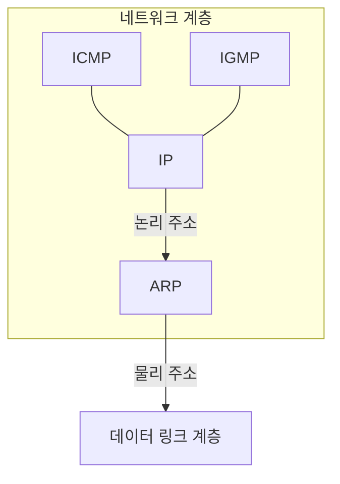

*그림 6. TCP/IP 프로토콜 스위트에서 ARP의 위치*

ARP는 DNS(5장)와 닮은 점이 있다. DNS가 호스트 이름을 IP 주소로 바꾸듯이 ARP는 IP 주소를 MAC 주소로 바꾼다. 그러나 중요한 차이가 있다. DNS는 인터넷 어디에 있는 호스트의 이름이든 바꿔 주지만, ARP는 **같은 서브넷**에 있는 호스트와 라우터 인터페이스의 IP 주소만 바꾼다. 다른 대륙에 있는 노드의 IP 주소를 ARP로 결정하려 하면 실패한다.

### 4.2 ARP 요청과 ARP 응답

> **용어 정의:** **ARP 요청(ARP request)** 은 송신자의 물리 주소와 IP 주소, 그리고 결정하려는 대상의 IP 주소를 담아 링크의 모든 호스트와 라우터에 브로드캐스트하는 ARP 패킷이다.

> **용어 정의:** **ARP 응답(ARP reply)** 은 ARP 요청의 대상 IP 주소를 가진 시스템이 자신의 IP 주소와 물리 주소를 담아 요청자에게 유니캐스트로 돌려보내는 ARP 패킷이다.

호스트나 라우터가 자기 네트워크에 있는 다른 호스트나 라우터의 물리 주소를 찾아야 할 때마다 ARP 질의 패킷을 보낸다. 송신자는 수신자의 물리 주소를 모르므로 질의는 네트워크 전체에 브로드캐스트된다. 네트워크의 모든 호스트와 라우터가 ARP 질의 패킷을 받아 처리하지만, 패킷에 담긴 IP 주소가 자신의 주소인 의도된 수신자만 ARP 응답 패킷을 돌려보낸다. 응답 패킷은 질의 패킷에 들어 있던 물리 주소를 써서 질의자에게 직접 유니캐스트된다.

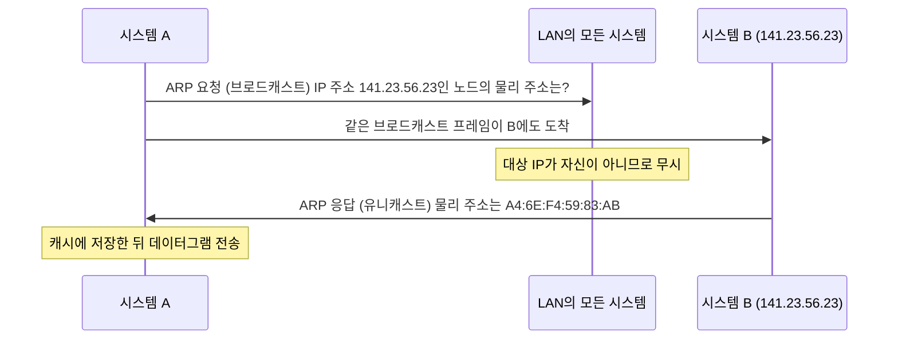

*그림 7. ARP 요청과 ARP 응답의 동작*

시스템 A가 IP 주소가 141.23.56.23인 시스템 B에게 패킷을 보낸다고 하자. 동작은 다음과 같다.

1. A는 먼저 자신의 ARP 캐시에 B의 물리 주소가 저장되어 있는지 확인한다. 저장되어 있으면 그 정보를 쓴다.
2. 캐시에 없으면 A는 ARP 요청 메시지(ARP 패킷)를 만들어 LAN의 모든 호스트에 브로드캐스트한다. 프레임의 목적지 MAC 주소는 FF:FF:FF:FF:FF:FF이다.
3. B는 A가 브로드캐스트한 ARP 요청을 받고, 대상 IP 주소가 자신의 주소임을 알아본다. B는 자신의 물리 주소를 기록한 응답 메시지를 A에게 보낸다.
4. A는 B의 물리 주소를 캐시에 저장하여 사용한다. 저장한 정보는 보통 20분 동안 유지된다.
5. 대상 IP 주소가 자신의 주소가 아닌 다른 모든 호스트는 요청 메시지를 무시한다.

> **핵심:** ARP 요청은 브로드캐스트되고, ARP 응답은 유니캐스트된다.

요청을 브로드캐스트하는 이유는 송신자가 대상의 물리 주소를 모르기 때문이다. 응답을 유니캐스트할 수 있는 이유는 응답자가 요청에 담긴 송신자의 물리 주소를 이미 알기 때문이다. 같은 브로드캐스트 LAN의 다른 호스트를 응답 프레임으로 인터럽트할 이유도 없다.

ARP 요청은 칸막이 사무실이 가득한 회사의 방에서 "우편 주소가 이 회사 112호 13번 칸인 사람의 주민등록번호는 무엇입니까?"라고 외치는 것에 비유할 수 있다. 우편 주소(IP 주소)는 알지만 주민등록번호(MAC 주소)를 모를 때 방 안의 모두에게 묻고, 해당하는 사람만 대답하는 방식이다.

### 4.3 ARP 캐시

> **용어 정의:** **ARP 캐시(ARP cache)** 는 각 호스트와 라우터가 메모리에 두는 IP 주소와 MAC 주소의 매핑 표이며, 각 항목은 정해진 수명이 지나면 삭제된다. ARP 테이블이라고도 한다.

송신자는 보통 같은 목적지로 IP 데이터그램을 여러 개 보낸다. 데이터그램을 보낼 때마다 ARP를 실행하는 것은 매우 비효율적이므로, 결정한 매핑을 캐시에 저장해 두고 일정 시간 동안 같은 수신자로 가는 데이터그램에 쓴다. 각 항목에는 그 매핑이 언제 표에서 삭제될지를 나타내는 **수명(time-to-live, TTL)** 이 있으며, 전형적인 만료 시간은 항목이 표에 들어간 때부터 20분이다.

| IP 주소 | MAC 주소 | TTL (삭제 시각) |
|:-----|:-----|:-----|
| 10.1.2.1 | 1A:23:F9:CD:06:9B | 13:45:00 |
| 10.1.2.23 | 88:B2:2F:54:1A:0F | 13:52:00 |

*표 3. 한 호스트의 ARP 캐시 예*

캐시에 서브넷의 모든 호스트와 라우터가 들어 있을 필요는 없다. 한 번도 들어온 적이 없는 항목도 있고, 이미 만료된 항목도 있다.

ARP의 두 가지 성질은 기억해 둘 필요가 있다.

- **플러그 앤 플레이(plug-and-play):** ARP 캐시는 시스템 관리자가 설정하지 않아도 자동으로 만들어진다.
- **자동 정리:** 호스트가 서브넷에서 빠지면 그 호스트의 항목은 결국 서브넷의 다른 ARP 캐시에서 삭제된다.

### 4.4 ARP가 속하는 계층

ARP가 링크 계층 프로토콜인지 네트워크 계층 프로토콜인지는 자주 나오는 질문이다. ARP 패킷은 링크 계층 프레임에 캡슐화되므로 구조상 링크 계층 위에 있다. 그러나 ARP 패킷에는 링크 계층 주소 필드가 있으므로 링크 계층 프로토콜이라고 볼 수도 있고, 네트워크 계층 주소 필드도 있으므로 네트워크 계층 프로토콜이라고 볼 수도 있다. 결국 ARP는 링크 계층과 네트워크 계층의 경계에 걸쳐 있는 프로토콜로 보는 것이 가장 적절하다. 그림 6의 TCP/IP 프로토콜 스위트 그림은 ARP를 IP, ICMP, IGMP와 함께 네트워크 계층에 둔다.

---

<br>

## 5. ARP 패킷과 캡슐화

### 5.1 ARP 패킷 형식

ARP 질의 패킷과 응답 패킷은 형식이 같다. 송신자와 수신자의 IP 주소와 MAC 주소를 비롯한 여러 필드로 이루어진다.

```text
  0               8               16                              31
  ┌───────────────────────────────┬───────────────────────────────┐
  │         Hardware type         │         Protocol type         │
  ├───────────────┬───────────────┼───────────────────────────────┤
  │   Hardware    │   Protocol    │           Operation           │
  │    length     │    length     │      Request 1, Reply 2       │
  ├───────────────┴───────────────┴───────────────────────────────┤
  │                    Sender hardware address                    │
  ├───────────────────────────────────────────────────────────────┤
  │                    Sender protocol address                    │
  ├───────────────────────────────────────────────────────────────┤
  │                    Target hardware address                    │
  ├───────────────────────────────────────────────────────────────┤
  │                    Target protocol address                    │
  └───────────────────────────────────────────────────────────────┘
```

*그림 8. ARP 패킷 형식*

각 주소 필드의 길이는 Hardware length와 Protocol length가 정하며, 이더넷과 IPv4에서는 하드웨어 주소가 6바이트, 프로토콜 주소가 4바이트이다. 요청에서는 Target hardware address를 채우지 않는다.

| 필드 | 크기 | 설명 |
|:-----|:-----|:-----|
| Hardware type | 16비트 | ARP가 동작하는 네트워크의 종류 (이더넷은 1). ARP는 어떤 물리 네트워크에서도 쓸 수 있음 |
| Protocol type | 16비트 | 주소를 결정할 상위 프로토콜 (IPv4는 0x0800). ARP는 어떤 상위 프로토콜과도 쓸 수 있음 |
| Hardware length | 8비트 | 물리 주소의 바이트 단위 길이 (이더넷은 6) |
| Protocol length | 8비트 | 논리 주소의 바이트 단위 길이 (IPv4는 4) |
| Operation | 16비트 | 패킷의 종류: ARP 요청은 1, ARP 응답은 2 |
| Sender hardware address | 가변 (이더넷은 6바이트) | 송신자의 물리 주소 |
| Sender protocol address | 가변 (IPv4는 4바이트) | 송신자의 논리 주소 |
| Target hardware address | 가변 (이더넷은 6바이트) | 대상의 물리 주소. 요청에서는 알 수 없으므로 모두 0 |
| Target protocol address | 가변 (IPv4는 4바이트) | 대상의 논리 주소 |

*표 4. ARP 패킷의 필드*

이더넷과 IPv4에서 ARP 패킷의 크기는 2 + 2 + 1 + 1 + 2 + 6 + 4 + 6 + 4 = 28바이트이다. 주소 필드의 길이가 Hardware length와 Protocol length로 정해지므로 ARP 패킷의 크기는 고정되어 있지 않으며, 네트워크와 상위 프로토콜의 종류에 따라 달라진다.

### 5.2 캡슐화

ARP 패킷은 데이터 링크 프레임에 직접 캡슐화된다. 이더넷 프레임에서는 Type 필드의 값 0x0806이 프레임이 ARP 패킷을 운반한다는 것을 나타낸다.

```text
  ┌──────────┬─────────────┬─────────────┬────────┬────────────────┬─────┐
  │ Preamble │ Destination │   Source    │  Type  │      Data      │ CRC │
  │ and SFD  │   address   │   address   │ 0x0806 │   ARP packet   │     │
  └──────────┴─────────────┴─────────────┴────────┴────────────────┴─────┘
       8            6             6           2                       4
```

*그림 9. 이더넷 프레임에 캡슐화된 ARP 패킷*

그림 9의 아래 숫자는 각 필드의 크기(바이트)이며, Data 필드에 ARP 요청 또는 응답 패킷이 들어간다.

- ARP 요청 프레임의 목적지 주소는 브로드캐스트 주소 FF:FF:FF:FF:FF:FF이고, 출발지 주소는 송신자의 물리 주소이다.
- ARP 응답 프레임의 목적지 주소는 요청을 보낸 송신자의 물리 주소(유니캐스트)이다.
- 28바이트 ARP 패킷은 이더넷의 최소 데이터 크기 46바이트보다 작으므로 18바이트를 덧붙여 채운다. 따라서 ARP 패킷을 담은 프레임은 프리앰블과 SFD를 빼고 14 + 46 + 4 = 64바이트, 곧 이더넷의 최소 프레임 크기가 된다(20장).

### 5.3 ARP 처리의 일곱 단계

ARP 처리는 다음 일곱 단계로 이루어진다.

1. 송신자는 대상의 IP 주소를 안다. 송신자가 이 주소를 어떻게 정하는지는 6절에서 다룬다.
2. IP는 ARP에게 ARP 요청 메시지를 만들라고 요청한다. 요청 메시지에는 송신자의 물리 주소, 송신자의 IP 주소, 대상의 IP 주소를 채우고, 대상의 물리 주소 필드는 0으로 채운다.
3. 메시지가 데이터 링크 계층으로 넘어가면, 송신자의 물리 주소를 출발지 주소로, 물리 브로드캐스트 주소를 목적지 주소로 하는 프레임에 캡슐화된다.
4. 모든 호스트와 라우터가 프레임을 받는다. 목적지 주소가 브로드캐스트 주소이므로 모든 스테이션이 메시지를 꺼내 자신의 ARP에 넘긴다. 대상이 아닌 장치는 모두 패킷을 버리고, 대상 장치는 IP 주소가 자신의 것임을 알아본다.
5. 대상 장치는 자신의 물리 주소를 담은 ARP 응답 메시지를 유니캐스트로 보낸다.
6. 송신자는 응답 메시지를 받아 대상 장치의 물리 주소를 알게 된다.
7. 대상 장치로 갈 데이터를 담은 IP 데이터그램을 프레임에 캡슐화하여 목적지로 유니캐스트한다.

---

<br>

## 6. ARP를 쓰는 네 가지 경우

ARP가 결정할 **대상 IP 주소**는 송신자가 호스트인지 라우터인지, 최종 목적지가 같은 네트워크에 있는지에 따라 달라진다.

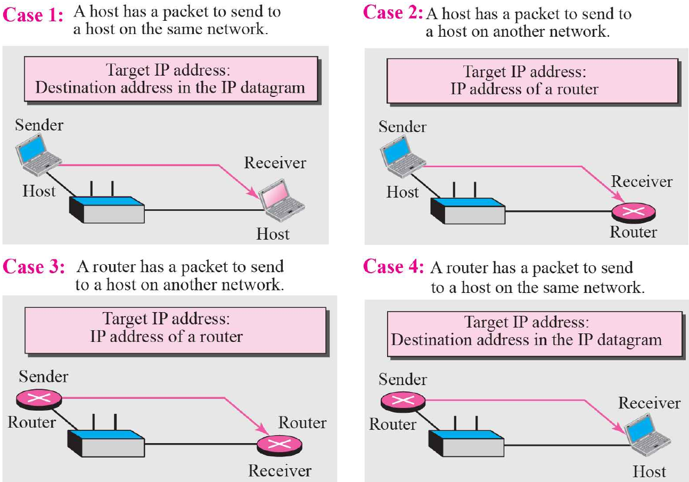

*그림 10. ARP를 쓰는 네 가지 경우*

- **경우 1:** 송신자가 호스트이고, 같은 네트워크의 다른 호스트로 패킷을 보낸다. 물리 주소로 매핑해야 할 논리 주소는 데이터그램 헤더의 목적지 IP 주소이다.
- **경우 2:** 송신자가 호스트이고, 다른 네트워크의 호스트로 패킷을 보낸다. 호스트는 포워딩 테이블에서 이 목적지로 가는 다음 홉(라우터)의 IP 주소를 찾는다. 포워딩 테이블이 없으면 기본 라우터의 IP 주소를 찾는다. 이 라우터의 IP 주소가 물리 주소로 매핑해야 할 논리 주소가 된다.
- **경우 3:** 송신자가 라우터이고, 다른 네트워크의 호스트로 가는 데이터그램을 받았다. 라우터는 포워딩 테이블에서 다음 라우터의 IP 주소를 찾으며, 이 주소가 매핑해야 할 논리 주소가 된다.
- **경우 4:** 송신자가 라우터이고, 같은 네트워크의 호스트로 가는 데이터그램을 받았다. 데이터그램의 목적지 IP 주소가 매핑해야 할 논리 주소가 된다.

| 경우 | 송신자 | 최종 목적지의 위치 | ARP의 대상 IP 주소 |
|:-----|:-----|:-----|:-----|
| 1 | 호스트 | 같은 네트워크의 호스트 | 데이터그램의 목적지 IP 주소 |
| 2 | 호스트 | 다른 네트워크의 호스트 | 다음 홉 라우터(또는 기본 라우터)의 IP 주소 |
| 3 | 라우터 | 다른 네트워크의 호스트 | 다음 라우터의 IP 주소 |
| 4 | 라우터 | 같은 네트워크의 호스트 | 데이터그램의 목적지 IP 주소 |

*표 5. 경우별 ARP의 대상 IP 주소*

> **핵심:** 최종 목적지가 다른 네트워크에 있으면 ARP는 최종 목적지가 아니라 다음 홉 라우터의 MAC 주소를 결정한다. 데이터그램의 목적지 IP 주소는 바뀌지 않는다.

---

<br>

## 7. 예제와 프레임 분석

### 7.1 요청 프레임과 응답 프레임

IP 주소가 130.23.43.20이고 물리 주소가 B2:34:55:10:22:10인 호스트 A가, 같은 이더넷에 있는 IP 주소 130.23.43.25, 물리 주소 A4:6E:F4:59:83:AB인 호스트 B에게 보낼 패킷이 있다. A는 B의 물리 주소를 모른다. 이때 이더넷 프레임에 캡슐화된 ARP 요청과 응답은 그림 11과 같다.

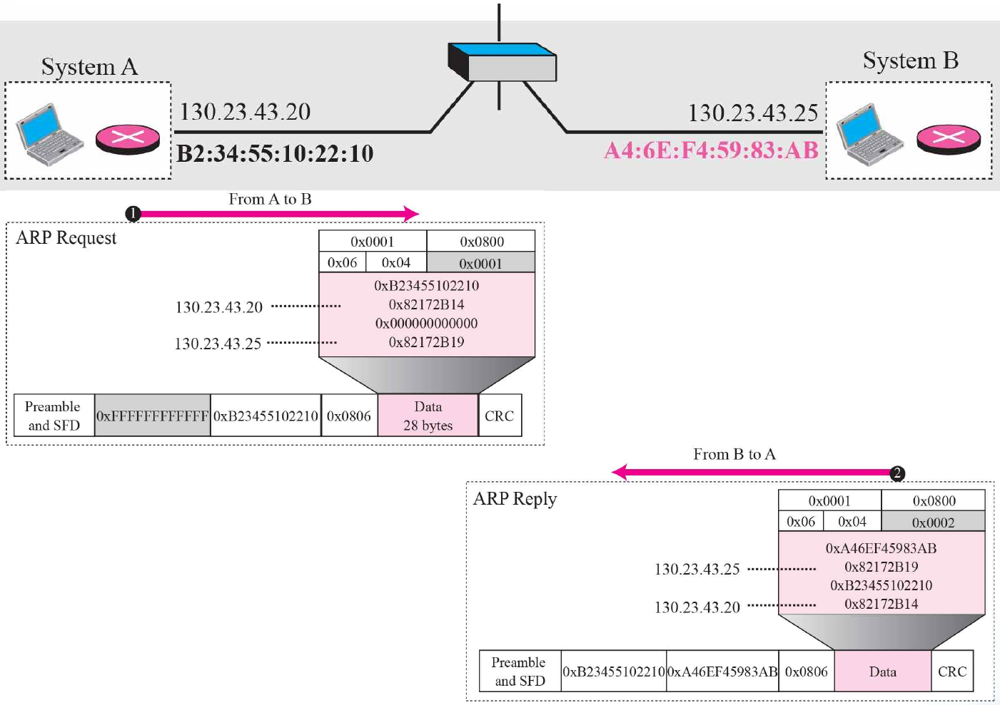

*그림 11. 호스트 A와 B가 주고받는 ARP 요청 프레임과 응답 프레임*

IP 주소는 16진수로 나타낸다. 130 = 0x82, 23 = 0x17, 43 = 0x2B, 20 = 0x14, 25 = 0x19이므로 130.23.43.20은 0x82172B14, 130.23.43.25는 0x82172B19이다.

| 필드 | ARP 요청 (A에서 B로) | ARP 응답 (B에서 A로) |
|:-----|:-----|:-----|
| 프레임의 목적지 주소 | 0xFFFFFFFFFFFF (브로드캐스트) | 0xB23455102210 (A) |
| 프레임의 출발지 주소 | 0xB23455102210 (A) | 0xA46EF45983AB (B) |
| 프레임의 Type | 0x0806 | 0x0806 |
| Hardware type, Protocol type | 0x0001, 0x0800 | 0x0001, 0x0800 |
| Hardware length, Protocol length | 0x06, 0x04 | 0x06, 0x04 |
| Operation | 0x0001 (요청) | 0x0002 (응답) |
| Sender hardware address | 0xB23455102210 | 0xA46EF45983AB |
| Sender protocol address | 0x82172B14 (130.23.43.20) | 0x82172B19 (130.23.43.25) |
| Target hardware address | 0x000000000000 | 0xB23455102210 |
| Target protocol address | 0x82172B19 (130.23.43.25) | 0x82172B14 (130.23.43.20) |

*표 6. ARP 요청 프레임과 응답 프레임의 필드 값*

ARP 데이터 필드는 28바이트이며, 6바이트인 하드웨어 주소 때문에 개별 주소가 4바이트 경계에 맞지 않는다. 그래서 그림 11은 일반적인 4바이트 경계를 지키지 않고 필드를 나타낸다. 응답에서는 B가 송신자가 되므로 Sender 필드와 Target 필드의 내용이 요청과 뒤바뀐다.

### 7.2 캡처한 ARP 프레임 읽기

LAN에서 패킷 분석기(예: Wireshark)로 프레임을 캡처하면 ARP 요청이 자주 보인다. 목록의 한 줄은 대개 다음 항목으로 이루어진다.

- **출발지(Source):** 요청을 보낸 인터페이스의 MAC 주소이다. 분석기는 MAC 주소의 앞 24비트를 제조사 이름으로 바꾸어 "제조사명_bc:26:3f"처럼 표시하기도 한다. 앞 24비트가 제조사마다 배정되기 때문이다(2.2절).
- **목적지(Destination):** Broadcast, 곧 FF:FF:FF:FF:FF:FF이다.
- **프로토콜(Protocol):** ARP이다.
- **길이(Length):** 60바이트이다. 14바이트 이더넷 헤더, 28바이트 ARP 패킷, 18바이트 패딩의 합이며, 여기에 4바이트 CRC를 더하면 최소 프레임 64바이트가 된다.
- **정보(Info):** "Who has (대상 IP 주소)? Tell (송신자 IP 주소)" 형식으로 요청의 내용을 요약한다. 대상 IP 주소의 MAC 주소를 묻고, 답은 송신자 IP 주소로 알려 달라는 뜻이다. ARP 응답은 "(IP 주소) is at (MAC 주소)" 형식으로 나타나며, 목적지가 Broadcast가 아니라 요청자의 MAC 주소이다.

서브넷의 기본 라우터(게이트웨이)는 그 서브넷의 여러 호스트로 데이터그램을 전달해야 하므로, 캡처 목록에서는 같은 라우터가 서로 다른 대상 IP 주소에 대해 브로드캐스트 요청을 잇달아 보내는 모습이 흔히 보인다. 이는 6절의 경우 4에 해당한다.

---

<br>

## 8. 서브넷 밖으로 데이터그램 보내기

같은 서브넷 안에서 ARP가 동작하는 방식은 분명하다. 이제 서브넷의 호스트가 라우터를 건너 다른 서브넷의 호스트로 데이터그램을 보내는 경우를 살펴본다. 그림 12의 네트워크는 라우터 하나로 연결된 두 서브넷으로 이루어진다.

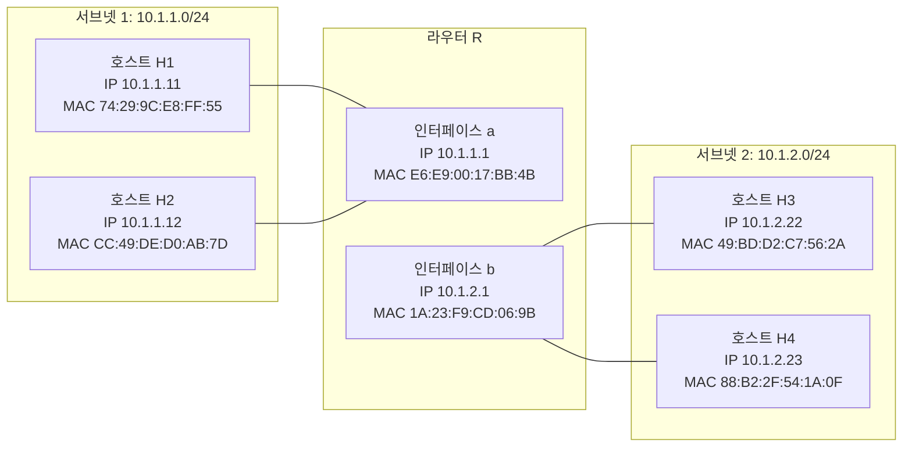

*그림 12. 라우터로 연결된 두 서브넷*

각 호스트는 IP 주소와 어댑터를 하나씩 가진다. 라우터는 인터페이스마다 IP 주소를 가지며(12장), 인터페이스마다 ARP 모듈과 어댑터도 하나씩 가진다. 그림 12의 라우터는 인터페이스가 둘이므로 IP 주소, ARP 모듈, 어댑터를 둘씩 가진다. 서브넷 1의 인터페이스는 모두 10.1.1.x 형태의 주소를, 서브넷 2의 인터페이스는 모두 10.1.2.x 형태의 주소를 가진다.

호스트 H1(10.1.1.11)이 호스트 H3(10.1.2.22)으로 IP 데이터그램을 보낸다고 하자. H1은 데이터그램을 어댑터에 넘기면서 프레임의 목적지 MAC 주소도 알려 주어야 한다. 이 주소를 H3의 어댑터 주소 49:BD:D2:C7:56:2A로 정하면 틀린다. 그 주소는 서브넷 1의 어떤 어댑터 주소와도 같지 않으므로, 서브넷 1의 어떤 어댑터도 데이터그램을 네트워크 계층으로 올리지 않고 데이터그램은 그대로 사라진다.

데이터그램이 서브넷 2의 호스트로 가려면 먼저 최종 목적지로 가는 경로의 첫 번째 홉 라우터의 인터페이스 10.1.1.1로 가야 한다. 따라서 프레임의 목적지 MAC 주소는 라우터 인터페이스 a의 MAC 주소 E6:E9:00:17:BB:4B이다. 전체 과정은 다음과 같다.

1. H1은 목적지 10.1.2.22가 자신의 서브넷 밖에 있으므로 첫 번째 홉 라우터의 인터페이스 10.1.1.1을 다음 홉으로 정한다(6절의 경우 2).
2. H1은 ARP로 10.1.1.1의 MAC 주소 E6:E9:00:17:BB:4B를 얻는다.
3. H1의 어댑터는 목적지 IP 주소가 10.1.2.22인 데이터그램을 목적지 MAC 주소가 E6:E9:00:17:BB:4B인 프레임에 담아 서브넷 1로 보낸다.
4. 라우터의 서브넷 1 쪽 어댑터는 프레임이 자신에게 온 것을 확인하고 프레임을 라우터의 네트워크 계층으로 넘긴다.
5. 라우터는 포워딩 테이블(13장)을 참조하여 데이터그램을 인터페이스 b(10.1.2.1)로 내보내야 함을 안다.
6. 인터페이스 b는 ARP로 10.1.2.22의 MAC 주소 49:BD:D2:C7:56:2A를 얻는다(경우 4).
7. 인터페이스 b의 어댑터는 데이터그램을 새 프레임에 담아 서브넷 2로 보낸다. 이번에는 프레임의 목적지 MAC 주소가 실제 최종 목적지의 MAC 주소이다.

| 구간 | 프레임의 출발지 MAC | 프레임의 목적지 MAC | 데이터그램의 출발지 IP | 데이터그램의 목적지 IP |
|:-----|:-----|:-----|:-----|:-----|
| H1에서 라우터로 (서브넷 1) | 74:29:9C:E8:FF:55 (H1) | E6:E9:00:17:BB:4B (R의 a) | 10.1.1.11 | 10.1.2.22 |
| 라우터에서 H3으로 (서브넷 2) | 1A:23:F9:CD:06:9B (R의 b) | 49:BD:D2:C7:56:2A (H3) | 10.1.1.11 | 10.1.2.22 |

*표 7. 링크마다 바뀌는 MAC 주소와 그대로인 IP 주소*

> **핵심:** MAC 주소는 링크(홉)마다 바뀌고, IP 주소는 출발지에서 목적지까지 그대로 유지된다. ARP는 각 링크에서 다음 홉의 MAC 주소를 알아내는 데 쓰인다.

---

<br>

## 9. 프록시 ARP

> **용어 정의:** **프록시 ARP(proxy ARP)** 는 라우터가 한 무리의 호스트를 대신하여 그 호스트들의 IP 주소를 찾는 ARP 요청에 자신의 하드웨어 주소로 응답하는 기법이다.

프록시 ARP는 서브넷을 나눈 효과를 만드는 데 쓰인다. 프록시 ARP를 실행하는 라우터는 자신이 대리하는 호스트들 가운데 하나의 IP 주소를 찾는 ARP 요청을 받으면, 자신의 하드웨어(물리) 주소를 알리는 ARP 응답을 보낸다. 라우터는 실제 IP 패킷을 받은 뒤 그 패킷을 알맞은 호스트나 라우터로 보낸다.

예를 들어 한 네트워크의 호스트들이 141.23.56.21, 141.23.56.22, 141.23.56.23을 같은 네트워크로 여기고 있다고 하자. 관리자가 세 호스트를 새 서브넷으로 옮기되, 전체 시스템이 서브넷 주소를 인식하도록 바꾸고 싶지 않을 수 있다. 이때 프록시 ARP를 실행하는 라우터를 두 네트워크 사이에 넣는다.

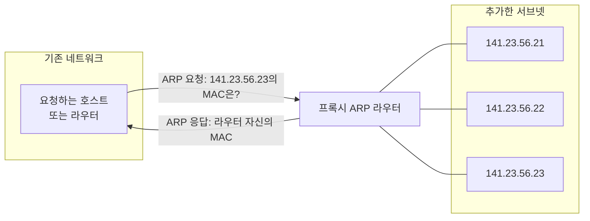

*그림 13. 프록시 ARP 라우터가 추가한 서브넷의 호스트를 대리하는 구조*

1. 기존 네트워크의 송신자가 141.23.56.23의 물리 주소를 찾는 ARP 요청을 브로드캐스트한다.
2. 라우터는 대상 IP 주소가 자신이 대리하는 주소 중 하나이므로, 자신의 하드웨어 주소를 대상 하드웨어 주소로 알리는 ARP 응답을 보낸다.
3. 송신자는 그 주소로 IP 패킷을 보내고, 라우터는 패킷을 받아 알맞은 호스트에 전달한다.

송신자는 목적지가 여전히 자기 네트워크에 있다고 여기므로, 호스트의 설정을 바꾸지 않고도 서브넷을 추가할 수 있다. 프록시 ARP를 실행하는 장치는 라우터일 수도 있고 호스트일 수도 있다.

> **주의:** 프록시 ARP의 응답은 실제 대상이 아닌 장치가 자신의 하드웨어 주소를 알리는 것이므로, 수신자는 그 응답이 정당한 대리인지 위조인지 구별하지 못한다. 13절의 ARP 스푸핑은 같은 성질을 악용한다.

---

<br>

## 10. ARP 패키지

### 10.1 구성 요소

ARP 소프트웨어를 단순화한 패키지를 예로 들어 구성 요소와 그 관계를 살펴본다. 이 패키지는 다음 다섯 가지 구성 요소로 이루어진다.

- 캐시 테이블
- 큐
- 출력 모듈
- 입력 모듈
- 캐시 제어 모듈

패키지는 목적지 물리 주소가 필요한 프레임에 캡슐화할 IP 데이터그램을 받는다. 이 주소를 찾으면 IP 패킷과 물리 주소를 데이터 링크 계층으로 넘겨 전송하게 한다.

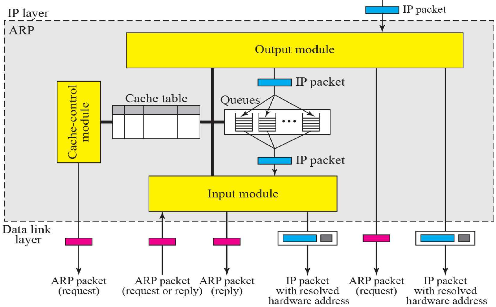

*그림 14. ARP 패키지의 구성 요소*

그림 14에서 출력 모듈은 IP 계층에서 IP 패킷을 받아, 주소가 결정되어 있으면 하드웨어 주소와 함께 데이터 링크 계층으로 내려보내고, 결정되어 있지 않으면 큐에 넣은 뒤 ARP 요청을 내보낸다. 입력 모듈은 데이터 링크 계층에서 ARP 패킷(요청 또는 응답)을 받아 캐시 테이블을 갱신하고, 큐에서 기다리던 IP 패킷을 결정된 하드웨어 주소와 함께 내보내며, 요청이면 ARP 응답을 보낸다. 캐시 제어 모듈은 주기적으로 캐시 테이블을 점검하며 필요하면 ARP 요청을 다시 보낸다.

### 10.2 캐시 테이블

송신자는 보통 같은 목적지로 IP 데이터그램을 여러 개 보내므로 데이터그램마다 ARP를 쓰는 것은 비효율적이다. 호스트나 라우터는 IP 데이터그램에 대응하는 물리 주소를 받으면 그 주소를 캐시 테이블에 저장하여 이후 몇 분 동안 같은 수신자로 가는 데이터그램에 쓴다. 캐시 테이블의 공간은 제한되어 있으므로 매핑을 무한히 보관하지는 않는다. 캐시 정보는 계속 갱신되며, 일정 시간(보통 20분) 동안 갱신되지 않은 정보는 자동으로 사라진다.

캐시 테이블은 항목의 배열로 구현되며, 각 항목은 다음 필드로 이루어진다.

| 필드 | 내용 |
|:-----|:-----|
| State | 항목의 상태: FREE, PENDING, RESOLVED |
| Hardware type, Protocol type | ARP 패킷의 같은 이름 필드와 같음 |
| Hardware length, Protocol length | ARP 패킷의 같은 이름 필드와 같음 |
| Interface number | 라우터나 다중 홈 호스트가 연결된 네트워크마다 다른 인터페이스 번호. 네트워크마다 하드웨어와 프로토콜의 종류가 다를 수 있음 |
| Queue number | 주소 결정을 기다리는 패킷을 넣어 둔 큐의 번호. 같은 목적지로 가는 패킷은 보통 같은 큐에 들어감 |
| Attempts | 이 항목에 대해 ARP 요청을 보낸 횟수 |
| Time-out | 항목의 수명(초 단위) |
| Hardware address | 목적지의 하드웨어 주소. ARP 응답으로 결정될 때까지 비어 있음 |
| Protocol address | 목적지의 IP 주소 |

*표 8. 캐시 테이블 항목의 필드*

세 가지 상태의 뜻은 다음과 같다.

- **FREE:** 이 항목의 수명이 끝났다. 이 공간은 새 항목에 쓸 수 있다.
- **PENDING:** 이 항목에 대한 요청을 보냈지만 아직 응답을 받지 못했다.
- **RESOLVED:** 항목이 완성되어 목적지의 물리(하드웨어) 주소를 가지고 있다. 이 목적지로 보내려고 기다리는 패킷은 이 항목의 정보를 쓸 수 있다.

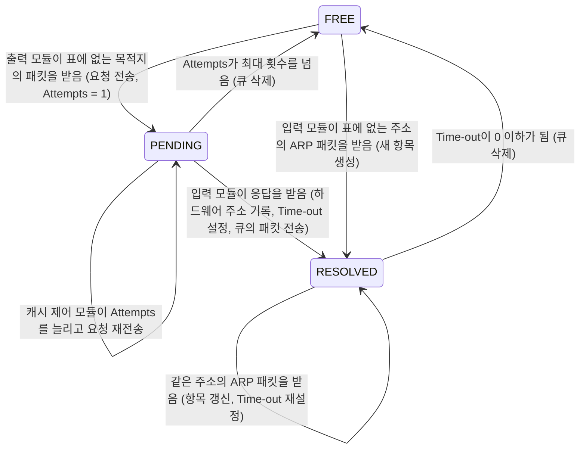

*그림 15. 캐시 테이블 항목의 상태 전이*

### 10.3 큐

ARP 패키지는 목적지마다 큐를 하나씩 두고, ARP가 하드웨어 주소를 결정하는 동안 IP 패킷을 보관한다. 출력 모듈은 주소가 결정되지 않은 패킷을 해당 큐에 넣는다. 입력 모듈은 주소가 결정되면 큐에서 패킷을 꺼내 결정된 물리 주소와 함께 데이터 링크 계층으로 보낸다.

### 10.4 출력 모듈

출력 모듈은 IP 소프트웨어에서 IP 패킷이 오기를 기다렸다가, 캐시 테이블에서 패킷의 목적지 IP 주소와 Protocol address가 일치하는 항목을 찾는다.

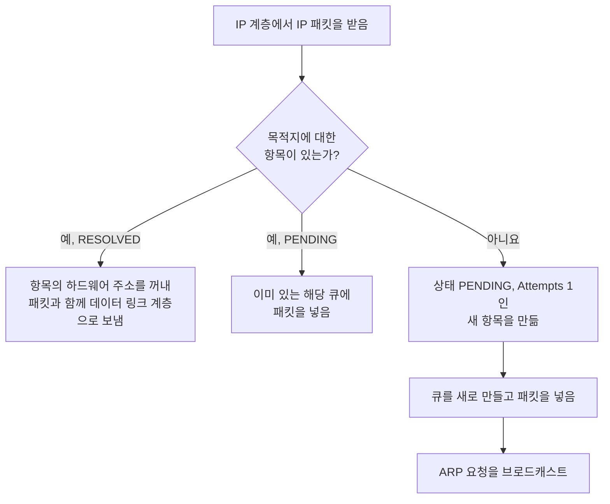

*그림 16. 출력 모듈의 동작*

- 항목이 있고 상태가 RESOLVED이면 패킷과 목적지 하드웨어 주소를 데이터 링크 계층으로 넘긴다.
- 항목이 있고 상태가 PENDING이면 이 목적지에 대한 큐가 이미 있으므로, 목적지 하드웨어 주소가 결정될 때까지 패킷을 그 큐에서 기다리게 한다.
- 항목이 없으면 큐를 만들어 패킷을 넣고, 상태가 PENDING이고 Attempts가 1인 새 항목을 만든 뒤 ARP 요청 패킷을 브로드캐스트한다.

### 10.5 입력 모듈

입력 모듈은 ARP 패킷(요청 또는 응답)이 도착하기를 기다렸다가, 캐시 테이블에서 이 ARP 패킷에 대응하는 항목을 찾는다.

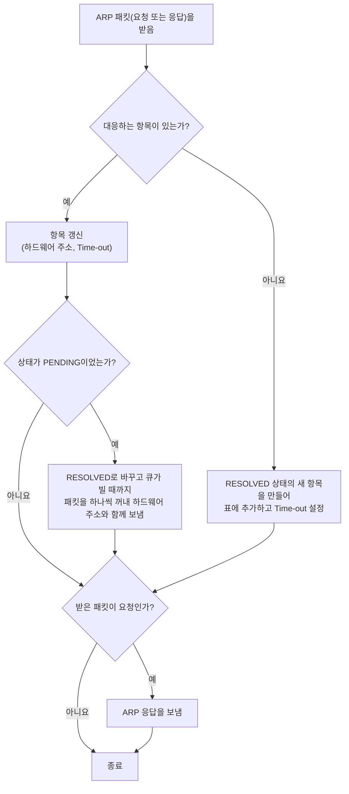

*그림 17. 입력 모듈의 동작*

- 항목이 있고 상태가 PENDING이면, 패킷의 하드웨어 주소를 항목의 하드웨어 주소 필드에 복사하고 상태를 RESOLVED로 바꾸며 Time-out 값을 설정한다. 그런 다음 해당 큐에서 패킷을 하나씩 꺼내 하드웨어 주소와 함께 데이터 링크 계층으로 보낸다.
- 항목이 있고 상태가 RESOLVED이어도 항목을 갱신한다. 대상의 하드웨어 주소가 바뀌었을 수 있기 때문이다. Time-out 값도 다시 설정한다.
- 항목이 없으면 새 항목을 만들어 표에 추가한다. 프로토콜은 받은 정보를 나중에 쓸 수 있도록 모두 표에 추가하라고 요구한다. 상태는 RESOLVED로 하고 Time-out을 설정한다.
- 마지막으로 도착한 ARP 패킷이 요청이면 곧바로 ARP 응답을 만들어 송신자에게 보낸다. 응답은 Operation 필드를 요청에서 응답으로 바꾸고 대상 하드웨어 주소를 채워 만든다.

> **참고:** 받은 ARP 패킷에서 표의 항목과 비교하는 주소는 그 패킷을 보낸 쪽의 주소이다. ARP 응답이라면 응답을 보낸 대상 시스템의 IP 주소와 하드웨어 주소가 응답 패킷의 Sender 필드에 들어 있으며, 이 값이 요청자가 결정하려던 주소이다. 요청자 쪽에서 보면 결정하려던 대상의 주소이므로 대상 프로토콜 주소, 대상 하드웨어 주소라고 부르기도 한다.

### 10.6 캐시 제어 모듈

캐시 제어 모듈은 캐시 테이블을 관리한다. 주기적으로(예를 들어 5초마다) 캐시 테이블을 항목 하나씩 점검한다.

1. 상태가 FREE이면 다음 항목으로 넘어간다.
2. 상태가 PENDING이면 Attempts 값을 1 늘린다. Attempts가 허용된 최대 시도 횟수보다 크면 상태를 FREE로 바꾸고 해당 큐를 없앤다. 최대 횟수 이하이면 ARP 요청을 다시 만들어 보낸다.
3. 상태가 RESOLVED이면 마지막 점검 이후 흐른 시간만큼 Time-out 값을 줄인다. 이 값이 0 이하가 되면 상태를 FREE로 바꾸고 해당 큐를 없앤다.

### 10.7 캐시 테이블의 변화 추적

예제가 시작될 때 캐시 테이블의 일부 필드는 표 9와 같다. 상태는 R(RESOLVED), P(PENDING), F(FREE)로 줄여 쓴다.

| State | Queue | Attempt | Time-out | Protocol addr. | Hardware addr. |
|:-----|:-----|:-----|:-----|:-----|:-----|
| R | 5 | | 900 | 180.3.6.1 | ACAE32457342 |
| P | 2 | 2 | | 129.34.4.8 | |
| P | 14 | 5 | | 201.11.56.7 | |
| R | 8 | | 450 | 114.5.7.89 | 457342ACAE32 |
| P | 12 | 1 | | 220.55.5.7 | |
| F | | | | | |
| R | 9 | | 60 | 19.1.7.82 | 4573E3242ACA |
| P | 18 | 3 | | 188.11.8.71 | |

*표 9. 예제가 시작될 때의 캐시 테이블*

**사건 1 (출력 모듈, RESOLVED 항목).** 출력 모듈이 IP 계층에서 목적지 주소가 114.5.7.89인 IP 데이터그램을 받는다. 캐시 테이블에서 이 목적지의 항목을 찾고, 상태가 RESOLVED임을 확인한다. 하드웨어 주소 457342ACAE32를 꺼내 패킷과 함께 데이터 링크 계층으로 보낸다. 캐시 테이블은 바뀌지 않는다.

**사건 2 (출력 모듈, 표에 없는 목적지, 20초 뒤).** 출력 모듈이 목적지 주소가 116.1.7.22인 IP 데이터그램을 받는다. 캐시 테이블에 이 목적지가 없으므로, 비어 있던(FREE) 자리에 상태 PENDING, Attempt 1인 항목을 추가한다. 이 목적지를 위한 새 큐(23번)를 만들어 패킷을 넣고, 이 목적지에 대한 ARP 요청을 데이터 링크 계층으로 보낸다.

| State | Queue | Attempt | Time-out | Protocol addr. | Hardware addr. |
|:-----|:-----|:-----|:-----|:-----|:-----|
| R | 5 | | 900 | 180.3.6.1 | ACAE32457342 |
| P | 2 | 2 | | 129.34.4.8 | |
| P | 14 | 5 | | 201.11.56.7 | |
| R | 8 | | 450 | 114.5.7.89 | 457342ACAE32 |
| P | 12 | 1 | | 220.55.5.7 | |
| **P** | **23** | **1** | | **116.1.7.22** | |
| R | 9 | | 60 | 19.1.7.82 | 4573E3242ACA |
| P | 18 | 3 | | 188.11.8.71 | |

*표 10. 사건 2 뒤의 캐시 테이블*

**사건 3 (입력 모듈, 응답 도착, 15초 뒤).** 입력 모듈이 결정하려던 IP 주소가 188.11.8.71인 ARP 패킷을 받는다. 표에서 이 주소를 찾아 항목의 상태를 RESOLVED로 바꾸고 Time-out 값을 900으로 설정한다. 하드웨어 주소 E34573242ACA를 항목에 넣는다. 이제 18번 큐에 접근하여 그 안의 패킷을 하나씩 모두 데이터 링크 계층으로 보낸다.

| State | Queue | Attempt | Time-out | Protocol addr. | Hardware addr. |
|:-----|:-----|:-----|:-----|:-----|:-----|
| R | 5 | | 900 | 180.3.6.1 | ACAE32457342 |
| P | 2 | 2 | | 129.34.4.8 | |
| P | 14 | 5 | | 201.11.56.7 | |
| R | 8 | | 450 | 114.5.7.89 | 457342ACAE32 |
| P | 12 | 1 | | 220.55.5.7 | |
| P | 23 | 1 | | 116.1.7.22 | |
| R | 9 | | 60 | 19.1.7.82 | 4573E3242ACA |
| **R** | 18 | | **900** | 188.11.8.71 | **E34573242ACA** |

*표 11. 사건 3 뒤의 캐시 테이블*

**사건 4 (캐시 제어 모듈, 25초 뒤).** 캐시 제어 모듈이 모든 항목을 갱신한다. 이 예제에서는 캐시 제어 모듈이 시작 시점 이후 처음 실행된다고 본다.

- RESOLVED 항목의 Time-out은 마지막 갱신 이후 흐른 시간만큼 줄어든다. 처음 세 RESOLVED 항목은 시작 시점부터 20 + 15 + 25 = 60초가 지났으므로 60씩 줄어들어 840, 390, 0이 된다. 마지막 RESOLVED 항목은 사건 3에서 설정된 뒤 25초가 지났으므로 875가 된다.
- Time-out이 0이 된 19.1.7.82 항목(끝에서 두 번째 항목)은 FREE로 바뀐다.
- 세 PENDING 항목의 Attempts 값은 1씩 늘어난다. 129.34.4.8은 3, 220.55.5.7은 2, 116.1.7.22는 2가 되어 각각 ARP 요청을 다시 보낸다.
- 201.11.56.7 항목은 Attempts가 6이 되어 최대 횟수(이 예에서는 5)를 넘으므로 상태가 FREE로 바뀌고 14번 큐가 삭제된다. 그 큐의 데이터그램은 전달할 수 없으므로 데이터그램의 출발지에 ICMP 오류 메시지를 보낸다(16장).

| State | Queue | Attempt | Time-out | Protocol addr. | Hardware addr. |
|:-----|:-----|:-----|:-----|:-----|:-----|
| R | 5 | | 840 | 180.3.6.1 | ACAE32457342 |
| P | 2 | 3 | | 129.34.4.8 | |
| **F** | | | | | |
| R | 8 | | 390 | 114.5.7.89 | 457342ACAE32 |
| P | 12 | 2 | | 220.55.5.7 | |
| P | 23 | 2 | | 116.1.7.22 | |
| **F** | | | | | |
| R | 18 | | 875 | 188.11.8.71 | E34573242ACA |

*표 12. 사건 4 뒤의 캐시 테이블*

> **참고:** **Time-out 열을 읽는 두 가지 방법.** 위의 표는 Time-out 값을 캐시 제어 모듈이 실행될 때만 고친다. 각 사건 시점의 남은 수명을 그때그때 표시하면 사건 2 뒤의 처음 세 RESOLVED 항목은 880, 430, 40이고, 사건 3 뒤에는 865, 415, 25이며, 사건 4 뒤의 결과는 표 12와 같다.

> **참고:** **ICMP 메시지의 목적지.** 교재는 사건 4에서 ICMP 메시지를 원래의 목적지로 보낸다고 쓰지만, ICMP 오류 메시지는 언제나 원래 데이터그램의 출발지로 보낸다(16장). 따라서 큐 14와 함께 버려진 데이터그램마다 그 출발지로 오류가 보고된다.

---

<br>

## 11. RARP와 그 후속 프로토콜

> **용어 정의:** **RARP(Reverse Address Resolution Protocol)** 는 자신의 물리 주소만 아는 장치가 그에 대응하는 논리(IP) 주소를 알아내기 위해 쓰던 역방향 주소 결정 프로토콜이다.

ARP가 논리 주소를 물리 주소로 바꾸는 것과 반대로, RARP는 물리 주소를 논리 주소로 바꾼다. RARP는 다른 프로토콜로 대체되어 더 이상 쓰이지 않는다. 장치가 시작할 때 자신의 IP 주소를 얻는 일은 오늘날 DHCP가 맡으며(12장), DHCP는 IP 주소와 함께 서브넷 마스크, 기본 라우터, DNS 서버 주소 같은 설정 정보도 준다.

| 특징 | ARP | RARP |
|:-----|:-----|:-----|
| 매핑 방향 | 논리 주소(IP)에서 물리 주소(MAC)로 | 물리 주소(MAC)에서 논리 주소(IP)로 |
| 쓰이는 상황 | 같은 링크의 다음 홉으로 프레임을 보낼 때 | 장치가 시작할 때 자신의 IP 주소를 얻을 때 |
| 현재 | 계속 쓰임 | 대체되어 쓰이지 않음 (주소 설정은 DHCP가 담당) |

*표 13. ARP와 RARP의 비교*

---

<br>

## 12. ARP 프로브와 ARP 알림

ARP 요청은 다른 시스템의 MAC 주소를 묻는 데만 쓰이지 않는다. 호스트는 특별한 형태의 ARP 요청으로 자신이 쓰려는 IP 주소가 이미 쓰이고 있는지 확인하고, 자신의 매핑을 링크의 다른 호스트에 알릴 수도 있다 [1].

- **ARP 프로브(ARP probe):** 링크에 브로드캐스트하는 ARP 요청으로, Sender protocol address를 모두 0으로 하고 Target protocol address에는 검사하려는 주소를 넣는다. 그 주소가 이미 다른 호스트의 것으로 밝혀질 경우에 다른 호스트들의 ARP 캐시를 잘못된 매핑으로 오염시키지 않으려고 송신자 IP 주소를 0으로 둔다.
- **ARP 알림(ARP announcement):** ARP 프로브와 같은 형태의 브로드캐스트 ARP 요청이지만, Sender protocol address와 Target protocol address에 모두 알리려는 IP 주소를 넣는다.

> **용어 정의:** **ARP 알림(ARP announcement)** 은 송신자 IP 주소와 대상 IP 주소를 모두 자신이 알리려는 IP 주소로 채워 링크에 브로드캐스트하는 ARP 요청이며, 다른 호스트들이 그 IP 주소에 대한 매핑을 갱신하게 한다.

ARP 알림은 오래전부터 **무상 ARP(gratuitous ARP)** 라고 불리던 패킷과 같다 [1]. 호스트가 IP 주소를 새로 쓰기 시작할 때 이 패킷을 보내면, 같은 링크에서 그 IP 주소에 대한 항목을 캐시에 가진 다른 호스트들이 새 MAC 주소로 매핑을 고칠 수 있다.

| 종류 | Operation | Sender protocol address | Target protocol address | 목적 |
|:-----|:-----|:-----|:-----|:-----|
| 일반 ARP 요청 | 요청 (1) | 송신자의 IP 주소 | 결정하려는 IP 주소 | 대상의 MAC 주소 얻기 |
| ARP 프로브 | 요청 (1) | 0.0.0.0 | 검사하려는 IP 주소 | 주소가 이미 쓰이는지 확인 |
| ARP 알림 | 요청 (1) | 알리려는 IP 주소 | 알리려는 IP 주소 | 다른 호스트의 캐시 갱신 |

*표 14. 일반 ARP 요청, ARP 프로브, ARP 알림의 비교*

---

<br>

## 13. ARP 보안

### 13.1 ARP 스푸핑

ARP에는 응답을 보낸 쪽이 실제로 그 IP 주소의 주인인지 확인하는 기능이 없다. 입력 모듈은 받은 정보를 표에 추가하고 기존 항목을 갱신하므로(10.5절), 악의적인 호스트가 네트워크에 위조된 ARP 패킷을 보내 다른 호스트들의 정상적인 동작을 방해할 수 있다 [1].

> **용어 정의:** **ARP 스푸핑(ARP spoofing)** 은 공격자가 다른 장치의 IP 주소에 자신의 MAC 주소를 대응시킨 위조 ARP 패킷을 보내, 피해 호스트의 ARP 캐시를 잘못된 매핑으로 바꾸는 공격이다. ARP 포이즈닝(ARP poisoning)이라고도 부른다.

같은 LAN의 공격자 M이 피해 호스트 V와 기본 게이트웨이 G 사이에 끼어드는 과정은 다음과 같다.

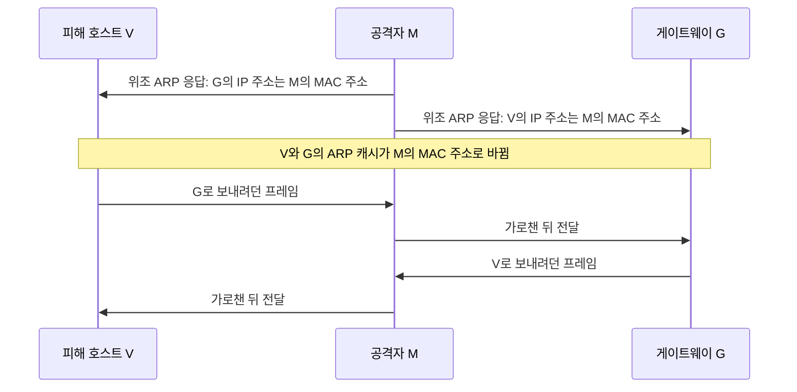

*그림 18. ARP 스푸핑을 이용한 중간자 공격*

1. M은 V에게 "G의 IP 주소에 대응하는 MAC 주소는 M의 MAC 주소"라는 위조 ARP 응답을 보내고, G에게는 "V의 IP 주소에 대응하는 MAC 주소는 M의 MAC 주소"라는 위조 응답을 보낸다.
2. V와 G는 응답을 보낸 주체를 확인하지 않고 캐시를 갱신한다.
3. 이후 V가 G로 보내는 프레임과 G가 V로 보내는 프레임은 모두 목적지 MAC 주소가 M의 주소가 되어 M에게 간다. 데이터그램의 IP 주소는 바뀌지 않으므로 V와 G는 이상을 알아채기 어렵다.
4. M은 가로챈 프레임을 읽거나 고친 뒤 원래 목적지로 전달하여 **중간자(man-in-the-middle, MITM)** 위치에 선다. 전달하지 않고 버리거나 존재하지 않는 MAC 주소를 알리면 V의 통신이 끊긴다.

이 결과 가능한 피해는 다음과 같다.

- **도청:** 공격자가 비밀번호나 인증 정보 같은 민감한 데이터를 읽는다.
- **변조:** 공격자가 가로챈 트래픽의 내용을 고쳐 전달한다.
- **서비스 거부:** 트래픽을 버리거나 존재하지 않는 MAC 주소로 보내 통신을 막는다.

> **[정보보호]** 보안의 세 가지 목표로 보면, 도청은 기밀성을, 중간자 공격에서 트래픽을 고치는 것은 무결성을, 트래픽을 버려 통신을 막는 서비스 거부는 가용성을 침해한다. 세 가지 공격이 모두 가능한 근본 원인은 ARP가 응답을 보낸 주체를 인증하지 않는다는 데 있다.

### 13.2 대응 방안

ARP 자체에는 인증이 없으므로 대응은 ARP 캐시를 바꾸지 못하게 하거나, ARP가 속더라도 상위 계층의 데이터를 보호하는 방향으로 이루어진다.

| 대응 방안 | 원리 | 한계 |
|:-----|:-----|:-----|
| 정적 ARP 항목 | 게이트웨이처럼 중요한 장치의 매핑을 정적 매핑(3.1절)으로 고정하여 위조 응답으로 바뀌지 않게 함 | 모든 호스트에 손으로 설정하고 주소가 바뀔 때마다 고쳐야 하므로 확장성이 낮음 |
| 상위 계층의 암호화와 인증 | TLS나 IPsec(26장)으로 데이터를 암호화하고 상대를 인증하여, 트래픽이 가로채져도 읽거나 고칠 수 없게 함 | 트래픽을 버려 통신을 막는 서비스 거부는 막지 못함 |

*표 15. ARP 스푸핑 대응 방안*

---

<br>

## 개념 적용

**T/F 점검:**

| 문장 | 판단과 근거 |
|:-----|:-----|
| 링크 계층 주소를 갖는 것은 호스트가 아니라 호스트의 어댑터이다. | **T.** 인터페이스가 여러 개인 호스트나 라우터는 MAC 주소도 여러 개 갖는다. |
| MAC 주소는 계층 구조이므로 호스트가 이동하면 바뀐다. | **F.** MAC 주소는 평면 구조이며 어댑터가 어디로 가도 바뀌지 않는다. 이동하면 바뀌는 것은 계층 구조인 IP 주소이다. |
| 목적지 주소 47:20:1B:2E:08:EE는 멀티캐스트 주소이다. | **T.** 첫 바이트 47의 최하위 비트가 1이다. |
| 출발지 MAC 주소는 멀티캐스트 주소일 수 있다. | **F.** 프레임은 한 스테이션에서만 나오므로 출발지 주소는 언제나 유니캐스트이다. |
| ARP 응답은 LAN의 모든 호스트에 브로드캐스트된다. | **F.** 요청은 브로드캐스트이지만 응답은 요청자에게 유니캐스트된다. |
| ARP는 인터넷 어디에 있는 호스트의 IP 주소든 MAC 주소로 바꿀 수 있다. | **F.** ARP는 같은 서브넷의 호스트와 라우터 인터페이스의 주소만 결정한다. |
| ARP 요청의 Target hardware address는 모두 0이다. | **T.** 송신자가 대상의 물리 주소를 모르기 때문이다. |
| 이더넷에서 ARP 패킷을 담은 프레임의 Type 값은 0x0800이다. | **F.** ARP는 0x0806이며, 0x0800은 ARP 패킷 안의 Protocol type 필드에 들어가는 IPv4의 값이다. |
| 호스트가 다른 서브넷의 호스트로 데이터그램을 보낼 때는 다음 홉 라우터의 IP 주소에 대해 ARP를 실행한다. | **T.** 프레임의 목적지 MAC 주소는 첫 번째 홉 라우터 인터페이스의 주소이다. |
| 라우터를 지나면 데이터그램의 목적지 IP 주소가 다음 홉의 주소로 바뀐다. | **F.** 링크마다 바뀌는 것은 프레임의 MAC 주소이고, 데이터그램의 IP 주소는 그대로이다. |
| ARP 패키지의 출력 모듈은 PENDING 항목의 목적지로 가는 패킷을 받으면 ARP 요청을 새로 보낸다. | **F.** 해당 큐에 패킷을 넣기만 한다. 요청의 재전송은 캐시 제어 모듈이 맡는다. |
| 입력 모듈은 표에 없는 주소의 ARP 패킷을 받아도 새 항목을 만든다. | **T.** 받은 정보를 나중에 쓰도록 RESOLVED 상태의 새 항목을 추가한다. |
| ARP 알림은 송신자 IP 주소를 0.0.0.0으로 채운다. | **F.** 송신자 IP 주소를 0으로 채우는 것은 ARP 프로브이고, ARP 알림은 송신자와 대상 IP 주소를 모두 알리려는 주소로 채운다. |
| ARP 스푸핑이 가능한 근본 원인은 ARP가 응답을 보낸 주체를 인증하지 않는다는 데 있다. | **T.** 호스트는 받은 응답을 확인하지 않고 캐시를 갱신한다. |

---

<br>

## 요약

| 개념 | 핵심 요약 |
|:-----|:-----|
| 두 단계의 주소 | 패킷 전달에는 유효 범위가 인터넷 전체인 논리(IP) 주소와 유효 범위가 지역 네트워크인 물리(MAC) 주소가 모두 필요하다. |
| MAC 주소 | 어댑터마다 붙는 48비트 평면 주소이며, IEEE가 앞 24비트를 제조사에 배정하고 제조사가 뒤 24비트를 정한다. |
| 주소의 종류 | 첫 바이트의 최하위 비트가 0이면 유니캐스트, 1이면 멀티캐스트이고, 모든 비트가 1이면 브로드캐스트이다. |
| 전송 순서 | 바이트는 왼쪽부터, 바이트 안의 비트는 최하위 비트부터 보내므로 유니캐스트와 멀티캐스트를 구분하는 비트가 먼저 도착한다. |
| 정적 매핑과 동적 매핑 | 정적 매핑은 표를 손으로 관리하여 변화에 약하고, 동적 매핑은 ARP 같은 프로토콜로 필요할 때 주소를 찾는다. |
| ARP | 같은 서브넷에서 IP 주소를 MAC 주소로 바꾸며, 요청은 브로드캐스트, 응답은 유니캐스트이다. |
| ARP 캐시 | 결정한 매핑을 보통 20분 동안 보관하여 데이터그램마다 ARP를 실행하지 않게 한다. |
| ARP 패킷 | 이더넷과 IPv4에서 28바이트이며, Operation은 요청 1, 응답 2이고, 요청의 대상 하드웨어 주소는 0이다. |
| 캡슐화 | ARP 패킷은 Type 0x0806인 이더넷 프레임에 직접 담기며, 패딩을 더해 최소 프레임 64바이트가 된다. |
| 네 가지 경우 | 목적지가 같은 네트워크면 목적지 IP 주소를, 다른 네트워크면 다음 홉 라우터의 IP 주소를 ARP로 결정한다. |
| 서브넷 밖으로 보내기 | 프레임의 MAC 주소는 링크마다 바뀌고 데이터그램의 IP 주소는 그대로이다. |
| 프록시 ARP | 라우터가 대리하는 호스트들의 ARP 요청에 자신의 MAC 주소로 응답하여 서브넷을 나눈 효과를 만든다. |
| ARP 패키지 | 캐시 테이블, 큐, 출력 모듈, 입력 모듈, 캐시 제어 모듈로 이루어지며, 항목은 FREE, PENDING, RESOLVED 상태를 오간다. |
| RARP | 물리 주소에서 논리 주소를 찾던 프로토콜이며, 주소 설정은 이제 DHCP가 맡는다. |
| ARP 프로브와 ARP 알림 | 프로브는 송신자 IP를 0으로 두어 주소 사용 여부를 확인하고, 알림은 송신자와 대상 IP를 모두 자신의 주소로 두어 캐시를 갱신하게 한다. |
| ARP 스푸핑 | 인증이 없는 ARP에 위조 응답을 보내 캐시를 오염시키며, 정적 항목과 상위 계층의 암호화로 대응한다. |

---

<br>

## 점검 문제

1. **ARP의 대상 IP 주소:** 호스트 A(192.168.1.10/24)가 기본 라우터 192.168.1.1을 거쳐 다른 네트워크의 호스트 B(10.0.0.5)에 IP 데이터그램을 보낸다. A가 보내는 ARP 요청의 대상 IP 주소는 무엇인가? 데이터그램을 담은 프레임의 목적지 MAC 주소와 데이터그램의 목적지 IP 주소는 각각 무엇인가?

   <details>
   <summary>정답</summary>

   목적지가 다른 네트워크에 있으므로 6절의 경우 2에 해당하며, ARP 요청의 대상 IP 주소는 기본 라우터의 192.168.1.1이다. 프레임의 목적지 MAC 주소는 ARP로 알아낸 라우터 인터페이스의 MAC 주소이고, 데이터그램의 목적지 IP 주소는 그대로 10.0.0.5이다. ARP는 다음 홉의 MAC 주소만 결정하며 IP 헤더의 목적지 주소를 바꾸지 않는다.

   </details>

2. **ARP 패킷과 프레임의 크기:** 이더넷과 IPv4에서 ARP 패킷의 크기를 구하라. 이 패킷을 담는 이더넷 프레임의 크기를 프리앰블과 SFD를 빼고 구하라. 이더넷 프레임은 목적지 주소부터 CRC까지 최소 64바이트여야 한다.

   <details>
   <summary>정답</summary>

   ARP 패킷은 Hardware type 2바이트, Protocol type 2바이트, 두 길이 필드 각 1바이트, Operation 2바이트, 송신자와 대상의 물리 주소 각 6바이트, 송신자와 대상의 IP 주소 각 4바이트로 이루어지므로 2 + 2 + 1 + 1 + 2 + 6 + 4 + 6 + 4 = 28바이트이다. 프레임 헤더(목적지 6, 출발지 6, Type 2)는 14바이트, CRC는 4바이트이므로 28바이트를 그대로 담으면 14 + 28 + 4 = 46바이트로 최소 크기보다 작다. 따라서 데이터 필드를 46바이트로 맞추도록 18바이트를 채우며, 프레임은 14 + 46 + 4 = 64바이트가 된다.

   </details>

3. **요청과 응답의 필드:** 호스트 A(IP 192.168.1.10, MAC AA:AA:AA:AA:AA:AA)가 같은 LAN의 호스트 B(IP 192.168.1.20, MAC BB:BB:BB:BB:BB:BB)의 물리 주소를 결정한다. ARP 요청과 ARP 응답 각각에 대해 Operation 값, Target hardware address, 프레임의 목적지 MAC 주소를 쓰라.

   <details>
   <summary>정답</summary>

   ARP 요청은 Operation이 1이고, Target hardware address는 아직 알 수 없으므로 00:00:00:00:00:00이며, 프레임의 목적지 MAC 주소는 브로드캐스트 주소 FF:FF:FF:FF:FF:FF이다. ARP 응답은 Operation이 2이고, B가 송신자가 되므로 Sender 필드에 B의 주소를, Target 필드에 A의 주소를 넣는다. 따라서 Target hardware address는 AA:AA:AA:AA:AA:AA이고, 프레임의 목적지 MAC 주소도 유니캐스트 주소 AA:AA:AA:AA:AA:AA이다. A는 응답의 Sender hardware address에서 BB:BB:BB:BB:BB:BB를 알아낸다.

   </details>

4. **요청은 브로드캐스트, 응답은 유니캐스트인 이유:** ARP 요청은 브로드캐스트 프레임에, ARP 응답은 일반 유니캐스트 프레임에 담기는 이유를 설명하라.

   <details>
   <summary>정답</summary>

   요청을 보내는 시점에 송신자는 대상의 MAC 주소를 모르므로, 대상이 누구든 받을 수 있도록 링크의 모든 어댑터가 받는 브로드캐스트 주소로 보낼 수밖에 없다. 응답을 보내는 대상 시스템은 요청의 Sender hardware address에서 요청자의 MAC 주소를 이미 알고 있으므로 요청자에게만 유니캐스트로 보낼 수 있다. 응답까지 브로드캐스트하면 관계없는 모든 호스트가 불필요하게 인터럽트된다.

   </details>

5. **캐시 제어 모듈의 추적:** 캐시 테이블에 다음 세 항목이 있다. (가) RESOLVED, Time-out 20, (나) PENDING, Attempts 4, (다) PENDING, Attempts 5. 최대 시도 횟수가 5이고, 캐시 제어 모듈이 마지막 점검 25초 뒤에 실행된다. 세 항목은 각각 어떻게 바뀌는가?

   <details>
   <summary>정답</summary>

   (가)는 Time-out이 20 − 25 = −5가 되어 0 이하이므로 FREE로 바뀌고 해당 큐가 없어진다. (나)는 Attempts가 5가 되어 최대 횟수를 넘지 않으므로 PENDING으로 남고 ARP 요청을 다시 보낸다. (다)는 Attempts가 6이 되어 최대 횟수를 넘으므로 FREE로 바뀌고 큐가 삭제되며, 큐에 있던 데이터그램의 출발지에 ICMP 오류 메시지를 보낸다.

   </details>

6. **ARP 요청 채우기:** IP 주소가 125.45.23.12이고 이더넷 물리 주소가 23:45:AB:4F:67:CD인 라우터가 같은 네트워크의 호스트 125.45.23.30으로 갈 데이터그램을 받았다. 라우터가 보내는 ARP 요청의 28바이트 각 필드 값을 16진수로 쓰라.

   <details>
   <summary>정답</summary>

   6절의 경우 4이므로 대상 IP 주소는 데이터그램의 목적지 125.45.23.30이다. Hardware type 0x0001, Protocol type 0x0800, Hardware length 0x06, Protocol length 0x04, Operation 0x0001이다. Sender hardware address는 0x2345AB4F67CD, Sender protocol address는 125.45.23.12 = 0x7D2D170C이다. Target hardware address는 0x000000000000, Target protocol address는 125.45.23.30 = 0x7D2D171E이다. 이 요청은 목적지 주소가 0xFFFFFFFFFFFF이고 Type이 0x0806인 프레임에 담긴다.

   </details>

7. **ARP 스푸핑의 원리와 대응:** ARP 스푸핑이 가능한 이유는 무엇인가? 피해 호스트에 게이트웨이의 정적 ARP 항목을 설정하면 왜 공격을 막을 수 있으며, 이 방법의 한계는 무엇인가?

   <details>
   <summary>정답</summary>

   ARP에는 인증 기능이 없어서, 호스트는 받은 ARP 응답이 실제 주소 소유자가 보낸 것인지 확인하지 않고 캐시를 갱신한다. 따라서 공격자가 게이트웨이의 IP 주소에 자신의 MAC 주소를 대응시킨 위조 응답을 보내면 피해 호스트의 트래픽이 공격자에게 간다. 정적 ARP 항목은 동적으로 바뀌지 않으므로 위조 응답이 와도 게이트웨이의 매핑이 유지된다. 그러나 모든 호스트에 중요한 매핑을 수동으로 설정하고 주소가 바뀔 때마다 고쳐야 하므로 확장성이 떨어진다.

   </details>

8. **ARP 프로브의 송신자 주소:** ARP 프로브가 Sender protocol address를 0.0.0.0으로 채우는 이유는 무엇인가?

   <details>
   <summary>정답</summary>

   프로브를 보내는 시점에는 그 주소가 이미 다른 호스트의 것인지 모른다. 송신자 IP 주소 필드에 검사하려는 주소를 넣으면, 프로브를 받은 다른 호스트들이 입력 모듈처럼 그 주소를 송신자의 MAC 주소로 매핑하여 캐시에 넣거나 기존 항목을 고칠 수 있다. 그 주소가 이미 다른 호스트의 것이라면 이 매핑은 잘못된 것이므로, 송신자 IP 주소를 0으로 두어 다른 호스트의 캐시를 오염시키지 않는다.

   </details>

---

<br>

## 참고 문헌

1. S. Cheshire, "IPv4 Address Conflict Detection," RFC 5227, Jul. 2008. [Online]. Available: https://www.rfc-editor.org/rfc/rfc5227
