# Chapter 19 — Link-Layer Addressing and ARP

[Repository Guide](../../README.md) | [English](Concepts_Lecture.md) | [한국어](Concepts_Lecture.ko.md)

> **Last Updated:** 2026-11-18
>
> Computer Networking: A Top-Down Approach, Kurose and Ross, Ch 6; TCP/IP Protocol Suite, Forouzan, Ch 3, 8

> **Learning Objectives:**
> 1. Explain the format and allocation of MAC addresses and distinguish unicast, multicast, and broadcast addresses
> 2. Explain why both logical and physical addresses are needed and how static mapping differs from dynamic mapping
> 3. Explain the operation, packet format, and encapsulation of ARP requests and replies, and fill in the fields of an ARP packet for given addresses
> 4. Explain the four cases in which ARP is used and how the addresses of a frame are determined when a datagram is sent off the subnet
> 5. Trace how the cache table, queues, output module, input module, and cache-control module of an ARP package change the cache table
> 6. Explain the principles of proxy ARP, ARP announcements, and ARP spoofing

---

## Table of Contents

- [1. Two Levels of Addresses](#1-two-levels-of-addresses)
  - [1.1 Logical Addresses and Physical Addresses](#11-logical-addresses-and-physical-addresses)
  - [1.2 Why Each Layer Has Its Own Addresses](#12-why-each-layer-has-its-own-addresses)
- [2. MAC Addresses](#2-mac-addresses)
  - [2.1 Format of a MAC Address](#21-format-of-a-mac-address)
  - [2.2 Allocation and Flat Structure of MAC Addresses](#22-allocation-and-flat-structure-of-mac-addresses)
  - [2.3 Unicast, Multicast, and Broadcast Addresses](#23-unicast-multicast-and-broadcast-addresses)
  - [2.4 Transmission Order of a MAC Address](#24-transmission-order-of-a-mac-address)
  - [2.5 Frame Reception at an Adapter](#25-frame-reception-at-an-adapter)
- [3. Address Mapping](#3-address-mapping)
  - [3.1 Static Mapping](#31-static-mapping)
  - [3.2 Dynamic Mapping](#32-dynamic-mapping)
- [4. Operation of ARP](#4-operation-of-arp)
  - [4.1 Position of ARP in the TCP/IP Protocol Suite](#41-position-of-arp-in-the-tcpip-protocol-suite)
  - [4.2 ARP Requests and ARP Replies](#42-arp-requests-and-arp-replies)
  - [4.3 The ARP Cache](#43-the-arp-cache)
  - [4.4 The Layer to Which ARP Belongs](#44-the-layer-to-which-arp-belongs)
- [5. ARP Packets and Encapsulation](#5-arp-packets-and-encapsulation)
  - [5.1 ARP Packet Format](#51-arp-packet-format)
  - [5.2 Encapsulation](#52-encapsulation)
  - [5.3 Seven Steps of ARP Processing](#53-seven-steps-of-arp-processing)
- [6. Four Cases in Which ARP Is Used](#6-four-cases-in-which-arp-is-used)
- [7. Examples and Frame Analysis](#7-examples-and-frame-analysis)
  - [7.1 Request and Reply Frames](#71-request-and-reply-frames)
  - [7.2 Reading Captured ARP Frames](#72-reading-captured-arp-frames)
- [8. Sending a Datagram off the Subnet](#8-sending-a-datagram-off-the-subnet)
- [9. Proxy ARP](#9-proxy-arp)
- [10. The ARP Package](#10-the-arp-package)
  - [10.1 Components](#101-components)
  - [10.2 Cache Table](#102-cache-table)
  - [10.3 Queues](#103-queues)
  - [10.4 Output Module](#104-output-module)
  - [10.5 Input Module](#105-input-module)
  - [10.6 Cache-Control Module](#106-cache-control-module)
  - [10.7 Tracing Changes in the Cache Table](#107-tracing-changes-in-the-cache-table)
- [11. RARP and Its Successors](#11-rarp-and-its-successors)
- [12. ARP Probes and ARP Announcements](#12-arp-probes-and-arp-announcements)
- [13. ARP Security](#13-arp-security)
  - [13.1 ARP Spoofing](#131-arp-spoofing)
  - [13.2 Countermeasures](#132-countermeasures)
- [Concept Applications](#concept-applications)
- [Summary](#summary)
- [Self-Check Questions](#self-check-questions)
- [References](#references)

---

<br>

## 1. Two Levels of Addresses

### 1.1 Logical Addresses and Physical Addresses

An internet is a combination of physical networks connected by internetworking devices such as routers. A packet leaving a source host passes through several physical networks before reaching the destination host. Along the way, hosts and routers are identified by two kinds of addresses.

- **Logical address:** An internetwork address that identifies hosts and routers at the network level. Its jurisdiction is the whole internet, so it must be unique universally. It is called logical because it is usually implemented in software, and in TCP/IP the 32-bit IP address is the logical address (Chapter 12).
- **Physical address:** A local address that identifies hosts and routers at the physical network level. Its jurisdiction is one local network, so it must be unique within that network but not necessarily universally. It is called physical because it is usually (but not always) implemented in hardware, and the 48-bit MAC address of Ethernet is the typical example.

The two addresses are different identifiers, and both are needed. A single physical network such as Ethernet can carry different network-layer protocols such as IP and IPX at the same time, and conversely, a single network-layer packet such as an IP packet may pass through different physical networks such as Ethernet and LocalTalk. Delivering a packet to a host or a router therefore requires **two levels of addresses, logical and physical**, and it must be possible to map a logical address to its corresponding physical address and vice versa.

### 1.2 Why Each Layer Has Its Own Addresses

Host and router interfaces have MAC addresses in addition to network-layer addresses for the following reasons.

- **Neutrality toward network-layer protocols:** LANs are designed for arbitrary network-layer protocols, not just for IP and the Internet. If adapters were assigned IP addresses instead of neutral MAC addresses, they could not easily support other network-layer protocols such as IPX or DECnet.
- **Configuration burden:** If adapters used network-layer addresses instead of MAC addresses, the address would have to be stored in the adapter RAM and reconfigured every time the adapter was moved or powered up.
- **Unnecessary interrupts:** Adapters could also have no addresses at all and pass the data of every received frame up to the network layer to check the address. The host would then be interrupted by every frame sent on the LAN, including frames destined for other hosts on the same broadcast LAN.

In short, for the layers to be independent building blocks, each layer needs its own addressing scheme. The addresses seen so far are of three kinds: host names in the application layer (Chapter 5), IP addresses in the network layer, and MAC addresses in the link layer.

---

<br>

## 2. MAC Addresses

### 2.1 Format of a MAC Address

> **Definition:** A **MAC address** is a link-layer address that identifies an adapter (network interface) attached to a LAN, and it is 6 bytes (48 bits) long in Ethernet and 802.11 wireless LANs.

Strictly speaking, it is not hosts or routers but their adapters, that is, their network interfaces, that have link-layer addresses. A host or router with several network interfaces therefore has several link-layer addresses, just as it has several IP addresses. A link-layer address is also called a **LAN address**, a **physical address**, or a **MAC address**, and these notes use the most popular name, MAC address.

> **Note:** A link-layer switch does not have MAC addresses on its interfaces that connect to hosts and routers. A switch carries datagrams between hosts and routers **transparently**, so a host or router never needs to address a frame to the intervening switch (Chapter 20).

Since an Ethernet MAC address is 6 bytes long, there are $`2^{48}`$ possible addresses. Each byte is usually written as two hexadecimal digits, with colons or hyphens between the bytes.

```text
  d1 d2 : d3 d4 : d5 d6 : d7 d8 : d9 d10 : d11 d12      (d is one hexadecimal digit)

  6 bytes = 12 hexadecimal digits = 48 bits

  Example: 4A:30:10:21:10:1A
```

*Figure 1. An Ethernet address in hexadecimal notation*

MAC addresses were designed to be permanent, but it is now possible to change an adapter's MAC address in software. This chapter assumes that an adapter's MAC address is fixed.

### 2.2 Allocation and Flat Structure of MAC Addresses

Although adapters are made by many companies in many countries, no two adapters have the same address. This is because the IEEE manages the MAC address space. A company that wants to manufacture adapters buys from the IEEE a chunk of the address space consisting of $`2^{24}`$ addresses. The IEEE allocates the chunk by fixing the first 24 bits of the MAC address, and the company creates a unique combination of the last 24 bits for each adapter.

```text
  ┌─────────────────────────┬─────────────────────────┐
  │            A            │            B            │
  └─────────────────────────┴─────────────────────────┘
  A: first 24 bits, assigned by the IEEE to the manufacturer (fixed per manufacturer)
  B: last 24 bits, set differently for each adapter by the manufacturer
```

*Figure 2. The allocation structure of a MAC address*

An adapter's MAC address has a **flat structure** and does not change no matter where the adapter goes. A laptop with an Ethernet interface or a smartphone with an 802.11 interface has the same MAC address wherever it goes. An IP address, in contrast, has a **hierarchical structure** made of a network part and a host part, so a host's IP address must change when the host changes the network to which it is attached.

| Comparison | MAC address | IP address |
|:-----|:-----|:-----|
| Layer | Link layer | Network layer |
| Length (Ethernet, IPv4) | 48 bits | 32 bits |
| Structure | Flat | Hierarchical (network part and host part) |
| When the device moves | Does not change | Changes with the attached network |
| Allocation | IEEE assigns the first 24 bits to manufacturers | Address blocks assigned to organizations (Chapter 12) |
| Analogy for a person | Like a social security number, the same for life | Like a postal address, which changes when the person moves |

*Table 1. Comparison of MAC addresses and IP addresses*

Just as it is useful for a person to have both a postal address and a social security number, it is useful for host and router interfaces to have both a network-layer address and a MAC address.

### 2.3 Unicast, Multicast, and Broadcast Addresses

A frame comes from only one station, so the source address is always a unicast address. The destination address can be one of the following three kinds.

- **Unicast address:** It defines only one recipient, and the relationship between the sender and the receiver is one-to-one.
- **Multicast address:** It defines a group of addresses, and the relationship between the sender and the receivers is one-to-many.
- **Broadcast address:** It defines all the stations on the LAN. It is the address with all 48 bits set to 1, FF:FF:FF:FF:FF:FF, a special case of the multicast address in which all bits are 1.

Unicast and multicast are distinguished by the least significant bit of the first byte. If this bit is 0, the address is unicast; if it is 1, the address is multicast.

```text
  ┌─┬─┬─┬─┬─┬─┬─┬─┐ ┌─┬─┬─┬─┬─┬─┬─┬─┐       ┌─┬─┬─┬─┬─┬─┬─┬─┐
  │ │ │ │ │ │ │ │x│ │ │ │ │ │ │ │ │ │  ...  │ │ │ │ │ │ │ │ │
  └─┴─┴─┴─┴─┴─┴─┴─┘ └─┴─┴─┴─┴─┴─┴─┴─┘       └─┴─┴─┴─┴─┴─┴─┴─┘
          1                  2                         6
                 ↑
                 x: least significant bit of the first byte (0 for unicast, 1 for multicast)
```

*Figure 3. The bit that distinguishes unicast and multicast addresses*

In hexadecimal notation, the address is unicast if the second digit from the left (the lower 4 bits of the first byte) is even, multicast if it is odd, and broadcast if all digits are F.

| Destination address | Second digit | Binary | Type |
|:-----|:-----|:-----|:-----|
| 4A:30:10:21:10:1A | A | 1010 (even) | Unicast |
| 47:20:1B:2E:08:EE | 7 | 0111 (odd) | Multicast |
| FF:FF:FF:FF:FF:FF | F | All 1s | Broadcast |

*Table 2. Determining the type of a destination address*

### 2.4 Transmission Order of a MAC Address

The order in which an address goes out on the line differs from the order in which it is written in hexadecimal. The bytes are sent left to right, but within each byte the least significant bit is sent first and the most significant bit last. The bit that defines an address as unicast or multicast therefore arrives first at the receiver.

For example, 47:20:1B:2E:08:EE is sent in the following order. The first byte 47 is 01000111 in binary, and sending it from the least significant bit gives 11100010.

```text
     47        20        1B        2E        08        EE        ← address (hex)
  01000111  00100000  00011011  00101110  00001000  11101110     ← binary
  11100010  00000100  11011000  01110100  00010000  01110111     ← transmission order (leftmost bit first)
```

*Figure 4. Transmission order of 47:20:1B:2E:08:EE on the line*

### 2.5 Frame Reception at an Adapter

When an adapter sends a frame to some destination adapter, it inserts the destination adapter's MAC address into the frame and sends the frame into the LAN. A switch, however, occasionally sends an incoming frame out on all its interfaces (Chapter 20), and 802.11 also broadcasts frames (Chapter 22). An adapter may therefore receive a frame that is not addressed to it. When an adapter receives a frame, it checks whether the destination MAC address matches its own MAC address.

- If they match, it extracts the enclosed datagram and passes it up the protocol stack.
- If they do not match, it discards the frame without passing it up to the network layer.

In this way, only the actual destination is interrupted when a frame is received. When a sending adapter wants all the other adapters on the LAN to receive and process a frame, it inserts the broadcast address FF-FF-FF-FF-FF-FF into the destination address field.

---

<br>

## 3. Address Mapping

### 3.1 Static Mapping

> **Definition:** **Static mapping** is an address-mapping method in which a table pairing logical addresses with physical addresses is stored in each machine on the network, and a machine looks up the table to obtain the physical address of another machine.

A machine that knows the IP address of another machine but not its physical address can look it up in this table. Static mapping has limitations, however, because physical addresses may change in the following ways.

1. A machine may change its NIC, which gives it a new physical address.
2. In some LANs, such as LocalTalk, the physical address changes every time the computer is turned on.
3. A mobile computer may move from one physical network to another, which changes its physical address.

To reflect such changes, the static mapping table must be updated periodically, and this overhead may affect network performance. The management burden also grows as the network grows.

### 3.2 Dynamic Mapping

> **Definition:** **Dynamic mapping** is an address-mapping method in which a machine that knows one of the two addresses (logical or physical) uses a protocol to find the other one each time it needs it.

Two protocols were designed for dynamic mapping.

- **ARP (Address Resolution Protocol):** It maps a logical address to a physical address.
- **RARP (Reverse Address Resolution Protocol):** It maps a physical address to a logical address. It has been replaced by another protocol and is no longer used, so it is covered briefly in Section 11.


*Figure 5. Dynamic mapping of a logical address to a physical address through ARP*

> **Key Point:** Dynamic mapping removes the need to maintain tables by hand. ARP automatically finds the MAC address corresponding to an IP address when it is needed.

---

<br>

## 4. Operation of ARP

> **Definition:** **ARP (Address Resolution Protocol)** is an address resolution protocol that translates the IP address of a host or router interface on the same subnet into the corresponding MAC address.

### 4.1 Position of ARP in the TCP/IP Protocol Suite

A host or router with an IP datagram to send to another host or router knows the logical (IP) address of the receiver. For the IP datagram to pass through a physical network, however, it must be encapsulated in a frame, so the sender needs the physical address of the receiver. On a typical physical network such as a LAN, each device on a link is identified by a physical or station address that is usually imprinted on the NIC. ARP accepts a logical address from IP, maps it to the corresponding physical address, and passes it to the data link layer.

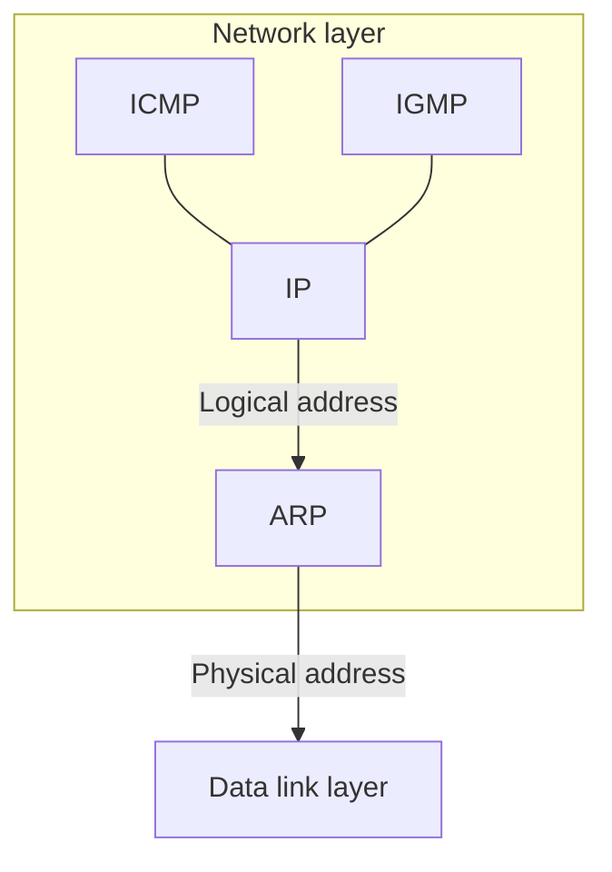

*Figure 6. Position of ARP in the TCP/IP protocol suite*

ARP resembles DNS (Chapter 5). Just as DNS translates host names into IP addresses, ARP translates IP addresses into MAC addresses. There is an important difference, however. DNS resolves the names of hosts anywhere in the Internet, whereas ARP resolves IP addresses only for hosts and router interfaces on the **same subnet**. An attempt to use ARP to resolve the IP address of a node on another continent fails.

### 4.2 ARP Requests and ARP Replies

> **Definition:** An **ARP request** is an ARP packet that carries the sender's physical and IP addresses and the IP address of the target to be resolved, and is broadcast to all hosts and routers on the link.

> **Definition:** An **ARP reply** is an ARP packet that the system owning the target IP address of an ARP request sends back to the requester by unicast, carrying its own IP and physical addresses.

Whenever a host or router needs to find the physical address of another host or router on its network, it sends an ARP query packet. Since the sender does not know the physical address of the receiver, the query is broadcast over the network. Every host and router on the network receives and processes the ARP query packet, but only the intended recipient, whose IP address is in the packet, sends back an ARP reply packet. The reply packet is unicast directly to the inquirer using the physical address contained in the query packet.

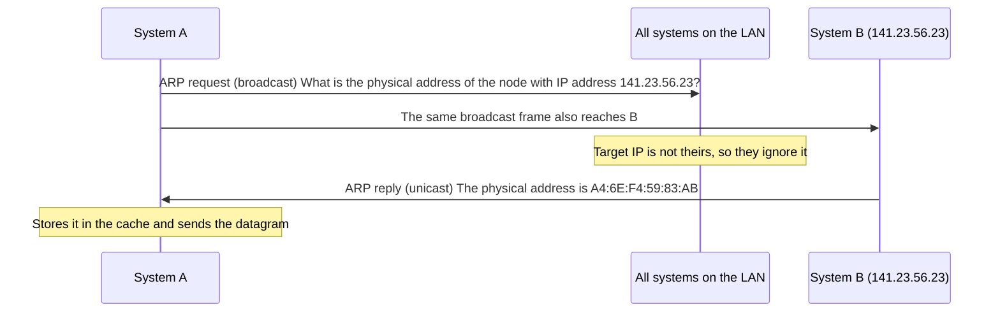

*Figure 7. Operation of an ARP request and an ARP reply*

Suppose that system A has a packet to send to system B, whose IP address is 141.23.56.23. The operation is as follows.

1. A first checks whether B's physical address is stored in its ARP cache. If it is, A uses that information.
2. If it is not in the cache, A creates an ARP request message (ARP packet) and broadcasts it to all hosts on the LAN. The destination MAC address of the frame is FF:FF:FF:FF:FF:FF.
3. B receives the ARP request broadcast by A and recognizes that the target IP address is its own. B sends A a reply message recording its own physical address.
4. A stores B's physical address in its cache and uses it. The stored information is usually kept for 20 minutes.
5. All other hosts, whose addresses do not match the target IP address, ignore the request message.

> **Key Point:** An ARP request is broadcast; an ARP reply is unicast.

The request is broadcast because the sender does not know the target's physical address. The reply can be unicast because the responder already knows the sender's physical address from the request. There is also no reason to interrupt the other hosts on the same broadcast LAN with the reply frame.

An ARP request can be compared to shouting in a crowded room of cubicles in a company, "What is the social security number of the person whose postal address is Cubicle 13, Room 112, of this company?" When one knows the postal address (IP address) but not the social security number (MAC address), one asks everyone in the room, and only the matching person answers.

### 4.3 The ARP Cache

> **Definition:** An **ARP cache** is a table of IP-to-MAC address mappings that each host and router keeps in memory, in which each entry is deleted after a set lifetime. It is also called an ARP table.

A sender usually sends several IP datagrams to the same destination. Running ARP for every datagram would be very inefficient, so a resolved mapping is stored in the cache and used for datagrams to the same receiver for some time. Each entry has a **time-to-live (TTL)** value indicating when the mapping will be deleted from the table, and a typical expiration time is 20 minutes from when the entry is placed in the table.

| IP address | MAC address | TTL (deletion time) |
|:-----|:-----|:-----|
| 10.1.2.1 | 1A:23:F9:CD:06:9B | 13:45:00 |
| 10.1.2.23 | 88:B2:2F:54:1A:0F | 13:52:00 |

*Table 3. An example ARP cache in a host*

A cache does not necessarily contain an entry for every host and router on the subnet. Some may never have been entered, and others may have expired.

Two properties of ARP are worth remembering.

- **Plug-and-play:** An ARP cache is built automatically without configuration by a system administrator.
- **Automatic cleanup:** If a host leaves the subnet, its entry is eventually deleted from the other ARP caches on the subnet.

### 4.4 The Layer to Which ARP Belongs

Whether ARP is a link-layer protocol or a network-layer protocol is a frequent question. An ARP packet is encapsulated in a link-layer frame, so architecturally it lies above the link layer. However, an ARP packet has fields containing link-layer addresses, so it can be regarded as a link-layer protocol, and it also has fields containing network-layer addresses, so it can be regarded as a network-layer protocol. In the end, ARP is best considered a protocol that straddles the boundary between the link and network layers. The TCP/IP protocol suite diagram of Figure 6 places ARP in the network layer together with IP, ICMP, and IGMP.

---

<br>

## 5. ARP Packets and Encapsulation

### 5.1 ARP Packet Format

ARP query and reply packets have the same format. They consist of several fields, including the IP and MAC addresses of the sender and the receiver.

```text
  0               8               16                              31
  ┌───────────────────────────────┬───────────────────────────────┐
  │         Hardware type         │         Protocol type         │
  ├───────────────┬───────────────┼───────────────────────────────┤
  │   Hardware    │   Protocol    │           Operation           │
  │    length     │    length     │      Request 1, Reply 2       │
  ├───────────────┴───────────────┴───────────────────────────────┤
  │                    Sender hardware address                    │
  ├───────────────────────────────────────────────────────────────┤
  │                    Sender protocol address                    │
  ├───────────────────────────────────────────────────────────────┤
  │                    Target hardware address                    │
  ├───────────────────────────────────────────────────────────────┤
  │                    Target protocol address                    │
  └───────────────────────────────────────────────────────────────┘
```

*Figure 8. ARP packet format*

The length of each address field is set by Hardware length and Protocol length; in Ethernet and IPv4 a hardware address is 6 bytes and a protocol address is 4 bytes. In a request, Target hardware address is not filled in.

| Field | Size | Description |
|:-----|:-----|:-----|
| Hardware type | 16 bits | Type of network on which ARP runs (Ethernet is 1); ARP can be used on any physical network |
| Protocol type | 16 bits | Upper protocol whose addresses are resolved (IPv4 is 0x0800); ARP can be used with any upper protocol |
| Hardware length | 8 bits | Length of the physical address in bytes (Ethernet is 6) |
| Protocol length | 8 bits | Length of the logical address in bytes (IPv4 is 4) |
| Operation | 16 bits | Type of packet: 1 for an ARP request, 2 for an ARP reply |
| Sender hardware address | Variable (6 bytes for Ethernet) | Physical address of the sender |
| Sender protocol address | Variable (4 bytes for IPv4) | Logical address of the sender |
| Target hardware address | Variable (6 bytes for Ethernet) | Physical address of the target; all 0s in a request because it is unknown |
| Target protocol address | Variable (4 bytes for IPv4) | Logical address of the target |

*Table 4. Fields of an ARP packet*

In Ethernet and IPv4, an ARP packet is 2 + 2 + 1 + 1 + 2 + 6 + 4 + 6 + 4 = 28 bytes. Because the lengths of the address fields are set by Hardware length and Protocol length, the size of an ARP packet is not fixed; it depends on the type of network and of upper protocol.

### 5.2 Encapsulation

An ARP packet is encapsulated directly in a data link frame. In an Ethernet frame, the Type field value 0x0806 indicates that the frame carries an ARP packet.

```text
  ┌──────────┬─────────────┬─────────────┬────────┬────────────────┬─────┐
  │ Preamble │ Destination │   Source    │  Type  │      Data      │ CRC │
  │ and SFD  │   address   │   address   │ 0x0806 │   ARP packet   │     │
  └──────────┴─────────────┴─────────────┴────────┴────────────────┴─────┘
       8            6             6           2                       4
```

*Figure 9. An ARP packet encapsulated in an Ethernet frame*

The numbers below Figure 9 are the sizes of the fields in bytes, and the Data field carries an ARP request or reply packet.

- The destination address of an ARP request frame is the broadcast address FF:FF:FF:FF:FF:FF, and the source address is the physical address of the sender.
- The destination address of an ARP reply frame is the physical address of the sender of the request (unicast).
- A 28-byte ARP packet is smaller than the 46-byte minimum data size of Ethernet, so 18 bytes of padding are added. A frame carrying an ARP packet is therefore 14 + 46 + 4 = 64 bytes excluding the preamble and SFD, which is the minimum Ethernet frame size (Chapter 20).

### 5.3 Seven Steps of ARP Processing

ARP processing consists of the following seven steps.

1. The sender knows the IP address of the target. How the sender determines this address is covered in Section 6.
2. IP asks ARP to create an ARP request message. The request is filled in with the sender's physical address, the sender's IP address, and the target's IP address, and the target physical address field is filled with 0s.
3. The message is passed to the data link layer, where it is encapsulated in a frame using the physical address of the sender as the source address and the physical broadcast address as the destination address.
4. Every host and router receives the frame. Because the destination address is the broadcast address, all stations remove the message and pass it to their ARP. All machines except the target drop the packet, and the target machine recognizes the IP address as its own.
5. The target machine sends back, by unicast, an ARP reply message containing its physical address.
6. The sender receives the reply message and now knows the physical address of the target machine.
7. The IP datagram carrying data for the target machine is encapsulated in a frame and unicast to the destination.

---

<br>

## 6. Four Cases in Which ARP Is Used

The **target IP address** that ARP resolves depends on whether the sender is a host or a router and on whether the final destination is on the same network.

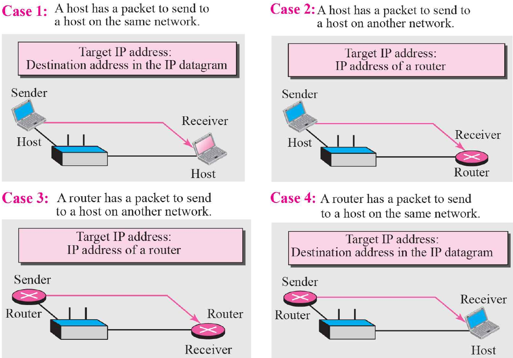

*Figure 10. Four cases in which ARP is used*

- **Case 1:** The sender is a host and sends a packet to another host on the same network. The logical address to be mapped to a physical address is the destination IP address in the datagram header.
- **Case 2:** The sender is a host and sends a packet to a host on another network. The host looks in its forwarding table for the IP address of the next hop (router) for this destination. If it has no forwarding table, it looks for the IP address of the default router. The IP address of the router becomes the logical address to be mapped to a physical address.
- **Case 3:** The sender is a router that has received a datagram destined for a host on another network. The router finds the IP address of the next router in its forwarding table, and that address becomes the logical address to be mapped.
- **Case 4:** The sender is a router that has received a datagram destined for a host on the same network. The destination IP address of the datagram becomes the logical address to be mapped.

| Case | Sender | Location of the final destination | Target IP address of ARP |
|:-----|:-----|:-----|:-----|
| 1 | Host | A host on the same network | Destination IP address of the datagram |
| 2 | Host | A host on another network | IP address of the next-hop router (or default router) |
| 3 | Router | A host on another network | IP address of the next router |
| 4 | Router | A host on the same network | Destination IP address of the datagram |

*Table 5. Target IP address of ARP in each case*

> **Key Point:** When the final destination is on another network, ARP resolves the MAC address of the next-hop router, not that of the final destination. The destination IP address of the datagram does not change.

---

<br>

## 7. Examples and Frame Analysis

### 7.1 Request and Reply Frames

Host A, with IP address 130.23.43.20 and physical address B2:34:55:10:22:10, has a packet to send to host B on the same Ethernet, with IP address 130.23.43.25 and physical address A4:6E:F4:59:83:AB. A does not know B's physical address. The ARP request and reply encapsulated in Ethernet frames are shown in Figure 11.

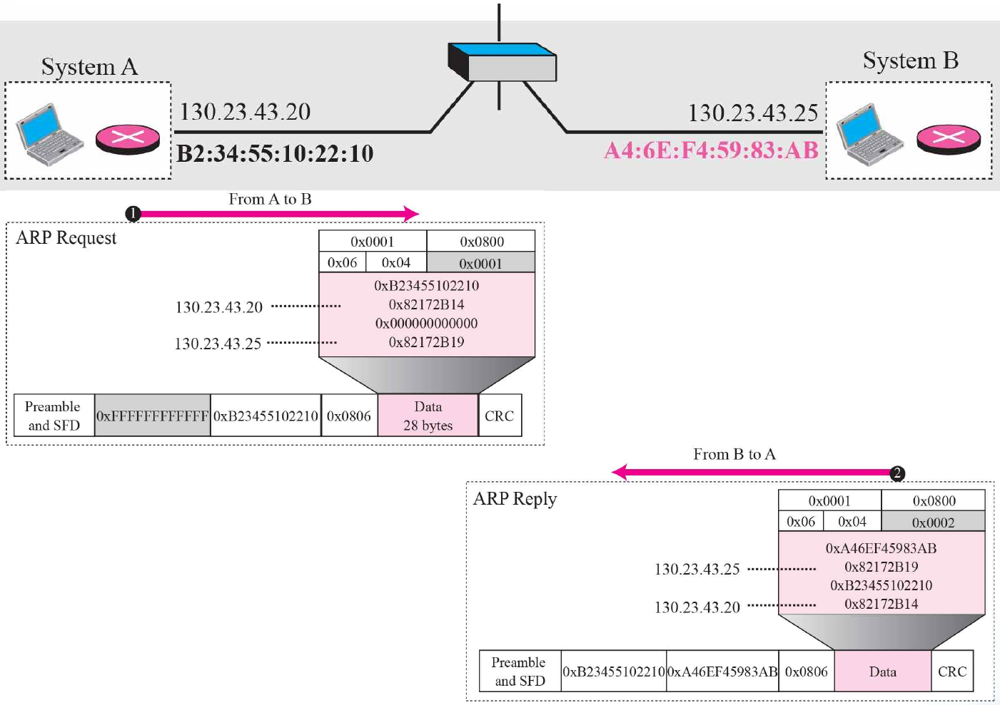

*Figure 11. ARP request and reply frames exchanged by hosts A and B*

The IP addresses are shown in hexadecimal. Since 130 = 0x82, 23 = 0x17, 43 = 0x2B, 20 = 0x14, and 25 = 0x19, 130.23.43.20 is 0x82172B14 and 130.23.43.25 is 0x82172B19.

| Field | ARP request (A to B) | ARP reply (B to A) |
|:-----|:-----|:-----|
| Destination address of the frame | 0xFFFFFFFFFFFF (broadcast) | 0xB23455102210 (A) |
| Source address of the frame | 0xB23455102210 (A) | 0xA46EF45983AB (B) |
| Type of the frame | 0x0806 | 0x0806 |
| Hardware type, Protocol type | 0x0001, 0x0800 | 0x0001, 0x0800 |
| Hardware length, Protocol length | 0x06, 0x04 | 0x06, 0x04 |
| Operation | 0x0001 (request) | 0x0002 (reply) |
| Sender hardware address | 0xB23455102210 | 0xA46EF45983AB |
| Sender protocol address | 0x82172B14 (130.23.43.20) | 0x82172B19 (130.23.43.25) |
| Target hardware address | 0x000000000000 | 0xB23455102210 |
| Target protocol address | 0x82172B19 (130.23.43.25) | 0x82172B14 (130.23.43.20) |

*Table 6. Field values of the ARP request and reply frames*

The ARP data field is 28 bytes, and because of the 6-byte hardware addresses the individual addresses do not fit the 4-byte boundary. That is why Figure 11 does not show the fields with the regular 4-byte boundaries. In the reply, B becomes the sender, so the contents of the Sender and Target fields are swapped relative to the request.

### 7.2 Reading Captured ARP Frames

When frames on a LAN are captured with a packet analyzer (for example, Wireshark), ARP requests appear frequently. One line of the listing usually consists of the following items.

- **Source:** The MAC address of the interface that sent the request. An analyzer may replace the first 24 bits of the MAC address with the manufacturer's name and display it as "Manufacturer_bc:26:3f", because the first 24 bits are assigned per manufacturer (Section 2.2).
- **Destination:** Broadcast, that is, FF:FF:FF:FF:FF:FF.
- **Protocol:** ARP.
- **Length:** 60 bytes. This is the sum of the 14-byte Ethernet header, the 28-byte ARP packet, and 18 bytes of padding, and adding the 4-byte CRC gives the minimum frame of 64 bytes.
- **Info:** It summarizes the request in the form "Who has (target IP address)? Tell (sender IP address)". It asks for the MAC address of the target IP address and requests that the answer be told to the sender IP address. An ARP reply appears instead in the form "(IP address) is at (MAC address)", and its destination is the MAC address of the requester, not Broadcast.

The default router (gateway) of a subnet must deliver datagrams to many hosts on that subnet, so a capture listing commonly shows the same router sending broadcast requests for different target IP addresses one after another. This corresponds to Case 4 of Section 6.

---

<br>

## 8. Sending a Datagram off the Subnet

How ARP works within one subnet is clear. Now consider a host on one subnet sending a datagram across a router to a host on another subnet. The network of Figure 12 consists of two subnets connected by one router.

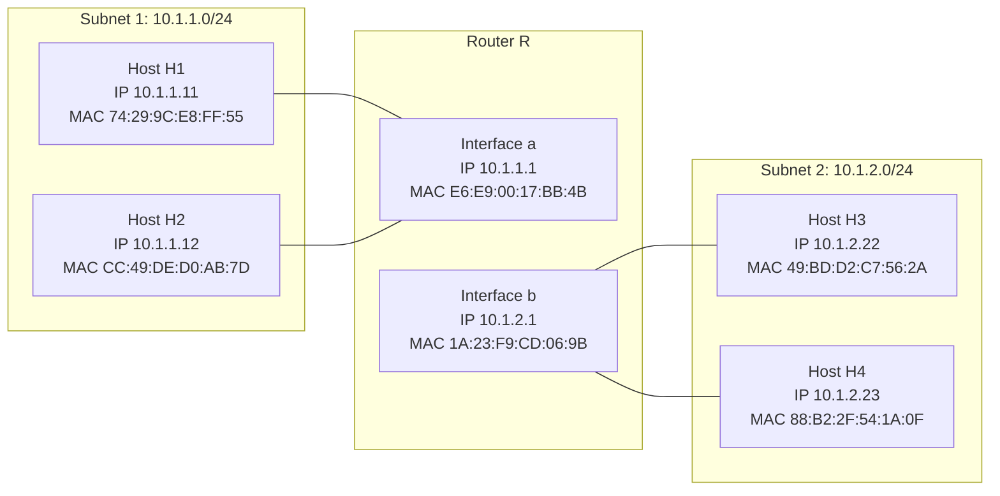

*Figure 12. Two subnets connected by a router*

Each host has one IP address and one adapter. A router has an IP address for each of its interfaces (Chapter 12), and it also has an ARP module and an adapter for each interface. The router of Figure 12 has two interfaces, so it has two IP addresses, two ARP modules, and two adapters. All interfaces on Subnet 1 have addresses of the form 10.1.1.x, and all interfaces on Subnet 2 have addresses of the form 10.1.2.x.

Suppose that host H1 (10.1.1.11) sends an IP datagram to host H3 (10.1.2.22). H1 passes the datagram to its adapter and must also tell the adapter the destination MAC address of the frame. Choosing the address of H3's adapter, 49:BD:D2:C7:56:2A, would be wrong. That address matches no adapter on Subnet 1, so no adapter on Subnet 1 would pass the datagram up to its network layer, and the datagram would simply be lost.

For the datagram to reach a host on Subnet 2, it must first go to the router interface 10.1.1.1 of the first-hop router on the path to the final destination. The destination MAC address of the frame is therefore the MAC address of router interface a, E6:E9:00:17:BB:4B. The whole process is as follows.

1. Since the destination 10.1.2.22 is off its subnet, H1 chooses the first-hop router interface 10.1.1.1 as the next hop (Case 2 of Section 6).
2. H1 obtains the MAC address E6:E9:00:17:BB:4B of 10.1.1.1 with ARP.
3. H1's adapter puts the datagram with destination IP address 10.1.2.22 into a frame with destination MAC address E6:E9:00:17:BB:4B and sends it into Subnet 1.
4. The router's adapter on Subnet 1 sees that the frame is addressed to it and passes the frame to the router's network layer.
5. The router consults its forwarding table (Chapter 13) and learns that the datagram must be sent out on interface b (10.1.2.1).
6. Interface b obtains the MAC address 49:BD:D2:C7:56:2A of 10.1.2.22 with ARP (Case 4).
7. The adapter of interface b puts the datagram into a new frame and sends it into Subnet 2. This time, the destination MAC address of the frame is indeed the MAC address of the final destination.

| Segment | Source MAC of the frame | Destination MAC of the frame | Source IP of the datagram | Destination IP of the datagram |
|:-----|:-----|:-----|:-----|:-----|
| H1 to the router (Subnet 1) | 74:29:9C:E8:FF:55 (H1) | E6:E9:00:17:BB:4B (R's a) | 10.1.1.11 | 10.1.2.22 |
| The router to H3 (Subnet 2) | 1A:23:F9:CD:06:9B (R's b) | 49:BD:D2:C7:56:2A (H3) | 10.1.1.11 | 10.1.2.22 |

*Table 7. MAC addresses change on each link while IP addresses stay the same*

> **Key Point:** MAC addresses change on every link (hop), while IP addresses stay the same from source to destination. ARP is used on each link to find the MAC address of the next hop.

---

<br>

## 9. Proxy ARP

> **Definition:** **Proxy ARP** is a technique in which a router, on behalf of a set of hosts, answers ARP requests for those hosts' IP addresses with its own hardware address.

Proxy ARP is used to create a subnetting effect. When a router running proxy ARP receives an ARP request looking for the IP address of one of the hosts it represents, it sends an ARP reply announcing its own hardware (physical) address. After the router receives the actual IP packet, it sends the packet to the appropriate host or router.

For example, suppose that the hosts of a network regard 141.23.56.21, 141.23.56.22, and 141.23.56.23 as being on the same network. An administrator may want to move these three hosts to a new subnet without changing the whole system to recognize subnetted addresses. A router running proxy ARP is then placed between the two networks.

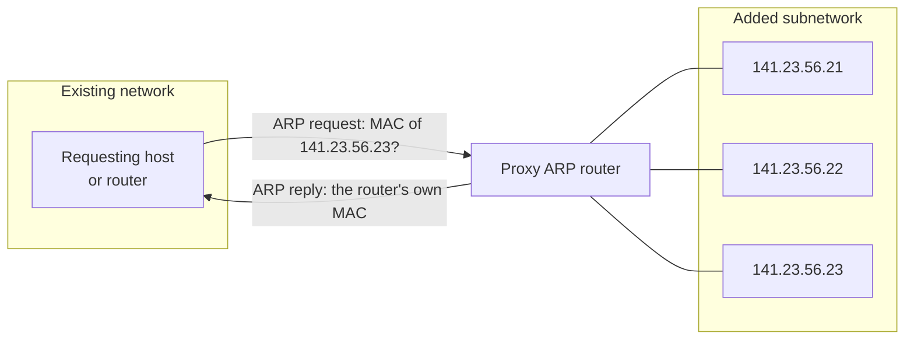

*Figure 13. A proxy ARP router representing the hosts of an added subnetwork*

1. A sender on the existing network broadcasts an ARP request looking for the physical address of 141.23.56.23.
2. Since the target IP address is one of the addresses it represents, the router sends an ARP reply that announces its own hardware address as the target hardware address.
3. The sender sends the IP packet to that address, and the router receives the packet and delivers it to the appropriate host.

The sender still believes that the destination is on its own network, so a subnet can be added without changing the configuration of the hosts. The device running proxy ARP may be a router or a host.

> **Caution:** In a proxy ARP reply, a device other than the actual target announces its own hardware address, so the receiver cannot tell whether the reply is a legitimate proxy or a forgery. ARP spoofing in Section 13 exploits the same property.

---

<br>

## 10. The ARP Package

### 10.1 Components

A simplified ARP software package is used here as an example to show the components and the relationships between them. The package consists of the following five components.

- A cache table
- Queues
- An output module
- An input module
- A cache-control module

The package receives an IP datagram that must be encapsulated in a frame needing the destination physical address. If it finds this address, it delivers the IP packet and the physical address to the data link layer for transmission.

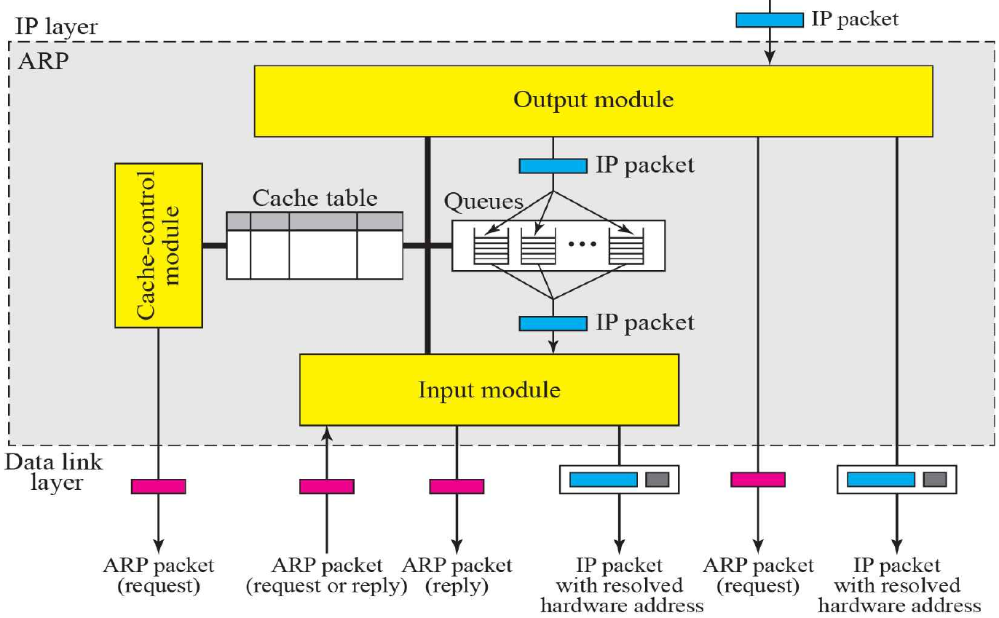

*Figure 14. Components of the ARP package*

In Figure 14, the output module receives IP packets from the IP layer; if the address is resolved, it sends the packet down to the data link layer with the hardware address, and if not, it puts the packet in a queue and sends out an ARP request. The input module receives ARP packets (requests or replies) from the data link layer, updates the cache table, sends out the IP packets waiting in a queue with the resolved hardware address, and sends an ARP reply if the packet is a request. The cache-control module checks the cache table periodically and sends ARP requests again when needed.

### 10.2 Cache Table

A sender usually sends several IP datagrams to the same destination, so using ARP for every datagram is inefficient. When a host or router receives the physical address corresponding to an IP datagram, it saves the address in the cache table and uses it for datagrams to the same receiver within the next few minutes. Since space in the cache table is limited, mappings are not retained for an unlimited time. The cache information is continually updated, and information not updated for a certain time (usually 20 minutes) disappears automatically.

The cache table is implemented as an array of entries, and each entry consists of the following fields.

| Field | Content |
|:-----|:-----|
| State | State of the entry: FREE, PENDING, or RESOLVED |
| Hardware type, Protocol type | Same as the fields of the same names in the ARP packet |
| Hardware length, Protocol length | Same as the fields of the same names in the ARP packet |
| Interface number | Interface number, different for each network to which a router or multihomed host is connected; each network can have different hardware and protocol types |
| Queue number | Number of the queue holding the packets waiting for address resolution; packets for the same destination usually go into the same queue |
| Attempts | Number of times an ARP request has been sent out for this entry |
| Time-out | Lifetime of the entry in seconds |
| Hardware address | Hardware address of the destination; empty until resolved by an ARP reply |
| Protocol address | IP address of the destination |

*Table 8. Fields of a cache table entry*

The three states mean the following.

- **FREE:** The lifetime of this entry has expired. The space can be used for a new entry.
- **PENDING:** A request for this entry has been sent, but the reply has not yet been received.
- **RESOLVED:** The entry is complete and holds the physical (hardware) address of the destination. Packets waiting to be sent to this destination can use the information in this entry.

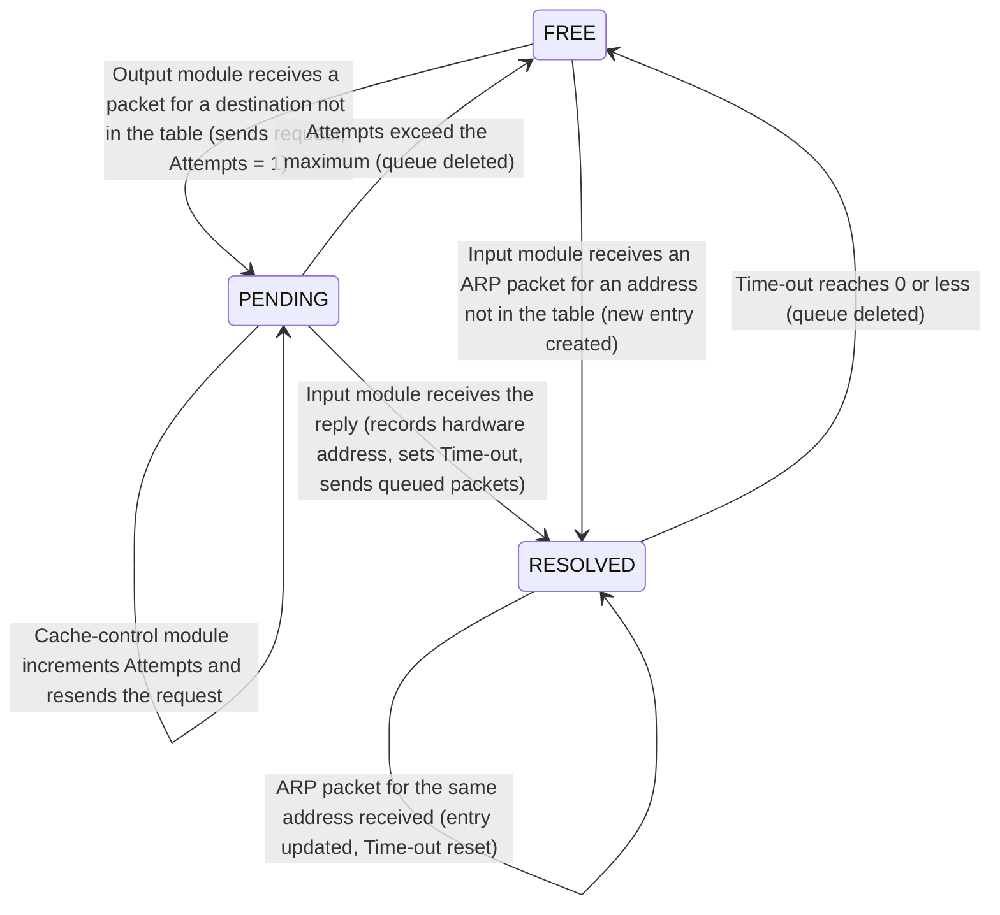

*Figure 15. State transitions of a cache table entry*

### 10.3 Queues

The ARP package maintains one queue for each destination to hold IP packets while ARP tries to resolve the hardware address. The output module sends unresolved packets into the corresponding queue. Once the address is resolved, the input module removes the packets from the queue and sends them, with the resolved physical address, to the data link layer.

### 10.4 Output Module

The output module waits for an IP packet from the IP software and then looks in the cache table for an entry whose Protocol address matches the destination IP address of the packet.

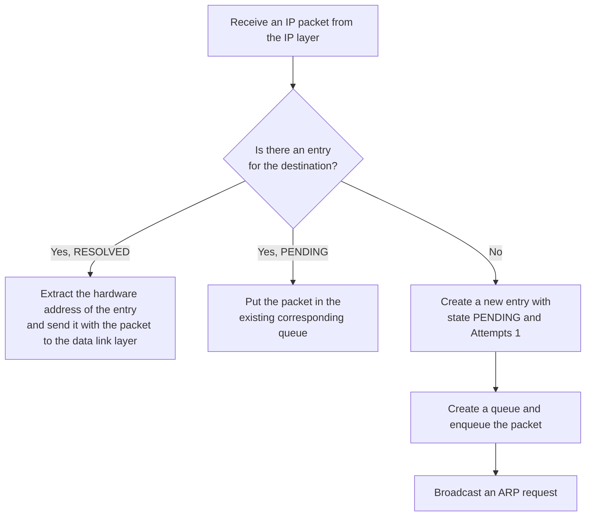

*Figure 16. Operation of the output module*

- If the entry is found and its state is RESOLVED, the packet and the destination hardware address are passed to the data link layer.
- If the entry is found and its state is PENDING, a queue already exists for this destination, so the packet waits in that queue until the destination hardware address is found.
- If no entry is found, the module creates a queue and enqueues the packet, creates a new entry with state PENDING and Attempts 1, and broadcasts an ARP request packet.

### 10.5 Input Module

The input module waits until an ARP packet (request or reply) arrives and then looks in the cache table for the entry corresponding to this ARP packet.

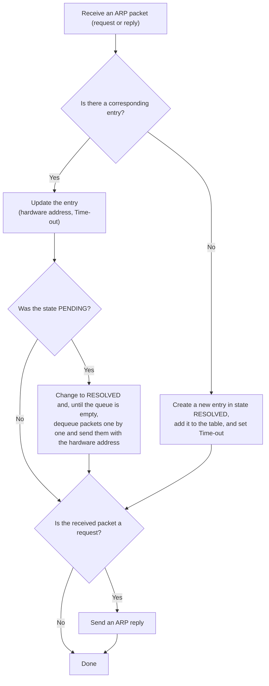

*Figure 17. Operation of the input module*

- If the entry is found and its state is PENDING, the module copies the hardware address in the packet into the hardware address field of the entry, changes the state to RESOLVED, and sets the Time-out value. It then dequeues the packets from the corresponding queue one by one and delivers them, with the hardware address, to the data link layer.
- If the entry is found and its state is RESOLVED, the module still updates the entry, because the target's hardware address could have changed. The Time-out value is also reset.
- If the entry is not found, the module creates a new entry and adds it to the table. The protocol requires that any information received be added to the table for future use. The state is set to RESOLVED and Time-out is set.
- Finally, if the arrived ARP packet is a request, the module immediately creates an ARP reply and sends it to the sender. The reply is made by changing the Operation field from request to reply and filling in the target hardware address.

> **Note:** The address compared with the table entries in a received ARP packet is the address of the side that sent that packet. In an ARP reply, the IP and hardware addresses of the target system that sent the reply are in the Sender fields of the reply packet, and these are the addresses the requester wanted to resolve. From the requester's point of view they are the addresses of the target it wanted to resolve, so they are sometimes called the target protocol address and the target hardware address.

### 10.6 Cache-Control Module

The cache-control module maintains the cache table. It checks the cache table periodically (for example, every 5 seconds), entry by entry.

1. If the state is FREE, it continues to the next entry.
2. If the state is PENDING, it increments the Attempts value by 1. If Attempts is greater than the maximum number of attempts allowed, it changes the state to FREE and destroys the corresponding queue. If it is within the maximum, it creates and sends another ARP request.
3. If the state is RESOLVED, it decrements the Time-out value by the time elapsed since the last check. If this value is less than or equal to zero, it changes the state to FREE and destroys the corresponding queue.

### 10.7 Tracing Changes in the Cache Table

At the start of the examples, some fields of the cache table are as in Table 9. The states are abbreviated R (RESOLVED), P (PENDING), and F (FREE).

| State | Queue | Attempt | Time-out | Protocol addr. | Hardware addr. |
|:-----|:-----|:-----|:-----|:-----|:-----|
| R | 5 | | 900 | 180.3.6.1 | ACAE32457342 |
| P | 2 | 2 | | 129.34.4.8 | |
| P | 14 | 5 | | 201.11.56.7 | |
| R | 8 | | 450 | 114.5.7.89 | 457342ACAE32 |
| P | 12 | 1 | | 220.55.5.7 | |
| F | | | | | |
| R | 9 | | 60 | 19.1.7.82 | 4573E3242ACA |
| P | 18 | 3 | | 188.11.8.71 | |

*Table 9. The cache table at the start of the examples*

**Event 1 (output module, RESOLVED entry).** The output module receives from the IP layer an IP datagram with destination address 114.5.7.89. It finds an entry for this destination in the cache table and sees that its state is RESOLVED. It extracts the hardware address 457342ACAE32 and sends it with the packet to the data link layer. The cache table remains the same.

**Event 2 (output module, destination not in the table, 20 seconds later).** The output module receives an IP datagram with destination address 116.1.7.22. This destination is not in the cache table, so the module adds an entry with state PENDING and Attempt 1 in the free slot. It creates a new queue (number 23) for this destination, enqueues the packet, and sends an ARP request for this destination to the data link layer.

| State | Queue | Attempt | Time-out | Protocol addr. | Hardware addr. |
|:-----|:-----|:-----|:-----|:-----|:-----|
| R | 5 | | 900 | 180.3.6.1 | ACAE32457342 |
| P | 2 | 2 | | 129.34.4.8 | |
| P | 14 | 5 | | 201.11.56.7 | |
| R | 8 | | 450 | 114.5.7.89 | 457342ACAE32 |
| P | 12 | 1 | | 220.55.5.7 | |
| **P** | **23** | **1** | | **116.1.7.22** | |
| R | 9 | | 60 | 19.1.7.82 | 4573E3242ACA |
| P | 18 | 3 | | 188.11.8.71 | |

*Table 10. The cache table after event 2*

**Event 3 (input module, reply arrives, 15 seconds later).** The input module receives an ARP packet for the IP address 188.11.8.71 that was being resolved. It finds this address in the table, changes the state of the entry to RESOLVED, and sets the Time-out value to 900. It adds the hardware address E34573242ACA to the entry. It then accesses queue 18 and sends all the packets in this queue, one by one, to the data link layer.

| State | Queue | Attempt | Time-out | Protocol addr. | Hardware addr. |
|:-----|:-----|:-----|:-----|:-----|:-----|
| R | 5 | | 900 | 180.3.6.1 | ACAE32457342 |
| P | 2 | 2 | | 129.34.4.8 | |
| P | 14 | 5 | | 201.11.56.7 | |
| R | 8 | | 450 | 114.5.7.89 | 457342ACAE32 |
| P | 12 | 1 | | 220.55.5.7 | |
| P | 23 | 1 | | 116.1.7.22 | |
| R | 9 | | 60 | 19.1.7.82 | 4573E3242ACA |
| **R** | 18 | | **900** | 188.11.8.71 | **E34573242ACA** |

*Table 11. The cache table after event 3*

**Event 4 (cache-control module, 25 seconds later).** The cache-control module updates every entry. In this example, the cache-control module is taken to run for the first time since the start.

- The Time-out of each RESOLVED entry decreases by the time elapsed since it was last updated. For the first three RESOLVED entries, 20 + 15 + 25 = 60 seconds have passed since the start, so they decrease by 60 to 840, 390, and 0. The last RESOLVED entry was set 25 seconds ago in event 3, so it becomes 875.
- The entry for 19.1.7.82 (the next-to-last entry), whose Time-out has reached 0, changes to FREE.
- The Attempts value of each of the three PENDING entries increases by 1. 129.34.4.8 becomes 3, 220.55.5.7 becomes 2, and 116.1.7.22 becomes 2, and an ARP request is sent again for each.
- The entry for 201.11.56.7 reaches Attempts 6, which exceeds the maximum (5 in this example), so its state changes to FREE and queue 14 is deleted. The datagrams in that queue cannot be delivered, so an ICMP error message is sent to the source of the datagram (Chapter 16).

| State | Queue | Attempt | Time-out | Protocol addr. | Hardware addr. |
|:-----|:-----|:-----|:-----|:-----|:-----|
| R | 5 | | 840 | 180.3.6.1 | ACAE32457342 |
| P | 2 | 3 | | 129.34.4.8 | |
| **F** | | | | | |
| R | 8 | | 390 | 114.5.7.89 | 457342ACAE32 |
| P | 12 | 2 | | 220.55.5.7 | |
| P | 23 | 2 | | 116.1.7.22 | |
| **F** | | | | | |
| R | 18 | | 875 | 188.11.8.71 | E34573242ACA |

*Table 12. The cache table after event 4*

> **Note:** **Two ways to read the Time-out column.** The tables above change the Time-out values only when the cache-control module runs. If the remaining lifetime is shown at the time of each event, the first three RESOLVED entries are 880, 430, and 40 after event 2 and 865, 415, and 25 after event 3, and the result after event 4 is the same as Table 12.

> **Note:** **Destination of the ICMP message.** The textbook says that the ICMP message in event 4 is sent to the original destination, but an ICMP error message is always sent to the source of the original datagram (Chapter 16). The datagrams discarded with queue 14 therefore cause an error report to each of their sources.

---

<br>

## 11. RARP and Its Successors

> **Definition:** **RARP (Reverse Address Resolution Protocol)** is a reverse address resolution protocol formerly used by a device that knows only its physical address to find its corresponding logical (IP) address.

Whereas ARP maps a logical address to a physical address, RARP maps a physical address to a logical address. RARP has been replaced by another protocol and is no longer used. Obtaining a device's own IP address at startup is now the job of DHCP (Chapter 12), which provides, along with the IP address, configuration information such as the subnet mask, the default router, and the address of the DNS server.

| Feature | ARP | RARP |
|:-----|:-----|:-----|
| Direction of mapping | From logical address (IP) to physical address (MAC) | From physical address (MAC) to logical address (IP) |
| When it is used | When sending a frame to the next hop on the same link | When a device obtains its own IP address at startup |
| Today | Still in use | Replaced and no longer used (address configuration done by DHCP) |

*Table 13. Comparison of ARP and RARP*

---

<br>

## 12. ARP Probes and ARP Announcements

ARP requests are not used only to ask for the MAC address of another system. With special forms of the ARP request, a host can also check whether an IP address it wants to use is already in use, and announce its own mapping to the other hosts on the link [1].

- **ARP probe:** An ARP request broadcast on the link, with Sender protocol address set to all zeros and Target protocol address set to the address being probed. The sender IP address is set to zero to avoid polluting the ARP caches of other hosts with a wrong mapping in case the address turns out to be already in use by another host.
- **ARP announcement:** A broadcast ARP request of the same form as an ARP probe, except that both Sender protocol address and Target protocol address contain the IP address being announced.

> **Definition:** An **ARP announcement** is an ARP request broadcast on the link with both the sender IP address and the target IP address set to the IP address being announced, which lets other hosts update their mappings for that IP address.

An ARP announcement is the same packet that has long been called **gratuitous ARP** [1]. When a host starts using an IP address and sends this packet, other hosts on the same link that have a cache entry for that IP address can correct the mapping to the new MAC address.

| Kind | Operation | Sender protocol address | Target protocol address | Purpose |
|:-----|:-----|:-----|:-----|:-----|
| Ordinary ARP request | Request (1) | IP address of the sender | IP address to be resolved | Obtain the target's MAC address |
| ARP probe | Request (1) | 0.0.0.0 | IP address being probed | Check whether the address is already in use |
| ARP announcement | Request (1) | IP address being announced | IP address being announced | Update other hosts' caches |

*Table 14. Comparison of an ordinary ARP request, an ARP probe, and an ARP announcement*

---

<br>

## 13. ARP Security

### 13.1 ARP Spoofing

ARP has no means of checking whether the side that sent a reply actually owns the IP address. Because the input module adds received information to the table and updates existing entries (Section 10.5), a malicious host may send fraudulent ARP packets on the network, interfering with the correct operation of other hosts [1].

> **Definition:** **ARP spoofing** is an attack in which an attacker sends forged ARP packets that map another device's IP address to the attacker's MAC address, replacing the victim host's ARP cache with a wrong mapping. It is also called ARP poisoning.

An attacker M on the same LAN inserts itself between a victim host V and the default gateway G as follows.

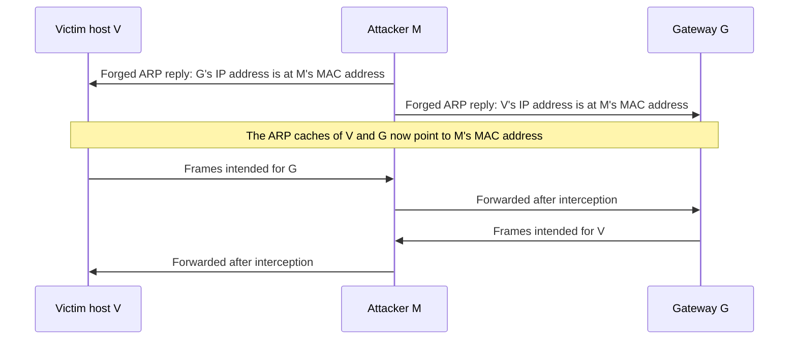

*Figure 18. A man-in-the-middle attack using ARP spoofing*

1. M sends V a forged ARP reply saying "the MAC address for G's IP address is M's MAC address," and sends G a forged reply saying "the MAC address for V's IP address is M's MAC address."
2. V and G update their caches without checking who sent the replies.
3. From then on, frames that V sends to G and frames that G sends to V all carry M's address as the destination MAC address and go to M. The IP addresses of the datagrams do not change, so V and G find it hard to notice anything wrong.
4. M reads or modifies the intercepted frames and forwards them to their original destinations, taking a **man-in-the-middle (MITM)** position. If it drops them instead of forwarding, or announces a nonexistent MAC address, V's communication is cut off.

The possible damage is as follows.

- **Eavesdropping:** The attacker reads sensitive data such as passwords and credentials.
- **Tampering:** The attacker modifies the contents of the intercepted traffic before forwarding it.
- **Denial of service:** The attacker blocks communication by dropping the traffic or sending it to a nonexistent MAC address.

> **[Information Security]** In terms of the three security goals, eavesdropping violates confidentiality, modifying traffic in a man-in-the-middle attack violates integrity, and denial of service that blocks communication by dropping traffic violates availability. The root cause that makes all three attacks possible is that ARP does not authenticate the sender of a reply.

### 13.2 Countermeasures

Since ARP itself has no authentication, countermeasures either keep the ARP cache from being changed or protect upper-layer data even when ARP is deceived.

| Countermeasure | Principle | Limitation |
|:-----|:-----|:-----|
| Static ARP entries | Fix the mappings of important devices such as the gateway by static mapping (Section 3.1) so that forged replies cannot change them | Must be configured by hand on every host and updated whenever an address changes, so scalability is low |
| Encryption and authentication in upper layers | Encrypt data and authenticate the peer with TLS or IPsec (Chapter 26) so that intercepted traffic cannot be read or modified | Cannot prevent denial of service that blocks communication by dropping traffic |

*Table 15. Countermeasures against ARP spoofing*

---

<br>

## Concept Applications

**True/False Check:**

| Statement | Judgment and Reason |
|:-----|:-----|
| It is not a host but the host's adapter that has a link-layer address. | **T.** A host or router with several interfaces also has several MAC addresses. |
| A MAC address is hierarchical, so it changes when the host moves. | **F.** A MAC address is flat and does not change wherever the adapter goes. It is the hierarchical IP address that changes when the host moves. |
| The destination address 47:20:1B:2E:08:EE is a multicast address. | **T.** The least significant bit of the first byte 47 is 1. |
| A source MAC address can be a multicast address. | **F.** A frame comes from only one station, so the source address is always unicast. |
| An ARP reply is broadcast to all hosts on the LAN. | **F.** The request is broadcast, but the reply is unicast to the requester. |
| ARP can translate the IP address of any host anywhere in the Internet into a MAC address. | **F.** ARP resolves addresses only for hosts and router interfaces on the same subnet. |
| The Target hardware address of an ARP request is all 0s. | **T.** The sender does not know the target's physical address. |
| In Ethernet, the Type value of a frame carrying an ARP packet is 0x0800. | **F.** ARP is 0x0806; 0x0800 is the IPv4 value carried in the Protocol type field inside the ARP packet. |
| When a host sends a datagram to a host on another subnet, it runs ARP for the IP address of the next-hop router. | **T.** The destination MAC address of the frame is the address of the first-hop router interface. |
| After passing a router, the destination IP address of a datagram changes to the address of the next hop. | **F.** What changes on each link is the MAC address of the frame; the IP address of the datagram stays the same. |
| When the output module of the ARP package receives a packet for the destination of a PENDING entry, it sends a new ARP request. | **F.** It only puts the packet in the corresponding queue. Retransmission of requests is the job of the cache-control module. |
| The input module creates a new entry even when it receives an ARP packet for an address not in the table. | **T.** It adds a new entry in state RESOLVED so that the information can be used later. |
| An ARP announcement sets the sender IP address to 0.0.0.0. | **F.** Setting the sender IP address to 0 is what an ARP probe does; an ARP announcement sets both the sender and target IP addresses to the address being announced. |
| The root cause that makes ARP spoofing possible is that ARP does not authenticate the sender of a reply. | **T.** A host updates its cache with a received reply without checking it. |

---

<br>

## Summary

| Concept | Key Summary |
|:-----|:-----|
| Two levels of addresses | Delivering a packet needs both a logical (IP) address whose jurisdiction is the whole internet and a physical (MAC) address whose jurisdiction is a local network. |
| MAC address | It is a 48-bit flat address attached to each adapter; the IEEE assigns the first 24 bits to manufacturers, and each manufacturer sets the last 24 bits. |
| Types of addresses | If the least significant bit of the first byte is 0 the address is unicast, if it is 1 it is multicast, and if all bits are 1 it is broadcast. |
| Transmission order | Bytes are sent from the left and the bits within a byte from the least significant bit, so the bit that distinguishes unicast and multicast arrives first. |
| Static and dynamic mapping | Static mapping maintains a table by hand and copes poorly with change, while dynamic mapping finds addresses when needed with a protocol such as ARP. |
| ARP | It translates IP addresses into MAC addresses within the same subnet; the request is broadcast and the reply is unicast. |
| ARP cache | It keeps resolved mappings, usually for 20 minutes, so that ARP need not be run for every datagram. |
| ARP packet | It is 28 bytes in Ethernet and IPv4, Operation is 1 for a request and 2 for a reply, and the target hardware address of a request is 0. |
| Encapsulation | An ARP packet is carried directly in an Ethernet frame with Type 0x0806 and is padded to the minimum frame of 64 bytes. |
| Four cases | ARP resolves the destination IP address if the destination is on the same network, and the IP address of the next-hop router otherwise. |
| Sending off the subnet | The MAC addresses of the frame change on each link, while the IP addresses of the datagram stay the same. |
| Proxy ARP | A router answers ARP requests for the hosts it represents with its own MAC address, creating a subnetting effect. |
| ARP package | It consists of a cache table, queues, an output module, an input module, and a cache-control module, and entries move among the FREE, PENDING, and RESOLVED states. |
| RARP | It was the protocol for finding a logical address from a physical address, and address configuration is now handled by DHCP. |
| ARP probes and ARP announcements | A probe sets the sender IP to 0 to check whether an address is in use, and an announcement sets both the sender and target IP to its own address so that caches are updated. |
| ARP spoofing | It sends forged replies to ARP, which has no authentication, to poison caches, and it is countered with static entries and upper-layer encryption. |

---

<br>

## Self-Check Questions

1. **Target IP address of ARP:** Host A (192.168.1.10/24) sends an IP datagram to host B (10.0.0.5) on another network through the default router 192.168.1.1. What is the target IP address of the ARP request that A sends? What are the destination MAC address of the frame carrying the datagram and the destination IP address of the datagram?

   <details>
   <summary>Answer</summary>

   Since the destination is on another network, this is Case 2 of Section 6, and the target IP address of the ARP request is the default router's 192.168.1.1. The destination MAC address of the frame is the MAC address of the router interface obtained with ARP, and the destination IP address of the datagram remains 10.0.0.5. ARP determines only the MAC address of the next hop and does not change the destination address in the IP header.

   </details>

2. **Size of the ARP packet and frame:** Find the size of an ARP packet for Ethernet and IPv4. Find the size of the Ethernet frame carrying this packet, excluding the preamble and SFD. An Ethernet frame must be at least 64 bytes from the destination address through the CRC.

   <details>
   <summary>Answer</summary>

   An ARP packet consists of a 2-byte Hardware type, a 2-byte Protocol type, two 1-byte length fields, a 2-byte Operation, 6-byte physical addresses of the sender and the target, and 4-byte IP addresses of the sender and the target, so it is 2 + 2 + 1 + 1 + 2 + 6 + 4 + 6 + 4 = 28 bytes. The frame header (destination 6, source 6, Type 2) is 14 bytes and the CRC is 4 bytes, so carrying the 28 bytes as they are gives 14 + 28 + 4 = 46 bytes, which is below the minimum size. The data field is therefore padded with 18 bytes to 46 bytes, and the frame becomes 14 + 46 + 4 = 64 bytes.

   </details>

3. **Fields of the request and reply:** Host A (IP 192.168.1.10, MAC AA:AA:AA:AA:AA:AA) resolves the physical address of host B (IP 192.168.1.20, MAC BB:BB:BB:BB:BB:BB) on the same LAN. For the ARP request and the ARP reply, give the Operation value, the Target hardware address, and the destination MAC address of the frame.

   <details>
   <summary>Answer</summary>

   The ARP request has Operation 1, its Target hardware address is 00:00:00:00:00:00 because it is not yet known, and the destination MAC address of the frame is the broadcast address FF:FF:FF:FF:FF:FF. The ARP reply has Operation 2, and since B becomes the sender, B's addresses go in the Sender fields and A's in the Target fields. Its Target hardware address is therefore AA:AA:AA:AA:AA:AA, and the destination MAC address of the frame is also the unicast address AA:AA:AA:AA:AA:AA. A learns BB:BB:BB:BB:BB:BB from the Sender hardware address of the reply.

   </details>

4. **Why the request is broadcast and the reply unicast:** Explain why an ARP request is carried in a broadcast frame and an ARP reply in an ordinary unicast frame.

   <details>
   <summary>Answer</summary>

   When the request is sent, the sender does not know the target's MAC address, so it has no choice but to send it to the broadcast address, which every adapter on the link receives, so that the target can receive it whoever it is. The target system sending the reply already knows the requester's MAC address from the Sender hardware address of the request, so it can unicast the reply to the requester alone. Broadcasting the reply as well would needlessly interrupt every unrelated host.

   </details>

5. **Tracing the cache-control module:** A cache table has the following three entries: (a) RESOLVED, Time-out 20; (b) PENDING, Attempts 4; (c) PENDING, Attempts 5. The maximum number of attempts is 5, and the cache-control module runs 25 seconds after its last check. How does each entry change?

   <details>
   <summary>Answer</summary>

   For (a), Time-out becomes 20 − 25 = −5, which is 0 or less, so it changes to FREE and its queue is destroyed. For (b), Attempts becomes 5, which does not exceed the maximum, so it stays PENDING and an ARP request is sent again. For (c), Attempts becomes 6, which exceeds the maximum, so it changes to FREE, its queue is deleted, and an ICMP error message is sent to the source of the datagrams that were in the queue.

   </details>

6. **Filling in an ARP request:** A router with IP address 125.45.23.12 and Ethernet physical address 23:45:AB:4F:67:CD has received a datagram for host 125.45.23.30 on the same network. Give the value of each field of the 28-byte ARP request that the router sends, in hexadecimal.

   <details>
   <summary>Answer</summary>

   This is Case 4 of Section 6, so the target IP address is the datagram's destination 125.45.23.30. Hardware type is 0x0001, Protocol type 0x0800, Hardware length 0x06, Protocol length 0x04, and Operation 0x0001. Sender hardware address is 0x2345AB4F67CD, and Sender protocol address is 125.45.23.12 = 0x7D2D170C. Target hardware address is 0x000000000000, and Target protocol address is 125.45.23.30 = 0x7D2D171E. This request is carried in a frame with destination address 0xFFFFFFFFFFFF and Type 0x0806.

   </details>

7. **Principle of and defense against ARP spoofing:** Why is ARP spoofing possible? Why does setting a static ARP entry for the gateway on the victim host prevent the attack, and what is the limitation of this method?

   <details>
   <summary>Answer</summary>

   ARP has no authentication, so a host updates its cache without checking whether a received ARP reply was sent by the actual owner of the address. If an attacker sends a forged reply that maps the gateway's IP address to the attacker's MAC address, the victim host's traffic goes to the attacker. A static ARP entry does not change dynamically, so the gateway's mapping is kept even when a forged reply arrives. However, important mappings must be set by hand on every host and corrected whenever an address changes, so scalability suffers.

   </details>

8. **Sender address of an ARP probe:** Why does an ARP probe set the Sender protocol address to 0.0.0.0?

   <details>
   <summary>Answer</summary>

   When the probe is sent, it is not yet known whether the address already belongs to another host. If the probe carried the address being probed in the sender IP address field, the hosts receiving it could, like the input module, map that address to the sender's MAC address in their caches or modify existing entries. If the address already belongs to another host, that mapping would be wrong, so the sender IP address is set to 0 to avoid polluting the caches of other hosts.

   </details>

---

<br>

## References

1. S. Cheshire, "IPv4 Address Conflict Detection," RFC 5227, Jul. 2008. [Online]. Available: https://www.rfc-editor.org/rfc/rfc5227
