# 20장 — 이더넷, 스위치, VLAN

[레포지토리 안내](../../README.ko.md) | [English](Concepts_Lecture.md) | [한국어](Concepts_Lecture.ko.md)

> **최종 수정일:** 2026-11-18
>
> Computer Networking: A Top-Down Approach, Kurose and Ross, Ch 6; TCP/IP Protocol Suite, Forouzan, Ch 3

> **학습 목표:**
> 1. IEEE 802 표준이 데이터 링크 계층을 LLC 부계층과 MAC 부계층으로 나누는 이유를 설명할 수 있다
> 2. 이더넷 프레임의 각 필드와 최소, 최대 길이를 설명하고 패딩을 계산할 수 있다
> 3. 표준, 고속, 기가비트, 10기가비트 이더넷의 특징과 구현을 비교할 수 있다
> 4. 리피터(허브), 브리지, 라우터를 동작 계층과 기능에 따라 구분할 수 있다
> 5. 스위치의 포워딩, 필터링, 자기 학습을 추적하고 스위치와 라우터의 장단점을 비교할 수 있다
> 6. 포트 기반 VLAN과 VLAN 트렁킹, 802.1Q 태그의 구조를 설명할 수 있다

---

## 목차

- [1. LAN과 IEEE 802 표준](#1-lan과-ieee-802-표준)
  - [1.1 근거리 통신망 (LAN)](#11-근거리-통신망-lan)
  - [1.2 IEEE 802 프로젝트와 두 부계층](#12-ieee-802-프로젝트와-두-부계층)
  - [1.3 IEEE 802 작업 그룹](#13-ieee-802-작업-그룹)
- [2. 이더넷의 위상과 토폴로지의 변화](#2-이더넷의-위상과-토폴로지의-변화)
- [3. 이더넷 프레임](#3-이더넷-프레임)
  - [3.1 프레임 형식](#31-프레임-형식)
  - [3.2 프레임의 최소 길이와 최대 길이](#32-프레임의-최소-길이와-최대-길이)
  - [3.3 비연결형 비신뢰 서비스](#33-비연결형-비신뢰-서비스)
- [4. 이더넷의 발전](#4-이더넷의-발전)
  - [4.1 네 세대와 명명 규칙](#41-네-세대와-명명-규칙)
  - [4.2 표준 이더넷](#42-표준-이더넷)
  - [4.3 고속 이더넷](#43-고속-이더넷)
  - [4.4 기가비트 이더넷](#44-기가비트-이더넷)
  - [4.5 10기가비트 이더넷](#45-10기가비트-이더넷)
  - [4.6 스위치 시대의 MAC 프로토콜](#46-스위치-시대의-mac-프로토콜)
- [5. 연결 장치](#5-연결-장치)
  - [5.1 연결 장치의 분류](#51-연결-장치의-분류)
  - [5.2 리피터와 허브](#52-리피터와-허브)
  - [5.3 브리지와 필터링](#53-브리지와-필터링)
  - [5.4 투명 브리지와 학습](#54-투명-브리지와-학습)
  - [5.5 라우터](#55-라우터)
- [6. 링크 계층 스위치](#6-링크-계층-스위치)
  - [6.1 포워딩과 필터링](#61-포워딩과-필터링)
  - [6.2 자기 학습](#62-자기-학습)
  - [6.3 스위치의 성질](#63-스위치의-성질)
  - [6.4 스위치 LAN의 도청과 스위치 포이즈닝](#64-스위치-lan의-도청과-스위치-포이즈닝)
- [7. 스위치와 라우터](#7-스위치와-라우터)
  - [7.1 패킷을 처리하는 계층](#71-패킷을-처리하는-계층)
  - [7.2 장단점 비교](#72-장단점-비교)
- [8. 가상 LAN (VLAN)](#8-가상-lan-vlan)
  - [8.1 계층적 스위치 LAN의 한계](#81-계층적-스위치-lan의-한계)
  - [8.2 포트 기반 VLAN](#82-포트-기반-vlan)
  - [8.3 VLAN 사이의 통신](#83-vlan-사이의-통신)
  - [8.4 VLAN 트렁킹과 802.1Q](#84-vlan-트렁킹과-8021q)
  - [8.5 다른 방식의 VLAN](#85-다른-방식의-vlan)
- [개념 적용](#개념-적용)
- [요약](#요약)
- [점검 문제](#점검-문제)
- [참고 문헌](#참고-문헌)

---

<br>

## 1. LAN과 IEEE 802 표준

### 1.1 근거리 통신망 (LAN)

**근거리 통신망(local area network, LAN)** 은 건물이나 캠퍼스처럼 제한된 지리적 영역을 위해 설계된 컴퓨터 네트워크이다. LAN은 조직 안의 컴퓨터를 이어 자원을 공유하기 위한 독립 네트워크로 쓸 수도 있지만, 오늘날 대부분의 LAN은 광역 통신망(WAN)이나 인터넷에도 연결되어 있다. LAN 시장에는 이더넷, 토큰 링, 토큰 버스, FDDI, ATM LAN 같은 여러 기술이 있었으나, 그중 일부만 한동안 살아남았고 오늘날에는 이더넷이 압도적으로 지배적인 기술이다.

이 장은 이더넷 LAN을 중심으로, 프레임 형식과 이더넷의 발전, LAN을 잇는 연결 장치, 링크 계층 스위치, 가상 LAN을 다룬다. 이더넷의 다중 접근 방식(CSMA/CD)과 오류 검출(CRC)은 18장, MAC 주소와 ARP는 19장에서 다룬다.

### 1.2 IEEE 802 프로젝트와 두 부계층

IEEE의 컴퓨터 학회는 1985년에 여러 제조사의 장비가 서로 통신할 수 있도록 표준을 정하는 **Project 802**를 시작했다. Project 802는 OSI 모델이나 인터넷 모델의 어떤 부분도 대체하려는 것이 아니라, 주요 LAN 프로토콜의 물리 계층과 데이터 링크 계층의 기능을 정하는 방법이다. 이 표준은 ANSI가 채택했고, 1987년에는 ISO도 ISO 8802라는 이름의 국제 표준으로 승인했다.

IEEE는 데이터 링크 계층을 두 부계층으로 나누고, LAN 프로토콜마다 물리 계층 표준도 따로 만들었다.

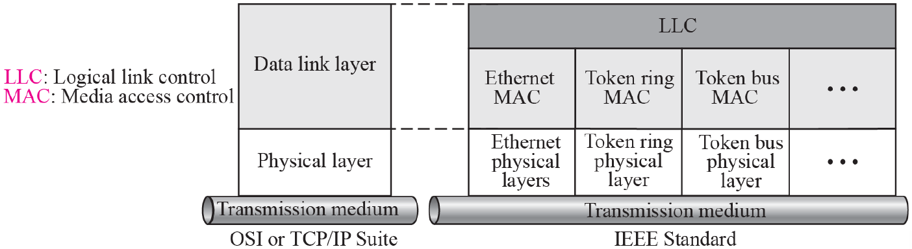

*그림 1. LAN에 대한 IEEE 표준의 계층 구조*

> **용어 정의:** **LLC 부계층(logical link control sublayer)** 은 IEEE 802 표준에서 데이터 링크 계층의 위쪽 부분으로, 모든 LAN 프로토콜이 공통으로 쓰며 네트워크 계층에 하나의 인터페이스를 제공한다.

> **용어 정의:** **MAC 부계층(media access control sublayer)** 은 IEEE 802 표준에서 데이터 링크 계층의 아래쪽 부분으로, 이더넷, 토큰 링, 토큰 버스처럼 LAN 프로토콜마다 따로 정해지며 매체 접근 방식과 프레임 형식을 정한다.

그림 1에서 OSI나 TCP/IP의 데이터 링크 계층 하나가 IEEE 표준에서는 공통의 LLC 하나와 프로토콜별 MAC(이더넷 MAC, 토큰 링 MAC, 토큰 버스 MAC 등)으로 나뉘고, 물리 계층도 프로토콜별 물리 계층으로 나뉜다. 이렇게 하면 서로 다른 MAC과 물리 계층 구현이 공통의 LLC 인터페이스를 공유하므로, 상위 계층은 아래에 어떤 LAN이 있는지 신경 쓰지 않아도 된다. 이 장에서 중요한 것은 이더넷 MAC이다.

> **핵심:** IEEE 802 표준은 데이터 링크 계층을 LAN 공통의 LLC와 LAN별 MAC으로 나누어, 다양한 LAN 기술이 같은 인터페이스로 상위 계층에 서비스를 제공하게 한다.

### 1.3 IEEE 802 작업 그룹

IEEE 802 위원회는 주제별 **작업 그룹(working group)** 으로 나뉘어 표준을 만든다. 조직도에서 각 작업 그룹은 활동 중, 휴면, 해산 같은 상태로 표시되며, 상태는 시기에 따라 바뀐다. 주요 작업 그룹의 번호와 주제는 다음과 같다.

| 작업 그룹 | 주제 | 다루는 곳 |
|:-----|:-----|:-----|
| 802.1 | 브리징과 구조 | 이 장 (브리지, VLAN의 802.1Q) |
| 802.2 | LLC | 이 장 |
| 802.3 | CSMA/CD (이더넷) | 이 장, 18장 |
| 802.4 | 토큰 버스 | 18장 (토큰 전달) |
| 802.5 | 토큰 링 | 18장 (토큰 전달) |
| 802.6 | DQDB | |
| 802.7 | 광대역 | |
| 802.8 | 광섬유 (기술 자문 그룹) | |
| 802.9 | ISLAN | |
| 802.10 | 보안 | |
| 802.11 | 무선 LAN | 22장 |
| 802.12 | 디맨드 프라이어리티 (demand priority) | |
| 802.14 | 케이블 TV | |
| 802.15 | 무선 PAN | 22장 (블루투스) |
| 802.16 | 무선 MAN | |

*표 1. IEEE 802의 주요 작업 그룹*

이 가운데 802.11, 802.15, 802.16은 무선 기술을 다루는 작업 그룹이다.

---

<br>

## 2. 이더넷의 위상과 토폴로지의 변화

> **용어 정의:** **이더넷(Ethernet)** 은 IEEE 802.3 작업 그룹이 표준화한 유선 LAN 기술로, 공통의 MAC 프로토콜과 프레임 형식 위에 여러 속도와 물리 매체의 물리 계층을 정의한다.

이더넷은 유선 LAN 시장을 사실상 차지했다. 1980년대와 1990년대 초에는 토큰 링, FDDI, ATM 같은 기술이 도전했고 일부는 몇 년 동안 시장의 일부를 차지했지만, 1970년대 중반에 발명된 이더넷은 계속 발전하며 지배적인 위치를 지켰다. 인터넷이 전 세계 네트워킹에서 차지하는 위치를 이더넷은 근거리 네트워킹에서 차지한다고 할 수 있다. 이더넷이 성공한 이유는 다음과 같다.

- 이더넷은 처음으로 널리 보급된 고속 LAN이었다. 일찍 보급되었으므로 네트워크 관리자들이 이더넷에 익숙해졌고, 다른 기술이 나와도 바꾸기를 꺼렸다.
- 토큰 링, FDDI, ATM은 이더넷보다 복잡하고 비쌌다.
- 다른 LAN 기술로 바꾸려는 가장 큰 이유는 대개 더 높은 전송 속도였지만, 이더넷은 언제나 같거나 더 높은 속도의 버전을 내놓았다. 1990년대 초에는 스위치 이더넷도 등장하여 실효 전송 속도를 더 높였다.
- 이더넷이 널리 쓰이면서 어댑터와 스위치 같은 이더넷 하드웨어가 범용 제품이 되어 매우 싸졌다.

최초의 이더넷 LAN은 1970년대 중반 Bob Metcalfe와 David Boggs가 발명했으며, 동축 케이블 버스로 노드들을 연결했다. 이더넷의 토폴로지는 다음처럼 바뀌어 왔다.

| 시기 | 토폴로지 | 중심 장치 | 성질 |
|:-----|:-----|:-----|:-----|
| 1980년대 ~ 1990년대 중반 | 버스 | 동축 케이블 | 브로드캐스트 LAN. 보낸 모든 프레임이 버스의 모든 어댑터에 가며, CSMA/CD로 충돌을 처리 |
| 1990년대 후반 | 허브 중심의 스타 | 허브 | 여전히 브로드캐스트 LAN. 허브는 비트를 재생하여 다른 모든 인터페이스로 내보내므로 두 인터페이스에서 동시에 프레임이 오면 충돌 |
| 2000년대 초 이후 | 스위치 중심의 스타 | 스위치 | 충돌이 없는 저장 후 전달 패킷 스위치. 라우터와 달리 2계층까지만 처리 |

*표 2. 이더넷 토폴로지의 변화*

**허브(hub)** 는 프레임이 아니라 개별 비트에 작용하는 물리 계층 장치이다. 한 인터페이스로 0이나 1을 나타내는 비트가 들어오면 허브는 그 비트를 다시 만들어 에너지 세기를 키운 뒤 다른 모든 인터페이스로 내보낸다.

> **참고:** **Metcalfe와 이더넷.** Metcalfe는 박사 과정 중 ARPAnet 연구에 참여하면서 Abramson의 ALOHA와 랜덤 접근 프로토콜(18장)을 접했고, 하와이 대학에 머물며 ALOHAnet을 직접 보았다. 이후 Xerox PARC에서 Boggs와 함께 이더넷을 발명했다. 최초의 이더넷은 2.94 Mbps로 동작했고 최대 1마일 거리에 있는 호스트를 256대까지 연결했다. 이후 Xerox, Digital, Intel의 협력으로 10 Mbps 이더넷 표준이 만들어져 IEEE의 승인을 받았다.

---

<br>

## 3. 이더넷 프레임

### 3.1 프레임 형식

이더넷 LAN에서 보내는 패킷을 **프레임(frame)** 이라고 한다. 같은 이더넷 LAN의 어댑터 A(MAC 주소 AA-AA-AA-AA-AA-AA)가 어댑터 B(MAC 주소 BB-BB-BB-BB-BB-BB)로 IP 데이터그램을 보낸다고 하자. A는 데이터그램을 이더넷 프레임에 캡슐화하여 물리 계층으로 넘기고, B는 물리 계층에서 프레임을 받아 IP 데이터그램을 꺼내 네트워크 계층으로 넘긴다. 이더넷 프레임은 IP 데이터그램 말고 다른 네트워크 계층 패킷도 운반할 수 있다.

```text
  ┌──────────┬─────┬─────────────┬─────────────┬─────────┬──────────────────┬─────┐
  │ Preamble │ SFD │ Destination │   Source    │ Length  │  Data and        │ CRC │
  │          │     │   address   │   address   │ or type │  padding         │     │
  └──────────┴─────┴─────────────┴─────────────┴─────────┴──────────────────┴─────┘
       7        1         6             6            2         46-1500          4
  ◄─────────────►◄────────────────────────────────────────────────────────────────►
       (a)                                    (b)
```

*그림 2. 이더넷 프레임의 형식*

그림 2의 아래 숫자는 각 필드의 크기(바이트)이다. (a)의 프리앰블과 SFD는 물리 계층이 덧붙이는 물리 계층 헤더이며, (b)의 목적지 주소부터 CRC까지가 실제 프레임이다.

> **용어 정의:** **프리앰블(preamble)** 은 이더넷 프레임 앞에 붙는 1과 0이 교대로 반복되는 비트 패턴으로, 수신 어댑터에 프레임이 오고 있음을 알리고 송신자의 클록에 동기를 맞추게 한다.

| 필드 | 크기 | 내용 |
|:-----|:-----|:-----|
| 프리앰블 (Preamble) | 7바이트 | 1과 0이 교대하는 56비트(10101010이 7번). 수신 측에 프레임의 도착을 알리고 입력 타이밍을 맞추게 함. 앞쪽 몇 비트를 놓쳐도 되도록 길게 둠. 물리 계층에서 덧붙이며 형식상 프레임의 일부가 아님 |
| 시작 프레임 구분자 (SFD) | 1바이트 | 10101011. 프레임의 시작을 알리며, 동기를 맞출 마지막 기회임을 알림. 마지막 두 비트 11은 다음 필드가 목적지 주소임을 알림. 물리 계층에서 덧붙임 |
| 목적지 주소 (DA) | 6바이트 | 프레임을 받을 다음 스테이션(들)의 물리 주소 |
| 출발지 주소 (SA) | 6바이트 | 프레임을 보내는 이전 스테이션의 물리 주소 |
| 길이 또는 유형 | 2바이트 | 원래의 이더넷은 상위 계층 프로토콜을 나타내는 유형 필드로, IEEE 표준은 데이터 필드의 바이트 수를 나타내는 길이 필드로 썼으며, 두 용도 모두 쓰임 |
| 데이터와 패딩 | 46\~1500바이트 | 상위 계층에서 받은 데이터 |
| CRC | 4바이트 | 오류 검출 정보(CRC-32, 18장) |

*표 3. 이더넷 프레임의 필드*

각 필드의 역할을 조금 더 살펴본다.

- **데이터 필드(46\~1500바이트):** IP 데이터그램을 운반한다. 이더넷의 **최대 전송 단위(maximum transmission unit, MTU)** 는 1500바이트이므로, 1500바이트보다 큰 IP 데이터그램은 IP 계층에서 단편화되며, 송신 호스트나 출력 링크의 MTU가 이처럼 작은 라우터가 단편화한다(11장). 데이터 필드의 최소 크기는 46바이트이므로, IP 데이터그램이 46바이트보다 작으면 데이터 필드를 46바이트로 채운다(**패딩, padding**). 이때 네트워크 계층에 넘겨지는 데이터에는 IP 데이터그램과 함께 패딩도 들어 있으며, 네트워크 계층은 IP 헤더의 길이 필드를 보고 패딩을 제거한다.
- **목적지 주소(6바이트):** 목적지 어댑터의 MAC 주소이다. 어댑터 B는 목적지 주소가 자신의 주소 BB-BB-BB-BB-BB-BB이거나 MAC 브로드캐스트 주소인 프레임을 받으면 데이터 필드의 내용을 네트워크 계층으로 넘기고, 다른 주소의 프레임은 버린다(19장).
- **출발지 주소(6바이트):** 프레임을 LAN으로 보내는 어댑터의 MAC 주소이며, 이 예에서는 AA-AA-AA-AA-AA-AA이다.
- **유형 필드(2바이트):** 이더넷이 네트워크 계층 프로토콜들을 다중화할 수 있게 한다. 호스트는 IP 말고도 여러 네트워크 계층 프로토콜을 쓸 수 있으므로, 프레임이 도착하면 어댑터 B는 데이터 필드의 내용을 어느 프로토콜로 넘길지(역다중화할지) 알아야 한다. IP와 다른 네트워크 계층 프로토콜에는 각자 표준화된 유형 번호가 있고, ARP도 자신의 유형 번호 0x0806을 가진다. 유형 필드는 네트워크 계층 데이터그램의 프로토콜 필드나 전송 계층 세그먼트의 포트 번호 필드처럼, 한 계층의 프로토콜을 바로 위 계층의 프로토콜과 이어 주는 역할을 한다.
- **CRC(4바이트):** 수신 어댑터가 프레임의 비트 오류를 검출하게 한다(18장).
- **프리앰블:** 송신 어댑터 A는 10 Mbps, 100 Mbps, 1 Gbps 같은 목표 속도로 보내려 하지만 실제 속도는 목표에서 조금씩 벗어나며, 다른 어댑터는 그 차이를 미리 알 수 없다. 수신 어댑터는 프리앰블의 비트에 맞추어 A의 클록에 동기를 맞춘다.

> **참고:** **프리앰블을 세는 두 가지 방법.** 프리앰블을 8바이트 필드 하나로 보고, 앞의 7바이트는 10101010, 마지막 바이트는 10101011이라고 설명하는 교재도 있다. 이 마지막 바이트가 그림 2의 SFD이다. 두 설명은 같은 비트열을 다르게 나눈 것이며, 마지막 두 비트 11이 중요한 내용이 곧 시작된다는 신호라는 점도 같다. 그런 설명에서는 길이 또는 유형 필드를 유형(Type) 필드로만 나타낸다.

### 3.2 프레임의 최소 길이와 최대 길이

이더넷은 프레임의 최소 길이와 최대 길이를 제한한다.

```text
  ┌─────────────┬─────────────┬─────────┬──────────────────────────────┬─────┐
  │ Destination │   Source    │ Length  │      Data and padding        │ CRC │
  │   address   │   address   │ or type │                              │     │
  └─────────────┴─────────────┴─────────┴──────────────────────────────┴─────┘
         6             6            2       최소 46, 최대 1500              4

  최소 프레임 길이: 512비트 또는 64바이트
  최대 프레임 길이: 12,144비트 또는 1518바이트
```

*그림 3. 이더넷 프레임의 최소 길이와 최대 길이*

- **최소 길이:** 프레임은 최소 512비트, 곧 64바이트여야 한다. 이 제한은 CSMA/CD가 올바르게 동작하기 위해 필요하다(18장). 헤더와 트레일러 18바이트(출발지 주소 6, 목적지 주소 6, 길이 또는 유형 2, CRC 4)를 빼면 상위 계층 데이터의 최소 길이는 64 − 18 = 46바이트이다. 상위 계층 패킷이 46바이트보다 짧으면 차이만큼 패딩을 덧붙인다.
- **최대 길이:** 프리앰블과 SFD를 뺀 프레임의 최대 길이는 1518바이트(12,144비트)이다. 헤더와 트레일러 18바이트를 빼면 데이터의 최대 길이는 1500바이트이다.

최대 길이를 제한한 데는 두 가지 역사적 이유가 있다.

1. 이더넷을 설계할 당시 메모리가 매우 비쌌으므로, 최대 길이를 제한하면 버퍼의 크기를 줄일 수 있었다.
2. 한 스테이션이 공유 매체를 독점하여 보낼 데이터가 있는 다른 스테이션을 막는 것을 방지한다.

### 3.3 비연결형 비신뢰 서비스

모든 이더넷 기술은 네트워크 계층에 **비연결형 서비스(connectionless service)** 를 제공한다. 어댑터 A는 어댑터 B에 데이터그램을 보낼 때 B와 미리 핸드셰이크를 하지 않고 프레임을 LAN으로 보낸다. 이 2계층의 비연결형 서비스는 IP의 3계층 데이터그램 서비스, UDP의 4계층 비연결형 서비스와 닮았다.

이더넷은 네트워크 계층에 **비신뢰 서비스(unreliable service)** 를 제공한다. 어댑터 B는 A에게서 받은 프레임에 CRC 검사를 하지만, 검사를 통과해도 확인 응답을 보내지 않고 실패해도 부정 확인 응답을 보내지 않는다. CRC 검사에 실패한 프레임은 단순히 버린다. 따라서 A는 보낸 프레임이 B에 도착해 CRC 검사를 통과했는지 알 수 없다. 확인 응답은 상위 계층에서 구현해야 한다. 링크 계층에서 신뢰적 전달을 하지 않으므로 이더넷은 단순하고 싸지만, 네트워크 계층으로 넘겨지는 데이터그램 흐름에 빈틈이 생길 수 있다.

버려진 프레임 때문에 생긴 빈틈을 응용 프로그램도 보게 되는지는 응용이 UDP를 쓰는지 TCP를 쓰는지에 달려 있다(6장, 8장).

- 응용이 UDP를 쓰면 호스트 B의 응용은 데이터의 빈틈을 그대로 본다.
- 응용이 TCP를 쓰면 호스트 B의 TCP가 버려진 프레임에 담겼던 데이터에 확인 응답을 하지 않으므로 호스트 A의 TCP가 재전송한다. 재전송된 데이터는 결국 그 데이터를 버렸던 이더넷 어댑터에 다시 도착한다. 이런 의미에서 이더넷도 데이터를 재전송한다고 할 수 있지만, 이더넷은 자신이 보내는 데이터그램이 새 데이터인지 이미 보낸 적이 있는 데이터인지 알지 못한다.

---

<br>

## 4. 이더넷의 발전

### 4.1 네 세대와 명명 규칙

이더넷은 1976년 Xerox의 PARC에서 만들어진 뒤 네 세대를 거쳐 발전했다. 세대마다 속도는 열 배씩 늘었지만 주요 개념은 그대로 유지되었다.

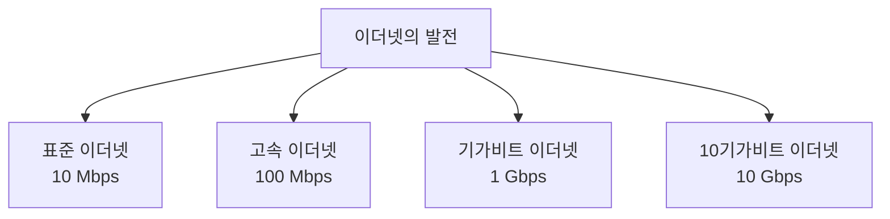

*그림 4. 이더넷의 네 세대*

이더넷 기술에는 10BASE-T, 10BASE-2, 100BASE-T, 1000BASE-LX, 10GBASE-T 같은 이름이 붙는다. 이 이름에는 규칙이 있다.

- **첫 부분:** 표준의 속도이다. 10, 100, 1000, 10G는 각각 10 Mbps, 100 Mbps, 1 Gbps, 10 Gbps를 뜻한다.
- **BASE:** 기저대역(baseband) 이더넷, 곧 물리 매체가 이더넷 트래픽만 운반한다는 뜻이다. 802.3 표준은 거의 모두 기저대역 이더넷이다.
- **마지막 부분:** 물리 매체이다. 이더넷은 링크 계층이자 물리 계층 명세이며 동축 케이블, 구리선, 광섬유 같은 여러 매체로 운반된다. 일반적으로 T는 트위스티드 페어 구리선, F는 광섬유를 뜻한다. 표준 이더넷의 5나 2처럼 숫자이면 케이블의 최대 길이를 대략 100 m 단위로 나타낸다(5는 500 m, 2는 185 m).

### 4.2 표준 이더넷

**표준 이더넷(Standard Ethernet)** 은 10 Mbps로 동작하는 최초의 이더넷이다. 지금은 역사가 되었지만 이후 버전을 이해하는 바탕이 된다. 접근 방식은 CSMA/CD이고 최소 프레임 크기는 512비트이다(18장). 1980년대에 널리 쓰인 구현은 다음 네 가지이다.

| 특성 | 10Base5 | 10Base2 | 10Base-T | 10Base-F |
|:-----|:-----|:-----|:-----|:-----|
| 매체 | 굵은 동축 케이블 | 가는 동축 케이블 | UTP 2쌍 | 광섬유 2가닥 |
| 최대 길이 | 500 m | 185 m | 100 m | 2000 m |
| 토폴로지 | 버스 (탭으로 연결) | 버스 (T 커넥터로 연결) | 허브 중심의 스타 | 허브 중심의 스타 |

*표 4. 표준 이더넷의 구현*

10BASE-2와 10BASE-5는 두 종류의 동축 케이블을 쓰는 10 Mbps 이더넷이며 케이블 길이에 제한이 있다. 더 긴 거리는 **리피터(repeater)** 로 얻는다. 동축 케이블은 한 인터페이스가 보낸 모든 프레임을 다른 인터페이스가 받는 브로드캐스트 매체이며, 다중 접근 문제는 CSMA/CD가 해결한다. 노드는 케이블에 붙기만 하면 LAN이 된다.

### 4.3 고속 이더넷

**고속 이더넷(Fast Ethernet)** 은 FDDI나 Fiber Channel 같은 LAN 프로토콜과 경쟁하기 위해 설계되었으며, IEEE는 이를 **802.3u**라는 이름으로 만들었다. 표준 이더넷과 하위 호환되면서 열 배 빠른 100 Mbps로 보낸다. 설계 목표는 다음과 같다.

1. 전송 속도를 100 Mbps로 높인다.
2. 표준 이더넷과 호환되게 한다.
3. 같은 48비트 주소를 쓴다.
4. 같은 프레임 형식을 쓴다.
5. 같은 최소 길이와 최대 길이를 유지한다.

10 Mbps에서 100 Mbps로 발전할 때 가장 중요하게 고려한 점은 MAC 부계층을 건드리지 않는 것이었다. 다만 버스 토폴로지는 버리고 스타 토폴로지만 남겼다. 스타 토폴로지에는 두 가지 선택이 있다.

- **반이중:** 스테이션들을 허브로 연결한다. 접근 방식은 CSMA/CD 그대로이다.
- **전이중:** 포트마다 버퍼가 있는 스위치로 연결한다. CSMA/CD가 필요 없지만, 표준 이더넷과의 하위 호환을 위해 구현에 CSMA/CD를 남겨 둔다.

고속 이더넷에 새로 더해진 기능이 **자동 협상(autonegotiation)** 이다. 두 장치가 동작 모드나 전송 속도를 협상할 수 있게 하며, 다음 목적으로 설계되었다.

- 호환되지 않는 장치끼리 연결할 수 있게 한다. 예를 들어 최대 10 Mbps인 장치가 100 Mbps 장치와 (낮은 속도로) 통신할 수 있다.
- 한 장치가 여러 능력을 가질 수 있게 한다.
- 스테이션이 허브의 능력을 확인할 수 있게 한다.

| 특성 | 100Base-TX | 100Base-FX | 100Base-T4 |
|:-----|:-----|:-----|:-----|
| 매체 | STP | 광섬유 | UTP |
| 선의 수 | 2 | 2 | 4 |
| 최대 길이 | 100 m | 100 m | 100 m |

*표 5. 고속 이더넷의 구현*

물리 계층 구현은 2선식과 4선식으로 나뉜다. 2선식은 차폐 트위스티드 페어(STP)를 쓰는 100Base-TX와 광섬유를 쓰는 100Base-FX이고, 4선식은 비차폐 트위스티드 페어(UTP)만을 위한 100Base-T4이다. 100 Mbps 표준들은 원래의 이더넷 MAC 프로토콜과 프레임 형식을 그대로 쓰고 구리선과 광섬유용의 더 빠른 물리 계층만 새로 정의했다. 트위스티드 페어에서는 100 m까지, 광섬유에서는 수 km까지 가능하여 서로 다른 건물의 이더넷 스위치를 연결할 수 있다.

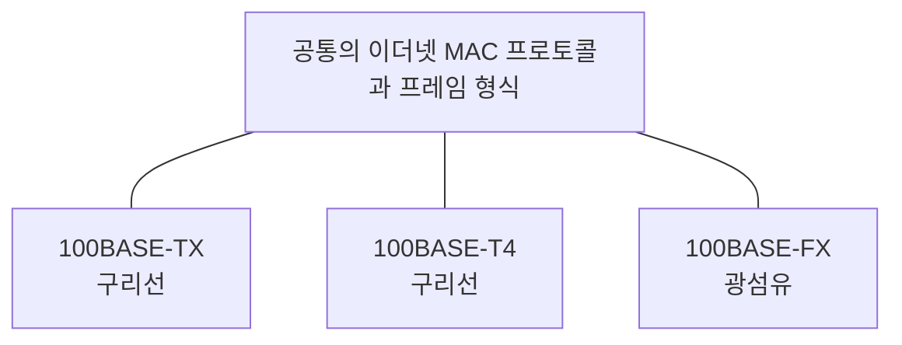

*그림 5. 공통의 링크 계층과 서로 다른 물리 계층으로 이루어진 100 Mbps 이더넷*

### 4.4 기가비트 이더넷

더 높은 속도가 필요해지면서 1000 Mbps의 **기가비트 이더넷(Gigabit Ethernet)** 이 설계되었고, IEEE는 이 표준을 **802.3z**라고 부른다. 설계 목표는 고속 이더넷의 목표에 자동 협상 지원을 더한 것이다.

1. 전송 속도를 1 Gbps로 높인다.
2. 표준 이더넷이나 고속 이더넷과 호환되게 한다.
3. 같은 48비트 주소를 쓴다.
4. 같은 프레임 형식을 쓴다.
5. 같은 최소 길이와 최대 길이를 유지한다.
6. 고속 이더넷에서 정의한 자동 협상을 지원한다.

표준 이더넷의 프레임 형식을 그대로 쓰므로 10BASE-T, 100BASE-T 기술과 하위 호환되며 기존 이더넷 장비에 쉽게 통합된다. 처음에는 광섬유에서 동작했지만 지금은 카테고리 5 UTP 케이블에서도 동작한다.

1 Gbps를 얻으려면 MAC 부계층을 그대로 둘 수 없었다. 기가비트 이더넷의 매체 접근에는 두 방식이 있다.

- **전이중 모드:** 중앙의 스위치가 모든 컴퓨터나 다른 스위치에 연결된다. 스위치는 입력 포트마다 버퍼를 두고 데이터를 전송할 때까지 저장한다. 충돌이 없으므로 CSMA/CD를 쓰지 않으며, 케이블의 최대 길이는 충돌 감지가 아니라 케이블의 신호 감쇠로 정해진다. 거의 모든 구현이 이 방식을 따른다.
- **반이중 모드:** 드물지만 스위치 대신 허브를 쓰면 충돌이 일어날 수 있는 공통 케이블처럼 동작하므로 CSMA/CD를 쓴다. 이때 망의 최대 길이는 최소 프레임 크기에 전적으로 의존한다(18장). 이를 위해 세 가지 방법이 정의되었다.

| 방법 | 내용 | 결과 |
|:-----|:-----|:-----|
| 전통적 방법 (traditional) | 최소 프레임 길이를 표준 이더넷처럼 512비트로 유지 | 비트의 길이가 10 Mbps 이더넷의 100분의 1이므로 망의 최대 길이가 25 m로 줄어듦. 한 방에 모든 스테이션이 있으면 적당하지만 사무실 하나를 잇기에도 부족할 수 있음 |
| 반송파 확장 (carrier extension) | 최소 프레임 길이를 512바이트(4096비트)로 8배 늘리고, 4096비트보다 짧은 프레임에는 확장 비트(패딩)를 덧붙임 | 망의 최대 길이가 8배인 200 m로 늘어나 허브에서 스테이션까지 100 m가 가능함 |
| 프레임 버스팅 (frame bursting) | 짧은 프레임마다 확장을 붙이는 대신 여러 프레임을 이어 보내고, 프레임 사이를 반송파 확장과 같은 패딩으로 채워 채널이 쉬지 않게 함 | 다른 스테이션에는 매우 큰 프레임 하나가 전송되는 것처럼 보이며, 짧은 프레임이 이어질 때의 비효율을 줄임 |

*표 6. 반이중 기가비트 이더넷의 세 가지 방법*

> **참고:** **25 m와 200 m의 근거.** 교재는 10 Mbps 이더넷의 망 길이 2500 m를 비트의 길이가 짧아지는 비율인 100분의 1로 줄여 25 m를 얻는다. 전파만으로 계산하면 한계가 더 크다. 1 Gbps에서 512비트 최소 프레임의 전송 시간은 0.512 μs이므로 $`T_p \le 0.256\ \mu\text{s}`$이고, 전파 속도가 $`2 \times 10^8`$ m/s이면 51.2 m이며, 반송파 확장의 4096비트 프레임으로는 409.6 m가 된다. 교재의 값이 이 상한의 약 절반인 것은 교재가 줄이는 2500 m 자체가 10 Mbps에서 최대 전파 시간 25.6 μs만으로 허용되는 5120 m의 약 절반이기 때문이다(18장). 실제 망은 리피터, 허브, 어댑터 내부의 지연처럼 전파 밖의 지연도 감당해야 하므로 허용 길이가 전파만 고려한 상한보다 짧다. 두 관점 모두 전통적 방법은 망을 방 하나 정도로 묶어 두고 반송파 확장은 망 길이를 8배로 늘린다는 점에서 같다.

| 특성 | 1000Base-SX | 1000Base-LX | 1000Base-CX | 1000Base-T |
|:-----|:-----|:-----|:-----|:-----|
| 매체 | 광섬유 (단파장) | 광섬유 (장파장) | STP | 카테고리 5 UTP |
| 선의 수 | 2 | 2 | 2 | 4 |
| 최대 길이 | 550 m | 5000 m | 25 m | 100 m |

*표 7. 기가비트 이더넷의 구현*

마지막 열의 카테고리 5 UTP 네 쌍을 쓰는 구현은 IEEE 802.3ab에서 1000BASE-T로 표준화되었다[1]. Forouzan의 표는 같은 구현을 1000Base-T4라고 부른다.

### 4.5 10기가비트 이더넷

IEEE는 **10기가비트 이더넷(Ten-Gigabit Ethernet)** 을 만들고 **802.3ae**라고 불렀다. 설계 목표는 다음과 같다.

1. 전송 속도를 10 Gbps로 높인다.
2. 표준, 고속, 기가비트 이더넷과 호환되게 한다.
3. 같은 48비트 주소를 쓴다.
4. 같은 프레임 형식을 쓴다.
5. 같은 최소 길이와 최대 길이를 유지한다.
6. 기존 LAN을 도시권 통신망(MAN)이나 광역 통신망(WAN)으로 서로 연결할 수 있게 한다.
7. 이더넷을 프레임 릴레이나 ATM 같은 기술(21장)과 호환되게 한다.

10기가비트 이더넷은 전이중 모드로만 동작하므로 경쟁이 필요 없고 CSMA/CD를 쓰지 않는다.

| 특성 | 10GBase-S | 10GBase-L | 10GBase-E |
|:-----|:-----|:-----|:-----|
| 매체 | 다중 모드 광섬유 | 단일 모드 광섬유 | 단일 모드 광섬유 |
| 선의 수 | 2 | 2 | 2 |
| 최대 길이 | 300 m | 10,000 m | 40,000 m |

*표 8. 10기가비트 이더넷의 구현*

| 세대 | 속도 | IEEE 표준 | 주요 매체 | 접근 방식 |
|:-----|:-----|:-----|:-----|:-----|
| 표준 이더넷 | 10 Mbps | 802.3 | 동축 케이블, UTP, 광섬유 | CSMA/CD |
| 고속 이더넷 | 100 Mbps | 802.3u | STP, UTP, 광섬유 | 반이중은 CSMA/CD, 전이중은 불필요 |
| 기가비트 이더넷 | 1 Gbps | 802.3z | 광섬유, STP, UTP | 거의 전이중 (반이중은 CSMA/CD와 반송파 확장) |
| 10기가비트 이더넷 | 10 Gbps | 802.3ae | 광섬유 | 전이중만 (CSMA/CD 없음) |

*표 9. 이더넷 네 세대의 비교*

### 4.6 스위치 시대의 MAC 프로토콜

버스 토폴로지와 허브 중심의 스타 토폴로지 시절에 이더넷은 노드들이 동시에 보내면 프레임이 충돌하는 분명한 브로드캐스트 링크였고, 이를 처리하기 위해 CSMA/CD를 표준에 넣었다. 그러나 오늘날처럼 저장 후 전달 방식의 스위치를 중심으로 한 스타 토폴로지에서는 사정이 다르다. 스위치는 전송을 조율하여 같은 인터페이스로 한 번에 두 프레임 이상을 내보내지 않으며(6절), 현대의 스위치는 전이중이므로 스위치와 노드가 동시에 서로 프레임을 보내도 간섭이 없다. 곧 스위치 기반 이더넷 LAN에는 충돌이 없으므로 MAC 프로토콜이 필요 없다.

오늘날의 이더넷은 처음의 이더넷과 매우 다르다. 속도는 세 자릿수만큼 빨라졌고, 프레임은 여러 매체로 운반되며, 스위치 이더넷이 주류가 되었고, MAC 프로토콜도 흔히 쓰이지 않는다. 그런데도 이것을 이더넷이라고 부를 수 있는 이유는 이 모든 변화 속에서도 바뀌지 않은 것이 있기 때문이다. 바로 이더넷의 프레임 형식이며, 이것이 이더넷 표준의 변하지 않는 중심이라고 할 수 있다.

---

<br>

## 5. 연결 장치

### 5.1 연결 장치의 분류

LAN과 WAN을 서로 연결하려면 **연결 장치(connecting device)** 가 필요하다. 연결 장치는 인터넷 모델의 서로 다른 계층에서 동작하며, 이 절에서는 세 종류를 다룬다.

- **리피터(또는 허브):** 물리 계층에서만 동작한다.
- **브리지(또는 2계층 스위치):** 물리 계층과 데이터 링크 계층까지 동작한다.
- **라우터(또는 3계층 스위치):** 물리 계층, 데이터 링크 계층, 네트워크 계층까지 동작한다.

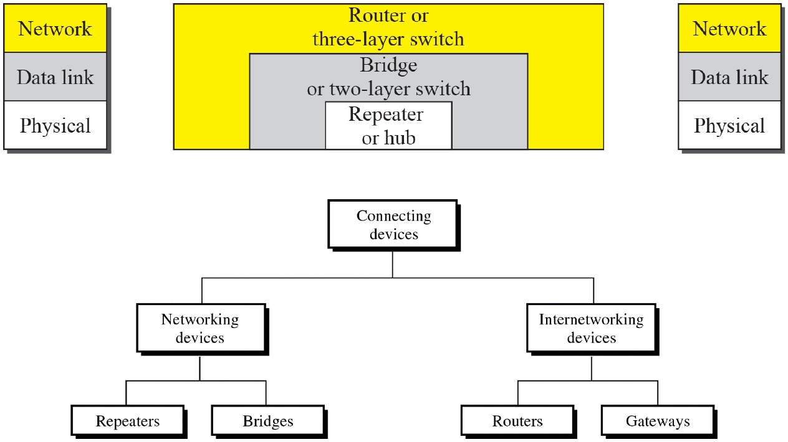

*그림 6. 연결 장치가 동작하는 계층과 분류*

그림 6의 위쪽은 각 장치가 동작하는 계층을 보여 준다. 리피터나 허브는 물리 계층, 브리지나 2계층 스위치는 데이터 링크 계층까지, 라우터나 3계층 스위치는 네트워크 계층까지 동작한다. 아래쪽 분류에서 연결 장치는 한 네트워크 안의 세그먼트를 잇는 네트워킹 장치(리피터, 브리지)와 독립된 네트워크들을 잇는 인터네트워킹 장치(라우터 등)로 나뉜다.

### 5.2 리피터와 허브

> **용어 정의:** **리피터(repeater)** 는 한 쪽에서 받은 신호를 다시 만들어 다른 쪽으로 내보내는 물리 계층 장치이며, 다중 포트 리피터를 허브(hub)라고 부른다.

리피터는 LAN의 세그먼트들을 잇는다. 버스 토폴로지에서는 리피터가 두 동축 케이블 세그먼트를 이어 케이블의 길이 제한을 넘게 한다. 오늘날의 이더넷 LAN은 스타 토폴로지를 쓰며, 이때 리피터는 연결 지점 역할과 리피터 역할을 함께 하는 다중 포트 장치, 곧 허브가 된다.

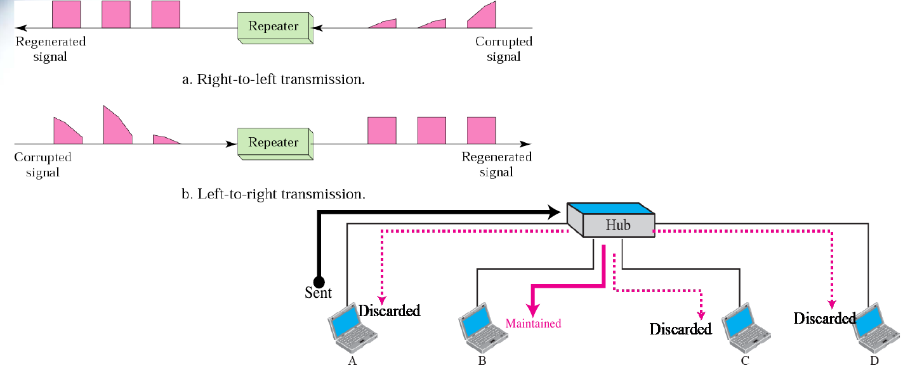

*그림 7. 리피터의 신호 재생과 허브의 프레임 전달*

- **증폭기가 아닌 재생기:** 리피터는 신호를 증폭하는 것이 아니라 재생한다. 그림 7의 위쪽처럼 잡음으로 일그러진 신호가 들어오면 원래 비트 패턴을 다시 만들어 내보낸다. 증폭기라면 잡음까지 키운다.
- **필터링 능력이 없음:** 스테이션 A가 B에게 보낸 프레임이 허브에 도착하면, 허브는 프레임을 나타내는 신호를 재생하여 잡음을 없애지만 모든 출력 포트로 내보낸다. 곧 프레임은 브로드캐스트된다. LAN의 모든 스테이션이 프레임을 받지만 B만 보관하고 나머지는 버린다. 허브는 프레임을 어느 포트로 보내야 하는지 알아내는 기능이 없다.
- **주소가 없음:** 리피터와 허브는 물리 계층 장치이므로 데이터 링크 주소를 가지지 않고, 받은 프레임의 데이터 링크 주소를 검사하지도 않는다. 손상된 비트를 재생해 모든 포트로 보낼 뿐이다.

> **핵심:** 리피터는 모든 비트를 전달하며 필터링 능력이 없다.

> **용어 정의:** **충돌 영역(collision domain)** 은 그 안의 두 장치가 동시에 보내면 프레임이 충돌하는 네트워크의 범위이다.

허브에 연결된 모든 스테이션은 하나의 충돌 영역을 이룬다. 허브가 받은 비트를 모든 포트로 내보내므로 두 포트에서 동시에 프레임이 오면 충돌이 일어나기 때문이다.

### 5.3 브리지와 필터링

> **용어 정의:** **브리지(bridge)** 는 물리 계층과 데이터 링크 계층에서 동작하며, 신호를 재생할 뿐 아니라 프레임의 MAC 주소를 검사하여 프레임을 어느 포트로 보낼지 결정하는 연결 장치이다.

브리지는 물리 계층 장치로서 받은 신호를 재생하고, 데이터 링크 계층 장치로서 프레임에 담긴 MAC 주소(출발지와 목적지)를 검사한다. 브리지와 리피터의 기능 차이는 **필터링(filtering)** 능력이다. 브리지는 프레임의 목적지 주소를 검사하여 어느 출력 포트로 내보낼지 결정할 수 있으며, 이 결정에 쓰는 표를 가지고 있다.

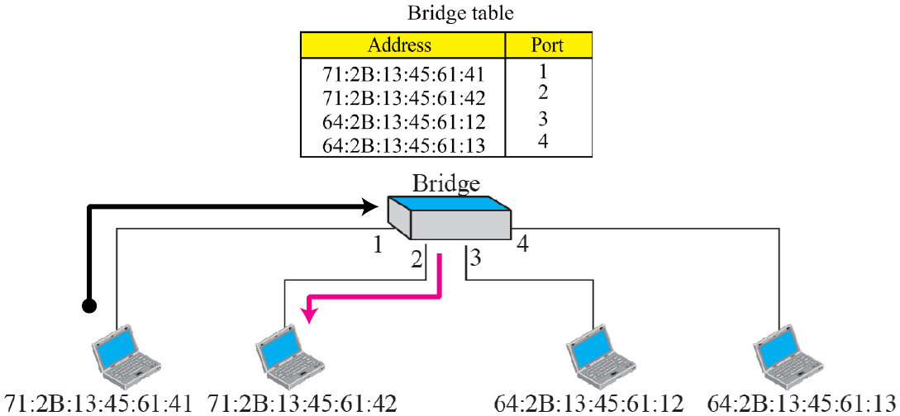

*그림 8. 브리지와 브리지 테이블*

그림 8의 LAN에서는 스테이션 넷이 브리지에 연결되어 있다. 목적지가 71:2B:13:45:61:42인 프레임이 포트 1로 들어오면, 브리지는 표에서 나갈 포트를 찾는다. 표에 따르면 71:2B:13:45:61:42로 가는 프레임은 포트 2로만 보내면 되므로 다른 포트로 보낼 필요가 없다. 브리지는 하나의 네트워크 안에서 세그먼트들을 잇는 장치이다.

> **핵심:** 브리지는 필터링 결정에 쓰는 표를 가지며, 프레임의 물리(MAC) 주소를 바꾸지 않는다.

브리지는 LAN을 여러 충돌 영역으로 나눈다. 반면 브로드캐스트 프레임은 모든 포트로 전달하므로 브로드캐스트가 미치는 범위는 나누지 않는다.

### 5.4 투명 브리지와 학습

**투명 브리지(transparent bridge)** 는 스테이션들이 그 존재를 전혀 모르는 브리지이다. 브리지를 시스템에 더하거나 빼도 스테이션을 다시 설정할 필요가 없다. IEEE 802.1d 명세에 따르면 투명 브리지를 갖춘 시스템은 다음 세 조건을 만족해야 한다.

1. 프레임을 한 스테이션에서 다른 스테이션으로 전달해야 한다.
2. 포워딩 테이블은 네트워크에서 프레임이 오가는 것을 보고 학습하여 자동으로 만들어야 한다.
3. 시스템에 루프가 생기지 않게 해야 한다.

초기의 브리지는 관리자가 설치할 때 표의 항목을 하나씩 손으로 입력하는 정적 테이블을 썼다. 단순하지만 실용적이지 않았다. 스테이션을 추가하거나 제거하면, 또는 네트워크 카드를 바꿔 MAC 주소가 바뀌면 표를 손으로 고쳐야 했다. 더 나은 방법은 프레임의 움직임으로부터 주소와 포트의 대응을 점차 학습하는 동적 테이블이다. 브리지는 목적지 주소를 포워딩 결정(표 검색)에, 출발지 주소를 표의 항목 추가와 갱신에 쓴다.

그림 8과 같은 브리지에 스테이션 A(71:2B:13:45:61:41, 포트 1), B(71:2B:13:45:61:42, 포트 2), C(64:2B:13:45:61:12, 포트 3), D(64:2B:13:45:61:13, 포트 4)가 연결되어 있고 표가 비어 있다고 하자.

| 사건 | 브리지의 동작 | 학습 후 표에 추가되는 항목 |
|:-----|:-----|:-----|
| A가 D에게 프레임을 보냄 | D와 A의 항목이 모두 없으므로 프레임을 다른 세 포트로 모두 내보냄(범람). 출발지 주소를 보고 A가 포트 1에 있음을 학습 | 71:2B:13:45:61:41, 포트 1 |
| D가 B에게 프레임을 보냄 | B의 항목이 없으므로 다시 범람. D가 포트 4에 있음을 학습 | 64:2B:13:45:61:13, 포트 4 |
| B가 A에게 프레임을 보냄 | A의 항목이 있으므로 포트 1로만 보냄. B가 포트 2에 있음을 학습 | 71:2B:13:45:61:42, 포트 2 |
| C가 D에게 프레임을 보냄 | D의 항목이 있으므로 포트 4로만 보냄. C가 포트 3에 있음을 학습 | 64:2B:13:45:61:12, 포트 3 |

*표 10. 학습 브리지의 표가 점차 만들어지는 과정*

학습은 표가 모든 포트의 정보를 가질 때까지 계속된다. 다만 학습에는 오랜 시간이 걸릴 수 있다. 예를 들어 어떤 스테이션이 프레임을 전혀 보내지 않으면(드문 경우이지만) 그 스테이션의 항목은 표에 생기지 않는다.

**2계층 스위치(two-layer switch)** 라는 말을 쓸 때는 주의해야 한다. 스위치는 동작하는 계층에 따라 두 가지를 뜻할 수 있기 때문이다. 2계층 스위치는 물리 계층과 데이터 링크 계층에서 동작하며, 포워딩이 더 빠른 정교한 브리지이다. 6절의 링크 계층 스위치가 이것이다.

### 5.5 라우터

라우터는 물리 계층, 데이터 링크 계층, 네트워크 계층에서 동작하는 3계층 장치이다. 물리 계층 장치로서 받은 신호를 재생하고, 데이터 링크 계층 장치로서 패킷에 담긴 물리 주소(출발지와 목적지)를 검사하며, 네트워크 계층 장치로서 네트워크 계층 주소(IP 계층의 주소)를 검사한다. 브리지는 충돌 영역을 바꾸지만, 라우터는 브로드캐스트가 미치는 범위를 제한한다.

라우터는 LAN과 LAN, WAN과 WAN, LAN과 WAN을 연결할 수 있다. 곧 라우터는 독립된 네트워크들을 연결하여 인터네트워크를 만드는 인터네트워킹 장치이며, 라우터로 연결된 두 네트워크는 인터네트워크, 곧 인터넷이 된다.

> **핵심:** 리피터나 브리지는 한 LAN의 세그먼트들을 잇고, 라우터는 독립된 LAN이나 WAN을 이어 인터네트워크(인터넷)를 만든다.

라우터와 리피터나 브리지 사이에는 세 가지 큰 차이가 있다.

1. 라우터는 인터페이스마다 물리 주소와 논리(IP) 주소를 가진다.
2. 라우터는 패킷의 물리 목적지 주소가 그 패킷이 도착한 인터페이스의 주소와 같은 패킷에만 작용한다.
3. 라우터는 패킷을 전달할 때 패킷의 물리 주소(출발지와 목적지 모두)를 바꾼다.

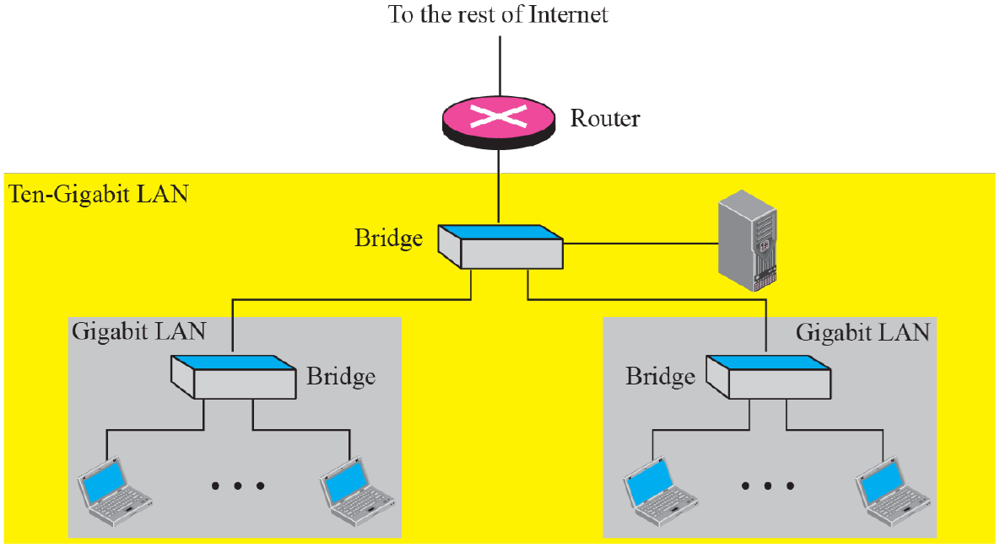

*그림 9. 브리지로 이은 LAN을 라우터로 인터넷에 연결한 예*

그림 9에서 한 조직은 두 건물에 각각 기가비트 이더넷 LAN을 두고, 각 LAN에서 브리지를 쓴다. 두 LAN은 10기가비트 이더넷 기술로 연결하여 더 큰 하나의 LAN을 이루며, 이는 이더넷과 조직의 서버로 가는 연결을 빠르게 한다. 그리고 라우터 하나가 전체 시스템을 인터넷에 연결한다. 브리지가 하나의 네트워크(같은 서브넷) 안에서 동작하는 반면, 라우터는 여러 네트워크 사이에서 동작한다. MAC 주소는 지역 네트워크 안에서만 유효하므로, 라우터는 받은 패킷의 MAC 주소를 바꾸어 다음 네트워크로 내보낸다(19장).

> **핵심:** 라우터는 패킷의 물리 주소를 바꾼다.

**3계층 스위치(three-layer switch)** 는 라우터이다. 성능을 높이도록 설계를 개선한 라우터로, 기능은 같지만 전통적인 라우터보다 훨씬 빠르게 패킷을 받고 처리하고 내보낸다. 이 정리본에서는 혼동을 피하기 위해 3계층 스위치도 라우터라고 부른다.

| 장치 | 동작 계층 | 신호 재생 | 주소 검사 | 필터링 | 주소 변경 | 잇는 대상 |
|:-----|:-----|:-----|:-----|:-----|:-----|:-----|
| 리피터, 허브 | 물리 | 함 | 하지 않음 | 없음 (모든 비트 전달) | 없음 | 한 LAN의 세그먼트 |
| 브리지, 2계층 스위치 | 물리, 데이터 링크 | 함 | MAC 주소 | 있음 (브리지 테이블) | MAC 주소를 바꾸지 않음 | 한 LAN의 세그먼트 |
| 라우터, 3계층 스위치 | 물리, 데이터 링크, 네트워크 | 함 | MAC 주소와 IP 주소 | 있음 (포워딩 테이블) | 출발지와 목적지 MAC 주소를 바꿈 | 독립된 LAN과 WAN |

*표 11. 계층별 연결 장치의 비교*

---

<br>

## 6. 링크 계층 스위치

링크 계층 스위치는 들어온 링크 계층 프레임을 받아 나가는 링크로 내보낸다. 스위치는 서브넷의 호스트와 라우터에 **투명(transparent)** 하다. 호스트나 라우터는 프레임의 주소를 스위치가 아니라 다른 호스트나 라우터로 지정하여 LAN으로 보내며, 스위치가 그 프레임을 받아 전달한다는 사실을 모른다. 스위치의 한 출력 인터페이스에 프레임이 도착하는 속도가 그 인터페이스의 링크 용량을 잠시 넘을 수 있으므로, 라우터의 출력 인터페이스처럼 스위치의 출력 인터페이스에도 버퍼가 있다.

### 6.1 포워딩과 필터링

스위치의 두 가지 기본 기능은 다음과 같다.

- **필터링(filtering):** 프레임을 어떤 인터페이스로 전달할지, 아니면 버릴지를 결정한다.
- **포워딩(forwarding):** 프레임을 보낼 인터페이스를 정하고 프레임을 그 인터페이스로 옮긴다.

> **용어 정의:** **스위치 테이블(switch table)** 은 스위치가 필터링과 포워딩에 쓰는 표로, 각 항목은 MAC 주소, 그 MAC 주소로 가는 스위치 인터페이스, 항목이 표에 들어간 시각으로 이루어진다.

스위치 테이블에는 LAN의 일부 호스트와 라우터의 항목만 있을 수도 있다. 다음은 인터페이스가 넷인 스위치의 표 일부이다.

| MAC 주소 | 인터페이스 | 시각 |
|:-----|:-----|:-----|
| 3E:91:0A:22:5C:01 | 1 | 9:32 |
| 7A:10:4B:9D:E3:27 | 3 | 9:36 |
| ... | ... | ... |

*표 12. 스위치 테이블의 일부*

스위치는 MAC 주소로 프레임을 전달하며 IP 주소를 쓰지 않는다. 또한 스위치 테이블은 라우터의 포워딩 테이블과 전혀 다른 방식으로 만들어진다(6.2절). 목적지 주소가 DD-DD-DD-DD-DD-DD인 프레임이 인터페이스 x로 들어왔다고 하자. 스위치는 MAC 주소 DD-DD-DD-DD-DD-DD로 표를 검색하며, 다음 세 경우가 있다.

1. **표에 DD-DD-DD-DD-DD-DD의 항목이 없다.** 스위치는 인터페이스 x를 뺀 모든 인터페이스의 출력 버퍼로 프레임의 사본을 보낸다. 곧 목적지 주소의 항목이 없으면 프레임을 브로드캐스트한다.
2. **표에 DD-DD-DD-DD-DD-DD를 인터페이스 x와 연결한 항목이 있다.** 프레임은 이미 어댑터 DD-DD-DD-DD-DD-DD가 있는 LAN 세그먼트에서 왔으므로 다른 인터페이스로 보낼 필요가 없다. 스위치는 프레임을 버려 필터링 기능을 수행한다.
3. **표에 DD-DD-DD-DD-DD-DD를 인터페이스 y(y ≠ x)와 연결한 항목이 있다.** 프레임을 인터페이스 y에 연결된 LAN 세그먼트로 보내야 한다. 스위치는 프레임을 인터페이스 y 앞의 출력 버퍼에 넣어 포워딩 기능을 수행한다.

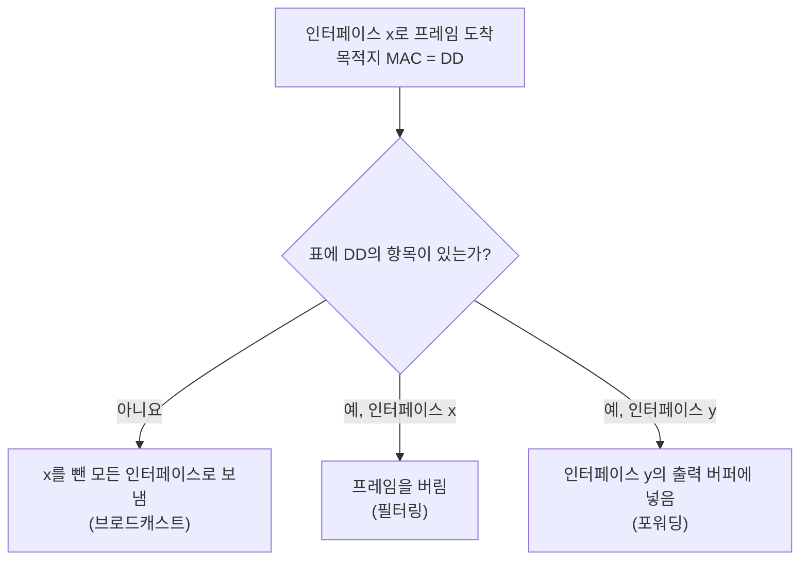

*그림 10. 스위치의 필터링과 포워딩 결정*

예를 들어 표 12의 스위치에 목적지 주소가 3E:91:0A:22:5C:01인 프레임이 인터페이스 1로 들어오면, 목적지가 인터페이스 1의 세그먼트에 있으므로 프레임은 이미 목적지가 있는 세그먼트에 브로드캐스트되었다. 스위치는 프레임을 버린다. 같은 프레임이 인터페이스 2로 들어오면 목적지가 인터페이스 1 쪽에 있으므로 인터페이스 1의 출력 버퍼로 보낸다. 스위치 테이블이 완전하고 정확하면 스위치는 브로드캐스트 없이 목적지로 프레임을 전달한다. 이런 의미에서 스위치는 허브보다 똑똑하다.

### 6.2 자기 학습

> **용어 정의:** **자기 학습(self-learning)** 은 스위치가 관리자나 설정 프로토콜의 개입 없이, 들어오는 프레임의 출발지 MAC 주소와 도착 인터페이스를 기록하여 스위치 테이블을 자동으로 만드는 기능이다.

스위치의 표는 자동으로, 동적으로, 자율적으로 만들어진다. 그 방법은 다음과 같다.

1. 스위치 테이블은 처음에 비어 있다.
2. 스위치는 인터페이스로 들어온 각 프레임에 대해 (1) 프레임의 출발지 주소 필드에 있는 MAC 주소, (2) 프레임이 도착한 인터페이스, (3) 현재 시각을 표에 저장한다. 이렇게 하여 송신자가 있는 LAN 세그먼트를 기록한다. LAN의 모든 호스트가 언젠가 프레임을 보내면 모든 호스트가 표에 기록된다.
3. 일정 시간(**에이징 시간, aging time**) 동안 어떤 주소를 출발지 주소로 하는 프레임이 들어오지 않으면 그 주소를 표에서 지운다. 이렇게 하면 PC를 다른 어댑터를 가진 PC로 바꾸었을 때 원래 PC의 MAC 주소가 결국 표에서 사라진다.

예를 들어 9:39에 출발지 주소가 01:12:23:34:45:56인 프레임이 인터페이스 2로 들어오고 이 주소가 표에 없으면, 스위치는 (01:12:23:34:45:56, 2, 9:39) 항목을 추가한다. 에이징 시간이 60분이고 9:32부터 10:32까지 출발지 주소가 3E:91:0A:22:5C:01인 프레임이 하나도 들어오지 않으면, 10:32에 그 주소를 표에서 지운다.

| MAC 주소 | 인터페이스 | 시각 |
|:-----|:-----|:-----|
| **01:12:23:34:45:56** | **2** | **9:39** |
| 3E:91:0A:22:5C:01 | 1 | 9:32 |
| 7A:10:4B:9D:E3:27 | 3 | 9:36 |
| ... | ... | ... |

*표 13. 01:12:23:34:45:56의 위치를 학습한 스위치 테이블*

스위치는 관리자나 사용자의 개입이 필요 없는 **플러그 앤 플레이(plug-and-play)** 장치이다. 스위치를 설치하려는 관리자는 LAN 세그먼트를 스위치 인터페이스에 연결하기만 하면 되며, 설치할 때나 LAN 세그먼트에서 호스트를 뺄 때 스위치 테이블을 설정할 필요가 없다. 또한 스위치는 전이중이므로 어느 인터페이스든 동시에 보내고 받을 수 있다.

### 6.3 스위치의 성질

버스나 허브 중심의 스타 토폴로지 같은 브로드캐스트 링크 대신 스위치를 쓰면 다음과 같은 이점이 있다.

- **충돌의 제거:** 허브 없이 스위치로만 만든 LAN에서는 충돌로 낭비되는 대역폭이 없다. 스위치는 프레임을 버퍼에 저장하고 한 세그먼트에 한 번에 두 프레임 이상을 내보내지 않는다. 라우터처럼 스위치의 최대 총 처리량은 모든 인터페이스 속도의 합이므로, 브로드캐스트 링크를 쓰는 LAN보다 성능이 크게 좋아진다.
- **이기종 링크:** 스위치는 링크들을 서로 격리하므로, LAN의 링크들이 서로 다른 속도와 매체로 동작할 수 있다. 예를 들어 한 스위치가 1 Gbps 1000BASE-T 구리 링크 셋, 100 Mbps 100BASE-FX 광섬유 링크 둘, 100BASE-T 구리 링크 하나를 가질 수 있다. 그래서 스위치는 기존 장비와 새 장비를 섞어 쓰기에 알맞다.
- **관리:** 어댑터가 고장 나 이더넷 프레임을 끝없이 보내면(jabbering adapter) 스위치가 문제를 알아채고 그 어댑터를 내부적으로 끊을 수 있다. 케이블이 끊겨도 그 케이블로 스위치에 연결된 호스트만 끊긴다. 동축 케이블 시절에는 네트워크 전체를 멈추게 한 케이블의 끊긴 곳을 찾느라 관리자가 몇 시간씩 선을 따라 다녀야 했다. 스위치는 대역폭 사용량, 충돌률, 트래픽 유형 같은 통계도 모아 관리자에게 제공하며, 이 정보는 문제 해결과 LAN의 향후 계획에 쓰인다.

충돌 영역의 관점에서 보면, 허브는 연결된 모든 장치를 하나의 충돌 영역으로 묶고, 스위치는 포트마다 별도의 충돌 영역을 만들며, 전이중 링크에서는 충돌 자체가 일어나지 않는다.

| 특성 | 허브 | 브리지 | 스위치 |
|:-----|:-----|:-----|:-----|
| 동작 계층 | 물리 | 물리, 데이터 링크 | 물리, 데이터 링크 |
| 충돌 영역 | 연결된 모든 장치가 하나 | 포트마다 분리 | 포트마다 분리 (전이중이면 충돌 없음) |
| 대역폭 | 모든 장치가 공유 | 세그먼트마다 공유 | 포트마다 전용 |
| 전달 방식 | 모든 포트로 내보냄 | 표에 따라 선택적으로 내보냄 | 표에 따라 선택적으로 내보냄 |

*표 14. 허브, 브리지, 스위치의 비교*

### 6.4 스위치 LAN의 도청과 스위치 포이즈닝

호스트가 스위치에 연결되어 있으면 보통 자신에게 오는 프레임만 받는다. 호스트 A가 호스트 B에게 프레임을 보내고 스위치 테이블에 B의 항목이 있으면, 스위치는 프레임을 B에게만 보낸다. 따라서 호스트 C가 스니퍼를 실행하고 있어도 A에서 B로 가는 이 프레임은 볼 수 없다. 802.11 LAN이나 허브 기반 이더넷 LAN 같은 브로드캐스트 링크 환경과 달리, 스위치 LAN에서는 공격자가 프레임을 엿보기 어렵다.

그러나 스위치는 표에 없는 목적지 주소의 프레임을 브로드캐스트하므로, C의 스니퍼는 자신에게 오지 않은 프레임 일부를 여전히 볼 수 있다. 목적지가 FF-FF-FF-FF-FF-FF인 이더넷 브로드캐스트 프레임도 모두 볼 수 있다. 잘 알려진 공격인 **스위치 포이즈닝(switch poisoning)** 은 가짜 출발지 MAC 주소를 수없이 바꿔 가며 스위치에 패킷을 대량으로 보내, 스위치 테이블을 가짜 항목으로 채우고 정상 호스트의 MAC 주소가 들어갈 자리를 없애는 공격이다. 그러면 스위치가 대부분의 프레임을 브로드캐스트하게 되어 스니퍼가 그 프레임들을 볼 수 있다. 이 공격은 숙련된 공격자에게도 꽤 번거로우므로, 스위치는 허브나 무선 LAN보다 도청에 훨씬 덜 취약하다.

> **[정보보호]** 스위치 포이즈닝은 6.2절의 자기 학습이 출발지 주소를 검증하지 않고 표에 기록한다는 점을 악용한다. 19장의 ARP 스푸핑이 ARP 캐시를 오염시키는 것처럼, 인증 없이 받은 정보를 믿는 자동 학습 기능은 오염 공격의 대상이 된다.

---

<br>

## 7. 스위치와 라우터

### 7.1 패킷을 처리하는 계층

라우터는 네트워크 계층 주소로 패킷을 전달하는 저장 후 전달 패킷 스위치이다(13장). 스위치도 저장 후 전달 패킷 스위치이지만 MAC 주소로 패킷을 전달한다는 점에서 라우터와 근본적으로 다르다. 라우터는 3계층 패킷 스위치이고, 스위치는 2계층 패킷 스위치이다.

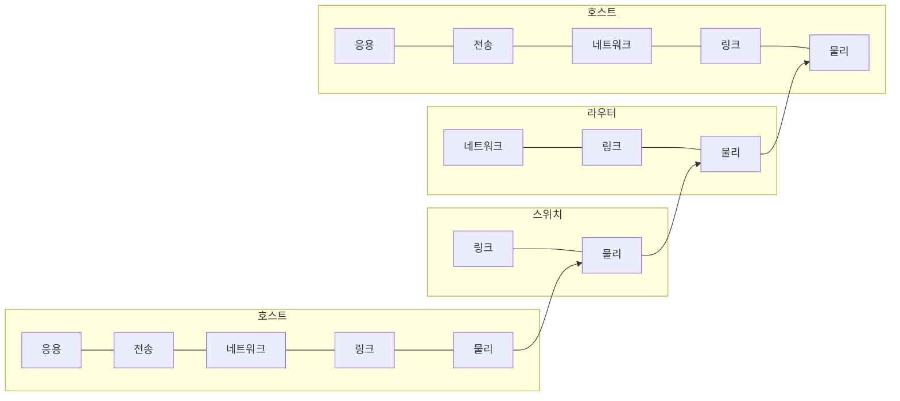

*그림 11. 호스트, 스위치, 라우터가 패킷을 처리하는 계층*

> **참고:** 24장에서 다루는 일반화된 포워딩에서는 "일치 후 동작(match plus action)" 방식의 현대 스위치가 프레임의 목적지 MAC 주소로 2계층 프레임을 전달할 수도 있고, 데이터그램의 목적지 IP 주소로 3계층 데이터그램을 전달할 수도 있다. OpenFlow 표준을 쓰는 스위치는 프레임, 데이터그램, 전송 계층 헤더의 여러 필드를 기준으로 일반화된 포워딩을 할 수 있다.

### 7.2 장단점 비교

네트워크 관리자는 연결 장치를 설치할 때 스위치와 라우터 중 하나를 골라야 하는 경우가 많다. 예를 들어 여러 학과의 LAN, 서버, 인터넷 게이트웨이 라우터를 잇는 데 스위치 대신 라우터를 써도 되며, 라우터를 쓰면 충돌 없이 학과 사이의 통신이 가능하다.

**스위치의 장점과 단점**

- 스위치는 플러그 앤 플레이이다.
- 프레임을 2계층까지만 처리하므로, 3계층까지 처리해야 하는 라우터보다 필터링과 포워딩 속도가 높다.
- 그러나 브로드캐스트 프레임이 순환하지 않도록 스위치 네트워크의 실제 토폴로지는 **스패닝 트리(spanning tree)** 로 제한된다.
- 큰 스위치 네트워크에서는 호스트와 라우터의 ARP 테이블이 커지고 ARP 트래픽과 처리량이 많아진다.
- 스위치는 **브로드캐스트 폭풍(broadcast storm)** 에 취약하다. 한 호스트가 고장 나 이더넷 브로드캐스트 프레임을 끝없이 보내면 스위치가 그 프레임을 모두 전달하여 네트워크 전체가 무너질 수 있다.

**라우터의 장점과 단점**

- 네트워크 주소는 MAC 주소와 달리 평면 구조가 아니라 계층 구조인 경우가 많으므로, 경로가 여럿인 네트워크에서도 패킷이 보통 라우터 사이를 순환하지 않는다. 라우터의 표가 잘못 설정되면 순환할 수 있지만, IP는 헤더의 특별한 필드(TTL, 11장)로 순환을 제한한다.
- 따라서 패킷은 스패닝 트리에 묶이지 않고 출발지와 목적지 사이의 최적 경로를 쓸 수 있다. 이 덕분에 인터넷은 유럽과 북미 사이에 여러 활성 링크를 두는 것처럼 풍부한 토폴로지로 만들어질 수 있었다.
- 라우터는 2계층 브로드캐스트 폭풍을 막는 방화벽 역할을 한다.
- 가장 큰 단점은 플러그 앤 플레이가 아니라는 점이다. 라우터와 거기에 연결된 호스트는 IP 주소를 설정해야 한다.
- 라우터는 3계층 필드까지 처리해야 하므로 스위치보다 패킷당 처리 시간이 긴 경우가 많다.

| 특성 | 허브 | 라우터 | 스위치 |
|:-----|:-----|:-----|:-----|
| 트래픽 격리 | 아니요 | 예 | 예 |
| 플러그 앤 플레이 | 예 | 아니요 | 예 |
| 최적 라우팅 | 아니요 | 예 | 아니요 |

*표 15. 대표적인 연결 장치의 일반적인 특징 비교*

그러면 대학이나 회사의 캠퍼스 네트워크는 언제 스위치를 쓰고 언제 라우터를 써야 하는가? 호스트 수백 대로 이루어진 작은 네트워크는 LAN 세그먼트가 몇 개뿐이며, 스위치만으로 충분하다. 스위치는 IP 주소를 설정하지 않고도 트래픽을 국지화하고 총 처리량을 높인다. 호스트 수천 대로 이루어진 큰 네트워크는 보통 스위치와 함께 라우터를 둔다. 라우터는 트래픽을 더 확실하게 격리하고, 브로드캐스트 폭풍을 통제하며, 호스트 사이에 더 똑똑한 경로를 쓴다.

---

<br>

## 8. 가상 LAN (VLAN)

### 8.1 계층적 스위치 LAN의 한계

현대의 기관 LAN은 보통 계층적으로 구성된다. 각 작업 그룹(학과)이 자신의 스위치 LAN을 가지고, 이 LAN들이 스위치 계층 구조로 다른 그룹의 스위치 LAN에 연결된다. 이상적인 환경에서는 잘 동작하지만 현실에서는 다음 세 가지 단점이 있다.

- **트래픽 격리의 부족:** 계층 구조는 그룹의 트래픽을 한 스위치 안에 국지화하지만, ARP와 DHCP 메시지를 담은 프레임이나 자기 학습 스위치가 아직 목적지를 학습하지 못한 프레임 같은 브로드캐스트 트래픽은 여전히 기관 네트워크 전체를 지나간다. 이런 브로드캐스트의 범위를 줄이면 LAN 성능이 좋아진다. 보안과 사생활 보호를 위해서도 브로드캐스트 범위를 제한하고 싶을 수 있다. 예를 들어 경영진의 트래픽이 패킷 스니퍼를 실행하는 다른 그룹의 호스트에 아예 닿지 않게 하고 싶을 수 있다. 중앙 스위치를 라우터로 바꾸면 이런 격리를 얻을 수 있지만, 2계층 해결책도 있다.
- **스위치의 비효율적인 사용:** 그룹이 셋이 아니라 열이면 1단계 스위치가 열 대 필요하다. 각 그룹이 열 명 미만으로 작다면 96포트 스위치 한 대로 모두를 수용할 수 있겠지만, 그 스위치 하나로는 트래픽을 격리할 수 없다.
- **사용자 관리:** 직원이 그룹을 옮기면 그 직원을 다른 스위치에 연결하도록 물리적 배선을 바꿔야 한다. 두 그룹에 속한 직원이 있으면 문제가 더 어려워진다.

### 8.2 포트 기반 VLAN

> **용어 정의:** **VLAN(virtual local area network)** 은 하나의 물리적 LAN 인프라 위에 여러 가상 LAN을 정의하여, 같은 VLAN의 호스트들이 마치 자신들만 스위치에 연결된 것처럼 통신하게 하는 기술이다.

VLAN을 지원하는 스위치는 위의 세 가지 어려움을 모두 해결한다. **포트 기반 VLAN(port-based VLAN)** 에서는 네트워크 관리자가 스위치의 포트(인터페이스)를 그룹으로 나눈다. 각 그룹이 하나의 VLAN이 되며, 각 VLAN의 포트들은 하나의 **브로드캐스트 영역(broadcast domain)** 을 이룬다. 곧 한 포트에서 나온 브로드캐스트 트래픽은 같은 그룹의 다른 포트에만 닿는다.

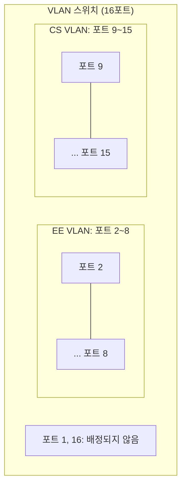

*그림 12. 두 VLAN이 설정된 하나의 스위치*

그림 12의 스위치는 포트가 16개이며, 포트 2\~8은 전기공학과(EE) VLAN에, 포트 9\~15는 컴퓨터과학과(CS) VLAN에 속하고, 포트 1과 16은 배정되지 않았다. 이 구성은 앞의 세 가지 어려움을 모두 해결한다.

- EE VLAN과 CS VLAN의 프레임은 서로 격리된다.
- 두 학과의 스위치 두 대가 스위치 한 대로 바뀐다.
- 포트 8의 사용자가 CS 학과로 옮기면, 네트워크 운영자는 VLAN 소프트웨어를 다시 설정하여 포트 8을 CS VLAN에 연결하기만 하면 된다.

VLAN 스위치의 설정과 동작은 간단하다. 네트워크 관리자는 스위치 관리 소프트웨어로 각 포트가 어느 VLAN에 속하는지 선언하고(선언하지 않은 포트는 기본 VLAN에 속함), 스위치 안에는 포트와 VLAN의 대응 표가 유지되며, 스위치 하드웨어는 같은 VLAN에 속한 포트 사이에서만 프레임을 전달한다.

### 8.3 VLAN 사이의 통신

두 VLAN을 완전히 격리하면 새로운 문제가 생긴다. EE 학과의 트래픽을 어떻게 CS 학과로 보낼 것인가? 한 가지 방법은 VLAN 스위치의 한 포트(예를 들어 포트 1)를 외부 라우터에 연결하고, 그 포트가 EE VLAN과 CS VLAN 모두에 속하도록 설정하는 것이다. 그러면 두 학과가 같은 물리 스위치를 공유하지만, 논리적인 구성은 두 학과가 각자의 스위치를 가지고 라우터로 연결된 것처럼 보인다. EE에서 CS로 가는 IP 데이터그램은 먼저 EE VLAN을 지나 라우터에 닿고, 라우터가 CS VLAN으로 다시 전달하여 CS 호스트에 도착한다. 스위치 제조사들은 VLAN 스위치와 라우터를 한 장치에 넣어 외부 라우터 없이도 이런 구성을 쉽게 만들 수 있게 한다.

### 8.4 VLAN 트렁킹과 802.1Q

이제 EE와 CS의 일부 교수가 다른 건물에 있고, 이들도 자기 학과의 VLAN에 속하고 싶어 한다고 하자. 두 번째 건물에 8포트 스위치를 두고 포트마다 EE VLAN이나 CS VLAN을 배정하면 된다. 그러면 두 스위치를 어떻게 연결할 것인가?

- **VLAN마다 케이블 하나:** 각 스위치에서 CS VLAN에 속하는 포트 하나(EE VLAN도 마찬가지)를 정하고 그 포트끼리 연결한다. 그러나 VLAN이 N개이면 두 스위치를 잇는 데만 스위치마다 포트 N개가 필요하므로 확장성이 없다.
- **VLAN 트렁킹:** 각 스위치의 특별한 포트 하나를 **트렁크 포트(trunk port)** 로 설정하여 두 VLAN 스위치를 연결한다. 트렁크 포트는 모든 VLAN에 속하며, 어느 VLAN으로 가는 프레임이든 트렁크 링크를 거쳐 다른 스위치로 전달된다.

> **용어 정의:** **VLAN 트렁킹(VLAN trunking)** 은 모든 VLAN에 속하는 트렁크 포트끼리 하나의 링크로 VLAN 스위치들을 연결하고, 그 링크로 보내는 프레임에 소속 VLAN을 나타내는 태그를 붙이는 방식이다.

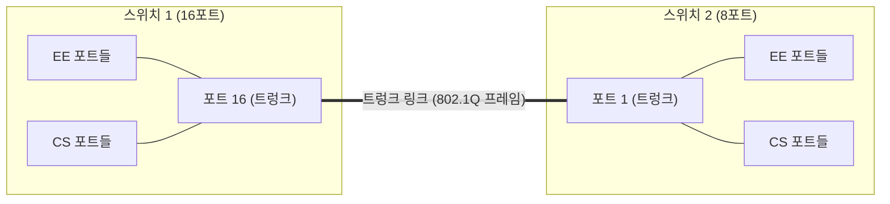

*그림 13. VLAN 트렁킹으로 연결한 두 VLAN 스위치*

그러면 트렁크 포트로 들어온 프레임이 어느 VLAN에 속하는지 스위치는 어떻게 아는가? IEEE는 VLAN 트렁크를 지나는 프레임을 위해 확장된 이더넷 프레임 형식 **802.1Q**를 정의했다. 802.1Q 프레임은 표준 이더넷 프레임의 헤더에 프레임이 속한 VLAN의 식별 정보를 담은 4바이트 **VLAN 태그(VLAN tag)** 를 더한 것이다.

```text
  표준 이더넷 프레임
  ┌──────────┬───────────┬───────────┬──────┬──────────────┬─────┐
  │ Preamble │ Dest addr │ Src addr  │ Type │     Data     │ CRC │
  └──────────┴───────────┴───────────┴──────┴──────────────┴─────┘

  802.1Q 태그가 붙은 이더넷 프레임
  ┌──────────┬───────────┬───────────┬──────┬──────┬──────┬──────────────┬──────┐
  │ Preamble │ Dest addr │ Src addr  │ TPID │ TCI  │ Type │     Data     │ CRC' │
  └──────────┴───────────┴───────────┴──────┴──────┴──────┴──────────────┴──────┘
                                       2      2
  TPID: Tag Protocol Identifier, 고정값 0x8100
  TCI:  Tag Control Information = Priority (3비트) + 1비트 + VLAN ID (12비트)
  CRC': 다시 계산한 CRC
```

*그림 14. 표준 이더넷 프레임과 802.1Q 태그가 붙은 프레임*

- **TPID(Tag Protocol Identifier):** 2바이트이며 16진수 고정값 81-00이다.
- **TCI(Tag Control Information):** 2바이트이며, 12비트 **VLAN 식별자(VLAN identifier)** 와 IP 데이터그램의 TOS 필드와 비슷한 목적의 3비트 우선순위 필드를 담는다. VLAN 식별자가 12비트이므로 $`2^{12} = 4096`$개의 값을 나타낼 수 있다.
- **CRC:** 태그를 넣으면 프레임의 내용이 바뀌므로 CRC를 다시 계산한다.

VLAN 태그는 트렁크의 송신 쪽 스위치가 프레임에 넣고, 수신 쪽 스위치가 해석한 뒤 제거한다. 곧 태그는 트렁크 링크 위에서만 존재하고, 호스트가 주고받는 프레임은 표준 이더넷 프레임이다. 태그를 붙이면 프레임이 4바이트 길어지므로, 최대 길이 1518바이트의 프레임에 태그를 붙이면 1522바이트가 된다.

### 8.5 다른 방식의 VLAN

지금까지는 포트 기반 VLAN을 다루었지만, VLAN은 다른 방식으로도 정의할 수 있다.

- **MAC 기반 VLAN:** 네트워크 관리자가 각 VLAN에 속하는 MAC 주소들의 집합을 정한다. 장치가 포트에 연결되면 그 장치의 MAC 주소에 따라 포트가 알맞은 VLAN에 연결된다.
- **네트워크 계층 프로토콜 기반 VLAN:** IPv4, IPv6, AppleTalk 같은 네트워크 계층 프로토콜이나 다른 기준으로 VLAN을 정의할 수도 있다.
- **라우터를 넘는 VLAN:** VLAN을 IP 라우터 너머로 확장하여, 떨어져 있는 LAN들을 하나의 VLAN으로 묶을 수도 있다.

---

<br>

## 개념 적용

**T/F 점검:**

| 문장 | 판단과 근거 |
|:-----|:-----|
| IEEE 802 표준에서 LLC는 LAN 프로토콜마다 다르고 MAC은 모든 LAN에 공통이다. | **F.** LLC가 모든 LAN에 공통이고, MAC은 이더넷, 토큰 링처럼 프로토콜마다 다르다. |
| 이더넷 프레임의 프리앰블과 SFD는 물리 계층에서 덧붙인다. | **T.** 둘은 물리 계층 헤더이며 형식상 프레임의 일부가 아니다. |
| 상위 계층 데이터가 30바이트이면 이더넷은 16바이트의 패딩을 덧붙인다. | **T.** 데이터 필드의 최소 크기가 46바이트이므로 46 − 30 = 16바이트를 채운다. |
| 이더넷 수신 어댑터는 CRC 검사에 실패한 프레임에 부정 확인 응답을 보낸다. | **F.** 이더넷은 비신뢰 서비스이므로 확인 응답도 부정 확인 응답도 보내지 않고 프레임을 버린다. |
| 고속 이더넷은 표준 이더넷과 같은 프레임 형식과 최소, 최대 길이를 쓴다. | **T.** MAC 부계층을 건드리지 않는 것이 설계의 핵심이었다. |
| 전이중 기가비트 이더넷에서 케이블의 최대 길이는 최소 프레임 크기로 정해진다. | **F.** 전이중에서는 충돌이 없으므로 케이블의 신호 감쇠로 정해진다. |
| 10기가비트 이더넷은 반이중 모드에서 CSMA/CD를 쓴다. | **F.** 10기가비트 이더넷은 전이중으로만 동작하며 CSMA/CD를 쓰지 않는다. |
| 리피터는 신호를 증폭하므로 잡음도 함께 커진다. | **F.** 리피터는 증폭기가 아니라 재생기이므로 원래 비트 패턴을 다시 만든다. |
| 브리지는 프레임을 전달할 때 출발지 MAC 주소를 자신의 주소로 바꾼다. | **F.** 브리지는 프레임의 MAC 주소를 바꾸지 않는다. 주소를 바꾸는 것은 라우터이다. |
| 스위치는 목적지 주소의 항목이 없는 프레임을 도착한 인터페이스를 뺀 모든 인터페이스로 보낸다. | **T.** 항목이 없으면 프레임을 브로드캐스트한다. |
| 자기 학습 스위치는 프레임의 목적지 주소로 표를 채운다. | **F.** 출발지 주소와 도착 인터페이스로 표를 채우고, 목적지 주소는 표 검색에 쓴다. |
| 스위치 네트워크의 실제 토폴로지는 브로드캐스트 프레임의 순환을 막기 위해 스패닝 트리로 제한된다. | **T.** 반면 라우터는 계층적 주소와 TTL 덕분에 이 제한이 없다. |
| VLAN의 트렁크 포트는 하나의 VLAN에만 속한다. | **F.** 트렁크 포트는 모든 VLAN에 속하며, 어느 VLAN의 프레임이든 트렁크로 전달한다. |
| 802.1Q 태그는 호스트가 프레임을 만들 때 넣고 목적지 호스트가 제거한다. | **F.** 트렁크의 송신 쪽 스위치가 넣고 수신 쪽 스위치가 제거한다. |

---

<br>

## 요약

| 개념 | 핵심 요약 |
|:-----|:-----|
| LAN | 건물이나 캠퍼스처럼 제한된 영역을 위한 네트워크이며, 오늘날에는 이더넷이 지배적인 기술이다. |
| IEEE 802 | 데이터 링크 계층을 LAN 공통의 LLC와 LAN별 MAC으로 나누고, 주제별 작업 그룹이 표준을 만든다. |
| 이더넷의 토폴로지 | 동축 케이블 버스에서 허브 중심의 스타를 거쳐 스위치 중심의 스타로 바뀌었다. |
| 이더넷 프레임 | 프리앰블, SFD, 목적지 주소, 출발지 주소, 길이 또는 유형, 데이터와 패딩, CRC로 이루어진다. |
| 프레임 길이 | 프리앰블과 SFD를 뺀 프레임은 64\~1518바이트이고, 데이터는 46\~1500바이트이며, 부족하면 패딩을 붙인다. |
| 이더넷 서비스 | 핸드셰이크 없는 비연결형 서비스이며, 확인 응답 없이 오류 프레임을 버리는 비신뢰 서비스이다. |
| 이더넷의 발전 | 10 Mbps, 100 Mbps(802.3u), 1 Gbps(802.3z), 10 Gbps(802.3ae)로 발전했으며, 주소와 프레임 형식은 그대로 유지되었다. |
| 반이중 기가비트 이더넷 | 최소 프레임을 유지하면 망 길이가 25 m로 줄어들므로 반송파 확장과 프레임 버스팅을 정의했다. |
| 리피터와 허브 | 물리 계층에서 신호를 재생하여 모든 포트로 내보내며, 필터링 능력이 없고 하나의 충돌 영역을 만든다. |
| 브리지 | 물리 계층과 데이터 링크 계층에서 동작하며, 표로 프레임을 필터링하지만 MAC 주소를 바꾸지 않는다. |
| 라우터 | 3계층 장치로서 독립된 네트워크를 이어 인터네트워크를 만들며, 전달할 때 MAC 주소를 바꾼다. |
| 스위치의 포워딩과 필터링 | 목적지 항목이 없으면 브로드캐스트하고, 같은 인터페이스면 버리며, 다른 인터페이스면 그쪽으로 보낸다. |
| 자기 학습 | 출발지 MAC 주소와 도착 인터페이스, 시각을 기록하고 에이징 시간이 지나면 지우는 플러그 앤 플레이 기능이다. |
| 스위치와 라우터 | 스위치는 플러그 앤 플레이이고 빠르지만 스패닝 트리와 브로드캐스트 폭풍의 제약이 있고, 라우터는 최적 경로와 격리를 주지만 설정이 필요하다. |
| VLAN | 하나의 물리 LAN 위에 여러 브로드캐스트 영역을 만들며, 포트 기반 VLAN은 포트를 그룹으로 나눈다. |
| VLAN 트렁킹과 802.1Q | 트렁크 링크로 스위치를 잇고, TPID 0x8100과 12비트 VLAN ID를 담은 4바이트 태그로 소속 VLAN을 표시한다. |

---

<br>

## 점검 문제

1. **패딩과 프레임 크기:** 상위 계층 데이터 20바이트를 이더넷 프레임으로 보낼 때 필요한 패딩의 크기와 프레임 크기를 구하라(프리앰블과 SFD 제외). 데이터가 1600바이트이면 어떻게 되는가? 최소 프레임과 최대 프레임의 크기를 바이트와 비트로 쓰라.

   <details>
   <summary>정답</summary>

   최소 데이터 크기가 46바이트이므로 패딩은 46 − 20 = 26바이트이고, 프레임은 6 + 6 + 2 + 46 + 4 = 64바이트이다. 1600바이트는 최대 데이터 크기 1500바이트를 넘으므로 한 프레임에 담을 수 없고, 상위 계층(IP)에서 1500바이트 이하로 단편화하여 여러 프레임으로 보내야 한다. 최소 프레임은 64바이트(512비트), 최대 프레임은 1518바이트(12,144비트)이다.

   </details>

2. **반이중 기가비트 이더넷의 망 길이:** 1 Gbps 반이중 CSMA/CD 네트워크에서 최소 프레임 크기를 64바이트로 유지할 때, 전파 속도가 $`2 \times 10^8`$ m/s이고 다른 지연을 무시하면 충돌 영역의 최대 길이는 얼마인가? 반송파 확장으로 최소 프레임을 512바이트로 늘리면 어떻게 되는가?

   <details>
   <summary>정답</summary>

   64바이트는 512비트이므로 최소 전송 시간은 512 / 10⁹ s = 0.512 μs이다. 전송 시간이 최대 전파 시간의 두 배 이상이어야 하므로 최대 전파 시간은 0.256 μs이고, 최대 길이는 0.256 × 10⁻⁶ × 2 × 10⁸ = 51.2 m이다. 최소 프레임을 512바이트(4096비트)로 8배 늘리면 이 한계도 8배인 409.6 m가 된다. 이 값은 전파 지연만 고려한 상한이며, 교재는 10 Mbps 이더넷의 망 길이 2500 m를 100분의 1로 줄여 전통적 방법에서 25 m, 반송파 확장에서 200 m를 제시한다(4.4절). 어느 쪽이든 반송파 확장은 망 길이를 8배로 늘린다.

   </details>

3. **충돌 영역:** 스테이션 8대를 (a) 허브 하나로, (b) 각 스테이션을 별도 포트에 연결한 스위치 하나로 연결한다. 각각 충돌 영역은 몇 개인가? (b)에서 모든 링크가 전이중으로 동작하면 어떻게 되는가?

   <details>
   <summary>정답</summary>

   (a) 허브는 물리 계층에서 신호를 모든 포트로 재생하므로 8대 전체가 하나의 충돌 영역을 이룬다. (b) 스위치는 각 포트가 별도의 충돌 영역이므로 충돌 영역은 8개이다. 전이중으로 동작하면 각 링크에서 송신과 수신이 동시에 이루어지므로 충돌이 일어나지 않는다.

   </details>

4. **자기 학습 추적:** 포트가 셋인 스위치에 호스트 A는 포트 1, B는 포트 2에 연결되어 있고, C와 D는 허브를 거쳐 포트 3에 연결되어 있다. 스위치 테이블이 비어 있을 때 프레임이 (1) A에서 C로, (2) C에서 A로, (3) D에서 C로, (4) B에서 D로 차례로 전송된다. 각 프레임에 대한 스위치의 동작과 최종 스위치 테이블을 쓰라.

   <details>
   <summary>정답</summary>

   (1) C의 항목이 없으므로 포트 2와 3으로 브로드캐스트하고, A가 포트 1에 있음을 학습한다. (2) A의 항목이 포트 1이므로 포트 1로만 보내고, C가 포트 3에 있음을 학습한다. (3) C의 항목이 프레임이 들어온 포트 3과 같으므로 프레임을 버리고(필터링), D가 포트 3에 있음을 학습한다. C는 허브를 통해 이미 프레임을 받았다. (4) D의 항목이 포트 3이므로 포트 3으로만 보내고, B가 포트 2에 있음을 학습한다. 최종 표는 A는 포트 1, C는 포트 3, D는 포트 3, B는 포트 2이다.

   </details>

5. **802.1Q의 오버헤드:** 802.1Q 태그를 붙이면 프레임이 몇 바이트 늘어나는가? 최대 크기 프레임에 태그를 붙이면 몇 바이트가 되는가? VLAN 식별자로 구별할 수 있는 값은 몇 개인가?

   <details>
   <summary>정답</summary>

   TPID 2바이트와 TCI 2바이트로 이루어진 4바이트 태그가 더해지므로 프레임은 4바이트 늘어난다. 프리앰블과 SFD를 뺀 최대 프레임 1518바이트에 태그를 붙이면 1522바이트가 된다. VLAN 식별자는 12비트이므로 $`2^{12} = 4096`$개의 값을 구별할 수 있다.

   </details>

6. **브리지와 라우터:** 브리지와 라우터가 프레임(패킷)을 전달할 때 MAC 주소를 각각 어떻게 다루는지 설명하고, 그 차이가 생기는 이유를 쓰라.

   <details>
   <summary>정답</summary>

   브리지는 하나의 LAN 안에서 세그먼트를 잇는 장치이므로 프레임의 출발지와 목적지 MAC 주소를 바꾸지 않고 표에 따라 알맞은 포트로 내보낸다. 라우터는 독립된 네트워크를 잇는 장치이며 인터페이스마다 자신의 MAC 주소와 IP 주소를 가진다. MAC 주소는 지역 네트워크 안에서만 유효하므로, 라우터는 패킷을 다음 네트워크로 내보낼 때 출발지 MAC 주소를 나가는 인터페이스의 주소로, 목적지 MAC 주소를 다음 홉의 주소로 바꾼다.

   </details>

7. **스위치와 라우터의 선택:** 호스트 300대의 작은 사무실과 호스트 수천 대의 대학 캠퍼스에서 각각 스위치와 라우터를 어떻게 쓰는 것이 알맞은지 이유와 함께 설명하라.

   <details>
   <summary>정답</summary>

   호스트 수백 대의 작은 네트워크는 LAN 세그먼트가 몇 개뿐이므로 스위치만으로 충분하다. 스위치는 IP 주소 설정 없이 트래픽을 국지화하고 총 처리량을 높이는 플러그 앤 플레이 장치이다. 호스트 수천 대의 큰 네트워크에서는 스위치만 쓰면 스패닝 트리 제약, 커지는 ARP 테이블과 ARP 트래픽, 브로드캐스트 폭풍의 위험이 있으므로 스위치와 함께 라우터를 둔다. 라우터는 트래픽을 확실하게 격리하고 브로드캐스트 폭풍을 막으며 더 나은 경로를 쓴다.

   </details>

---

<br>

## 참고 문헌

1. IEEE 802.3 Ethernet Working Group, "IEEE P802.3ab 1000BASE-T Task Force." [Online]. Available: https://www.ieee802.org/3/ab/index.html
