# Chapter 20 — Ethernet, Switches, and VLANs

[Repository Guide](../../README.md) | [English](Concepts_Lecture.md) | [한국어](Concepts_Lecture.ko.md)

> **Last Updated:** 2026-11-19
>
> Computer Networking: A Top-Down Approach, Kurose and Ross, Ch 6; TCP/IP Protocol Suite, Forouzan, Ch 3

> **Learning Objectives:**
> 1. Explain why the IEEE 802 standard divides the data link layer into the LLC sublayer and the MAC sublayer
> 2. Explain each field and the minimum and maximum lengths of the Ethernet frame, and compute the padding
> 3. Compare the features and implementations of Standard, Fast, Gigabit, and Ten-Gigabit Ethernet
> 4. Distinguish repeaters (hubs), bridges, and routers by the layers at which they operate and by their functions
> 5. Trace the forwarding, filtering, and self-learning of a switch, and compare the pros and cons of switches and routers
> 6. Explain port-based VLANs, VLAN trunking, and the structure of the 802.1Q tag

---

## Table of Contents

- [1. LANs and the IEEE 802 Standard](#1-lans-and-the-ieee-802-standard)
  - [1.1 Local Area Networks (LANs)](#11-local-area-networks-lans)
  - [1.2 IEEE Project 802 and the Two Sublayers](#12-ieee-project-802-and-the-two-sublayers)
  - [1.3 IEEE 802 Working Groups](#13-ieee-802-working-groups)
- [2. The Position of Ethernet and Its Changing Topology](#2-the-position-of-ethernet-and-its-changing-topology)
- [3. The Ethernet Frame](#3-the-ethernet-frame)
  - [3.1 Frame Format](#31-frame-format)
  - [3.2 Minimum and Maximum Frame Lengths](#32-minimum-and-maximum-frame-lengths)
  - [3.3 Connectionless, Unreliable Service](#33-connectionless-unreliable-service)
- [4. Ethernet Evolution](#4-ethernet-evolution)
  - [4.1 Four Generations and the Naming Convention](#41-four-generations-and-the-naming-convention)
  - [4.2 Standard Ethernet](#42-standard-ethernet)
  - [4.3 Fast Ethernet](#43-fast-ethernet)
  - [4.4 Gigabit Ethernet](#44-gigabit-ethernet)
  - [4.5 Ten-Gigabit Ethernet](#45-ten-gigabit-ethernet)
  - [4.6 The MAC Protocol in the Age of Switches](#46-the-mac-protocol-in-the-age-of-switches)
- [5. Connecting Devices](#5-connecting-devices)
  - [5.1 Classification of Connecting Devices](#51-classification-of-connecting-devices)
  - [5.2 Repeaters and Hubs](#52-repeaters-and-hubs)
  - [5.3 Bridges and Filtering](#53-bridges-and-filtering)
  - [5.4 Transparent Bridges and Learning](#54-transparent-bridges-and-learning)
  - [5.5 Routers](#55-routers)
- [6. Link-Layer Switches](#6-link-layer-switches)
  - [6.1 Forwarding and Filtering](#61-forwarding-and-filtering)
  - [6.2 Self-Learning](#62-self-learning)
  - [6.3 Properties of Switches](#63-properties-of-switches)
  - [6.4 Sniffing a Switched LAN and Switch Poisoning](#64-sniffing-a-switched-lan-and-switch-poisoning)
- [7. Switches and Routers](#7-switches-and-routers)
  - [7.1 Layers at Which Packets Are Processed](#71-layers-at-which-packets-are-processed)
  - [7.2 Comparison of Pros and Cons](#72-comparison-of-pros-and-cons)
- [8. Virtual LANs (VLANs)](#8-virtual-lans-vlans)
  - [8.1 Limits of Hierarchical Switched LANs](#81-limits-of-hierarchical-switched-lans)
  - [8.2 Port-Based VLANs](#82-port-based-vlans)
  - [8.3 Communication between VLANs](#83-communication-between-vlans)
  - [8.4 VLAN Trunking and 802.1Q](#84-vlan-trunking-and-8021q)
  - [8.5 Other Kinds of VLANs](#85-other-kinds-of-vlans)
- [Concept Applications](#concept-applications)
- [Summary](#summary)
- [Self-Check Questions](#self-check-questions)
- [References](#references)

---

<br>

## 1. LANs and the IEEE 802 Standard

### 1.1 Local Area Networks (LANs)

A **local area network (LAN)** is a computer network designed for a limited geographic area such as a building or a campus. A LAN can be used as an isolated network that connects the computers in an organization for sharing resources, but most LANs today are also linked to a wide area network (WAN) or the Internet. The LAN market has seen several technologies such as Ethernet, token ring, token bus, FDDI, and ATM LAN; only some of them survived for a while, and today Ethernet is by far the dominant technology.

This chapter focuses on Ethernet LANs and covers the frame format, the evolution of Ethernet, the connecting devices that join LANs, link-layer switches, and virtual LANs. The multiple access method of Ethernet (CSMA/CD) and its error detection (CRC) are covered in Chapter 18, and MAC addresses and ARP in Chapter 19.

### 1.2 IEEE Project 802 and the Two Sublayers

In 1985, the Computer Society of the IEEE started **Project 802** to set standards that enable intercommunication among equipment from a variety of manufacturers. Project 802 does not seek to replace any part of the OSI model or the Internet model; it is a way of specifying the functions of the physical layer and the data link layer of the major LAN protocols. The standard was adopted by ANSI, and in 1987 ISO also approved it as an international standard under the designation ISO 8802.

The IEEE subdivided the data link layer into two sublayers and also created separate physical-layer standards for each LAN protocol.

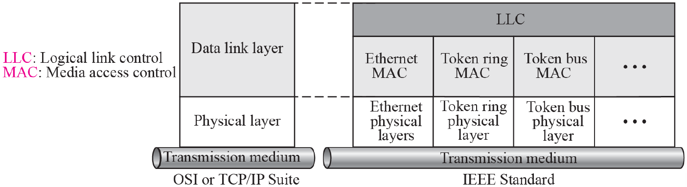

*Figure 1. Layer structure of the IEEE standard for LANs*

> **Definition:** The **logical link control sublayer** is the upper part of the data link layer in the IEEE 802 standard; it is common to all LAN protocols and provides a single interface to the network layer.

> **Definition:** The **media access control sublayer** is the lower part of the data link layer in the IEEE 802 standard; it is defined separately for each LAN protocol, such as Ethernet, token ring, and token bus, and specifies the medium access method and the frame format.

In Figure 1, the single data link layer of OSI or TCP/IP becomes, in the IEEE standard, one common LLC and protocol-specific MACs (Ethernet MAC, token ring MAC, token bus MAC, and so on), and the physical layer is likewise divided into protocol-specific physical layers. Different MAC and physical-layer implementations thus share the common LLC interface, so the upper layers need not care which LAN lies below. The MAC that matters in this chapter is the Ethernet MAC.

> **Key Point:** The IEEE 802 standard divides the data link layer into an LLC common to all LANs and a MAC specific to each LAN, so that various LAN technologies serve the upper layers through the same interface.

### 1.3 IEEE 802 Working Groups

The IEEE 802 committee is divided into **working groups** by topic, which develop the standards. In the organization chart, each working group is marked with a status such as active, hibernating, or disbanded, and these statuses change over time. The numbers and topics of the main working groups are as follows.

| Working group | Topic | Where covered |
|:-----|:-----|:-----|
| 802.1 | Bridging and architecture | This chapter (bridges, 802.1Q for VLANs) |
| 802.2 | LLC | This chapter |
| 802.3 | CSMA/CD (Ethernet) | This chapter, Chapter 18 |
| 802.4 | Token bus | Chapter 18 (token passing) |
| 802.5 | Token ring | Chapter 18 (token passing) |
| 802.6 | DQDB | |
| 802.7 | Broadband | |
| 802.8 | Fiber (technical advisory group) | |
| 802.9 | ISLAN | |
| 802.10 | Security | |
| 802.11 | Wireless LAN | Chapter 22 |
| 802.12 | Demand priority | |
| 802.14 | Cable TV | |
| 802.15 | Wireless PAN | Chapter 22 (Bluetooth) |
| 802.16 | Wireless MAN | |

*Table 1. Main working groups of IEEE 802*

Among them, 802.11, 802.15, and 802.16 are the working groups for wireless technologies.

---

<br>

## 2. The Position of Ethernet and Its Changing Topology

> **Definition:** **Ethernet** is the wired LAN technology standardized by the IEEE 802.3 working group, which defines physical layers of various speeds and media on top of a common MAC protocol and frame format.

Ethernet has practically taken over the wired LAN market. In the 1980s and early 1990s it was challenged by technologies such as token ring, FDDI, and ATM, some of which captured part of the market for a few years, but Ethernet, invented in the mid-1970s, kept evolving and held on to its dominant position. Ethernet can be said to be to local area networking what the Internet is to global networking. Ethernet succeeded for the following reasons.

- Ethernet was the first widely deployed high-speed LAN. Because it was deployed early, network administrators became familiar with it and were reluctant to switch when other technologies appeared.
- Token ring, FDDI, and ATM were more complex and expensive than Ethernet.
- The most compelling reason to switch to another LAN technology was usually a higher data rate, but Ethernet always fought back with versions of equal or higher speed. Switched Ethernet, introduced in the early 1990s, further increased its effective data rate.
- Because Ethernet became so popular, Ethernet hardware such as adapters and switches became a commodity and remarkably cheap.

The original Ethernet LAN was invented in the mid-1970s by Bob Metcalfe and David Boggs and used a coaxial bus to interconnect the nodes. The topology of Ethernet changed as follows.

| Period | Topology | Central element | Properties |
|:-----|:-----|:-----|:-----|
| 1980s to mid-1990s | Bus | Coaxial cable | Broadcast LAN; every transmitted frame goes to all adapters on the bus, and CSMA/CD handles collisions |
| Late 1990s | Hub-based star | Hub | Still a broadcast LAN; the hub regenerates bits onto all other interfaces, so frames arriving at two interfaces at once collide |
| Early 2000s on | Switch-based star | Switch | A collision-free store-and-forward packet switch that, unlike a router, processes only up through layer 2 |

*Table 2. Changes in Ethernet topology*

A **hub** is a physical-layer device that acts on individual bits rather than frames. When a bit representing a 0 or a 1 arrives on one interface, the hub re-creates the bit, boosts its energy strength, and transmits it onto all the other interfaces.

---

<br>

## 3. The Ethernet Frame

### 3.1 Frame Format

The packet sent on an Ethernet LAN is called a **frame**. Suppose that adapter A (MAC address AA-AA-AA-AA-AA-AA) sends an IP datagram to adapter B (MAC address BB-BB-BB-BB-BB-BB) on the same Ethernet LAN. A encapsulates the datagram in an Ethernet frame and passes it to the physical layer, and B receives the frame from the physical layer, extracts the IP datagram, and passes it to the network layer. An Ethernet frame can carry network-layer packets other than IP datagrams as well.

```text
  ┌──────────┬─────┬─────────────┬─────────────┬─────────┬──────────────────┬─────┐
  │ Preamble │ SFD │ Destination │   Source    │ Length  │  Data and        │ CRC │
  │          │     │   address   │   address   │ or type │  padding         │     │
  └──────────┴─────┴─────────────┴─────────────┴─────────┴──────────────────┴─────┘
       7        1         6             6            2         46-1500          4
  ◄─────────────►◄────────────────────────────────────────────────────────────────►
       (a)                                    (b)
```

*Figure 2. Format of the Ethernet frame*

The numbers below Figure 2 are the field sizes in bytes. The preamble and SFD in (a) are the physical-layer header added by the physical layer, and the part in (b), from the destination address to the CRC, is the actual frame.

> **Definition:** A **preamble** is the bit pattern of alternating 1s and 0s placed before an Ethernet frame, which alerts the receiving adapter that a frame is coming and lets it synchronize with the sender's clock.

| Field | Size | Content |
|:-----|:-----|:-----|
| Preamble | 7 bytes | 56 bits of alternating 1s and 0s (10101010 seven times); alerts the receiver to the coming frame and lets it synchronize its input timing; long enough to allow some bits at the start to be missed; added at the physical layer and not formally part of the frame |
| Start frame delimiter (SFD) | 1 byte | 10101011; signals the beginning of the frame and warns that this is the last chance for synchronization; the last 2 bits, 11, signal that the next field is the destination address; added at the physical layer |
| Destination address (DA) | 6 bytes | Physical address of the next station(s) to receive the frame |
| Source address (SA) | 6 bytes | Physical address of the previous station sending the frame |
| Length or type | 2 bytes | Used by the original Ethernet as a type field defining the upper-layer protocol and by the IEEE standard as a length field defining the number of bytes in the data field; both uses are common |
| Data and padding | 46-1500 bytes | Data received from the upper layer |
| CRC | 4 bytes | Error-detection information (CRC-32, Chapter 18) |

*Table 3. Fields of the Ethernet frame*

The roles of the fields deserve a closer look.

- **Data field (46-1500 bytes):** It carries the IP datagram. The **maximum transmission unit (MTU)** of Ethernet is 1500 bytes, so an IP datagram larger than 1500 bytes is fragmented at the IP layer, by the source host or by a router whose outgoing link has this smaller MTU (Chapter 11). The minimum size of the data field is 46 bytes, so if the IP datagram is shorter than 46 bytes, the data field is filled out to 46 bytes (**padding**). The data passed to the network layer then contains the padding along with the IP datagram, and the network layer removes the padding using the length field in the IP header.
- **Destination address (6 bytes):** The MAC address of the destination adapter. When adapter B receives a frame whose destination address is its own address BB-BB-BB-BB-BB-BB or the MAC broadcast address, it passes the contents of the data field to the network layer; it discards frames with any other address (Chapter 19).
- **Source address (6 bytes):** The MAC address of the adapter that transmits the frame onto the LAN, AA-AA-AA-AA-AA-AA in this example.
- **Type field (2 bytes):** It lets Ethernet multiplex network-layer protocols. A host can use network-layer protocols other than IP, so when a frame arrives, adapter B needs to know to which protocol it should pass (demultiplex) the contents of the data field. IP and other network-layer protocols each have their own standardized type number, and ARP has its own type number 0x0806. Like the protocol field of a network-layer datagram and the port-number fields of a transport-layer segment, the type field glues a protocol at one layer to a protocol at the layer above.
- **CRC (4 bytes):** It lets the receiving adapter detect bit errors in the frame (Chapter 18).
- **Preamble:** Sending adapter A aims to transmit at a target rate such as 10 Mbps, 100 Mbps, or 1 Gbps, but the actual rate drifts slightly from the target, and the other adapters cannot know the drift in advance. A receiving adapter locks onto A's clock by locking onto the bits of the preamble.

> **Note:** **Two ways to count the preamble.** Some textbooks treat the preamble as a single 8-byte field, describing the first 7 bytes as 10101010 and the last byte as 10101011. That last byte is the SFD of Figure 2. The two descriptions divide the same bit string differently, and both agree that the last two bits, 11, signal that the important content is about to begin. Such descriptions show the length-or-type field only as a Type field.

### 3.2 Minimum and Maximum Frame Lengths

Ethernet restricts both the minimum and the maximum length of a frame.

```text
  ┌─────────────┬─────────────┬─────────┬──────────────────────────────┬─────┐
  │ Destination │   Source    │ Length  │      Data and padding        │ CRC │
  │   address   │   address   │ or type │                              │     │
  └─────────────┴─────────────┴─────────┴──────────────────────────────┴─────┘
         6             6            2       min 46, max 1500               4

  Minimum frame length: 512 bits or 64 bytes
  Maximum frame length: 12,144 bits or 1518 bytes
```

*Figure 3. Minimum and maximum lengths of the Ethernet frame*

- **Minimum length:** A frame must be at least 512 bits, or 64 bytes. This restriction is required for the correct operation of CSMA/CD (Chapter 18). Subtracting the 18 bytes of header and trailer (6 bytes of source address, 6 bytes of destination address, 2 bytes of length or type, and 4 bytes of CRC) gives a minimum upper-layer data length of 64 − 18 = 46 bytes. If the upper-layer packet is shorter than 46 bytes, padding is added to make up the difference.
- **Maximum length:** The maximum length of a frame without the preamble and SFD is 1518 bytes (12,144 bits). Subtracting the 18 bytes of header and trailer gives a maximum data length of 1500 bytes.

The maximum length was restricted for two historical reasons.

1. Memory was very expensive when Ethernet was designed, and a maximum length restriction helped to reduce the size of the buffer.
2. It prevents one station from monopolizing the shared medium and blocking other stations that have data to send.

### 3.3 Connectionless, Unreliable Service

All Ethernet technologies provide **connectionless service** to the network layer. When adapter A sends a datagram to adapter B, it sends the frame into the LAN without first handshaking with B. This layer-2 connectionless service is analogous to IP's layer-3 datagram service and UDP's layer-4 connectionless service.

Ethernet provides **unreliable service** to the network layer. Adapter B runs a CRC check on a frame received from A, but it sends no acknowledgment when the frame passes the check and no negative acknowledgment when it fails. A frame that fails the CRC check is simply discarded. A therefore has no idea whether its transmitted frame reached B and passed the CRC check. Acknowledgments must be implemented at the higher layers. Because the link layer does not provide reliable delivery, Ethernet is simple and cheap, but the stream of datagrams passed to the network layer can have gaps.

Whether the application also sees gaps caused by discarded frames depends on whether the application uses UDP or TCP (Chapters 6 and 8).

- If the application uses UDP, the application in host B sees the gaps in the data.
- If the application uses TCP, TCP in host B does not acknowledge the data contained in the discarded frames, so TCP in host A retransmits. The retransmitted data eventually return to the Ethernet adapter at which they were discarded. In this sense Ethernet can be said to retransmit data, but Ethernet does not know whether the datagram it is sending carries new data or data that have already been sent.

---

<br>

## 4. Ethernet Evolution

### 4.1 Four Generations and the Naming Convention

Ethernet was created in 1976 at Xerox's PARC and has since gone through four generations. The speed grew tenfold with each generation, but the main concept remained the same.

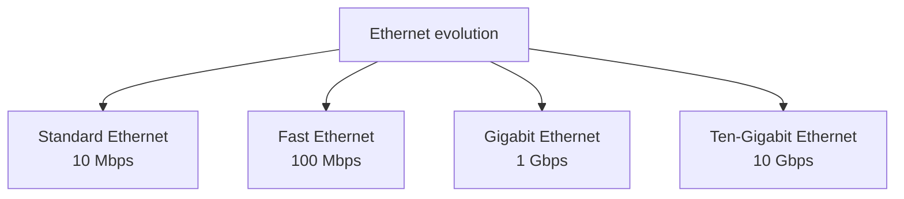

*Figure 4. Four generations of Ethernet*

Ethernet technologies have names such as 10BASE-T, 10BASE-2, 100BASE-T, 1000BASE-LX, and 10GBASE-T. These names follow a convention.

- **First part:** The speed of the standard. 10, 100, 1000, and 10G mean 10 Mbps, 100 Mbps, 1 Gbps, and 10 Gbps, respectively.
- **BASE:** Baseband Ethernet, meaning that the physical medium carries only Ethernet traffic. Almost all 802.3 standards are baseband Ethernet.
- **Last part:** The physical medium. Ethernet is both a link-layer and a physical-layer specification and is carried over various media such as coaxial cable, copper wire, and fiber. Generally, T refers to twisted-pair copper wire and F to fiber. A number, as in the 5 or 2 of Standard Ethernet, roughly gives the maximum cable length in units of 100 m (5 for 500 m, 2 for 185 m).

### 4.2 Standard Ethernet

**Standard Ethernet** is the original Ethernet running at 10 Mbps. It is now history, but it is the basis for understanding the later versions. Its access method is CSMA/CD, and its minimum frame size is 512 bits (Chapter 18). The four implementations that became popular in the 1980s are as follows.

| Characteristic | 10Base5 | 10Base2 | 10Base-T | 10Base-F |
|:-----|:-----|:-----|:-----|:-----|
| Medium | Thick coax | Thin coax | 2 UTP | 2 fiber |
| Maximum length | 500 m | 185 m | 100 m | 2000 m |
| Topology | Bus (connected by taps) | Bus (connected by tees) | Hub-based star | Hub-based star |

*Table 4. Implementations of Standard Ethernet*

10BASE-2 and 10BASE-5 specify 10 Mbps Ethernet over two kinds of coaxial cable, each with a limited cable length. Longer runs are obtained with a **repeater**. A coaxial cable is a broadcast medium in which all frames transmitted by one interface are received at the other interfaces, and CSMA/CD solves the multiple access problem. Nodes simply attach to the cable, and the result is a LAN.

### 4.3 Fast Ethernet

**Fast Ethernet** was designed to compete with LAN protocols such as FDDI and Fiber Channel, and the IEEE created it under the name **802.3u**. It is backward-compatible with Standard Ethernet but transmits ten times faster, at 100 Mbps. Its design goals are as follows.

1. Upgrade the data rate to 100 Mbps.
2. Make it compatible with Standard Ethernet.
3. Keep the same 48-bit address.
4. Keep the same frame format.
5. Keep the same minimum and maximum frame lengths.

The main consideration in the evolution from 10 to 100 Mbps was to keep the MAC sublayer untouched. However, bus topologies were dropped and only the star topology was kept. For the star topology there are two choices.

- **Half duplex:** The stations are connected via a hub. The access method is still CSMA/CD.
- **Full duplex:** The connection is made via a switch with buffers at each port. CSMA/CD is not needed, but implementations keep it for backward compatibility with Standard Ethernet.

A new feature added to Fast Ethernet is **autonegotiation**. It allows two devices to negotiate the mode or the data rate of operation, and it was designed for the following purposes.

- To allow incompatible devices to connect to one another. For example, a device with a maximum capacity of 10 Mbps can communicate with a 100 Mbps device (at the lower rate).
- To allow one device to have multiple capabilities.
- To allow a station to check a hub's capabilities.

| Characteristic | 100Base-TX | 100Base-FX | 100Base-T4 |
|:-----|:-----|:-----|:-----|
| Medium | STP | Fiber | UTP |
| Number of wires | 2 | 2 | 4 |
| Maximum length | 100 m | 100 m | 100 m |

*Table 5. Implementations of Fast Ethernet*

The physical-layer implementations are either two-wire or four-wire. The two-wire implementations are 100Base-TX over shielded twisted pair (STP) and 100Base-FX over fiber, and the four-wire implementation is 100Base-T4, designed only for unshielded twisted pair (UTP). The 100 Mbps standards keep the original Ethernet MAC protocol and frame format and define only faster physical layers for copper wire and fiber. They reach 100 m over twisted pair and several kilometers over fiber, which allows Ethernet switches in different buildings to be connected.

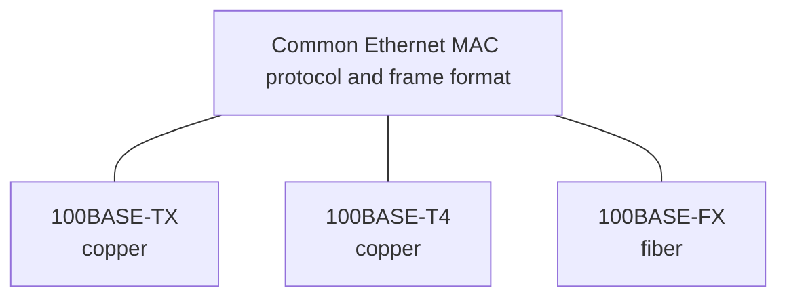

*Figure 5. 100 Mbps Ethernet with a common link layer and different physical layers*

### 4.4 Gigabit Ethernet

The need for an even higher data rate led to the design of the 1000 Mbps **Gigabit Ethernet**, whose standard the IEEE calls **802.3z**. Its design goals are those of Fast Ethernet plus support for autonegotiation.

1. Upgrade the data rate to 1 Gbps.
2. Make it compatible with Standard or Fast Ethernet.
3. Use the same 48-bit address.
4. Use the same frame format.
5. Keep the same minimum and maximum frame lengths.
6. Support autonegotiation as defined in Fast Ethernet.

Because it uses the frame format of Standard Ethernet, it is backward compatible with 10BASE-T and 100BASE-T technologies and integrates easily with the existing base of Ethernet equipment. It initially operated over optical fiber but can now run over category 5 UTP cabling.

To achieve 1 Gbps, the MAC sublayer could no longer be left untouched. Gigabit Ethernet has two approaches to medium access.

- **Full-duplex mode:** A central switch is connected to all computers or other switches. The switch has buffers for each input port in which data are stored until they are transmitted. There are no collisions, so CSMA/CD is not used, and the maximum cable length is determined by the signal attenuation in the cable rather than by collision detection. Almost all implementations follow this approach.
- **Half-duplex mode:** Rarely, a hub replaces the switch and acts as a common cable in which collisions might occur, so CSMA/CD is used. The maximum length of the network then depends entirely on the minimum frame size (Chapter 18). Three solutions have been defined for this.

| Method | Content | Result |
|:-----|:-----|:-----|
| Traditional | Keep the minimum frame length of traditional Ethernet, 512 bits | Since a bit is 1/100 as long as in 10 Mbps Ethernet, the maximum network length shrinks to 25 m; this may suit stations all in one room but may not even reach across one office |
| Carrier extension | Increase the minimum frame length 8 times to 512 bytes (4096 bits), adding extension bits (padding) to any frame shorter than 4096 bits | The maximum network length grows 8 times to 200 m, allowing 100 m from the hub to a station |
| Frame bursting | Instead of adding an extension to each short frame, send multiple frames in a row and fill the gaps between them with the same padding as carrier extension so that the channel is not idle | Other stations see what looks like one very large frame, which reduces the inefficiency of a series of short frames |

*Table 6. Three methods for half-duplex Gigabit Ethernet*

> **Note:** **Where 25 m and 200 m come from.** The textbook obtains 25 m by scaling a 10 Mbps network length of 2500 m down by the factor of 100 by which a bit becomes shorter. A calculation from propagation alone gives larger limits. At 1 Gbps the 512-bit minimum frame lasts 0.512 μs, so $`T_p \le 0.256\ \mu\text{s}`$, which at a propagation speed of $`2 \times 10^8`$ m/s is 51.2 m, and the 4096-bit frame of carrier extension allows 409.6 m. The textbook's values are about half of these bounds because the 2500 m it scales is itself about half of the 5120 m that a maximum propagation time of 25.6 μs alone would allow at 10 Mbps (Chapter 18). A real network must also absorb delays other than propagation, such as those inside repeaters, hubs, and adapters, so its permitted length stays below the propagation-only bound. Both views agree that the traditional method confines the network to about one room and that carrier extension lengthens it eightfold.

| Characteristic | 1000Base-SX | 1000Base-LX | 1000Base-CX | 1000Base-T |
|:-----|:-----|:-----|:-----|:-----|
| Medium | Fiber (short-wave) | Fiber (long-wave) | STP | Cat 5 UTP |
| Number of wires | 2 | 2 | 2 | 4 |
| Maximum length | 550 m | 5000 m | 25 m | 100 m |

*Table 7. Implementations of Gigabit Ethernet*

The implementation over four pairs of Category 5 UTP in the last column is standardized as 1000BASE-T by IEEE 802.3ab [1]. Forouzan's table calls the same implementation 1000Base-T4.

### 4.5 Ten-Gigabit Ethernet

The IEEE created **Ten-Gigabit Ethernet** and called it **802.3ae**. Its design goals are as follows.

1. Upgrade the data rate to 10 Gbps.
2. Make it compatible with Standard, Fast, and Gigabit Ethernet.
3. Use the same 48-bit address.
4. Use the same frame format.
5. Keep the same minimum and maximum frame lengths.
6. Allow the interconnection of existing LANs into a metropolitan area network (MAN) or a wide area network (WAN).
7. Make Ethernet compatible with technologies such as Frame Relay and ATM (Chapter 21).

Ten-Gigabit Ethernet operates only in full-duplex mode, so there is no need for contention and CSMA/CD is not used.

| Characteristic | 10GBase-S | 10GBase-L | 10GBase-E |
|:-----|:-----|:-----|:-----|
| Medium | Multimode fiber | Single-mode fiber | Single-mode fiber |
| Number of wires | 2 | 2 | 2 |
| Maximum length | 300 m | 10,000 m | 40,000 m |

*Table 8. Implementations of Ten-Gigabit Ethernet*

| Generation | Speed | IEEE standard | Main media | Access method |
|:-----|:-----|:-----|:-----|:-----|
| Standard Ethernet | 10 Mbps | 802.3 | Coax, UTP, fiber | CSMA/CD |
| Fast Ethernet | 100 Mbps | 802.3u | STP, UTP, fiber | CSMA/CD for half duplex, not needed for full duplex |
| Gigabit Ethernet | 1 Gbps | 802.3z | Fiber, STP, UTP | Mostly full duplex (half duplex with CSMA/CD and carrier extension) |
| Ten-Gigabit Ethernet | 10 Gbps | 802.3ae | Fiber | Full duplex only (no CSMA/CD) |

*Table 9. Comparison of the four generations of Ethernet*

### 4.6 The MAC Protocol in the Age of Switches

In the days of bus topologies and hub-based star topologies, Ethernet was clearly a broadcast link in which frames collided when nodes transmitted at the same time, and the standard included CSMA/CD to handle this. Things are different with today's star topologies built around store-and-forward switches. A switch coordinates its transmissions and never forwards more than one frame onto the same interface at a time (Section 6), and modern switches are full duplex, so a switch and a node can send frames to each other at the same time without interference. In other words, a switch-based Ethernet LAN has no collisions and therefore needs no MAC protocol.

Today's Ethernet is very different from the original one. Speeds have increased by three orders of magnitude, frames are carried over many media, switched Ethernet has become dominant, and the MAC protocol is often unnecessary. It can still be called Ethernet because one thing has remained unchanged through all these changes: Ethernet's frame format, which can be regarded as the enduring centerpiece of the Ethernet standard.

---

<br>

## 5. Connecting Devices

### 5.1 Classification of Connecting Devices

Connecting LANs and WANs together requires **connecting devices**. Connecting devices operate at different layers of the Internet model, and this section covers three kinds.

- **Repeaters (or hubs):** They operate only at the physical layer.
- **Bridges (or two-layer switches):** They operate up through the physical and data link layers.
- **Routers (or three-layer switches):** They operate up through the physical, data link, and network layers.

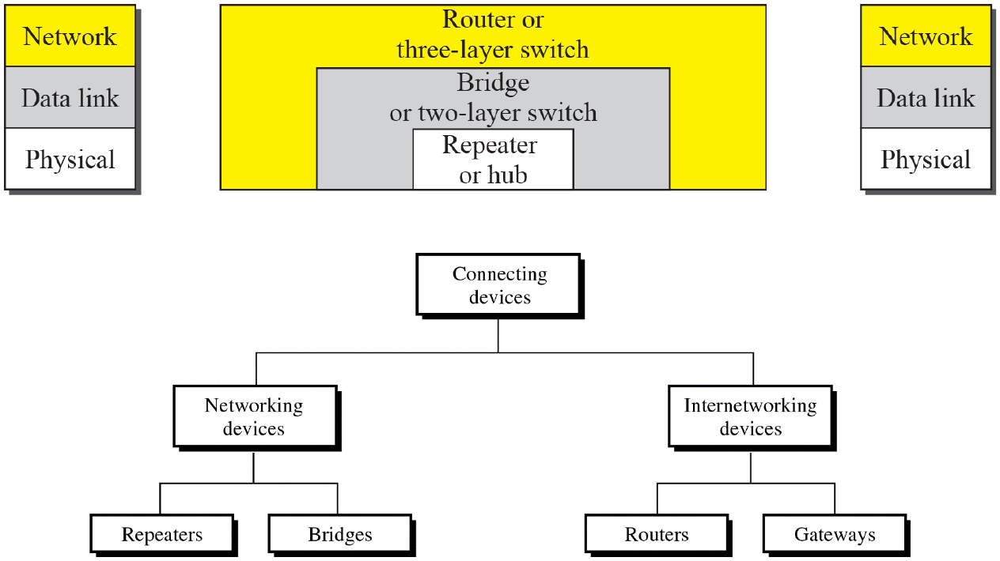

*Figure 6. Layers at which connecting devices operate and their classification*

The upper part of Figure 6 shows the layers at which each device operates: a repeater or hub at the physical layer, a bridge or two-layer switch up to the data link layer, and a router or three-layer switch up to the network layer. In the classification below, connecting devices are divided into networking devices that join segments within one network (repeaters, bridges) and internetworking devices that join independent networks (routers and others).

### 5.2 Repeaters and Hubs

> **Definition:** A **repeater** is a physical-layer device that regenerates the signal received on one side and sends it out on the other side, and a multiport repeater is called a hub.

A repeater connects segments of a LAN. In a bus topology, a repeater joins two coaxial cable segments to overcome the cable length limit. Today's Ethernet LANs use a star topology, in which the repeater becomes a multiport device, the hub, that serves both as the connecting point and as a repeater.

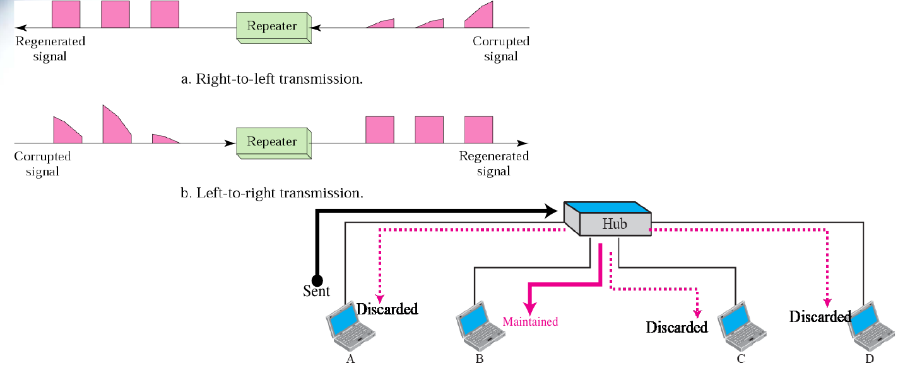

*Figure 7. Signal regeneration by a repeater and frame delivery by a hub*

- **A regenerator, not an amplifier:** A repeater regenerates the signal rather than amplifying it. As in the upper part of Figure 7, when a signal distorted by noise arrives, it re-creates the original bit pattern and sends it out. An amplifier would amplify the noise as well.
- **No filtering capability:** When a frame from station A to B arrives at the hub, the hub regenerates the signal representing the frame to remove noise, but sends it out of every outgoing port. In other words, the frame is broadcast. All stations on the LAN receive the frame, but only B keeps it and the rest discard it. The hub has no means of finding out from which port the frame should be sent.
- **No addresses:** Repeaters and hubs are physical-layer devices, so they have no data-link addresses and do not check the data-link address of a received frame. They simply regenerate the corrupted bits and send them out of every port.

> **Key Point:** A repeater forwards every bit; it has no filtering capability.

> **Definition:** A **collision domain** is the part of a network within which two devices transmitting at the same time cause their frames to collide.

All stations connected to a hub form one collision domain, because the hub sends received bits out of every port, so frames arriving at two ports at the same time collide.

### 5.3 Bridges and Filtering

> **Definition:** A **bridge** is a connecting device that operates at the physical and data link layers, which not only regenerates the signal but also checks the MAC address of a frame to decide to which port the frame should be sent.

As a physical-layer device, a bridge regenerates the signal it receives, and as a data-link-layer device, it checks the MAC addresses (source and destination) contained in the frame. The difference in function between a bridge and a repeater is the **filtering** capability. A bridge can check the destination address of a frame and decide from which outgoing port to send it, and it has a table used for this decision.

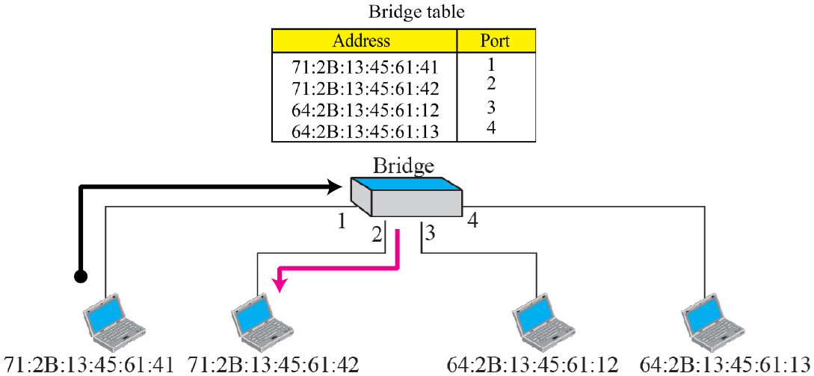

*Figure 8. A bridge and its bridge table*

In the LAN of Figure 8, four stations are connected to a bridge. When a frame destined for 71:2B:13:45:61:42 arrives at port 1, the bridge consults its table to find the departing port. According to the table, frames for 71:2B:13:45:61:42 need to be sent out only through port 2, so there is no need to forward the frame through the other ports. A bridge is a device that joins segments within one network.

> **Key Point:** A bridge has a table used in filtering decisions, and it does not change the physical (MAC) addresses in a frame.

A bridge divides a LAN into several collision domains. It still forwards broadcast frames to all ports, however, so it does not divide the reach of a broadcast.

### 5.4 Transparent Bridges and Learning

A **transparent bridge** is a bridge whose existence the stations are completely unaware of. If a bridge is added to or removed from the system, the stations need not be reconfigured. According to the IEEE 802.1d specification, a system equipped with transparent bridges must meet the following three criteria.

1. Frames must be forwarded from one station to another.
2. The forwarding table must be built automatically by learning the frame movements in the network.
3. Loops in the system must be prevented.

The earliest bridges used static tables, whose entries the administrator entered by hand during bridge setup. This was simple but not practical. Whenever a station was added or removed, or a MAC address changed because a network card was replaced, the table had to be modified by hand. A better solution is a dynamic table that gradually learns the mapping of addresses to ports from the movements of frames. The bridge uses the destination address for the forwarding decision (table lookup) and the source address for adding and updating table entries.

Suppose that stations A (71:2B:13:45:61:41, port 1), B (71:2B:13:45:61:42, port 2), C (64:2B:13:45:61:12, port 3), and D (64:2B:13:45:61:13, port 4) are connected to a bridge like the one in Figure 8, and that the table is empty.

| Event | Action of the bridge | Entry added to the table after learning |
|:-----|:-----|:-----|
| A sends a frame to D | Neither D nor A has an entry, so the frame goes out of all three other ports (flooding); from the source address, the bridge learns that A is on port 1 | 71:2B:13:45:61:41, port 1 |
| D sends a frame to B | B has no entry, so the frame floods again; the bridge learns that D is on port 4 | 64:2B:13:45:61:13, port 4 |
| B sends a frame to A | A has an entry, so the frame goes out of port 1 only; the bridge learns that B is on port 2 | 71:2B:13:45:61:42, port 2 |
| C sends a frame to D | D has an entry, so the frame goes out of port 4 only; the bridge learns that C is on port 3 | 64:2B:13:45:61:12, port 3 |

*Table 10. Gradual building of the table of a learning bridge*

Learning continues until the table has information about every port. Learning may take a long time, however. For example, if a station never sends a frame (a rare situation), it never gets an entry in the table.

Care is needed with the term **two-layer switch**, because a switch can mean two different things depending on the layer at which it operates. A two-layer switch operates at the physical and data link layers and is a sophisticated bridge with faster forwarding. The link-layer switch of Section 6 is such a device.

### 5.5 Routers

A router is a three-layer device that operates at the physical, data link, and network layers. As a physical-layer device, it regenerates the signal it receives; as a data-link-layer device, it checks the physical addresses (source and destination) contained in the packet; and as a network-layer device, it checks the network-layer addresses (the addresses of the IP layer). Bridges change collision domains, whereas routers limit the reach of broadcasts.

A router can connect LANs together, WANs together, and LANs with WANs. In other words, a router is an internetworking device that connects independent networks to form an internetwork, and two networks connected by a router become an internetwork, or an internet.

> **Key Point:** A repeater or a bridge connects segments of a LAN, and a router connects independent LANs or WANs to create an internetwork (internet).

There are three major differences between a router and a repeater or bridge.

1. A router has a physical address and a logical (IP) address for each of its interfaces.
2. A router acts only on packets whose physical destination address matches the address of the interface at which they arrive.
3. A router changes the physical addresses of a packet (both source and destination) when it forwards the packet.

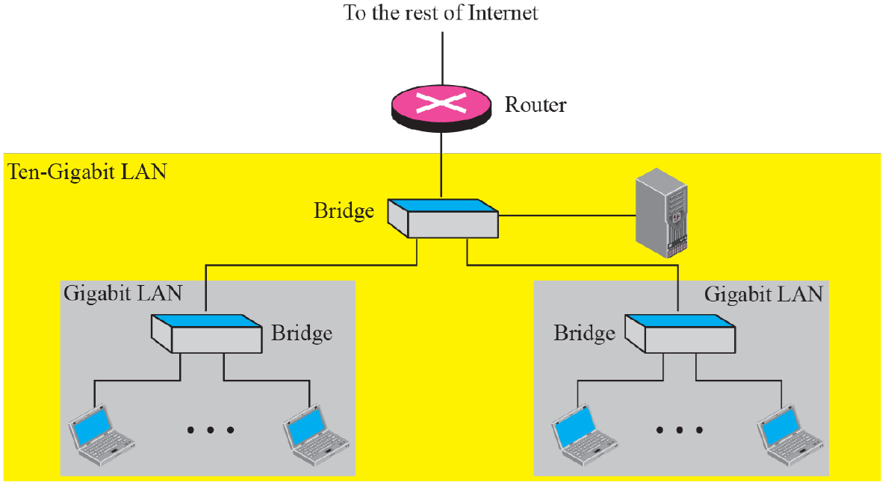

*Figure 9. LANs joined by bridges and connected to the Internet by a router*

In Figure 9, an organization has a Gigabit Ethernet LAN in each of two buildings and uses bridges in each LAN. The two LANs are connected with Ten-Gigabit Ethernet technology to form one larger LAN, which speeds up the connection to the Ethernet and to the organization's server. A router then connects the whole system to the Internet. Whereas a bridge operates within one network (the same subnet), a router operates between several networks. Since MAC addresses are valid only within a local network, a router changes the MAC addresses of a received packet before sending it into the next network (Chapter 19).

> **Key Point:** A router changes the physical addresses in a packet.

A **three-layer switch** is a router: a router with an improved design for better performance, which receives, processes, and dispatches a packet much faster than a traditional router even though the functionality is the same. In these notes, to avoid confusion, a three-layer switch is also called a router.

| Device | Layers of operation | Regenerates signal | Checks addresses | Filtering | Changes addresses | Connects |
|:-----|:-----|:-----|:-----|:-----|:-----|:-----|
| Repeater, hub | Physical | Yes | No | None (forwards every bit) | No | Segments of one LAN |
| Bridge, two-layer switch | Physical, data link | Yes | MAC addresses | Yes (bridge table) | Does not change MAC addresses | Segments of one LAN |
| Router, three-layer switch | Physical, data link, network | Yes | MAC and IP addresses | Yes (forwarding table) | Changes source and destination MAC addresses | Independent LANs and WANs |

*Table 11. Comparison of connecting devices by layer*

---

<br>

## 6. Link-Layer Switches

A link-layer switch receives incoming link-layer frames and forwards them onto outgoing links. The switch is **transparent** to the hosts and routers in the subnet. A host or router addresses a frame to another host or router, not to the switch, and sends it into the LAN, unaware that a switch will receive and forward the frame. The rate at which frames arrive at one of the switch's output interfaces may temporarily exceed the link capacity of that interface, so, like the output interfaces of a router, the output interfaces of a switch have buffers.

### 6.1 Forwarding and Filtering

The two basic functions of a switch are the following.

- **Filtering:** Determining whether a frame should be forwarded to some interface or should be dropped.
- **Forwarding:** Determining the interfaces to which a frame should be directed and moving the frame to those interfaces.

> **Definition:** A **switch table** is the table that a switch uses for filtering and forwarding, each of whose entries consists of a MAC address, the switch interface leading toward that MAC address, and the time at which the entry was placed in the table.

A switch table may contain entries for only some of the hosts and routers on a LAN. The following is part of the table of a switch with four interfaces.

| MAC address | Interface | Time |
|:-----|:-----|:-----|
| 3E:91:0A:22:5C:01 | 1 | 9:32 |
| 7A:10:4B:9D:E3:27 | 3 | 9:36 |
| ... | ... | ... |

*Table 12. Part of a switch table*

A switch forwards frames by MAC address and does not use IP addresses. Moreover, a switch table is built in a very different way from a router's forwarding table (Section 6.2). Suppose that a frame with destination address DD-DD-DD-DD-DD-DD arrives at the switch on interface x. The switch looks up the MAC address DD-DD-DD-DD-DD-DD in its table, and there are three possible cases.

1. **There is no entry for DD-DD-DD-DD-DD-DD in the table.** The switch sends copies of the frame to the output buffers of all interfaces except interface x. In other words, if there is no entry for the destination address, the switch broadcasts the frame.
2. **There is an entry associating DD-DD-DD-DD-DD-DD with interface x.** The frame came from the LAN segment that already contains adapter DD-DD-DD-DD-DD-DD, so there is no need to forward it to any other interface. The switch performs the filtering function by discarding the frame.
3. **There is an entry associating DD-DD-DD-DD-DD-DD with interface y (y ≠ x).** The frame needs to be forwarded to the LAN segment attached to interface y. The switch performs the forwarding function by putting the frame in the output buffer that precedes interface y.

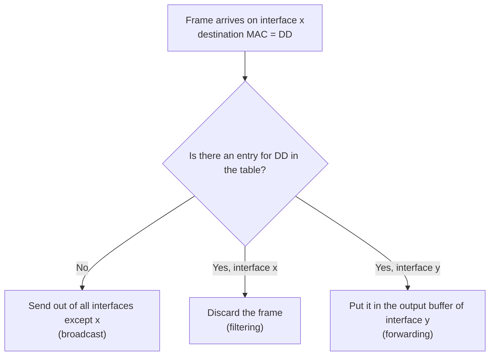

*Figure 10. Filtering and forwarding decisions of a switch*

For example, if a frame with destination address 3E:91:0A:22:5C:01 arrives at the switch of Table 12 on interface 1, the destination is on the segment of interface 1, so the frame has already been broadcast on the segment containing the destination. The switch discards the frame. If the same frame arrives on interface 2, the destination lies in the direction of interface 1, so the switch sends the frame to the output buffer of interface 1. As long as the switch table is complete and accurate, the switch forwards frames toward their destinations without any broadcasting. In this sense a switch is smarter than a hub.

### 6.2 Self-Learning

> **Definition:** **Self-learning** is the capability of a switch to build its switch table automatically, without intervention from an administrator or a configuration protocol, by recording the source MAC address and arrival interface of incoming frames.

A switch's table is built automatically, dynamically, and autonomously, as follows.

1. The switch table is initially empty.
2. For each frame received on an interface, the switch stores in its table (1) the MAC address in the frame's source address field, (2) the interface on which the frame arrived, and (3) the current time. In this way it records the LAN segment on which the sender resides. If every host on the LAN eventually sends a frame, every host is eventually recorded in the table.
3. The switch deletes an address from the table if no frame with that address as its source address arrives within some period of time (the **aging time**). In this way, if a PC is replaced by another PC with a different adapter, the MAC address of the original PC is eventually purged from the table.

For example, if at 9:39 a frame with source address 01:12:23:34:45:56 arrives on interface 2 and this address is not in the table, the switch adds the entry (01:12:23:34:45:56, 2, 9:39). If the aging time is 60 minutes and no frame with source address 3E:91:0A:22:5C:01 arrives between 9:32 and 10:32, the switch removes that address from the table at 10:32.

| MAC address | Interface | Time |
|:-----|:-----|:-----|
| **01:12:23:34:45:56** | **2** | **9:39** |
| 3E:91:0A:22:5C:01 | 1 | 9:32 |
| 7A:10:4B:9D:E3:27 | 3 | 9:36 |
| ... | ... | ... |

*Table 13. The switch table after learning the location of 01:12:23:34:45:56*

Switches are **plug-and-play** devices that require no intervention from a network administrator or user. An administrator who wants to install a switch need do nothing more than connect the LAN segments to the switch interfaces, and need not configure the switch table at installation or when a host is removed from a LAN segment. Switches are also full duplex, so any interface can send and receive at the same time.

### 6.3 Properties of Switches

Using switches instead of broadcast links such as buses or hub-based star topologies has the following advantages.

- **Elimination of collisions:** In a LAN built only from switches, without hubs, no bandwidth is wasted on collisions. The switches buffer frames and never transmit more than one frame on a segment at a time. As with a router, the maximum aggregate throughput of a switch is the sum of all its interface rates, so switches greatly improve performance over LANs with broadcast links.
- **Heterogeneous links:** A switch isolates links from one another, so the links of a LAN can operate at different speeds and over different media. For example, one switch might have three 1 Gbps 1000BASE-T copper links, two 100 Mbps 100BASE-FX fiber links, and one 100BASE-T copper link. A switch is therefore well suited to mixing legacy equipment with new equipment.
- **Management:** If an adapter malfunctions and continually sends Ethernet frames (a jabbering adapter), a switch can detect the problem and internally disconnect that adapter. A cable cut disconnects only the host using that cable to connect to the switch. In the days of coaxial cable, administrators spent hours walking the line to find the cable break that brought down the entire network. Switches also gather statistics on bandwidth usage, collision rates, and traffic types and make them available to the administrator, who can use them to debug problems and plan how the LAN should evolve.

In terms of collision domains, a hub puts all the devices connected to it into one collision domain, a switch makes a separate collision domain for each port, and on full-duplex links collisions do not occur at all.

| Characteristic | Hub | Bridge | Switch |
|:-----|:-----|:-----|:-----|
| Layers of operation | Physical | Physical, data link | Physical, data link |
| Collision domain | One for all connected devices | Separate per port | Separate per port (none on full duplex) |
| Bandwidth | Shared by all devices | Shared per segment | Dedicated per port |
| Delivery | Out of every port | Selectively by table | Selectively by table |

*Table 14. Comparison of hubs, bridges, and switches*

### 6.4 Sniffing a Switched LAN and Switch Poisoning

A host connected to a switch usually receives only the frames intended for it. When host A sends a frame to host B and the switch table has an entry for B, the switch forwards the frame only to B. Even if host C is running a sniffer, it cannot see this A-to-B frame. Unlike broadcast-link environments such as 802.11 LANs or hub-based Ethernet LANs, a switched LAN makes it hard for an attacker to sniff frames.

However, because the switch broadcasts frames whose destination addresses are not in its table, the sniffer at C can still see some frames not intended for C. It can also see every Ethernet broadcast frame with destination FF-FF-FF-FF-FF-FF. A well-known attack, **switch poisoning**, sends the switch a flood of packets with many different bogus source MAC addresses, filling the switch table with bogus entries and leaving no room for the MAC addresses of legitimate hosts. The switch then broadcasts most frames, which the sniffer can pick up. Since this attack is rather involved even for a sophisticated attacker, switches are significantly less vulnerable to sniffing than hubs and wireless LANs.

> **[Information Security]** Switch poisoning exploits the fact that the self-learning of Section 6.2 records source addresses in the table without verifying them. Just as ARP spoofing in Chapter 19 poisons the ARP cache, any automatic learning function that trusts information received without authentication becomes a target of poisoning attacks.

---

<br>

## 7. Switches and Routers

### 7.1 Layers at Which Packets Are Processed

A router is a store-and-forward packet switch that forwards packets using network-layer addresses (Chapter 13). A switch is also a store-and-forward packet switch, but it differs fundamentally from a router in that it forwards packets using MAC addresses. A router is a layer-3 packet switch, and a switch is a layer-2 packet switch.

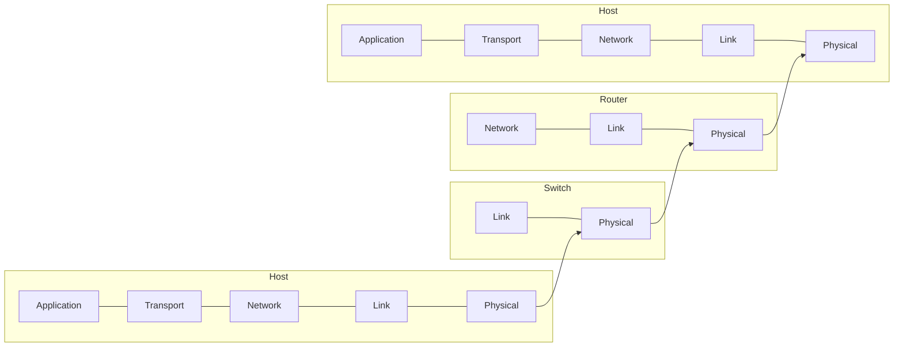

*Figure 11. Layers at which hosts, switches, and routers process packets*

> **Note:** In the generalized forwarding covered in Chapter 24, modern switches using the "match plus action" operation can forward a layer-2 frame based on the frame's destination MAC address, as well as a layer-3 datagram based on the datagram's destination IP address. Switches using the OpenFlow standard can perform generalized forwarding based on many fields of the frame, datagram, and transport-layer headers.

### 7.2 Comparison of Pros and Cons

Network administrators must often choose between a switch and a router when installing an interconnection device. For example, a router could just as easily be used instead of a switch to connect the LANs of several departments, servers, and an Internet gateway router, and a router would permit interdepartmental communication without collisions.

**Pros and cons of switches**

- Switches are plug-and-play.
- They process frames only up through layer 2, so their filtering and forwarding rates are higher than those of routers, which must process up through layer 3.
- However, to prevent the cycling of broadcast frames, the active topology of a switched network is restricted to a **spanning tree**.
- A large switched network requires large ARP tables in the hosts and routers and generates substantial ARP traffic and processing.
- Switches are susceptible to **broadcast storms**. If one host goes haywire and transmits an endless stream of Ethernet broadcast frames, the switches forward all of them, and the entire network can collapse.

**Pros and cons of routers**

- Network addressing is often hierarchical, not flat like MAC addressing, so packets do not normally cycle through routers even when the network has redundant paths. Packets can cycle when router tables are misconfigured, but IP limits the cycling with a special header field (TTL, Chapter 11).
- Packets are therefore not restricted to a spanning tree and can use the best path between source and destination. This has allowed the Internet to be built with a rich topology, including, for example, multiple active links between Europe and North America.
- Routers provide firewall protection against layer-2 broadcast storms.
- Their most significant drawback is that they are not plug-and-play: routers and the hosts connected to them need their IP addresses to be configured.
- Routers often have a larger per-packet processing time than switches, because they have to process up through the layer-3 fields.

| Feature | Hubs | Routers | Switches |
|:-----|:-----|:-----|:-----|
| Traffic isolation | No | Yes | Yes |
| Plug and play | Yes | No | Yes |
| Optimal routing | No | Yes | No |

*Table 15. Comparison of the typical features of popular interconnection devices*

When, then, should a university or corporate campus network use switches, and when routers? Small networks of a few hundred hosts have a few LAN segments, and switches suffice for them. Switches localize traffic and increase aggregate throughput without requiring any IP address configuration. Larger networks of thousands of hosts typically include routers in addition to switches. The routers provide more robust traffic isolation, control broadcast storms, and use more intelligent routes among the hosts.

---

<br>

## 8. Virtual LANs (VLANs)

### 8.1 Limits of Hierarchical Switched LANs

Modern institutional LANs are often configured hierarchically, with each workgroup (department) having its own switched LAN connected to the switched LANs of other groups through a switch hierarchy. This works well in an ideal world, but in reality it has three drawbacks.

- **Lack of traffic isolation:** The hierarchy localizes group traffic within a single switch, but broadcast traffic, such as frames carrying ARP and DHCP messages or frames whose destination a self-learning switch has not yet learned, must still traverse the entire institutional network. Limiting the scope of such broadcasts would improve LAN performance. It may also be desirable to limit broadcast scope for security and privacy. For example, one may want the executives' traffic never to reach the hosts of another group running packet sniffers. Replacing the center switch with a router would provide such isolation, but there is also a layer-2 solution.
- **Inefficient use of switches:** With ten groups instead of three, ten first-level switches would be required. If each group were small, say fewer than ten people, a single 96-port switch could accommodate everyone, but that single switch would not provide traffic isolation.
- **Managing users:** If an employee moves between groups, the physical cabling must be changed to connect the employee to a different switch. Employees who belong to two groups make the problem even harder.

### 8.2 Port-Based VLANs

> **Definition:** A **VLAN (virtual local area network)** is a technology that defines multiple virtual LANs over a single physical LAN infrastructure, so that the hosts in a VLAN communicate as if they, and no other hosts, were connected to the switch.

A switch that supports VLANs solves all three difficulties above. In a **port-based VLAN**, the network manager divides the switch's ports (interfaces) into groups. Each group constitutes a VLAN, and the ports in each VLAN form a **broadcast domain**; that is, broadcast traffic from one port can reach only the other ports in the group.

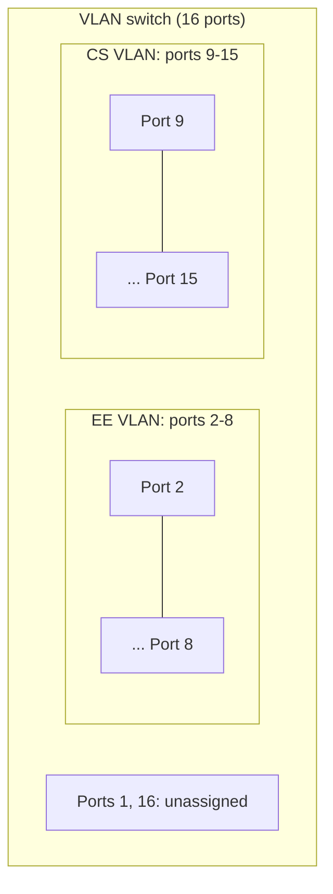

*Figure 12. A single switch with two configured VLANs*

The switch of Figure 12 has 16 ports: ports 2-8 belong to the Electrical Engineering (EE) VLAN, ports 9-15 to the Computer Science (CS) VLAN, and ports 1 and 16 are unassigned. This configuration solves all three difficulties.

- EE VLAN and CS VLAN frames are isolated from each other.
- The two departmental switches are replaced by a single switch.
- If the user at port 8 joins the CS department, the network operator simply reconfigures the VLAN software so that port 8 is associated with the CS VLAN.

The configuration and operation of a VLAN switch are simple. The network manager uses switch management software to declare to which VLAN each port belongs (undeclared ports belong to a default VLAN), a table of port-to-VLAN mappings is maintained in the switch, and the switch hardware delivers frames only between ports belonging to the same VLAN.

### 8.3 Communication between VLANs

Completely isolating the two VLANs introduces a new difficulty: how can traffic from the EE department be sent to the CS department? One way is to connect one port of the VLAN switch (for example, port 1) to an external router and configure that port to belong to both the EE and CS VLANs. Even though the two departments share the same physical switch, the logical configuration then looks as if each department had its own switch and the two were connected by a router. An IP datagram from EE to CS first crosses the EE VLAN to reach the router, and the router forwards it back over the CS VLAN to the CS host. Switch vendors make such configurations easy by building a VLAN switch and a router into a single device, so that no separate external router is needed.

### 8.4 VLAN Trunking and 802.1Q

Now suppose that some EE and CS faculty are housed in another building and want to be part of their departments' VLANs. A second 8-port switch can be placed in that building, with each port assigned to the EE VLAN or the CS VLAN. How should the two switches be interconnected?

- **One cable per VLAN:** Define a port belonging to the CS VLAN on each switch (similarly for the EE VLAN) and connect these ports to each other. With N VLANs, however, each switch would need N ports just to interconnect the two switches, so this does not scale.
- **VLAN trunking:** Configure one special port on each switch as a **trunk port** to interconnect the two VLAN switches. The trunk port belongs to all VLANs, and frames sent to any VLAN are forwarded over the trunk link to the other switch.

> **Definition:** **VLAN trunking** is a method of interconnecting VLAN switches with a single link between trunk ports that belong to all VLANs, in which frames sent over that link carry a tag indicating the VLAN to which they belong.

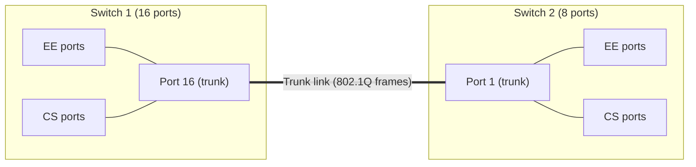

*Figure 13. Two VLAN switches connected by VLAN trunking*

How, then, does a switch know to which VLAN a frame arriving on a trunk port belongs? The IEEE has defined an extended Ethernet frame format, **802.1Q**, for frames crossing a VLAN trunk. An 802.1Q frame is a standard Ethernet frame with a four-byte **VLAN tag** added to its header, carrying the identity of the VLAN to which the frame belongs.

```text
  Standard Ethernet frame
  ┌──────────┬───────────┬───────────┬──────┬──────────────┬─────┐
  │ Preamble │ Dest addr │ Src addr  │ Type │     Data     │ CRC │
  └──────────┴───────────┴───────────┴──────┴──────────────┴─────┘

  802.1Q-tagged Ethernet frame
  ┌──────────┬───────────┬───────────┬──────┬──────┬──────┬──────────────┬──────┐
  │ Preamble │ Dest addr │ Src addr  │ TPID │ TCI  │ Type │     Data     │ CRC' │
  └──────────┴───────────┴───────────┴──────┴──────┴──────┴──────────────┴──────┘
                                       2      2
  TPID: Tag Protocol Identifier, fixed value 0x8100
  TCI:  Tag Control Information = Priority (3 bits) + 1 bit + VLAN ID (12 bits)
  CRC': recomputed CRC
```

*Figure 14. A standard Ethernet frame and an 802.1Q-tagged frame*

- **TPID (Tag Protocol Identifier):** 2 bytes, with the fixed hexadecimal value 81-00.
- **TCI (Tag Control Information):** 2 bytes, containing a 12-bit **VLAN identifier** and a 3-bit priority field similar in intent to the TOS field of the IP datagram. Since the VLAN identifier has 12 bits, it can represent $`2^{12} = 4096`$ values.
- **CRC:** Inserting the tag changes the contents of the frame, so the CRC is recomputed.

The VLAN tag is added to a frame by the switch at the sending side of the trunk and is parsed and removed by the switch at the receiving side. The tag therefore exists only on the trunk link, and the frames that hosts exchange are standard Ethernet frames. The tag makes a frame 4 bytes longer, so a maximum-length frame of 1518 bytes becomes 1522 bytes when tagged.

### 8.5 Other Kinds of VLANs

So far only port-based VLANs have been covered, but VLANs can be defined in other ways as well.

- **MAC-based VLANs:** The network manager specifies the set of MAC addresses that belong to each VLAN. Whenever a device attaches to a port, the port is connected to the appropriate VLAN based on the MAC address of the device.
- **VLANs based on network-layer protocols:** VLANs can also be defined by network-layer protocols such as IPv4, IPv6, or AppleTalk, or by other criteria.
- **VLANs across routers:** VLANs can also be extended across IP routers, joining separated LANs into a single VLAN.

---

<br>

## Concept Applications

**True/False Check:**

| Statement | Judgment and Reason |
|:-----|:-----|
| In the IEEE 802 standard, the LLC differs for each LAN protocol and the MAC is common to all LANs. | **F.** The LLC is common to all LANs, and the MAC differs for each protocol, such as Ethernet and token ring. |
| The preamble and SFD of an Ethernet frame are added at the physical layer. | **T.** Both are the physical-layer header and are not formally part of the frame. |
| If the upper-layer data are 30 bytes, Ethernet adds 16 bytes of padding. | **T.** The minimum data field is 46 bytes, so 46 − 30 = 16 bytes are added. |
| An Ethernet receiving adapter sends a negative acknowledgment for a frame that fails the CRC check. | **F.** Ethernet is an unreliable service, so it sends neither acknowledgments nor negative acknowledgments and discards the frame. |
| Fast Ethernet uses the same frame format and minimum and maximum lengths as Standard Ethernet. | **T.** Keeping the MAC sublayer untouched was the key to its design. |
| In full-duplex Gigabit Ethernet, the maximum cable length is determined by the minimum frame size. | **F.** Full duplex has no collisions, so it is determined by the signal attenuation in the cable. |
| Ten-Gigabit Ethernet uses CSMA/CD in half-duplex mode. | **F.** Ten-Gigabit Ethernet operates only in full duplex and does not use CSMA/CD. |
| A repeater amplifies the signal, so it also amplifies the noise. | **F.** A repeater is a regenerator, not an amplifier, so it re-creates the original bit pattern. |
| A bridge replaces the source MAC address of a frame with its own address when forwarding it. | **F.** A bridge does not change the MAC addresses of a frame. It is a router that changes addresses. |
| A switch sends a frame whose destination has no table entry out of all interfaces except the one on which it arrived. | **T.** With no entry, it broadcasts the frame. |
| A self-learning switch fills its table with the destination addresses of frames. | **F.** It fills the table with source addresses and arrival interfaces, and uses destination addresses for table lookup. |
| The active topology of a switched network is restricted to a spanning tree to prevent broadcast frames from cycling. | **T.** Routers, in contrast, are free of this restriction thanks to hierarchical addresses and the TTL. |
| A VLAN trunk port belongs to only one VLAN. | **F.** A trunk port belongs to all VLANs and forwards frames of any VLAN over the trunk. |
| The 802.1Q tag is inserted by the host when it creates the frame and removed by the destination host. | **F.** It is inserted by the switch at the sending side of the trunk and removed by the switch at the receiving side. |

---

<br>

## Summary

| Concept | Key Summary |
|:-----|:-----|
| LAN | It is a network for a limited area such as a building or campus, and Ethernet is today's dominant technology. |
| IEEE 802 | It divides the data link layer into an LLC common to all LANs and a MAC specific to each LAN, and working groups by topic develop the standards. |
| Ethernet topology | It changed from a coaxial bus to a hub-based star and then to a switch-based star. |
| Ethernet frame | It consists of the preamble, SFD, destination address, source address, length or type, data and padding, and CRC. |
| Frame length | Excluding the preamble and SFD, a frame is 64-1518 bytes and the data are 46-1500 bytes, with padding added when short. |
| Ethernet service | It is a connectionless service without handshaking and an unreliable service that discards erroneous frames without acknowledgments. |
| Ethernet evolution | It evolved to 10 Mbps, 100 Mbps (802.3u), 1 Gbps (802.3z), and 10 Gbps (802.3ae) while keeping the address and frame format. |
| Half-duplex Gigabit Ethernet | Keeping the minimum frame shrinks the network to 25 m, so carrier extension and frame bursting were defined. |
| Repeaters and hubs | They regenerate signals at the physical layer and send them out of all ports, with no filtering, forming a single collision domain. |
| Bridges | They operate at the physical and data link layers and filter frames with a table, but do not change MAC addresses. |
| Routers | As layer-3 devices, they connect independent networks into an internetwork and change MAC addresses when forwarding. |
| Switch forwarding and filtering | With no destination entry the switch broadcasts, with the same interface it discards, and with another interface it forwards there. |
| Self-learning | It is a plug-and-play function that records the source MAC address, arrival interface, and time, and deletes entries after the aging time. |
| Switches and routers | Switches are plug-and-play and fast but constrained by spanning trees and broadcast storms, while routers give optimal paths and isolation but need configuration. |
| VLAN | It creates multiple broadcast domains over one physical LAN, and a port-based VLAN divides ports into groups. |
| VLAN trunking and 802.1Q | Switches are joined by a trunk link, and a 4-byte tag carrying TPID 0x8100 and a 12-bit VLAN ID marks the VLAN of each frame. |

---

<br>

## Self-Check Questions

1. **Padding and frame size:** Find the padding and the frame size needed to send 20 bytes of upper-layer data in an Ethernet frame (excluding the preamble and SFD). What happens if the data are 1600 bytes? Give the sizes of the minimum and maximum frames in bytes and in bits.

   <details>
   <summary>Answer</summary>

   Since the minimum data size is 46 bytes, the padding is 46 − 20 = 26 bytes, and the frame is 6 + 6 + 2 + 46 + 4 = 64 bytes. 1600 bytes exceed the maximum data size of 1500 bytes, so they cannot fit in one frame; the upper layer (IP) must fragment them into pieces of at most 1500 bytes and send them in several frames. The minimum frame is 64 bytes (512 bits), and the maximum frame is 1518 bytes (12,144 bits).

   </details>

2. **Network length of half-duplex Gigabit Ethernet:** In a 1 Gbps half-duplex CSMA/CD network that keeps the minimum frame size of 64 bytes, what is the maximum length of the collision domain if the propagation speed is $`2 \times 10^8`$ m/s and other delays are ignored? What happens if carrier extension raises the minimum frame to 512 bytes?

   <details>
   <summary>Answer</summary>

   64 bytes are 512 bits, so the minimum transmission time is 512 / 10⁹ s = 0.512 μs. The transmission time must be at least twice the maximum propagation time, so the maximum propagation time is 0.256 μs, and the maximum length is 0.256 × 10⁻⁶ × 2 × 10⁸ = 51.2 m. Raising the minimum frame 8 times to 512 bytes (4096 bits) raises this limit 8 times as well, to 409.6 m. These values are upper bounds that consider propagation delay only; the textbook instead scales a 10 Mbps network length of 2500 m down by the factor of 100 and gives 25 m for the traditional method and 200 m for carrier extension (Section 4.4). Either way, carrier extension multiplies the network length by 8.

   </details>

3. **Collision domains:** Eight stations are connected (a) by one hub and (b) by one switch with each station on its own port. How many collision domains are there in each case? What happens in (b) if all links operate in full duplex?

   <details>
   <summary>Answer</summary>

   (a) A hub regenerates signals to all ports at the physical layer, so all eight stations form one collision domain. (b) Each port of a switch is a separate collision domain, so there are eight collision domains. With full duplex, each link sends and receives at the same time, so no collisions occur.

   </details>

4. **Tracing self-learning:** A three-port switch has host A on port 1 and host B on port 2, and hosts C and D are connected to port 3 through a hub. With the switch table initially empty, frames are sent in order (1) from A to C, (2) from C to A, (3) from D to C, and (4) from B to D. Give the switch's action for each frame and the final switch table.

   <details>
   <summary>Answer</summary>

   (1) C has no entry, so the switch broadcasts to ports 2 and 3 and learns that A is on port 1. (2) A's entry is port 1, so the switch sends only to port 1 and learns that C is on port 3. (3) C's entry is port 3, the same port on which the frame arrived, so the switch discards the frame (filtering) and learns that D is on port 3; C has already received the frame through the hub. (4) D's entry is port 3, so the switch sends only to port 3 and learns that B is on port 2. The final table is A on port 1, C on port 3, D on port 3, and B on port 2.

   </details>

5. **Overhead of 802.1Q:** By how many bytes does an 802.1Q tag lengthen a frame? How many bytes is a maximum-size frame once tagged? How many values can the VLAN identifier distinguish?

   <details>
   <summary>Answer</summary>

   A 4-byte tag made of a 2-byte TPID and a 2-byte TCI is added, so the frame grows by 4 bytes. The maximum frame of 1518 bytes, excluding the preamble and SFD, becomes 1522 bytes when tagged. The VLAN identifier has 12 bits, so it can distinguish $`2^{12} = 4096`$ values.

   </details>

6. **Bridges and routers:** Explain how a bridge and a router each treat MAC addresses when forwarding a frame (packet), and why the difference arises.

   <details>
   <summary>Answer</summary>

   A bridge joins segments within one LAN, so it sends the frame out of the appropriate port according to its table without changing the source and destination MAC addresses. A router joins independent networks and has its own MAC address and IP address on each interface. Because MAC addresses are valid only within a local network, a router, when sending a packet into the next network, changes the source MAC address to that of the outgoing interface and the destination MAC address to that of the next hop.

   </details>

7. **Choosing switches and routers:** Explain, with reasons, how switches and routers should be used in a small office of 300 hosts and in a university campus of several thousand hosts.

   <details>
   <summary>Answer</summary>

   A small network of a few hundred hosts has only a few LAN segments, so switches alone suffice. Switches are plug-and-play devices that localize traffic and increase aggregate throughput without IP address configuration. In a large network of thousands of hosts, using only switches brings the spanning-tree restriction, growing ARP tables and ARP traffic, and the risk of broadcast storms, so routers are used together with switches. Routers isolate traffic robustly, stop broadcast storms, and use better routes.

   </details>

---

<br>

## References

1. IEEE 802.3 Ethernet Working Group, "IEEE P802.3ab 1000BASE-T Task Force." [Online]. Available: https://www.ieee802.org/3/ab/index.html
