# 21장 — 광역 네트워크와 링크 가상화

[레포지토리 안내](../../README.ko.md) | [English](Concepts_Lecture.md) | [한국어](Concepts_Lecture.ko.md)

> **최종 수정일:** 2026-11-27
>
> Computer Networking: A Top-Down Approach, Kurose and Ross, Ch 6; TCP/IP Protocol Suite, Forouzan, Ch 3, 6, 7

> **학습 목표:**
> 1. 점대점 WAN과 교환형 WAN의 차이와 인터넷에서 각 기술이 쓰이는 위치를 설명할 수 있다
> 2. T-1 회선과 SONET의 전송 속도를 프레임 구조로부터 계산할 수 있다
> 3. PPP 프레임의 구조와 LCP, NCP의 역할을 설명할 수 있다
> 4. X.25, 프레임 릴레이, ATM을 비교하고 ATM 셀과 AAL의 역할을 설명할 수 있다
> 5. MPLS가 레이블로 데이터그램을 전달하는 방식과 트래픽 엔지니어링의 이점을 설명할 수 있다
> 6. 데이터 센터 네트워크의 구조와 웹 페이지 요청 하나에 관여하는 프로토콜을 차례대로 설명할 수 있다

---

## 목차

- [1. 광역 네트워크와 링크 개념의 확장](#1-광역-네트워크와-링크-개념의-확장)
  - [1.1 링크 개념의 확장](#11-링크-개념의-확장)
  - [1.2 점대점 WAN과 교환형 WAN](#12-점대점-wan과-교환형-wan)
  - [1.3 인터넷 속의 WAN](#13-인터넷-속의-wan)
- [2. 점대점 WAN의 전송 기술](#2-점대점-wan의-전송-기술)
  - [2.1 T 회선](#21-t-회선)
  - [2.2 SONET](#22-sonet)
- [3. PPP](#3-ppp)
  - [3.1 PPP의 계층과 프레임](#31-ppp의-계층과-프레임)
  - [3.2 LCP와 NCP](#32-lcp와-ncp)
  - [3.3 PPPoE](#33-pppoe)
- [4. 교환형 WAN](#4-교환형-wan)
  - [4.1 연결 지향 기술로서의 교환형 WAN](#41-연결-지향-기술로서의-교환형-wan)
  - [4.2 X.25](#42-x25)
  - [4.3 프레임 릴레이](#43-프레임-릴레이)
  - [4.4 X.25와 프레임 릴레이의 비교](#44-x25와-프레임-릴레이의-비교)
- [5. ATM](#5-atm)
  - [5.1 설계 목표](#51-설계-목표)
  - [5.2 셀 네트워크와 다중화](#52-셀-네트워크와-다중화)
  - [5.3 ATM 구조와 가상 연결](#53-atm-구조와-가상-연결)
  - [5.4 ATM 계층](#54-atm-계층)
  - [5.5 AAL5와 ATM 셀](#55-aal5와-atm-셀)
  - [5.6 ATM 위의 IP](#56-atm-위의-ip)
- [6. 링크 가상화와 MPLS](#6-링크-가상화와-mpls)
  - [6.1 네트워크를 링크로 보기](#61-네트워크를-링크로-보기)
  - [6.2 MPLS 헤더와 레이블 교환 라우터](#62-mpls-헤더와-레이블-교환-라우터)
  - [6.3 MPLS 전달의 예](#63-mpls-전달의-예)
  - [6.4 트래픽 엔지니어링과 그 밖의 용도](#64-트래픽-엔지니어링과-그-밖의-용도)
- [7. 데이터 센터 네트워크](#7-데이터-센터-네트워크)
  - [7.1 데이터 센터의 구성 요소](#71-데이터-센터의-구성-요소)
  - [7.2 부하 분산](#72-부하-분산)
  - [7.3 계층적 구조](#73-계층적-구조)
  - [7.4 계층적 구조의 한계](#74-계층적-구조의-한계)
  - [7.5 데이터 센터 네트워크의 동향](#75-데이터-센터-네트워크의-동향)
- [8. 웹 페이지 요청의 전 과정](#8-웹-페이지-요청의-전-과정)
  - [8.1 시작: DHCP, UDP, IP, 이더넷](#81-시작-dhcp-udp-ip-이더넷)
  - [8.2 DNS와 ARP](#82-dns와-arp)
  - [8.3 DNS 서버까지의 도메인 내 라우팅](#83-dns-서버까지의-도메인-내-라우팅)
  - [8.4 웹 클라이언트와 서버의 상호 작용: TCP와 HTTP](#84-웹-클라이언트와-서버의-상호-작용-tcp와-http)
  - [8.5 전 과정의 정리](#85-전-과정의-정리)
- [개념 적용](#개념-적용)
- [요약](#요약)
- [점검 문제](#점검-문제)

---

<br>

## 1. 광역 네트워크와 링크 개념의 확장

### 1.1 링크 개념의 확장

링크라는 개념은 공부가 진행될수록 넓어진다. 처음에는 링크를 통신하는 두 호스트를 잇는 물리적인 전선으로 보았다. 다중 접근 프로토콜(18장)에서는 여러 호스트가 공유하는 전선이나 전파 스펙트럼 같은 매체도 링크가 될 수 있었으므로, 링크를 전선보다 추상적인 채널로 보게 되었다. 이더넷 LAN(20장)에서는 호스트를 잇는 매체가 상당히 복잡한 교환 인프라일 수 있었다. 그런데도 호스트는 언제나 자신과 다른 호스트를 잇는 매체를 단순한 링크 계층 채널로 본다. 이더넷 호스트는 자신이 짧은 LAN 세그먼트 하나로 연결되었는지, 지리적으로 넓게 퍼진 스위치 LAN으로 연결되었는지, VLAN으로 연결되었는지 알지 못한다.

이 장은 링크를 더 넓게 본다. 전화망이나 교환형 WAN처럼 자신만의 스위치, 링크, 프로토콜 스택을 가진 네트워크 전체도 인터넷의 관점에서는 두 IP 장치를 잇는 하나의 링크가 될 수 있다. 이를 **링크 가상화(link virtualization)** 라고 한다.

### 1.2 점대점 WAN과 교환형 WAN

**광역 통신망(wide area network, WAN)** 은 도시, 주, 나라처럼 넓은 지역을 덮는 네트워크이다. 인터넷에서 만나는 WAN은 두 종류이다.

- **점대점 WAN(point-to-point WAN):** 전화망 같은 공중망에서 빌린 회선으로 멀리 떨어진 두 장치를 잇는다. 전통적인 모뎀, DSL 회선, 케이블 모뎀, T 회선, SONET이 여기에 속한다. 56K 모뎀, DSL, 케이블 모뎀은 가입자를 인터넷에 접속시키는 접속 네트워크이므로 1장에서 다루고, 이 장에서는 T 회선과 SONET, 그리고 점대점 링크의 데이터 링크 프로토콜인 PPP를 다룬다.
- **교환형 WAN(switched WAN):** 한 주나 나라 같은 넓은 지역을 덮고 여러 지점에서 사용자에게 접속을 제공한다. 네트워크 안에는 스위치들을 잇는 점대점 네트워크들이 그물처럼 얽혀 있으며, 다중 포트 연결 장치인 스위치가 여러 입력과 출력을 연결한다. 인터넷의 백본 네트워크는 대개 교환형 WAN이다. X.25, 프레임 릴레이, ATM이 여기에 속한다.

### 1.3 인터넷 속의 WAN

그림 1은 지금까지 다룬 여러 기술이 인터넷의 한 부분에서 어떻게 함께 쓰이는지를 보여 주는 가상의 예이다.

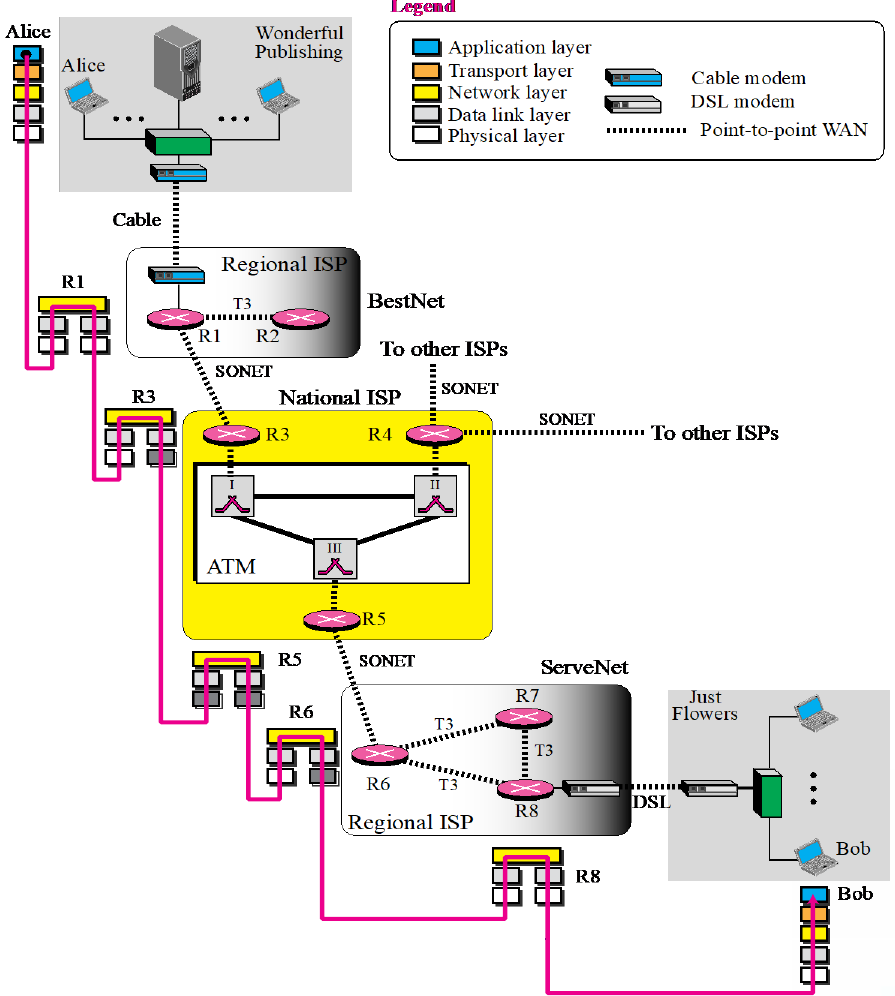

*그림 1. 여러 WAN 기술이 함께 쓰이는 인터넷의 가상의 한 부분*

- 왼쪽 위의 사용자 Alice는 회사 LAN에 있으며, 회사 LAN은 동축 케이블을 쓰는 **케이블 모뎀**으로 지역 ISP(BestNet)에 연결된다.
- 지역 ISP 안의 라우터 R1과 R2는 **T-3 회선**으로 연결되고, 지역 ISP는 광케이블을 쓰는 **SONET**으로 국가 ISP에 연결된다.
- 국가 ISP의 내부는 스위치 I, II, III으로 이루어진 **ATM** 교환형 WAN이며, 라우터 R3, R4, R5가 ATM 네트워크의 입구와 출구가 된다. 국가 ISP는 SONET으로 다른 ISP들과도 연결된다.
- 아래쪽의 지역 ISP(ServeNet)는 SONET으로 국가 ISP에 연결되고, 내부 라우터들은 T-3 회선으로 연결된다.
- 오른쪽 아래의 사용자 Bob은 트위스티드 페어 전화선(공중 전화망)을 쓰는 **DSL**로 지역 ISP에 연결된다.

곧 인터넷의 많은 링크는 새로 깐 전용 선이 아니라 이미 존재하는 전화망과 케이블망, 광통신망을 빌려 쓴다. 그림 왼쪽과 오른쪽의 계층 막대는 Alice에서 Bob까지 패킷이 지나는 장치마다 처리하는 계층을 나타낸다. 라우터는 네트워크 계층까지, 모뎀은 물리 계층까지 처리한다.

---

<br>

## 2. 점대점 WAN의 전송 기술

### 2.1 T 회선

> **용어 정의:** **T-1 회선(T-1 line)** 은 디지털화한 음성 채널 24개를 시분할 다중화하도록 설계된 디지털 전화 반송 회선으로, 전송 속도가 1.544 Mbps이다.

**T 회선(T line)** 은 원래 디지털화한 음성 채널들을 다중화하도록 설계된 표준 디지털 전화 반송 회선이다. 오늘날에는 가정이나 기관에서 인터넷까지 데이터를 운반하거나, 교환형 WAN의 노드 사이를 잇는 물리 링크로도 쓰인다. 상업적으로는 T-1과 T-3의 두 속도로 제공된다.

| 회선 | 속도 (Mbps) |
|:-----|:-----|
| T-1 | 1.544 |
| T-3 | 44.736 |

*표 1. T 회선의 속도*

T-1의 속도는 프레임 구조에서 나온다. 음성 채널 24개를 각각 표본화하고 표본 하나를 8비트로 디지털화한 뒤, 동기를 위한 비트 1개를 더하면 프레임 하나가 193비트가 된다. 이 프레임을 초당 8000개 보내므로 속도는 다음과 같다.

```math
(24 \times 8 + 1)\ \text{bits/frame} \times 8000\ \text{frames/s} = 193 \times 8000 = 1{,}544{,}000\ \text{bps} = 1.544\ \text{Mbps}
```

```text
  ┌───┬──────┬──────┬──────┬─────┬──────┐
  │ F │  1   │  2   │  3   │ ... │  24  │
  └───┴──────┴──────┴──────┴─────┴──────┘
    1     8      8      8            8      (bits)

  F: synchronization bit, 1-24: 8-bit sample of each voice channel
  One frame = 1 + 24 × 8 = 193 bits, 8000 per second (one frame every 125 μs)
```

*그림 2. T-1 프레임의 구조*

T-1 회선으로 인터넷에 연결할 때는 회선의 용량을 모두 쓰거나 일부만 써서 디지털 데이터를 보낼 수 있다. T-3 회선은 44.736 Mbps이며 T-1 회선 28개에 해당한다. 많은 가입자는 T 회선의 용량 전체가 필요하지 않으므로, 전화 회사는 여러 가입자가 전송을 다중화하여 한 회선을 나누어 쓰는 **분할 T 회선(fractional T line)** 서비스를 제공한다.

### 2.2 SONET

> **용어 정의:** **SONET(Synchronous Optical Network)** 은 ANSI가 광섬유 케이블의 사용을 위해 정한 고속 데이터 반송 표준으로, 전기 신호 STS와 광 신호 OC의 계층을 정의하고 초당 8000개의 프레임을 보낸다.

광섬유 케이블의 넓은 대역폭은 화상 회의 같은 고속 기술과, 많은 저속 기술을 동시에 운반하는 데 알맞다. SONET은 먼저 **동기 전송 신호(synchronous transport signal, STS)** 라는 전기 신호들을 정의하고, 이를 **광 반송파(optical carrier, OC)** 라는 광 신호로 바꾼다. 광 신호는 초당 8000개의 프레임으로 전송되므로 프레임 하나의 시간은 125 μs이다.

| STS | OC | 속도 (Mbps) | STS | OC | 속도 (Mbps) |
|:-----|:-----|:-----|:-----|:-----|:-----|
| STS-1 | OC-1 | 51.840 | STS-24 | OC-24 | 1244.160 |
| STS-3 | OC-3 | 155.520 | STS-36 | OC-36 | 1866.240 |
| STS-9 | OC-9 | 466.560 | STS-48 | OC-48 | 2488.320 |
| STS-12 | OC-12 | 622.080 | STS-96 | OC-96 | 4976.640 |
| STS-18 | OC-18 | 933.120 | STS-192 | OC-192 | 9953.280 |

*표 2. SONET의 속도*

STS-n의 속도는 STS-1의 n배이다. 계층의 가장 낮은 단계인 STS-1의 51.840 Mbps는 T-3 회선의 44.736 Mbps보다 크다. STS-1 프레임 하나에는 51.84 × 10⁶ / 8000 = 6480비트, 곧 810바이트가 들어간다.

SONET의 장점은 다음과 같다.

- **125 μs 프레임:** 초당 8000개의 프레임은 음성 표본화 주기와 같으므로, 디지털 음성 채널을 다중화하기에 알맞다.
- **효율적인 다중화:** 낮은 속도의 신호를 높은 속도의 신호로 체계적으로 묶을 수 있다.
- **높은 신뢰성:** 운용과 유지 보수를 위한 오버헤드를 프레임에 두어 네트워크의 신뢰성을 높인다.
- **비용 효율:** 새로운 네트워크 구조를 비용 효율적으로 구현할 수 있다.

---

<br>

## 3. PPP

### 3.1 PPP의 계층과 프레임

> **용어 정의:** **PPP(Point-to-Point Protocol)** 는 전화 회사나 케이블 회사가 제공하는 물리적인 점대점 링크 위에서 데이터 전송을 제어하고 관리하기 위한 데이터 링크 계층 프로토콜이다.

전화 회사나 케이블 회사는 물리적인 링크를 제공하지만, 데이터 전송을 제어하고 관리하려면 특별한 프로토콜이 필요하다. PPP는 이 필요에 맞추어 설계되었다. PPP에는 물리 계층과 데이터 링크 계층만 있다. 물리 계층에 대해서는 특정 프로토콜을 정하지 않고 구현자가 쓸 수 있는 것을 쓰게 하며, ANSI가 인정한 어떤 프로토콜도 지원한다. 데이터 링크 계층에서는 프레임의 형식과, 링크를 제어하고 사용자 데이터를 운반하는 프로토콜을 정한다.

```text
  ┌──────────┬──────────┬──────────┬──────────┬──────────────┬──────────┬──────────┐
  │   Flag   │ Address  │ Control  │ Protocol │ Data and     │   FCS    │   Flag   │
  │ 01111110 │ 11111111 │ 11000000 │          │ padding      │          │ 01111110 │
  └──────────┴──────────┴──────────┴──────────┴──────────────┴──────────┴──────────┘
       1          1          1         1 or 2      variable      2 or 4        1
```

*그림 3. PPP 프레임의 형식*

그림 3의 아래 숫자는 각 필드의 크기(바이트)이다.

| 필드 | 크기 | 내용 |
|:-----|:-----|:-----|
| 플래그 (Flag) | 1바이트 | 값 01111110. PPP 프레임의 경계를 나타냄 |
| 주소 (Address) | 1바이트 | PPP는 점대점 연결이므로 데이터 링크 주소를 쓰지 않으려고 대부분의 LAN에서 쓰는 브로드캐스트 주소 11111111을 씀 |
| 제어 (Control) | 1바이트 | 값 11000000. 대부분의 LAN처럼 프레임에 순서 번호가 없고 각 프레임이 독립적임을 나타냄 |
| 프로토콜 (Protocol) | 1 또는 2바이트 | 데이터 필드가 운반하는 것이 사용자 데이터인지 다른 정보인지를 나타냄 |
| 데이터 (Data) | 가변 | 사용자 데이터나 다른 정보 |
| FCS | 2 또는 4바이트 | 오류 검출을 위한 2바이트나 4바이트 CRC (18장) |

*표 3. PPP 프레임의 필드*

### 3.2 LCP와 NCP

> **용어 정의:** **LCP(Link Control Protocol)** 는 PPP에서 링크를 설정하고 유지하고 설정값을 정하며 종료하는 일을 맡는 프로토콜로, 두 끝점이 옵션을 협상하는 방법을 제공한다.

- **LCP:** 링크의 설정, 유지, 구성, 종료를 맡는다. 두 끝점 사이에서 옵션을 정하는 협상 방법을 제공한다. 프레임의 데이터 필드가 이 프로토콜에 관한 내용을 운반하면 PPP가 링크를 다루고 있다는 뜻이며, 사용자 데이터는 운반하지 않는다.
- **NCP(Network Control Protocol):** PPP에 유연성을 주기 위해 정의되었다. PPP는 IP, IPX 같은 여러 네트워크 프로토콜의 데이터를 운반할 수 있다. 링크가 설정된 뒤에는 PPP가 데이터 필드에 IP 패킷을 담아 운반한다.

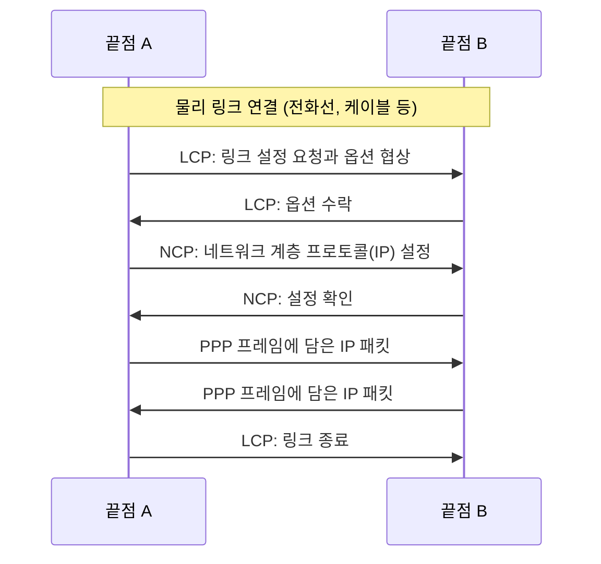

*그림 4. PPP에서 LCP와 NCP가 쓰이는 순서*

### 3.3 PPPoE

PPP는 원래 일반 모뎀과 전화선으로 사용자 한 명을 인터넷에 연결하기 위해 설계되었다. 오늘날에는 DSL, 케이블 모뎀, 무선 기술 덕분에 이더넷 LAN에 있는 여러 사용자가 하나의 물리 회선으로 인터넷에 접속할 수 있다. **PPPoE(PPP over Ethernet)** 는 발견(discovery) 절차로 인터넷에 연결할 호스트의 이더넷 주소를 찾아낸 뒤, 일반적인 PPP 세션으로 연결을 제공하는 프로토콜이다.

---

<br>

## 4. 교환형 WAN

### 4.1 연결 지향 기술로서의 교환형 WAN

교환형 WAN 기술은 여러 면에서 LAN 기술과 다르다.

- **토폴로지:** 스타 토폴로지 대신 스위치들로 여러 경로를 만든다.
- **연결 지향:** LAN 기술은 송신자가 수신자에게 보내는 패킷들 사이에 아무 관계가 없는 비연결형 기술이다. 교환형 WAN 기술은 연결 지향 기술이다. 송신자가 패킷을 보내기 전에 송신자와 수신자 사이에 연결을 설정해야 하며, 설정된 연결에는 전송 동안 쓰이는 식별자(레이블이라고도 함)가 배정된다. 전송이 끝나면 연결을 공식적으로 해제한다. LAN 기술의 출발지 주소와 목적지 주소 대신 이 연결 식별자를 쓴다. 이는 10장의 가상 회선 방식과 같다.

### 4.2 X.25

> **용어 정의:** **X.25** 는 1970년대에 도입되어 유럽과 미국에서 처음으로 널리 쓰인 패킷 교환형 WAN 프로토콜로, 가상 회선 방식으로 종단 간 서비스를 제공한다.

X.25는 주로 개별 컴퓨터나 LAN을 잇는 공중망으로 쓰였으며, 종단 간 서비스를 제공한다. 패킷 교환은 가상 회선 방식이며, 가상 회선은 두 종류가 있다.

- **SVC(switched virtual circuit):** 통신할 때마다 연결을 설정하고 끝나면 해제하는 교환 가상 회선이다.
- **PVC(permanent virtual circuit):** 미리 설정해 두고 계속 쓰는 영구 가상 회선이다.

X.25 네트워크에 연결되는 장비는 두 가지로 나뉜다.

- **DTE(data terminal equipment):** 패킷형 사용자 단말, 곧 사용자의 컴퓨터 같은 데이터 단말 장비이다.
- **DCE(data circuit-terminating equipment):** DTE를 패킷 교환 네트워크에 접속시키는 장비이다.


*그림 5. X.25 네트워크의 DTE와 DCE*

X.25는 인터넷의 한 곳에서 다른 곳으로 IP 패킷을 운반하는 WAN으로 쓰였지만, IP와 X.25 사이에는 늘 충돌이 있었다.

- **계층의 충돌:** IP는 3계층(네트워크 계층) 프로토콜이므로 IP 패킷은 2계층(데이터 링크 계층) 프레임에 담겨야 한다. 그런데 인터넷보다 먼저 설계된 X.25는 자신의 네트워크 계층을 가진 3계층 프로토콜이다. 따라서 IP 패킷을 네트워크의 한쪽에서 다른 쪽으로 보내려면 X.25 네트워크 계층 패킷에 다시 캡슐화해야 했다. 자동차가 있는 사람이 목적지까지 가려고 그 차를 트럭에 실어야 하는 것과 비슷하다.
- **과도한 오류 제어:** X.25는 전송 매체의 신뢰성이 낮던(광섬유를 쓰지 않던) 시기에 설계되었다. 그래서 오류 제어를 광범위하게 하며, 이 때문에 전송이 매우 느려 점점 높아지는 속도 요구에 맞지 않았다.

### 4.3 프레임 릴레이

> **용어 정의:** **프레임 릴레이(Frame Relay)** 는 X.25를 대체하도록 설계된 교환형 WAN 기술로, 물리 계층과 데이터 링크 계층의 서비스만 제공하며 데이터 링크 계층에서 오류 검사와 확인 응답을 하지 않는다.

프레임 릴레이는 X.25보다 다음과 같은 장점이 있다.

- **높은 전송 속도:** 원래는 T-1 회선에 해당하는 1.544 Mbps를 제공하도록 설계되었지만, 오늘날 대부분의 구현은 T-3 회선에 해당하는 44.736 Mbps까지 처리한다.
- **낮은 비용(그물형 연결):** 하나의 물리적 접속 링크 위에 여러 가상 회선을 두어, 각 쌍 사이에 전용 회선을 깔지 않고도 그물(mesh) 형태로 여러 목적지와 연결할 수 있다.
- **버스트 데이터와 요구에 따른 대역폭:** WAN 사업자의 서비스 중에는 사용자가 일정한 속도를 필요로 한다고 가정하는 것이 있다. T-1 회선은 1.544 Mbps를 꾸준히 쓰는 사용자를 위해 설계되었으므로, 속도가 일정하지 않은 **버스트 데이터(bursty data)** 를 보내는 사용자에게는 맞지 않는다. 예를 들어 어떤 사용자가 2초 동안 6 Mbps, 7초 동안 0 Mbps, 1초 동안 3.44 Mbps로 보내면, 10초 동안 모두 6 × 2 + 0 × 7 + 3.44 × 1 = 15.44 Mb를 보내므로 평균 속도는 여전히 1.544 Mbps이다. 그러나 T-1 회선은 고정 속도용이므로 이런 요구를 감당하지 못한다. 버스트 데이터에는 시기마다 다른 대역폭을 배정하는 **요구에 따른 대역폭(bandwidth on demand)** 이 필요하다. 프레임 릴레이는 사용자에게 평균 속도를 보장하고, 필요할 때는 그 속도를 넘을 수 있게 한다.
- **전송 매체의 개선에 따른 적은 오버헤드:** 전송 매체(특히 광 매체)의 품질이 크게 좋아져 오류가 드물어졌으므로, 잠재적인 오류를 검사하고 또 검사하는 데 시간과 자원을 쓰는 WAN이 필요 없다. 프레임 릴레이는 데이터 링크 계층에서 오류 검사를 하지 않고 확인 응답도 요구하지 않는다. 오류 검사는 모두 프레임 릴레이의 서비스를 쓰는 네트워크 계층과 전송 계층의 프로토콜에 맡긴다.

프레임 릴레이에서 가상 회선을 식별하는 연결 식별자를 **DLCI(data link connection identifier)** 라고 한다.

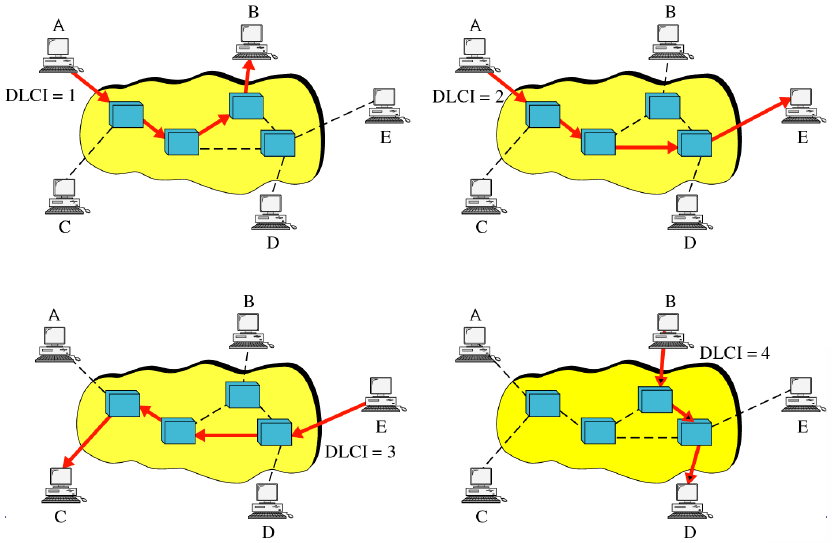

*그림 6. 접속 링크마다 DLCI로 구별되는 프레임 릴레이의 가상 회선*

그림 6에서 사용자 A는 하나의 접속 링크로 네트워크에 연결되어 있지만, DLCI = 1인 가상 회선으로는 B에게, DLCI = 2인 가상 회선으로는 E에게 프레임을 보낸다. 마찬가지로 E는 DLCI = 3인 가상 회선으로 C에게, B는 DLCI = 4인 가상 회선으로 D에게 보낸다. 사용자는 목적지마다 회선을 따로 빌리지 않고 접속 링크 하나로 여러 목적지와 연결되므로 비용이 줄어든다.

### 4.4 X.25와 프레임 릴레이의 비교

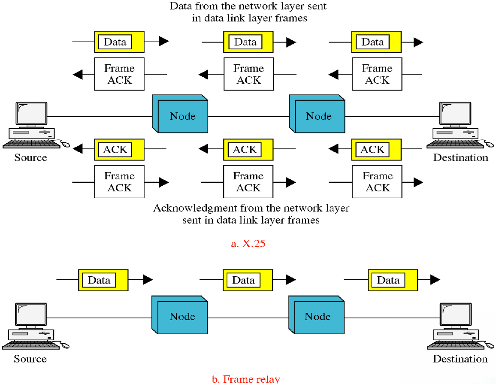

*그림 7. X.25와 프레임 릴레이의 홉별 처리 비교*

그림 7의 (a) X.25에서는 네트워크 계층에서 내려온 데이터가 데이터 링크 계층 프레임에 담겨 보내질 때, 링크마다(출발지와 노드 사이, 노드와 노드 사이, 노드와 목적지 사이) 데이터 링크 계층의 확인 응답(Frame ACK)이 돌아온다. 네트워크 계층의 확인 응답(ACK)도 링크마다 데이터 링크 프레임에 담겨 전달되며, 그 프레임에 대해서도 다시 Frame ACK가 돌아온다. 전달할 때마다 확인 응답을 확인하므로 속도가 느리다. (b) 프레임 릴레이에서는 데이터 프레임만 노드를 거쳐 전달되고 홉별 확인 응답이 없으므로 속도가 빠르다.

| 특징 | X.25 | 프레임 릴레이 |
|:-----|:-----|:-----|
| 동작 계층 | 물리, 데이터 링크, 네트워크 (3계층) | 물리, 데이터 링크 (2계층) |
| IP 패킷의 운반 | X.25 네트워크 계층 패킷에 다시 캡슐화 | 데이터 링크 프레임에 직접 담음 |
| 홉별 오류 제어와 확인 응답 | 광범위하게 함 | 하지 않음 (상위 계층에 맡김) |
| 설계 당시의 전송 매체 | 신뢰성이 낮은 매체 | 신뢰성이 높은 광 매체 |
| 속도 | 느림 | 빠름 (T-1에서 T-3 수준) |
| 버스트 데이터 | 고려하지 않음 | 요구에 따른 대역폭 제공 |

*표 4. X.25와 프레임 릴레이의 비교*

---

<br>

## 5. ATM

**ATM(Asynchronous Transfer Mode)** 은 ATM 포럼이 설계하고 ITU-T가 채택한 **셀 릴레이(cell relay)** 프로토콜이다.

### 5.1 설계 목표

ATM의 설계자들이 마주한 과제 가운데 다음 여섯 가지가 두드러진다.

1. 고속 전송 매체, 특히 광섬유의 사용을 최적화하는 전송 시스템이 필요하다.
2. 다양한 패킷 네트워크 같은 기존 시스템과 인터페이스하여, 그 효과를 떨어뜨리거나 교체를 요구하지 않고 서로를 광역으로 연결할 수 있어야 한다.
3. 비용이 도입의 장벽이 되지 않도록 싸게 구현할 수 있어야 한다. ATM이 국제 통신의 백본이 되려면 원하는 모든 사용자가 낮은 비용으로 쓸 수 있어야 한다.
4. 가입자 회선, 지역 사업자, 장거리 사업자 같은 기존의 통신 계층 구조와 함께 동작하고 이를 지원해야 한다.
5. 정확하고 예측 가능한 전달을 보장하도록 연결 지향이어야 한다.
6. 속도를 높이기 위해 가능한 한 많은 기능을 하드웨어로 옮기고 소프트웨어 기능을 줄여야 한다.

### 5.2 셀 네트워크와 다중화

> **용어 정의:** **ATM 셀(ATM cell)** 은 ATM 네트워크에서 데이터를 주고받는 기본 단위인 고정 크기의 작은 데이터 블록으로, 5바이트 헤더와 48바이트 페이로드를 합쳐 53바이트이다.

ATM은 **셀 네트워크(cell network)** 이다. 셀 네트워크에서는 모든 데이터를 똑같은 크기의 셀에 담아 완전히 예측 가능하고 균일하게 전송한다. 셀들은 다른 셀들과 다중화되어 셀 네트워크를 지나간다. 모든 셀이 같은 크기이고 작으므로, 크기가 서로 다른 패킷을 다중화할 때 생기는 문제를 피할 수 있다. 곧 셀 네트워크는 데이터를 고정된 크기로 잘게 나누어 보낸다.

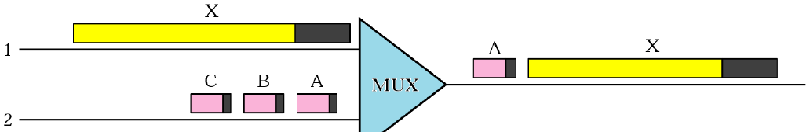

*그림 8. 크기가 서로 다른 패킷의 다중화*

그림 8에서 입력 1에는 큰 패킷 X가, 입력 2에는 작은 패킷 A, B, C가 있다. 다중화기가 X를 보내기 시작하면, 출력에서 A 다음에 X가 이어지고 B와 C는 X 전체가 다 보내질 때까지 기다려야 한다. 프레임의 크기가 서로 다르면 작은 패킷이 큰 패킷 뒤에서 오래 지연되며, 이는 실시간 음성처럼 지연에 민감한 작은 패킷에 공평하지 않다.

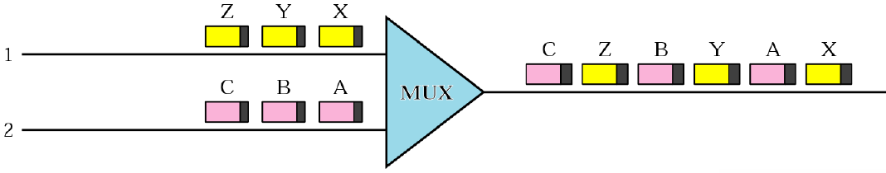

*그림 9. 셀 네트워크의 다중화*

그림 9처럼 모든 데이터를 같은 크기의 셀로 나누면, 두 입력의 셀 X, Y, Z와 A, B, C가 번갈아 출력되어 어느 입력도 다른 입력의 큰 데이터 뒤에서 오래 기다리지 않는다.

ATM은 서로 다른 채널에서 오는 셀을 **비동기 시분할 다중화(asynchronous time-division multiplexing)** 로 다중화하며, 그래서 이름이 비동기 전송 모드이다. 다중화기는 셀 크기의 고정 슬롯을 쓰며, 셀이 있는 아무 입력 채널의 셀로 슬롯을 채운다. 어느 채널에도 보낼 셀이 없으면 슬롯은 빈다. 동기 TDM(18장)처럼 슬롯을 채널마다 고정 배정하지 않으므로 빈 채널 때문에 슬롯이 낭비되지 않는다.

```text
  Input 1:  A3   A2   A1
  Input 2:       B2   B1
  Input 3:  C3   C2   C1
                               Output (the cell sent first is on the right)
                       ──►  ... │ C3 │ B2 │ A3 │ C2 │ B1 │ A2 │ C1 │ A1 │
```

*그림 10. 세 입력의 셀을 비동기 시분할 다중화한 예*

그림 10은 첫 번째 클록에서 입력 2에 셀이 없어(빈 입력 슬롯) 다중화기가 그 슬롯을 입력 3의 셀로 채우는 경우를 보여 준다. 출력 순서는 A1, C1, A2, B1, C2, A3, B2, C3이며, 모든 채널의 셀을 다중화하고 나면 출력 슬롯은 빈다.

### 5.3 ATM 구조와 가상 연결

ATM은 교환형 네트워크이다. **끝점(end point)** 이라 부르는 사용자 접속 장치는 네트워크 안의 스위치에 연결되고, 스위치들은 고속 통신 채널로 서로 연결된다. 두 끝점 사이의 연결은 세 단계로 이루어진다.

- **전송 경로(transmission path, TP):** 끝점과 스위치 사이, 또는 두 스위치 사이의 물리적 연결(전선, 케이블, 위성 등)이다. 두 스위치를 두 도시라고 하면, 두 도시를 직접 잇는 고속도로 전체의 집합이 전송 경로이다.
- **가상 경로(virtual path, VP):** 전송 경로를 나눈 것으로, 두 스위치 사이에 하나 또는 여러 연결을 제공한다. 두 도시를 잇는 고속도로 하나하나가 가상 경로이다. 경로의 일부가 같은 가상 회선들을 묶어 놓은 것이다.
- **가상 회선(virtual circuit, VC):** 한 메시지에 속한 모든 셀이 따라가는 논리적 연결이며, 셀들은 목적지에 닿을 때까지 원래의 순서를 유지한다. 고속도로의 차선이 가상 회선이다.

```text
                    Transmission path (TP)
  ┌───────────────────────────────────────────────────┐
  │  VP (VPI = 14)  ═══ VC (VCI = 21) ═══             │
  │                 ═══ VC (VCI = 32) ═══             │
  │                 ═══ VC (VCI = 45) ═══             │
  │  VP (VPI = 18)  ═══ VC (VCI = 21) ═══             │
  │                 ═══ VC (VCI = 32) ═══             │
  │                 ═══ VC (VCI = 45) ═══             │
  └───────────────────────────────────────────────────┘
  One virtual connection is defined by a (VPI, VCI) pair (e.g., (14, 21))
```

*그림 11. 전송 경로, 가상 경로, 가상 회선의 관계*

가상 회선 네트워크에서 한 끝점에서 다른 끝점으로 데이터를 보내려면 가상 연결을 식별해야 한다. ATM은 이를 위해 두 단계의 계층적 식별자를 쓴다. **VPI(virtual path identifier)** 는 특정 가상 경로를, **VCI(virtual circuit identifier)** 는 그 가상 경로 안의 특정 가상 회선을 정한다. 하나의 가상 경로로 묶인 모든 가상 연결은 같은 VPI를 가진다. 곧 가상 연결 하나는 VPI와 VCI의 쌍으로 정해진다.

### 5.4 ATM 계층

ATM 표준은 위에서부터 **응용 적응 계층(application adaptation layer, AAL)**, ATM 계층, 물리 계층의 세 계층을 정의한다.

```text
  ┌──────────┬──────────┬──────────┬──────────┐
  │   AAL1   │   AAL2   │  AAL3/4  │   AAL5   │
  ├──────────┴──────────┴──────────┴──────────┤
  │                ATM layer                  │
  ├───────────────────────────────────────────┤
  │              Physical layer               │
  └───────────────────────────────────────────┘
```

*그림 12. ATM의 계층*

> **용어 정의:** **AAL(application adaptation layer)** 은 패킷 네트워크 같은 기존 네트워크가 ATM 설비에 연결되도록, 상위 계층의 전송을 받아 고정 크기의 ATM 셀로 바꾸고 수신 측에서 원래 형식으로 재조립하는 ATM의 최상위 계층이다.

AAL은 음성, 데이터, 오디오, 비디오 같은 어떤 종류의 전송이든, 가변 속도든 고정 속도든 받아들인다. 수신 측에서는 이 과정을 거꾸로 하여 조각들을 원래 형식으로 재조립해 수신 서비스에 넘긴다. AAL에는 네 종류가 정의되어 있다.

| AAL 종류 | 서비스 | 쓰임 |
|:-----|:-----|:-----|
| AAL1 | 고정 비트율 (constant bit rate, CBR) | 실시간 음성, 비디오 |
| AAL2 | 가변 비트율 (variable bit rate, VBR) | 압축한 음성, 데이터, 비디오 |
| AAL3/4 | 연결 지향 패킷 프로토콜 | 가상 회선을 쓰는 X.25 같은 연결 지향 패킷 |
| AAL5 | 비연결형 패킷 프로토콜 | IP 데이터그램 |

*표 5. AAL의 종류*

물리 계층과 ATM 계층은 네트워크 안의 스위치와, ATM의 서비스를 쓰는 끝점(라우터 등) 모두에서 쓰인다. AAL은 끝점에서만 쓰인다.

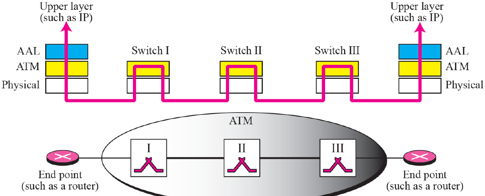

*그림 13. ATM 네트워크 안팎에서 쓰이는 계층*

그림 13에서 끝점(라우터)은 상위 계층(IP)의 데이터를 AAL, ATM 계층, 물리 계층을 거쳐 내보내고, 스위치 I, II, III은 ATM 계층과 물리 계층만으로 셀을 전달하며, 반대쪽 끝점이 AAL에서 원래 데이터를 재조립해 상위 계층으로 올린다.

- **ATM 계층:** 라우팅, 트래픽 관리, 교환, 다중화 서비스를 제공한다. AAL에서 48바이트 조각을 받아 5바이트 헤더를 붙여 53바이트 셀로 만든다.
- **물리 계층:** 전송 매체, 비트 전송, 부호화, 전기 신호와 광 신호의 변환을 정한다. SONET이나 T-3 같은 물리 전송 프로토콜에 맞추고, 셀의 흐름을 비트의 흐름으로 바꾸는 방법을 제공한다.

### 5.5 AAL5와 ATM 셀

네 AAL 가운데 인터넷에서 IP 패킷을 운반하는 데 쓰이는 것은 AAL5이다. AAL5는 **단순하고 효율적인 적응 계층(simple and efficient adaptation layer, SEAL)** 이라고도 부른다. AAL5는 한 메시지에 속한 셀들이 차례대로 이동하고 제어 기능은 송신 응용의 상위 계층에 있다고 가정하므로, 주소, 순서 번호 같은 헤더 정보를 따로 두지 않는다. IP처럼 데이터그램 방식으로 라우팅하는 비연결형 패킷 프로토콜을 위해 설계되었다.

```text
  ┌─────────────────────────────────────────┬─────────┬─────────┐
  │                IP packet                │   pad   │ trailer │
  └─────────────────────────────────────────┴─────────┴─────────┘
                       │
                       ▼
  ┌──────────┐┌──────────┐┌──────────┐       ┌──────────┐
  │    48    ││    48    ││    48    │  ...  │    48    │
  └──────────┘└──────────┘└──────────┘       └──────────┘
                       │
                       ▼
  ┌─────┬──────────┐
  │  5  │    48    │
  └─────┴──────────┘

  Top: padding and an 8-byte trailer are added to an IP packet of at most 65,535 bytes
  Middle: divided into 48-byte segments (the trailer is the last 8 bytes of the last segment)
  Bottom: the ATM layer adds a 5-byte header to make a 53-byte cell (the header is mostly VPI and VCI)
```

*그림 14. AAL5의 분할과 ATM 셀*

AAL5는 65,535바이트 이하의 IP 패킷을 받아 8바이트 트레일러를 붙이고, 트레일러가 수신 장비가 기대하는 위치, 곧 마지막 셀의 마지막 8바이트에 오도록 필요한 만큼 패딩을 넣는다. 패딩과 트레일러를 붙인 메시지를 48바이트 조각으로 나누어 ATM 계층에 넘긴다. 셀은 53바이트이며 5바이트가 헤더, 48바이트가 페이로드이다. 헤더의 대부분은 VPI와 VCI가 차지하며, VPI와 VCI의 조합은 특정 가상 연결을 정하는 **레이블(label)** 로 볼 수 있다.

IP 패킷을 셀 하나에 직접 담지 않고 AAL5를 쓰는 이유는 효율 때문이다. IP 데이터그램을 셀 하나에 담으려면 IP 헤더에 최소 20바이트, ATM 헤더에 5바이트가 필요하므로 IP 수준의 데이터는 53 − 5 − 20 = 27바이트밖에 되지 않는다. 효율은 27/53, 곧 약 51%이다. IP 데이터그램 하나가 여러 셀에 걸치게 하면 IP의 오버헤드 20바이트를 여러 셀이 나누어 지므로 효율이 높아진다. 예를 들어 1500바이트 IP 데이터그램에 트레일러 8바이트를 더한 1508바이트는 48바이트 셀 32개(패딩 28바이트)가 되어 32 × 53 = 1696바이트로 전송되고, 효율은 1500/1696 ≈ 88%이다.

> **참고:** 고정된 53바이트 셀은 5.2절의 다중화 지연 문제를 해결하지만, 셀마다 5바이트 헤더가 붙으므로 페이로드 대비 오버헤드가 5/53 ≈ 9.4%로 일정하게 남는다. 셀의 크기를 작게 할수록 다중화 지연은 줄고 헤더 오버헤드는 늘어나는 절충 관계가 있다.

### 5.6 ATM 위의 IP

ATM 같은 교환형 WAN도 IP 데이터그램이 지나가는 고속도로가 될 수 있다. LAN이나 점대점 WAN과 비슷한 점도 있고 다른 점도 있다. IP 패킷은 셀 하나가 아니라 여러 셀에 담기며, ATM 네트워크에는 장치의 물리 주소에 대한 자신만의 정의가 있다.

ATM 네트워크는 두 라우터 사이에 경로를 만든다. 셀들은 **진입점 라우터(entering-point router)** 에서 출발하여 **출구점 라우터(exiting-point router)** 에서 끝난다. 특정 진입점 라우터에서 특정 출구점 라우터로 셀을 보내려면 세 종류의 주소가 필요하다.

| 주소 | 정의되는 곳 | 역할 |
|:-----|:-----|:-----|
| IP 주소 | IP 계층 | ATM 네트워크에 연결된 각 라우터를 IP 계층에서 정함. ATM 네트워크와는 무관 |
| 물리 주소 | ATM 네트워크 | ATM 포럼은 ATM 네트워크에 20바이트 주소를 정의함. 네트워크 안에서 유일해야 하며 관리자가 정함. LAN의 MAC 주소와 같은 역할이며 연결 설정에 쓰임 |
| 가상 회선 식별자 (VPI, VCI) | ATM 스위치 | 네트워크 안의 스위치가 셀을 전달하는 기준. 데이터 전송 중에 쓰임 |

*표 6. IP over ATM에서 쓰이는 세 종류의 주소*

IP 데이터그램에는 출발지와 목적지의 IP 주소만 있으므로, 가상 회선 식별자는 목적지 IP 주소로부터 정해야 한다. 주소 결합 과정은 다음과 같다.

1. 진입점 라우터가 IP 데이터그램을 받으면, 목적지 주소와 포워딩 테이블로 다음 라우터, 곧 출구점 라우터의 IP 주소를 찾는다. 데이터그램이 LAN을 지날 때와 똑같은 단계이다.
2. 진입점 라우터는 **ATMARP**라는 프로토콜로 출구점 라우터의 물리 주소를 찾는다. ATMARP는 ARP(19장)와 비슷하다. 다만 LAN은 데이터 링크 계층에서 브로드캐스트가 가능한 네트워크이지만 ATM 네트워크는 브로드캐스트 네트워크가 아니므로, ARP처럼 요청을 브로드캐스트하는 대신 다른 방법을 쓴다.
3. 가상 회선 식별자를 물리 주소에 결합하여 연결을 설정한다.

---

<br>

## 6. 링크 가상화와 MPLS

### 6.1 네트워크를 링크로 보기

두 호스트를 잇는 다이얼업 모뎀 연결을 생각해 보면, 두 호스트를 잇는 링크는 실제로는 자신만의 스위치, 링크, 데이터 전송과 신호 프로토콜 스택을 가진 논리적으로 별개인 전 세계의 전화망이다. 그러나 인터넷의 링크 계층 관점에서 전화망을 거치는 다이얼업 연결은 단순한 전선으로 보인다. 이런 의미에서 인터넷은 전화망을 가상화하여, 전화망을 두 인터넷 호스트 사이에 링크 계층 연결을 제공하는 링크 계층 기술로 본다. 5.6절의 ATM 네트워크도 IP 장치들을 잇는 링크 역할을 한다.

**MPLS(Multiprotocol Label Switching)** 네트워크도 이런 관점에서 볼 수 있다. 회선 교환 전화망과 달리 MPLS는 자신만의 패킷 형식과 전달 방식을 가진 패킷 교환 가상 회선 네트워크이다. 그래서 교육적으로는 네트워크 계층에서 다룰 수도, 링크 계층에서 다룰 수도 있다. 인터넷의 관점에서는 전화망이나 스위치 이더넷처럼 IP 장치들을 서로 잇는 링크 계층 기술로 볼 수 있다. 레이블로 포워딩 테이블을 직접 찾는 원리와 MPLS 헤더의 위치는 13장에서도 다룬다.

### 6.2 MPLS 헤더와 레이블 교환 라우터

MPLS는 1990년대 중후반 IP 라우터의 포워딩 속도를 높이려는 여러 산업계의 노력에서 나왔다. 핵심 발상은 가상 회선 네트워크의 **고정 길이 레이블(fixed-length label)** 을 가져오는 것이다. 목적지 기반의 IP 데이터그램 포워딩을 버리고 레이블과 가상 회선으로 바꾸려는 것이 아니라, 데이터그램에 선택적으로 레이블을 붙여 가능할 때는 목적지 IP 주소 대신 고정 길이 레이블로 데이터그램을 전달하도록 보강하려는 것이다. 이 기법은 IP 주소 지정과 라우팅을 함께 쓰며 IP와 협력한다. IETF는 이 노력들을 MPLS 프로토콜로 통합하여, 라우팅되는 데이터그램 네트워크에 가상 회선 기법을 섞었다.

```text
  ┌─────────────────┬─────────────┬───────────┬──────────────────────────┐
  │ PPP or Ethernet │ MPLS header │ IP header │ Remainder of link-layer  │
  │     header      │             │           │ frame                    │
  └─────────────────┴─────────────┴───────────┴──────────────────────────┘
                     │
                     ▼
                    ┌──────────────────────┬─────┬───┬──────────┐
                    │        Label         │ Exp │ S │   TTL    │
                    └──────────────────────┴─────┴───┴──────────┘
                              20              3    1      8        (bits)
```

*그림 15. 링크 계층 헤더와 네트워크 계층 헤더 사이에 놓이는 MPLS 헤더*

MPLS를 지원하는 장치 사이에서 전송되는 링크 계층 프레임에는 2계층(예: 이더넷) 헤더와 3계층(IP) 헤더 사이에 작은 MPLS 헤더가 더해진다. MPLS 헤더의 필드는 다음과 같다.

- **레이블(Label):** 라우터의 표를 찾는 데 쓰는 20비트 레이블이다.
- **Exp:** 실험용으로 예약된 3비트이다.
- **S:** 여러 MPLS 헤더를 쌓은(stacked) 경우 마지막 헤더임을 나타내는 1비트이다.
- **TTL:** 수명 필드이다.

MPLS 헤더가 붙은 프레임은 양쪽 라우터가 모두 MPLS를 지원할 때만 주고받을 수 있다. MPLS를 지원하지 않는 라우터는 IP 헤더가 있어야 할 자리에서 MPLS 헤더를 만나면 처리하지 못하기 때문이다.

> **용어 정의:** **레이블 교환 라우터(label-switched router)** 는 MPLS 프레임의 레이블로 포워딩 테이블을 찾아 곧바로 알맞은 출력 인터페이스로 데이터그램을 넘기는, MPLS를 지원하는 라우터이다.

레이블 교환 라우터는 목적지 IP 주소를 꺼내 포워딩 테이블에서 최장 접두사 일치(13장)를 수행할 필요가 없다. 레이블이 표의 색인 역할을 하므로 표를 검색하지 않고 바로 접근한다.

### 6.3 MPLS 전달의 예

라우터가 이웃이 MPLS를 지원하는지, 주어진 IP 목적지에 어떤 레이블을 연결해야 하는지 알려면 MPLS 라우터들 사이의 상호 작용을 보아야 한다. 그림 16에서 라우터 R1\~R4는 MPLS를 지원하고 R5와 R6은 일반 IP 라우터이다.

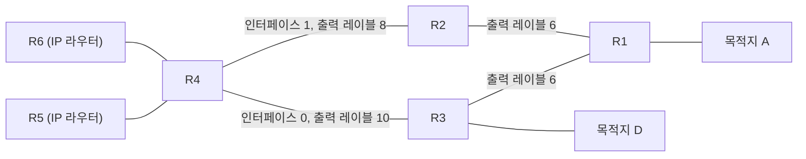

*그림 16. MPLS로 보강한 포워딩의 예*

- R1은 R2와 R3에 자신이 목적지 A로 갈 수 있으며, 레이블 6인 프레임을 받으면 A로 전달하겠다고 알린다.
- R3은 R4에 자신이 목적지 A와 D로 갈 수 있으며, 레이블 10과 12인 프레임을 받으면 각각 그 목적지로 교환하겠다고 알린다.
- R2도 R4에 자신이 A로 갈 수 있으며, 레이블 8인 프레임을 받으면 A로 교환하겠다고 알린다.

| R4의 입력 레이블 | 출력 레이블 | 목적지 | 출력 인터페이스 |
|:-----|:-----|:-----|:-----|
| | 10 | A | 0 |
| | 12 | D | 0 |
| | 8 | A | 1 |

*표 7. R4의 MPLS 포워딩 테이블*

R4는 A로 가는 MPLS 경로를 둘 가진다. 출력 레이블 10으로 인터페이스 0을 거치는 경로와, 레이블 8로 인터페이스 1을 거치는 경로이다. IP 장치인 R5, R6, A, D는 MPLS 인프라(R1\~R4)를 거쳐 연결되며, 이는 스위치 LAN이나 ATM 네트워크가 IP 장치들을 잇는 방식과 같다. 스위치 LAN이나 ATM 네트워크처럼 MPLS 라우터 R1\~R4도 패킷의 IP 헤더를 건드리지 않고 이 일을 한다.

MPLS 라우터 사이에 레이블을 배포하는 신호 프로토콜과, MPLS가 경로를 계산하고 링크 상태 정보(예: MPLS가 예약하지 않은 링크 대역폭)를 모으는 방법은 이 정리본의 범위를 넘는다. 기존의 링크 상태 라우팅 알고리즘(예: OSPF, 15장)을 확장하여 이 정보를 MPLS 라우터들에 퍼뜨리며, 실제 경로 계산 알고리즘은 표준화되어 있지 않다.

### 6.4 트래픽 엔지니어링과 그 밖의 용도

지금까지는 MPLS가 패킷의 IP 주소를 보지 않고 레이블로 교환한다는 점을 강조했다. 그러나 MPLS의 실제 이점과 오늘날의 관심은 교환 속도의 향상보다 MPLS가 가능하게 하는 새로운 트래픽 관리 능력에 있다.

- **트래픽 엔지니어링(traffic engineering):** R4는 A로 가는 MPLS 경로를 둘 가진다. IP 주소로 IP 계층에서 포워딩한다면 라우팅 프로토콜(14장, 15장)은 A로 가는 최소 비용 경로 하나만 정한다. MPLS를 쓰면 표준 IP 라우팅으로는 불가능한 경로로도 패킷을 보낼 수 있다. 네트워크 운영자는 정책, 성능, 그 밖의 이유로 일반 IP 라우팅을 무시하고, 같은 목적지로 가는 트래픽의 일부는 한 경로로, 나머지는 다른 경로로 보낼 수 있다.
- **빠른 복구:** 링크가 고장 나면 미리 계산해 둔 우회 경로로 트래픽을 다시 보내 MPLS 포워딩 경로를 빠르게 복구할 수 있다.
- **VPN:** ISP는 MPLS 네트워크로 고객의 여러 네트워크를 연결하여 가상 사설 네트워크(VPN, 26장)를 구현할 수 있다. MPLS는 고객 VPN이 쓰는 자원과 주소를 ISP 네트워크를 지나는 다른 사용자의 것과 격리한다.

용도가 이렇게 다양하므로 MPLS는 인터넷 트래픽 엔지니어링의 만능 도구가 되어 가고 있다.

> **용어 정의:** **MPLS(Multiprotocol Label Switching)** 는 IP 데이터그램에 고정 길이 레이블을 담은 헤더를 붙여, 레이블 교환 라우터가 목적지 IP 주소 대신 레이블로 데이터그램을 전달하게 하는 패킷 교환 가상 회선 기술이다.

---

<br>

## 7. 데이터 센터 네트워크

### 7.1 데이터 센터의 구성 요소

> **용어 정의:** **데이터 센터 네트워크(data center network)** 는 데이터 센터 안의 수만에서 수십만 대의 호스트를 서로 연결하고, 데이터 센터를 인터넷에 연결하는 네트워크이다.

Google, Microsoft, Facebook, Amazon 같은 인터넷 기업은 호스트 수만에서 수십만 대를 수용하고 검색, 전자 메일, 소셜 네트워킹, 전자 상거래 같은 여러 클라우드 응용을 동시에 지원하는 대규모 데이터 센터를 지었다. 호스트 10만 대 규모의 데이터 센터는 한 달 비용이 1200만 달러를 넘으며, 그 비용은 대략 다음과 같이 나뉜다.

| 항목 | 비율 | 내용 |
|:-----|:-----|:-----|
| 호스트 | 약 45% | 3\~4년마다 교체 |
| 기반 시설 | 약 25% | 변압기, 무정전 전원 장치, 장기 정전용 발전기, 냉각 시스템 |
| 전력 | 약 15% | 소비 전력에 대한 전기 요금 |
| 네트워킹 | 약 15% | 스위치, 라우터, 부하 분산기 같은 네트워크 장비, 외부 링크, 전송 트래픽 비용 |

*표 8. 대규모 데이터 센터의 비용 구성*

네트워킹은 가장 큰 비용은 아니지만, 네트워킹의 혁신은 전체 비용을 줄이고 성능을 높이는 열쇠이다.

- **호스트:** 데이터 센터의 일꾼으로, 웹 페이지나 비디오 같은 콘텐츠를 제공하고, 전자 메일과 문서를 저장하며, 검색 엔진의 분산 색인 계산 같은 대규모 분산 계산을 함께 수행한다. 데이터 센터의 호스트는 **블레이드(blade)** 라고 부르며 피자 상자와 비슷하게 생긴 CPU, 메모리, 디스크 저장 장치를 갖춘 범용 호스트이다.
- **랙과 TOR 스위치:** 호스트는 **랙(rack)** 에 쌓이며, 랙 하나에는 보통 블레이드 20\~40개가 들어간다. 각 랙의 맨 위에는 랙 안의 호스트들을 서로 연결하고 데이터 센터의 다른 스위치와도 연결하는 **TOR(Top of Rack) 스위치**가 있다. 랙의 각 호스트는 NIC로 TOR 스위치에 연결되고, TOR 스위치에는 다른 스위치와 연결할 포트가 더 있다. 오늘날 호스트는 보통 TOR 스위치와 40 Gbps 이더넷으로 연결된다. 각 호스트는 데이터 센터 내부용 IP 주소를 가진다.
- **경계 라우터(border router):** 데이터 센터 네트워크는 외부 클라이언트와 내부 호스트 사이의 트래픽, 그리고 내부 호스트 사이의 트래픽을 다룬다. 외부 클라이언트와의 흐름을 위해 데이터 센터 네트워크를 공중 인터넷에 연결하는 경계 라우터를 하나 이상 둔다.

곧 데이터 센터 네트워크는 랙들을 서로 연결하고, 랙들을 경계 라우터에 연결한다. 이 연결 네트워크와 프로토콜을 설계하는 일은 최근 컴퓨터 네트워크 연구의 중요한 분야가 되었다.

### 7.2 부하 분산

클라우드 데이터 센터는 여러 응용을 동시에 제공한다. 외부 클라이언트의 요청을 처리하기 위해 각 응용에는 공개적으로 보이는 IP 주소가 있고, 클라이언트는 그 주소로 요청을 보내고 응답을 받는다. 데이터 센터 안에서 외부 요청은 먼저 **부하 분산기(load balancer)** 로 간다.

- 부하 분산기는 호스트들의 현재 부하에 따라 요청을 호스트에 나누어 준다. 큰 데이터 센터에는 특정 클라우드 응용들을 맡는 부하 분산기가 여럿 있다.
- 부하 분산기는 목적지 IP 주소뿐 아니라 목적지 포트 번호(4계층)도 보고 결정하므로 "4계층 스위치"라고도 부른다.
- 요청을 처리한 호스트는 응답을 부하 분산기로 보내고, 부하 분산기는 그 응답을 외부 클라이언트에 전달한다.
- 부하 분산기는 NAT(12장)와 비슷하게 공개 외부 IP 주소를 알맞은 호스트의 내부 IP 주소로 바꾸고, 클라이언트로 돌아가는 패킷은 반대로 바꾼다. 이렇게 하면 클라이언트가 호스트에 직접 접촉하지 못하므로, 내부 네트워크 구조를 숨기고 클라이언트가 호스트와 직접 상호 작용하는 것을 막는 보안상의 이점도 있다.

### 7.3 계층적 구조

호스트가 수천 대뿐인 작은 데이터 센터는 경계 라우터, 부하 분산기, 그리고 이더넷 스위치 하나로 연결한 랙 수십 개로 충분할 수 있다. 그러나 호스트 수만에서 수십만 대로 확장하려면 라우터와 스위치의 계층 구조를 쓴다.

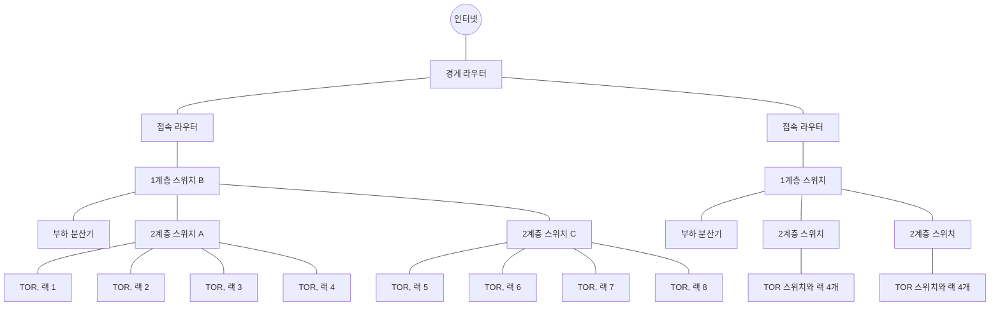

*그림 17. 계층적 토폴로지를 가진 데이터 센터 네트워크*

- 계층의 맨 위에서 경계 라우터가 접속 라우터(access router)들에 연결된다.
- 각 접속 라우터 아래에는 스위치가 세 단계로 있다. 접속 라우터는 1계층(tier-1) 스위치에 연결되고, 1계층 스위치는 여러 2계층(tier-2) 스위치와 부하 분산기에 연결된다.
- 각 2계층 스위치는 랙들의 TOR 스위치(3계층 스위치)를 통해 여러 랙에 연결된다.
- 모든 링크는 보통 링크 계층과 물리 계층 프로토콜로 이더넷을 쓰며, 구리선과 광섬유가 섞여 있다.

클라우드 응용 제공자는 높은 가용성을 계속 유지해야 하므로, 데이터 센터는 그림에 보이지 않는 여분의 네트워크 장비와 링크도 둔다. 예를 들어 TOR 스위치마다 2계층 스위치 두 대에 연결하고, 접속 라우터, 1계층 스위치, 2계층 스위치를 이중화할 수 있다. 그림 17의 구조에서 각 접속 라우터 아래의 호스트들은 하나의 서브넷을 이룬다. ARP 브로드캐스트 트래픽을 국지화하기 위해, 각 서브넷은 다시 호스트 수백 대씩으로 이루어진 더 작은 VLAN 서브넷(20장)으로 나뉜다.

### 7.4 계층적 구조의 한계

전통적인 계층 구조는 규모 문제를 해결하지만, **호스트 사이의 용량(host-to-host capacity)** 이 제한된다는 문제가 있다. 각 호스트가 1 Gbps 링크로 TOR 스위치에 연결되고 스위치 사이의 링크는 10 Gbps 이더넷이라고 하자.

- 같은 랙의 두 호스트는 호스트 NIC의 속도에만 제한되므로 언제나 1 Gbps로 통신할 수 있다.
- 서로 다른 랙의 두 호스트는 데이터 센터에 동시 흐름이 많으면 훨씬 낮은 속도밖에 얻지 못할 수 있다.

예를 들어 그림 17에서 랙 1의 호스트 10대가 각각 랙 5의 호스트로 흐름을 보내고, 같은 방식으로 랙 2와 6, 랙 3과 7, 랙 4와 8 사이에도 흐름이 10개씩 있다고 하자. 모두 40개의 흐름이 서로 다른 랙의 호스트 쌍 사이에 있다. 각 흐름이 링크의 용량을 다른 흐름과 똑같이 나누어 쓴다면, 10 Gbps인 A에서 B로 가는 링크(그리고 B에서 C로 가는 링크)를 지나는 40개의 흐름은 각각 다음 속도만 얻는다.

```math
\frac{10\ \text{Gbps}}{40} = 250\ \text{Mbps}
```

이는 NIC의 1 Gbps보다 훨씬 작다. 계층의 더 높은 곳까지 올라가야 하는 흐름에서는 문제가 더 심해진다. 더 빠른 스위치와 라우터를 쓰는 해결책도 있지만, 포트 속도가 높은 스위치와 라우터는 매우 비싸므로 데이터 센터의 비용이 크게 늘어난다.

호스트 사이의 높은 대역폭은 중요하다. 데이터 센터의 핵심 요구 사항이 계산과 서비스를 유연하게 배치하는 것이기 때문이다. 대규모 인터넷 검색 엔진은 여러 랙에 퍼진 수천 대의 호스트에서 실행되며 모든 호스트 쌍 사이에 큰 대역폭이 필요하다. 클라우드 컴퓨팅 서비스는 고객 서비스를 이루는 여러 가상 머신을 데이터 센터 안의 위치와 상관없이 여유 용량이 가장 큰 물리 호스트에 배치하고 싶어 한다. 이 호스트들이 여러 랙에 흩어져 있으면 앞에서 본 병목 때문에 성능이 나빠질 수 있다.

### 7.5 데이터 센터 네트워크의 동향

대형 클라우드 기업들은 비용을 줄이면서 지연과 처리량을 개선하기 위해 새로운 데이터 센터 네트워크 설계를 계속 도입한다. 설계는 대부분 독점이지만 다음과 같은 동향을 볼 수 있다.

- **완전 연결 토폴로지:** 스위치와 라우터의 계층 구조를 완전 연결 토폴로지로 바꾼다. 각 1계층 스위치가 모든 2계층 스위치에 연결되므로 (1) 호스트 사이의 트래픽이 스위치 계층 위로 올라갈 필요가 없고, (2) 1계층 스위치가 n대이면 임의의 두 2계층 스위치 사이에 서로 겹치지 않는 경로가 n개 있다. 앞의 40개 흐름 예에서 1계층 스위치가 4대이면 첫째와 둘째 2계층 스위치 사이에 서로 다른 경로가 4개 있어 둘 사이에 모두 4 × 10 = 40 Gbps의 용량을 제공하므로, 각 흐름이 1 Gbps를 얻을 수 있다. 또한 같은 스위치에 연결되지 않은 임의의 두 랙 사이의 통신이 데이터 센터 안의 위치와 상관없이 논리적으로 같아져 계산과 서비스를 더 유연하게 배치할 수 있다.
- **컨테이너 기반 모듈형 데이터 센터(MDC):** 공장에서 표준 12 m 선적 컨테이너 안에 호스트 최대 수천 대를 수십 개의 랙에 촘촘히 쌓은 작은 데이터 센터를 만들어 현장으로 보낸다. 현장에서 여러 컨테이너를 서로 연결하고 인터넷에도 연결한다. 배치한 컨테이너는 정비하기 어려우므로, 서버나 스위치가 고장 나도 성능이 서서히 떨어지며 계속 동작하도록 설계하고, 성능이 기준 아래로 떨어지면 컨테이너 전체를 새것으로 바꾼다. 컨테이너 내부 네트워크는 값싼 범용 기가비트 이더넷 스위치로 완전 연결 네트워크를 만들 수 있지만, 수백에서 수천 개의 컨테이너를 잇는 코어 네트워크의 설계는 여전히 어려운 문제이다.
- **고도로 연결된 토폴로지의 라우팅:** 스위치 사이의 라우팅 알고리즘 설계가 중요한 과제이다. 무작위 라우팅의 한 형태를 쓰는 방법과, 호스트마다 NIC를 여러 개 두어 값싼 범용 스위치 여러 대에 연결하고 호스트가 스스로 스위치 사이의 트래픽 경로를 정하게 하는 방법이 있다.
- **자체 제작:** 대형 클라우드 제공자는 네트워크 어댑터, 스위치, 라우터, TOR, 소프트웨어, 네트워크 프로토콜까지 데이터 센터의 거의 모든 것을 직접 만들거나 맞춤 제작한다.
- **가용 영역(availability zone):** 서로 수 km 떨어진 가까운 건물에 별개의 데이터 센터를 복제해 두어 신뢰성을 높인다. 건물이 가까우므로 같은 가용 영역의 데이터 센터 사이에서 트랜잭션 데이터를 동기화하면서도 장애를 견딜 수 있다.

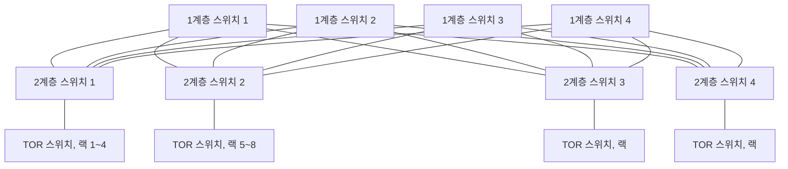

*그림 18. 각 1계층 스위치가 모든 2계층 스위치에 연결된 완전 연결 토폴로지*

---

<br>

## 8. 웹 페이지 요청의 전 과정

지금까지 응용 계층에서 링크 계층까지 프로토콜 스택을 내려오며 많은 프로토콜을 다루었다. 이 절에서는 가장 단순한 요청인 웹 페이지 내려받기 하나를 처리하는 데 얼마나 많은 프로토콜이 관여하는지 따라가며 이들을 하나로 묶어 본다.

학생 Bob이 노트북을 학교의 이더넷 스위치에 연결하고 www.google.com의 홈 페이지를 내려받는다고 하자. 학교의 스위치는 학교 라우터에 연결되고, 학교 라우터는 ISP(comcast.net)에 연결된다. 이 예에서 학교의 DNS 서비스는 ISP가 제공하므로 DNS 서버는 학교 네트워크가 아니라 ISP 네트워크에 있다. DHCP 서버는 흔히 그렇듯 라우터 안에서 실행된다고 가정한다. 이 예의 주소는 다음과 같다.

| 대상 | 주소 |
|:-----|:-----|
| Bob의 노트북 MAC 주소 | 00:16:D3:23:68:8A |
| 학교 라우터의 학교 쪽 인터페이스 MAC 주소 | 00:22:6B:45:1F:1B |
| DHCP 서버가 배정하는 주소 블록 | 68.85.2.0/24 |
| Bob의 노트북에 배정되는 IP 주소 | 68.85.2.101 |
| 기본 게이트웨이(학교 라우터) IP 주소 | 68.85.2.1 |
| DNS 서버 IP 주소 | 68.87.71.226 |
| www.google.com의 IP 주소 | 64.233.169.105 |

*표 9. 웹 페이지 요청 예의 주소*

### 8.1 시작: DHCP, UDP, IP, 이더넷

Bob의 노트북은 IP 주소가 없으면 아무것도 할 수 없다. 따라서 노트북이 하는 첫 번째 네트워크 동작은 DHCP(12장)로 IP 주소와 다른 정보를 얻는 것이다.

1. 노트북의 운영체제는 DHCP 요청 메시지를 만들어 목적지 포트 67(DHCP 서버), 출발지 포트 68(DHCP 클라이언트)인 UDP 세그먼트(6장)에 넣는다. UDP 세그먼트는 목적지 IP 주소가 브로드캐스트 주소 255.255.255.255이고 출발지 IP 주소가 0.0.0.0인 IP 데이터그램(11장)에 담긴다. 노트북에 아직 IP 주소가 없기 때문이다.
2. 데이터그램은 목적지 MAC 주소가 FF:FF:FF:FF:FF:FF인 이더넷 프레임(20장)에 담겨, 스위치에 연결된 모든 장치(DHCP 서버를 포함하기를 바라며)로 브로드캐스트된다. 프레임의 출발지 MAC 주소는 노트북의 00:16:D3:23:68:8A이다.
3. 이 브로드캐스트 프레임이 노트북이 스위치로 보내는 첫 프레임이다. 스위치는 들어온 프레임을 라우터에 연결된 포트를 포함한 모든 출력 포트로 브로드캐스트한다.
4. 라우터는 MAC 주소가 00:22:6B:45:1F:1B인 인터페이스로 프레임을 받아 IP 데이터그램을 꺼낸다. 목적지가 브로드캐스트 IP 주소이므로 이 노드의 상위 계층이 처리해야 할 데이터그램이다. 데이터그램의 페이로드(UDP 세그먼트)는 UDP로 역다중화되고(6장), UDP 세그먼트에서 DHCP 요청 메시지가 꺼내진다. 이제 DHCP 서버가 요청을 받았다.
5. DHCP 서버는 CIDR 블록 68.85.2.0/24(12장)에서 주소를 배정할 수 있으며, Bob의 노트북에 68.85.2.101을 배정한다고 하자. 서버는 이 IP 주소와 함께 DNS 서버의 IP 주소(68.87.71.226), 기본 게이트웨이 라우터의 IP 주소(68.85.2.1), 서브넷 블록(68.85.2.0/24, 곧 네트워크 마스크)을 담은 DHCP ACK 메시지를 만든다. 메시지는 UDP 세그먼트, IP 데이터그램, 이더넷 프레임에 차례로 담기며, 프레임의 출발지 MAC 주소는 라우터 인터페이스의 00:22:6B:45:1F:1B, 목적지 MAC 주소는 노트북의 00:16:D3:23:68:8A이다.
6. 라우터는 DHCP ACK를 담은 프레임을 스위치로 유니캐스트한다. 스위치는 자기 학습(20장)을 하므로 앞서 노트북에서 DHCP 요청 프레임을 받았을 때 노트북의 위치를 학습해 두었다. 따라서 00:16:D3:23:68:8A로 가는 프레임을 노트북으로 이어지는 출력 포트로만 보낸다.
7. 노트북은 이더넷 프레임에서 IP 데이터그램을, IP 데이터그램에서 UDP 세그먼트를, UDP 세그먼트에서 DHCP ACK 메시지를 꺼낸다. DHCP 클라이언트는 자신의 IP 주소와 DNS 서버의 IP 주소를 기록하고, 기본 게이트웨이의 주소를 IP 포워딩 테이블에 넣는다. 노트북은 서브넷 68.85.2.0/24 밖으로 가는 모든 데이터그램을 기본 게이트웨이로 보낸다. 이제 네트워크 구성 요소의 초기화가 끝나 웹 페이지를 가져올 준비가 되었다.

> **참고:** 여기서는 12장에서 다룬 DHCP의 네 단계 가운데 마지막 두 단계(요청과 ACK)만 보였다.

### 8.2 DNS와 ARP

Bob이 웹 브라우저에 www.google.com의 URL을 입력하면, 결국 브라우저에 홈 페이지가 표시될 때까지 긴 사건의 사슬이 시작된다. 브라우저는 www.google.com으로 HTTP 요청(3장)을 보낼 TCP 소켓(23장)을 만드는데, 소켓을 만들려면 www.google.com의 IP 주소를 알아야 한다. 이름을 IP 주소로 바꾸는 일은 DNS(5장)가 한다.

8. 노트북의 운영체제는 DNS 질의 메시지를 만들고, 질문 부분에 문자열 www.google.com을 넣는다. 이 메시지는 목적지 포트가 53(DNS 서버)인 UDP 세그먼트에 담기고, UDP 세그먼트는 목적지 IP 주소가 68.87.71.226(5단계의 DHCP ACK가 알려 준 DNS 서버 주소)이고 출발지 IP 주소가 68.85.2.101인 IP 데이터그램에 담긴다.
9. 노트북은 DNS 질의를 담은 데이터그램을 이더넷 프레임에 넣는다. 이 프레임은 링크 계층에서 학교의 게이트웨이 라우터로 주소가 지정되어야 한다. 노트북은 5단계의 DHCP ACK로 게이트웨이 라우터의 IP 주소(68.85.2.1)는 알지만 MAC 주소는 모른다. 게이트웨이 라우터의 MAC 주소를 얻으려면 ARP(19장)가 필요하다.
10. 노트북은 대상 IP 주소가 68.85.2.1(기본 게이트웨이)인 ARP 질의 메시지를 만들어 목적지가 브로드캐스트 주소(FF:FF:FF:FF:FF:FF)인 이더넷 프레임에 넣고 스위치로 보낸다. 스위치는 이 프레임을 게이트웨이 라우터를 포함한 모든 연결 장치로 전달한다.
11. 게이트웨이 라우터는 학교 네트워크 쪽 인터페이스로 ARP 질의를 담은 프레임을 받고, ARP 메시지의 대상 IP 주소 68.85.2.1이 그 인터페이스의 IP 주소와 같음을 확인한다. 라우터는 자신의 MAC 주소 00:22:6B:45:1F:1B가 IP 주소 68.85.2.1에 대응한다는 ARP 응답을 만들어, 목적지 주소가 노트북의 00:16:D3:23:68:8A인 이더넷 프레임에 넣고 스위치로 보내며, 스위치는 이 프레임을 노트북에 전달한다.
12. 노트북은 ARP 응답 메시지에서 게이트웨이 라우터의 MAC 주소(00:22:6B:45:1F:1B)를 꺼낸다.
13. 이제 노트북은 DNS 질의를 담은 이더넷 프레임의 주소를 게이트웨이 라우터의 MAC 주소로 지정할 수 있다. 이 프레임 안의 IP 데이터그램의 목적지 IP 주소는 DNS 서버의 68.87.71.226이지만, 프레임의 목적지 주소는 게이트웨이 라우터의 00:22:6B:45:1F:1B이다. 노트북은 이 프레임을 스위치로 보내고, 스위치는 게이트웨이 라우터로 전달한다.

### 8.3 DNS 서버까지의 도메인 내 라우팅

14. 게이트웨이 라우터는 프레임을 받아 DNS 질의를 담은 IP 데이터그램을 꺼낸다. 라우터는 데이터그램의 목적지 주소(68.87.71.226)를 찾아보고, 포워딩 테이블(13장)로부터 데이터그램을 ISP 네트워크의 첫 라우터로 보내야 함을 안다. IP 데이터그램은 학교 라우터와 그 ISP 라우터를 잇는 링크에 알맞은 링크 계층 프레임에 담겨 그 링크로 보내진다.
15. ISP 네트워크의 라우터는 프레임을 받아 IP 데이터그램을 꺼내고, 목적지 주소(68.87.71.226)를 보고 포워딩 테이블에서 DNS 서버로 가는 출력 인터페이스를 정한다. 이 포워딩 테이블은 ISP의 도메인 내 라우팅 프로토콜(RIP, OSPF, IS-IS 등, 15장)과 인터넷의 도메인 간 라우팅 프로토콜인 BGP(15장)로 채워진 것이다.
16. 마침내 DNS 질의를 담은 IP 데이터그램이 DNS 서버에 도착한다. DNS 서버는 DNS 질의 메시지를 꺼내 DNS 데이터베이스에서 www.google.com을 찾고, www.google.com의 IP 주소(64.233.169.105)를 담은 DNS 자원 레코드(5장)를 찾는다. 이 정보가 지금 DNS 서버에 캐시되어 있다고 가정하며, 캐시된 정보는 원래 google.com의 책임 DNS 서버에서 온 것이다. DNS 서버는 이 호스트 이름과 IP 주소의 매핑을 담은 DNS 응답 메시지를 UDP 세그먼트에, 그 세그먼트를 Bob의 노트북(68.85.2.101)으로 가는 IP 데이터그램에 담는다. 데이터그램은 ISP 네트워크를 거쳐 학교 라우터로, 거기서 이더넷 스위치를 거쳐 노트북으로 전달된다.
17. 노트북은 DNS 메시지에서 서버 www.google.com의 IP 주소를 꺼낸다. 이제 노트북은 www.google.com 서버에 접촉할 준비가 되었다.

### 8.4 웹 클라이언트와 서버의 상호 작용: TCP와 HTTP

18. www.google.com의 IP 주소를 알았으므로, 노트북은 HTTP GET 메시지(3장)를 보낼 TCP 소켓을 만들 수 있다. 소켓을 만들 때 노트북의 TCP는 먼저 www.google.com의 TCP와 3방향 핸드셰이크(8장)를 해야 한다. 노트북은 목적지 포트가 80(HTTP)인 TCP SYN 세그먼트를 만들어, 목적지 IP 주소가 64.233.169.105인 IP 데이터그램에 넣고, 그 데이터그램을 목적지 MAC 주소가 게이트웨이 라우터의 00:22:6B:45:1F:1B인 프레임에 넣어 스위치로 보낸다.
19. 학교 네트워크, ISP 네트워크, Google 네트워크의 라우터들은 14\~16단계처럼 각 라우터의 포워딩 테이블을 써서 TCP SYN을 담은 데이터그램을 www.google.com 쪽으로 전달한다. ISP 네트워크와 Google 네트워크 사이의 도메인 간 링크로 패킷을 보내는 포워딩 테이블 항목은 BGP가 정한다.
20. 마침내 TCP SYN을 담은 데이터그램이 www.google.com에 도착한다. TCP SYN 메시지는 데이터그램에서 꺼내져 포트 80에 연결된 환영 소켓으로 역다중화된다. Google HTTP 서버와 Bob의 노트북 사이의 TCP 연결을 위한 연결 소켓(23장)이 만들어진다. TCP SYNACK 세그먼트가 만들어져 노트북으로 가는 데이터그램에 담기고, 마지막으로 www.google.com과 첫 번째 홉 라우터를 잇는 링크에 알맞은 링크 계층 프레임에 담긴다.
21. TCP SYNACK을 담은 데이터그램은 Google 네트워크, ISP 네트워크, 학교 네트워크를 거쳐 노트북의 이더넷 카드에 도착한다. 데이터그램은 운영체제 안에서 18단계에서 만든 TCP 소켓으로 역다중화되고, 소켓은 연결 상태가 된다.
22. 이제 노트북의 소켓이 www.google.com으로 바이트를 보낼 준비가 되었으므로, 브라우저는 가져올 URL을 담은 HTTP GET 메시지를 만든다. HTTP GET 메시지는 소켓에 쓰여 TCP 세그먼트의 페이로드가 된다. TCP 세그먼트는 데이터그램에 담겨 18\~20단계처럼 www.google.com으로 전달된다.
23. www.google.com의 HTTP 서버는 TCP 소켓에서 HTTP GET 메시지를 읽고, 요청받은 웹 페이지의 내용을 본문에 담은 HTTP 응답 메시지를 만들어 TCP 소켓으로 보낸다.
24. HTTP 응답 메시지를 담은 데이터그램은 Google 네트워크, ISP 네트워크, 학교 네트워크를 거쳐 노트북에 도착한다. 브라우저 프로그램은 소켓에서 HTTP 응답을 읽고, 응답의 본문에서 웹 페이지의 HTML을 꺼내 마침내 웹 페이지를 표시한다.

### 8.5 전 과정의 정리

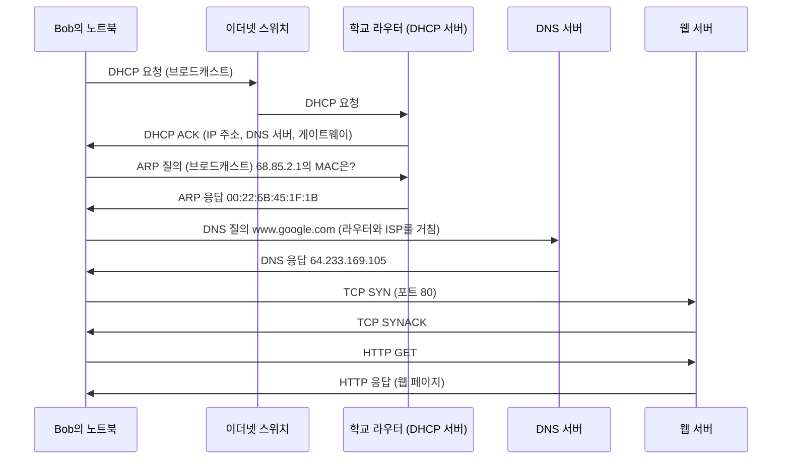

*그림 19. 웹 페이지 요청 하나를 처리하는 메시지의 흐름*

| 단계 | 관여하는 프로토콜 | 목적 | 다루는 곳 |
|:-----|:-----|:-----|:-----|
| 1\~7 | DHCP, UDP, IP, 이더넷, 스위치의 자기 학습 | IP 주소, DNS 서버, 기본 게이트웨이 얻기 | 12장, 6장, 11장, 20장 |
| 8\~13 | DNS, UDP, ARP | 웹 서버의 IP 주소를 묻는 질의를 게이트웨이 라우터로 보내기 | 5장, 19장 |
| 14\~17 | IP 포워딩, 도메인 내 라우팅, BGP, DNS | 질의를 DNS 서버까지 전달하고 응답 받기 | 13장, 14장, 15장 |
| 18\~21 | TCP 3방향 핸드셰이크, 포워딩, BGP | 웹 서버와 TCP 연결 설정 | 8장, 15장 |
| 22\~24 | HTTP, TCP | 웹 페이지 요청과 응답 | 3장, 8장 |

*표 10. 웹 페이지 요청의 단계별 프로토콜*

이 예는 매우 자세해 보이지만, 공중 인터넷에서 마주칠 수 있는 여러 프로토콜(학교 게이트웨이 라우터의 NAT, 학교 네트워크의 무선 접속, 네트워크 접속이나 세그먼트와 데이터그램의 암호화를 위한 보안 프로토콜, 네트워크 관리 프로토콜)과 고려 사항(웹 캐싱, DNS 계층 구조)은 생략했다. 이들은 12장, 22장, 26장, 17장, 3장, 5장에서 다룬다.

> **핵심:** 웹 페이지 하나를 내려받는 단순한 요청에도 응용 계층의 HTTP와 DNS, 전송 계층의 TCP와 UDP, 네트워크 계층의 IP, DHCP, 라우팅, 링크 계층의 이더넷과 ARP가 모두 차례로 관여한다.

---

<br>

## 개념 적용

**T/F 점검:**

| 문장 | 판단과 근거 |
|:-----|:-----|
| 인터넷의 관점에서는 자신만의 스위치와 프로토콜을 가진 전화망 전체도 하나의 링크로 볼 수 있다. | **T.** 인터넷은 전화망을 두 호스트 사이에 링크 계층 연결을 제공하는 기술로 가상화한다. |
| T-1 회선의 프레임은 음성 채널 24개의 8비트 표본으로만 이루어진 192비트이다. | **F.** 동기를 위한 1비트가 더해져 193비트이며, 초당 8000개를 보내 1.544 Mbps가 된다. |
| SONET은 초당 8000개의 프레임을 보내므로 프레임 하나의 시간은 125 μs이다. | **T.** 1/8000초는 125 μs이다. |
| PPP 프레임의 주소 필드에는 상대 장치의 MAC 주소가 들어간다. | **F.** 점대점 연결이므로 데이터 링크 주소를 쓰지 않고 브로드캐스트 주소 11111111을 넣는다. |
| PPP에서 링크의 설정, 유지, 종료는 NCP가 맡는다. | **F.** 링크는 LCP가 맡고, NCP는 IP 같은 네트워크 계층 프로토콜의 데이터를 운반하게 한다. |
| 교환형 WAN은 패킷을 보내기 전에 연결을 설정하고 연결 식별자로 패킷을 전달한다. | **T.** 교환형 WAN은 연결 지향 기술이다. |
| X.25는 링크마다 오류 제어와 확인 응답을 하므로 프레임 릴레이보다 빠르다. | **F.** 홉별 확인 응답 때문에 X.25가 느리며, 프레임 릴레이는 이를 상위 계층에 맡겨 빠르다. |
| ATM 셀은 53바이트이며 그중 5바이트가 헤더이다. | **T.** 페이로드는 48바이트이다. |
| AAL은 ATM 네트워크 안의 모든 스위치에서 쓰인다. | **F.** AAL은 끝점에서만 쓰이고, 스위치는 ATM 계층과 물리 계층만 쓴다. |
| IP 데이터그램을 셀 하나에 직접 담으면 효율이 약 51%이다. | **T.** IP 헤더 20바이트와 ATM 헤더 5바이트를 빼면 데이터는 27바이트이므로 27/53이다. |
| 레이블 교환 라우터는 MPLS 프레임을 전달할 때 목적지 IP 주소로 최장 접두사 일치를 수행한다. | **F.** 레이블로 포워딩 테이블을 찾아 곧바로 출력 인터페이스로 넘긴다. |
| MPLS를 쓰면 같은 목적지로 가는 트래픽을 여러 경로로 나누어 보낼 수 있다. | **T.** 이것이 트래픽 엔지니어링이며, 표준 IP 라우팅은 최소 비용 경로 하나만 쓴다. |
| 데이터 센터의 부하 분산기는 목적지 IP 주소만 보고 요청을 나누므로 3계층 장치이다. | **F.** 목적지 포트 번호도 보므로 4계층 스위치라고도 부른다. |
| 웹 페이지 요청에서 노트북은 DNS 질의를 담은 프레임의 목적지 MAC 주소를 DNS 서버의 MAC 주소로 지정한다. | **F.** DNS 서버는 다른 네트워크에 있으므로 프레임의 목적지는 게이트웨이 라우터의 MAC 주소이다. |

---

<br>

## 요약

| 개념 | 핵심 요약 |
|:-----|:-----|
| 링크 가상화 | 전화망, ATM, MPLS처럼 자신만의 구조를 가진 네트워크도 인터넷의 관점에서는 IP 장치를 잇는 하나의 링크로 볼 수 있다. |
| 점대점 WAN과 교환형 WAN | 점대점 WAN은 공중망에서 빌린 회선으로 두 장치를 잇고, 교환형 WAN은 스위치들의 그물로 넓은 지역에 여러 접속점을 제공한다. |
| T 회선 | T-1은 (24 × 8 + 1)비트 프레임을 초당 8000개 보내 1.544 Mbps이고, T-3은 44.736 Mbps이다. |
| SONET | 전기 신호 STS와 광 신호 OC의 계층을 정의하며, STS-1은 51.84 Mbps이고 125 μs 프레임을 초당 8000개 보낸다. |
| PPP | 점대점 링크의 데이터 링크 프로토콜로, 플래그, 주소, 제어, 프로토콜, 데이터, FCS로 이루어진 프레임을 쓰고 LCP와 NCP를 둔다. |
| X.25 | 가상 회선(SVC, PVC)을 쓰는 3계층 패킷 교환 WAN이며, 광범위한 홉별 오류 제어 때문에 느리다. |
| 프레임 릴레이 | 2계층만 제공하고 오류 검사를 상위 계층에 맡겨 빠르며, DLCI로 가상 회선을 구별하고 버스트 데이터에 요구에 따른 대역폭을 준다. |
| ATM | 53바이트 고정 크기 셀을 비동기 TDM으로 다중화하는 연결 지향 셀 네트워크이며, VPI와 VCI로 가상 연결을 정한다. |
| AAL | 상위 계층 데이터를 셀로 바꾸는 끝점의 계층이며, 인터넷은 IP 데이터그램에 AAL5를 쓴다. |
| MPLS | 2계층과 3계층 헤더 사이에 20비트 레이블을 담은 헤더를 넣어, 레이블 교환 라우터가 IP 주소 대신 레이블로 전달하게 한다. |
| 트래픽 엔지니어링 | MPLS로 같은 목적지의 트래픽을 최소 비용 경로가 아닌 여러 경로로 나누어 보내며, 빠른 복구와 VPN에도 쓰인다. |
| 데이터 센터 네트워크 | 블레이드, 랙, TOR 스위치, 2계층과 1계층 스위치, 접속 라우터, 경계 라우터의 계층 구조와 부하 분산기로 이루어진다. |
| 계층 구조의 한계 | 상위 링크를 많은 흐름이 공유하여 호스트 사이의 용량이 제한되므로, 완전 연결 토폴로지 같은 새 구조가 쓰인다. |
| 웹 페이지 요청 | DHCP로 주소를 얻고, ARP와 DNS로 게이트웨이와 서버를 찾으며, 라우팅으로 패킷을 전달하고, TCP 연결 위에서 HTTP로 페이지를 받는다. |

---

<br>

## 점검 문제

1. **ATM의 고정 크기 셀:** ATM이 크기가 다른 패킷 대신 53바이트 고정 크기 셀을 쓰는 이유를 다중화 지연의 관점에서 설명하고, 이 선택의 대가를 쓰라.

   <details>
   <summary>정답</summary>

   크기가 다른 패킷을 다중화하면, 큰 패킷이 출력 링크를 차지하는 동안 다른 입력의 작은 패킷이 그 뒤에서 오래 기다려야 한다. 실시간 음성처럼 지연에 민감한 작은 패킷에 불리하다. 모든 데이터를 같은 크기의 작은 셀로 나누면 여러 입력의 셀이 번갈아 나가므로 어느 입력도 다른 입력의 큰 데이터 뒤에서 오래 기다리지 않고, 지연이 예측 가능해진다. 대가는 셀마다 5바이트 헤더가 붙어 오버헤드가 약 9.4%로 늘 남는다는 점이다.

   </details>

2. **T-1 회선의 속도:** 음성 채널 24개를 8비트로 표본화하고 프레임마다 동기 비트 1개를 더하여 초당 8000개의 프레임을 보낸다. T-1 회선의 속도를 구하라. 동기 비트가 없다면 속도는 얼마인가?

   <details>
   <summary>정답</summary>

   프레임 하나는 24 × 8 + 1 = 193비트이므로 속도는 193 × 8000 = 1,544,000 bps, 곧 1.544 Mbps이다. 동기 비트가 없다면 192 × 8000 = 1,536,000 bps, 곧 1.536 Mbps이다. 차이 8 kbps는 동기 비트가 차지한다.

   </details>

3. **AAL5의 효율:** 1500바이트 IP 데이터그램을 AAL5로 ATM 네트워크에 보낸다. 셀이 몇 개 필요하고, 패딩은 몇 바이트이며, 전송 효율은 얼마인가? IP 데이터그램을 셀 하나에 직접 담는 경우와 비교하라.

   <details>
   <summary>정답</summary>

   1500바이트에 트레일러 8바이트를 더하면 1508바이트이다. 48바이트 조각으로 나누면 1508/48 ≈ 31.4이므로 셀 32개가 필요하고, 패딩은 32 × 48 − 1508 = 28바이트이다. 전송되는 바이트는 32 × 53 = 1696바이트이므로 효율은 1500/1696 ≈ 88%이다. IP 데이터그램을 셀 하나에 직접 담으면 IP 수준의 데이터가 53 − 5 − 20 = 27바이트뿐이라 효율이 27/53 ≈ 51%이다.

   </details>

4. **MPLS와 IP 포워딩:** 같은 목적지 A로 가는 패킷 하나를 일반 IP 라우터와 레이블 교환 라우터가 각각 어떻게 전달하는지 비교하고, MPLS가 트래픽 엔지니어링을 가능하게 하는 이유를 쓰라.

   <details>
   <summary>정답</summary>

   일반 IP 라우터는 데이터그램에서 목적지 IP 주소를 꺼내 포워딩 테이블에서 최장 접두사 일치를 수행하고, 라우팅 프로토콜이 정한 최소 비용 경로의 다음 홉으로 보낸다. 레이블 교환 라우터는 MPLS 헤더의 레이블로 표를 곧바로 찾아 출력 인터페이스와 출력 레이블을 정하며 IP 헤더를 보지 않는다. 레이블과 경로의 대응은 운영자가 정할 수 있으므로, 같은 목적지로 가는 트래픽을 레이블에 따라 서로 다른 경로로 보낼 수 있다. 이것이 표준 IP 라우팅으로는 불가능한 트래픽 엔지니어링이다.

   </details>

5. **데이터 센터의 병목:** 호스트가 1 Gbps로 TOR 스위치에 연결되고 스위치 사이의 링크가 10 Gbps인 계층적 데이터 센터에서, 서로 다른 랙의 호스트 쌍 사이의 흐름 40개가 같은 10 Gbps 링크를 지난다. 각 흐름의 속도를 구하라. 1계층 스위치 4대가 모든 2계층 스위치와 연결된 완전 연결 토폴로지에서는 어떻게 되는가?

   <details>
   <summary>정답</summary>

   40개의 흐름이 10 Gbps를 똑같이 나누면 각 흐름은 10 Gbps / 40 = 250 Mbps이며, NIC 속도 1 Gbps보다 훨씬 낮다. 완전 연결 토폴로지에서는 두 2계층 스위치 사이에 서로 겹치지 않는 경로가 1계층 스위치 수만큼, 곧 4개 있으므로 둘 사이의 총 용량이 4 × 10 = 40 Gbps가 된다. 40개의 흐름이 이를 나누면 각각 1 Gbps를 얻어 NIC 속도를 다 쓸 수 있다.

   </details>

6. **웹 페이지 요청의 순서:** 노트북을 처음 네트워크에 연결하고 웹 페이지를 요청할 때 DHCP, ARP, DNS, TCP, HTTP가 쓰이는 순서를 쓰고, 각 프로토콜이 그 순서에 와야 하는 이유를 설명하라.

   <details>
   <summary>정답</summary>

   DHCP, ARP, DNS, TCP, HTTP 순서이다. IP 주소가 없으면 어떤 IP 통신도 할 수 없으므로 DHCP로 자신의 IP 주소와 DNS 서버, 기본 게이트웨이의 주소를 먼저 얻는다. DNS 서버는 다른 네트워크에 있으므로 DNS 질의를 게이트웨이 라우터로 보내야 하며, 그 프레임의 목적지 MAC 주소를 알기 위해 ARP를 쓴다. 웹 서버의 IP 주소를 알아야 TCP 소켓을 만들 수 있으므로 DNS로 이름을 주소로 바꾼다. HTTP는 TCP 연결 위에서 동작하므로 3방향 핸드셰이크로 연결을 설정한 뒤에 HTTP GET을 보낸다.

   </details>

7. **프레임 릴레이의 버스트 데이터:** 어떤 사용자가 10초 동안 처음 2초는 6 Mbps, 다음 7초는 0 Mbps, 마지막 1초는 3.44 Mbps로 보낸다. 평균 속도를 구하고, 이 사용자에게 T-1 회선보다 프레임 릴레이가 알맞은 이유를 설명하라.

   <details>
   <summary>정답</summary>

   보낸 양은 6 × 2 + 0 × 7 + 3.44 × 1 = 15.44 Mb이므로 평균 속도는 15.44 / 10 = 1.544 Mbps로 T-1 회선의 속도와 같다. 그러나 T-1 회선은 1.544 Mbps를 꾸준히 쓰는 고정 속도용이므로 6 Mbps로 몰리는 순간의 요구를 감당하지 못한다. 프레임 릴레이는 평균 속도를 보장하면서 필요할 때 그 속도를 넘을 수 있게 하는 요구에 따른 대역폭을 제공하므로 버스트 데이터에 알맞다.

   </details>
