# Chapter 21 — Wide Area Networks and Link Virtualization

[Repository Guide](../../README.md) | [English](Concepts_Lecture.md) | [한국어](Concepts_Lecture.ko.md)

> **Last Updated:** 2026-11-18
>
> Computer Networking: A Top-Down Approach, Kurose and Ross, Ch 6; TCP/IP Protocol Suite, Forouzan, Ch 3, 6, 7

> **Learning Objectives:**
> 1. Explain the difference between point-to-point WANs and switched WANs and where each technology is used in the Internet
> 2. Compute the data rates of T-1 lines and SONET from their frame structures
> 3. Explain the structure of the PPP frame and the roles of LCP and NCP
> 4. Compare X.25, Frame Relay, and ATM, and explain the roles of the ATM cell and the AAL
> 5. Explain how MPLS forwards datagrams by label and the benefit of traffic engineering
> 6. Explain the structure of data center networks and, in order, the protocols involved in a single Web page request

---

## Table of Contents

- [1. Wide Area Networks and the Broadening Notion of a Link](#1-wide-area-networks-and-the-broadening-notion-of-a-link)
  - [1.1 Broadening the Notion of a Link](#11-broadening-the-notion-of-a-link)
  - [1.2 Point-to-Point WANs and Switched WANs](#12-point-to-point-wans-and-switched-wans)
  - [1.3 WANs inside the Internet](#13-wans-inside-the-internet)
- [2. Transmission Technologies of Point-to-Point WANs](#2-transmission-technologies-of-point-to-point-wans)
  - [2.1 T Lines](#21-t-lines)
  - [2.2 SONET](#22-sonet)
- [3. PPP](#3-ppp)
  - [3.1 PPP Layers and Frame](#31-ppp-layers-and-frame)
  - [3.2 LCP and NCP](#32-lcp-and-ncp)
  - [3.3 PPPoE](#33-pppoe)
- [4. Switched WANs](#4-switched-wans)
  - [4.1 Switched WANs as a Connection-Oriented Technology](#41-switched-wans-as-a-connection-oriented-technology)
  - [4.2 X.25](#42-x25)
  - [4.3 Frame Relay](#43-frame-relay)
  - [4.4 X.25 versus Frame Relay](#44-x25-versus-frame-relay)
- [5. ATM](#5-atm)
  - [5.1 Design Goals](#51-design-goals)
  - [5.2 Cell Networks and Multiplexing](#52-cell-networks-and-multiplexing)
  - [5.3 ATM Architecture and Virtual Connections](#53-atm-architecture-and-virtual-connections)
  - [5.4 ATM Layers](#54-atm-layers)
  - [5.5 AAL5 and the ATM Cell](#55-aal5-and-the-atm-cell)
  - [5.6 IP over ATM](#56-ip-over-atm)
- [6. Link Virtualization and MPLS](#6-link-virtualization-and-mpls)
  - [6.1 Viewing a Network as a Link](#61-viewing-a-network-as-a-link)
  - [6.2 The MPLS Header and Label-Switched Routers](#62-the-mpls-header-and-label-switched-routers)
  - [6.3 An Example of MPLS Forwarding](#63-an-example-of-mpls-forwarding)
  - [6.4 Traffic Engineering and Other Uses](#64-traffic-engineering-and-other-uses)
- [7. Data Center Networks](#7-data-center-networks)
  - [7.1 Components of a Data Center](#71-components-of-a-data-center)
  - [7.2 Load Balancing](#72-load-balancing)
  - [7.3 Hierarchical Architecture](#73-hierarchical-architecture)
  - [7.4 Limits of the Hierarchical Architecture](#74-limits-of-the-hierarchical-architecture)
  - [7.5 Trends in Data Center Networking](#75-trends-in-data-center-networking)
- [8. A Day in the Life of a Web Page Request](#8-a-day-in-the-life-of-a-web-page-request)
  - [8.1 Getting Started: DHCP, UDP, IP, and Ethernet](#81-getting-started-dhcp-udp-ip-and-ethernet)
  - [8.2 DNS and ARP](#82-dns-and-arp)
  - [8.3 Intra-Domain Routing to the DNS Server](#83-intra-domain-routing-to-the-dns-server)
  - [8.4 Web Client-Server Interaction: TCP and HTTP](#84-web-client-server-interaction-tcp-and-http)
  - [8.5 Putting It All Together](#85-putting-it-all-together)
- [Concept Applications](#concept-applications)
- [Summary](#summary)
- [Self-Check Questions](#self-check-questions)

---

<br>

## 1. Wide Area Networks and the Broadening Notion of a Link

### 1.1 Broadening the Notion of a Link

The notion of a link broadens as one's study progresses. At first, a link was viewed as a physical wire connecting two communicating hosts. With multiple access protocols (Chapter 18), media such as a wire or radio spectrum shared by several hosts could also be links, so the link came to be viewed more abstractly as a channel rather than a wire. With Ethernet LANs (Chapter 20), the medium connecting hosts could be a rather complex switched infrastructure. Even so, a host always views the medium connecting it to other hosts simply as a link-layer channel. An Ethernet host does not know whether it is connected by a single short LAN segment, by a geographically dispersed switched LAN, or by a VLAN.

This chapter takes an even broader view of the link. A whole network with its own switches, links, and protocol stacks, such as the telephone network or a switched WAN, can from the Internet's point of view be a single link connecting two IP devices. This is called **link virtualization**.

### 1.2 Point-to-Point WANs and Switched WANs

A **wide area network (WAN)** is a network that covers a large area such as a city, a state, or a country. The WANs encountered in the Internet are of two kinds.

- **Point-to-point WAN:** It connects two remote devices using a line leased from a public network such as the telephone network. Traditional modems, DSL lines, cable modems, T lines, and SONET belong here. 56K modems, DSL, and cable modems are access networks that connect subscribers to the Internet and are covered in Chapter 1; this chapter covers T lines, SONET, and PPP, the data link protocol for point-to-point links.
- **Switched WAN:** It covers a large area such as a state or a country and provides access to users at several points. Inside the network there is a mesh of point-to-point networks that connects switches, and the switches, as multiport connectors, connect several inputs and outputs. The backbone networks of the Internet are usually switched WANs. X.25, Frame Relay, and ATM belong here.

### 1.3 WANs inside the Internet

Figure 1 is an imaginary example showing how the technologies covered so far are used together in one part of the Internet.

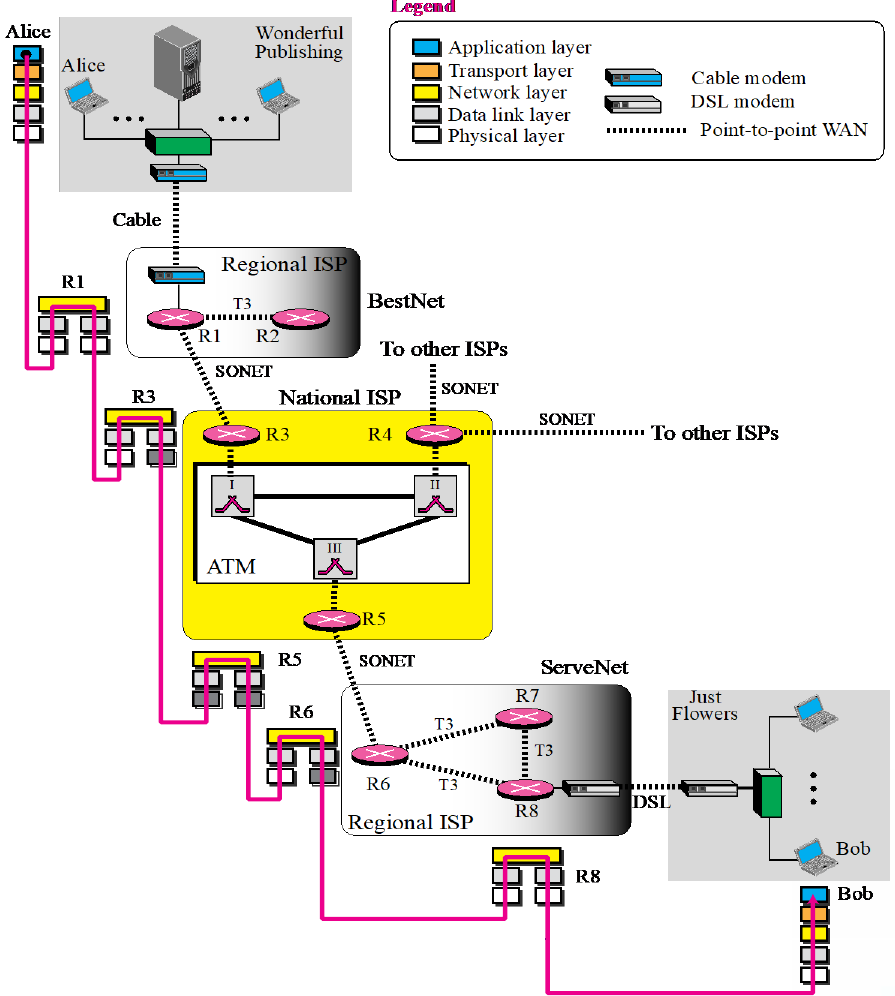

*Figure 1. An imaginary part of the Internet in which several WAN technologies are used together*

- User Alice, at the upper left, is on a company LAN, which is connected to a regional ISP (BestNet) through a **cable modem** using coaxial cable.
- Routers R1 and R2 inside the regional ISP are connected by a **T-3 line**, and the regional ISP is connected to the national ISP by **SONET** over optical fiber.
- The interior of the national ISP is an **ATM** switched WAN made of switches I, II, and III, and routers R3, R4, and R5 are the entry and exit points of the ATM network. The national ISP is also connected to other ISPs by SONET.
- The regional ISP at the bottom (ServeNet) is connected to the national ISP by SONET, and its internal routers are connected by T-3 lines.
- User Bob, at the lower right, is connected to the regional ISP by **DSL** over a twisted-pair telephone line (the public telephone network).

In other words, many links of the Internet are not newly laid dedicated lines but borrow the existing telephone, cable, and optical networks. The layer bars on the left and right of the figure show the layers processed by each device that a packet passes from Alice to Bob. Routers process up through the network layer, and modems up through the physical layer.

---

<br>

## 2. Transmission Technologies of Point-to-Point WANs

### 2.1 T Lines

> **Definition:** A **T-1 line** is a digital telephone carrier designed to time-division multiplex 24 digitized voice channels, with a data rate of 1.544 Mbps.

**T lines** are standard digital telephone carriers originally designed to multiplex digitized voice channels. Today they are also used to carry data from a residence or an organization to the Internet, or as physical links between the nodes of a switched WAN. They are commercially available at two data rates, T-1 and T-3.

| Line | Rate (Mbps) |
|:-----|:-----|
| T-1 | 1.544 |
| T-3 | 44.736 |

*Table 1. Rates of T lines*

The T-1 rate follows from its frame structure. Each of the 24 voice channels is sampled, each sample is digitized to 8 bits, and one extra bit is added for synchronization, which makes a frame 193 bits long. Sending 8000 such frames per second gives the following rate.

```math
(24 \times 8 + 1)\ \text{bits/frame} \times 8000\ \text{frames/s} = 193 \times 8000 = 1{,}544{,}000\ \text{bps} = 1.544\ \text{Mbps}
```

```text
  ┌───┬──────┬──────┬──────┬─────┬──────┐
  │ F │  1   │  2   │  3   │ ... │  24  │
  └───┴──────┴──────┴──────┴─────┴──────┘
    1     8      8      8            8      (bits)

  F: synchronization bit, 1-24: 8-bit sample of each voice channel
  One frame = 1 + 24 × 8 = 193 bits, 8000 per second (one frame every 125 μs)
```

*Figure 2. Structure of a T-1 frame*

When a T-1 line is used to connect to the Internet, all or part of its capacity can be used to send digital data. A T-3 line runs at 44.736 Mbps and is equivalent to 28 T-1 lines. Many subscribers do not need the entire capacity of a T line, so telephone companies offer **fractional T line** services, which allow several subscribers to share one line by multiplexing their transmissions.

### 2.2 SONET

> **Definition:** **SONET (Synchronous Optical Network)** is a high-speed data carrier standard created by ANSI for the use of fiber-optic cable, which defines a hierarchy of electrical STS signals and optical OC signals and transmits 8000 frames per second.

The high bandwidth of fiber-optic cable suits today's high-rate technologies such as video conferencing as well as carrying many lower-rate technologies at the same time. SONET first defines a set of electrical signals called **synchronous transport signals (STSs)** and then converts them into optical signals called **optical carriers (OCs)**. The optical signals are transmitted at 8000 frames per second, so one frame lasts 125 μs.

| STS | OC | Rate (Mbps) | STS | OC | Rate (Mbps) |
|:-----|:-----|:-----|:-----|:-----|:-----|
| STS-1 | OC-1 | 51.840 | STS-24 | OC-24 | 1244.160 |
| STS-3 | OC-3 | 155.520 | STS-36 | OC-36 | 1866.240 |
| STS-9 | OC-9 | 466.560 | STS-48 | OC-48 | 2488.320 |
| STS-12 | OC-12 | 622.080 | STS-96 | OC-96 | 4976.640 |
| STS-18 | OC-18 | 933.120 | STS-192 | OC-192 | 9953.280 |

*Table 2. SONET rates*

The rate of STS-n is n times that of STS-1. The lowest level of the hierarchy, STS-1 at 51.840 Mbps, is faster than a T-3 line at 44.736 Mbps. One STS-1 frame carries 51.84 × 10⁶ / 8000 = 6480 bits, or 810 bytes.

The advantages of SONET are as follows.

- **125 μs frames:** 8000 frames per second matches the voice sampling period, which suits the multiplexing of digital voice channels.
- **Efficient multiplexing:** Lower-rate signals can be combined systematically into higher-rate signals.
- **High reliability:** Overhead for operations and maintenance carried in the frame raises the reliability of the network.
- **Cost-effectiveness:** New network architectures can be realized cost-effectively.

---

<br>

## 3. PPP

### 3.1 PPP Layers and Frame

> **Definition:** **PPP (Point-to-Point Protocol)** is a data-link-layer protocol for controlling and managing data transfer over a physical point-to-point link provided by a telephone or cable company.

Telephone and cable companies provide a physical link, but a special protocol is needed to control and manage the transfer of data. PPP was designed to meet this need. PPP has only physical and data link layers. It defines no specific protocol for the physical layer, leaving the implementer to use whatever is available, and it supports any of the protocols recognized by ANSI. At the data link layer, it defines the format of a frame and the protocols used for controlling the link and transporting user data.

```text
  ┌──────────┬──────────┬──────────┬──────────┬──────────────┬──────────┬──────────┐
  │   Flag   │ Address  │ Control  │ Protocol │ Data and     │   FCS    │   Flag   │
  │ 01111110 │ 11111111 │ 11000000 │          │ padding      │          │ 01111110 │
  └──────────┴──────────┴──────────┴──────────┴──────────────┴──────────┴──────────┘
       1          1          1         1 or 2      variable      2 or 4        1
```

*Figure 3. Format of a PPP frame*

The numbers below Figure 3 are the field sizes in bytes.

| Field | Size | Content |
|:-----|:-----|:-----|
| Flag | 1 byte | Value 01111110; marks the boundaries of a PPP frame |
| Address | 1 byte | Since PPP is a point-to-point connection, it uses the broadcast address of most LANs, 11111111, to avoid a data link address |
| Control | 1 byte | Value 11000000; shows that, as in most LANs, frames have no sequence numbers and each frame is independent |
| Protocol | 1 or 2 bytes | Defines whether the data field carries user data or other information |
| Data | Variable | User data or other information |
| FCS | 2 or 4 bytes | A 2-byte or 4-byte CRC for error detection (Chapter 18) |

*Table 3. Fields of a PPP frame*

### 3.2 LCP and NCP

> **Definition:** **LCP (Link Control Protocol)** is the protocol in PPP responsible for establishing, maintaining, configuring, and terminating the link, providing a mechanism for the two endpoints to negotiate options.

- **LCP:** It is responsible for establishing, maintaining, configuring, and terminating the link. It provides a negotiation mechanism for setting options between the two endpoints. When the data field of a frame carries data related to this protocol, PPP is handling the link, and no user data are carried.
- **NCP (Network Control Protocol):** It was defined to give PPP flexibility. PPP can carry data from different network protocols, such as IP and IPX. After the link is established, PPP carries IP packets in its data field.

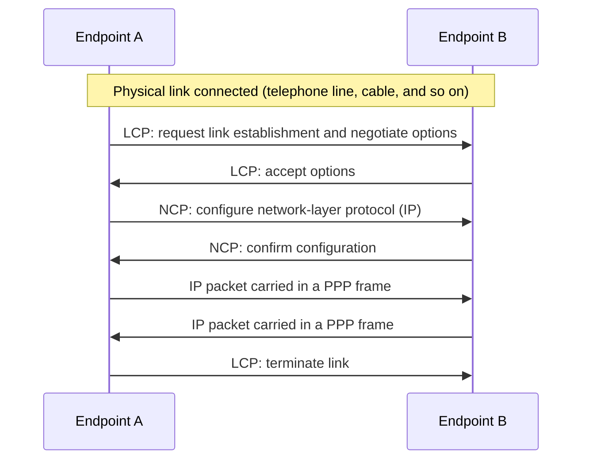

*Figure 4. Order in which LCP and NCP are used in PPP*

### 3.3 PPPoE

PPP was originally designed to connect a single user to the Internet through a conventional modem and a telephone line. Today, DSL, cable modems, and wireless technology allow a group of users on an Ethernet LAN to access the Internet through a single physical line. **PPPoE (PPP over Ethernet)** is a protocol that uses a discovery procedure to find the Ethernet address of the host to be connected to the Internet and then provides the connection with a regular PPP session.

---

<br>

## 4. Switched WANs

### 4.1 Switched WANs as a Connection-Oriented Technology

Switched WAN technology differs from LAN technology in several ways.

- **Topology:** Instead of a star topology, switches are used to create multiple paths.
- **Connection orientation:** LAN technology is connectionless; there is no relationship between the packets a sender sends to a receiver. Switched WAN technology is connection-oriented. Before a sender can send a packet, a connection must be established between the sender and the receiver, and the established connection is assigned an identifier (sometimes called a label) used during the transmission. The connection is formally terminated when the transmission is over. This connection identifier is used instead of the source and destination addresses of LAN technology. This is the same as the virtual-circuit approach of Chapter 10.

### 4.2 X.25

> **Definition:** **X.25** is a packet-switched WAN protocol introduced in the 1970s, the first to become popular in Europe and the United States, which provides an end-to-end service with the virtual-circuit approach.

X.25 was mostly used as a public network connecting individual computers or LANs, and it provides an end-to-end service. Its packet switching follows the virtual-circuit approach, with two kinds of virtual circuits.

- **SVC (switched virtual circuit):** A connection is set up for each communication and released when it ends.
- **PVC (permanent virtual circuit):** A connection is set up in advance and kept in use.

The equipment connected to an X.25 network falls into two kinds.

- **DTE (data terminal equipment):** Packet-mode user terminals, that is, data terminal equipment such as a user's computer.
- **DCE (data circuit-terminating equipment):** Equipment that connects a DTE to the packet-switching network.

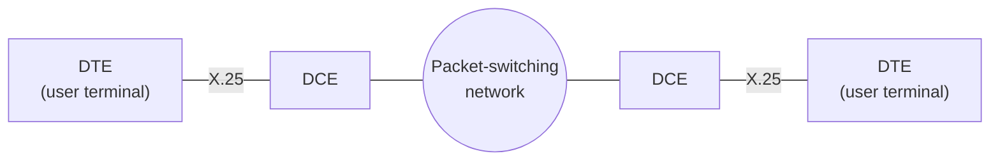

*Figure 5. DTEs and DCEs of an X.25 network*

X.25 was used as a WAN to carry IP packets from one part of the Internet to another, but there was always a conflict between IP and X.25.

- **Conflicting layers:** IP is a third-layer (network-layer) protocol, so an IP packet is supposed to be carried in a second-layer (data-link-layer) frame. X.25, designed before the Internet, is a three-layer protocol with its own network layer. IP packets therefore had to be encapsulated in X.25 network-layer packets to be carried from one side of the network to the other. This is like a person who has a car but must load it onto a truck to get to the destination.
- **Excessive error control:** X.25 was designed when transmission media were not very reliable (optical fiber was not used). It therefore performs extensive error control, which makes transmission very slow and unsuited to the ever-increasing demand for speed.

### 4.3 Frame Relay

> **Definition:** **Frame Relay** is a switched WAN technology designed to replace X.25, which provides only physical-layer and data-link-layer service and performs no error checking or acknowledgment at the data link layer.

Frame Relay has the following advantages over X.25.

- **High data rate:** It was originally designed to provide 1.544 Mbps, equivalent to a T-1 line, but most implementations today can handle up to 44.736 Mbps, equivalent to a T-3 line.
- **Low cost (mesh connectivity):** Several virtual circuits are carried over one physical access link, so a user can be connected to several destinations in a mesh without laying a dedicated line between every pair.
- **Bursty data and bandwidth on demand:** Some services offered by WAN providers assume that the user needs a fixed rate. A T-1 line is designed for a user who uses 1.544 Mbps consistently, so it does not suit users who send **bursty data**, whose rate is not fixed. For example, if a user sends at 6 Mbps for 2 seconds, 0 Mbps for 7 seconds, and 3.44 Mbps for 1 second, the total over 10 seconds is 6 × 2 + 0 × 7 + 3.44 × 1 = 15.44 Mb, so the average rate is still 1.544 Mbps. A T-1 line, however, is designed for fixed-rate data and cannot meet such a demand. Bursty data require **bandwidth on demand**, with different bandwidth allocations at different times. Frame Relay guarantees the user an average rate that can be exceeded when needed.
- **Less overhead due to improved transmission media:** The quality of transmission media, especially optical media, has improved greatly and errors have become rare, so there is no need for a WAN that spends time and resources checking and double-checking potential errors. Frame Relay performs no error checking and requires no acknowledgment at the data link layer. All error checking is left to the network-layer and transport-layer protocols that use Frame Relay's service.

In Frame Relay, the connection identifier that identifies a virtual circuit is called the **DLCI (data link connection identifier)**.

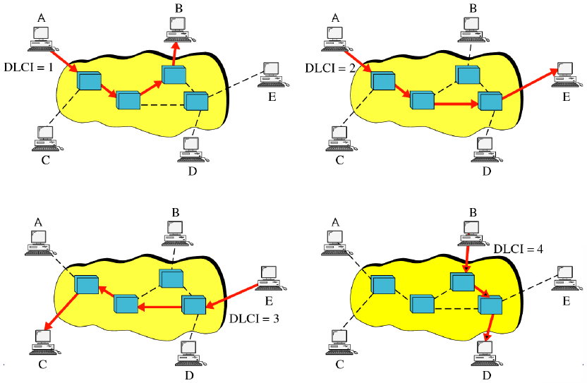

*Figure 6. Frame Relay virtual circuits distinguished by DLCI on each access link*

In Figure 6, user A is connected to the network by a single access link, yet it sends frames to B over the virtual circuit with DLCI = 1 and to E over the virtual circuit with DLCI = 2. Likewise, E sends to C over the virtual circuit with DLCI = 3, and B sends to D over the virtual circuit with DLCI = 4. A user is connected to several destinations through one access link without leasing a separate line for each destination, which lowers cost.

### 4.4 X.25 versus Frame Relay

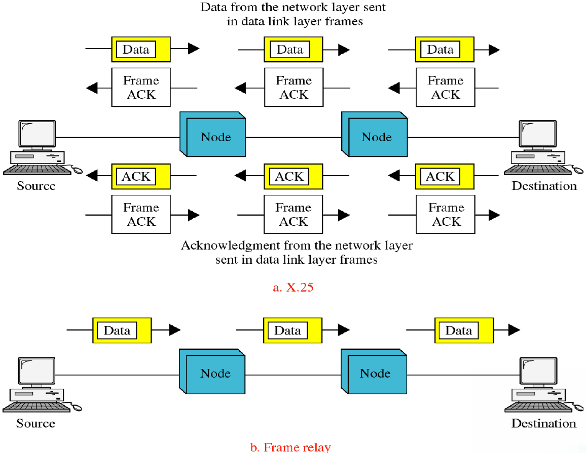

*Figure 7. Hop-by-hop processing in X.25 and in Frame Relay*

In (a) X.25 of Figure 7, when data from the network layer are sent in data-link-layer frames, a data-link-layer acknowledgment (Frame ACK) returns on every link (between the source and a node, between nodes, and between a node and the destination). The network-layer acknowledgment (ACK) is also carried hop by hop in data link frames, and those frames are in turn acknowledged with Frame ACKs. Checking acknowledgments at every delivery makes it slow. In (b) Frame Relay, only the data frames are relayed through the nodes, with no hop-by-hop acknowledgments, so it is fast.

| Feature | X.25 | Frame Relay |
|:-----|:-----|:-----|
| Layers of operation | Physical, data link, network (three layers) | Physical, data link (two layers) |
| Carrying IP packets | Re-encapsulated in X.25 network-layer packets | Carried directly in data link frames |
| Hop-by-hop error control and acknowledgment | Extensive | None (left to upper layers) |
| Transmission media at design time | Unreliable media | Reliable optical media |
| Speed | Slow | Fast (T-1 to T-3 level) |
| Bursty data | Not considered | Bandwidth on demand |

*Table 4. Comparison of X.25 and Frame Relay*

---

<br>

## 5. ATM

**ATM (Asynchronous Transfer Mode)** is the **cell relay** protocol designed by the ATM Forum and adopted by the ITU-T.

### 5.1 Design Goals

Among the challenges faced by the designers of ATM, six stand out.

1. A transmission system is needed that optimizes the use of high-data-rate transmission media, in particular optical fiber.
2. It must interface with existing systems such as the various packet networks and provide wide area interconnectivity between them without lowering their effectiveness or requiring their replacement.
3. It must be implementable inexpensively so that cost is not a barrier to adoption. If ATM is to become the backbone of international communications, it must be available at low cost to every user who wants it.
4. It must work with and support the existing telecommunications hierarchies, such as local loops, local providers, and long-distance carriers.
5. It must be connection-oriented to ensure accurate and predictable delivery.
6. It must move as many functions as possible to hardware and eliminate as many software functions as possible, for speed.

### 5.2 Cell Networks and Multiplexing

> **Definition:** An **ATM cell** is a small block of data of fixed size that is the basic unit of data exchange in an ATM network, 53 bytes in total with a 5-byte header and a 48-byte payload.

ATM is a **cell network**. In a cell network, all data are loaded into identical cells that are transmitted with complete predictability and uniformity. Cells are multiplexed with other cells and routed through the cell network. Because all cells are the same size and small, the problems associated with multiplexing packets of different sizes are avoided. In short, a cell network divides data into pieces of a fixed size before sending them.

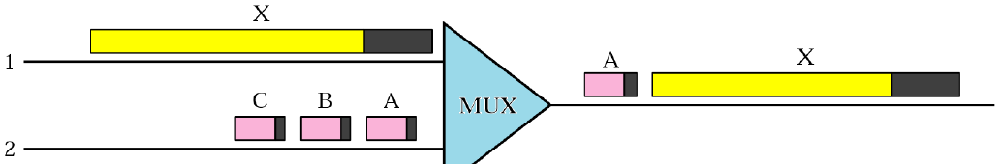

*Figure 8. Multiplexing packets of different sizes*

In Figure 8, input 1 has a large packet X and input 2 has small packets A, B, and C. Once the multiplexer starts sending X, the output carries A followed by X, and B and C must wait until all of X has been sent. When frames differ in size, small packets are delayed for a long time behind large ones, which is unfair to small delay-sensitive packets such as real-time voice.

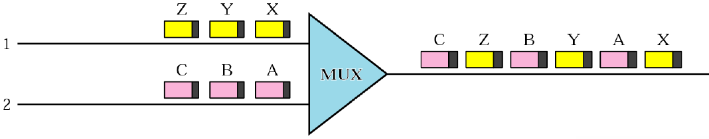

*Figure 9. Multiplexing in a cell network*

When all data are divided into cells of the same size, as in Figure 9, the cells X, Y, Z and A, B, C of the two inputs are output alternately, and no input waits long behind the large data of another input.

ATM multiplexes cells coming from different channels with **asynchronous time-division multiplexing**, which is why it is called Asynchronous Transfer Mode. The multiplexer uses fixed-size slots the size of a cell and fills a slot with a cell from any input channel that has one; the slot is empty if none of the channels has a cell to send. Unlike synchronous TDM (Chapter 18), slots are not permanently assigned to channels, so no slots are wasted on idle channels.

```text
  Input 1:  A3   A2   A1
  Input 2:       B2   B1
  Input 3:  C3   C2   C1
                               Output (the cell sent first is on the right)
                       ──►  ... │ C3 │ B2 │ A3 │ C2 │ B1 │ A2 │ C1 │ A1 │
```

*Figure 10. An example of asynchronous TDM of the cells of three inputs*

Figure 10 shows the case where input 2 has no cell at the first clock tick (an empty input slot), so the multiplexer fills that slot with a cell from input 3. The output order is A1, C1, A2, B1, C2, A3, B2, C3, and once the cells of all channels have been multiplexed, the output slots are empty.

### 5.3 ATM Architecture and Virtual Connections

ATM is a switched network. User access devices, called **end points**, are connected to the switches inside the network, and the switches are connected to each other by high-speed communication channels. A connection between two end points is made at three levels.

- **Transmission path (TP):** The physical connection (wire, cable, satellite, and so on) between an end point and a switch or between two switches. If two switches are thought of as two cities, the transmission path is the set of all highways directly connecting the two cities.
- **Virtual path (VP):** A division of a transmission path that provides a connection or a set of connections between two switches. Each highway connecting the two cities is a virtual path. It bundles together virtual circuits whose paths are partly the same.
- **Virtual circuit (VC):** The logical connection followed by all cells belonging to one message, which keep their original order until they reach their destination. The lanes of a highway are the virtual circuits.

```text
                    Transmission path (TP)
  ┌───────────────────────────────────────────────────┐
  │  VP (VPI = 14)  ═══ VC (VCI = 21) ═══             │
  │                 ═══ VC (VCI = 32) ═══             │
  │                 ═══ VC (VCI = 45) ═══             │
  │  VP (VPI = 18)  ═══ VC (VCI = 21) ═══             │
  │                 ═══ VC (VCI = 32) ═══             │
  │                 ═══ VC (VCI = 45) ═══             │
  └───────────────────────────────────────────────────┘
  One virtual connection is defined by a (VPI, VCI) pair (e.g., (14, 21))
```

*Figure 11. Relationship of transmission paths, virtual paths, and virtual circuits*

In a virtual-circuit network, the virtual connections must be identified to route data from one end point to another. ATM uses a hierarchical identifier with two levels for this. The **VPI (virtual path identifier)** defines a specific virtual path, and the **VCI (virtual circuit identifier)** defines a particular virtual circuit inside that virtual path. All virtual connections bundled into one virtual path have the same VPI. A virtual connection is thus defined by a pair of numbers, the VPI and the VCI.

### 5.4 ATM Layers

The ATM standard defines three layers, from top to bottom: the **application adaptation layer (AAL)**, the ATM layer, and the physical layer.

```text
  ┌──────────┬──────────┬──────────┬──────────┐
  │   AAL1   │   AAL2   │  AAL3/4  │   AAL5   │
  ├──────────┴──────────┴──────────┴──────────┤
  │                ATM layer                  │
  ├───────────────────────────────────────────┤
  │              Physical layer               │
  └───────────────────────────────────────────┘
```

*Figure 12. Layers of ATM*

> **Definition:** The **application adaptation layer (AAL)** is the top layer of ATM, which lets existing networks such as packet networks connect to ATM facilities by accepting upper-layer transmissions, mapping them into fixed-size ATM cells, and reassembling them into their original formats at the receiver.

The AAL accepts transmissions of any type, such as voice, data, audio, and video, at variable or fixed rates. At the receiver the process is reversed: the segments are reassembled into their original formats and passed to the receiving service. Four kinds of AAL have been defined.

| AAL type | Service | Use |
|:-----|:-----|:-----|
| AAL1 | Constant bit rate (CBR) | Real-time voice, video |
| AAL2 | Variable bit rate (VBR) | Compressed voice, data, video |
| AAL3/4 | Connection-oriented packet protocol | Connection-oriented packets such as X.25 using virtual circuits |
| AAL5 | Connectionless packet protocol | IP datagrams |

*Table 5. Types of AAL*

The physical layer and the ATM layer are used both in the switches inside the network and in the end points (such as routers) that use the services of ATM. The AAL is used only by the end points.

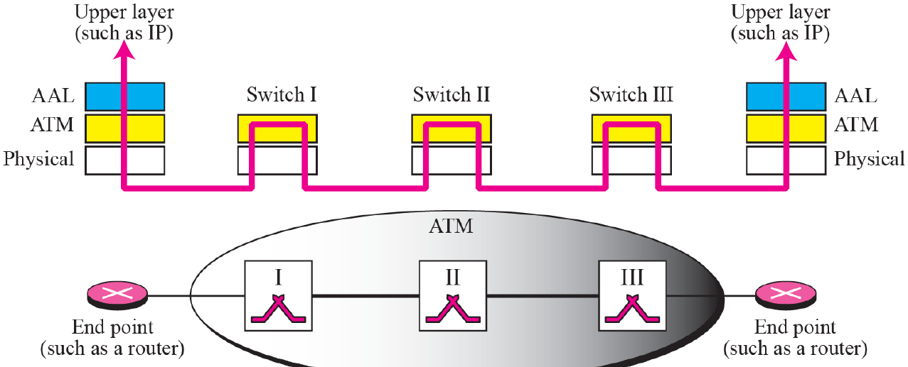

*Figure 13. Layers used inside and outside an ATM network*

In Figure 13, an end point (router) sends the data of the upper layer (IP) out through the AAL, the ATM layer, and the physical layer; switches I, II, and III relay cells using only the ATM and physical layers; and the opposite end point reassembles the original data in its AAL and passes them up to the upper layer.

- **ATM layer:** It provides routing, traffic management, switching, and multiplexing services. It accepts 48-byte segments from the AAL and adds a 5-byte header to turn each into a 53-byte cell.
- **Physical layer:** It defines the transmission medium, bit transmission, encoding, and electrical-to-optical transformation. It provides convergence with physical transport protocols such as SONET and T-3 and the mechanisms for transforming the flow of cells into a flow of bits.

### 5.5 AAL5 and the ATM Cell

Of the four AALs, the one used to carry IP packets in the Internet is AAL5. AAL5 is also called the **simple and efficient adaptation layer (SEAL)**. AAL5 assumes that all cells belonging to one message travel sequentially and that control functions are in the upper layers of the sending application, so it has no separate header information such as addressing or sequence numbers. It is designed for connectionless packet protocols that route by the datagram approach, such as IP.

```text
  ┌─────────────────────────────────────────┬─────────┬─────────┐
  │                IP packet                │   pad   │ trailer │
  └─────────────────────────────────────────┴─────────┴─────────┘
                       │
                       ▼
  ┌──────────┐┌──────────┐┌──────────┐       ┌──────────┐
  │    48    ││    48    ││    48    │  ...  │    48    │
  └──────────┘└──────────┘└──────────┘       └──────────┘
                       │
                       ▼
  ┌─────┬──────────┐
  │  5  │    48    │
  └─────┴──────────┘

  Top: padding and an 8-byte trailer are added to an IP packet of at most 65,535 bytes
  Middle: divided into 48-byte segments (the trailer is the last 8 bytes of the last segment)
  Bottom: the ATM layer adds a 5-byte header to make a 53-byte cell (the header is mostly VPI and VCI)
```

*Figure 14. Segmentation by AAL5 and the ATM cell*

AAL5 accepts an IP packet of no more than 65,535 bytes, adds an 8-byte trailer, and inserts any padding needed so that the trailer falls where the receiving equipment expects it, at the last 8 bytes of the last cell. With the padding and trailer in place, it passes the message to the ATM layer in 48-byte segments. A cell is 53 bytes, of which 5 bytes are the header and 48 bytes the payload. Most of the header is occupied by the VPI and VCI, and the combination of VPI and VCI can be regarded as a **label** that defines a particular virtual connection.

AAL5 is used instead of carrying an IP packet directly in a single cell because it is more efficient. To carry an IP datagram in a single cell, at least 20 bytes are needed for the IP header and 5 bytes for the ATM header, so the data at the IP level are only 53 − 5 − 20 = 27 bytes. The efficiency is 27/53, or about 51 percent. Letting an IP datagram span several cells spreads the 20-byte IP overhead over those cells and increases efficiency. For example, a 1500-byte IP datagram plus the 8-byte trailer makes 1508 bytes, which become 32 cells of 48 bytes (with 28 bytes of padding) transmitted as 32 × 53 = 1696 bytes, an efficiency of 1500/1696 ≈ 88 percent.

> **Note:** The fixed 53-byte cell solves the multiplexing delay problem of Section 5.2, but every cell carries a 5-byte header, so the overhead relative to the cell stays at 5/53 ≈ 9.4 percent. There is a trade-off: the smaller the cell, the shorter the multiplexing delay and the larger the header overhead.

### 5.6 IP over ATM

A switched WAN such as ATM can also be a highway for IP datagrams. There are similarities to LANs and point-to-point WANs as well as differences. An IP packet is carried not in one cell but in several, and an ATM network has its own definition of the physical address of a device.

An ATM network creates a route between two routers. The cells start at the **entering-point router** and end at the **exiting-point router**. Routing cells from a specific entering-point router to a specific exiting-point router requires three types of addresses.

| Address | Where defined | Role |
|:-----|:-----|:-----|
| IP address | IP layer | Defines each router connected to the ATM network at the IP layer; unrelated to the ATM network |
| Physical address | ATM network | The ATM Forum defines 20-byte addresses for ATM networks; unique within a network and set by the administrator; plays the same role as the MAC address in a LAN and is used during connection establishment |
| Virtual circuit identifiers (VPI, VCI) | ATM switches | The basis on which switches inside the network route cells; used during data transfer |

*Table 6. Three types of addresses used in IP over ATM*

An IP datagram contains only the source and destination IP addresses, so the virtual circuit identifiers must be determined from the destination IP address. The address binding proceeds as follows.

1. When the entering-point router receives an IP datagram, it uses the destination address and its forwarding table to find the IP address of the next router, the exiting-point router. This is exactly the same step followed when a datagram passes through a LAN.
2. The entering-point router uses a protocol called **ATMARP** to find the physical address of the exiting-point router. ATMARP is similar to ARP (Chapter 19). However, whereas a LAN is a broadcast network at the data link layer, an ATM network is not a broadcast network, so instead of broadcasting a request as ARP does, another method is used.
3. The virtual circuit identifiers are bound to the physical addresses to establish the connection.

---

<br>

## 6. Link Virtualization and MPLS

### 6.1 Viewing a Network as a Link

Consider a dial-up modem connection between two hosts. The link connecting the two hosts is actually the telephone network, a logically separate global network with its own switches, links, and protocol stacks for data transfer and signaling. From the Internet's link-layer point of view, however, a dial-up connection through the telephone network is viewed as a simple wire. In this sense, the Internet virtualizes the telephone network, viewing it as a link-layer technology that provides link-layer connectivity between two Internet hosts. The ATM network of Section 5.6 likewise acts as a link connecting IP devices.

**MPLS (Multiprotocol Label Switching)** networks can be viewed in the same way. Unlike the circuit-switched telephone network, MPLS is a packet-switched, virtual-circuit network in its own right, with its own packet formats and forwarding behaviors. Pedagogically, it could therefore be covered under either the network layer or the link layer. From the Internet's point of view, like the telephone network and switched Ethernet, it can be considered a link-layer technology that interconnects IP devices. The principle of using a label to access the forwarding table directly, and the position of the MPLS header, are also covered in Chapter 13.

### 6.2 The MPLS Header and Label-Switched Routers

MPLS evolved from several industry efforts in the mid-to-late 1990s to improve the forwarding speed of IP routers. The key idea is to adopt the **fixed-length label** of virtual-circuit networks. The goal is not to abandon destination-based IP datagram forwarding for labels and virtual circuits, but to augment it by selectively labeling datagrams and letting routers forward them by fixed-length label rather than by destination IP address when possible. These techniques work hand in hand with IP, using IP addressing and routing. The IETF unified these efforts in the MPLS protocol, blending virtual-circuit techniques into a routed datagram network.

```text
  ┌─────────────────┬─────────────┬───────────┬──────────────────────────┐
  │ PPP or Ethernet │ MPLS header │ IP header │ Remainder of link-layer  │
  │     header      │             │           │ frame                    │
  └─────────────────┴─────────────┴───────────┴──────────────────────────┘
                     │
                     ▼
                    ┌──────────────────────┬─────┬───┬──────────┐
                    │        Label         │ Exp │ S │   TTL    │
                    └──────────────────────┴─────┴───┴──────────┘
                              20              3    1      8        (bits)
```

*Figure 15. The MPLS header placed between the link-layer and network-layer headers*

A link-layer frame transmitted between MPLS-capable devices has a small MPLS header added between the layer-2 (for example, Ethernet) header and the layer-3 (IP) header. The fields of the MPLS header are as follows.

- **Label:** A 20-bit label used to look up the router's table.
- **Exp:** 3 bits reserved for experimental use.
- **S:** A single bit indicating the last of a series of stacked MPLS headers.
- **TTL:** A time-to-live field.

A frame carrying an MPLS header can be exchanged only between routers that are both MPLS capable, because a router without MPLS support cannot process an MPLS header found where the IP header was expected.

> **Definition:** A **label-switched router** is an MPLS-capable router that looks up the label of an MPLS frame in its forwarding table and immediately passes the datagram to the appropriate output interface.

A label-switched router need not extract the destination IP address and perform longest prefix matching (Chapter 13) in its forwarding table. The label acts as an index into the table, so the table is accessed directly rather than searched.

### 6.3 An Example of MPLS Forwarding

To understand how a router knows whether its neighbor is MPLS capable and which label to associate with a given IP destination, one must look at the interaction among MPLS routers. In Figure 16, routers R1-R4 are MPLS capable, and R5 and R6 are standard IP routers.

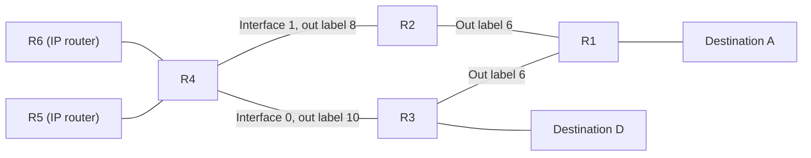

*Figure 16. An example of MPLS-enhanced forwarding*

- R1 advertises to R2 and R3 that it can route to destination A and that a received frame with label 6 will be forwarded to A.
- R3 advertises to R4 that it can route to destinations A and D and that incoming frames with labels 10 and 12, respectively, will be switched toward those destinations.
- R2 also advertises to R4 that it can reach A and that a received frame with label 8 will be switched toward A.

| In label at R4 | Out label | Destination | Out interface |
|:-----|:-----|:-----|:-----|
| | 10 | A | 0 |
| | 12 | D | 0 |
| | 8 | A | 1 |

*Table 7. MPLS forwarding table of R4*

R4 has two MPLS paths to A: via interface 0 with outbound label 10, and via interface 1 with label 8. The IP devices R5, R6, A, and D are connected through the MPLS infrastructure (R1-R4) in the same way that a switched LAN or an ATM network connects IP devices. Like a switched LAN or an ATM network, the MPLS routers R1-R4 do this without ever touching the IP header of a packet.

The signaling protocol that distributes labels among MPLS routers, and how MPLS computes paths and gathers link-state information (for example, link bandwidth not reserved by MPLS), are beyond the scope of these notes. Existing link-state routing algorithms (for example, OSPF, Chapter 15) have been extended to flood this information to MPLS routers, and the actual path computation algorithms are not standardized.

### 6.4 Traffic Engineering and Other Uses

So far the emphasis has been on MPLS switching by label without considering the IP address of a packet. The true advantages of MPLS and the reason for current interest in it, however, lie not in faster switching but in the new traffic management capabilities that MPLS enables.

- **Traffic engineering:** R4 has two MPLS paths to A. If forwarding were performed at the IP layer by IP address, the routing protocols (Chapters 14 and 15) would specify only a single least-cost path to A. MPLS can forward packets along routes that standard IP routing cannot. A network operator can override normal IP routing for policy, performance, or other reasons, sending some of the traffic for a given destination along one path and the rest along another.
- **Fast restoration:** When a link fails, traffic can be rerouted over a precomputed failover path, quickly restoring MPLS forwarding paths.
- **VPNs:** An ISP can use its MPLS network to connect a customer's various networks and implement a virtual private network (VPN, Chapter 26). MPLS isolates the resources and addressing used by the customer's VPN from those of other users crossing the ISP's network.

With so many uses, MPLS is becoming the all-purpose tool of Internet traffic engineering.

> **Definition:** **MPLS (Multiprotocol Label Switching)** is a packet-switched virtual-circuit technology that attaches a header carrying a fixed-length label to IP datagrams so that label-switched routers forward datagrams by label instead of by destination IP address.

---

<br>

## 7. Data Center Networks

### 7.1 Components of a Data Center

> **Definition:** A **data center network** is the network that interconnects the tens to hundreds of thousands of hosts in a data center with each other and connects the data center to the Internet.

Internet companies such as Google, Microsoft, Facebook, and Amazon have built massive data centers, each housing tens to hundreds of thousands of hosts and supporting many cloud applications such as search, e-mail, social networking, and e-commerce at the same time. A data center of 100,000 hosts costs more than 12 million dollars per month, and the cost is divided roughly as follows.

| Item | Share | Content |
|:-----|:-----|:-----|
| Hosts | About 45% | Replaced every 3-4 years |
| Infrastructure | About 25% | Transformers, uninterruptible power supplies, generators for long outages, cooling systems |
| Power | About 15% | Electric utility costs for the power drawn |
| Networking | About 15% | Network gear such as switches, routers, and load balancers, external links, transit traffic costs |

*Table 8. Cost breakdown of a large data center*

Networking is not the largest cost, but networking innovation is the key to reducing overall cost and maximizing performance.

- **Hosts:** The workers of the data center. They serve content such as Web pages and videos, store e-mails and documents, and collectively perform massively distributed computations such as the distributed index computations of search engines. Data center hosts are called **blades**; they resemble pizza boxes and are commodity hosts with CPU, memory, and disk storage.
- **Racks and TOR switches:** Hosts are stacked in **racks**, each rack typically holding 20-40 blades. At the top of each rack is a **TOR (Top of Rack) switch** that interconnects the hosts in the rack with each other and with other switches in the data center. Each host in the rack connects to the TOR switch through its NIC, and each TOR switch has additional ports for connecting to other switches. Today hosts typically connect to their TOR switches with 40 Gbps Ethernet. Each host has its own data-center-internal IP address.
- **Border routers:** A data center network carries traffic between external clients and internal hosts and traffic between internal hosts. For flows with external clients, it includes one or more border routers connecting the data center network to the public Internet.

The data center network therefore interconnects the racks with each other and connects the racks to the border routers. Designing this interconnection network and its protocols has become an important area of computer networking research.

### 7.2 Load Balancing

A cloud data center provides many applications concurrently. To handle requests from external clients, each application is associated with a publicly visible IP address to which clients send requests and from which they receive responses. Inside the data center, external requests first go to a **load balancer**.

- The load balancer distributes requests to the hosts according to their current load. A large data center has several load balancers, each devoted to a set of specific cloud applications.
- A load balancer makes decisions based on the destination port number (layer 4) as well as the destination IP address, so it is sometimes called a "layer-4 switch."
- The host that processes a request sends its response back to the load balancer, which relays it to the external client.
- Like NAT (Chapter 12), the load balancer translates the public external IP address to the internal IP address of the appropriate host and translates back for packets returning to clients. This prevents clients from contacting hosts directly, with the security benefit of hiding the internal network structure and preventing clients from interacting with the hosts directly.

### 7.3 Hierarchical Architecture

A small data center of only a few thousand hosts could be served by a border router, a load balancer, and a few tens of racks interconnected by a single Ethernet switch. To scale to tens or hundreds of thousands of hosts, however, a hierarchy of routers and switches is used.

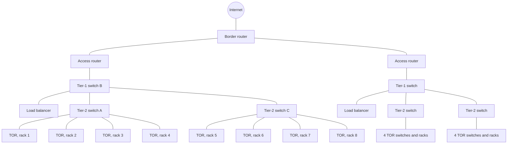

*Figure 17. A data center network with a hierarchical topology*

- At the top of the hierarchy, the border router connects to access routers.
- Below each access router there are three tiers of switches. Each access router connects to a tier-1 switch, and each tier-1 switch connects to multiple tier-2 switches and a load balancer.
- Each tier-2 switch connects to multiple racks through the racks' TOR switches (tier-3 switches).
- All links typically use Ethernet for their link-layer and physical-layer protocols, with a mix of copper and fiber cabling.

Since a cloud application provider must continually provide high availability, data centers also include redundant network equipment and links not shown in the figure. For example, each TOR switch can connect to two tier-2 switches, and the access routers, tier-1 switches, and tier-2 switches can be duplicated. In the architecture of Figure 17, the hosts below each access router form a single subnet. To localize ARP broadcast traffic, each subnet is further divided into smaller VLAN subnets (Chapter 20) of a few hundred hosts each.

### 7.4 Limits of the Hierarchical Architecture

The conventional hierarchical architecture solves the problem of scale but suffers from limited **host-to-host capacity**. Suppose each host connects to its TOR switch with a 1 Gbps link and the links between switches are 10 Gbps Ethernet.

- Two hosts in the same rack can always communicate at a full 1 Gbps, limited only by the hosts' NIC rate.
- Two hosts in different racks may get a much lower rate when there are many simultaneous flows in the data center.

For example, in Figure 17, suppose that each of 10 hosts in rack 1 sends a flow to a host in rack 5, and likewise there are 10 flows each between racks 2 and 6, racks 3 and 7, and racks 4 and 8. In total, 40 flows run between pairs of hosts in different racks. If each flow shares a link's capacity equally with the others, the 40 flows crossing the 10 Gbps link from A to B (and the link from B to C) each receive only the following rate.

```math
\frac{10\ \text{Gbps}}{40} = 250\ \text{Mbps}
```

This is far less than the NIC rate of 1 Gbps. The problem becomes worse for flows that must travel higher up the hierarchy. One solution is to deploy higher-rate switches and routers, but switches and routers with high port speeds are very expensive and would greatly increase the cost of the data center.

High host-to-host bandwidth matters because a key requirement of data centers is flexibility in placing computation and services. A large-scale Internet search engine runs on thousands of hosts spread across many racks and needs large bandwidth between all pairs of hosts. A cloud computing service wants to place the virtual machines that make up a customer's service on the physical hosts with the most capacity, regardless of their location in the data center. If those hosts are spread across several racks, the bottleneck above can degrade performance.

### 7.5 Trends in Data Center Networking

To reduce cost while improving delay and throughput, large cloud companies keep deploying new data center network designs. Most of the designs are proprietary, but the following trends can be seen.

- **Fully connected topology:** The hierarchy of switches and routers is replaced with a fully connected topology. Each tier-1 switch connects to all tier-2 switches, so (1) host-to-host traffic never has to rise above the switch tiers, and (2) with n tier-1 switches, there are n disjoint paths between any two tier-2 switches. In the example of 40 flows, with 4 tier-1 switches there are 4 distinct paths between the first and second tier-2 switches, providing an aggregate capacity of 4 × 10 = 40 Gbps between them, so each flow can get 1 Gbps. Communication between any two racks not connected to the same switch also becomes logically equivalent regardless of their locations, making the placement of computation and services more flexible.
- **Shipping-container-based modular data centers (MDCs):** A factory builds, inside a standard 12-meter shipping container, a mini data center of up to a few thousand hosts packed closely in tens of racks, and ships it to the site. At the site, multiple containers are interconnected with each other and with the Internet. A deployed container is hard to service, so it is designed to keep operating with gradually degrading performance as servers and switches fail, and the whole container is replaced with a fresh one when performance drops below a threshold. Within a container, a fully connected network can be built with inexpensive commodity Gigabit Ethernet switches, but designing the core network that interconnects hundreds to thousands of containers remains a challenging problem.
- **Routing in highly interconnected topologies:** Designing routing algorithms among the switches is a major issue. One approach uses a form of random routing; another deploys multiple NICs in each host, connects each host to several low-cost commodity switches, and lets the hosts themselves route traffic among the switches.
- **In-house building:** Large cloud providers build or customize almost everything in their data centers, including network adapters, switches, routers, TORs, software, and networking protocols.
- **Availability zones:** Distinct data centers are replicated in nearby buildings a few kilometers apart to improve reliability. Because the buildings are close, transactional data can be synchronized across the data centers of the same availability zone while providing fault tolerance.

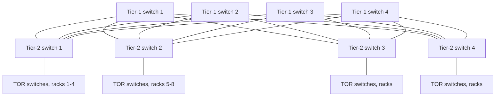

*Figure 18. A fully connected topology in which each tier-1 switch connects to all tier-2 switches*

---

<br>

## 8. A Day in the Life of a Web Page Request

So far, many protocols have been covered on the way down the protocol stack from the application layer to the link layer. This section ties them together by following how many protocols are involved in handling the simplest request: downloading a single Web page.

Suppose that a student, Bob, connects a laptop to his school's Ethernet switch and downloads the home page of www.google.com. The school's switch is connected to the school's router, and the router is connected to an ISP (comcast.net). In this example, the ISP provides the DNS service for the school, so the DNS server is in the ISP's network rather than the school's. The DHCP server is assumed to run inside the router, as is often the case. The addresses in this example are as follows.

| Item | Address |
|:-----|:-----|
| MAC address of Bob's laptop | 00:16:D3:23:68:8A |
| MAC address of the school router's school-side interface | 00:22:6B:45:1F:1B |
| Address block assigned by the DHCP server | 68.85.2.0/24 |
| IP address assigned to Bob's laptop | 68.85.2.101 |
| IP address of the default gateway (school router) | 68.85.2.1 |
| IP address of the DNS server | 68.87.71.226 |
| IP address of www.google.com | 64.233.169.105 |

*Table 9. Addresses in the Web page request example*

### 8.1 Getting Started: DHCP, UDP, IP, and Ethernet

Bob's laptop can do nothing without an IP address. The first network action of the laptop is therefore to obtain an IP address and other information with DHCP (Chapter 12).

1. The operating system on the laptop creates a DHCP request message and puts it in a UDP segment (Chapter 6) with destination port 67 (DHCP server) and source port 68 (DHCP client). The UDP segment is placed in an IP datagram (Chapter 11) with the broadcast destination IP address 255.255.255.255 and the source IP address 0.0.0.0, since the laptop does not yet have an IP address.
2. The datagram is placed in an Ethernet frame (Chapter 20) with destination MAC address FF:FF:FF:FF:FF:FF so that it is broadcast to all devices connected to the switch (hopefully including a DHCP server). The frame's source MAC address is the laptop's, 00:16:D3:23:68:8A.
3. This broadcast frame is the first frame sent by the laptop to the switch. The switch broadcasts the incoming frame on all outgoing ports, including the port connected to the router.
4. The router receives the frame on its interface with MAC address 00:22:6B:45:1F:1B and extracts the IP datagram. The broadcast destination IP address indicates that the datagram should be processed by the upper layers of this node. The datagram's payload (a UDP segment) is demultiplexed up to UDP (Chapter 6), and the DHCP request message is extracted from the UDP segment. The DHCP server now has the request.
5. Suppose that the DHCP server can allocate addresses in the CIDR block 68.85.2.0/24 (Chapter 12) and allocates 68.85.2.101 to Bob's laptop. The server creates a DHCP ACK message containing this IP address together with the IP address of the DNS server (68.87.71.226), the IP address of the default gateway router (68.85.2.1), and the subnet block (68.85.2.0/24, equivalently the network mask). The message is placed in a UDP segment, an IP datagram, and an Ethernet frame in turn; the frame's source MAC address is the router interface's 00:22:6B:45:1F:1B, and its destination MAC address is the laptop's 00:16:D3:23:68:8A.
6. The router unicasts the frame containing the DHCP ACK to the switch. Because the switch is self-learning (Chapter 20) and earlier learned the laptop's location when it received the DHCP request frame from the laptop, it forwards a frame addressed to 00:16:D3:23:68:8A only to the output port leading to the laptop.
7. The laptop extracts the IP datagram from the Ethernet frame, the UDP segment from the IP datagram, and the DHCP ACK message from the UDP segment. The DHCP client records its IP address and the IP address of its DNS server and installs the address of the default gateway in its IP forwarding table. The laptop will send all datagrams destined outside its subnet 68.85.2.0/24 to the default gateway. Its networking components are now initialized, and it is ready to fetch the Web page.

> **Note:** Only the last two of the four DHCP steps covered in Chapter 12 (the request and the ACK) are shown here.

### 8.2 DNS and ARP

When Bob types the URL of www.google.com into his Web browser, a long chain of events begins that eventually displays the home page in the browser. The browser creates a TCP socket (Chapter 23) that will be used to send the HTTP request (Chapter 3) to www.google.com, and to create the socket it needs to know the IP address of www.google.com. Translating names into IP addresses is the job of DNS (Chapter 5).

8. The operating system on the laptop creates a DNS query message, putting the string www.google.com in the question section. The message is placed in a UDP segment with destination port 53 (DNS server), and the UDP segment is placed in an IP datagram with destination IP address 68.87.71.226 (the DNS server address given in the DHCP ACK of step 5) and source IP address 68.85.2.101.
9. The laptop places the datagram containing the DNS query in an Ethernet frame. At the link layer, this frame must be addressed to the school's gateway router. The laptop knows the gateway router's IP address (68.85.2.1) from the DHCP ACK of step 5 but not its MAC address. Obtaining the gateway router's MAC address requires ARP (Chapter 19).
10. The laptop creates an ARP query message with target IP address 68.85.2.1 (the default gateway), places it in an Ethernet frame with the broadcast destination address (FF:FF:FF:FF:FF:FF), and sends the frame to the switch, which delivers it to all connected devices, including the gateway router.
11. The gateway router receives the frame containing the ARP query on its interface to the school network and finds that the target IP address 68.85.2.1 in the ARP message matches the IP address of that interface. The router prepares an ARP reply indicating that its MAC address 00:22:6B:45:1F:1B corresponds to IP address 68.85.2.1, places it in an Ethernet frame with destination address 00:16:D3:23:68:8A (the laptop), and sends the frame to the switch, which delivers it to the laptop.
12. The laptop extracts the MAC address of the gateway router (00:22:6B:45:1F:1B) from the ARP reply message.
13. The laptop can now address the Ethernet frame containing the DNS query to the gateway router's MAC address. The IP datagram in this frame has destination IP address 68.87.71.226 (the DNS server), while the frame has destination address 00:22:6B:45:1F:1B (the gateway router). The laptop sends the frame to the switch, which delivers it to the gateway router.

### 8.3 Intra-Domain Routing to the DNS Server

14. The gateway router receives the frame and extracts the IP datagram containing the DNS query. The router looks up the destination address of the datagram (68.87.71.226) and determines from its forwarding table (Chapter 13) that the datagram should be sent to the first router in the ISP's network. The IP datagram is placed in a link-layer frame appropriate for the link connecting the school's router to that ISP router, and the frame is sent over the link.
15. The router in the ISP's network receives the frame, extracts the IP datagram, examines its destination address (68.87.71.226), and determines from its forwarding table the outgoing interface toward the DNS server. This forwarding table has been filled in by the ISP's intra-domain routing protocol (such as RIP, OSPF, or IS-IS, Chapter 15) and by the Internet's inter-domain routing protocol, BGP (Chapter 15).
16. Eventually the IP datagram containing the DNS query arrives at the DNS server. The DNS server extracts the DNS query message, looks up www.google.com in its DNS database, and finds the DNS resource record (Chapter 5) containing the IP address of www.google.com (64.233.169.105). This assumes that the record is currently cached in the DNS server; the cached data originated in the authoritative DNS server for google.com. The DNS server forms a DNS reply message containing this hostname-to-IP-address mapping, places it in a UDP segment, and places the segment in an IP datagram addressed to Bob's laptop (68.85.2.101). The datagram is forwarded back through the ISP's network to the school's router and from there through the Ethernet switch to the laptop.
17. The laptop extracts the IP address of the server www.google.com from the DNS message. The laptop is now ready to contact the www.google.com server.

### 8.4 Web Client-Server Interaction: TCP and HTTP

18. Now that it knows the IP address of www.google.com, the laptop can create the TCP socket that will be used to send the HTTP GET message (Chapter 3). When the socket is created, the laptop's TCP must first perform a three-way handshake (Chapter 8) with the TCP in www.google.com. The laptop creates a TCP SYN segment with destination port 80 (HTTP), places it in an IP datagram with destination IP address 64.233.169.105, places that datagram in a frame with destination MAC address 00:22:6B:45:1F:1B (the gateway router), and sends the frame to the switch.
19. The routers in the school network, the ISP's network, and Google's network forward the datagram containing the TCP SYN toward www.google.com using each router's forwarding table, as in steps 14-16. The forwarding table entries that govern the forwarding of packets over the inter-domain link between the ISP's network and Google's network are determined by BGP.
20. Eventually the datagram containing the TCP SYN arrives at www.google.com. The TCP SYN message is extracted from the datagram and demultiplexed to the welcome socket associated with port 80. A connection socket (Chapter 23) is created for the TCP connection between the Google HTTP server and Bob's laptop. A TCP SYNACK segment is generated, placed in a datagram addressed to the laptop, and finally placed in a link-layer frame appropriate for the link connecting www.google.com to its first-hop router.
21. The datagram containing the TCP SYNACK segment is forwarded through Google's network, the ISP's network, and the school network, eventually arriving at the Ethernet card of the laptop. The datagram is demultiplexed within the operating system to the TCP socket created in step 18, which enters the connected state.
22. With the socket on the laptop now ready to send bytes to www.google.com, the browser creates the HTTP GET message containing the URL to be fetched. The HTTP GET message is written into the socket and becomes the payload of a TCP segment. The TCP segment is placed in a datagram and delivered to www.google.com as in steps 18-20.
23. The HTTP server at www.google.com reads the HTTP GET message from the TCP socket, creates an HTTP response message with the requested Web page content in its body, and sends the message into the TCP socket.
24. The datagram containing the HTTP response message is forwarded through Google's network, the ISP's network, and the school network and arrives at the laptop. The browser program reads the HTTP response from the socket, extracts the HTML of the Web page from the body of the response, and finally displays the Web page.

### 8.5 Putting It All Together

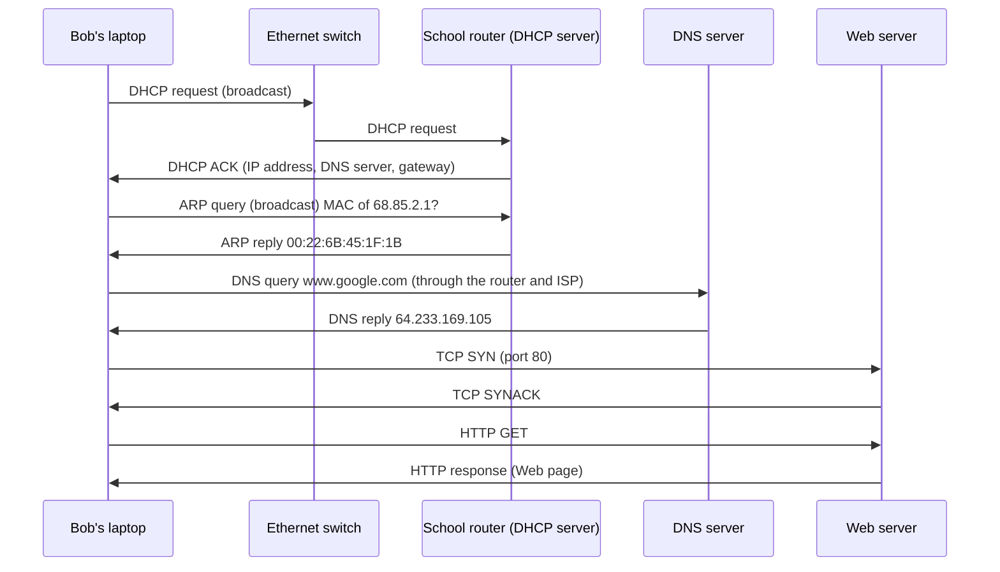

*Figure 19. Message flow for handling a single Web page request*

| Steps | Protocols involved | Purpose | Where covered |
|:-----|:-----|:-----|:-----|
| 1-7 | DHCP, UDP, IP, Ethernet, switch self-learning | Obtain the IP address, DNS server, and default gateway | Chapters 12, 6, 11, 20 |
| 8-13 | DNS, UDP, ARP | Send the query for the Web server's IP address to the gateway router | Chapters 5, 19 |
| 14-17 | IP forwarding, intra-domain routing, BGP, DNS | Deliver the query to the DNS server and receive the reply | Chapters 13, 14, 15 |
| 18-21 | TCP three-way handshake, forwarding, BGP | Establish a TCP connection with the Web server | Chapters 8, 15 |
| 22-24 | HTTP, TCP | Request and receive the Web page | Chapters 3, 8 |

*Table 10. Protocols at each stage of a Web page request*

Detailed as this example may seem, it omits several protocols that one would encounter in the public Internet (NAT in the school's gateway router, wireless access to the school network, security protocols for accessing the network or encrypting segments and datagrams, network management protocols) and considerations (Web caching, the DNS hierarchy). These are covered in Chapters 12, 22, 26, 17, 3, and 5.

> **Key Point:** Even the simple request of downloading one Web page involves, in turn, HTTP and DNS in the application layer, TCP and UDP in the transport layer, IP, DHCP, and routing in the network layer, and Ethernet and ARP in the link layer.

---

<br>

## Concept Applications

**True/False Check:**

| Statement | Judgment and Reason |
|:-----|:-----|
| From the Internet's point of view, even an entire telephone network with its own switches and protocols can be viewed as a single link. | **T.** The Internet virtualizes the telephone network as a technology that provides link-layer connectivity between two hosts. |
| A T-1 frame is 192 bits made only of the 8-bit samples of 24 voice channels. | **F.** One synchronization bit is added to make 193 bits, and sending 8000 per second gives 1.544 Mbps. |
| Since SONET sends 8000 frames per second, one frame lasts 125 μs. | **T.** 1/8000 second is 125 μs. |
| The address field of a PPP frame carries the MAC address of the peer device. | **F.** As a point-to-point connection, it uses no data link address and carries the broadcast address 11111111. |
| In PPP, establishing, maintaining, and terminating the link is the job of NCP. | **F.** LCP handles the link, and NCP lets it carry the data of network-layer protocols such as IP. |
| A switched WAN establishes a connection before sending packets and forwards packets by connection identifier. | **T.** Switched WANs are a connection-oriented technology. |
| X.25 performs error control and acknowledgment on every link, so it is faster than Frame Relay. | **F.** Hop-by-hop acknowledgments make X.25 slow; Frame Relay leaves them to upper layers and is fast. |
| An ATM cell is 53 bytes, of which 5 bytes are the header. | **T.** The payload is 48 bytes. |
| The AAL is used by every switch inside an ATM network. | **F.** The AAL is used only by end points; switches use only the ATM and physical layers. |
| Carrying an IP datagram directly in a single cell gives an efficiency of about 51 percent. | **T.** Removing the 20-byte IP header and the 5-byte ATM header leaves 27 bytes of data, so 27/53. |
| A label-switched router performs longest prefix matching on the destination IP address when forwarding an MPLS frame. | **F.** It looks up the label in its forwarding table and immediately passes the frame to the output interface. |
| MPLS can split traffic for the same destination over several paths. | **T.** This is traffic engineering; standard IP routing uses only a single least-cost path. |
| A data center load balancer divides requests by destination IP address only, so it is a layer-3 device. | **F.** It also looks at the destination port number, so it is also called a layer-4 switch. |
| In the Web page request, the laptop sets the destination MAC address of the frame carrying the DNS query to the MAC address of the DNS server. | **F.** The DNS server is on another network, so the frame's destination is the MAC address of the gateway router. |

---

<br>

## Summary

| Concept | Key Summary |
|:-----|:-----|
| Link virtualization | Networks with their own structure, such as the telephone network, ATM, and MPLS, can from the Internet's point of view be a single link connecting IP devices. |
| Point-to-point and switched WANs | A point-to-point WAN connects two devices with a line leased from a public network, and a switched WAN provides several access points over a large area through a mesh of switches. |
| T lines | T-1 sends 8000 frames per second of (24 × 8 + 1) bits for 1.544 Mbps, and T-3 runs at 44.736 Mbps. |
| SONET | It defines a hierarchy of electrical STS and optical OC signals, with STS-1 at 51.84 Mbps and 8000 frames of 125 μs per second. |
| PPP | It is the data link protocol of point-to-point links, using a frame of flag, address, control, protocol, data, and FCS, with LCP and NCP. |
| X.25 | It is a three-layer packet-switched WAN using virtual circuits (SVC, PVC), slow because of extensive hop-by-hop error control. |
| Frame Relay | It provides only two layers and leaves error checking to upper layers, so it is fast; it distinguishes virtual circuits by DLCI and gives bursty data bandwidth on demand. |
| ATM | It is a connection-oriented cell network that multiplexes fixed 53-byte cells with asynchronous TDM and defines virtual connections by VPI and VCI. |
| AAL | It is the end-point layer that maps upper-layer data into cells, and the Internet uses AAL5 for IP datagrams. |
| MPLS | It inserts a header carrying a 20-bit label between the layer-2 and layer-3 headers so that label-switched routers forward by label instead of IP address. |
| Traffic engineering | MPLS sends traffic for the same destination over several paths rather than only the least-cost one, and it is also used for fast restoration and VPNs. |
| Data center network | It consists of a hierarchy of blades, racks, TOR switches, tier-2 and tier-1 switches, access routers, and border routers, together with load balancers. |
| Limits of the hierarchy | Many flows share the upper links, limiting host-to-host capacity, so new architectures such as fully connected topologies are used. |
| Web page request | The laptop obtains an address with DHCP, finds the gateway and server with ARP and DNS, has packets forwarded by routing, and receives the page with HTTP over a TCP connection. |

---

<br>

## Self-Check Questions

1. **Fixed-size cells in ATM:** Explain, in terms of multiplexing delay, why ATM uses fixed 53-byte cells instead of packets of different sizes, and state the cost of this choice.

   <details>
   <summary>Answer</summary>

   When packets of different sizes are multiplexed, small packets from another input must wait a long time behind a large packet while it occupies the output link. This is unfavorable to small delay-sensitive packets such as real-time voice. When all data are divided into small cells of the same size, the cells of several inputs go out alternately, so no input waits long behind the large data of another input, and delay becomes predictable. The cost is that every cell carries a 5-byte header, so an overhead of about 9.4 percent always remains.

   </details>

2. **Rate of a T-1 line:** 24 voice channels are sampled at 8 bits each, one synchronization bit is added per frame, and 8000 frames are sent per second. Find the rate of a T-1 line. What would the rate be without the synchronization bit?

   <details>
   <summary>Answer</summary>

   One frame is 24 × 8 + 1 = 193 bits, so the rate is 193 × 8000 = 1,544,000 bps, or 1.544 Mbps. Without the synchronization bit, it would be 192 × 8000 = 1,536,000 bps, or 1.536 Mbps. The difference of 8 kbps is taken by the synchronization bit.

   </details>

3. **Efficiency of AAL5:** A 1500-byte IP datagram is sent over an ATM network with AAL5. How many cells are needed, how many bytes of padding are added, and what is the transmission efficiency? Compare with carrying an IP datagram directly in a single cell.

   <details>
   <summary>Answer</summary>

   Adding the 8-byte trailer to 1500 bytes gives 1508 bytes. Dividing into 48-byte segments gives 1508/48 ≈ 31.4, so 32 cells are needed, and the padding is 32 × 48 − 1508 = 28 bytes. The bytes transmitted are 32 × 53 = 1696, so the efficiency is 1500/1696 ≈ 88 percent. Carrying an IP datagram directly in a single cell leaves only 53 − 5 − 20 = 27 bytes of IP-level data, an efficiency of 27/53 ≈ 51 percent.

   </details>

4. **MPLS and IP forwarding:** Compare how an ordinary IP router and a label-switched router forward a packet to the same destination A, and explain why MPLS makes traffic engineering possible.

   <details>
   <summary>Answer</summary>

   An ordinary IP router extracts the destination IP address from the datagram, performs longest prefix matching in its forwarding table, and sends the datagram to the next hop on the least-cost path chosen by the routing protocol. A label-switched router looks up the label in the MPLS header directly to determine the output interface and outgoing label, without looking at the IP header. Since the operator can set the mapping between labels and paths, traffic for the same destination can be sent over different paths according to its labels. This is traffic engineering, which standard IP routing cannot do.

   </details>

5. **Bottleneck in a data center:** In a hierarchical data center where hosts connect to TOR switches at 1 Gbps and links between switches are 10 Gbps, 40 flows between pairs of hosts in different racks cross the same 10 Gbps link. Find the rate of each flow. What happens in a fully connected topology in which 4 tier-1 switches connect to all tier-2 switches?

   <details>
   <summary>Answer</summary>

   If 40 flows share 10 Gbps equally, each flow gets 10 Gbps / 40 = 250 Mbps, far below the NIC rate of 1 Gbps. In the fully connected topology there are as many disjoint paths between two tier-2 switches as there are tier-1 switches, that is, 4, so the total capacity between them is 4 × 10 = 40 Gbps. Shared among 40 flows, each gets 1 Gbps and can use the full NIC rate.

   </details>

6. **Order in a Web page request:** When a laptop is first connected to a network and requests a Web page, give the order in which DHCP, ARP, DNS, TCP, and HTTP are used, and explain why each protocol must come in that position.

   <details>
   <summary>Answer</summary>

   The order is DHCP, ARP, DNS, TCP, HTTP. Without an IP address no IP communication is possible, so DHCP first provides the laptop's own IP address and the addresses of the DNS server and the default gateway. The DNS server is on another network, so the DNS query must be sent to the gateway router, and ARP is used to learn the destination MAC address of that frame. A TCP socket can be created only once the Web server's IP address is known, so DNS translates the name into an address. HTTP runs over a TCP connection, so the HTTP GET is sent after the three-way handshake establishes the connection.

   </details>

7. **Bursty data in Frame Relay:** Over 10 seconds, a user sends at 6 Mbps for the first 2 seconds, 0 Mbps for the next 7 seconds, and 3.44 Mbps for the last second. Find the average rate, and explain why Frame Relay suits this user better than a T-1 line.

   <details>
   <summary>Answer</summary>

   The amount sent is 6 × 2 + 0 × 7 + 3.44 × 1 = 15.44 Mb, so the average rate is 15.44 / 10 = 1.544 Mbps, the same as a T-1 line. However, a T-1 line is designed for fixed-rate use at a steady 1.544 Mbps, so it cannot meet the demand at the moments when traffic bursts to 6 Mbps. Frame Relay provides bandwidth on demand, guaranteeing an average rate that can be exceeded when needed, so it suits bursty data.

   </details>
