# 22장 — 무선 LAN과 블루투스

[레포지토리 안내](../../README.ko.md) | [English](Concepts_Lecture.md) | [한국어](Concepts_Lecture.ko.md)

> **최종 수정일:** 2026-11-27
>
> Computer Networking: A Top-Down Approach, Kurose and Ross, Ch 7; TCP/IP Protocol Suite, Forouzan, Ch 3

> **학습 목표:**
> 1. 무선 네트워크의 구성 요소와 분류를 설명할 수 있다
> 2. 신호 감쇠, 간섭, 다중 경로 전파, SNR과 BER, 숨은 단말처럼 무선 링크가 유선 링크와 다른 점을 설명할 수 있다
> 3. CDMA의 부호화와 복호화를 계산할 수 있다
> 4. 802.11의 구조, 연결 과정, CSMA/CA와 RTS/CTS, NAV, 프레임 간 간격, 프레임 형식과 주소 지정을 설명할 수 있다
> 5. 숨은 스테이션 문제와 노출 스테이션 문제를 구분하고 RTS/CTS가 각각에 미치는 효과를 설명할 수 있다
> 6. 블루투스의 피코넷과 스캐터넷, 주파수 도약, 물리 링크, 프레임 형식을 설명할 수 있다

---

## 목차

- [1. 무선 네트워크의 구성 요소](#1-무선-네트워크의-구성-요소)
  - [1.1 구성 요소](#11-구성-요소)
  - [1.2 무선 네트워크의 분류](#12-무선-네트워크의-분류)
- [2. 무선 링크의 특성](#2-무선-링크의-특성)
  - [2.1 유선 링크와의 차이](#21-유선-링크와의-차이)
  - [2.2 신호 대 잡음비와 비트 오류율](#22-신호-대-잡음비와-비트-오류율)
  - [2.3 숨은 단말과 페이딩](#23-숨은-단말과-페이딩)
- [3. 코드 분할 다중 접근 (CDMA)](#3-코드-분할-다중-접근-cdma)
  - [3.1 부호화와 복호화](#31-부호화와-복호화)
  - [3.2 송신자가 여럿일 때](#32-송신자가-여럿일-때)
- [4. IEEE 802.11 무선 LAN](#4-ieee-80211-무선-lan)
  - [4.1 IEEE 802의 무선 작업 그룹](#41-ieee-802의-무선-작업-그룹)
  - [4.2 802.11 표준들](#42-80211-표준들)
- [5. 802.11의 구조](#5-80211의-구조)
  - [5.1 기본 서비스 세트 (BSS)](#51-기본-서비스-세트-bss)
  - [5.2 확장 서비스 세트 (ESS)](#52-확장-서비스-세트-ess)
  - [5.3 스테이션의 이동성 유형](#53-스테이션의-이동성-유형)
  - [5.4 채널과 연결](#54-채널과-연결)
- [6. 802.11 MAC 프로토콜](#6-80211-mac-프로토콜)
  - [6.1 CSMA/CD를 쓸 수 없는 이유](#61-csmacd를-쓸-수-없는-이유)
  - [6.2 링크 계층 확인 응답](#62-링크-계층-확인-응답)
  - [6.3 CSMA/CA](#63-csmaca)
  - [6.4 RTS/CTS와 네트워크 할당 벡터](#64-rtscts와-네트워크-할당-벡터)
  - [6.5 분산 조정 기능과 점 조정 기능](#65-분산-조정-기능과-점-조정-기능)
  - [6.6 프레임 간 간격과 우선순위](#66-프레임-간-간격과-우선순위)
  - [6.7 단편화와 점대점 링크로서의 802.11](#67-단편화와-점대점-링크로서의-80211)
- [7. 802.11 프레임](#7-80211-프레임)
  - [7.1 프레임 형식](#71-프레임-형식)
  - [7.2 프레임 제어 필드](#72-프레임-제어-필드)
  - [7.3 프레임의 종류](#73-프레임의-종류)
- [8. 주소 지정 메커니즘](#8-주소-지정-메커니즘)
  - [8.1 네 개의 주소 필드](#81-네-개의-주소-필드)
  - [8.2 To DS와 From DS의 네 가지 경우](#82-to-ds와-from-ds의-네-가지-경우)
  - [8.3 AP를 거쳐 라우터와 주고받는 프레임](#83-ap를-거쳐-라우터와-주고받는-프레임)
- [9. 숨은 스테이션과 노출 스테이션](#9-숨은-스테이션과-노출-스테이션)
  - [9.1 숨은 스테이션 문제](#91-숨은-스테이션-문제)
  - [9.2 핸드셰이크로 숨은 스테이션 문제 막기](#92-핸드셰이크로-숨은-스테이션-문제-막기)
  - [9.3 노출 스테이션 문제](#93-노출-스테이션-문제)
  - [9.4 핸드셰이크로 해결되지 않는 노출 스테이션 문제](#94-핸드셰이크로-해결되지-않는-노출-스테이션-문제)
- [10. 같은 서브넷 안의 이동성과 고급 기능](#10-같은-서브넷-안의-이동성과-고급-기능)
  - [10.1 같은 IP 서브넷 안의 이동성](#101-같은-ip-서브넷-안의-이동성)
  - [10.2 전송률 적응](#102-전송률-적응)
  - [10.3 전력 관리](#103-전력-관리)
- [11. 블루투스](#11-블루투스)
  - [11.1 블루투스의 특징](#111-블루투스의-특징)
  - [11.2 피코넷과 스캐터넷](#112-피코넷과-스캐터넷)
  - [11.3 무선 계층과 주파수 도약](#113-무선-계층과-주파수-도약)
  - [11.4 물리 링크와 접근 코드](#114-물리-링크와-접근-코드)
  - [11.5 프레임 형식](#115-프레임-형식)
- [12. Zigbee](#12-zigbee)
- [개념 적용](#개념-적용)
- [요약](#요약)
- [점검 문제](#점검-문제)

---

<br>

## 1. 무선 네트워크의 구성 요소

### 1.1 구성 요소

무선 통신은 가장 빠르게 성장하는 기술 가운데 하나이다. 케이블 없이 장치를 연결하려는 수요가 어디서나 늘고 있으며, 무선 LAN은 대학 캠퍼스, 사무실 건물, 많은 공공장소에서 볼 수 있다. 무선 네트워크에는 다음 구성 요소가 있다.

- **무선 호스트(wireless host):** 유선 네트워크처럼 응용을 실행하는 종단 시스템이다. 노트북, 태블릿, 스마트폰, 데스크톱 컴퓨터가 될 수 있으며, 호스트 자체가 이동할 수도 있고 이동하지 않을 수도 있다.
- **무선 링크(wireless link):** 호스트는 무선 통신 링크로 기지국이나 다른 무선 호스트에 연결된다. 무선 링크 기술마다 전송 속도와 전송 거리가 다르다. 무선 링크는 네트워크 가장자리의 무선 호스트를 더 큰 네트워크 인프라에 연결하며, 이 장은 이처럼 네트워크 가장자리에서 쓰이는 무선 통신을 다룬다.
- **기지국(base station):** 무선 네트워크 인프라의 핵심이며 유선 네트워크에는 뚜렷한 대응물이 없다.
- **네트워크 인프라(network infrastructure):** 무선 호스트가 통신하려는 더 큰 네트워크(인터넷, 회사나 가정의 네트워크, 전화망)이다.

> **용어 정의:** **기지국(base station)** 은 자신과 연결된 무선 호스트에게 데이터를 보내고 받으며, 여러 무선 호스트의 전송을 조율하고, 무선 호스트와 더 큰 네트워크 사이에서 링크 계층 중계기 역할을 하는 장치이다.

무선 호스트가 기지국과 **연결되어(associated)** 있다는 것은 (1) 호스트가 기지국의 무선 통신 거리 안에 있고, (2) 호스트가 그 기지국을 거쳐 더 큰 네트워크와 데이터를 주고받는다는 뜻이다. 셀룰러 네트워크의 기지국 탑과 802.11 무선 LAN의 액세스 포인트(AP)가 기지국의 예이다.

> **용어 정의:** **인프라 모드(infrastructure mode)** 는 무선 호스트가 기지국과 연결되어, 주소 배정과 라우팅 같은 전통적인 네트워크 서비스를 기지국이 연결된 네트워크로부터 받는 동작 방식이다.

> **용어 정의:** **애드혹 네트워크(ad hoc network)** 는 기지국 같은 인프라 없이 무선 호스트들끼리 이루는 네트워크로, 라우팅, 주소 배정, DNS 같은 이름 변환 서비스를 호스트들이 스스로 제공해야 한다.

> **용어 정의:** **핸드오프(handoff)** 는 이동하는 호스트가 한 기지국의 범위를 벗어나 다른 기지국의 범위로 들어가면서 더 큰 네트워크에 연결되는 지점, 곧 연결된 기지국을 바꾸는 과정이다.

이동성은 어려운 질문을 많이 던진다. 호스트가 움직인다면 데이터를 전달하기 위해 네트워크 안에서 그 호스트의 현재 위치를 어떻게 찾는가? 호스트가 여러 위치 중 어디에나 있을 수 있다면 주소는 어떻게 정하는가? TCP 연결이나 전화 통화 중에 호스트가 움직이면 연결이 끊기지 않도록 데이터를 어떻게 전달하는가? 이 질문들은 25장에서 다룬다.

### 1.2 무선 네트워크의 분류

무선 네트워크는 (i) 패킷이 무선 홉을 정확히 하나만 건너는지 여러 개 건너는지, (ii) 기지국 같은 인프라가 있는지에 따라 네 가지로 나눌 수 있다.

| 분류 | 인프라 있음 | 인프라 없음 |
|:-----|:-----|:-----|
| 단일 홉 | 기지국이 더 큰 유선 네트워크(인터넷)에 연결되고 모든 통신이 기지국과 무선 호스트 사이의 무선 홉 하나로 이루어짐. 강의실, 카페, 도서관의 802.11 네트워크, 4G LTE 데이터 네트워크 | 유선 네트워크에 연결된 기지국이 없지만, 노드 하나가 다른 노드들의 전송을 조율할 수 있음. 블루투스 네트워크, 애드혹 모드의 802.11 네트워크 |
| 다중 홉 | 기지국이 유선 네트워크에 연결되어 있지만, 일부 무선 노드는 기지국과 통신하려면 다른 무선 노드를 거쳐 중계해야 함. 일부 무선 센서 네트워크, 무선 메시 네트워크 | 기지국이 없고, 노드가 목적지에 닿으려면 여러 노드를 거쳐 메시지를 중계해야 함. 노드가 이동하며 연결이 바뀌는 이동 애드혹 네트워크(MANET), 노드가 차량이면 VANET |

*표 1. 무선 네트워크의 분류*

일상에서 이용하는 무선 네트워크의 대부분은 단일 홉, 인프라 기반 네트워크이며, 이 장은 주로 이 경우를 다룬다.

---

<br>

## 2. 무선 링크의 특성

### 2.1 유선 링크와의 차이

이더넷 스위치로 호스트를 잇는 가정의 유선 네트워크를 802.11 무선 네트워크로 바꾼다고 하자. 호스트의 유선 이더넷 인터페이스는 무선 네트워크 인터페이스로, 이더넷 스위치는 액세스 포인트로 바뀌지만, 네트워크 계층 이상은 거의 바꿀 필요가 없다. 따라서 유선 네트워크와 무선 네트워크의 중요한 차이는 링크 계층에서 찾아야 한다. 유선 링크와 무선 링크의 차이는 다음과 같다.

- **신호 세기의 감소:** 전자기파는 물질(예를 들어 벽)을 지날 때 감쇠한다. 자유 공간에서도 신호가 퍼지므로, 송신자와 수신자 사이의 거리가 멀어질수록 신호 세기가 줄어든다. 이를 **경로 손실(path loss)** 이라고 한다.
- **다른 신호원의 간섭:** 같은 주파수 대역에서 전송하는 무선 신호원은 서로 간섭한다. 예를 들어 2.4 GHz 무선 전화기와 802.11b 무선 LAN은 같은 주파수 대역을 쓰므로, 802.11b 사용자가 2.4 GHz 무선 전화로 통화하면 네트워크도 전화도 잘 동작하지 않을 수 있다. 전송하는 신호원뿐 아니라 근처의 모터나 전자레인지 같은 환경의 전자기 잡음도 간섭을 일으킨다.
- **다중 경로 전파(multipath propagation):** 전자기파의 일부가 물체와 땅에 반사되어 송신자와 수신자 사이에서 길이가 다른 여러 경로를 거친다. 그 결과 수신자에서 신호가 흐려진다. 송신자와 수신자 사이에서 움직이는 물체가 있으면 다중 경로 전파가 시간에 따라 바뀐다.

이 때문에 무선 링크에서는 유선 링크보다 비트 오류가 훨씬 흔하다. 그래서 802.11 같은 무선 링크 프로토콜은 강력한 CRC 오류 검출 부호(18장)뿐 아니라, 손상된 프레임을 재전송하는 링크 수준의 신뢰적 데이터 전송 프로토콜도 쓴다.

### 2.2 신호 대 잡음비와 비트 오류율

무선 신호를 받는 호스트가 받는 전자기 신호는, 감쇠와 다중 경로 전파 등으로 약해진 원래 신호와 환경의 배경 잡음이 섞인 것이다.

> **용어 정의:** **신호 대 잡음비(signal-to-noise ratio, SNR)** 는 받은 신호(전송되는 정보)의 세기와 잡음의 세기를 비교하는 상대적인 척도로, 보통 데시벨(dB) 단위로 나타낸다.

데시벨로 나타낸 SNR은 받은 신호의 진폭과 잡음의 진폭의 비에 상용로그를 취해 20을 곱한 값이다.

```math
\text{SNR}_{\text{dB}} = 20 \log_{10} \frac{A_{\text{signal}}}{A_{\text{noise}}}
```

예를 들어 신호의 진폭이 잡음의 10배이면 SNR은 20 dB, 100배이면 40 dB이다. SNR이 클수록 수신자가 배경 잡음에서 전송된 신호를 꺼내기 쉽다.

**비트 오류율(bit error rate, BER)** 은 대략 말해 전송한 비트가 수신자에서 잘못 받아질 확률이다. 그림 1은 이상적인 무선 채널에서 서로 다른 세 변조 기법의 SNR에 따른 BER을 보여 준다.

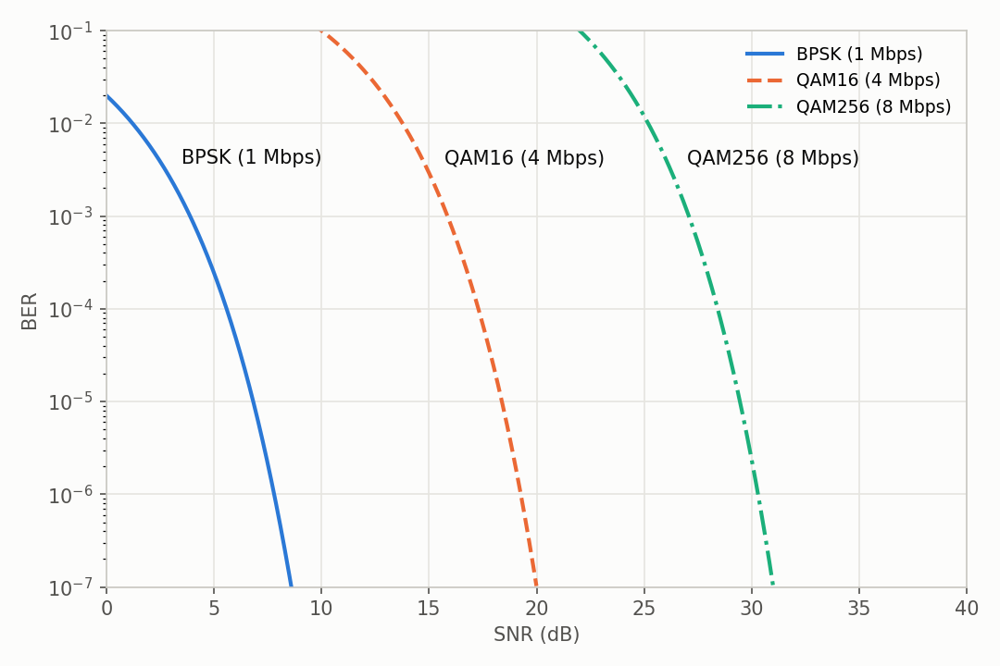

*그림 1. 세 변조 기법의 SNR에 따른 비트 오류율*

변조와 부호화 이론은 이 정리본의 범위를 넘지만, 그림 1은 상위 계층의 무선 통신 프로토콜을 이해하는 데 중요한 물리 계층의 성질 세 가지를 보여 준다.

- **같은 변조 기법이면 SNR이 높을수록 BER이 낮다.** 송신자는 전송 전력을 높여 SNR을 높일 수 있으므로, 전력을 높이면 프레임이 오류를 겪을 확률이 줄어든다. 그러나 BER을 10⁻¹²에서 10⁻¹³으로 낮추는 것처럼 어느 수준을 넘는 전력 증가는 실질적인 이득이 거의 없다. 게다가 송신자가 에너지를 더 써야 하고(배터리로 동작하는 이동 사용자에게 중요한 문제), 다른 송신자의 전송을 간섭할 가능성도 커진다.
- **같은 SNR이면 비트 전송 속도가 높은 변조 기법일수록 BER이 높다.** 그림 1에서 SNR이 10 dB일 때 1 Mbps인 BPSK 변조의 BER은 10⁻⁷보다 작지만, 4 Mbps인 QAM16 변조의 BER은 10⁻¹로 실제로 쓰기에는 너무 높다. SNR이 20 dB이면 QAM16은 4 Mbps로 BER 10⁻⁷을 얻고, BPSK의 BER은 그래프에 나타나지 않을 만큼 낮지만 속도는 1 Mbps뿐이다. BER 10⁻⁷을 감수할 수 있다면 이때는 전송 속도가 높은 QAM16이 낫다.
- **채널 상황에 맞추어 물리 계층의 변조 기법을 동적으로 고를 수 있다.** SNR(그리고 BER)은 이동이나 환경의 변화로 바뀐다. 적응형 변조와 부호화는 셀룰러 데이터 시스템, 802.11 WiFi, 4G 셀룰러 데이터 네트워크에서 쓰이며, 주어진 채널 특성에서 BER 제약을 지키면서 가장 높은 전송 속도를 주는 변조 기법을 고를 수 있게 한다(10.2절).

### 2.3 숨은 단말과 페이딩

무선 링크가 유선 링크와 다른 점은 높고 시간에 따라 변하는 BER만이 아니다. 유선 브로드캐스트 링크에서는 모든 노드가 다른 모든 노드의 전송을 받지만, 무선 링크에서는 그렇지 않다. 스테이션 A와 스테이션 C가 모두 스테이션 B에게 보낸다고 하자.

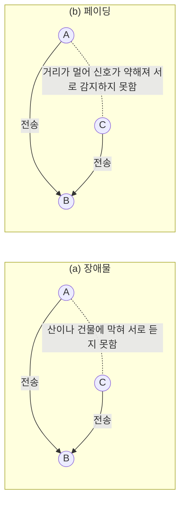

*그림 2. 장애물과 페이딩 때문에 생기는 숨은 단말 문제*

- **숨은 단말 문제(hidden terminal problem):** 산이나 건물 같은 물리적 장애물 때문에 A와 C가 서로의 전송을 듣지 못하지만, 둘의 전송은 목적지 B에서 실제로 간섭한다(그림 2의 (a)).
- **페이딩(fading):** 신호 세기가 무선 매체를 지나면서 약해진다. A와 C가 서로의 전송을 감지할 만큼 신호가 세지는 않지만, B에서 서로 간섭할 만큼은 센 위치에 있을 수 있다(그림 2의 (b)).

두 경우 모두 수신자에서 일어나는 충돌을 송신자가 감지할 수 없으므로, 무선 네트워크의 다중 접근은 유선 네트워크보다 훨씬 복잡하다(6절, 9절).

---

<br>

## 3. 코드 분할 다중 접근 (CDMA)

공유 매체로 통신하는 호스트들에는 여러 송신자의 신호가 수신자에서 간섭하지 않게 하는 프로토콜이 필요하다. 18장의 세 분류 가운데 **코드 분할 다중 접근(code division multiple access, CDMA)** 은 채널 분할 프로토콜에 속하며, 무선 LAN과 셀룰러 기술에서 널리 쓰인다.

> **용어 정의:** **CDMA(code division multiple access)** 는 송신자마다 서로 다른 코드를 배정하고, 각 데이터 비트에 원래 비트보다 훨씬 빨리 바뀌는 코드를 곱해 보내어, 여러 송신자가 동시에 보내도 수신자가 송신자의 코드로 그 송신자의 비트를 복원하게 하는 채널 분할 프로토콜이다.

### 3.1 부호화와 복호화

CDMA에서는 보낼 각 비트에 원래 데이터 비트열보다 훨씬 빠른 속도(**칩 속도, chipping rate**)로 바뀌는 신호, 곧 코드를 곱한다. 원래 데이터 비트가 CDMA 부호화기에 도착하는 속도를 시간의 단위로 잡아, 데이터 비트 하나가 비트 슬롯 하나를 차지한다고 하자. i번째 비트 슬롯의 데이터 비트를 $`d_i`$라 하고, 계산의 편의를 위해 값이 0인 비트를 −1로 나타낸다. 각 비트 슬롯은 다시 M개의 **미니 슬롯(mini-slot)** 으로 나뉜다. 송신자의 CDMA 코드는 각각 +1이나 −1인 M개의 값 $`c_m`$ (m = 1, ..., M)의 나열이다.

i번째 데이터 비트의 m번째 미니 슬롯에서 CDMA 부호화기의 출력 $`Z_{i,m}`$은 데이터 비트에 코드의 m번째 값을 곱한 것이다.

```math
Z_{i,m} = d_i \cdot c_m
```

간섭하는 송신자가 없으면 수신자는 받은 $`Z_{i,m}`$으로 원래 데이터 비트를 다음과 같이 복원한다.

```math
d_i = \frac{1}{M} \sum_{m=1}^{M} Z_{i,m} \cdot c_m
```

$`c_m \cdot c_m = 1`$이므로 합은 $`M d_i`$가 되고, M으로 나누면 $`d_i`$가 나온다.

### 3.2 송신자가 여럿일 때

CDMA는 간섭하는 송신자들의 비트 신호가 **더해진다(additive)** 고 가정한다. 예를 들어 같은 미니 슬롯에서 세 송신자가 1을, 네 번째 송신자가 −1을 보내면 모든 수신자가 받는 신호는 1 + 1 + 1 − 1 = 2이다. 송신자가 N명이면 i번째 비트 슬롯의 m번째 미니 슬롯에서 받는 값은 모든 송신자의 전송 값의 합이다.

```math
Z^{*}_{i,m} = \sum_{s=1}^{N} Z^{s}_{i,m}
```

송신자들의 코드를 신중하게 고르면, 각 수신자는 원하는 송신자의 코드를 같은 방식으로 써서 합쳐진 신호에서 그 송신자의 데이터를 꺼낼 수 있다.

```math
d_i = \frac{1}{M} \sum_{m=1}^{M} Z^{*}_{i,m} \cdot c_m
```

M = 8이고 송신자 1의 코드가 (1, 1, 1, −1, 1, −1, −1, −1), 송신자 2의 코드가 (1, −1, 1, 1, 1, −1, 1, 1)이라 하자. 송신자 1은 데이터 비트 1, −1을, 송신자 2는 1, 1을 차례로 보낸다.

| 비트 슬롯 | 송신자 1의 출력 | 송신자 2의 출력 | 채널의 합 | 코드 1로 복호화 | 코드 2로 복호화 |
|:-----|:-----|:-----|:-----|:-----|:-----|
| 0 (d¹ = 1, d² = 1) | 1, 1, 1, −1, 1, −1, −1, −1 | 1, −1, 1, 1, 1, −1, 1, 1 | 2, 0, 2, 0, 2, −2, 0, 0 | (2 + 2 + 2 + 2) / 8 = 1 | (2 + 2 + 2 + 2) / 8 = 1 |
| 1 (d¹ = −1, d² = 1) | −1, −1, −1, 1, −1, 1, 1, 1 | 1, −1, 1, 1, 1, −1, 1, 1 | 0, −2, 0, 2, 0, 0, 2, 2 | (−2 − 2 − 2 − 2) / 8 = −1 | (2 + 2 + 2 + 2) / 8 = 1 |

*표 2. 두 송신자의 CDMA 부호화와 복호화*

송신자 2의 간섭이 있어도 수신자는 코드 1로 송신자 1의 비트 1, −1을, 코드 2로 송신자 2의 비트 1, 1을 정확히 복원한다. 두 코드의 대응하는 값을 곱해 더하면 1 − 1 + 1 − 1 + 1 + 1 − 1 − 1 = 0이므로, 복호화할 때 다른 송신자의 몫이 정확히 사라지기 때문이다.

> **[선형대수학]** 코드를 길이 M인 벡터로 보면, 복호화는 받은 벡터와 코드 벡터의 내적을 M으로 나누는 것이다. 두 코드 벡터의 내적이 0, 곧 두 코드가 **직교(orthogonal)** 하면 다른 송신자의 신호는 내적에서 0이 되어 사라진다. 그래서 CDMA 코드는 서로 직교하도록 고른다.

칵테일 파티에 비유하면 CDMA는 사람들이 여러 언어로 동시에 말하는 상황과 같다. 사람은 자신이 아는 언어의 대화에 집중하고 나머지 대화를 걸러 내는 데 꽤 능숙하다. CDMA는 시간이나 주파수가 아니라 **코드 공간**을 나누어 각 노드에 전용 부분을 배정하는 분할 프로토콜이다. 실제로는 코드를 신중하게 골라야 하고, 여러 송신자의 신호가 수신자에서 같은 세기로 도착한다는 가정을 실현하기 어렵다는 문제도 해결해야 한다.

---

<br>

## 4. IEEE 802.11 무선 LAN

### 4.1 IEEE 802의 무선 작업 그룹

20장의 IEEE 802 작업 그룹 가운데 무선 기술을 다루는 것은 802.11(무선 LAN), 802.15(무선 PAN), 802.16(무선 MAN)이다. 이 장은 LAN을 위한 두 가지 무선 기술, 곧 무선 이더넷이라고도 부르는 IEEE 802.11 무선 LAN과 작은 무선 LAN을 위한 블루투스를 다룬다. IEEE 802.11은 무선 LAN의 물리 계층과 데이터 링크 계층을 정의한다.

### 4.2 802.11 표준들

1990년대에 무선 LAN을 위한 여러 기술과 표준이 개발되었지만, 결국 IEEE 802.11 무선 LAN, 곧 WiFi가 승자가 되었다. 802.11 계열에는 여러 표준이 있다.

| 표준 | 주파수 대역 | 전송 속도 |
|:-----|:-----|:-----|
| 802.11b | 2.4 GHz | 최대 11 Mbps |
| 802.11a | 5 GHz | 최대 54 Mbps |
| 802.11g | 2.4 GHz | 최대 54 Mbps |
| 802.11n | 2.4 GHz와 5 GHz | 최대 450 Mbps |
| 802.11ac | 5 GHz | 최대 1300 Mbps |

*표 3. IEEE 802.11 표준의 요약*

여러 802.11 표준에는 공통점이 있다.

- 모두 같은 매체 접근 프로토콜인 CSMA/CA(6절)를 쓴다.
- 모두 링크 계층 프레임의 구조가 같다(7절).
- 모두 전송 속도를 낮추어 더 먼 거리까지 닿을 수 있다.
- 802.11 제품은 하위 호환된다. 예를 들어 802.11g만 지원하는 장치도 더 새로운 802.11ac 기지국과 통신할 수 있다.

그러나 물리 계층에서는 큰 차이가 있다.

- **주파수 대역:** 802.11 장치는 2.4\~2.485 GHz(2.4 GHz 대역)와 5.1\~5.8 GHz(5 GHz 대역)의 두 주파수 범위에서 동작한다. 2.4 GHz 대역은 면허가 필요 없는 대역이므로 802.11 장치가 2.4 GHz 전화기, 전자레인지와 주파수를 두고 경쟁할 수 있다. 5 GHz 대역에서는 같은 전력에서 전송 거리가 짧고 다중 경로 전파의 영향을 더 많이 받는다.
- **MIMO:** 802.11n과 802.11ac는 송신 쪽과 수신 쪽에 각각 둘 이상의 안테나를 두고 서로 다른 신호를 주고받는 MIMO(multiple input multiple output) 안테나를 쓴다. 802.11ac 기지국은 여러 스테이션에 동시에 보낼 수 있고, 스마트 안테나로 수신자 방향으로 전송을 모으는 빔포밍(beamforming)을 하여 간섭을 줄이고 주어진 속도로 닿는 거리를 늘린다.

> **주의:** 표 3의 전송 속도는 수신자가 기지국에서 1 m 떨어져 있고 간섭이 없는 것과 같은 이상적인 환경의 값이다. 실제 환경에서 얻는 속도는 이보다 낮고 상황에 따라 달라진다.

---

<br>

## 5. 802.11의 구조

### 5.1 기본 서비스 세트 (BSS)

> **용어 정의:** **기본 서비스 세트(basic service set, BSS)** 는 802.11 무선 LAN 구조의 기본 단위로, 고정되거나 이동하는 무선 스테이션들과 선택적인 중앙 기지국인 액세스 포인트(AP)로 이루어진다.

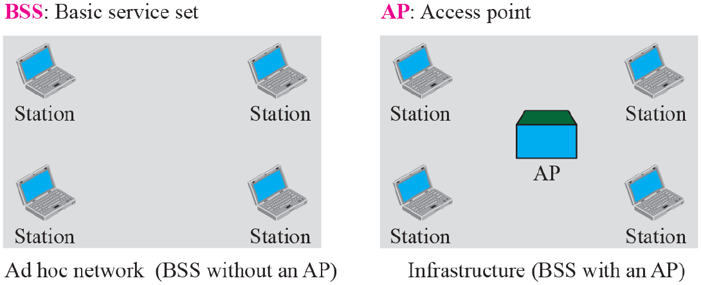

*그림 3. 기본 서비스 세트: AP가 없는 애드혹 네트워크와 AP가 있는 인프라 네트워크*

- **AP가 없는 BSS:** 다른 BSS로 데이터를 보낼 수 없는 독립 네트워크이며 **애드혹 구조(ad hoc architecture)** 라고 부른다. 스테이션들은 AP 없이 서로를 찾아 하나의 BSS에 속하기로 합의하여 네트워크를 이룬다. 중앙 제어도 외부 세계와의 연결도 없이, 가까이 모인 이동 장치들이 통신이 필요하지만 주변에 기존 네트워크 인프라가 없을 때 즉석에서 만든다. 회의실, 기차, 자동차에서 노트북을 가진 사람들이 데이터를 주고받으려 할 때나, 스마트폰의 테더링으로 다른 장치를 연결할 때가 그 예이다.
- **AP가 있는 BSS:** **인프라 네트워크(infrastructure network)** 라고 부른다. 여기서 인프라는 AP와, AP들과 라우터를 잇는 유선 이더넷 인프라를 말한다. 가정의 무선 공유기(와이파이)가 대표적인 예이다. 전형적인 가정 네트워크에서는 AP 하나와 라우터 하나가 보통 한 장치로 통합되어 BSS를 인터넷에 연결한다.

이더넷 장치처럼 각 802.11 무선 스테이션에는 스테이션 어댑터의 펌웨어에 저장된 6바이트 MAC 주소가 있다. 각 AP도 무선 인터페이스의 MAC 주소를 가진다. 이더넷처럼 이 MAC 주소들은 IEEE가 관리하며 (이론적으로) 전 세계에서 유일하다(19장).

### 5.2 확장 서비스 세트 (ESS)

> **용어 정의:** **확장 서비스 세트(extended service set, ESS)** 는 AP를 가진 둘 이상의 BSS를 분배 시스템으로 연결한 것으로, 분배 시스템은 보통 유선 LAN이다.

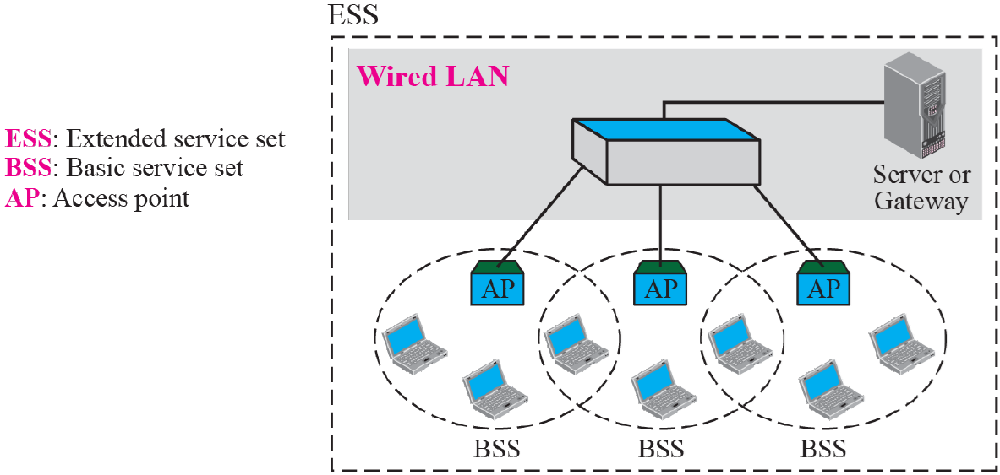

*그림 4. 분배 시스템으로 BSS들을 연결한 확장 서비스 세트*

분배 시스템은 BSS들의 AP를 연결한다. IEEE 802.11은 분배 시스템을 제한하지 않으며, 이더넷 같은 어떤 IEEE LAN이든 될 수 있다. ESS에는 두 종류의 스테이션이 있다. 이동 스테이션은 BSS 안의 일반 스테이션이고, 고정 스테이션은 유선 LAN의 일부인 AP 스테이션이다. BSS들이 연결되어 있으면 서로의 범위 안에 있는 스테이션들은 AP를 거치지 않고 통신할 수 있지만, 서로 다른 BSS에 있는 두 스테이션의 통신은 보통 두 AP를 거친다.

### 5.3 스테이션의 이동성 유형

IEEE 802.11은 무선 LAN 안에서의 이동성에 따라 스테이션을 세 종류로 나눈다.

| 유형 | 이동 범위 |
|:-----|:-----|
| 비전이 이동성 (no-transition mobility) | 고정되어 있거나 하나의 BSS 안에서만 이동 |
| BSS 전이 이동성 (BSS-transition mobility) | 한 BSS에서 다른 BSS로 이동할 수 있지만 하나의 ESS 안으로 제한 |
| ESS 전이 이동성 (ESS-transition mobility) | 한 ESS에서 다른 ESS로 이동 |

*표 4. 802.11 스테이션의 이동성 유형*

### 5.4 채널과 연결

802.11에서 각 무선 스테이션은 네트워크 계층 데이터를 보내거나 받기 전에 AP와 **연결(association)** 해야 한다. 여기서는 802.11b/g를 예로 든다.

- **SSID와 채널:** 네트워크 관리자는 AP를 설치할 때 한두 단어로 된 **서비스 세트 식별자(service set identifier, SSID)** 를 AP에 배정한다. 스마트폰에서 WiFi 설정을 열면 범위 안에 있는 각 AP의 SSID가 목록으로 나타난다. 관리자는 AP에 채널 번호도 배정해야 한다. 802.11은 2.4 GHz 대역 안에 부분적으로 겹치는 채널 11개를 정의한다. 두 채널은 그 사이에 채널이 4개 이상 있을 때에만 겹치지 않으며, 특히 채널 1, 6, 11이 서로 겹치지 않는 유일한 세 채널의 조합이다. 따라서 같은 장소에 802.11b AP 셋을 설치하고 채널 1, 6, 11을 배정한 뒤 스위치로 연결하면 최대 총 전송 속도가 3 × 11 = 33 Mbps인 무선 LAN을 만들 수 있다.
- **WiFi 정글:** 무선 스테이션이 둘 이상의 AP에서 충분히 센 신호를 받는 장소를 **WiFi 정글(WiFi jungle)** 이라고 한다. 예를 들어 카페에서는 카페가 관리하는 AP와 근처 아파트의 AP들의 신호가 함께 잡힐 수 있으며, 각 AP는 서로 다른 IP 서브넷에 있고 독립적으로 채널을 배정받았을 것이다. 인터넷에 접속하려면 장치는 정확히 하나의 서브넷에 들어가야 하므로 정확히 하나의 AP와 연결해야 한다. 연결한다는 것은 장치와 AP 사이에 가상의 전선을 만드는 것이다. 연결된 AP만 장치에 데이터 프레임을 보내고, 장치도 연결된 AP를 통해서만 인터넷으로 데이터 프레임을 보낸다.
- **비컨과 수동 스캐닝:** 802.11 표준은 AP가 SSID와 MAC 주소를 담은 **비컨 프레임(beacon frame)** 을 주기적으로 보내도록 요구한다. 장치는 11개 채널을 훑으며 비컨 프레임을 찾는데, 이를 **수동 스캐닝(passive scanning)** 이라고 한다.
- **능동 스캐닝:** 장치가 범위 안의 모든 AP가 받는 **프로브 요청 프레임(probe request frame)** 을 브로드캐스트하고, AP들이 **프로브 응답 프레임(probe response frame)** 으로 답하게 할 수도 있다. 이를 **능동 스캐닝(active scanning)** 이라고 한다.
- **AP 선택:** 802.11 표준은 사용 가능한 AP 중 어느 것과 연결할지 정하는 알고리즘을 정하지 않으며, 장치의 펌웨어와 소프트웨어 설계자에게 맡긴다. 보통 비컨 프레임의 신호 세기가 가장 큰 AP를 고른다. 그러나 신호가 센 AP가 이미 많은 장치와 연결되어 대역폭을 나누어 써야 하는 반면, 신호가 조금 약한 AP는 한가할 수도 있으므로 신호 세기만으로 성능이 정해지지는 않는다.
- **연결 요청과 응답:** AP를 고른 장치는 **연결 요청 프레임(association request frame)** 을 보내고 AP는 **연결 응답 프레임(association response frame)** 으로 답한다. 능동 스캐닝을 썼다면 이 두 번째 요청과 응답이 필요하다. 처음 프로브 요청에 응답한 AP는 응답한 여러 AP 가운데 장치가 어느 것을 고를지 모르기 때문이다. 여러 DHCP 서버 중 하나를 고르는 DHCP 클라이언트(12장)와 비슷하다.
- **서브넷 가입:** AP와 연결된 장치는 AP가 속한 서브넷에 들어가기 위해 보통 AP를 거쳐 DHCP 발견 메시지를 보내 그 서브넷의 IP 주소를 얻는다. 주소를 얻으면 나머지 세계는 장치를 그 서브넷의 IP 주소를 가진 또 하나의 호스트로 본다.
- **인증:** AP와 연결하려면 장치가 AP에 자신을 인증해야 할 수도 있다. 장치의 MAC 주소로 접근을 허용하는 방법이나 사용자 이름과 비밀번호를 쓰는 방법이 있다. 두 경우 모두 AP는 보통 RADIUS나 DIAMETER 같은 프로토콜로 인증 서버와 정보를 주고받는다. 인증 서버를 AP와 분리하면 인증 서버 하나가 많은 AP를 맡아 민감한 인증 결정을 한곳에 모으고 AP의 비용과 복잡도를 낮출 수 있다. 802.11의 보안을 정한 IEEE 802.11i는 26장에서 다룬다.

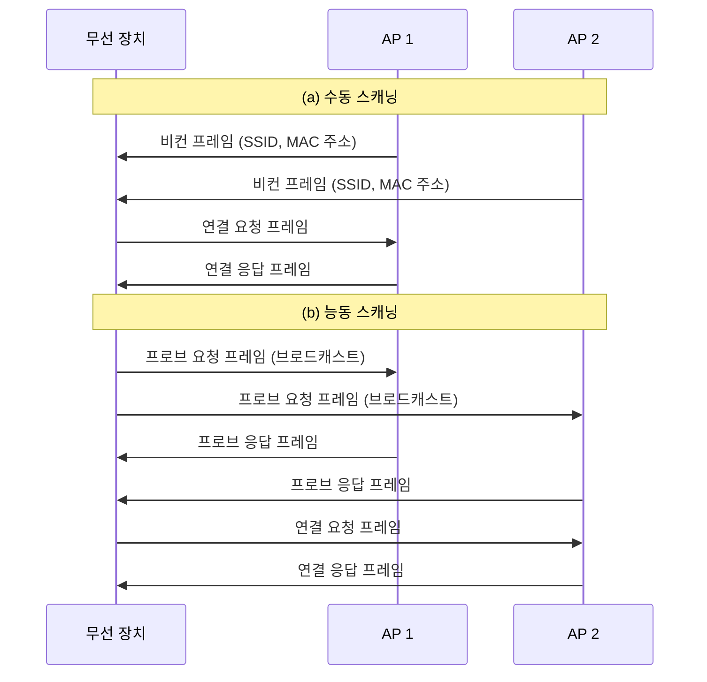

*그림 5. AP를 찾는 수동 스캐닝과 능동 스캐닝*

---

<br>

## 6. 802.11 MAC 프로토콜

무선 장치가 AP와 연결되면 AP와 데이터 프레임을 주고받을 수 있다. 그러나 여러 장치나 AP 자체가 같은 채널로 동시에 보내려 할 수 있으므로 전송을 조율하는 다중 접근 프로토콜이 필요하다. 이 절에서는 장치와 AP를 모두 다중 접근 채널을 공유하는 무선 **스테이션(station)** 이라고 부른다. 이더넷과 그 랜덤 접근 프로토콜의 큰 성공에 영향을 받아, 802.11 설계자들은 802.11 무선 LAN에 랜덤 접근 프로토콜을 택했다. 이것이 **충돌 회피를 갖춘 CSMA(CSMA with collision avoidance, CSMA/CA)** 이다.

> **용어 정의:** **CSMA/CA(carrier sense multiple access with collision avoidance)** 는 전송 전에 채널을 감지하되 충돌을 감지하는 대신 프레임 간 간격, 무작위 백오프, 선택적인 RTS/CTS 예약으로 충돌을 미리 피하고, 링크 계층 확인 응답으로 전송 성공을 확인하는 802.11의 다중 접근 프로토콜이다.

이더넷의 CSMA/CD(18장)처럼 CSMA/CA의 CSMA도 각 스테이션이 전송 전에 채널을 감지하고 채널이 사용 중이면 전송을 삼간다는 뜻이다. 그러나 두 MAC 프로토콜에는 중요한 차이가 있다.

1. 802.11은 충돌 감지 대신 **충돌 회피(collision avoidance)** 기법을 쓴다.
2. 무선 채널의 비트 오류율이 비교적 높으므로, 802.11은 이더넷과 달리 링크 계층 확인 응답과 재전송(ARQ)을 쓴다.

### 6.1 CSMA/CD를 쓸 수 없는 이유

무선 LAN은 다음 세 가지 이유로 CSMA/CD를 구현할 수 없으며, 그래서 충돌을 감지(detection)하는 대신 회피(avoidance)한다.

1. **송신과 수신의 동시 수행:** 충돌을 감지하려면 스테이션이 데이터를 보내면서 동시에 충돌 신호를 받을 수 있어야 한다. 802.11 어댑터에서는 받는 신호의 세기가 보내는 신호의 세기보다 매우 작으므로, 충돌을 감지할 수 있는 하드웨어를 만들기에는 비용이 많이 들고 대역폭 요구도 늘어난다.
2. **숨은 스테이션:** 어댑터가 보내면서 들을 수 있다 해도, 2.3절의 숨은 단말 문제 때문에 모든 충돌을 감지할 수는 없다(9절).
3. **신호의 감쇠:** 신호 세기는 거리의 제곱에 비례하여 줄어든다. 스테이션 사이의 거리가 멀면 신호 페이딩 때문에 한쪽 끝의 스테이션이 다른 쪽 끝에서 일어난 충돌을 듣지 못할 수 있다. 곧 무선 환경에서는 신호가 감쇠하므로 충돌 감지를 쓸 수 없다.

802.11은 충돌 감지를 하지 않으므로, 스테이션은 프레임을 보내기 시작하면 프레임 전체를 다 보낸다. 곧 한번 시작하면 되돌릴 수 없다. 충돌이 잦을 때 프레임(특히 긴 프레임) 전체를 보내면 성능이 크게 떨어지므로, 802.11은 충돌 가능성을 줄이는 여러 충돌 회피 기법을 쓴다.

### 6.2 링크 계층 확인 응답

무선 LAN에서 보낸 프레임은 여러 이유로 목적지에 온전하게 도착하지 못할 수 있다. 이 무시할 수 없는 실패 가능성에 대처하기 위해 802.11 MAC 프로토콜은 링크 계층 확인 응답을 쓴다.

- 목적지 스테이션은 CRC 검사를 통과한 프레임을 받으면 **짧은 프레임 간 간격(Short Inter-frame Spacing, SIFS)** 이라는 짧은 시간을 기다린 뒤 확인 응답 프레임을 보낸다.
- 송신 스테이션이 정해진 시간 안에 확인 응답을 받지 못하면 오류가 났다고 보고, CSMA/CA로 채널에 접근하여 프레임을 재전송한다.
- 정해진 횟수만큼 재전송해도 확인 응답을 받지 못하면 프레임을 버린다.

CSMA/CD에서는 충돌이 없다는 사실 자체가 데이터가 도착했다는 일종의 표시가 된다. 그러나 무선에서는 송신 스테이션이 데이터의 도착을 확인할 다른 수단이 없으므로 확인 응답이 필요하다.

### 6.3 CSMA/CA

스테이션(무선 장치나 AP)에 보낼 프레임이 있다고 하자. 802.11의 CSMA/CA는 다음과 같이 동작한다.

1. 처음에 채널이 비어 있다고 감지하면, **분산 프레임 간 간격(Distributed Inter-frame Space, DIFS)** 이라는 짧은 시간을 기다린 뒤 프레임을 보낸다.
2. 그렇지 않으면 이진 지수 백오프(18장)로 무작위 백오프 값을 고르고, 채널이 비어 있다고 감지되는 동안 DIFS 뒤부터 이 값을 줄여 나간다. 채널이 사용 중이라고 감지되는 동안에는 카운터 값이 멈춘다.
3. 카운터가 0이 되면(채널이 비어 있을 때만 그럴 수 있다) 프레임 전체를 보내고 확인 응답을 기다린다.
4. 확인 응답을 받으면 프레임이 목적지에 올바르게 도착했음을 안다. 보낼 프레임이 더 있으면 2단계부터 CSMA/CA를 다시 시작한다. 확인 응답을 받지 못하면 2단계의 백오프로 돌아가되 더 큰 구간에서 무작위 값을 고른다.

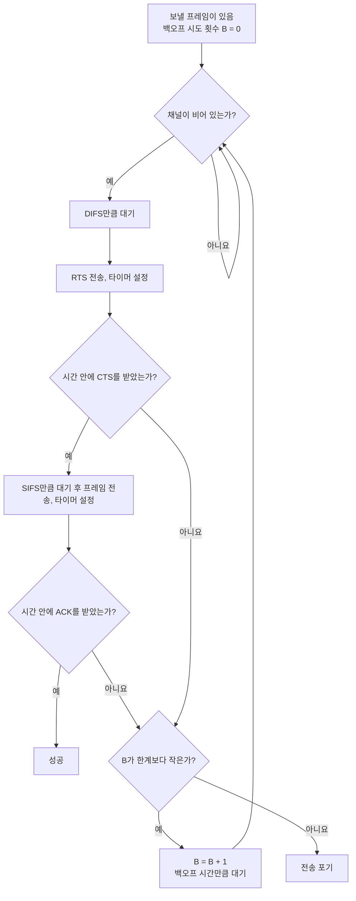

*그림 6. RTS/CTS를 쓰는 CSMA/CA의 흐름도*

CSMA/CD에서는 채널이 비었다고 감지하자마자 전송을 시작하지만, CSMA/CA에서는 채널이 비어 있어도 카운트다운하는 동안에는 전송을 삼간다. 두 방식이 다른 이유는 다음 상황에서 알 수 있다. 두 스테이션이 보낼 프레임이 있지만 제3의 스테이션이 이미 보내고 있어 둘 다 바로 보내지 못한다고 하자.

- **CSMA/CD:** 두 스테이션은 제3의 스테이션이 끝나자마자 동시에 보내 충돌한다. 그러나 둘 다 충돌을 감지해 전송을 중단하므로 프레임의 나머지를 헛되이 보내지 않아 큰 문제가 아니다.
- **CSMA/CA:** 802.11은 충돌을 감지해 중단하지 못하므로, 충돌한 프레임은 끝까지 전송된다. 따라서 802.11의 목표는 가능한 한 충돌을 피하는 것이다. 두 스테이션은 채널이 사용 중임을 감지하면 곧바로 무작위 백오프에 들어가 서로 다른 백오프 값을 고르기를 기대한다. 값이 다르면 채널이 비었을 때 한 스테이션이 먼저 보내기 시작하고, (두 스테이션이 서로 숨어 있지 않다면) 진 스테이션은 이긴 스테이션의 신호를 듣고 카운터를 멈춘 채 전송을 삼간다. 이렇게 비싼 충돌을 피한다.

그래도 두 스테이션이 서로 숨어 있거나, 백오프 값이 너무 가까워 먼저 시작한 스테이션의 전송이 아직 두 번째 스테이션에 닿지 않았다면 충돌이 일어날 수 있다. 18장의 그림 12에서 본 문제와 같다.

### 6.4 RTS/CTS와 네트워크 할당 벡터

802.11 MAC 프로토콜에는 숨은 단말이 있을 때도 충돌을 피하게 돕는 선택적인 예약 방식이 있다. 송신자는 짧은 **송신 요청(Request to Send, RTS)** 제어 프레임과 짧은 **송신 허가(Clear to Send, CTS)** 제어 프레임으로 채널 접근을 예약한다.

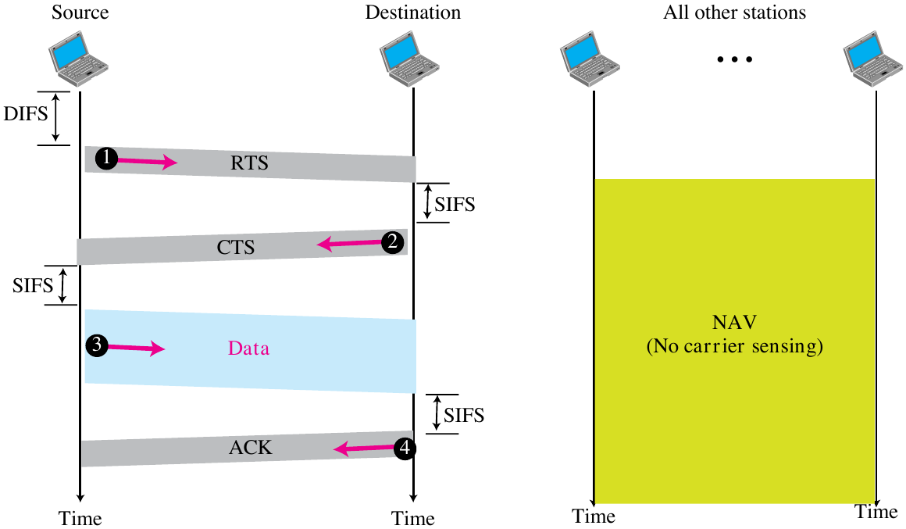

*그림 7. CSMA/CA의 RTS, CTS, 데이터, ACK 교환과 NAV*

1. 프레임을 보내기 전에 출발지 스테이션은 반송파 주파수의 에너지 수준을 검사하여 매체를 감지한다. 채널이 빌 때까지 백오프를 하는 1-지속(1-persistence) 전략을 쓴다. 매체가 비었음을 확인하면 DIFS만큼 기다린 뒤, 데이터 프레임과 확인 응답을 보내는 데 필요한 전체 시간을 담은 RTS를 보낸다. RTS는 "이제 말할 테니 모두 기다리라"는 뜻이다.
2. 목적지 스테이션은 RTS를 받고 SIFS만큼 기다린 뒤 CTS를 보낸다. CTS는 목적지가 데이터를 받을 준비가 되었다는 표시, 곧 "좋다"는 뜻이다. 목적지가 AP이면 AP는 CTS를 브로드캐스트한다. CTS는 송신자에게 명시적으로 전송을 허가하고, 다른 스테이션들에게는 예약된 기간 동안 보내지 말라고 알리는 두 가지 역할을 한다.
3. 출발지 스테이션은 SIFS만큼 기다린 뒤 데이터를 보낸다.
4. 목적지 스테이션은 SIFS만큼 기다린 뒤 프레임을 받았음을 알리는 ACK를 보낸다. ACK가 오지 않으면 출발지는 데이터를 재전송한다.

> **용어 정의:** **네트워크 할당 벡터(network allocation vector, NAV)** 는 RTS나 CTS를 들은 다른 스테이션들이 시작하는 타이머로, 채널이 빈지 확인해도 되기까지 얼마나 기다려야 하는지를 나타낸다.

한 스테이션이 채널을 차지했을 때 다른 스테이션들이 전송을 미루는 방법, 곧 충돌 회피의 핵심이 NAV이다. 스테이션은 RTS를 보낼 때 채널을 차지해야 하는 시간을 함께 담는다. 이 전송의 영향을 받는 스테이션들은 그 시간을 NAV 타이머로 설정하고, NAV가 끝날 때까지 기다린다. 곧 각 스테이션은 물리적 매체가 빈지 감지하기 전에 먼저 자신의 NAV가 끝났는지 확인한다. 그림 7에서 다른 모든 스테이션은 NAV 동안 반송파를 감지하지도 않고 기다린다.

RTS와 CTS는 두 가지 면에서 성능을 높인다.

- 긴 데이터 프레임은 채널을 예약한 뒤에만 보내므로 숨은 스테이션 문제가 완화된다(9.2절).
- RTS와 CTS는 짧으므로, RTS나 CTS가 관련된 충돌은 짧은 RTS나 CTS 프레임의 길이 동안만 지속된다. RTS와 CTS가 올바르게 전송되면 이어지는 데이터와 ACK 프레임은 충돌 없이 전송된다.

**핸드셰이크 중의 충돌:** RTS나 CTS 제어 프레임이 오가는 동안, 곧 **핸드셰이크 기간(handshaking period)** 에 충돌이 일어나면 어떻게 되는가? 둘 이상의 스테이션이 동시에 RTS를 보내면 제어 프레임끼리 충돌할 수 있다. 곧 CSMA/CA도 RTS를 동시에 보내면 충돌할 수 있다. 충돌을 감지하는 수단이 없으므로, 송신자는 수신자에게서 CTS를 받지 못하면 충돌이 났다고 판단하고 백오프 전략으로 다시 시도한다.

RTS/CTS 교환은 충돌을 줄이지만 지연을 늘리고 채널 자원을 쓴다. 그래서 긴 데이터 프레임의 전송을 위해 채널을 예약할 때만 쓴다. 실제로 각 무선 스테이션은 **RTS 임곗값(RTS threshold)** 을 정해, 프레임이 그보다 길 때만 RTS/CTS를 쓴다. 많은 스테이션에서 기본 RTS 임곗값은 최대 프레임 길이보다 커서, 모든 데이터 프레임에 대해 RTS/CTS를 생략한다.

### 6.5 분산 조정 기능과 점 조정 기능

802.11 MAC 부계층에는 두 가지 접근 방식이 있다.

> **용어 정의:** **분산 조정 기능(distributed coordination function, DCF)** 은 각 스테이션이 CSMA/CA와 무작위 백오프로 스스로 채널 접근을 경쟁하는 802.11의 기본 접근 방식이다.

DCF에서는 RTS가 동시에 충돌하는 것을 막기 위해 스테이션마다 무작위 대기 시간을 정하여 경쟁한다. 6.3절과 6.4절이 DCF의 동작이다.

> **용어 정의:** **점 조정 기능(point coordination function, PCF)** 은 AP가 스테이션들을 차례로 폴링하여 경쟁 없이 채널을 쓰게 하는, DCF와 함께 쓰이는 중앙 집중식 접근 방식이다.

- PCF는 시간에 민감한 전송에 쓰인다.
- 중앙 집중식, 경쟁 없는(contention-free) 폴링 접근 방식이다. 곧 AP가 허락한 스테이션만 보내므로 경쟁이 없다.
- PCF를 DCF보다 우선하도록 새로운 간격인 **PIFS(PCF IFS)** 를 정의한다.
- **반복 구간(repetition interval)** 은 비컨 프레임으로 시작한다. 스테이션들은 비컨을 들으면, 반복 구간의 경쟁 없는 구간(contention-free period) 동안 NAV 타이머를 시작한다.

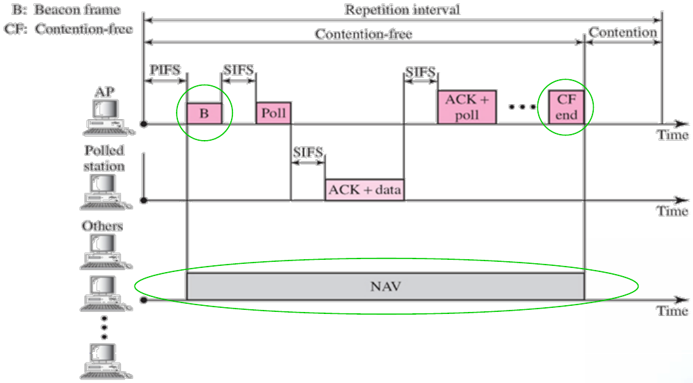

*그림 8. PCF의 반복 구간: 경쟁 없는 구간과 경쟁 구간*

그림 8에서 AP는 PIFS를 기다린 뒤 비컨 프레임(B)을 보내고, SIFS 뒤에 폴링 프레임(Poll)을 보낸다. 폴링을 받은 스테이션은 SIFS 뒤에 ACK와 데이터를 보내고, AP는 다시 ACK와 다음 폴링을 보낸다. 경쟁 없는 구간은 CF end 프레임으로 끝나며, 그 뒤 반복 구간의 나머지는 DCF로 경쟁하는 구간이다. 다른 스테이션들은 경쟁 없는 구간 내내 NAV로 기다린다.

PCF는 구현이 복잡하고, 사용자 수가 자주 바뀌는 무선 환경에서 폴링 목록을 관리하기 어렵다. 그래서 실제로는 주로 DCF가 쓰인다. 폴링 방식의 일반적인 장단점은 18장에서 다루었다.

### 6.6 프레임 간 간격과 우선순위

> **용어 정의:** **프레임 간 간격(inter-frame space, IFS)** 은 802.11 스테이션이 채널이 빈 것을 감지한 뒤 전송하기 전에 기다리는 시간으로, 길이가 다른 여러 간격을 두어 프레임 종류마다 채널 접근의 우선순위를 준다.

802.11 MAC 계층(CSMA/CA)의 우선순위는 서로 다른 프레임 간 간격으로 정해지며, 엄격하게 보장되는 우선순위는 아니다. 간격의 길이는 SIFS < PIFS < DIFS이며, 중요한 프레임일수록 짧은 대기 시간을 준다.

| 간격 | 우선순위 | 쓰임 |
|:-----|:-----|:-----|
| SIFS (Short IFS) | 가장 높음 | ACK, CTS, 폴링 응답처럼 요청에 대한 응답 |
| PIFS (PCF IFS) | 중간 | PCF를 쓰는 시간 제한 서비스, 경쟁 없는 구간(CFP)의 프레임 |
| DIFS (DCF IFS) | 가장 낮음 | 비동기 데이터 서비스 |

*표 5. 프레임 간 간격과 우선순위*

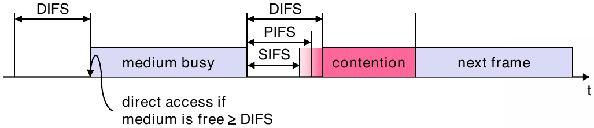

*그림 9. 프레임 간 간격의 길이와 경쟁*

그림 9에서 매체가 DIFS 이상 비어 있으면 스테이션은 곧바로 접근할 수 있다. 매체가 사용 중(medium busy)이었다가 비게 되면, SIFS만 기다리면 되는 응답 프레임이 가장 먼저 매체를 차지하고, 그다음은 PIFS를 기다리는 PCF 프레임이며, 일반 데이터는 DIFS를 기다린 뒤 백오프로 경쟁(contention)하여 다음 프레임을 보낸다. 짧은 간격을 쓰는 프레임은 긴 간격을 기다리는 프레임보다 먼저 매체를 차지하므로, 진행 중인 교환(예: RTS, CTS, 데이터, ACK)이 다른 스테이션에 끊기지 않는다.

### 6.7 단편화와 점대점 링크로서의 802.11

**단편화(fragmentation):** 무선 환경은 잡음이 매우 많아 손상된 프레임을 다시 보내야 하는 일이 잦다. 그래서 802.11은 큰 프레임을 작은 프레임들로 나누는 단편화를 권장한다. 작은 프레임을 다시 보내는 것이 큰 프레임을 다시 보내는 것보다 효율적이기 때문이다.

**점대점 링크로서의 802.11:** 지금까지는 다중 접근 환경의 802.11을 다루었다. 두 노드가 각각 지향성 안테나를 서로에게 향하게 하면, 사실상 점대점 링크 위에서 802.11 프로토콜을 실행할 수 있다. 범용 802.11 하드웨어가 싸므로, 지향성 안테나와 높인 송신 전력을 쓰면 802.11로 수십 km 거리의 무선 점대점 연결을 싸게 만들 수 있다.

---

<br>

## 7. 802.11 프레임

### 7.1 프레임 형식

802.11 프레임은 이더넷 프레임과 비슷한 점이 많지만, 무선 링크에서 쓰기 위한 필드도 있다. 유선과 무선은 서로 다른 프레임 형식을 쓰므로, AP는 이더넷 프레임과 802.11 프레임을 서로 바꾸어 전달한다(8.3절).

```text
  ┌────┬────┬───────────┬───────────┬───────────┬────┬───────────┬──────────────┬─────┐
  │ FC │ D  │ Address 1 │ Address 2 │ Address 3 │ SC │ Address 4 │ Frame body   │ FCS │
  └────┴────┴───────────┴───────────┴───────────┴────┴───────────┴──────────────┴─────┘
    2    2        6           6           6        2        6        0-2312       4

  Subfields of FC
  ┌──────────┬──────┬─────────┬────┬──────┬──────┬───────┬─────┬──────┬─────┬──────┐
  │ Protocol │ Type │ Subtype │ To │ From │ More │ Retry │ Pwr │ More │ WEP │ Rsvd │
  │ version  │      │         │ DS │ DS   │ flag │       │ mgt │ data │     │      │
  └──────────┴──────┴─────────┴────┴──────┴──────┴───────┴─────┴──────┴─────┴──────┘
       2         2       4       1     1      1      1      1      1     1      1
```

*그림 10. 802.11 프레임의 형식과 프레임 제어 필드*

그림 10의 위쪽 숫자는 필드의 크기(바이트), 아래쪽 숫자는 프레임 제어 필드의 하위 필드 크기(비트)이다. MAC 계층 프레임은 다음 아홉 필드로 이루어진다.

| 필드 | 크기 | 내용 |
|:-----|:-----|:-----|
| 프레임 제어 (FC) | 2바이트 | 프레임의 종류와 몇 가지 제어 정보 (7.2절) |
| 지속 시간 (D) | 2바이트 | 한 종류를 뺀 모든 프레임에서 NAV를 설정할 전송 지속 시간. 데이터 프레임과 RTS, CTS 프레임 모두 채널을 예약할 시간을 이 필드에 담음. 한 제어 프레임에서는 프레임의 ID를 나타냄 |
| 주소 1\~4 | 각 6바이트 | 네 주소 필드. 각 필드의 의미는 To DS와 From DS 하위 필드의 값에 따라 달라짐 (8절) |
| 순서 제어 (SC) | 2바이트 | 흐름 제어에 쓰는 프레임의 순서 번호 |
| 프레임 본문 | 0\~2312바이트 | FC 필드에 정한 종류와 하위 종류에 따른 정보. 보통 IP 데이터그램이나 ARP 패킷을 담으며 1500바이트보다 작은 경우가 많음 |
| FCS | 4바이트 | CRC-32 오류 검출 순서열. 무선 LAN에서는 비트 오류가 유선 LAN보다 훨씬 흔하므로 CRC가 더 유용함 |

*표 6. 802.11 프레임의 필드*

**순서 번호의 역할:** 802.11에서 스테이션은 다른 스테이션의 프레임을 올바르게 받으면 확인 응답을 보낸다. 확인 응답이 손실될 수 있으므로 송신 스테이션은 같은 프레임의 사본을 여러 번 보낼 수 있다. 7장의 rdt2.1 프로토콜에서처럼 순서 번호를 쓰면 수신자는 새로 보낸 프레임과 이전 프레임의 재전송을 구별할 수 있다. 802.11 프레임의 순서 번호 필드는 링크 계층에서 전송 계층의 순서 번호와 똑같은 목적을 수행한다.

### 7.2 프레임 제어 필드

| 하위 필드 | 설명 |
|:-----|:-----|
| Version | 현재 버전은 0 |
| Type | 정보의 종류: 관리(00), 제어(01), 데이터(10) |
| Subtype | 각 종류의 하위 종류 (표 8) |
| To DS | 8절에서 설명 |
| From DS | 8절에서 설명 |
| More flag | 1이면 단편이 더 있음 |
| Retry | 1이면 재전송한 프레임 |
| Pwr mgt | 1이면 스테이션이 전력 관리 모드에 있음 (10.3절) |
| More data | 1이면 스테이션이 보낼 데이터가 더 있음 |
| WEP | 유선 동등 프라이버시(wired equivalent privacy), 곧 암호화를 쓰는지 여부 (26장) |
| Rsvd | 예약 |

*표 7. 프레임 제어 필드의 하위 필드*

Type과 Subtype 필드는 연결, RTS, CTS, ACK, 데이터 프레임을 구별하는 데 쓰인다.

### 7.3 프레임의 종류

IEEE 802.11 무선 LAN의 프레임은 세 범주로 나뉜다.

- **관리 프레임(management frame):** 스테이션과 AP 사이의 초기 통신, 곧 비컨, 프로브, 연결, 인증 같은 초기 접속에 쓰인다.
- **제어 프레임(control frame):** 채널 접근과 프레임의 확인 응답, 곧 데이터를 보내기 전후의 작업에 쓰인다.
- **데이터 프레임(data frame):** 전송할 데이터와 제어 정보를 운반한다.

```text
  RTS
  ┌────┬────┬───────────┬───────────┬─────┐
  │ FC │ D  │ Address 1 │ Address 2 │ FCS │
  └────┴────┴───────────┴───────────┴─────┘
    2    2        6           6        4      = 20 bytes

  CTS or ACK
  ┌────┬────┬───────────┬─────┐
  │ FC │ D  │ Address 1 │ FCS │
  └────┴────┴───────────┴─────┘
    2    2        6        4                   = 14 bytes
```

*그림 11. 제어 프레임의 형식*

제어 프레임의 Type 필드 값은 01이며, 지금까지 다룬 제어 프레임의 Subtype 값은 다음과 같다.

| Subtype | 뜻 |
|:-----|:-----|
| 1011 | 송신 요청 (RTS) |
| 1100 | 송신 허가 (CTS) |
| 1101 | 확인 응답 (ACK) |

*표 8. 제어 프레임의 Subtype 값*

---

<br>

## 8. 주소 지정 메커니즘

### 8.1 네 개의 주소 필드

802.11 프레임에서 가장 눈에 띄는 차이는 각각 6바이트 MAC 주소를 담는 주소 필드가 넷이라는 점이다. 이더넷처럼 출발지 MAC 필드와 목적지 MAC 필드만으로 충분하지 않은 이유는, 네트워크 계층 데이터그램을 무선 스테이션에서 AP를 거쳐 라우터 인터페이스로 옮기는 인터네트워킹에 주소 필드 셋이 필요하기 때문이다. 네 번째 주소 필드는 AP들끼리 프레임을 전달할 때 쓰인다. 인프라 네트워크의 경우 처음 세 주소 필드는 다음과 같다.

- **주소 2:** 프레임을 보내는 스테이션의 MAC 주소이다. 무선 스테이션이 보내면 그 스테이션의 MAC 주소가, AP가 보내면 AP의 MAC 주소가 들어간다.
- **주소 1:** 프레임을 받을 무선 스테이션의 MAC 주소이다. 무선 스테이션이 보내면 목적지 AP의 MAC 주소가, AP가 보내면 목적지 무선 스테이션의 MAC 주소가 들어간다.
- **주소 3:** BSS(AP와 무선 스테이션들)는 하나의 서브넷에 속하고, 이 서브넷은 어떤 라우터 인터페이스를 통해 다른 서브넷에 연결된다. 주소 3에는 이 라우터 인터페이스의 MAC 주소가 들어간다.

### 8.2 To DS와 From DS의 네 가지 경우

주소 필드의 의미는 프레임 제어 필드의 두 플래그 To DS와 From DS의 값으로 정해지며, 두 플래그가 각각 0이나 1이므로 네 가지 경우가 있다. DS는 분배 시스템(distribution system)을 뜻한다.

| To DS | From DS | 주소 1 | 주소 2 | 주소 3 | 주소 4 | 상황 |
|:-----|:-----|:-----|:-----|:-----|:-----|:-----|
| 0 | 0 | 목적지 | 출발지 | BSS ID | 없음 | 같은 BSS 안에서 단말에서 단말로 |
| 0 | 1 | 목적지 | 보내는 AP | 출발지 | 없음 | 분배 시스템에서 AP를 거쳐 단말로 |
| 1 | 0 | 받는 AP | 출발지 | 목적지 | 없음 | 단말에서 AP를 거쳐 분배 시스템으로 |
| 1 | 1 | 받는 AP | 보내는 AP | 목적지 | 출발지 | 무선 분배 시스템에서 AP에서 AP로 |

*표 9. To DS와 From DS 값에 따른 주소 필드의 의미*

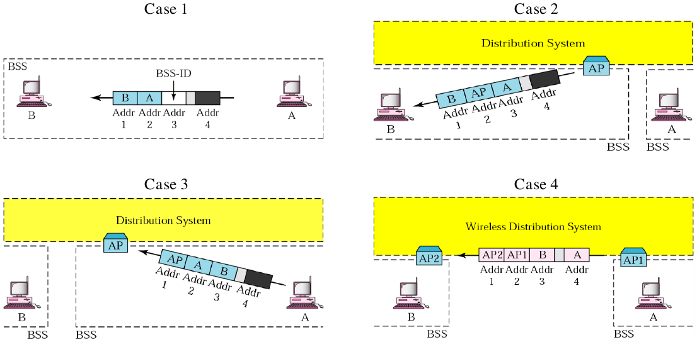

*그림 12. 주소 지정의 네 가지 경우*

네 경우에 공통된 규칙은 다음과 같다.

- 주소 1은 언제나 다음 장치의 주소이다.
- 주소 2는 언제나 이전 장치의 주소이다.
- 주소 3은 주소 1이 최종 목적지가 아닐 때 최종 목적지 스테이션의 주소이다.
- 주소 4는 원래 출발지 스테이션이 주소 2와 같지 않을 때 원래 출발지의 주소이다.

그림 12의 경우 1은 같은 BSS 안에서 단말 B가 단말 A로 직접 보내는 경우, 경우 2는 다른 BSS에서 온 프레임을 AP가 단말 A에 전달하는 경우, 경우 3은 단말 B가 AP를 거쳐 다른 BSS의 A로 보내는 경우, 경우 4는 무선 분배 시스템에서 AP2가 AP1로 프레임을 전달하는 경우이다.

### 8.3 AP를 거쳐 라우터와 주고받는 프레임

그림 13의 네트워크에서 AP는 무선 스테이션 H1을 맡고, 라우터 인터페이스 R1에 연결된다. AP는 링크 계층 장치이므로 IP를 쓰지도 IP 주소를 이해하지도 못한다.


*그림 13. 무선 스테이션, AP, 라우터 인터페이스*

**R1에서 H1로 데이터그램을 보낼 때:** 라우터는 자신과 H1 사이에 AP가 있다는 것을 모르며, 라우터에게 H1은 자신이 연결된 서브넷의 한 호스트일 뿐이다.

1. 라우터는 데이터그램의 목적지 주소로 H1의 IP 주소를 알고, 일반 이더넷 LAN에서처럼 ARP(19장)로 H1의 MAC 주소를 알아낸다.
2. 라우터 인터페이스 R1은 데이터그램을 이더넷 프레임에 캡슐화한다. 출발지 주소는 R1의 MAC 주소, 목적지 주소는 H1의 MAC 주소이다.
3. 이더넷 프레임이 AP에 도착하면, AP는 802.3 이더넷 프레임을 802.11 프레임으로 바꾸어 무선 채널로 보낸다. 주소 1에는 H1의 MAC 주소를, 주소 2에는 자신의 MAC 주소를, 주소 3에는 R1의 MAC 주소를 넣는다. H1은 주소 3에서 데이터그램을 서브넷으로 보낸 라우터 인터페이스의 MAC 주소를 알 수 있다.

**H1에서 R1로 데이터그램을 보낼 때:**

1. H1은 802.11 프레임을 만들어 주소 1에 AP의 MAC 주소를, 주소 2에 자신의 MAC 주소를, 주소 3에 R1의 MAC 주소를 넣는다.
2. AP는 802.11 프레임을 받아 이더넷 프레임으로 바꾼다. 출발지 주소는 H1의 MAC 주소, 목적지 주소는 R1의 MAC 주소이다. 곧 주소 3 덕분에 AP는 이더넷 프레임을 만들 때 알맞은 목적지 MAC 주소를 정할 수 있다.

| 구간 | 프레임 | 주소 1 (또는 목적지) | 주소 2 (또는 출발지) | 주소 3 |
|:-----|:-----|:-----|:-----|:-----|
| R1에서 AP로 | 이더넷 | H1 | R1 | |
| AP에서 H1로 | 802.11 | H1 | AP | R1 |
| H1에서 AP로 | 802.11 | AP | H1 | R1 |
| AP에서 R1로 | 이더넷 | R1 | H1 | |

*표 10. AP를 거칠 때 바뀌는 주소 필드*

> **핵심:** 주소 3은 BSS를 유선 LAN과 연결하는 인터네트워킹에서 결정적인 역할을 한다.

---

<br>

## 9. 숨은 스테이션과 노출 스테이션

### 9.1 숨은 스테이션 문제

> **용어 정의:** **숨은 스테이션 문제(hidden station problem)** 는 서로의 전송 범위 밖에 있어 서로의 존재를 모르는 두 스테이션이, 둘 모두의 범위 안에 있는 같은 스테이션에게 동시에 보내 그 스테이션에서 충돌이 일어나는 문제이다.

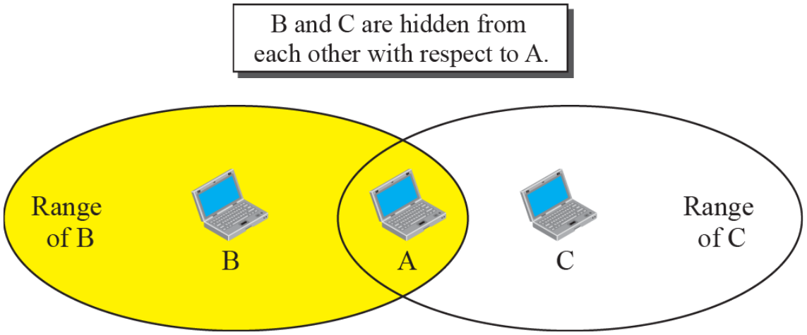

*그림 14. 숨은 스테이션 문제*

그림 14에서 왼쪽 원은 스테이션 B의 전송 범위, 오른쪽 원은 스테이션 C의 전송 범위이다. C는 B의 범위 밖에, B는 C의 범위 밖에 있다. 스테이션 A는 두 범위가 겹치는 곳에 있어 B와 C가 보내는 신호를 모두 들을 수 있다.

1. B가 A에게 데이터를 보낸다. C는 B의 신호를 받지 못한다.
2. B가 보내는 도중에 C도 A에게 보낼 데이터가 생긴다. C는 B의 전송이 닿지 않으므로 매체가 비었다고 판단한다. 곧 반송파 감지가 실패한다.
3. C가 A에게 데이터를 보내면 A는 B와 C의 데이터를 동시에 받아 A에서 충돌이 일어난다. B는 그 충돌을 받을 수 없으므로 충돌 감지도 실패한다.

이 경우 B와 C는 A에 대해 서로 **숨어(hidden)** 있다고 한다. B와 C는 서로의 존재를 모른다. 숨은 스테이션은 충돌 가능성을 높여 네트워크의 용량을 줄인다.

### 9.2 핸드셰이크로 숨은 스테이션 문제 막기

숨은 스테이션 문제는 6.4절의 핸드셰이크 프레임(RTS와 CTS)으로 해결한다.

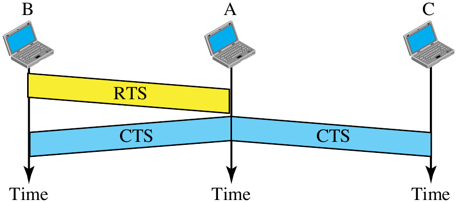

*그림 15. 핸드셰이크로 숨은 스테이션 문제를 막는 과정*

1. B와 C가 모두 A에게 보내려 하고, B가 먼저 RTS를 보낸다.
2. B의 RTS는 A에게 닿지만 C에게는 닿지 않는다.
3. B와 C 모두 A의 범위 안에 있으므로, B에서 A로의 데이터 전송 시간을 담은 A의 CTS는 B와 C 모두에게 닿는다.
4. C는 B의 RTS를 듣지 못했지만 A의 CTS를 듣고, 어떤 숨은 스테이션이 A에게 보내려고 채널을 쓰고 있음을 안다. C는 그 시간이 끝날 때까지 전송을 삼간다.

> **핵심:** CSMA/CA 핸드셰이크의 CTS 프레임은 숨은 스테이션에서 오는 충돌을 막을 수 있다.

### 9.3 노출 스테이션 문제

> **용어 정의:** **노출 스테이션 문제(exposed station problem)** 는 다른 스테이션의 전송을 듣는다는 이유로, 실제로는 간섭 없이 보낼 수 있는데도 채널 사용을 삼가 채널 용량을 낭비하는 문제이다.

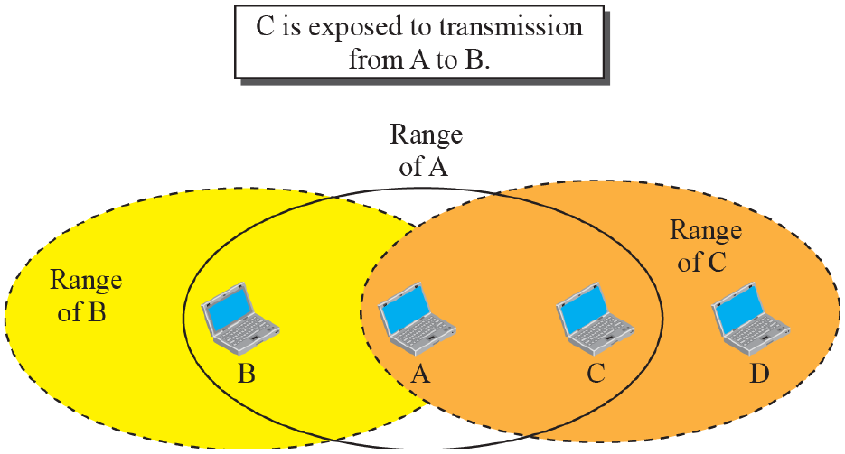

*그림 16. 노출 스테이션 문제*

노출 스테이션 문제는 숨은 스테이션 문제와 반대 상황이다. 그림 16에서 스테이션 A는 B에게 보내고 있다. 스테이션 C는 D에게 보낼 데이터가 있으며(A나 B가 아닌 D), 이 전송은 A에서 B로의 전송과 간섭하지 않고 보낼 수 있다. 곧 A에서 B로, C에서 D로의 두 전송이 동시에 가능한 상황이다. 그러나 C는 A의 전송에 **노출되어(exposed)** 있어, A가 보내는 것을 듣고 반송파 감지가 매체 사용 중을 알리므로 기다려야 한다. B는 C의 전파 범위 밖에 있으므로 C가 기다릴 필요가 없는데도, C는 지나치게 조심스러워 채널 용량을 낭비한다.

### 9.4 핸드셰이크로 해결되지 않는 노출 스테이션 문제

예상과 달리 RTS와 CTS 핸드셰이크 메시지는 노출 스테이션 문제를 해결하지 못한다.

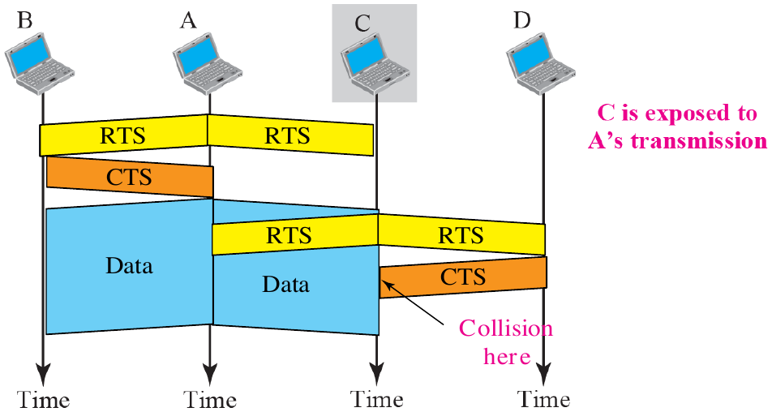

*그림 17. 노출 스테이션 문제에서의 핸드셰이크*

1. A와 C가 각각 B와 D에게 보내려 한다. A가 먼저 RTS를 보낸다.
2. C는 A의 RTS를 듣지만 B의 CTS는 듣지 못한다. 곧 A에서 B로의 RTS를 들은 C가 기다린다.
3. C는 B의 CTS가 A에 닿을 때까지 기다린 뒤, D와 통신하겠다는 RTS를 D에게 보낸다. B와 A도 이 RTS를 들을 수 있지만, A는 받는 상태가 아니라 보내는 상태이다.
4. D는 CTS로 응답한다. 그런데 A가 이미 데이터를 보내기 시작했다면, C의 위치에서 A의 데이터와 D의 CTS가 충돌하므로 C는 D의 CTS를 듣지 못한다.
5. 따라서 C는 A가 데이터를 다 보낼 때까지 D에게 데이터를 보낼 수 없으며, 그때까지 노출된 상태로 남는다.

| 비교 | 숨은 스테이션 문제 | 노출 스테이션 문제 |
|:-----|:-----|:-----|
| 원인 | 두 송신자가 서로의 전송을 듣지 못함 | 송신자가 간섭하지 않을 전송을 들음 |
| 결과 | 반송파 감지가 매체를 비었다고 잘못 판단하여 수신자에서 충돌 | 반송파 감지가 매체를 사용 중으로 판단하여 불필요하게 대기 |
| 피해 | 충돌로 인한 용량 감소 | 대기로 인한 용량 낭비 |
| RTS/CTS의 효과 | 수신자의 CTS를 듣고 기다리므로 해결됨 | 해결되지 않음 |

*표 11. 숨은 스테이션 문제와 노출 스테이션 문제의 비교*

---

<br>

## 10. 같은 서브넷 안의 이동성과 고급 기능

### 10.1 같은 IP 서브넷 안의 이동성

기업과 대학은 무선 LAN의 물리적 범위를 넓히려고 같은 IP 서브넷 안에 여러 BSS를 두는 경우가 많다. 그러면 무선 스테이션이 진행 중인 TCP 세션을 유지하면서 한 BSS에서 다른 BSS로 어떻게 매끄럽게 옮겨 가는가 하는 문제가 생긴다. BSS들이 같은 서브넷에 속하면 이동성을 비교적 간단하게 처리할 수 있다.

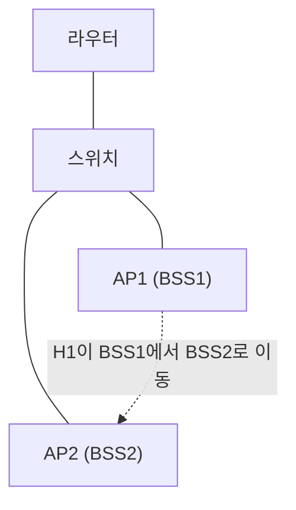

*그림 18. 같은 서브넷 안의 두 BSS 사이를 이동하는 호스트*

그림 18에서 두 BSS를 잇는 장치는 라우터가 아니라 스위치이므로, AP를 포함한 두 BSS의 모든 스테이션은 같은 IP 서브넷에 속한다. 따라서 H1이 BSS1에서 BSS2로 옮겨 가도 IP 주소와 진행 중인 모든 TCP 연결을 유지할 수 있다. 두 BSS를 잇는 장치가 라우터라면 H1은 새 서브넷에서 새 IP 주소를 얻어야 하고, 주소가 바뀌면 진행 중인 TCP 연결이 끊긴다. 25장의 모바일 IP 같은 네트워크 계층 이동성 프로토콜이 이 문제를 해결한다.

1. H1이 AP1에서 멀어지면 AP1의 신호가 약해지는 것을 감지하고 더 센 신호를 찾기 시작한다.
2. H1은 AP2의 비컨 프레임을 받는다. 많은 기업과 대학에서 AP2는 AP1과 같은 SSID를 가진다.
3. H1은 AP1과의 연결을 끊고 AP2와 연결한다. IP 주소와 진행 중인 TCP 세션은 그대로 유지된다.

이것은 호스트와 AP 관점의 핸드오프 문제를 해결한다. 그러면 스위치는 호스트가 다른 AP로 옮겨 갔다는 것을 어떻게 아는가? 스위치는 자기 학습(20장)으로 포워딩 테이블을 자동으로 만드므로 가끔 일어나는 이동은 잘 처리하지만, BSS 사이를 옮겨 다니며 TCP 연결을 유지하려는 이동성이 높은 사용자를 지원하도록 설계되지는 않았다. 이동 전에 스위치의 표에는 H1의 MAC 주소와 H1에 닿는 출력 인터페이스(AP1 쪽)의 쌍이 있다. H1이 BSS2와 연결된 뒤에는 H1로 가는 프레임이 AP2로 가야 한다. 한 가지 해결책은 새로 연결된 직후 AP2가 출발지 주소를 H1의 주소로 한 브로드캐스트 이더넷 프레임을 스위치로 보내는 것이다. 스위치는 이 프레임을 받아 포워딩 테이블을 갱신하여 H1에 AP2를 거쳐 닿을 수 있게 된다. VLAN(20장)으로 떨어진 LAN들을 하나의 큰 가상 LAN으로 묶은 경우에도 같은 방식으로 기지국 사이의 이동성을 처리할 수 있다.

### 10.2 전송률 적응

2.2절에서 본 것처럼 SNR 상황에 따라 알맞은 변조 기법(과 그에 따른 전송 속도)이 다르다. 기지국에서 20 m 떨어져 SNR이 높은 이동 사용자는 낮은 BER을 유지하면서 높은 전송 속도를 주는 변조 기법을 쓸 수 있다. 사용자가 기지국에서 멀어지면 SNR이 떨어지고, 변조 기법을 바꾸지 않으면 BER이 받아들일 수 없을 만큼 높아져 결국 어떤 프레임도 올바르게 받아지지 않는다.

그래서 일부 802.11 구현에는 현재나 최근의 채널 특성에 따라 물리 계층 변조 기법을 적응적으로 고르는 **전송률 적응(rate adaptation)** 기능이 있다.

- 노드가 확인 응답을 받지 못한 프레임을 두 번 연달아 보내면(채널에 비트 오류가 있다는 간접적인 표시), 전송 속도를 한 단계 낮은 속도로 내린다.
- 프레임 10개가 연달아 확인 응답을 받거나, 마지막으로 속도를 내린 뒤의 시간을 재는 타이머가 끝나면, 전송 속도를 한 단계 높은 속도로 올린다.

이 방식은 TCP의 혼잡 제어(9장)와 같은 "탐색" 철학을 따른다. 상황이 좋으면(ACK를 받으면) 무언가 나쁜 일(ACK를 받지 못함)이 일어날 때까지 전송 속도를 높이고, 나쁜 일이 일어나면 속도를 낮춘다.

### 10.3 전력 관리

이동 장치에서 전력은 귀한 자원이므로, 802.11 표준은 노드가 감지, 송신, 수신 기능과 다른 회로를 켜 두는 시간을 최소화하는 전력 관리 기능을 제공한다.

1. 노드는 잠자기 상태와 깨어 있는 상태를 명시적으로 오갈 수 있다. 노드는 802.11 프레임 헤더의 전력 관리 비트를 1로 설정하여 AP에 자신이 잠들 것임을 알린다.
2. 노드는 AP가 비컨 프레임을 보내기로 예정된 시각 직전에 깨어나도록 타이머를 설정한다. AP는 보통 100 ms마다 비컨 프레임을 보낸다.
3. AP는 전력 관리 비트를 보고 그 노드가 잠든다는 것을 알므로, 그 노드에 프레임을 보내지 않고 잠든 호스트로 가는 프레임을 버퍼에 저장해 두었다가 나중에 보낸다.
4. 노드는 AP가 비컨 프레임을 보내기 직전에 깨어나 빠르게(250 μs 만에) 완전히 활성 상태가 된다. AP가 보내는 비컨 프레임에는 AP에 프레임이 버퍼링된 노드들의 목록이 있다.
5. 자신의 프레임이 버퍼링되어 있지 않으면 노드는 다시 잠든다. 버퍼링되어 있으면 AP에 폴링 메시지를 보내 버퍼링된 프레임을 명시적으로 요청한다.

비컨 간격이 100 ms이고 깨어나는 데 250 μs가 걸리며, 비컨 프레임을 받고 버퍼링된 프레임이 없는지 확인하는 시간도 비슷하게 짧으므로, 보내거나 받을 프레임이 없는 노드는 99% 정도의 시간 동안 잠들어 있어 에너지를 크게 아낄 수 있다.

---

<br>

## 11. 블루투스

### 11.1 블루투스의 특징

**블루투스(Bluetooth)** 는 전화기, 노트북, 컴퓨터, 카메라, 프린터 같은 서로 다른 기능의 장치를 연결하도록 설계된 짧은 거리의 무선 통신 기술이며, 개인 영역 네트워크(personal area network, PAN)를 만들기 위한 것이다. 오늘날 블루투스 기술은 IEEE 802.15 표준이 정의한 프로토콜을 구현한 것이며, 표준은 방이나 홀 크기의 영역에서 동작하는 무선 PAN을 정의한다. 링크 계층과 물리 계층을 정의한 표준은 IEEE 802.15.1이다.

802.11이 높은 전력, 중간 거리, 높은 속도의 "접속" 기술이라면, 블루투스는 컴퓨터와 무선 키보드, 마우스 같은 주변 장치나 휴대 전화, 스피커, 헤드폰을 잇는 낮은 전력, 짧은 거리, 낮은 속도의 "케이블 대체" 기술이다. 그래서 무선 개인 영역 네트워크(WPAN)라고도 부른다. 블루투스의 특징은 다음과 같다.

- **매우 낮은 전력:** 신호 세기가 1 mW에 불과하다.
- **짧은 거리:** 동작 거리는 10 m이며, 선택적으로 100 m 모드도 있다.
- **면허가 필요 없는 대역:** 2.4 GHz\~2.5 GHz의 ISM(산업, 과학, 의료용) 대역에서 동작한다. 802.11b 무선 LAN도 2.4 GHz 대역을 쓰므로 둘 사이에 간섭이 생길 수 있다.
- **확산 스펙트럼:** 간섭을 피하기 위해 확산 스펙트럼을 쓴다(11.3절).
- **여러 단계의 보안:** 주파수 도약, 데이터 화이트닝(data whitening), 데이터 부호화, 데이터 암호화를 쓴다.
- **모든 종류의 장치를 대상으로 함:** 휴대 전화와 위성 전화 같은 무선 전화, 컴퓨터, PDA, 주변 장치, 셋톱 박스, 오디오 시스템, 카메라와 캠코더, 헤드셋, 리모컨 같은 가전제품이 대상이다.

활용 예로는 무선 마우스나 키보드와 컴퓨터의 통신, 작은 의료 시설에서 감시 장치와 센서 장치의 통신, 가정 보안 장치에서 여러 센서와 주 보안 제어기의 연결, 회의 참석자들의 노트북 동기화가 있다. 블루투스 LAN은 애드혹 네트워크이므로 본래 크게 만들 수 없으며, 많은 장치가 연결하려 하면 혼란이 생긴다. 블루투스는 원래 Ericsson의 프로젝트로 시작했으며, 덴마크와 노르웨이를 통일한 덴마크 왕 Harald Blaatand(940\~981)의 이름에서 따왔다. Blaatand를 영어로 옮기면 Bluetooth이다.

### 11.2 피코넷과 스캐터넷

블루투스는 피코넷과 스캐터넷의 두 종류의 네트워크를 정의한다. 연결된 무선 장치는 마스터(primary)나 슬레이브(secondary)가 될 수 있으며, 무선 장치는 대칭적이므로 같은 장치가 마스터도 슬레이브도 될 수 있다.

> **용어 정의:** **피코넷(piconet)** 은 마스터 장치 하나와 활성 슬레이브 장치 최대 일곱 개로 이루어진 블루투스의 기본 네트워크로, 모든 슬레이브가 마스터에 클록과 도약 순서를 맞춘다.

- **구성:** 피코넷에는 장치가 최대 여덟 개 있을 수 있으며, 그중 하나가 마스터이고 나머지가 슬레이브이다. 피코넷의 마스터는 하나뿐이며, 마스터와 슬레이브의 통신은 일대일이거나 일대다이다.
- **마스터의 역할:** 마스터는 피코넷을 다스린다. 마스터의 클록이 피코넷의 시간을 정하고, 마스터는 홀수 번째 슬롯마다 보낼 수 있다. 슬레이브는 바로 앞 슬롯에서 마스터가 자신과 통신한 뒤에만 보낼 수 있고, 그때도 마스터에게만 보낼 수 있다. 곧 블루투스는 18장의 폴링 프로토콜의 예이다.
- **파크 상태:** 활성 슬레이브 외에 파크(parked) 상태의 장치가 최대 255개 있을 수 있다. 파크 상태의 장치는 마스터와 동기화되어 있지만, 마스터가 활성 상태로 바꾸어 줄 때까지 통신에 참여하지 못한다. 피코넷에서 활성 장치는 여덟 개까지이므로, 파크 상태의 장치를 활성화하려면 활성 장치 하나가 파크 상태로 가야 한다.
- **용량과 식별:** 피코넷 하나의 최대 용량은 1 Mbps이며, 피코넷마다 고유한 도약 패턴과 ID를 가진다.

> **용어 정의:** **스캐터넷(scatternet)** 은 여러 피코넷을 결합한 블루투스 네트워크로, 한 피코넷의 슬레이브가 다른 피코넷의 마스터가 되어 두 피코넷 사이에서 메시지를 전달한다.

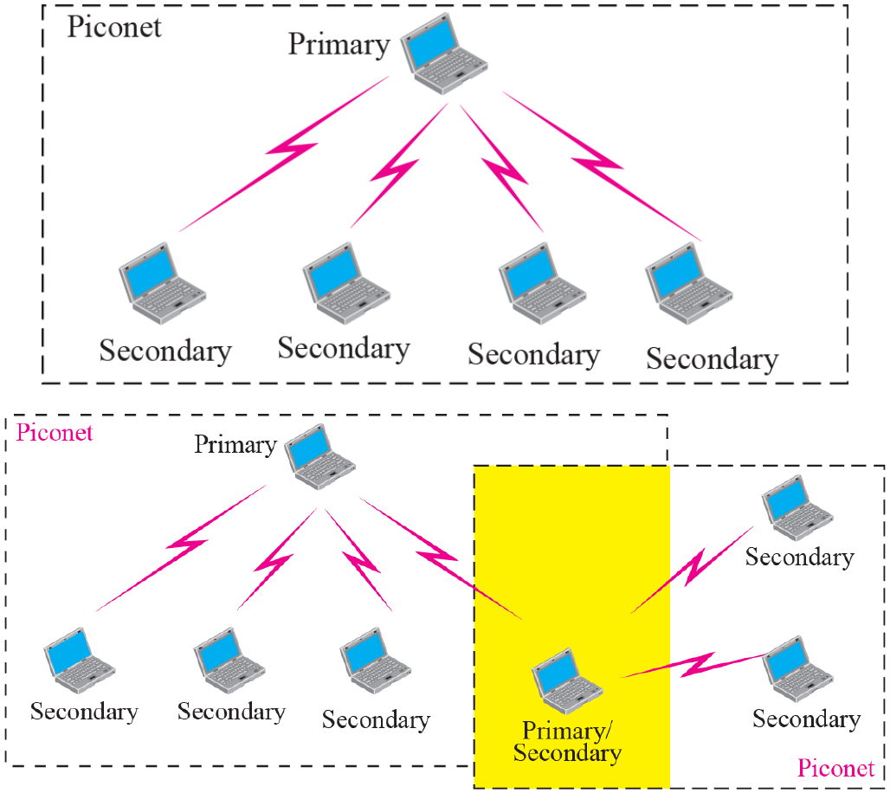

*그림 19. 피코넷과 스캐터넷*

스캐터넷에서 한 피코넷의 슬레이브는 다른 피코넷의 마스터가 될 수 있다. 이 장치는 첫 번째 피코넷의 마스터에게서 (슬레이브로서) 메시지를 받아, (마스터로서) 두 번째 피코넷의 슬레이브들에게 전달한다. 곧 한 장치가 두 피코넷의 구성원이 될 수 있으며, 피코넷들은 시간과 공간 속에서 공존한다.

### 11.3 무선 계층과 주파수 도약

블루투스의 무선 계층은 2.4 GHz ISM 대역을 쓰며, 시분할 방식으로 동작한다. 시간 슬롯은 625 μs이며, 각 시간 슬롯 동안 송신자는 79개 채널 가운데 하나로 보내고, 채널은 슬롯마다 알려져 있지만 의사 무작위적인 방식으로 바뀐다. 이런 채널 도약을 **주파수 도약 확산 스펙트럼(frequency-hopping spread spectrum, FHSS)** 이라고 하며, 시간에 따라 전송을 주파수 스펙트럼 전체에 펼친다. 곧 확산 스펙트럼은 주파수를 펼치는 것이다.

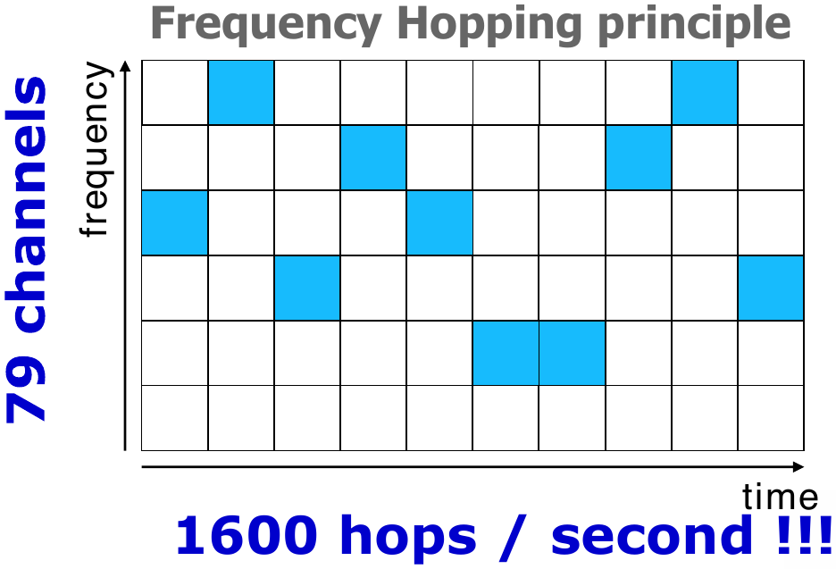

*그림 20. 79개 채널에서 초당 1600번 도약하는 주파수 도약의 원리*

도약 시간은 초당 1600번 도약하므로 1/1600초, 곧 625 μs이다.

```math
\frac{1}{1600\ \text{hops/s}} = 0.000625\ \text{s} = 625\ \mu\text{s}
```

주파수를 바꾸어 가며 전송하므로, 한 채널에서 몇 번 충돌이 일어나도 다음 슬롯은 다른 채널을 쓰기 때문에 전체 전송은 정상적으로 이루어질 수 있다. 또한 같은 장소에서 802.11 무선 LAN이 쓰는 채널을 블루투스의 도약 채널에서 빼고 나머지 채널에서만 도약하면, 블루투스와 WiFi의 충돌을 피할 수 있다.

> **참고:** 블루투스의 전송 속도는 피코넷당 1 Mbps로 설명되기도 하고, IEEE 802.15.1이 최대 4 Mbps를 제공할 수 있다고 설명되기도 한다.

### 11.4 물리 링크와 접근 코드

블루투스는 마스터와 슬레이브 사이에 두 종류의 물리 링크를 정의한다.

| 링크 | 성질 |
|:-----|:-----|
| SCO (Synchronous Connection-Oriented) | 대칭, 회선 교환, 점대점 |
| ACL (Asynchronous Connectionless Link) | 패킷 교환, 점대다점, 마스터가 폴링 |

*표 12. 블루투스의 물리 링크*

**접근 코드(access code)** 는 동기를 위한 것으로, 마스터로부터 만들어지며 채널마다 고유하다. 이 코드로 한 피코넷의 프레임을 다른 피코넷의 프레임과 구별한다.

### 11.5 프레임 형식

블루투스 프레임은 72비트 접근 코드, 54비트 헤더, 0\~N비트 데이터로 이루어진다.

```text
  ┌─────────────┬────────┬──────────────────────────┐
  │ Access code │ Header │           Data           │
  └─────────────┴────────┴──────────────────────────┘
        72          54            0 to N            (bits)

  N = 240 (1-slot frame), 1490 (3-slot frame), 2740 (5-slot frame)

  The 18-bit part of the header (repeated 3 times for 54 bits)
  ┌─────────┬──────┬──────┬──────┬──────┬──────┐
  │ AM_ADDR │ TYPE │ FLOW │ ARQN │ SEQN │ HEC  │
  └─────────┴──────┴──────┴──────┴──────┴──────┘
       3       4      1      1      1      8      (bits)
```

*그림 21. 블루투스 프레임의 형식*

| 필드 | 크기 | 정보 |
|:-----|:-----|:-----|
| AM_ADDR | 3비트 | 활성 슬레이브의 주소(active member address). 슬레이브 일곱 개(1\~7)를 정하며, 0이면 마스터가 모든 슬레이브에 보내는 브로드캐스트 |
| TYPE | 4비트 | 상위 계층에서 온 페이로드의 종류 |
| FLOW | 1비트 | 흐름 제어. 1이면 장치의 버퍼가 차서 더 받을 수 없음 |
| ARQN | 1비트 | 확인 응답(ACK)과 부정 확인 응답(NAK). 정지 후 대기 ARQ를 쓰므로 1비트로 충분 |
| SEQN | 1비트 | 재전송 순서를 위한 순서 번호. 정지 후 대기 ARQ를 쓰므로 1비트로 충분 (7장) |
| HEC | 8비트 | 각 18비트 헤더 부분의 오류를 검사하는 헤더 오류 검사 |

*표 13. 블루투스 프레임 헤더의 필드*

헤더는 똑같은 18비트 부분 세 개로 이루어진다. 수신자는 세 부분을 비트별로 비교하여, 대응하는 비트가 모두 같으면 그 비트를 받아들이고 다르면 다수결을 따른다. 이것은 헤더에만 적용되는 순방향 오류 정정(18장)의 한 형태이다. 공기를 통한 통신은 잡음이 매우 많으므로 이런 이중 오류 제어가 필요하다.

기저 대역 계층의 프레임은 슬롯 1개, 3개, 5개를 차지하는 세 종류가 있다. 슬롯은 625 μs이지만, 1슬롯 프레임에서는 도약과 제어에 259 μs가 필요하므로 프레임은 625 − 259 = 366 μs만 지속된다. 1 MHz 대역폭과 1 bit/Hz에서 1슬롯 프레임의 크기는 366비트이다. 3슬롯 프레임은 3 × 625 − 259 = 1616비트, 5슬롯 프레임은 5 × 625 − 259 = 2866비트이다. 3슬롯 프레임을 쓰는 장치는 세 슬롯 동안 같은 도약(같은 반송파 주파수)에 머문다. 도약 번호는 하나만 쓰지만 세 개가 소비되므로, 각 프레임의 도약 번호는 그 프레임의 첫 슬롯의 번호와 같다.

---

<br>

## 12. Zigbee

IEEE가 표준화한 두 번째 개인 영역 네트워크는 **Zigbee**라고 부르는 802.15.4 표준이다. 블루투스가 메가비트 단위의 "케이블 대체" 속도를 제공하는 반면, Zigbee는 블루투스보다 전력, 전송 속도, 작동 비율(duty cycle)이 낮은 응용을 대상으로 한다. 가정의 온도 센서와 조명 센서, 보안 장치, 벽 스위치처럼 단순하고 전력과 비용이 낮은 장치는 큰 대역폭이 필요하지 않다.

- **속도:** 채널 주파수에 따라 20, 40, 100, 250 kbps의 채널 속도를 정의한다.
- **노드의 종류:** "축소 기능 장치(reduced-function device)" 는 블루투스의 슬레이브처럼 하나의 "완전 기능 장치(full-function device)" 의 제어를 받는다. 완전 기능 장치는 블루투스의 마스터처럼 여러 슬레이브를 제어할 수 있고, 여러 완전 기능 장치를 메시 네트워크로 구성하여 서로 프레임을 라우팅하게 할 수도 있다.
- **익숙한 메커니즘:** 비컨 프레임과 링크 계층 확인 응답(802.11과 비슷), 이진 지수 백오프를 쓰는 반송파 감지 랜덤 접근(802.11, 이더넷과 비슷), 시간 슬롯의 고정 보장 할당(DOCSIS와 비슷)을 쓴다.

```text
  ┌────────┬──────────────────────────────┬──────────────────────────┐
  │ beacon │        active period         │     inactive period      │
  │        │ (16 time slots: CSMA/CA and  │ (all devices, including  │
  │        │  guaranteed slots)           │  the controller, sleep)  │
  └────────┴──────────────────────────────┴──────────────────────────┘
  ◄──────────────────────────── super frame ─────────────────────────►
```

*그림 22. Zigbee 802.15.4의 슈퍼 프레임 구조*

완전 기능 장치 하나가 비컨 프레임으로 시간 슬롯 방식으로 여러 축소 기능 장치를 제어하는 경우, Zigbee 네트워크는 시간을 반복되는 **슈퍼 프레임(super frame)** 으로 나누며, 각 슈퍼 프레임은 비컨 프레임으로 시작한다. 비컨 프레임은 슈퍼 프레임을 장치들이 보낼 수 있는 활성 구간과, 제어기를 포함한 모든 장치가 잠들어 전력을 아끼는 비활성 구간으로 나눈다. 활성 구간은 시간 슬롯 16개로 이루어지며, 일부는 장치들이 CSMA/CA 랜덤 접근으로 쓰고, 일부는 제어기가 특정 장치에 배정하여 채널 접근을 보장한다.

---

<br>

## 개념 적용

**T/F 점검:**

| 문장 | 판단과 근거 |
|:-----|:-----|
| 애드혹 네트워크에서는 주소 배정과 라우팅을 기지국이 제공한다. | **F.** 애드혹 네트워크에는 기지국 같은 인프라가 없으므로 호스트들이 스스로 제공해야 한다. |
| 같은 변조 기법이면 SNR이 높을수록 BER이 낮다. | **T.** 송신 전력을 높이면 SNR이 높아져 프레임 오류 확률이 줄어든다. |
| CDMA에서 두 송신자의 코드가 직교하면 수신자는 합쳐진 신호에서 각 송신자의 비트를 복원할 수 있다. | **T.** 다른 송신자의 몫은 코드와의 내적에서 0이 되어 사라진다. |
| 표 3의 802.11 전송 속도는 실제 환경에서 얻는 일반적인 속도이다. | **F.** 수신자가 1 m 거리에 있고 간섭이 없는 이상적인 환경의 값이다. |
| 2.4 GHz 대역의 802.11 채널 가운데 서로 겹치지 않는 세 채널의 조합은 1, 6, 11뿐이다. | **T.** 두 채널 사이에 채널이 4개 이상 있어야 겹치지 않는다. |
| 802.11은 이더넷과 마찬가지로 링크 계층 확인 응답을 쓰지 않는다. | **F.** 무선 채널의 비트 오류율이 높으므로 802.11은 링크 계층 확인 응답과 재전송을 쓴다. |
| CSMA/CA에서 백오프 카운터는 채널이 사용 중일 때도 계속 줄어든다. | **F.** 채널이 사용 중이라고 감지되는 동안 카운터는 멈춘다. |
| RTS/CTS를 쓰면 RTS 프레임끼리의 충돌도 일어나지 않는다. | **F.** 두 스테이션이 동시에 RTS를 보내면 충돌할 수 있으며, CTS를 받지 못하면 충돌로 보고 백오프한다. |
| SIFS는 DIFS보다 짧으므로 ACK와 CTS가 새 데이터 프레임보다 먼저 매체를 차지한다. | **T.** SIFS < PIFS < DIFS이므로 응답 프레임의 우선순위가 가장 높다. |
| PCF는 각 스테이션이 무작위 백오프로 경쟁하는 접근 방식이다. | **F.** PCF는 AP가 폴링하는 경쟁 없는 방식이며, 무작위 백오프로 경쟁하는 것은 DCF이다. |
| 무선 스테이션이 AP를 거쳐 라우터로 보내는 802.11 프레임의 주소 3에는 라우터 인터페이스의 MAC 주소가 들어간다. | **T.** AP는 주소 3을 보고 이더넷 프레임의 목적지 MAC 주소를 정한다. |
| RTS/CTS 핸드셰이크는 노출 스테이션 문제를 해결한다. | **F.** 노출 스테이션은 상대의 CTS를 다른 전송과의 충돌 때문에 듣지 못하므로 해결되지 않는다. |
| 같은 서브넷 안의 다른 BSS로 옮겨 가는 호스트는 IP 주소를 바꿔야 한다. | **F.** 두 BSS가 스위치로 연결된 같은 서브넷이면 IP 주소와 TCP 연결을 유지할 수 있다. |
| 블루투스 피코넷에서는 마스터 하나와 활성 슬레이브 최대 일곱 개가 통신한다. | **T.** 그 밖의 장치는 파크 상태로 동기만 유지한다. |
| 블루투스의 도약 시간이 625 μs이면 초당 1600번 도약한다. | **T.** 1/625 μs = 1600회/초이다. |

---

<br>

## 요약

| 개념 | 핵심 요약 |
|:-----|:-----|
| 무선 네트워크의 구성 요소 | 무선 호스트, 무선 링크, 기지국, 네트워크 인프라로 이루어지며, 인프라 모드와 애드혹 네트워크, 단일 홉과 다중 홉으로 분류된다. |
| 무선 링크의 특성 | 경로 손실, 다른 신호원의 간섭, 다중 경로 전파 때문에 비트 오류가 흔하고, 숨은 단말과 페이딩 때문에 충돌을 감지하기 어렵다. |
| SNR과 BER | SNR이 높을수록 BER이 낮고, 같은 SNR에서는 빠른 변조일수록 BER이 높으므로, 채널에 맞추어 변조를 고른다. |
| CDMA | 송신자마다 직교하는 코드를 곱해 보내고, 수신자는 그 코드와의 내적으로 원하는 송신자의 비트를 복원한다. |
| 802.11 표준 | b, a, g, n, ac는 2.4 GHz나 5 GHz에서 최대 11\~1300 Mbps를 내며, 모두 CSMA/CA와 같은 프레임 구조를 쓰고 하위 호환된다. |
| BSS와 ESS | BSS는 스테이션과 선택적인 AP로 이루어진 기본 단위이고, ESS는 AP를 가진 여러 BSS를 분배 시스템으로 연결한 것이다. |
| 연결 | 장치는 비컨을 듣는 수동 스캐닝이나 프로브를 보내는 능동 스캐닝으로 AP를 찾고, 연결 요청과 응답을 주고받은 뒤 DHCP로 주소를 얻는다. |
| CSMA/CA | 충돌을 감지할 수 없으므로 DIFS, 멈추는 백오프 카운터, 선택적인 RTS/CTS로 충돌을 피하고, 링크 계층 ACK로 성공을 확인한다. |
| NAV | RTS와 CTS에 담긴 지속 시간으로 다른 스테이션들이 설정하는 타이머이며, 그동안 반송파를 감지하지 않고 기다린다. |
| DCF와 PCF | DCF는 무작위 백오프로 경쟁하는 기본 방식이고, PCF는 PIFS와 비컨으로 시작하는 경쟁 없는 구간에서 AP가 폴링하는 방식이다. |
| 프레임 간 간격 | SIFS < PIFS < DIFS로, 응답 프레임, PCF 프레임, 일반 데이터의 순서로 매체 접근의 우선순위를 준다. |
| 802.11 프레임 | FC, D, 주소 넷, SC, 0\~2312바이트 본문, FCS로 이루어지며, 관리, 제어, 데이터 프레임으로 나뉜다. |
| 주소 지정 | To DS와 From DS가 네 경우를 정하며, 주소 1은 다음 장치, 주소 2는 이전 장치, 주소 3은 라우터 인터페이스 같은 최종 목적지이다. |
| 숨은 스테이션과 노출 스테이션 | 숨은 스테이션 문제는 CTS로 해결되지만, 노출 스테이션 문제는 RTS/CTS로 해결되지 않는다. |
| 이동성과 고급 기능 | 같은 서브넷 안의 BSS 이동은 IP 주소를 유지하며, 전송률 적응과 전력 관리는 표준이 제공하는 메커니즘으로 구현한다. |
| 블루투스 | 2.4 GHz ISM 대역에서 625 μs 슬롯과 79채널 주파수 도약을 쓰는 낮은 전력의 WPAN이며, 피코넷과 스캐터넷, SCO와 ACL 링크를 정의한다. |
| Zigbee | 802.15.4로 정의된 더 낮은 전력과 속도의 PAN이며, 비컨으로 시작하는 슈퍼 프레임을 활성 구간과 비활성 구간으로 나눈다. |

---

<br>

## 점검 문제

1. **링크 계층 확인 응답:** 802.11은 링크 계층 확인 응답을 쓰지만 이더넷은 쓰지 않는 이유를 두 가지 관점에서 설명하라.

   <details>
   <summary>정답</summary>

   첫째, 무선 링크는 경로 손실, 간섭, 다중 경로 전파 때문에 비트 오류율이 높고 시간에 따라 변하므로, 오류가 난 링크에서 바로 재전송하는 편이 종단 간 재전송을 기다리는 것보다 낫다. 이더넷이 쓰는 광섬유나 구리선은 비트 오류가 드물어 확인 응답이 불필요한 오버헤드이다. 둘째, 802.11은 충돌을 감지할 수 없으므로 송신자가 프레임이 무사히 도착했는지 알 수단이 확인 응답뿐이다. CSMA/CD에서는 충돌이 감지되지 않았다는 사실이 일종의 성공 표시가 된다.

   </details>

2. **숨은 스테이션과 RTS/CTS:** 스테이션 A와 C는 서로의 범위 밖에 있고 둘 다 AP의 범위 안에 있다. A가 AP에게 긴 데이터 프레임을 보내려 할 때 RTS/CTS 교환의 순서를 쓰고, C가 언제까지 전송을 삼가는지 설명하라.

   <details>
   <summary>정답</summary>

   A는 채널이 비었음을 확인하고 DIFS를 기다린 뒤, 데이터와 ACK에 필요한 시간을 담은 RTS를 AP에게 보낸다. C는 A의 범위 밖이므로 RTS를 듣지 못한다. AP는 SIFS 뒤에 CTS를 브로드캐스트하며, A와 C 모두 이를 듣는다. C는 CTS에 담긴 지속 시간으로 NAV를 설정하고 그 시간이 끝날 때까지 전송을 삼간다. A는 SIFS 뒤에 데이터를 보내고, AP는 SIFS 뒤에 ACK를 보낸다. 곧 C는 AP가 ACK를 보낼 때까지 기다린다.

   </details>

3. **주소 필드:** 무선 스테이션 H1이 AP를 거쳐 라우터 인터페이스 R1로 데이터그램을 보낸다. H1이 보내는 802.11 프레임의 To DS, From DS, 주소 1, 2, 3과 AP가 만드는 이더넷 프레임의 목적지와 출발지 주소를 쓰라.

   <details>
   <summary>정답</summary>

   H1에서 AP를 거쳐 분배 시스템으로 가므로 To DS = 1, From DS = 0이다. 주소 1은 받는 AP의 MAC 주소, 주소 2는 출발지 H1의 MAC 주소, 주소 3은 최종 목적지인 R1의 MAC 주소이다. AP가 만드는 이더넷 프레임의 목적지 주소는 주소 3에서 얻은 R1의 MAC 주소이고, 출발지 주소는 H1의 MAC 주소이다.

   </details>

4. **블루투스의 슬롯:** 블루투스가 초당 1600번 주파수를 도약할 때 슬롯 하나의 길이를 구하라. 도약과 제어에 259 μs가 필요하다면 3슬롯 프레임의 데이터 길이는 몇 비트인가? 1 MHz 대역폭에서 1 bit/Hz라고 가정한다.

   <details>
   <summary>정답</summary>

   슬롯 하나는 1/1600초 = 625 μs이다. 3슬롯 프레임은 3 × 625 = 1875 μs 동안 같은 주파수에 머물지만, 그중 259 μs가 도약과 제어에 쓰이므로 1875 − 259 = 1616 μs 동안 데이터를 보낸다. 1 Mbps(1 MHz × 1 bit/Hz)이므로 프레임은 1616비트이다.

   </details>

5. **CDMA 복호화:** 송신자 1의 코드가 (1, 1, 1, −1, 1, −1, −1, −1), 송신자 2의 코드가 (1, −1, 1, 1, 1, −1, 1, 1)이다. 한 비트 슬롯에서 수신자가 받은 합이 (0, −2, 0, 2, 0, 0, 2, 2)일 때 두 송신자가 보낸 비트를 구하라.

   <details>
   <summary>정답</summary>

   코드 1과의 내적은 0 − 2 + 0 − 2 + 0 + 0 − 2 − 2 = −8이므로 −8/8 = −1이고, 송신자 1은 비트 −1(곧 0)을 보냈다. 코드 2와의 내적은 0 + 2 + 0 + 2 + 0 + 0 + 2 + 2 = 8이므로 8/8 = 1이고, 송신자 2는 비트 1을 보냈다. 두 코드가 직교하므로 다른 송신자의 몫이 내적에서 사라진다.

   </details>

6. **노출 스테이션:** 노출 스테이션 문제에서 RTS/CTS가 도움이 되지 않는 이유를 설명하라.

   <details>
   <summary>정답</summary>

   A가 B에게 보내는 동안 C가 D에게 보내려 한다. C는 A의 RTS를 들어 기다린 뒤 D에게 RTS를 보낼 수 있지만, 그때 A가 이미 데이터를 보내고 있으면 C의 위치에서 A의 데이터와 D의 CTS가 충돌한다. C는 D의 CTS를 듣지 못하므로 허가를 받았다고 판단할 수 없고, A가 데이터를 다 보낼 때까지 기다려야 한다. 곧 RTS/CTS는 수신자 주변의 송신을 막는 장치이므로, 송신자 주변의 불필요한 대기를 없애지 못한다.

   </details>

7. **전력 관리:** AP가 100 ms마다 비컨을 보내고 노드가 깨어나는 데 250 μs가 걸린다. 보내거나 받을 프레임이 없는 노드가 잠들어 있는 시간의 비율은 대략 얼마이며, 그동안 노드로 오는 프레임은 어떻게 처리되는가?

   <details>
   <summary>정답</summary>

   깨어나는 데 250 μs, 비컨을 받고 버퍼링된 프레임이 없는지 확인하는 데도 비슷하게 짧은 시간이 걸리므로, 100 ms 가운데 깨어 있는 시간은 1% 미만이다. 따라서 노드는 약 99%의 시간 동안 잠들어 있다. 노드가 잠든 동안 AP는 그 노드로 가는 프레임을 버퍼에 저장하고, 비컨에 버퍼링된 노드의 목록을 담는다. 노드는 비컨에서 자신의 이름을 보면 폴링 메시지로 프레임을 요청한다.

   </details>

8. **채널 배치:** 같은 장소에 802.11b AP 셋을 설치하여 최대 총 전송 속도를 얻으려면 채널을 어떻게 배정해야 하며, 그때 최대 총 전송 속도는 얼마인가?

   <details>
   <summary>정답</summary>

   서로 겹치지 않는 유일한 세 채널 조합인 채널 1, 6, 11을 세 AP에 배정하고 AP들을 스위치로 연결한다. 세 AP가 서로 간섭하지 않고 각각 최대 11 Mbps로 동작하므로 최대 총 전송 속도는 3 × 11 = 33 Mbps이다.

   </details>
