# Chapter 22 — Wireless LANs and Bluetooth

[Repository Guide](../../README.md) | [English](Concepts_Lecture.md) | [한국어](Concepts_Lecture.ko.md)

> **Last Updated:** 2026-11-18
>
> Computer Networking: A Top-Down Approach, Kurose and Ross, Ch 7; TCP/IP Protocol Suite, Forouzan, Ch 3

> **Learning Objectives:**
> 1. Explain the elements of a wireless network and its classification
> 2. Explain how wireless links differ from wired links, including signal attenuation, interference, multipath propagation, SNR and BER, and hidden terminals
> 3. Compute CDMA encoding and decoding
> 4. Explain the 802.11 architecture, association, CSMA/CA and RTS/CTS, the NAV, inter-frame spaces, and the frame format and addressing
> 5. Distinguish the hidden station problem from the exposed station problem and explain the effect of RTS/CTS on each
> 6. Explain Bluetooth piconets and scatternets, frequency hopping, physical links, and the frame format

---

## Table of Contents

- [1. Elements of a Wireless Network](#1-elements-of-a-wireless-network)
  - [1.1 Elements](#11-elements)
  - [1.2 Classification of Wireless Networks](#12-classification-of-wireless-networks)
- [2. Characteristics of Wireless Links](#2-characteristics-of-wireless-links)
  - [2.1 Differences from Wired Links](#21-differences-from-wired-links)
  - [2.2 Signal-to-Noise Ratio and Bit Error Rate](#22-signal-to-noise-ratio-and-bit-error-rate)
  - [2.3 Hidden Terminals and Fading](#23-hidden-terminals-and-fading)
- [3. Code Division Multiple Access (CDMA)](#3-code-division-multiple-access-cdma)
  - [3.1 Encoding and Decoding](#31-encoding-and-decoding)
  - [3.2 With Several Senders](#32-with-several-senders)
- [4. IEEE 802.11 Wireless LANs](#4-ieee-80211-wireless-lans)
  - [4.1 Wireless Working Groups of IEEE 802](#41-wireless-working-groups-of-ieee-802)
  - [4.2 The 802.11 Standards](#42-the-80211-standards)
- [5. The 802.11 Architecture](#5-the-80211-architecture)
  - [5.1 Basic Service Set (BSS)](#51-basic-service-set-bss)
  - [5.2 Extended Service Set (ESS)](#52-extended-service-set-ess)
  - [5.3 Types of Station Mobility](#53-types-of-station-mobility)
  - [5.4 Channels and Association](#54-channels-and-association)
- [6. The 802.11 MAC Protocol](#6-the-80211-mac-protocol)
  - [6.1 Why CSMA/CD Cannot Be Used](#61-why-csmacd-cannot-be-used)
  - [6.2 Link-Layer Acknowledgments](#62-link-layer-acknowledgments)
  - [6.3 CSMA/CA](#63-csmaca)
  - [6.4 RTS/CTS and the Network Allocation Vector](#64-rtscts-and-the-network-allocation-vector)
  - [6.5 Distributed and Point Coordination Functions](#65-distributed-and-point-coordination-functions)
  - [6.6 Inter-Frame Spaces and Priorities](#66-inter-frame-spaces-and-priorities)
  - [6.7 Fragmentation and 802.11 as a Point-to-Point Link](#67-fragmentation-and-80211-as-a-point-to-point-link)
- [7. The 802.11 Frame](#7-the-80211-frame)
  - [7.1 Frame Format](#71-frame-format)
  - [7.2 The Frame Control Field](#72-the-frame-control-field)
  - [7.3 Frame Types](#73-frame-types)
- [8. Addressing Mechanism](#8-addressing-mechanism)
  - [8.1 Four Address Fields](#81-four-address-fields)
  - [8.2 Four Cases of To DS and From DS](#82-four-cases-of-to-ds-and-from-ds)
  - [8.3 Frames Exchanged with a Router through an AP](#83-frames-exchanged-with-a-router-through-an-ap)
- [9. Hidden and Exposed Stations](#9-hidden-and-exposed-stations)
  - [9.1 The Hidden Station Problem](#91-the-hidden-station-problem)
  - [9.2 Preventing the Hidden Station Problem with Handshaking](#92-preventing-the-hidden-station-problem-with-handshaking)
  - [9.3 The Exposed Station Problem](#93-the-exposed-station-problem)
  - [9.4 The Exposed Station Problem Unsolved by Handshaking](#94-the-exposed-station-problem-unsolved-by-handshaking)
- [10. Mobility within a Subnet and Advanced Features](#10-mobility-within-a-subnet-and-advanced-features)
  - [10.1 Mobility in the Same IP Subnet](#101-mobility-in-the-same-ip-subnet)
  - [10.2 Rate Adaptation](#102-rate-adaptation)
  - [10.3 Power Management](#103-power-management)
- [11. Bluetooth](#11-bluetooth)
  - [11.1 Features of Bluetooth](#111-features-of-bluetooth)
  - [11.2 Piconets and Scatternets](#112-piconets-and-scatternets)
  - [11.3 The Radio Layer and Frequency Hopping](#113-the-radio-layer-and-frequency-hopping)
  - [11.4 Physical Links and the Access Code](#114-physical-links-and-the-access-code)
  - [11.5 Frame Format](#115-frame-format)
- [12. Zigbee](#12-zigbee)
- [Concept Applications](#concept-applications)
- [Summary](#summary)
- [Self-Check Questions](#self-check-questions)

---

<br>

## 1. Elements of a Wireless Network

### 1.1 Elements

Wireless communication is one of the fastest-growing technologies. The demand for connecting devices without cables is increasing everywhere, and wireless LANs can be found on college campuses, in office buildings, and in many public areas. A wireless network has the following elements.

- **Wireless hosts:** As in wired networks, these are end systems that run applications. They may be laptops, tablets, smartphones, or desktop computers, and the hosts themselves may or may not be mobile.
- **Wireless links:** A host connects to a base station or to another wireless host through a wireless communication link. Different wireless link technologies have different transmission rates and transmission distances. Wireless links connect the wireless hosts at the network edge to the larger network infrastructure, and this chapter covers wireless communication used in this way at the network edge.
- **Base station:** It is the key part of the wireless network infrastructure and has no obvious counterpart in a wired network.
- **Network infrastructure:** The larger network with which a wireless host wishes to communicate (the Internet, a corporate or home network, the telephone network).

> **Definition:** A **base station** is a device that sends and receives data to and from the wireless hosts associated with it, coordinates the transmissions of several wireless hosts, and acts as a link-layer relay between the wireless hosts and the larger network.

A wireless host being **associated** with a base station means that (1) the host is within the wireless communication distance of the base station and (2) the host uses that base station to relay data between itself and the larger network. Cell towers in cellular networks and access points (APs) in 802.11 wireless LANs are examples of base stations.

> **Definition:** **Infrastructure mode** is the mode of operation in which wireless hosts are associated with a base station and receive traditional network services, such as address assignment and routing, from the network to which the base station is connected.

> **Definition:** An **ad hoc network** is a network formed among wireless hosts without infrastructure such as a base station, in which the hosts themselves must provide services such as routing, address assignment, and DNS-like name translation.

> **Definition:** A **handoff** is the process in which a mobile host moves beyond the range of one base station into the range of another and changes its point of attachment to the larger network, that is, the base station with which it is associated.

Mobility raises many challenging questions. If a host moves, how is its current location in the network found so that data can be forwarded to it? How is addressing performed when a host can be in one of many locations? If a host moves during a TCP connection or a phone call, how is data routed so that the connection continues uninterrupted? These questions are covered in Chapter 25.

### 1.2 Classification of Wireless Networks

Wireless networks can be classified into four types according to (i) whether a packet crosses exactly one wireless hop or several, and (ii) whether there is infrastructure such as a base station.

| Classification | With infrastructure | Without infrastructure |
|:-----|:-----|:-----|
| Single hop | A base station is connected to a larger wired network (the Internet), and all communication is over a single wireless hop between the base station and a wireless host; the 802.11 networks of classrooms, cafés, and libraries, and 4G LTE data networks | There is no base station connected to a wired network, but one node may coordinate the transmissions of the others; Bluetooth networks, 802.11 networks in ad hoc mode |
| Multi-hop | A base station is wired to the larger network, but some wireless nodes must relay their communication through other wireless nodes to reach it; some wireless sensor networks, wireless mesh networks | There is no base station, and nodes may have to relay messages through several other nodes to reach a destination; mobile ad hoc networks (MANETs) in which nodes move and connectivity changes, and VANETs if the nodes are vehicles |

*Table 1. Classification of wireless networks*

Most of the wireless networks used in daily life are single-hop, infrastructure-based networks, and this chapter focuses mainly on this case.

---

<br>

## 2. Characteristics of Wireless Links

### 2.1 Differences from Wired Links

Suppose that a home's wired network, in which an Ethernet switch interconnects the hosts, is replaced by an 802.11 wireless network. The host's wired Ethernet interface is replaced by a wireless network interface and the Ethernet switch by an access point, but virtually nothing needs to change at the network layer or above. The important differences between wired and wireless networks should therefore be sought in the link layer. Wired and wireless links differ as follows.

- **Decreasing signal strength:** Electromagnetic radiation attenuates as it passes through matter (for example, a wall). Even in free space the signal disperses, so the signal strength decreases as the distance between sender and receiver increases. This is called **path loss**.
- **Interference from other sources:** Radio sources transmitting in the same frequency band interfere with each other. For example, 2.4 GHz wireless phones and 802.11b wireless LANs use the same band, so an 802.11b user talking on a 2.4 GHz wireless phone may find that neither the network nor the phone performs well. Besides transmitting sources, electromagnetic noise in the environment, such as a nearby motor or a microwave oven, also causes interference.
- **Multipath propagation:** Parts of the electromagnetic wave reflect off objects and the ground and take paths of different lengths between sender and receiver. This blurs the received signal at the receiver. Moving objects between sender and receiver make the multipath propagation change over time.

Bit errors are therefore far more common on wireless links than on wired links. For this reason, wireless link protocols such as 802.11 use not only powerful CRC error-detection codes (Chapter 18) but also link-level reliable-data-transfer protocols that retransmit corrupted frames.

### 2.2 Signal-to-Noise Ratio and Bit Error Rate

The electromagnetic signal received by a host receiving a wireless signal is a combination of the original signal, degraded by attenuation, multipath propagation, and so on, and background noise in the environment.

> **Definition:** The **signal-to-noise ratio (SNR)** is a relative measure comparing the strength of the received signal (the information being transmitted) with the strength of the noise, usually expressed in decibels (dB).

The SNR in decibels is twenty times the base-10 logarithm of the ratio of the amplitude of the received signal to the amplitude of the noise.

```math
\text{SNR}_{\text{dB}} = 20 \log_{10} \frac{A_{\text{signal}}}{A_{\text{noise}}}
```

For example, if the signal amplitude is 10 times the noise amplitude, the SNR is 20 dB, and if it is 100 times, 40 dB. A larger SNR makes it easier for the receiver to extract the transmitted signal from the background noise.

The **bit error rate (BER)** is, roughly speaking, the probability that a transmitted bit is received in error at the receiver. Figure 1 shows the BER versus the SNR for three different modulation techniques on an idealized wireless channel.

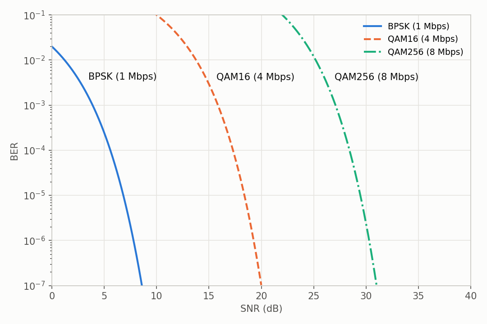

*Figure 1. Bit error rate versus SNR for three modulation techniques*

The theory of modulation and coding is beyond the scope of these notes, but Figure 1 shows three physical-layer characteristics that are important for understanding higher-layer wireless communication protocols.

- **For a given modulation technique, the higher the SNR, the lower the BER.** A sender can raise the SNR by raising its transmission power, so increasing power lowers the probability that a frame is received in error. Beyond a certain level, however, such as lowering the BER from 10⁻¹² to 10⁻¹³, there is little practical gain. The sender must also expend more energy (an important concern for battery-powered mobile users), and its transmissions are more likely to interfere with those of other senders.
- **For a given SNR, a modulation technique with a higher bit transmission rate has a higher BER.** In Figure 1, at an SNR of 10 dB, BPSK modulation at 1 Mbps has a BER below 10⁻⁷, while QAM16 modulation at 4 Mbps has a BER of 10⁻¹, far too high to be practically useful. At an SNR of 20 dB, QAM16 achieves 4 Mbps with a BER of 10⁻⁷, while BPSK's BER is so low that it is off the chart but its rate is only 1 Mbps. If a BER of 10⁻⁷ can be tolerated, QAM16, with its higher transmission rate, is preferable here.
- **The physical-layer modulation technique can be selected dynamically to suit channel conditions.** The SNR (and hence the BER) changes with mobility or changes in the environment. Adaptive modulation and coding are used in cellular data systems, 802.11 WiFi, and 4G cellular data networks, allowing the selection of the modulation technique that gives the highest transmission rate subject to a BER constraint for the given channel characteristics (Section 10.2).

### 2.3 Hidden Terminals and Fading

A higher and time-varying BER is not the only way wireless links differ from wired links. On a wired broadcast link every node receives the transmissions of every other node, but on a wireless link this is not so. Suppose that stations A and C both send to station B.

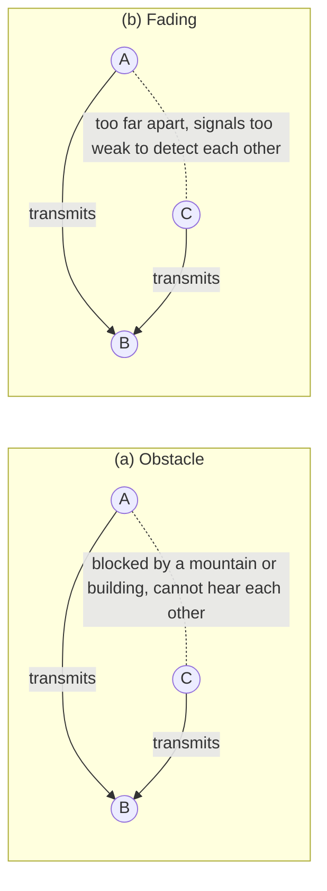

*Figure 2. The hidden terminal problem caused by an obstacle and by fading*

- **Hidden terminal problem:** Physical obstructions such as a mountain or a building prevent A and C from hearing each other's transmissions, even though their transmissions do interfere at the destination B ((a) in Figure 2).
- **Fading:** Signal strength weakens as it propagates through the wireless medium. A and C may be placed so that their signals are not strong enough to detect each other's transmissions, yet strong enough to interfere with each other at B ((b) in Figure 2).

In both cases the senders cannot detect the collision occurring at the receiver, which makes multiple access in a wireless network much more complex than in a wired network (Sections 6 and 9).

---

<br>

## 3. Code Division Multiple Access (CDMA)

Hosts communicating over a shared medium need a protocol so that the signals of several senders do not interfere at the receivers. Among the three classes of Chapter 18, **code division multiple access (CDMA)** belongs to the channel partitioning protocols and is widely used in wireless LAN and cellular technologies.

> **Definition:** **CDMA (code division multiple access)** is a channel partitioning protocol that assigns a different code to each sender and multiplies each data bit by a code changing much faster than the original bits, so that even when several senders transmit at once, a receiver recovers a sender's bits using that sender's code.

### 3.1 Encoding and Decoding

In CDMA, each bit to be sent is multiplied by a signal, the code, that changes at a much faster rate (the **chipping rate**) than the original sequence of data bits. Let the rate at which original data bits arrive at the CDMA encoder define the unit of time, so that each data bit occupies one bit slot. Let $`d_i`$ be the data bit of the ith bit slot, and for convenience represent a bit with value 0 as −1. Each bit slot is further divided into M **mini-slots**. The sender's CDMA code is a sequence of M values $`c_m`$ (m = 1, ..., M), each +1 or −1.

In the mth mini-slot of the ith data bit, the output of the CDMA encoder $`Z_{i,m}`$ is the data bit multiplied by the mth value of the code.

```math
Z_{i,m} = d_i \cdot c_m
```

With no interfering senders, the receiver recovers the original data bit from the received $`Z_{i,m}`$ as follows.

```math
d_i = \frac{1}{M} \sum_{m=1}^{M} Z_{i,m} \cdot c_m
```

Since $`c_m \cdot c_m = 1`$, the sum is $`M d_i`$, and dividing by M gives $`d_i`$.

### 3.2 With Several Senders

CDMA assumes that the bit signals of interfering senders are **additive**. For example, if three senders send 1 and a fourth sends −1 in the same mini-slot, the signal received by all receivers is 1 + 1 + 1 − 1 = 2. With N senders, the value received in the mth mini-slot of the ith bit slot is the sum of the transmitted values of all senders.

```math
Z^{*}_{i,m} = \sum_{s=1}^{N} Z^{s}_{i,m}
```

If the senders' codes are chosen carefully, each receiver can extract the data of a desired sender from the aggregate signal using that sender's code in the same way.

```math
d_i = \frac{1}{M} \sum_{m=1}^{M} Z^{*}_{i,m} \cdot c_m
```

Let M = 8, let sender 1's code be (1, 1, 1, −1, 1, −1, −1, −1), and let sender 2's code be (1, −1, 1, 1, 1, −1, 1, 1). Sender 1 sends the data bits 1 and −1, and sender 2 sends 1 and 1.

| Bit slot | Output of sender 1 | Output of sender 2 | Sum on the channel | Decoded with code 1 | Decoded with code 2 |
|:-----|:-----|:-----|:-----|:-----|:-----|
| 0 (d¹ = 1, d² = 1) | 1, 1, 1, −1, 1, −1, −1, −1 | 1, −1, 1, 1, 1, −1, 1, 1 | 2, 0, 2, 0, 2, −2, 0, 0 | (2 + 2 + 2 + 2) / 8 = 1 | (2 + 2 + 2 + 2) / 8 = 1 |
| 1 (d¹ = −1, d² = 1) | −1, −1, −1, 1, −1, 1, 1, 1 | 1, −1, 1, 1, 1, −1, 1, 1 | 0, −2, 0, 2, 0, 0, 2, 2 | (−2 − 2 − 2 − 2) / 8 = −1 | (2 + 2 + 2 + 2) / 8 = 1 |

*Table 2. CDMA encoding and decoding for two senders*

Despite the interference from sender 2, the receiver correctly recovers sender 1's bits 1 and −1 with code 1, and sender 2's bits 1 and 1 with code 2. Multiplying the corresponding values of the two codes and adding gives 1 − 1 + 1 − 1 + 1 + 1 − 1 − 1 = 0, so the other sender's share vanishes exactly in decoding.

> **[Linear Algebra]** Viewing a code as a vector of length M, decoding divides the inner product of the received vector and the code vector by M. If the inner product of two code vectors is 0, that is, if the two codes are **orthogonal**, the other sender's signal becomes 0 in the inner product and vanishes. CDMA codes are therefore chosen to be mutually orthogonal.

In terms of the cocktail party, CDMA is like partygoers speaking in several languages at once. People are quite good at locking onto the conversation in a language they understand while filtering out the rest. CDMA is a partitioning protocol that divides the **codespace**, rather than time or frequency, and assigns each node a dedicated piece of it. In practice, the codes must be chosen carefully, and the assumption that the signals of the various senders arrive at the receiver with equal strength is difficult to achieve.

---

<br>

## 4. IEEE 802.11 Wireless LANs

### 4.1 Wireless Working Groups of IEEE 802

Among the IEEE 802 working groups of Chapter 20, those dealing with wireless technologies are 802.11 (wireless LAN), 802.15 (wireless PAN), and 802.16 (wireless MAN). This chapter covers two wireless technologies for LANs: IEEE 802.11 wireless LANs, sometimes called wireless Ethernet, and Bluetooth, a technology for small wireless LANs. IEEE 802.11 defines the physical and data link layers of a wireless LAN.

### 4.2 The 802.11 Standards

Although many technologies and standards for wireless LANs were developed in the 1990s, the IEEE 802.11 wireless LAN, also known as WiFi, emerged as the winner. The 802.11 family has several standards.

| Standard | Frequency range | Data rate |
|:-----|:-----|:-----|
| 802.11b | 2.4 GHz | Up to 11 Mbps |
| 802.11a | 5 GHz | Up to 54 Mbps |
| 802.11g | 2.4 GHz | Up to 54 Mbps |
| 802.11n | 2.4 GHz and 5 GHz | Up to 450 Mbps |
| 802.11ac | 5 GHz | Up to 1300 Mbps |

*Table 3. Summary of IEEE 802.11 standards*

The 802.11 standards share common characteristics.

- They all use the same medium access protocol, CSMA/CA (Section 6).
- They all use the same structure for their link-layer frames (Section 7).
- They can all reduce their transmission rate to reach over greater distances.
- 802.11 products are backward compatible; for example, a device capable only of 802.11g can still interact with a newer 802.11ac base station.

At the physical layer, however, there are major differences.

- **Frequency range:** 802.11 devices operate in two frequency ranges, 2.4-2.485 GHz (the 2.4 GHz range) and 5.1-5.8 GHz (the 5 GHz range). The 2.4 GHz range is unlicensed, so 802.11 devices may compete for spectrum with 2.4 GHz phones and microwave ovens. At 5 GHz, the transmission distance is shorter for a given power level, and multipath propagation has a greater effect.
- **MIMO:** 802.11n and 802.11ac use multiple-input multiple-output (MIMO) antennas, with two or more antennas on the sending side and two or more on the receiving side transmitting and receiving different signals. 802.11ac base stations can transmit to several stations simultaneously and use smart antennas to beamform transmissions in the direction of a receiver, reducing interference and increasing the distance reached at a given data rate.

> **Caution:** The data rates in Table 3 are for an idealized environment, such as a receiver placed 1 meter from the base station with no interference. The rates obtained in real environments are lower and vary with the situation.

---

<br>

## 5. The 802.11 Architecture

### 5.1 Basic Service Set (BSS)

> **Definition:** A **basic service set (BSS)** is the building block of the 802.11 wireless LAN architecture, made of stationary or mobile wireless stations and an optional central base station called an access point (AP).

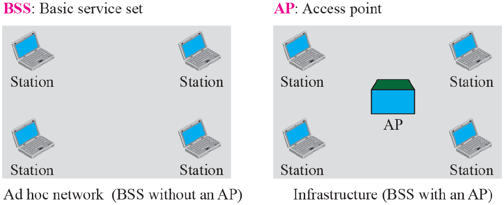

*Figure 3. Basic service sets: an ad hoc network without an AP and an infrastructure network with an AP*

- **BSS without an AP:** A stand-alone network that cannot send data to other BSSs, called an **ad hoc architecture**. Stations form the network without an AP by locating one another and agreeing to be part of a BSS. It has no central control and no connection to the outside world and is formed on the fly by mobile devices that are close together, need to communicate, and find no preexisting network infrastructure nearby. Examples are people with laptops exchanging data in a conference room, a train, or a car, and devices connected through a smartphone's tethering.
- **BSS with an AP:** It is called an **infrastructure network**. The infrastructure here is the APs together with the wired Ethernet infrastructure interconnecting the APs and a router. A home wireless router (WiFi) is a typical example. In a typical home network, one AP and one router, usually integrated in one unit, connect the BSS to the Internet.

As with Ethernet devices, each 802.11 wireless station has a 6-byte MAC address stored in the firmware of its adapter. Each AP also has a MAC address for its wireless interface. As with Ethernet, these MAC addresses are administered by the IEEE and are (in theory) globally unique (Chapter 19).

### 5.2 Extended Service Set (ESS)

> **Definition:** An **extended service set (ESS)** is two or more BSSs with APs connected by a distribution system, which is usually a wired LAN.

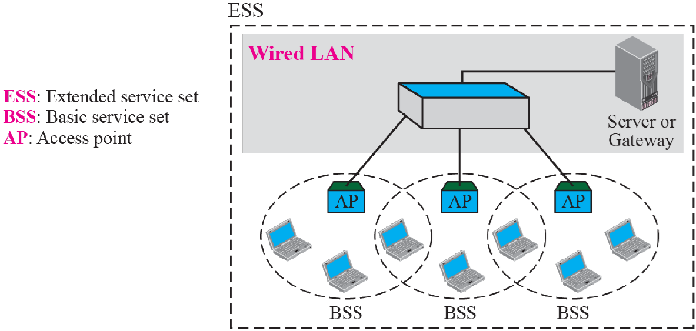

*Figure 4. An extended service set connecting BSSs through a distribution system*

The distribution system connects the APs of the BSSs. IEEE 802.11 does not restrict the distribution system; it can be any IEEE LAN, such as Ethernet. An ESS has two kinds of stations: mobile stations are the ordinary stations inside a BSS, and stationary stations are AP stations that are part of the wired LAN. When BSSs are connected, stations within reach of one another can communicate without an AP, but communication between two stations in different BSSs usually goes through two APs.

### 5.3 Types of Station Mobility

IEEE 802.11 defines three types of stations according to their mobility in a wireless LAN.

| Type | Range of movement |
|:-----|:-----|
| No-transition mobility | Stationary or moving only inside one BSS |
| BSS-transition mobility | Can move from one BSS to another, but confined within one ESS |
| ESS-transition mobility | Moves from one ESS to another |

*Table 4. Types of mobility of 802.11 stations*

### 5.4 Channels and Association

In 802.11, each wireless station must **associate** with an AP before it can send or receive network-layer data. 802.11b/g is used here as the example.

- **SSID and channel:** When installing an AP, the network administrator assigns it a one- or two-word **service set identifier (SSID)**. Opening the WiFi settings on a smartphone displays a list of the SSIDs of the APs in range. The administrator must also assign a channel number to the AP. 802.11 defines 11 partially overlapping channels within the 2.4 GHz band. Two channels are non-overlapping only if there are four or more channels between them, and in particular channels 1, 6, and 11 form the only set of three non-overlapping channels. Installing three 802.11b APs at the same location, assigning them channels 1, 6, and 11, and interconnecting them with a switch thus yields a wireless LAN with a maximum aggregate rate of 3 × 11 = 33 Mbps.
- **WiFi jungle:** A location where a wireless station receives a sufficiently strong signal from two or more APs is called a **WiFi jungle**. In a café, for example, the AP managed by the café and APs in nearby apartments may all be heard, each probably in a different IP subnet with an independently assigned channel. To gain Internet access, a device must join exactly one subnet and hence associate with exactly one AP. Associating means creating a virtual wire between the device and the AP: only the associated AP sends data frames to the device, and the device sends data frames into the Internet only through the associated AP.
- **Beacons and passive scanning:** The 802.11 standard requires an AP to send **beacon frames** periodically, each including the AP's SSID and MAC address. The device scans the 11 channels seeking beacon frames, which is called **passive scanning**.
- **Active scanning:** A device can also broadcast a **probe request frame** that is received by all APs in range, and the APs respond with **probe response frames**. This is called **active scanning**.
- **AP selection:** The 802.11 standard does not specify the algorithm for choosing which available AP to associate with; it is left to the designers of the device's firmware and software. Typically the AP whose beacon is received with the highest signal strength is chosen. However, a strong AP may already be associated with many devices that share its bandwidth while a slightly weaker AP is idle, so signal strength alone does not determine performance.
- **Association request and response:** Having chosen an AP, the device sends an **association request frame**, and the AP responds with an **association response frame**. With active scanning this second request/response handshake is needed, because an AP responding to the initial probe request does not know which of the possibly many responding APs the device will choose, much as a DHCP client chooses among several DHCP servers (Chapter 12).
- **Joining the subnet:** Once associated with an AP, the device typically sends a DHCP discovery message into the subnet through the AP to obtain an IP address in the AP's subnet. Once it has the address, the rest of the world views the device simply as another host with an IP address in that subnet.
- **Authentication:** To associate with an AP, a device may be required to authenticate itself. Access may be permitted based on the device's MAC address or by usernames and passwords. In both cases the AP typically communicates with an authentication server using a protocol such as RADIUS or DIAMETER. Separating the authentication server from the AP lets one server serve many APs, centralizing sensitive authentication decisions and keeping AP cost and complexity low. IEEE 802.11i, which defines the security of 802.11, is covered in Chapter 26.

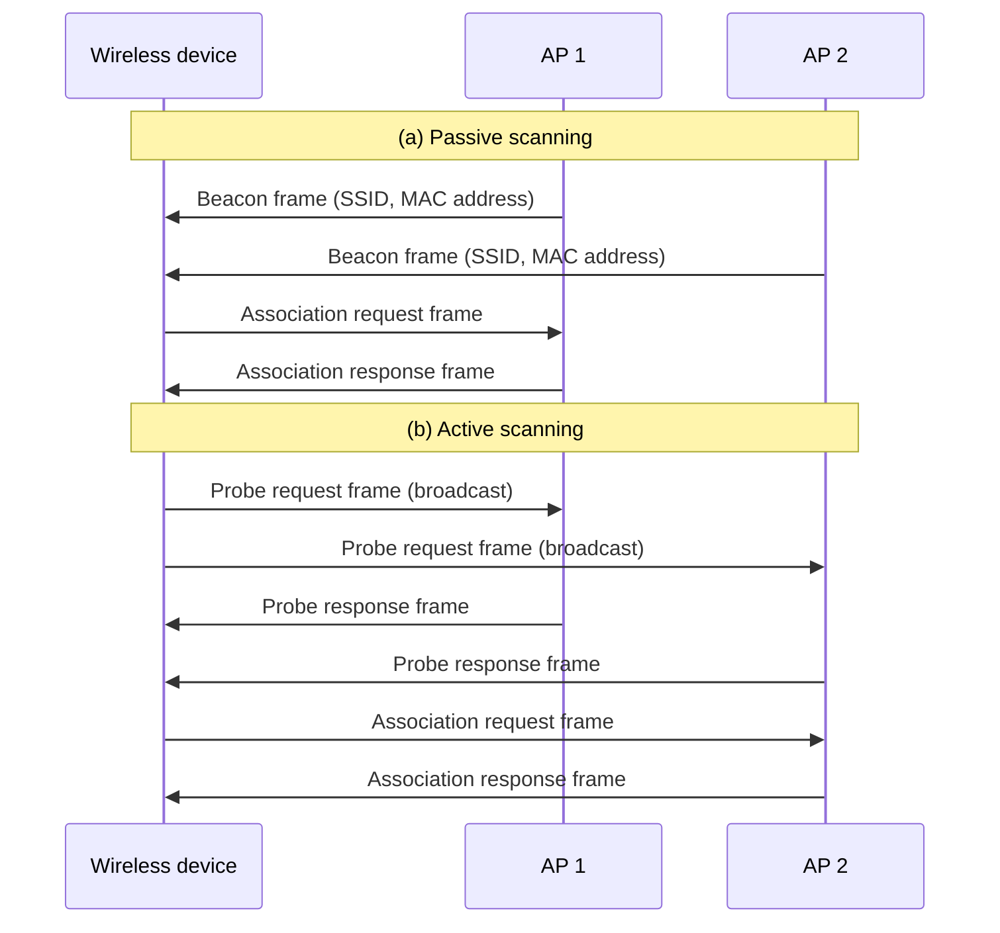

*Figure 5. Passive and active scanning for access points*

---

<br>

## 6. The 802.11 MAC Protocol

Once a wireless device is associated with an AP, it can send and receive data frames to and from the AP. But several devices, or the AP itself, may want to transmit at the same time over the same channel, so a multiple access protocol is needed to coordinate the transmissions. In this section, devices and the AP are both called wireless **stations** sharing the multiple access channel. Inspired by the huge success of Ethernet and its random access protocol, the designers of 802.11 chose a random access protocol for 802.11 wireless LANs: **CSMA with collision avoidance (CSMA/CA)**.

> **Definition:** **CSMA/CA (carrier sense multiple access with collision avoidance)** is the multiple access protocol of 802.11, which senses the channel before transmitting but, instead of detecting collisions, avoids them in advance with inter-frame spaces, random backoff, and optional RTS/CTS reservation, and confirms successful transmission with link-layer acknowledgments.

As in Ethernet's CSMA/CD (Chapter 18), the CSMA in CSMA/CA means that each station senses the channel before transmitting and refrains from transmitting when the channel is busy. The two MAC protocols, however, differ in important ways.

1. 802.11 uses **collision avoidance** techniques instead of collision detection.
2. Because of the relatively high bit error rates of wireless channels, 802.11, unlike Ethernet, uses link-layer acknowledgment and retransmission (ARQ).

### 6.1 Why CSMA/CD Cannot Be Used

Wireless LANs cannot implement CSMA/CD for the following three reasons, so they avoid collisions instead of detecting them.

1. **Sending and receiving at the same time:** To detect collisions, a station must be able to send data and receive collision signals at the same time. In an 802.11 adapter the received signal is very weak compared with the transmitted signal, so hardware that can detect collisions is costly and increases bandwidth requirements.
2. **Hidden stations:** Even if an adapter could listen while transmitting, it still could not detect all collisions because of the hidden terminal problem of Section 2.3 (Section 9).
3. **Signal attenuation:** Signal strength decreases in proportion to the square of the distance. When stations are far apart, signal fading could prevent a station at one end from hearing a collision at the other end. In other words, collision detection cannot be used in a wireless environment because of signal attenuation.

Because 802.11 does not detect collisions, once a station begins to transmit a frame, it transmits the entire frame; once started, there is no turning back. Transmitting entire frames (especially long ones) when collisions are frequent degrades performance significantly, so 802.11 uses several collision-avoidance techniques to reduce the likelihood of collisions.

### 6.2 Link-Layer Acknowledgments

A frame sent in a wireless LAN may fail to reach the destination intact for various reasons. To deal with this non-negligible chance of failure, the 802.11 MAC protocol uses link-layer acknowledgments.

- When the destination station receives a frame that passes the CRC, it waits a short period called the **Short Inter-frame Spacing (SIFS)** and then sends back an acknowledgment frame.
- If the transmitting station does not receive an acknowledgment within a given time, it assumes that an error has occurred and retransmits the frame, using CSMA/CA to access the channel.
- If no acknowledgment is received after a fixed number of retransmissions, the station gives up and discards the frame.

In CSMA/CD, the absence of a collision is itself a kind of indication that the data have arrived. In wireless, however, the sending station has no other means of checking the arrival of its data, so acknowledgments are needed.

### 6.3 CSMA/CA

Suppose that a station (a wireless device or an AP) has a frame to transmit. 802.11 CSMA/CA operates as follows.

1. If the station initially senses the channel idle, it transmits its frame after a short period called the **Distributed Inter-frame Space (DIFS)**.
2. Otherwise, it chooses a random backoff value using binary exponential backoff (Chapter 18) and counts this value down after DIFS while the channel is sensed idle. While the channel is sensed busy, the counter value stays frozen.
3. When the counter reaches zero (which can happen only while the channel is idle), the station transmits the entire frame and waits for an acknowledgment.
4. If an acknowledgment is received, the station knows that its frame was correctly received at the destination. If it has another frame to send, it begins CSMA/CA again at step 2. If no acknowledgment is received, it reenters the backoff phase of step 2, with the random value chosen from a larger interval.

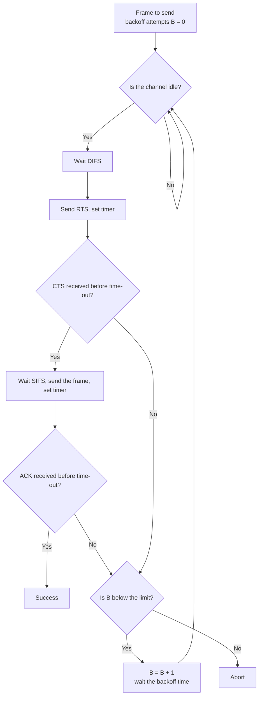

*Figure 6. Flow diagram of CSMA/CA with RTS/CTS*

In CSMA/CD a station begins transmitting as soon as it senses the channel idle, but in CSMA/CA the station refrains from transmitting while counting down, even when the channel is idle. The reason for the different approaches can be seen in the following situation. Two stations have frames to send, but neither transmits immediately because a third station is already transmitting.

- **CSMA/CD:** The two stations transmit as soon as the third finishes and collide. This is not a serious problem, because both detect the collision and abort, avoiding useless transmission of the rest of their frames.
- **CSMA/CA:** 802.11 cannot detect a collision and abort, so a colliding frame is transmitted in its entirety. The goal of 802.11 is therefore to avoid collisions whenever possible. On sensing the channel busy, both stations immediately enter random backoff, hopefully choosing different backoff values. If the values differ, one station begins transmitting first when the channel becomes idle, and (if the two are not hidden from each other) the losing station hears the winning station's signal, freezes its counter, and refrains from transmitting. In this way a costly collision is avoided.

Collisions can still occur if the two stations are hidden from each other, or if their backoff values are so close that the transmission of the station starting first has not yet reached the second station. This is the same problem seen in Figure 12 of Chapter 18.

### 6.4 RTS/CTS and the Network Allocation Vector

The 802.11 MAC protocol includes an optional reservation scheme that helps avoid collisions even in the presence of hidden terminals. A sender reserves access to the channel with a short **Request to Send (RTS)** control frame and a short **Clear to Send (CTS)** control frame.

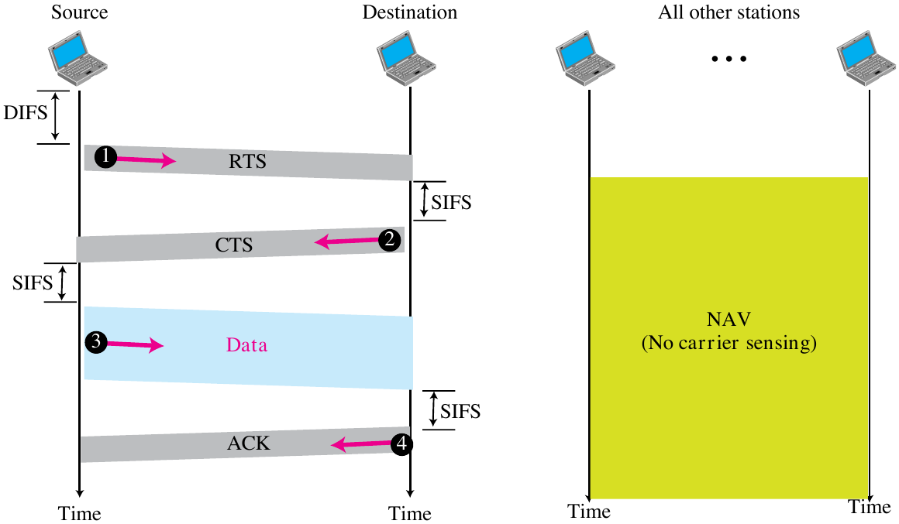

*Figure 7. RTS, CTS, data, and ACK exchange and the NAV in CSMA/CA*

1. Before sending a frame, the source station senses the medium by checking the energy level at the carrier frequency. It uses a 1-persistence strategy with backoff until the channel is idle. After finding the medium idle, it waits DIFS and then sends an RTS indicating the total time required to send the data frame and its acknowledgment. The RTS means "I am about to talk, so everyone wait."
2. After receiving the RTS and waiting SIFS, the destination station sends a CTS. The CTS indicates that the destination is ready to receive data, that is, "OK." If the destination is an AP, the AP broadcasts the CTS. The CTS serves two purposes: it gives the sender explicit permission to send, and it tells the other stations not to send for the reserved duration.
3. The source station sends the data after waiting SIFS.
4. The destination station, after waiting SIFS, sends an ACK to show that the frame has been received. If no ACK arrives, the source retransmits the data.

> **Definition:** A **network allocation vector (NAV)** is a timer started by the other stations that hear an RTS or CTS, indicating how much time must pass before they may check the channel for idleness.

The NAV is how the other stations defer sending when one station has acquired the channel, the key to collision avoidance. When a station sends an RTS, it includes the duration for which it needs to occupy the channel. The stations affected by this transmission set their NAV timers to that duration and wait until the NAV expires. In other words, each station first checks whether its NAV has expired before sensing whether the physical medium is idle. In Figure 7, all other stations wait during the NAV without even sensing the carrier.

RTS and CTS improve performance in two ways.

- The hidden station problem is mitigated, because a long data frame is sent only after the channel has been reserved (Section 9.2).
- Because RTS and CTS are short, a collision involving an RTS or CTS lasts only for the duration of that short frame. Once the RTS and CTS are correctly transmitted, the following data and ACK frames are transmitted without collisions.

**Collision during handshaking:** What happens if a collision occurs while the RTS or CTS control frames are in transit, the so-called **handshaking period**? Two or more stations may send RTS frames at the same time, and these control frames may collide. In other words, even CSMA/CA can suffer collisions when RTSs are sent simultaneously. Since there is no means of detecting collisions, the sender assumes that a collision has occurred if it receives no CTS from the receiver, and it tries again using the backoff strategy.

Although the RTS/CTS exchange reduces collisions, it adds delay and consumes channel resources. It is therefore used only to reserve the channel for the transmission of long data frames. In practice, each wireless station sets an **RTS threshold** so that RTS/CTS is used only for frames longer than the threshold. For many stations the default RTS threshold is larger than the maximum frame length, so RTS/CTS is skipped for all data frames.

### 6.5 Distributed and Point Coordination Functions

The 802.11 MAC sublayer has two access methods.

> **Definition:** The **distributed coordination function (DCF)** is the basic access method of 802.11, in which each station competes for channel access on its own with CSMA/CA and random backoff.

In DCF, each station sets a random waiting time and competes, so that RTSs do not collide by being sent at the same moment. Sections 6.3 and 6.4 describe the operation of DCF.

> **Definition:** The **point coordination function (PCF)** is a centralized access method used together with DCF, in which the AP polls the stations in turn so that they use the channel without contention.

- PCF is used for time-sensitive transmission.
- It is a centralized, contention-free polling access method. Only the stations the AP permits may send, so there is no contention.
- To give PCF priority over DCF, a new interval, **PIFS (PCF IFS)**, is defined.
- A **repetition interval** starts with a beacon frame. When the stations hear the beacon, they start their NAV timers for the contention-free period of the repetition interval.

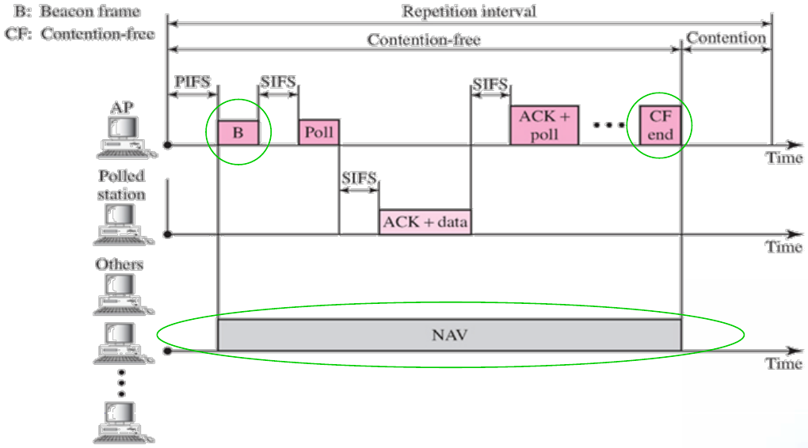

*Figure 8. The PCF repetition interval: contention-free period and contention period*

In Figure 8, the AP waits PIFS and sends a beacon frame (B), and after SIFS sends a poll frame (Poll). The polled station sends an ACK plus data after SIFS, and the AP again sends an ACK plus the next poll. The contention-free period ends with a CF end frame, after which the rest of the repetition interval is a contention period using DCF. The other stations wait with their NAVs for the whole contention-free period.

PCF is complex to implement, and maintaining a polling list is difficult in a wireless environment where the number of users changes often. In practice, therefore, DCF is mostly used. The general strengths and weaknesses of polling were covered in Chapter 18.

### 6.6 Inter-Frame Spaces and Priorities

> **Definition:** An **inter-frame space (IFS)** is the time an 802.11 station waits after sensing the channel idle before transmitting; intervals of different lengths give different frame types different priorities in accessing the channel.

The priorities of the 802.11 MAC layer (CSMA/CA) are defined by different inter-frame spaces and are not hard, guaranteed priorities. The intervals satisfy SIFS < PIFS < DIFS, and the more important the frame, the shorter the waiting time it is given.

| Interval | Priority | Use |
|:-----|:-----|:-----|
| SIFS (Short IFS) | Highest | Responses to a request, such as ACK, CTS, and polling responses |
| PIFS (PCF IFS) | Medium | Time-bounded service using PCF, frames of the contention-free period (CFP) |
| DIFS (DCF IFS) | Lowest | Asynchronous data service |

*Table 5. Inter-frame spaces and priorities*

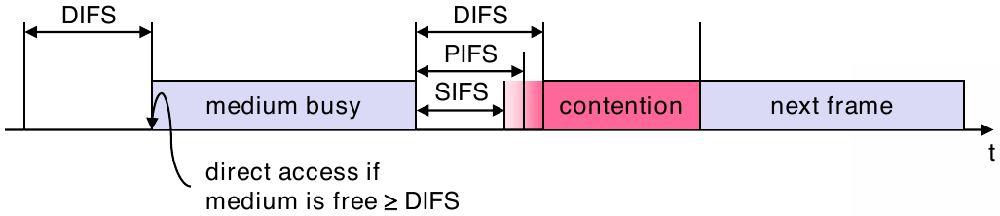

*Figure 9. Lengths of inter-frame spaces and contention*

In Figure 9, if the medium has been free for at least DIFS, a station can access it directly. When a busy medium becomes free, a response frame that needs to wait only SIFS takes the medium first, a PCF frame waiting PIFS comes next, and ordinary data wait DIFS and then compete with backoff (contention) to send the next frame. Because frames using a shorter interval take the medium before frames waiting a longer one, an exchange in progress (for example, RTS, CTS, data, ACK) is not interrupted by other stations.

### 6.7 Fragmentation and 802.11 as a Point-to-Point Link

**Fragmentation:** The wireless environment is very noisy, so corrupted frames often have to be retransmitted. 802.11 therefore recommends fragmentation, the division of a large frame into smaller ones. Resending a small frame is more efficient than resending a large one.

**802.11 as a point-to-point link:** So far 802.11 has been discussed in a multiple access setting. If two nodes each have a directional antenna, they can point the antennas at each other and run the 802.11 protocol over what is essentially a point-to-point link. Given the low cost of commodity 802.11 hardware, directional antennas and increased transmission power allow 802.11 to provide inexpensive wireless point-to-point connections over tens of kilometers.

---

<br>

## 7. The 802.11 Frame

### 7.1 Frame Format

The 802.11 frame shares many similarities with the Ethernet frame, but it also has fields specific to wireless links. Since wired and wireless networks use different frame formats, an AP converts between Ethernet frames and 802.11 frames when relaying them (Section 8.3).

```text
  ┌────┬────┬───────────┬───────────┬───────────┬────┬───────────┬──────────────┬─────┐
  │ FC │ D  │ Address 1 │ Address 2 │ Address 3 │ SC │ Address 4 │ Frame body   │ FCS │
  └────┴────┴───────────┴───────────┴───────────┴────┴───────────┴──────────────┴─────┘
    2    2        6           6           6        2        6        0-2312       4

  Subfields of FC
  ┌──────────┬──────┬─────────┬────┬──────┬──────┬───────┬─────┬──────┬─────┬──────┐
  │ Protocol │ Type │ Subtype │ To │ From │ More │ Retry │ Pwr │ More │ WEP │ Rsvd │
  │ version  │      │         │ DS │ DS   │ flag │       │ mgt │ data │     │      │
  └──────────┴──────┴─────────┴────┴──────┴──────┴───────┴─────┴──────┴─────┴──────┘
       2         2       4       1     1      1      1      1      1     1      1
```

*Figure 10. Format of the 802.11 frame and the frame control field*

The upper numbers in Figure 10 are field sizes in bytes, and the lower numbers are the sizes of the subfields of the frame control field in bits. The MAC layer frame consists of the following nine fields.

| Field | Size | Content |
|:-----|:-----|:-----|
| Frame control (FC) | 2 bytes | Type of frame and some control information (Section 7.2) |
| Duration (D) | 2 bytes | In all frame types except one, the duration of the transmission used to set the NAV; data frames and RTS and CTS frames all carry the time to reserve the channel in this field; in one control frame it defines the ID of the frame |
| Addresses 1-4 | 6 bytes each | Four address fields whose meanings depend on the To DS and From DS subfields (Section 8) |
| Sequence control (SC) | 2 bytes | Sequence number of the frame, used in flow control |
| Frame body | 0-2312 bytes | Information depending on the type and subtype defined in FC; usually an IP datagram or ARP packet, often shorter than 1500 bytes |
| FCS | 4 bytes | CRC-32 error-detection sequence; bit errors are much more common in wireless LANs than in wired LANs, so the CRC is even more useful |

*Table 6. Fields of the 802.11 frame*

**Role of the sequence number:** In 802.11, a station sends an acknowledgment whenever it correctly receives a frame from another station. Because acknowledgments can be lost, the sending station may send several copies of the same frame. As in the rdt2.1 protocol of Chapter 7, sequence numbers let the receiver distinguish a newly transmitted frame from a retransmission of a previous one. The sequence number field of the 802.11 frame serves at the link layer exactly the same purpose as the sequence numbers of the transport layer.

### 7.2 The Frame Control Field

| Subfield | Explanation |
|:-----|:-----|
| Version | Current version is 0 |
| Type | Type of information: management (00), control (01), or data (10) |
| Subtype | Subtype of each type (Table 8) |
| To DS | Explained in Section 8 |
| From DS | Explained in Section 8 |
| More flag | When 1, more fragments follow |
| Retry | When 1, the frame is retransmitted |
| Pwr mgt | When 1, the station is in power management mode (Section 10.3) |
| More data | When 1, the station has more data to send |
| WEP | Whether wired equivalent privacy, that is, encryption, is used (Chapter 26) |
| Rsvd | Reserved |

*Table 7. Subfields of the frame control field*

The Type and Subtype fields are used to distinguish association, RTS, CTS, ACK, and data frames.

### 7.3 Frame Types

Frames of an IEEE 802.11 wireless LAN fall into three categories.

- **Management frames:** Used for the initial communication between stations and access points, that is, initial access such as beacons, probes, association, and authentication.
- **Control frames:** Used for accessing the channel and acknowledging frames, that is, the work before and after sending data.
- **Data frames:** Used for carrying the data to be transmitted and control information.

```text
  RTS
  ┌────┬────┬───────────┬───────────┬─────┐
  │ FC │ D  │ Address 1 │ Address 2 │ FCS │
  └────┴────┴───────────┴───────────┴─────┘
    2    2        6           6        4      = 20 bytes

  CTS or ACK
  ┌────┬────┬───────────┬─────┐
  │ FC │ D  │ Address 1 │ FCS │
  └────┴────┴───────────┴─────┘
    2    2        6        4                   = 14 bytes
```

*Figure 11. Formats of control frames*

The Type field of a control frame is 01, and the Subtype values of the control frames discussed so far are as follows.

| Subtype | Meaning |
|:-----|:-----|
| 1011 | Request to send (RTS) |
| 1100 | Clear to send (CTS) |
| 1101 | Acknowledgment (ACK) |

*Table 8. Subtype values of control frames*

---

<br>

## 8. Addressing Mechanism

### 8.1 Four Address Fields

The most striking difference in the 802.11 frame is that it has four address fields, each holding a 6-byte MAC address. A source MAC field and a destination MAC field are not enough, as they are for Ethernet, because three address fields are needed for internetworking, specifically for moving a network-layer datagram from a wireless station through an AP to a router interface. The fourth address field is used when APs forward frames to each other. For infrastructure networks, the first three address fields are as follows.

- **Address 2:** The MAC address of the station that transmits the frame. If a wireless station transmits the frame, that station's MAC address goes here; if an AP transmits it, the AP's MAC address goes here.
- **Address 1:** The MAC address of the wireless station that is to receive the frame. If a wireless station transmits the frame, it contains the MAC address of the destination AP; if an AP transmits it, it contains the MAC address of the destination wireless station.
- **Address 3:** The BSS (the AP and wireless stations) is part of a subnet, and this subnet connects to other subnets through some router interface. Address 3 contains the MAC address of that router interface.

### 8.2 Four Cases of To DS and From DS

The meanings of the address fields are determined by the two flags To DS and From DS in the frame control field; each flag can be 0 or 1, giving four cases. DS stands for distribution system.

| To DS | From DS | Address 1 | Address 2 | Address 3 | Address 4 | Situation |
|:-----|:-----|:-----|:-----|:-----|:-----|:-----|
| 0 | 0 | Destination | Source | BSS ID | N/A | Terminal to terminal within the same BSS |
| 0 | 1 | Destination | Sending AP | Source | N/A | From the distribution system through an AP to a terminal |
| 1 | 0 | Receiving AP | Source | Destination | N/A | From a terminal through an AP to the distribution system |
| 1 | 1 | Receiving AP | Sending AP | Destination | Source | AP to AP over a wireless distribution system |

*Table 9. Meanings of the address fields by To DS and From DS*

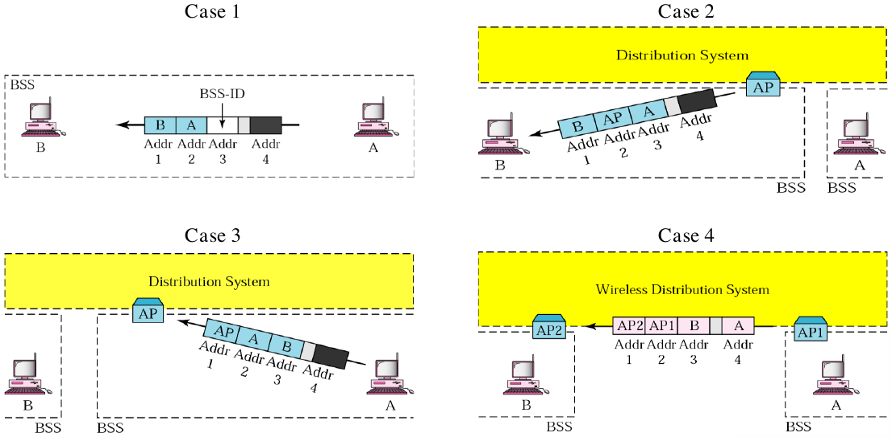

*Figure 12. Four cases of addressing*

The rules common to all four cases are as follows.

- Address 1 is always the address of the next device.
- Address 2 is always the address of the previous device.
- Address 3 is the address of the final destination station if it is not given by address 1.
- Address 4 is the address of the original source station if it is not the same as address 2.

In Figure 12, case 1 is terminal B sending directly to terminal A within the same BSS, case 2 is an AP delivering to terminal A a frame that came from another BSS, case 3 is terminal B sending through an AP to A in another BSS, and case 4 is AP2 relaying a frame to AP1 over a wireless distribution system.

### 8.3 Frames Exchanged with a Router through an AP

In the network of Figure 13, an AP serves wireless station H1 and is connected to router interface R1. An AP is a link-layer device, so it neither speaks IP nor understands IP addresses.

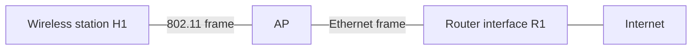

*Figure 13. A wireless station, an AP, and a router interface*

**Sending a datagram from R1 to H1:** The router is not aware that there is an AP between it and H1; from the router's perspective, H1 is just a host in one of the subnets to which it is connected.

1. The router knows H1's IP address from the destination address of the datagram and uses ARP (Chapter 19) to determine H1's MAC address, just as in an ordinary Ethernet LAN.
2. Router interface R1 encapsulates the datagram in an Ethernet frame. The source address is R1's MAC address, and the destination address is H1's MAC address.
3. When the Ethernet frame arrives at the AP, the AP converts the 802.3 Ethernet frame into an 802.11 frame and transmits it into the wireless channel. It puts H1's MAC address in address 1, its own MAC address in address 2, and R1's MAC address in address 3. From address 3, H1 can learn the MAC address of the router interface that sent the datagram into the subnet.

**Sending a datagram from H1 to R1:**

1. H1 creates an 802.11 frame, putting the AP's MAC address in address 1, its own MAC address in address 2, and R1's MAC address in address 3.
2. The AP receives the 802.11 frame and converts it into an Ethernet frame. The source address is H1's MAC address, and the destination address is R1's MAC address. Thus address 3 lets the AP determine the appropriate destination MAC address when constructing the Ethernet frame.

| Segment | Frame | Address 1 (or destination) | Address 2 (or source) | Address 3 |
|:-----|:-----|:-----|:-----|:-----|
| R1 to AP | Ethernet | H1 | R1 | |
| AP to H1 | 802.11 | H1 | AP | R1 |
| H1 to AP | 802.11 | AP | H1 | R1 |
| AP to R1 | Ethernet | R1 | H1 | |

*Table 10. Address fields changing as frames pass through an AP*

> **Key Point:** Address 3 plays a crucial role in internetworking a BSS with a wired LAN.

---

<br>

## 9. Hidden and Exposed Stations

### 9.1 The Hidden Station Problem

> **Definition:** The **hidden station problem** is the problem in which two stations outside each other's transmission range, unaware of each other, send at the same time to a station within range of both, causing a collision at that station.

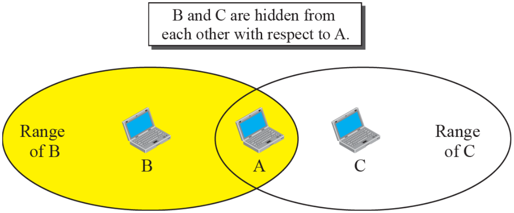

*Figure 14. The hidden station problem*

In Figure 14, the left oval is the transmission range of station B and the right oval that of station C. C is outside B's range, and B is outside C's range. Station A is in the area covered by both and can hear signals from both B and C.

1. B sends data to A. C does not receive B's signal.
2. In the middle of B's transmission, C also has data to send to A. Since B's transmission does not reach C, C thinks the medium is free; that is, carrier sensing fails.
3. When C sends its data to A, A receives data from B and C at the same time, and a collision occurs at A. B cannot receive the collision, so collision detection fails as well.

In this case, B and C are said to be **hidden** from each other with respect to A. B and C do not know of each other's existence. Hidden stations reduce the capacity of the network by making collisions possible.

### 9.2 Preventing the Hidden Station Problem with Handshaking

The hidden station problem is solved with the handshake frames (RTS and CTS) of Section 6.4.

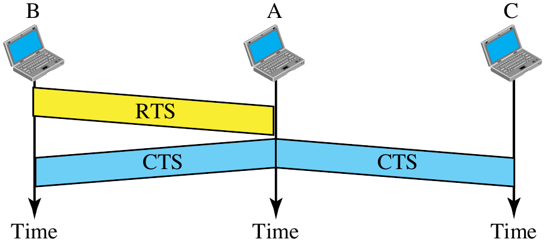

*Figure 15. Preventing the hidden station problem with handshaking*

1. Both B and C want to send to A, and B sends an RTS first.
2. B's RTS reaches A but not C.
3. Since both B and C are within A's range, A's CTS, which contains the duration of the data transmission from B to A, reaches both B and C.
4. Although C did not hear B's RTS, it hears A's CTS and learns that some hidden station is using the channel to send to A. C refrains from transmitting until that duration is over.

> **Key Point:** The CTS frame in the CSMA/CA handshake can prevent collisions from a hidden station.

### 9.3 The Exposed Station Problem

> **Definition:** The **exposed station problem** is the problem in which a station refrains from using the channel because it hears another station's transmission, even though it could in fact send without interference, wasting channel capacity.

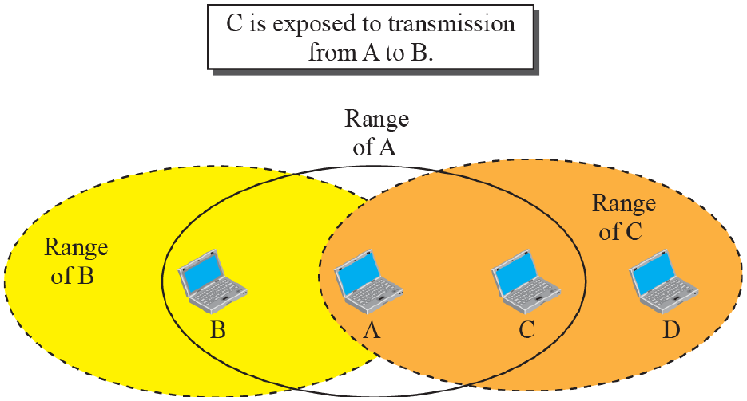

*Figure 16. The exposed station problem*

The exposed station problem is the inverse of the hidden station problem. In Figure 16, station A is transmitting to B. Station C has data to send to D (not A or B), and this transmission could be sent without interfering with the transmission from A to B. That is, the two transmissions A to B and C to D could take place at the same time. However, C is **exposed** to A's transmission: it hears what A is sending, and since carrier sensing signals a medium in use, it must wait. B is outside C's radio range, so there is no need for C to wait, but C is too conservative and wastes the capacity of the channel.

### 9.4 The Exposed Station Problem Unsolved by Handshaking

Contrary to what one might expect, the RTS and CTS handshake messages do not solve the exposed station problem.

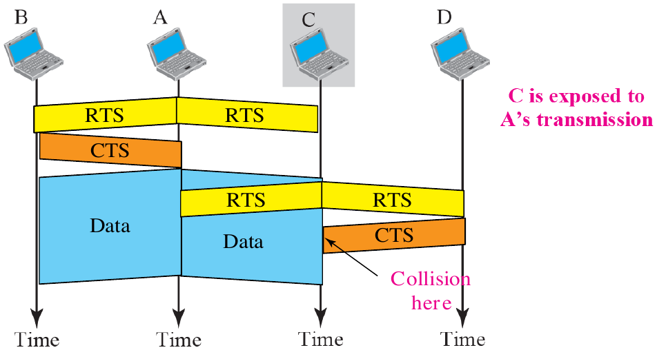

*Figure 17. Handshaking in the exposed station problem*

1. A and C want to send to B and D, respectively. A sends an RTS first.
2. C hears A's RTS but does not hear B's CTS. That is, C, having heard the RTS from A to B, waits.
3. C waits for a time so that B's CTS reaches A, and then sends an RTS to D to show that it needs to communicate with D. Both B and A may hear this RTS, but A is in the sending state, not the receiving state.
4. D responds with a CTS. However, if A has already started sending its data, A's data and D's CTS collide at C's location, so C cannot hear D's CTS.
5. C therefore cannot send its data to D until A finishes sending its data, and it remains exposed until then.

| Comparison | Hidden station problem | Exposed station problem |
|:-----|:-----|:-----|
| Cause | Two senders cannot hear each other's transmissions | A sender hears a transmission it would not interfere with |
| Result | Carrier sensing wrongly judges the medium free, and a collision occurs at the receiver | Carrier sensing judges the medium busy, and the sender waits needlessly |
| Harm | Loss of capacity due to collisions | Capacity wasted by waiting |
| Effect of RTS/CTS | Solved, because the sender hears the receiver's CTS and waits | Not solved |

*Table 11. Comparison of the hidden and exposed station problems*

---

<br>

## 10. Mobility within a Subnet and Advanced Features

### 10.1 Mobility in the Same IP Subnet

To increase the physical range of a wireless LAN, companies and universities often deploy several BSSs within the same IP subnet. This raises the question of how wireless stations move seamlessly from one BSS to another while maintaining ongoing TCP sessions. When the BSSs are part of the same subnet, mobility can be handled relatively simply.

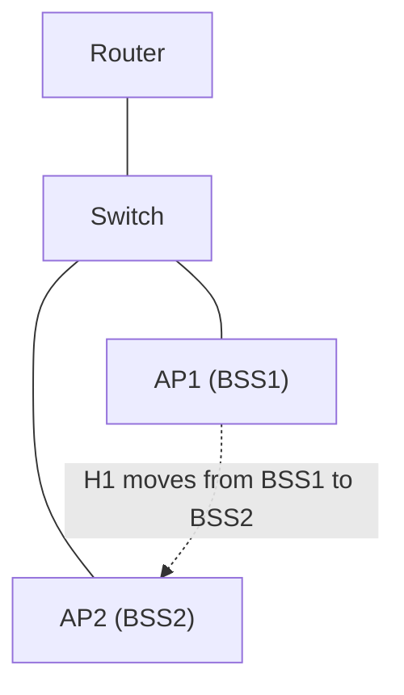

*Figure 18. A host moving between two BSSs in the same subnet*

In Figure 18, the device connecting the two BSSs is a switch, not a router, so all stations in the two BSSs, including the APs, belong to the same IP subnet. When H1 moves from BSS1 to BSS2, it can therefore keep its IP address and all its ongoing TCP connections. If the connecting device were a router, H1 would have to obtain a new IP address in the new subnet, and the address change would break its ongoing TCP connections. Network-layer mobility protocols such as Mobile IP in Chapter 25 solve this problem.

1. As H1 moves away from AP1, it detects a weakening signal from AP1 and starts to scan for a stronger signal.
2. H1 receives beacon frames from AP2. In many corporate and university settings, AP2 has the same SSID as AP1.
3. H1 disassociates from AP1 and associates with AP2, keeping its IP address and its ongoing TCP sessions.

This addresses the handoff problem from the viewpoint of the host and the AP. But how does the switch know that the host has moved to another AP? A switch builds its forwarding table automatically by self-learning (Chapter 20), which handles occasional moves well, but switches were not designed to support highly mobile users who want to keep TCP connections while moving between BSSs. Before the move, the switch's table has an entry pairing H1's MAC address with the outgoing interface (toward AP1) through which H1 can be reached. Once H1 associates with BSS2, frames for H1 should go to AP2. One solution is for AP2 to send the switch a broadcast Ethernet frame with H1's address as its source address just after the new association. When the switch receives the frame, it updates its forwarding table, allowing H1 to be reached through AP2. When VLANs (Chapter 20) join separated LANs into one large virtual LAN, mobility among base stations can be handled in the same way.

### 10.2 Rate Adaptation

As seen in Section 2.2, different modulation techniques (and the transmission rates they provide) suit different SNR scenarios. A mobile user 20 meters from the base station with a high SNR can use a modulation technique that provides high transmission rates while maintaining a low BER. As the user walks away from the base station, the SNR falls, and if the modulation technique does not change, the BER becomes unacceptably high until eventually no frames are received correctly.

For this reason, some 802.11 implementations have a **rate adaptation** capability that adaptively selects the physical-layer modulation technique based on current or recent channel characteristics.

- If a node sends two frames in a row without receiving an acknowledgment (an implicit indication of bit errors on the channel), it lowers the transmission rate to the next lower rate.
- If 10 frames in a row are acknowledged, or if a timer tracking the time since the last fallback expires, it raises the transmission rate to the next higher rate.

This mechanism follows the same "probing" philosophy as TCP congestion control (Chapter 9). When conditions are good (ACKs are received), the transmission rate is increased until something bad happens (ACKs are not received), and when something bad happens, the rate is reduced.

### 10.3 Power Management

Power is a precious resource in mobile devices, so the 802.11 standard provides power-management capabilities that minimize the time that a node's sensing, transmitting, and receiving functions and other circuitry must be on.

1. A node can explicitly alternate between sleep and wake states. It indicates to the AP that it will sleep by setting the power-management bit in the header of an 802.11 frame to 1.
2. The node sets a timer to wake it up just before the AP is scheduled to send its beacon frame. An AP typically sends a beacon frame every 100 ms.
3. Since the AP knows from the power-management bit that the node is going to sleep, it sends no frames to that node and buffers any frames destined for the sleeping host for later transmission.
4. The node wakes up just before the AP sends a beacon frame and quickly (in 250 μs) enters the fully active state. The beacon frames sent by the AP contain a list of nodes whose frames have been buffered at the AP.
5. If no frames are buffered for it, the node goes back to sleep. Otherwise, it explicitly requests the buffered frames by sending a polling message to the AP.

With a beacon interval of 100 ms, a wakeup time of 250 μs, and a similarly small time to receive a beacon frame and check for buffered frames, a node with nothing to send or receive can be asleep about 99 percent of the time, saving significant energy.

---

<br>

## 11. Bluetooth

### 11.1 Features of Bluetooth

**Bluetooth** is a short-range wireless communication technology designed to connect devices of different functions, such as telephones, notebooks, computers, cameras, and printers, and is intended to create personal area networks (PANs). Today Bluetooth technology is the implementation of a protocol defined by the IEEE 802.15 standard, which defines a wireless PAN operable in an area the size of a room or a hall. The standard defining its link and physical layers is IEEE 802.15.1.

Whereas 802.11 is a higher-power, medium-range, higher-rate "access" technology, Bluetooth is a lower-power, short-range, lower-rate "cable replacement" technology for interconnecting a computer with peripherals such as a wireless keyboard and mouse, or with cellular phones, speakers, and headphones. It is therefore also called a wireless personal area network (WPAN). The features of Bluetooth are as follows.

- **Very low power:** The signal strength is only 1 mW.
- **Short range:** The operating range is 10 m, with an optional 100 m mode.
- **Unlicensed band:** It operates in the ISM (industrial, scientific, and medical) band of 2.4 GHz to 2.5 GHz. 802.11b wireless LANs also use the 2.4 GHz band, so the two may interfere.
- **Spread spectrum:** It uses spread spectrum to avoid interference (Section 11.3).
- **Multiple levels of security:** It uses frequency hopping, data whitening, data encoding, and data encryption.
- **Targeted at all types of devices:** Wireless telephones such as cellular and satellite phones, computers, PDAs, peripherals, set-top boxes, audio systems, cameras and camcorders, and consumer electronics such as headsets and remote controls.

Examples of its use include communication between a computer and a wireless mouse or keyboard, communication between monitoring devices and sensor devices in a small health care center, connection of home security sensors to the main security controller, and synchronization of laptops among conference attendees. A Bluetooth LAN is an ad hoc network, so by nature it cannot be large; if many devices try to connect, there is chaos. Bluetooth originally started as a project of the Ericsson company and is named for Harald Blaatand (940-981), the king of Denmark who united Denmark and Norway. Blaatand translates to Bluetooth in English.

### 11.2 Piconets and Scatternets

Bluetooth defines two types of networks, piconets and scatternets. A connected radio can be a master (primary) or a slave (secondary), and radios are symmetric, so the same radio can be either.

> **Definition:** A **piconet** is the basic Bluetooth network of one master and up to seven active slaves, in which all slaves synchronize their clocks and hopping sequence with the master.

- **Composition:** A piconet can have up to eight devices, one of which is the master and the rest slaves. A piconet has only one master, and communication between the master and the slaves can be one-to-one or one-to-many.
- **Role of the master:** The master rules the piconet. Its clock determines time in the piconet, and it can transmit in each odd-numbered slot. A slave can transmit only after the master has communicated with it in the previous slot, and even then only to the master. Bluetooth is thus an example of the polling protocols of Chapter 18.
- **Parked state:** In addition to the active slaves, there can be up to 255 devices in the parked state. A parked device is synchronized with the master but cannot take part in communication until the master changes it to the active state. Since only eight devices can be active in a piconet, activating a parked device means that an active device must go to the parked state.
- **Capacity and identification:** The maximum capacity of one piconet is 1 Mbps, and each piconet has a unique hopping pattern and ID.

> **Definition:** A **scatternet** is a Bluetooth network formed by combining several piconets, in which a slave of one piconet acts as the master of another and relays messages between the two piconets.

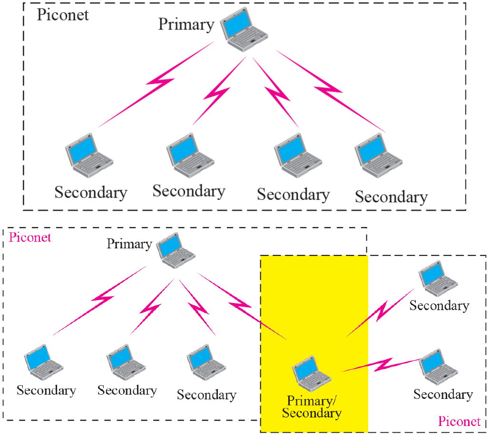

*Figure 19. Piconets and a scatternet*

In a scatternet, a slave in one piconet can be the master in another piconet. This device receives messages from the master of the first piconet (as a slave) and delivers them, as a master, to the slaves in the second piconet. A device can thus be a member of two piconets, and piconets coexist in time and space.

### 11.3 The Radio Layer and Frequency Hopping

The Bluetooth radio layer uses the 2.4 GHz ISM band and operates in a time-division manner. Time slots are 625 μs long, and during each slot a sender transmits on one of 79 channels, with the channel changing from slot to slot in a known but pseudo-random manner. This channel hopping is called **frequency-hopping spread spectrum (FHSS)**; it spreads transmissions in time over the frequency spectrum. In short, spread spectrum spreads the frequency.

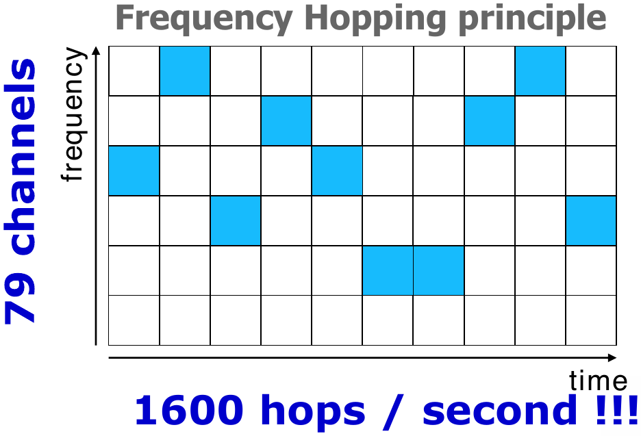

*Figure 20. Principle of frequency hopping at 1600 hops per second over 79 channels*

With 1600 hops per second, the hop time is 1/1600 second, or 625 μs.

```math
\frac{1}{1600\ \text{hops/s}} = 0.000625\ \text{s} = 625\ \mu\text{s}
```

Because transmission keeps changing frequency, even if a few collisions occur on one channel, the next slot uses another channel, so the transmission as a whole can proceed normally. Moreover, if the channels used by an 802.11 wireless LAN at the same location are removed from Bluetooth's hopping channels and hopping takes place only over the remaining channels, collisions between Bluetooth and WiFi can be avoided.

> **Note:** The data rate of Bluetooth is described in some places as 1 Mbps per piconet and in others as up to 4 Mbps provided by IEEE 802.15.1.

### 11.4 Physical Links and the Access Code

Bluetooth defines two kinds of physical links between the master and a slave.

| Link | Properties |
|:-----|:-----|
| SCO (Synchronous Connection-Oriented) | Symmetrical, circuit switched, point-to-point |
| ACL (Asynchronous Connectionless Link) | Packet switched, point-to-multipoint, master polls |

*Table 12. Physical links of Bluetooth*

The **access code** is for synchronization; it is derived from the master and is unique per channel. It distinguishes the frames of one piconet from those of another.

### 11.5 Frame Format

A Bluetooth frame consists of a 72-bit access code, a 54-bit header, and 0 to N bits of data.

```text
  ┌─────────────┬────────┬──────────────────────────┐
  │ Access code │ Header │           Data           │
  └─────────────┴────────┴──────────────────────────┘
        72          54            0 to N            (bits)

  N = 240 (1-slot frame), 1490 (3-slot frame), 2740 (5-slot frame)

  The 18-bit part of the header (repeated 3 times for 54 bits)
  ┌─────────┬──────┬──────┬──────┬──────┬──────┐
  │ AM_ADDR │ TYPE │ FLOW │ ARQN │ SEQN │ HEC  │
  └─────────┴──────┴──────┴──────┴──────┴──────┘
       3       4      1      1      1      8      (bits)
```

*Figure 21. Format of a Bluetooth frame*

| Field | Size | Information |
|:-----|:-----|:-----|
| AM_ADDR | 3 bits | Active member address of a slave; defines up to seven slaves (1-7), and 0 means a broadcast from the master to all slaves |
| TYPE | 4 bits | Type of payload coming from the upper layers |
| FLOW | 1 bit | Flow control; when 1, the device's buffer is full and it cannot receive more frames |
| ARQN | 1 bit | Acknowledgment (ACK) and negative acknowledgment (NAK); stop-and-wait ARQ is used, so 1 bit suffices |
| SEQN | 1 bit | Sequence number for retransmission ordering; stop-and-wait ARQ is used, so 1 bit suffices (Chapter 7) |
| HEC | 8 bits | Header error check that detects errors in each 18-bit header section |

*Table 13. Fields of the Bluetooth frame header*

The header consists of three identical 18-bit sections. The receiver compares the three sections bit by bit; if the corresponding bits are all the same, the bit is accepted, and if not, the majority rules. This is a form of forward error correction (Chapter 18) applied to the header only. Communication through the air is very noisy, so this double error control is needed.

A frame of the baseband layer can occupy one, three, or five slots. A slot is 625 μs, but in a one-slot frame 259 μs is needed for hopping and control, so the frame lasts only 625 − 259 = 366 μs. With a 1 MHz bandwidth and 1 bit/Hz, a one-slot frame is 366 bits. A three-slot frame is 3 × 625 − 259 = 1616 bits, and a five-slot frame is 5 × 625 − 259 = 2866 bits. A device using a three-slot frame stays at the same hop (the same carrier frequency) for three slots. Only one hop number is used, but three are consumed, so the hop number of each frame equals the number of its first slot.

---

<br>

## 12. Zigbee

A second personal area network standardized by the IEEE is the 802.15.4 standard known as **Zigbee**. While Bluetooth provides a "cable replacement" data rate of over a megabit per second, Zigbee targets applications with lower power, lower data rates, and lower duty cycles than Bluetooth. Simple, low-power, low-cost devices such as home temperature and light sensors, security devices, and wall-mounted switches do not need high bandwidth.

- **Rates:** It defines channel rates of 20, 40, 100, and 250 kbps, depending on the channel frequency.
- **Kinds of nodes:** "Reduced-function devices" operate as slaves under the control of a single "full-function device," much like Bluetooth slaves. A full-function device can act as a master controlling multiple slaves, as in Bluetooth, and multiple full-function devices can be configured into a mesh network in which they route frames among themselves.
- **Familiar mechanisms:** It uses beacon frames and link-layer acknowledgments (similar to 802.11), carrier-sense random access with binary exponential backoff (similar to 802.11 and Ethernet), and fixed, guaranteed allocation of time slots (similar to DOCSIS).

```text
  ┌────────┬──────────────────────────────┬──────────────────────────┐
  │ beacon │        active period         │     inactive period      │
  │        │ (16 time slots: CSMA/CA and  │ (all devices, including  │
  │        │  guaranteed slots)           │  the controller, sleep)  │
  └────────┴──────────────────────────────┴──────────────────────────┘
  ◄──────────────────────────── super frame ─────────────────────────►
```

*Figure 22. Super-frame structure of Zigbee 802.15.4*

When a single full-function device controls multiple reduced-function devices in a time-slotted manner using beacon frames, the Zigbee network divides time into recurring **super frames**, each beginning with a beacon frame. The beacon frame divides the super frame into an active period, during which devices may transmit, and an inactive period, during which all devices, including the controller, can sleep and conserve power. The active period consists of 16 time slots; some are used by devices in a CSMA/CA random access manner, and some are allocated by the controller to specific devices, guaranteeing them channel access.

---

<br>

## Concept Applications

**True/False Check:**

| Statement | Judgment and Reason |
|:-----|:-----|
| In an ad hoc network, address assignment and routing are provided by the base station. | **F.** An ad hoc network has no infrastructure such as a base station, so the hosts must provide them themselves. |
| For a given modulation technique, the higher the SNR, the lower the BER. | **T.** Raising the transmission power raises the SNR and lowers the probability of frame errors. |
| In CDMA, if the two senders' codes are orthogonal, the receiver can recover each sender's bits from the combined signal. | **T.** The other sender's share becomes 0 in the inner product with the code and vanishes. |
| The 802.11 data rates in Table 3 are the typical rates obtained in real environments. | **F.** They are for an idealized environment with the receiver 1 m away and no interference. |
| Among the 802.11 channels of the 2.4 GHz band, the only set of three non-overlapping channels is 1, 6, and 11. | **T.** Two channels must have four or more channels between them to be non-overlapping. |
| Like Ethernet, 802.11 does not use link-layer acknowledgments. | **F.** Because wireless channels have high bit error rates, 802.11 uses link-layer acknowledgments and retransmission. |
| In CSMA/CA, the backoff counter keeps decreasing even while the channel is busy. | **F.** The counter stays frozen while the channel is sensed busy. |
| With RTS/CTS, RTS frames cannot collide with each other either. | **F.** If two stations send RTSs at the same time they can collide; failing to receive a CTS, a sender assumes a collision and backs off. |
| Since SIFS is shorter than DIFS, ACK and CTS take the medium before a new data frame. | **T.** SIFS < PIFS < DIFS, so response frames have the highest priority. |
| PCF is an access method in which each station competes with random backoff. | **F.** PCF is a contention-free method in which the AP polls; competing with random backoff is DCF. |
| In an 802.11 frame sent by a wireless station through an AP to a router, address 3 holds the MAC address of the router interface. | **T.** The AP uses address 3 to set the destination MAC address of the Ethernet frame. |
| The RTS/CTS handshake solves the exposed station problem. | **F.** The exposed station cannot hear its peer's CTS because of a collision with another transmission, so it is not solved. |
| A host moving to another BSS in the same subnet must change its IP address. | **F.** If the two BSSs are in the same subnet connected by a switch, it can keep its IP address and TCP connections. |
| In a Bluetooth piconet, one master communicates with up to seven active slaves. | **T.** Other devices only keep synchronization in the parked state. |
| If the Bluetooth hop time is 625 μs, it hops 1600 times per second. | **T.** 1/625 μs = 1600 per second. |

---

<br>

## Summary

| Concept | Key Summary |
|:-----|:-----|
| Elements of a wireless network | It consists of wireless hosts, wireless links, base stations, and the network infrastructure, and is classified by infrastructure mode versus ad hoc and single hop versus multi-hop. |
| Characteristics of wireless links | Path loss, interference from other sources, and multipath propagation make bit errors common, and hidden terminals and fading make collisions hard to detect. |
| SNR and BER | The higher the SNR, the lower the BER, and at a given SNR faster modulation has a higher BER, so modulation is chosen to suit the channel. |
| CDMA | Each sender multiplies its bits by an orthogonal code, and a receiver recovers a desired sender's bits through the inner product with that code. |
| 802.11 standards | b, a, g, n, and ac reach up to 11-1300 Mbps at 2.4 GHz or 5 GHz, all use CSMA/CA and the same frame structure, and are backward compatible. |
| BSS and ESS | A BSS is the building block of stations and an optional AP, and an ESS is several BSSs with APs connected by a distribution system. |
| Association | A device finds an AP by passive scanning of beacons or active scanning with probes, exchanges an association request and response, and obtains an address with DHCP. |
| CSMA/CA | Unable to detect collisions, it avoids them with DIFS, a backoff counter that freezes, and optional RTS/CTS, and confirms success with link-layer ACKs. |
| NAV | It is a timer set by other stations from the duration in an RTS or CTS, during which they wait without sensing the carrier. |
| DCF and PCF | DCF is the basic method of competing with random backoff, and PCF is the method in which the AP polls during a contention-free period that begins with PIFS and a beacon. |
| Inter-frame spaces | SIFS < PIFS < DIFS gives medium-access priority to response frames, then PCF frames, then ordinary data. |
| 802.11 frame | It consists of FC, D, four addresses, SC, a body of 0-2312 bytes, and FCS, and frames are divided into management, control, and data frames. |
| Addressing | To DS and From DS define four cases; address 1 is the next device, address 2 the previous device, and address 3 the final destination such as a router interface. |
| Hidden and exposed stations | The hidden station problem is solved by the CTS, but the exposed station problem is not solved by RTS/CTS. |
| Mobility and advanced features | Moving between BSSs in the same subnet keeps the IP address, and rate adaptation and power management are implemented with mechanisms the standard provides. |
| Bluetooth | It is a low-power WPAN using 625 μs slots and frequency hopping over 79 channels in the 2.4 GHz ISM band, defining piconets and scatternets and SCO and ACL links. |
| Zigbee | It is the lower-power, lower-rate PAN defined by 802.15.4, dividing super frames that begin with a beacon into active and inactive periods. |

---

<br>

## Self-Check Questions

1. **Link-layer acknowledgments:** Explain from two points of view why 802.11 uses link-layer acknowledgments while Ethernet does not.

   <details>
   <summary>Answer</summary>

   First, wireless links have high and time-varying bit error rates because of path loss, interference, and multipath propagation, so retransmitting immediately on the link where the error occurred is better than waiting for an end-to-end retransmission. The fiber and copper used by Ethernet have few bit errors, so acknowledgments would be unnecessary overhead. Second, 802.11 cannot detect collisions, so acknowledgments are the sender's only way to know whether a frame arrived safely. In CSMA/CD, the fact that no collision was detected serves as a kind of indication of success.

   </details>

2. **Hidden stations and RTS/CTS:** Stations A and C are outside each other's range, and both are within range of the AP. When A wants to send a long data frame to the AP, give the order of the RTS/CTS exchange and explain until when C refrains from transmitting.

   <details>
   <summary>Answer</summary>

   A finds the channel idle, waits DIFS, and sends the AP an RTS containing the time needed for the data and the ACK. C is outside A's range and does not hear the RTS. After SIFS, the AP broadcasts a CTS, which both A and C hear. C sets its NAV from the duration in the CTS and refrains from transmitting until that time is over. A sends the data after SIFS, and the AP sends the ACK after SIFS. In other words, C waits until the AP sends the ACK.

   </details>

3. **Address fields:** Wireless station H1 sends a datagram through an AP to router interface R1. Give To DS, From DS, and addresses 1, 2, and 3 of the 802.11 frame that H1 sends, and the destination and source addresses of the Ethernet frame that the AP creates.

   <details>
   <summary>Answer</summary>

   The frame goes from H1 through the AP to the distribution system, so To DS = 1 and From DS = 0. Address 1 is the MAC address of the receiving AP, address 2 the MAC address of the source H1, and address 3 the MAC address of the final destination R1. The destination address of the Ethernet frame the AP creates is R1's MAC address, taken from address 3, and the source address is H1's MAC address.

   </details>

4. **Bluetooth slots:** Find the length of one slot when Bluetooth hops 1600 times per second. If 259 μs is needed for hopping and control, how many bits of data does a three-slot frame carry? Assume 1 bit/Hz over a 1 MHz bandwidth.

   <details>
   <summary>Answer</summary>

   One slot is 1/1600 second = 625 μs. A three-slot frame stays on the same frequency for 3 × 625 = 1875 μs, of which 259 μs is used for hopping and control, so data are sent for 1875 − 259 = 1616 μs. At 1 Mbps (1 MHz × 1 bit/Hz), the frame is 1616 bits.

   </details>

5. **CDMA decoding:** Sender 1's code is (1, 1, 1, −1, 1, −1, −1, −1), and sender 2's code is (1, −1, 1, 1, 1, −1, 1, 1). If the receiver receives the sum (0, −2, 0, 2, 0, 0, 2, 2) in one bit slot, find the bits sent by the two senders.

   <details>
   <summary>Answer</summary>

   The inner product with code 1 is 0 − 2 + 0 − 2 + 0 + 0 − 2 − 2 = −8, so −8/8 = −1, and sender 1 sent bit −1 (that is, 0). The inner product with code 2 is 0 + 2 + 0 + 2 + 0 + 0 + 2 + 2 = 8, so 8/8 = 1, and sender 2 sent bit 1. Since the two codes are orthogonal, the other sender's share vanishes in the inner product.

   </details>

6. **Exposed stations:** Explain why RTS/CTS does not help in the exposed station problem.

   <details>
   <summary>Answer</summary>

   While A sends to B, C wants to send to D. C hears A's RTS, waits, and can then send an RTS to D, but if A is already sending data at that point, A's data and D's CTS collide at C's location. C cannot hear D's CTS, so it cannot conclude that it has permission, and it must wait until A finishes sending its data. RTS/CTS is a mechanism that silences transmissions around the receiver, so it cannot remove needless waiting around the sender.

   </details>

7. **Power management:** An AP sends a beacon every 100 ms, and a node takes 250 μs to wake up. Roughly what fraction of the time is a node with nothing to send or receive asleep, and how are frames for the node handled meanwhile?

   <details>
   <summary>Answer</summary>

   Waking takes 250 μs, and receiving the beacon and checking for buffered frames takes a similarly short time, so the node is awake for less than 1 percent of each 100 ms. The node is therefore asleep about 99 percent of the time. While the node sleeps, the AP buffers frames destined for it and lists the nodes with buffered frames in its beacon. When the node sees itself listed in the beacon, it requests the frames with a polling message.

   </details>

8. **Channel assignment:** To obtain the maximum aggregate rate from three 802.11b APs installed at the same location, how should the channels be assigned, and what is the maximum aggregate rate?

   <details>
   <summary>Answer</summary>

   Assign channels 1, 6, and 11, the only set of three non-overlapping channels, to the three APs and interconnect the APs with a switch. The three APs then operate without interfering with each other, each at up to 11 Mbps, so the maximum aggregate rate is 3 × 11 = 33 Mbps.

   </details>
