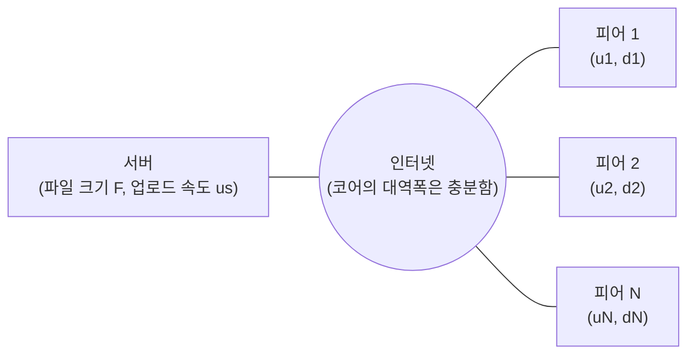
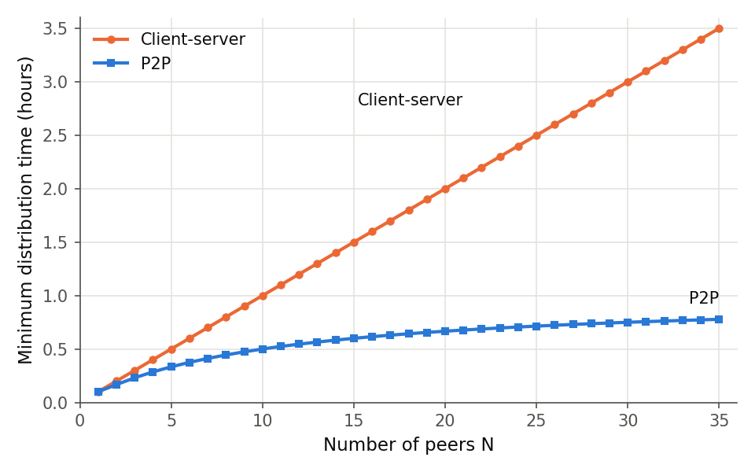
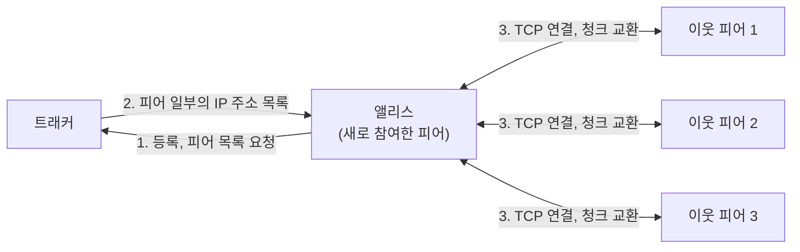
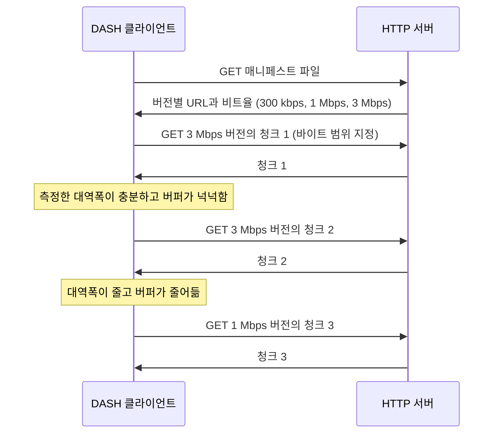
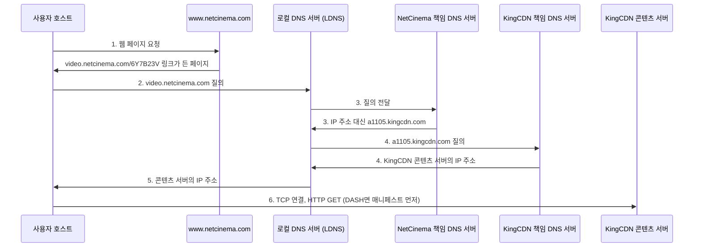
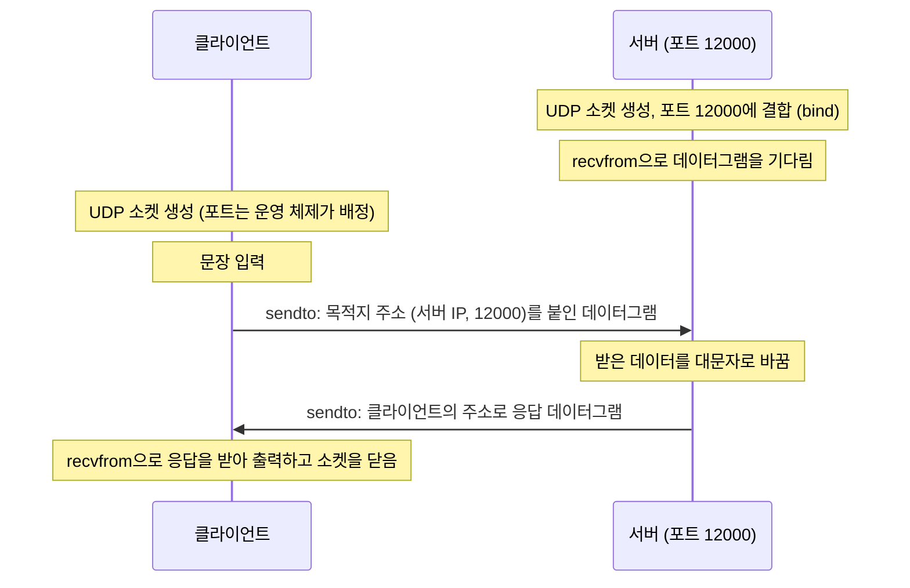
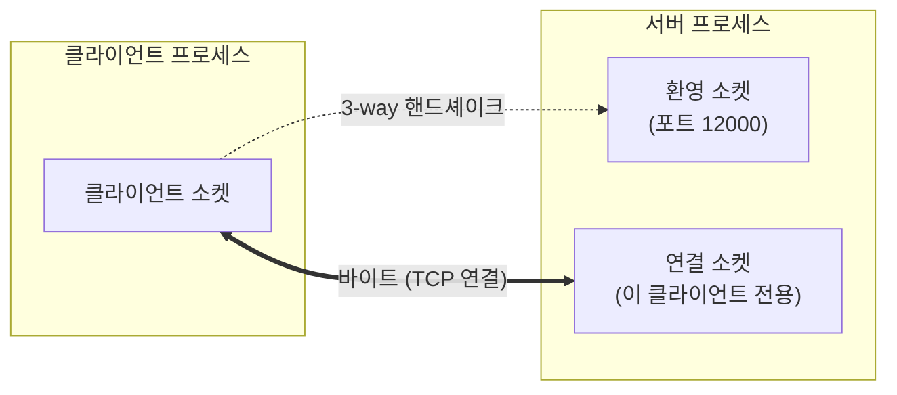
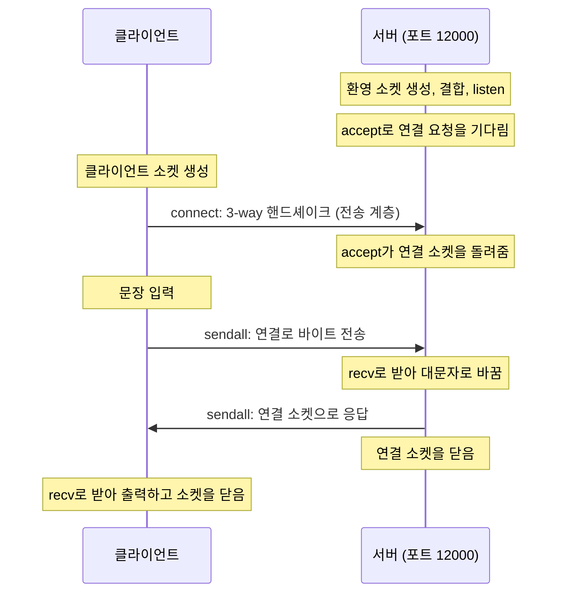

# 23장 — P2P, 비디오 스트리밍, 소켓 프로그래밍

[레포지토리 안내](../../README.ko.md) | [English](Concepts_Lecture.md) | [한국어](Concepts_Lecture.ko.md)

> **최종 수정일:** 2026-11-18
>
> Computer Networking: A Top-Down Approach, Kurose and Ross, Ch 2; TCP/IP Protocol Suite, Forouzan, Ch 17

> **학습 목표:**
> 1. 클라이언트-서버 배포와 P2P 배포의 최소 배포 시간을 유도하고 계산하여 P2P의 자기 확장성을 설명할 수 있다
> 2. BitTorrent의 트래커, 청크, 가장 드문 것 먼저, 팃포탯 교환의 동작을 설명할 수 있다
> 3. HTTP 스트리밍과 DASH가 비디오를 전달하는 방법과 DASH가 전송률을 고르는 기준을 설명할 수 있다
> 4. CDN의 서버 배치 철학, DNS를 이용한 요청 가로채기, 클러스터 선택 전략을 설명할 수 있다
> 5. Python으로 UDP와 TCP 클라이언트-서버 프로그램을 작성하고, 환영 소켓과 연결 소켓의 역할을 구분할 수 있다
> 6. 반복 서버와 동시 서버의 동작 차이를 실행 결과로 설명하고, C 소켓 인터페이스의 함수와 대응시킬 수 있다

---

## 목차

- [1. P2P 파일 배포](#1-p2p-파일-배포)
  - [1.1 클라이언트-서버 배포와 P2P 배포](#11-클라이언트-서버-배포와-p2p-배포)
  - [1.2 배포 시간의 모델](#12-배포-시간의-모델)
  - [1.3 P2P 구조의 자기 확장성](#13-p2p-구조의-자기-확장성)
  - [1.4 BitTorrent](#14-bittorrent)
- [2. 비디오 스트리밍](#2-비디오-스트리밍)
  - [2.1 인터넷 비디오](#21-인터넷-비디오)
  - [2.2 HTTP 스트리밍](#22-http-스트리밍)
  - [2.3 DASH](#23-dash)
- [3. 콘텐츠 분배 네트워크 (CDN)](#3-콘텐츠-분배-네트워크-cdn)
  - [3.1 데이터 센터 하나로 서비스할 때의 문제](#31-데이터-센터-하나로-서비스할-때의-문제)
  - [3.2 CDN과 서버 배치 철학](#32-cdn과-서버-배치-철학)
  - [3.3 DNS를 이용한 요청 가로채기와 리디렉션](#33-dns를-이용한-요청-가로채기와-리디렉션)
  - [3.4 클러스터 선택 전략](#34-클러스터-선택-전략)
  - [3.5 사례 연구: Netflix, YouTube, Kankan](#35-사례-연구-netflix-youtube-kankan)
- [4. 소켓 프로그래밍](#4-소켓-프로그래밍)
  - [4.1 네트워크 응용의 개발](#41-네트워크-응용의-개발)
  - [4.2 소켓과 소켓 인터페이스](#42-소켓과-소켓-인터페이스)
  - [4.3 UDP 소켓 프로그래밍](#43-udp-소켓-프로그래밍)
  - [4.4 TCP 소켓 프로그래밍](#44-tcp-소켓-프로그래밍)
  - [4.5 반복 서버와 동시 서버](#45-반복-서버와-동시-서버)
  - [4.6 C 소켓 인터페이스와의 대응](#46-c-소켓-인터페이스와의-대응)
  - [4.7 UDP 프로그램과 TCP 프로그램의 비교](#47-udp-프로그램과-tcp-프로그램의-비교)
- [요약](#요약)
- [점검 문제](#점검-문제)

---

<br>

## 1. P2P 파일 배포

### 1.1 클라이언트-서버 배포와 P2P 배포

3장부터 5장까지 다룬 웹, 전자 메일, DNS는 모두 항상 켜져 있는 기반 서버에 크게 의존하는 클라이언트-서버 구조를 쓴다. 3장에서 본 것처럼 P2P 구조는 항상 켜져 있는 기반 서버에 거의 또는 전혀 의존하지 않고, 간헐적으로 연결되는 **피어(peer)** 쌍이 서로 직접 통신한다. 피어는 서비스 제공자의 소유가 아니라 사용자가 관리하는 데스크톱과 노트북이다.

이 절에서는 매우 자연스러운 P2P 응용인, 큰 파일 하나를 서버 하나에서 많은 호스트(피어)에게 배포하는 문제를 다룬다. 이 파일은 운영 체제의 새 버전, 기존 운영 체제나 응용의 소프트웨어 패치, 음악 파일, 비디오 파일일 수 있다.

- **클라이언트-서버 파일 배포:** 서버가 파일의 사본을 모든 피어에게 직접 보내야 하므로, 서버에 막대한 부담을 주고 서버의 대역폭을 많이 소비한다.
- **P2P 파일 배포:** 각 피어가 자신이 받은 파일의 어느 부분이든 다른 피어에게 다시 배포할 수 있으므로, 피어들이 배포 과정에서 서버를 돕는다.

> **용어 정의:** **P2P 파일 배포(P2P file distribution)** 는 파일을 받은 피어가 자신이 가진 부분을 다른 피어에게 다시 보내어, 서버 혼자가 아니라 참여한 모든 피어의 업로드 용량으로 파일을 배포하는 방식이다.

Forouzan은 P2P 패러다임이 클라이언트-서버 패러다임을 버리는 것이 아니라, 서버의 임무를 참여하려는 사용자들이 나누어 맡게 하는 것이라고 설명한다. 예를 들어 여러 클라이언트가 각자 서버에 연결하여 큰 파일 전체를 내려받는 대신, 서버는 각 클라이언트에게 파일의 일부를 내려받게 하고 클라이언트들이 받은 부분을 서로 나누게 할 수 있다. 일부를 내려받거나 나누는 과정에서는 한 컴퓨터가 클라이언트 역할을, 다른 컴퓨터가 서버 역할을 한다. 즉 한 컴퓨터가 어떤 순간에는 클라이언트이고 다른 순간에는 서버이다.

### 1.2 배포 시간의 모델

클라이언트-서버 구조와 P2P 구조를 비교하기 위해, 정해진 피어 집합에 파일을 배포하는 간단한 정량 모델을 세운다. 서버와 피어는 접속 링크로 인터넷에 연결되어 있다.



*그림 1. 파일 배포 문제의 모델*

다음과 같이 기호를 정한다.

| 기호 | 뜻 |
|:-----|:-----|
| $`F`$ | 배포할 파일의 크기 (비트) |
| $`N`$ | 파일 사본을 원하는 피어의 수 |
| $`u_s`$ | 서버 접속 링크의 업로드 속도 |
| $`u_i`$ | i번째 피어 접속 링크의 업로드 속도 |
| $`d_i`$ | i번째 피어 접속 링크의 다운로드 속도 |
| $`d_{min}`$ | 다운로드 속도가 가장 낮은 피어의 다운로드 속도 |

*표 1. 배포 시간 모델의 기호*

**배포 시간(distribution time)** 은 N개의 피어 모두가 파일의 사본을 얻는 데 걸리는 시간이다. 분석을 위해 인터넷 코어의 대역폭이 충분하여 병목은 모두 접속 네트워크에 있다고 가정한다. 1장에서 본 것처럼 종단 간 처리량은 병목 링크가 정하며, Kurose는 이 가정이 대체로 정확하다고 설명한다. 또한 서버와 피어는 다른 네트워크 응용에 참여하지 않아서, 업로드와 다운로드 대역폭 전부를 이 파일의 배포에 쓴다고 가정한다.

**클라이언트-서버 구조의 배포 시간.** 클라이언트-서버 구조에서는 어떤 피어도 배포를 돕지 않는다. 배포 시간을 $`D_{cs}`$로 쓰면 다음 두 가지를 관찰할 수 있다.

- 서버는 N개의 피어 각각에게 파일 사본을 하나씩 보내야 하므로 모두 NF 비트를 보내야 한다. 서버의 업로드 속도가 $`u_s`$이므로 배포 시간은 적어도 $`NF/u_s`$이다.
- 다운로드 속도가 가장 낮은 피어는 F 비트 전체를 $`F/d_{min}`$초보다 빨리 받을 수 없다. 따라서 배포 시간은 적어도 $`F/d_{min}`$이다.

두 관찰을 합치면 하한을 얻는다. Kurose는 서버가 전송 일정을 잘 짜면 이 하한을 실제로 달성할 수 있음을 연습 문제로 보이며, 이 하한을 실제 배포 시간으로 삼는다.

```math
D_{cs} = \max\left\lbrace \frac{NF}{u_s},\ \frac{F}{d_{min}} \right\rbrace
```

N이 충분히 크면 클라이언트-서버 배포 시간은 $`NF/u_s`$가 된다. 즉 배포 시간은 피어 수 N에 비례하여 선형으로 늘어난다. 예를 들어 한 주 사이에 피어 수가 천 명에서 백만 명으로 천 배 늘면, 모든 피어에게 파일을 배포하는 시간도 천 배 늘어난다.

**P2P 구조의 배포 시간.** P2P 구조에서는 피어가 파일 데이터를 받으면 자신의 업로드 용량으로 그 데이터를 다른 피어에게 다시 배포할 수 있다. 배포 시간은 각 피어가 파일의 부분을 다른 피어에게 어떻게 나누어 주느냐에 따라 달라지므로 계산이 더 복잡하지만, 최소 배포 시간에 대한 간단한 식을 얻을 수 있다. 배포 시간을 $`D_{P2P}`$로 쓰고 다음 세 가지를 관찰한다.

- 배포를 시작할 때는 서버만 파일을 가지고 있다. 파일을 피어 공동체에 넣으려면 서버가 파일의 각 비트를 적어도 한 번은 접속 링크로 보내야 하므로, 배포 시간은 적어도 $`F/u_s`$이다. 클라이언트-서버 방식과 달리, 서버가 한 번 보낸 비트는 피어들이 서로 다시 배포할 수 있으므로 서버가 다시 보낼 필요가 없을 수 있다.
- 클라이언트-서버 구조에서와 마찬가지로 다운로드 속도가 가장 낮은 피어는 F 비트 전체를 $`F/d_{min}`$초보다 빨리 받을 수 없다.
- 시스템 전체의 업로드 용량은 서버의 업로드 속도와 모든 피어의 업로드 속도를 더한 $`u_s + u_1 + \cdots + u_N`$이다. 시스템은 N개의 피어 각각에게 F 비트를 전달해야 하므로 모두 NF 비트를 업로드해야 하고, 이 일은 전체 업로드 용량보다 빠르게 할 수 없다.

세 관찰을 합치면 다음 하한을 얻는다.

```math
D_{P2P} = \max\left\lbrace \frac{F}{u_s},\ \frac{F}{d_{min}},\ \frac{NF}{u_s + \sum_{i=1}^{N} u_i} \right\rbrace
```

각 피어가 비트를 받자마자 다시 배포할 수 있다고 가정하면 이 하한을 실제로 달성하는 재배포 방식이 있다. 실제로는 개별 비트가 아니라 파일의 청크 단위로 재배포하지만, 이 식은 실제 최소 배포 시간의 좋은 근사가 된다. 그래서 Kurose는 이 하한을 실제 최소 배포 시간으로 삼는다.

> **핵심:** 클라이언트-서버 배포에서는 서버 혼자 NF 비트를 보내야 하므로 배포 시간이 N에 비례하여 늘어난다. P2P 배포에서는 피어가 늘어날 때마다 업로드 용량도 함께 늘어나므로, 셋째 항의 분모가 분자와 함께 커진다.

### 1.3 P2P 구조의 자기 확장성

모든 피어의 업로드 속도가 u로 같다고 하고, Kurose의 비교 조건인 $`F/u = 1`$시간, $`u_s = 10u`$, $`d_{min} \ge u_s`$를 쓴다. 즉 피어 하나는 파일 전체를 한 시간에 올릴 수 있고, 서버의 전송 속도는 피어 업로드 속도의 10배이며, 피어의 다운로드 속도는 영향이 없을 만큼 충분히 크다. 그러면 두 배포 시간은 다음과 같다.

```math
D_{cs} = \frac{NF}{u_s} = \frac{N}{10}\ \text{시간}, \qquad D_{P2P} = \max\left\lbrace \frac{F}{10u},\ \frac{NF}{10u + Nu} \right\rbrace = \max\left\lbrace 0.1,\ \frac{N}{10+N} \right\rbrace \text{시간}
```



*그림 2. 피어 수에 따른 클라이언트-서버 구조와 P2P 구조의 최소 배포 시간*

예를 들어 피어가 30명이면 클라이언트-서버 구조의 배포 시간은 30/10 = 3시간이지만, P2P 구조의 배포 시간은 30/40 = 0.75시간이다. 클라이언트-서버 구조의 배포 시간은 피어 수가 늘어남에 따라 한없이 선형으로 늘어난다. 반면 P2P 구조의 최소 배포 시간은 N이 2 이상이면 언제나 클라이언트-서버 구조보다 짧고(N = 1일 때만 둘 다 0.1시간으로 같다), N/(10 + N)이 N이 커져도 1에 다가갈 뿐 1을 넘지 않으므로 피어 수와 관계없이 한 시간보다 짧다. 이처럼 P2P 구조의 응용은 **자기 확장성(self-scalability)** 을 가진다. 이 확장성은 피어가 비트의 소비자이면서 동시에 재배포자라는 사실에서 직접 나온다.

### 1.4 BitTorrent

BitTorrent는 파일 배포를 위한 대표적인 P2P 프로토콜이다. Kurose는 2016년 기준으로 가장 널리 쓰이는 P2P 파일 배포 프로토콜로 BitTorrent를 꼽는다. 처음에는 Bram Cohen이 개발했지만, 지금은 HTTP를 따르는 웹 브라우저가 여럿 있는 것처럼 BitTorrent 프로토콜을 따르는 독립적인 클라이언트가 많다.

> **용어 정의:** **BitTorrent** 는 한 파일의 배포에 참여하는 피어들이 파일을 같은 크기의 청크로 나누어 서로 주고받고, 트래커가 참여 피어를 추적하는 P2P 파일 배포 프로토콜이다.

**토렌트와 청크.** BitTorrent의 용어로, 특정 파일의 배포에 참여하는 모든 피어의 집합을 **토렌트(torrent)** 라 한다. 토렌트의 피어들은 파일을 같은 크기의 청크로 나누어 서로 내려받으며, 청크의 크기는 보통 256 KB이다.

> **용어 정의:** **청크(chunk)** 는 BitTorrent에서 배포할 파일을 나눈 같은 크기의 조각으로, 피어들이 내려받고 올리는 단위이다.

피어가 처음 토렌트에 참여하면 청크가 하나도 없다. 시간이 지나면서 청크를 점점 더 많이 모으며, 청크를 내려받는 동안 다른 피어에게 청크를 올리기도 한다. 파일 전체를 얻은 피어는 (이기적으로) 토렌트를 떠날 수도, (이타적으로) 토렌트에 남아 다른 피어에게 청크를 계속 올릴 수도 있다. 어떤 피어든 청크의 일부만 가진 채 언제든 떠났다가 나중에 다시 참여할 수 있다.

**트래커.** 각 토렌트에는 **트래커(tracker)** 라는 기반 노드가 있다. 피어는 토렌트에 참여할 때 트래커에 자신을 등록하고, 주기적으로 아직 토렌트에 있다고 알린다. 이렇게 트래커는 토렌트에 참여한 피어를 추적한다. 한 토렌트에 참여하는 피어는 어느 순간에 열 명 미만일 수도, 천 명이 넘을 수도 있다.



*그림 3. BitTorrent를 이용한 파일 배포*

새 피어 앨리스가 토렌트에 참여하면, 트래커는 참여 중인 피어 가운데 일부(예를 들어 50명)를 무작위로 골라 그 IP 주소를 앨리스에게 보낸다. 앨리스는 이 목록의 모든 피어와 동시에 TCP 연결을 맺으려 하며, TCP 연결에 성공한 피어들을 **이웃 피어(neighboring peers)** 라 한다. 시간이 지나면서 일부 피어는 떠나고 처음 50명 밖의 다른 피어가 앨리스와 TCP 연결을 맺으려 하므로, 이웃 피어는 시간에 따라 바뀐다.

어느 순간이든 각 피어는 파일 청크의 일부를 가지며, 피어마다 가진 청크가 다르다. 앨리스는 주기적으로 (TCP 연결을 통해) 이웃 피어들에게 그들이 가진 청크의 목록을 묻는다. 이웃이 L명이면 청크 목록을 L개 얻으며, 이를 바탕으로 자신에게 없는 청크를 (다시 TCP 연결을 통해) 요청한다. 이제 앨리스는 두 가지 중요한 결정을 내려야 한다. 이웃에게 어떤 청크를 먼저 요청할지, 그리고 요청받은 청크를 어느 이웃에게 보낼지이다.

**가장 드문 것 먼저(rarest first).** 어떤 청크를 요청할지 정할 때 앨리스는 가장 드문 것 먼저 기법을 쓴다. 자신에게 없는 청크 가운데 이웃들 사이에서 가장 드문 청크, 즉 이웃들이 가진 사본이 가장 적은 청크를 찾아 먼저 요청한다. 이렇게 하면 가장 드문 청크가 더 빨리 재배포되어, 토렌트 안에서 각 청크의 사본 수가 대략 같아지게 된다.

**팃포탯(tit-for-tat) 교환.** 어떤 요청에 응할지 정할 때 BitTorrent는 영리한 교환 알고리즘을 쓴다. 기본 생각은 앨리스가 현재 자신에게 가장 빠른 속도로 데이터를 보내 주는 이웃에게 우선권을 주는 것이다.

1. 앨리스는 각 이웃에게서 비트를 받는 속도를 계속 측정하고, 가장 빠른 속도로 비트를 보내 주는 네 피어를 고른다. 그리고 같은 네 피어에게 청크를 보내 보답한다.
2. 앨리스는 10초마다 속도를 다시 계산하여 네 피어의 집합을 바꿀 수 있다. BitTorrent의 용어로 이 네 피어는 **언초크(unchoked)** 되었다고 한다.
3. 또한 30초마다 이웃 하나를 무작위로 더 골라 청크를 보낸다. 무작위로 고른 이 피어를 밥이라 하면, 밥은 **낙관적으로 언초크(optimistically unchoked)** 되었다고 한다.
4. 이 다섯 피어(상위 네 피어와 탐색용 한 피어)를 제외한 다른 모든 이웃은 **초크(choked)** 되어 앨리스에게서 청크를 받지 못한다.

앨리스가 밥에게 데이터를 보내므로 앨리스는 밥의 상위 네 업로더 중 하나가 될 수 있고, 그러면 밥도 앨리스에게 데이터를 보내기 시작한다. 밥이 앨리스에게 데이터를 보내는 속도가 충분히 빠르면 밥도 앨리스의 상위 네 업로더 중 하나가 될 수 있다. 즉 앨리스는 30초마다 무작위로 새 교환 상대를 골라 교환을 시작하며, 두 피어가 교환에 만족하면 서로를 상위 네 목록에 넣고 어느 한쪽이 더 나은 상대를 찾을 때까지 교환을 계속한다. 그 결과 비슷한 속도로 올릴 수 있는 피어들이 서로를 찾게 된다. 무작위 이웃 선택은 아직 교환할 청크가 없는 새 피어도 청크를 얻게 해 준다.

이 교환 인센티브 메커니즘을 흔히 팃포탯이라 한다. Kurose는 이 인센티브 방식을 우회할 수 있다는 연구가 있지만, BitTorrent 생태계는 수십만 개의 토렌트에서 수백만 명의 피어가 동시에 파일을 나누며 크게 성공했다고 설명한다. 팃포탯이나 그 변형 없이 설계되었다면 사용자 대부분이 받기만 하는 **무임승차자(free-rider)** 가 되어 BitTorrent는 지금 존재하지도 못했을 것이다. BitTorrent에는 이 밖에도 조각(작은 청크), 파이프라이닝, 무작위 첫 선택, 종료 단계 모드, 스너빙 방지 같은 흥미로운 메커니즘이 있다.

| 용어 | 뜻 |
|:-----|:-----|
| 토렌트 | 한 파일의 배포에 참여하는 모든 피어의 집합 |
| 청크 | 파일을 나눈 같은 크기의 조각 (보통 256 KB) |
| 트래커 | 토렌트에 참여한 피어를 추적하고 새 피어에게 피어 목록을 주는 기반 노드 |
| 이웃 피어 | TCP 연결에 성공한 피어 |
| 가장 드문 것 먼저 | 이웃 사이에서 사본이 가장 적은 청크를 먼저 요청하는 방법 |
| 언초크 | 10초마다 다시 고르는, 가장 빠르게 보내 주는 네 피어에게 청크를 보냄 |
| 낙관적 언초크 | 30초마다 무작위로 고른 한 이웃에게 청크를 보냄 |
| 초크 | 나머지 이웃에게는 청크를 보내지 않음 |

*표 2. BitTorrent의 주요 용어*

> **참고:** **분산 해시 테이블.** Kurose는 P2P의 또 다른 응용으로 **분산 해시 테이블(distributed hash table, DHT)** 을 소개한다. DHT는 데이터베이스의 레코드를 P2P 시스템의 피어들에 나누어 저장하는 단순한 데이터베이스로, BitTorrent를 비롯한 여러 시스템에 널리 구현되었고 많은 연구의 대상이 되었다.

---

<br>

## 2. 비디오 스트리밍

Kurose에 따르면 2015년 기준으로 미리 녹화된 비디오의 스트리밍은 북미 주거용 ISP 트래픽의 대부분을 차지하였으며, 그해에는 Netflix와 YouTube 두 서비스만으로 주거용 ISP 트래픽의 각각 37%와 16%를 소비했다. 이 절에서는 인기 있는 비디오 스트리밍 서비스가 오늘날의 인터넷에서 어떻게 구현되는지 개관한다. 이 서비스들은 응용 계층 프로토콜과, 어떤 면에서 캐시처럼 동작하는 서버로 구현된다.

### 2.1 인터넷 비디오

저장된 비디오의 스트리밍 응용에서 매체는 영화, 텔레비전 프로그램, 녹화된 스포츠 경기, 사용자가 만든 영상처럼 미리 녹화된 비디오이다. 이 비디오는 서버에 저장되고, 사용자는 원할 때 서버에 요청을 보내 비디오를 본다.

비디오는 보통 초당 24장이나 30장처럼 일정한 속도로 표시되는 이미지의 연속이다. 압축되지 않은 디지털 이미지는 픽셀의 배열이며, 각 픽셀은 밝기와 색을 나타내는 여러 비트로 부호화된다. 비디오의 중요한 특징은 압축할 수 있다는 것이며, 압축은 비디오의 품질과 비트율을 맞바꾼다. 오늘날의 압축 알고리즘은 비디오를 원하는 거의 모든 비트율로 압축할 수 있으며, 비트율이 높을수록 이미지의 품질과 시청 경험이 좋아진다.

네트워크의 관점에서 비디오의 가장 두드러진 특징은 높은 비트율이다. 압축된 인터넷 비디오의 비트율은 저품질 비디오의 100 kbps부터 고화질 영화 스트리밍의 3 Mbps 이상까지 이르며, 4K 스트리밍은 10 Mbps 이상의 비트율을 예상한다. 이는 막대한 트래픽과 저장 공간으로 이어진다. 예를 들어 길이가 67분인 2 Mbps 비디오 하나는 다음과 같이 약 1 GB의 저장 공간과 트래픽을 소비한다.

```math
2 \times 10^{6}\ \text{bps} \times (67 \times 60)\ \text{s} \div 8 = 1.005 \times 10^{9}\ \text{bytes} \approx 1\ \text{GB}
```

스트리밍 비디오에서 가장 중요한 성능 척도는 **평균 종단 간 처리량**이다. 끊김 없이 재생하려면 네트워크가 스트리밍 응용에 압축된 비디오의 비트율 이상의 평균 처리량을 제공해야 한다.

압축을 이용하면 같은 비디오를 품질이 다른 여러 버전으로 만들 수 있다. 예를 들어 같은 비디오를 300 kbps, 1 Mbps, 3 Mbps의 세 버전으로 만들면, 사용자는 현재 쓸 수 있는 대역폭에 따라 볼 버전을 고를 수 있다. 고속 인터넷 연결을 가진 사용자는 3 Mbps 버전을, 스마트폰으로 3G 연결을 통해 보는 사용자는 300 kbps 버전을 고를 수 있다.

### 2.2 HTTP 스트리밍

**HTTP 스트리밍(HTTP streaming)** 에서 비디오는 특정 URL을 가진 보통의 파일로 HTTP 서버에 저장된다. 사용자가 비디오를 보려 하면, 클라이언트는 서버와 TCP 연결을 맺고 그 URL에 대한 HTTP GET 요청을 보낸다. 서버는 응답 메시지에 비디오 파일을 담아, 아래 계층의 프로토콜과 트래픽 상황이 허락하는 한 빠르게 보낸다.

클라이언트 쪽에서는 받은 바이트가 클라이언트 응용 버퍼에 모인다. 버퍼의 바이트 수가 미리 정한 임계값을 넘으면 클라이언트 응용이 재생을 시작한다. 즉 스트리밍 응용은 주기적으로 버퍼에서 비디오 프레임을 꺼내 압축을 풀고 화면에 표시한다. 따라서 스트리밍 응용은 비디오를 표시하는 동안 비디오의 뒷부분에 해당하는 프레임을 받아 버퍼에 쌓는다.

HTTP 스트리밍은 실제로 널리 쓰였지만 큰 단점이 있다. 클라이언트마다, 그리고 같은 클라이언트라도 시간에 따라 쓸 수 있는 대역폭이 크게 다른데도, 모든 클라이언트가 같은 부호화의 비디오를 받는다는 점이다.

### 2.3 DASH

이 단점 때문에 개발된 새로운 HTTP 기반 스트리밍이 **DASH(Dynamic Adaptive Streaming over HTTP)** 이다.

> **용어 정의:** **DASH(Dynamic Adaptive Streaming over HTTP)** 는 비디오를 비트율이 다른 여러 버전으로 부호화해 두고, 클라이언트가 몇 초 길이의 청크를 하나씩 HTTP GET으로 요청하면서 쓸 수 있는 대역폭에 맞는 버전을 동적으로 고르는 스트리밍 방식이다.

DASH에서 비디오는 비트율과 품질 수준이 서로 다른 여러 버전으로 부호화된다. 클라이언트는 몇 초 길이의 비디오 조각인 청크를 동적으로 요청한다. 쓸 수 있는 대역폭이 크면 높은 비트율 버전의 청크를, 작으면 낮은 비트율 버전의 청크를 고른다. 클라이언트는 HTTP GET 요청 메시지로 청크를 하나씩 고른다.

DASH 덕분에 접속 속도가 서로 다른 클라이언트가 서로 다른 부호화율로 비디오를 받을 수 있다. 저속 3G 연결을 가진 클라이언트는 낮은 비트율(저품질) 버전을, 광섬유 연결을 가진 클라이언트는 고품질 버전을 받는다. 또한 세션 도중에 종단 간 대역폭이 바뀌면 클라이언트가 그에 맞출 수 있다. 이 기능은 기지국에 대한 위치가 바뀌면서 쓸 수 있는 대역폭이 자주 변하는 이동 사용자에게 특히 중요하다.

**매니페스트 파일.** DASH에서 각 비디오 버전은 서로 다른 URL로 HTTP 서버에 저장된다. HTTP 서버에는 각 버전의 URL과 비트율을 알려 주는 **매니페스트 파일(manifest file)** 도 있다. 클라이언트는 먼저 매니페스트 파일을 요청하여 여러 버전에 대해 알게 된다. 그 뒤 청크마다 HTTP GET 요청 메시지에 URL과 바이트 범위를 지정하여 청크를 하나씩 고른다. 청크를 내려받는 동안 클라이언트는 수신 대역폭을 측정하고 **전송률 결정 알고리즘(rate determination algorithm)** 을 실행하여 다음에 요청할 청크를 고른다. 클라이언트가 버퍼에 비디오를 많이 가지고 있고 측정한 수신 대역폭이 크면 높은 비트율 버전의 청크를 고르고, 버퍼에 비디오가 적고 측정한 대역폭이 작으면 낮은 비트율 버전의 청크를 고른다. 이렇게 DASH는 클라이언트가 품질 수준을 자유롭게 바꿀 수 있게 한다.



*그림 4. DASH 클라이언트가 대역폭 변화에 맞추어 버전을 바꾸는 과정*

> **핵심:** HTTP 스트리밍은 모든 클라이언트에게 같은 부호화를 보내지만, DASH는 여러 버전을 준비해 두고 클라이언트가 매니페스트 파일을 본 뒤 측정한 대역폭과 버퍼 상태에 따라 청크마다 버전을 고르게 한다.

---

<br>

## 3. 콘텐츠 분배 네트워크 (CDN)

### 3.1 데이터 센터 하나로 서비스할 때의 문제

오늘날 많은 인터넷 비디오 회사가 매일 수백만 명의 사용자에게 수 Mbps의 주문형 스트림을 보낸다. 예를 들어 Kurose에 따르면 2016년 기준으로 수억 개의 비디오를 가진 YouTube는 매일 전 세계 사용자에게 수억 개의 비디오 스트림을 보냈다. 끊김 없는 재생과 높은 상호 작용성을 유지하면서 이 모든 트래픽을 전 세계로 스트리밍하는 것은 어려운 일이다.

가장 단순한 방법은 거대한 데이터 센터 하나를 짓고 모든 비디오를 저장한 뒤, 전 세계 클라이언트에게 그 데이터 센터에서 직접 비디오를 보내는 것이다. 이 방법에는 세 가지 큰 문제가 있다.

1. **멀리 있는 클라이언트:** 클라이언트가 데이터 센터에서 멀리 있으면 서버에서 클라이언트로 가는 패킷이 많은 링크와 여러 ISP를 지나며, 그중에는 다른 대륙에 있는 ISP도 있을 수 있다. 이 링크 중 하나라도 처리량이 비디오의 소비율보다 낮으면 종단 간 처리량도 소비율보다 낮아져 재생이 멈춘다. 1장에서 본 것처럼 흐름의 종단 간 처리량은 병목 링크의 처리량이 정하며, 경로의 링크 수가 많을수록 이런 일이 일어날 가능성이 커진다.
2. **같은 데이터의 반복 전송:** 인기 있는 비디오는 같은 통신 링크로 여러 번 보내질 가능성이 크다. 네트워크 대역폭을 낭비할 뿐 아니라, 비디오 회사는 같은 바이트를 인터넷에 거듭 보내는 데 대해 데이터 센터가 연결된 제공자 ISP에 요금을 내야 한다.
3. **단일 장애점:** 데이터 센터나 그 데이터 센터와 인터넷을 잇는 링크가 멈추면 어떤 비디오 스트림도 배포할 수 없다.

### 3.2 CDN과 서버 배치 철학

전 세계에 흩어진 사용자에게 막대한 양의 비디오 데이터를 배포하기 위해, 거의 모든 주요 비디오 스트리밍 회사는 CDN을 이용한다.

> **용어 정의:** **CDN(Content Distribution Network)** 은 지리적으로 분산된 여러 위치에 서버를 두고 비디오와 웹 콘텐츠의 사본을 저장하여, 각 사용자의 요청을 가장 좋은 사용자 경험을 줄 위치로 보내는 네트워크이다.

CDN은 콘텐츠 제공자가 직접 소유하는 **사설 CDN(private CDN)** 일 수도 있다. 예를 들어 Google의 CDN은 YouTube 비디오와 그 밖의 콘텐츠를 배포한다. 또는 여러 콘텐츠 제공자를 대신하여 콘텐츠를 배포하는 **제3자 CDN(third-party CDN)** 일 수도 있으며, Kurose는 제3자 CDN의 운영자로 Akamai, Limelight, Level-3를 든다.

CDN은 보통 두 가지 서버 배치 철학 중 하나를 따른다.

- **깊이 들어가기(enter deep):** Akamai가 개척한 방식으로, 전 세계의 접속 ISP 안에 서버 클러스터를 두어 ISP의 접속 네트워크(1장) 깊숙이 들어간다. Kurose에 따르면 2016년 기준으로 Akamai는 약 1,700곳에 클러스터를 두었다. 목표는 최종 사용자에게 가까이 가서, 사용자와 콘텐츠를 받는 CDN 서버 사이의 링크와 라우터 수를 줄여 사용자가 느끼는 지연과 처리량을 개선하는 것이다. 그러나 이렇게 매우 분산된 설계에서는 클러스터를 유지하고 관리하는 일이 어려워진다.
- **집으로 불러오기(bring home):** Limelight와 다른 많은 CDN 회사가 택한 방식으로, 더 적은 수(예를 들어 수십 곳)의 장소에 큰 클러스터를 지어 ISP들을 불러온다. 접속 ISP 안으로 들어가는 대신 보통 인터넷 교환 지점(IXP, 1장)에 클러스터를 둔다. 깊이 들어가기 설계와 비교하면 유지와 관리의 부담은 적지만, 최종 사용자가 겪는 지연이 더 크고 처리량이 더 낮을 수 있다.

| 철학 | 클러스터의 위치 | 클러스터 수 | 장점 | 단점 |
|:-----|:-----|:-----|:-----|:-----|
| 깊이 들어가기 | 접속 ISP 안 | 많음 (2016년 기준 Akamai 약 1,700곳) | 사용자와 가까워 지연이 작고 처리량이 큼 | 유지와 관리가 어려움 |
| 집으로 불러오기 | IXP | 적음 (수십 곳) | 유지와 관리의 부담이 적음 | 지연이 더 크고 처리량이 낮을 수 있음 |

*표 3. CDN의 두 가지 서버 배치 철학*

클러스터를 배치한 뒤 CDN은 콘텐츠를 클러스터들에 복제한다. 어떤 비디오는 거의 시청되지 않거나 일부 국가에서만 인기가 있으므로, CDN은 모든 비디오의 사본을 모든 클러스터에 두려 하지 않을 수 있다. 실제로 많은 CDN은 클러스터에 비디오를 미리 밀어 넣지 않고 단순한 **끌어오기(pull)** 전략을 쓴다. 클라이언트가 어떤 클러스터에 그 클러스터가 저장하지 않은 비디오를 요청하면, 클러스터는 중앙 저장소나 다른 클러스터에서 비디오를 가져와 클라이언트에게 스트리밍하면서 동시에 사본을 저장한다. 3장의 웹 캐싱과 비슷하게, 클러스터의 저장 공간이 가득 차면 자주 요청되지 않는 비디오를 지운다.

> **참고:** **Google의 네트워크 기반 시설.** Kurose는 검색, Gmail, YouTube 같은 클라우드 서비스를 지원하기 위해 Google이 2016년까지 구축한 사설 네트워크와 CDN을 사례로 소개한다. 당시 Google의 CDN은 세 계층의 서버 클러스터로 이루어졌다. 첫째는 각각 10만 대 정도의 서버를 가진 14개의 거대 데이터 센터로, 검색 결과와 Gmail 메시지처럼 동적이고 개인화된 콘텐츠를 제공하였다. 둘째는 전 세계 IXP에 흩어진 약 50개의 클러스터로, 각각 100~500대 정도의 서버를 가지며 YouTube 비디오 같은 정적 콘텐츠를 제공하였다. 셋째는 접속 ISP 안에 있는 수백 개의 깊이 들어가기 클러스터로, 보통 랙 하나에 든 수십 대의 서버가 웹 페이지의 정적 부분 같은 정적 콘텐츠를 제공하였다. 이 모든 데이터 센터와 클러스터는 Google의 사설 네트워크로 연결되어 있었으므로, 지역 ISP를 제외하면 Google의 클라우드 서비스는 공중 인터넷과 상당히 독립적인 네트워크 기반 시설로 제공되었다.

### 3.3 DNS를 이용한 요청 가로채기와 리디렉션

사용자 호스트의 브라우저가 URL로 지정된 특정 비디오를 가져오라는 지시를 받으면, CDN은 그 요청을 가로채서 (1) 그 시점에 그 클라이언트에게 알맞은 CDN 서버 클러스터를 정하고, (2) 클라이언트의 요청을 그 클러스터의 서버로 보내야 한다. 대부분의 CDN은 요청을 가로채고 리디렉션하는 데 5장의 DNS를 활용한다.

간단한 예로 DNS가 어떻게 관여하는지 본다. 콘텐츠 제공자 NetCinema가 제3자 CDN 회사 KingCDN을 고용하여 고객에게 비디오를 배포한다고 가정한다. NetCinema의 웹 페이지에서 각 비디오에는 문자열 "video"와 비디오의 고유 식별자를 포함한 URL이 배정된다. 예를 들어 어떤 영화에 http://video.netcinema.com/6Y7B23V가 배정될 수 있다. 그러면 다음 여섯 단계가 일어난다.

1. 사용자가 NetCinema의 웹 페이지를 방문한다.
2. 사용자가 링크 http://video.netcinema.com/6Y7B23V를 누르면, 사용자 호스트가 video.netcinema.com에 대한 DNS 질의를 보낸다.
3. 사용자의 로컬 DNS 서버(LDNS)는 이 질의를 NetCinema의 책임 DNS 서버에 전달한다. 이 서버는 호스트 이름 video.netcinema.com에 있는 문자열 "video"를 보고, DNS 질의를 KingCDN에 넘기기 위해 IP 주소 대신 KingCDN의 도메인에 속한 호스트 이름(예: a1105.kingcdn.com)을 LDNS에 돌려준다.
4. 이때부터 DNS 질의는 KingCDN의 사설 DNS 기반 시설로 들어간다. 사용자의 LDNS는 a1105.kingcdn.com에 대한 두 번째 질의를 보내고, KingCDN의 DNS 시스템은 결국 KingCDN 콘텐츠 서버의 IP 주소를 LDNS에 돌려준다. 즉 클라이언트가 콘텐츠를 받을 CDN 서버는 KingCDN의 DNS 시스템 안에서 정해진다.
5. LDNS는 콘텐츠를 제공할 CDN 노드의 IP 주소를 사용자 호스트에 전달한다.
6. 클라이언트는 KingCDN 콘텐츠 서버의 IP 주소를 받으면 그 서버와 직접 TCP 연결을 맺고 비디오에 대한 HTTP GET 요청을 보낸다. DASH를 쓰면 서버는 먼저 비디오의 버전마다 하나씩 URL을 담은 매니페스트 파일을 보내고, 클라이언트는 여러 버전에서 청크를 동적으로 고른다.



*그림 5. DNS가 사용자의 요청을 CDN 서버로 리디렉션하는 과정*

### 3.4 클러스터 선택 전략

CDN 배치의 핵심은 클라이언트를 CDN 안의 서버 클러스터나 데이터 센터로 동적으로 보내는 메커니즘인 **클러스터 선택 전략(cluster selection strategy)** 이다. 앞에서 본 것처럼 CDN은 클라이언트의 DNS 조회를 통해 클라이언트의 LDNS 서버의 IP 주소를 알게 되고, 이 IP 주소를 바탕으로 알맞은 클러스터를 골라야 한다. CDN은 보통 자체 전략을 쓰며, 여기서는 각각 장단점이 있는 몇 가지 방법을 살펴본다.

**지리적으로 가장 가까운 클러스터.** 가장 단순한 전략은 지리적으로 가장 가까운 클러스터를 배정하는 것이다. 상용 지리 위치 데이터베이스로 각 LDNS의 IP 주소를 지리적 위치에 대응시키고, 어떤 LDNS에서 DNS 요청이 오면 그 LDNS에서 직선거리가 가장 짧은 클러스터를 고른다. 이 방법은 많은 클라이언트에게 꽤 잘 동작하지만, 다음 문제가 있다.

- 지리적으로 가장 가까운 클러스터가 네트워크 경로의 길이나 홉 수로는 가장 가깝지 않을 수 있다.
- DNS 기반 방법에 공통인 문제로, 일부 최종 사용자는 멀리 있는 LDNS를 쓰도록 설정되어 있어 LDNS의 위치가 클라이언트의 위치와 멀 수 있다.
- 인터넷 경로의 지연과 쓸 수 있는 대역폭이 시간에 따라 변하는 것을 무시하고, 특정 클라이언트에게 항상 같은 클러스터를 배정한다.

**실시간 측정.** 현재의 트래픽 상황을 반영하여 클라이언트에게 가장 좋은 클러스터를 정하기 위해, CDN은 클러스터와 클라이언트 사이의 지연과 손실 성능을 주기적으로 실시간 측정할 수 있다. 예를 들어 각 클러스터가 전 세계의 모든 LDNS에 탐색 메시지(예: ping 메시지나 DNS 질의)를 주기적으로 보낼 수 있다. 이 방법의 단점은 많은 LDNS가 이런 탐색에 응답하지 않도록 설정되어 있다는 것이다.

### 3.5 사례 연구: Netflix, YouTube, Kankan

Kurose는 크게 성공한 세 대규모 서비스를 집필 당시(2016년)의 모습으로 사례로 든다. 세 시스템은 매우 다른 방식을 택하지만 이 절에서 다룬 원리를 공통으로 쓴다.

- **Netflix:** 사용자 등록, 결제, 영화 목록, 추천 등을 처리하는 웹 사이트와 영화의 수집, 여러 형식과 비트율로의 변환, CDN으로의 업로드는 모두 Amazon 클라우드에서 처리하고, 비디오는 IXP와 주거용 ISP 안에 서버 랙을 둔 자체 사설 CDN으로 배포한다. Netflix는 끌어오기 캐싱 대신 사용량이 적은 시간에 비디오를 CDN 서버에 미리 밀어 넣으며(push), DNS 리디렉션 없이 Amazon 클라우드의 소프트웨어가 클라이언트에게 쓸 CDN 서버의 IP 주소와 매니페스트 파일을 직접 알려 준다. 클라이언트는 그 서버와 약 4초 길이의 청크를 쓰는 자체 버전의 DASH로 통신한다.
- **YouTube:** Google은 수백 곳의 IXP와 ISP에 서버 클러스터를 둔 자체 사설 CDN으로 YouTube 비디오를 배포한다. Netflix와 달리 끌어오기 캐싱과 DNS 리디렉션을 쓰며, 대개 클라이언트와의 RTT가 가장 작은 클러스터로 보내지만 부하를 고르게 하기 위해 더 먼 클러스터로 보내기도 한다. YouTube는 DASH 같은 적응형 스트리밍 대신 HTTP 스트리밍을 쓰고 사용자가 버전을 직접 고르게 하며, 미리 받아 둔 양이 목표에 이르면 HTTP 바이트 범위 요청으로 전송을 제한하여 사용자가 재생 위치를 옮기거나 일찍 끝낼 때 낭비되는 대역폭을 줄인다.
- **Kankan:** 사설 CDN의 서버 하드웨어와 대역폭에 드는 비용을 크게 줄이기 위해 P2P 전달을 쓴다. 비디오를 보려는 피어는 트래커에 연락하여 그 비디오를 가진 다른 피어를 찾고, 여러 피어에게서 청크를 병렬로 요청한다는 점에서 BitTorrent와 비슷하다. 다만 끊김 없는 재생을 위해 곧 재생할 청크를 우선 요청한다. 이후 Kankan은 시작 단계에서 CDN 서버에서 콘텐츠를 받으면서 피어에게서도 받다가, P2P 트래픽이 충분해지면 피어에게서만 받는 CDN-P2P 혼합 방식으로 바꾸었다.

| 서비스 | CDN | 콘텐츠를 채우는 방법 | 서버 선택 | 스트리밍 방식 |
|:-----|:-----|:-----|:-----|:-----|
| Netflix | 자체 사설 CDN (IXP와 ISP 안의 서버 랙) | 사용량이 적은 시간에 밀어 넣기 | Amazon 클라우드의 소프트웨어가 직접 지정 | 자체 버전의 DASH |
| YouTube | Google의 사설 CDN | 끌어오기 캐싱 | DNS 리디렉션, 대개 RTT가 가장 작은 클러스터 | HTTP 스트리밍, 사용자가 버전 선택 |
| Kankan | 혼합 CDN-P2P | CDN 서버에 밀어 넣기, 피어 사이에서 교환 | 트래커로 피어를 찾음 | 곧 재생할 청크를 우선하는 P2P |

*표 4. 세 비디오 서비스의 비교*

---

<br>

## 4. 소켓 프로그래밍

### 4.1 네트워크 응용의 개발

3장에서 본 것처럼 전형적인 네트워크 응용은 서로 다른 두 종단 시스템에 있는 클라이언트 프로그램과 서버 프로그램의 쌍으로 이루어진다. 두 프로그램을 실행하면 클라이언트 프로세스와 서버 프로세스가 생기고, 두 프로세스는 소켓에서 읽고 소켓에 쓰면서 통신한다. 따라서 네트워크 응용을 만드는 개발자의 주된 일은 클라이언트 프로그램과 서버 프로그램의 코드를 작성하는 것이다.

네트워크 응용에는 두 종류가 있다.

- **공개 응용:** RFC 같은 표준 문서에 정의된 프로토콜을 구현한 응용으로, 동작 규칙이 모두에게 알려져 있으므로 "공개(open)"라 부르기도 한다. 클라이언트 프로그램과 서버 프로그램은 RFC가 정한 규칙을 따라야 하며, 서로 다른 개발자가 RFC의 규칙을 신중하게 따라 각자 클라이언트와 서버를 작성해도 두 프로그램은 상호 운용된다. 예를 들어 Google Chrome 브라우저가 Apache 웹 서버와, BitTorrent 클라이언트가 BitTorrent 트래커와 통신한다. 이런 응용은 그 프로토콜에 배정된 잘 알려진 포트 번호를 써야 한다.
- **독점 응용(proprietary application):** RFC 등으로 공개되지 않은 응용 계층 프로토콜을 쓰는 응용이다. 한 개발자(또는 개발 팀)가 클라이언트와 서버 프로그램을 모두 만들고 코드를 완전히 통제하지만, 공개 프로토콜을 구현하지 않으므로 다른 개발자가 이 응용과 상호 운용되는 코드를 만들 수 없다. 독점 응용을 개발할 때는 잘 알려진 포트 번호를 쓰지 않도록 주의해야 한다.

개발 초기에 개발자가 내려야 할 첫 결정 중 하나는 응용을 TCP 위에서 실행할지 UDP 위에서 실행할지이다. TCP는 연결형이며 두 종단 시스템 사이에 데이터가 흐르는 신뢰적인 바이트 스트림 채널을 제공한다. UDP는 비연결형이며 전달을 전혀 보장하지 않고 독립적인 데이터 패킷을 한 종단 시스템에서 다른 종단 시스템으로 보낸다.

이 절에서는 Kurose와 같은 간단한 응용으로 UDP 소켓 프로그래밍과 TCP 소켓 프로그래밍을 살펴본다.

1. 클라이언트는 키보드에서 한 줄의 문자(데이터)를 읽어 서버에 보낸다.
2. 서버는 데이터를 받아 문자를 대문자로 바꾼다.
3. 서버는 바꾼 데이터를 클라이언트에 보낸다.
4. 클라이언트는 바꾼 데이터를 받아 화면에 표시한다.

프로그램은 Python 3로 작성한다. Kurose는 Python이 소켓의 핵심 개념을 분명하게 드러내고, 코드 줄 수가 적어 각 줄을 처음 배우는 사람에게 쉽게 설명할 수 있다는 이유로 Python을 택한다. 서버 포트 번호는 잘 알려진 포트와 겹치지 않는 12000으로 정한다. 아래의 실행 결과는 macOS의 Python 3.13에서 클라이언트와 서버를 한 컴퓨터 안(localhost)에서 실행하여 얻은 것이다.

> **[컴퓨터프로그래밍]** Python의 `str`은 문자열이고 `bytes`는 바이트의 나열이다. 소켓은 바이트만 주고받으므로, 보낼 때는 `encode()`로 문자열을 바이트로 바꾸고 받은 뒤에는 `decode()`로 바이트를 문자열로 바꾼다(기본 부호화는 UTF-8). `with` 문은 블록을 벗어날 때 소켓 객체의 `close()`를 자동으로 호출하므로, 오류로 블록을 벗어나도 소켓이 닫힌다. `input()`은 안내 문자열을 출력하고 사용자가 입력한 한 줄을 문자열로 돌려준다.

### 4.2 소켓과 소켓 인터페이스

3장에서 본 것처럼 서로 다른 컴퓨터에서 실행되는 프로세스는 소켓으로 메시지를 보내 통신한다. 프로세스를 집에, 소켓을 문에 비유할 수 있다. 응용은 집 안쪽, 문의 한쪽에 있고 전송 계층 프로토콜은 집 밖, 문의 다른 쪽에 있다. 응용 개발자는 소켓의 응용 계층 쪽은 모두 통제하지만 전송 계층 쪽은 거의 통제하지 못한다.

**목적지 주소.** UDP를 쓰는 송신 프로세스는 데이터 패킷을 소켓 문밖으로 내보내기 전에 먼저 패킷에 목적지 주소를 붙여야 한다. 목적지 주소에는 목적지 호스트의 IP 주소가 들어가며, 인터넷의 라우터는 이 주소로 패킷을 목적지 호스트까지 보낸다. 그러나 한 호스트에서 여러 네트워크 응용 프로세스가 각각 하나 이상의 소켓을 가지고 실행될 수 있으므로, 목적지 호스트 안의 특정 소켓도 식별해야 한다. 소켓이 만들어질 때 **포트 번호(port number)** 라는 식별자가 배정되며, 목적지 주소에는 이 소켓의 포트 번호도 들어간다. 송신자의 출발지 주소, 즉 출발지 호스트의 IP 주소와 출발지 소켓의 포트 번호도 패킷에 붙지만, 이 일은 보통 UDP 응용 코드가 아니라 아래의 운영 체제가 자동으로 한다.

**소켓 인터페이스.** Forouzan은 소켓을 운영 체제와의 관계로 설명한다. 컴퓨터 프로그램에는 수학 연산, 문자열 처리, 입출력을 위한 명령의 집합이 있으며, 다른 컴퓨터에서 실행되는 프로그램과 통신하려면 전송 계층에게 연결을 열고, 데이터를 보내고 받고, 연결을 닫으라고 지시하는 새로운 명령의 집합이 필요하다. 두 개체 사이의 상호 작용을 위해 설계된 이런 명령의 집합을 **인터페이스(interface)** 라 한다. 통신을 위한 인터페이스 가운데 **소켓 인터페이스(socket interface)** 는 1980년대 초 Berkeley 대학에서 UNIX 환경의 일부로 시작되었다. 소켓 인터페이스는 운영 체제와 응용 프로그램 사이에 있으며, 응용은 TCP/IP 프로토콜 묶음의 서비스를 쓰려면 소켓 인터페이스에 정의된 명령을 써야 한다.

```text
+------------------------------------+
| Application layer                  |
+====================================+  <- socket interface
| Transport layer                    |  \
+------------------------------------+   |
| Network layer                      |   |  operating system
+------------------------------------+   |
| Data link layer                    |   |
+------------------------------------+   |
| Physical layer                     |  /
+------------------------------------+
```

*그림 6. 운영 체제와 TCP/IP 프로토콜 묶음의 관계*

통신 채널을 쓰려면 응용 프로그램(클라이언트나 서버)은 운영 체제에 소켓을 만들어 달라고 요청한다. 그 뒤 응용 프로그램은 일상에서 플러그를 소켓에 꽂듯이 소켓에 연결하여 데이터를 보내고 받는다. 통신이 이루어지려면 양 끝에 하나씩, 한 쌍의 소켓이 필요하다.

> **[운영체제]** 운영 체제는 프로세스가 연 파일마다 정수 번호인 **파일 기술자(file descriptor)** 를 돌려주고, 프로세스는 이 번호로 읽기, 쓰기, 닫기를 요청한다. Forouzan은 소켓이 이 파일 인터페이스와 비슷하다고 설명한다. 소켓을 만드는 호출은 **소켓 기술자(socket descriptor)** 라는 정수를 돌려주고, 이후의 보내기, 받기, 닫기 호출은 이 기술자로 소켓을 가리킨다. 소켓에 연결된 버퍼와 프로토콜 상태는 운영 체제의 커널이 관리하므로, 응용은 소켓 인터페이스의 시스템 호출을 통해서만 전송 계층을 이용한다.

### 4.3 UDP 소켓 프로그래밍

UDP 클라이언트와 서버는 다음 순서로 상호 작용한다. UDP에서는 서버가 클라이언트의 메시지를 받아 응답하려면, 클라이언트가 메시지를 보내기 전에 서버 프로세스가 실행되어 있어야 한다.



*그림 7. UDP를 쓰는 클라이언트-서버 응용*

**UDP 서버.** 서버 프로그램 `udp_server.py`는 다음과 같다.

```python
from socket import socket, AF_INET, SOCK_DGRAM

SERVER_PORT = 12000

with socket(AF_INET, SOCK_DGRAM) as server_socket:
    server_socket.bind(('', SERVER_PORT))
    print('UDP server ready on port', SERVER_PORT, flush=True)
    while True:
        message, client_address = server_socket.recvfrom(2048)
        reply = message.decode().upper()
        server_socket.sendto(reply.encode(), client_address)
        print('Replied to', client_address, flush=True)
```

- `from socket import ...`: Python의 모든 네트워크 통신의 바탕인 `socket` 모듈에서 필요한 이름을 가져온다.
- `socket(AF_INET, SOCK_DGRAM)`: 서버의 소켓을 만든다. 첫째 인자 `AF_INET`은 주소 체계로 아래 네트워크가 IPv4를 쓴다는 뜻이고, 둘째 인자 `SOCK_DGRAM`은 소켓의 종류가 UDP 소켓이라는 뜻이다.
- `bind(('', SERVER_PORT))`: 포트 번호 12000을 서버 소켓에 **결합(bind)**, 즉 배정한다. 빈 문자열은 이 호스트의 모든 IP 주소를 뜻한다. 이제 누구든 서버의 IP 주소와 포트 12000으로 패킷을 보내면 그 패킷은 이 소켓으로 간다. UDP 서버에서는 응용 개발자가 작성한 코드가 소켓에 포트 번호를 명시적으로 배정한다.
- `while True`: 서버는 이 반복문에서 클라이언트의 패킷을 끝없이 받아 처리한다.
- `recvfrom(2048)`: 패킷이 도착할 때까지 기다리다가, 패킷이 도착하면 데이터를 `message`에, 패킷의 출발지 주소를 `client_address`에 넣는다. `client_address`에는 클라이언트의 IP 주소와 포트 번호가 모두 들어 있으며, 서버는 이 주소를 우편의 회신 주소처럼 써서 응답을 보낼 곳을 안다. 2048은 받을 버퍼의 크기이다.
- `message.decode().upper()`: 이 간단한 응용의 핵심으로, 받은 바이트를 문자열로 바꾼 뒤 대문자로 바꾼다.
- `sendto(reply.encode(), client_address)`: 대문자로 바꾼 메시지를 바이트로 바꾸고 클라이언트의 주소(IP 주소와 포트 번호)를 붙여 서버의 소켓으로 보낸다. 서버의 주소도 패킷에 붙지만 코드가 아니라 운영 체제가 자동으로 붙인다. 응답을 보낸 뒤 서버는 반복문에 남아 (어느 호스트의 어느 클라이언트에서든) 다음 UDP 패킷을 기다린다.

**UDP 클라이언트.** 클라이언트 프로그램 `udp_client.py`는 다음과 같다.

```python
from socket import socket, AF_INET, SOCK_DGRAM

SERVER_ADDRESS = ('localhost', 12000)

with socket(AF_INET, SOCK_DGRAM) as client_socket:
    client_socket.settimeout(2.0)
    sentence = input('Input a sentence: ')
    client_socket.sendto(sentence.encode(), SERVER_ADDRESS)
    print('Client socket:', client_socket.getsockname())
    try:
        reply, server_address = client_socket.recvfrom(2048)
    except TimeoutError:
        print('No reply within 2 seconds')
    else:
        print('From', server_address, ':', reply.decode())
```

- `SERVER_ADDRESS`: 서버의 호스트 이름(또는 IP 주소)과 포트 번호이다. 호스트 이름을 쓰면 IP 주소를 얻기 위해 5장의 DNS 조회가 자동으로 일어난다. 여기서는 같은 컴퓨터를 뜻하는 localhost를 쓴다.
- `socket(AF_INET, SOCK_DGRAM)`: 클라이언트의 UDP 소켓을 만든다. 클라이언트 소켓을 만들 때는 포트 번호를 지정하지 않고 운영 체제가 배정하게 한다.
- `settimeout(2.0)`: UDP는 전달을 보장하지 않으므로, 응답이 오지 않을 때 무한히 기다리지 않도록 받기에 2초의 시간 제한을 둔다. Kurose의 최소한의 예제에는 없는 줄이다.
- `sendto(sentence.encode(), SERVER_ADDRESS)`: 메시지를 바이트로 바꾸고 목적지 주소 (서버, 12000)를 붙여 소켓으로 보낸다. 출발지 주소는 운영 체제가 자동으로 붙인다. UDP 소켓으로 클라이언트에서 서버로 메시지를 보내는 일은 이렇게 간단하다.
- `getsockname()`: 운영 체제가 클라이언트 소켓에 배정한 주소를 확인한다.
- `recvfrom(2048)`: 서버에서 패킷이 도착하면 데이터를 `reply`에, 출발지 주소를 `server_address`에 넣는다. 클라이언트는 이미 서버의 주소를 알고 있으므로 이 주소가 필요하지는 않다. 2초 안에 아무것도 오지 않으면 `TimeoutError`가 발생한다.

**실행 결과.** 먼저 서버를 실행한 뒤 클라이언트를 실행하고 문장을 입력했다. 클라이언트의 출력은 다음과 같다.

```text
Input a sentence: hello from a udp client
Client socket: ('0.0.0.0', 51210)
From ('127.0.0.1', 12000) : HELLO FROM A UDP CLIENT
```

서버의 출력은 다음과 같다.

```text
UDP server ready on port 12000
Replied to ('127.0.0.1', 51210)
```

운영 체제가 클라이언트 소켓에 배정한 포트는 51210이며(주소 0.0.0.0은 소켓이 특정 주소에 결합되지 않았다는 뜻이다), 서버가 `recvfrom`으로 알아낸 클라이언트의 주소에도 같은 포트 51210이 들어 있다. 클라이언트 코드가 출발지 주소를 붙이지 않았는데도 서버가 응답을 보낼 곳을 아는 것은 운영 체제가 출발지 주소를 붙였기 때문이다.

서버를 실행하지 않은 채 클라이언트를 실행하면 다음과 같다.

```text
Input a sentence: is anyone there
Client socket: ('0.0.0.0', 63366)
No reply within 2 seconds
```

UDP에는 연결 설정이 없으므로 `sendto`는 서버가 있는지 확인하지 않고 그대로 성공한다. 클라이언트는 응답이 오지 않는다는 사실로만 문제를 알 수 있으며, 시간 제한이 없었다면 `recvfrom`에서 영원히 기다렸을 것이다. 이 데이터그램은 서버 프로세스가 나중에 실행되더라도 그 서버에 전달되지 않는다. 데이터그램이 도착한 시점에 포트 12000에 결합된 소켓이 없었기 때문이다.

### 4.4 TCP 소켓 프로그래밍

UDP와 달리 TCP는 연결형 프로토콜이다. 클라이언트와 서버가 서로 데이터를 보내기 전에 먼저 핸드셰이크를 하여 TCP 연결을 맺어야 한다. TCP 연결의 한쪽 끝은 클라이언트 소켓에, 다른 쪽 끝은 서버 소켓에 붙으며, 연결을 만들 때 클라이언트 소켓 주소(IP 주소와 포트 번호)와 서버 소켓 주소를 연결에 연관시킨다. 연결이 맺어지면 한쪽이 다른 쪽에 데이터를 보낼 때 소켓을 통해 TCP 연결에 데이터를 넣기만 하면 된다. 서버가 패킷에 목적지 주소를 붙인 뒤 소켓에 넣어야 하는 UDP와 다른 점이다.

**두 종류의 서버 소켓.** TCP에서 서버와 접촉을 시작하는 것은 클라이언트이다. 서버가 클라이언트의 첫 접촉에 반응하려면 준비되어 있어야 하며, 이는 두 가지를 뜻한다. 첫째, UDP처럼 TCP 서버도 클라이언트가 접촉을 시도하기 전에 프로세스로 실행되어 있어야 한다. 둘째, 서버 프로그램은 임의의 호스트에서 실행되는 클라이언트 프로세스의 첫 접촉을 맞이하는 특별한 문, 즉 특별한 소켓을 가져야 한다. 집과 문의 비유로, 클라이언트의 첫 접촉을 "환영의 문을 두드린다"고 표현할 수 있다.

> **용어 정의:** **환영 소켓(welcoming socket)** 은 TCP 서버가 잘 알려진 포트에 결합하여 열어 두고, 모든 클라이언트의 연결 요청을 처음으로 받는 서버 쪽 소켓이다.

> **용어 정의:** **연결 소켓(connection socket)** 은 TCP 서버가 클라이언트의 연결 요청을 받아들일 때 그 클라이언트 하나만을 위해 새로 만드는 서버 쪽 소켓이다.

서버 프로세스가 실행 중이면 클라이언트 프로세스는 서버에 TCP 연결을 시작할 수 있다. 클라이언트 프로그램은 TCP 소켓을 만들면서 서버의 환영 소켓의 주소, 즉 서버 호스트의 IP 주소와 소켓의 포트 번호를 지정한다. 소켓을 만든 뒤 클라이언트는 **3-way 핸드셰이크(three-way handshake)** 를 시작하여 서버와 TCP 연결을 맺는다. 3-way 핸드셰이크는 전송 계층 안에서 일어나며 클라이언트와 서버 프로그램에는 전혀 보이지 않는다(8장).

3-way 핸드셰이크 동안 클라이언트 프로세스는 서버 프로세스의 환영의 문을 두드린다. 서버가 두드리는 소리를 들으면 새 문, 즉 그 클라이언트만을 위한 새 소켓을 만든다. TCP 소켓을 처음 접하는 학생은 환영 소켓(서버와 통신하려는 모든 클라이언트의 첫 접촉 지점)과, 이후에 각 클라이언트와 통신하기 위해 새로 만드는 서버 쪽 연결 소켓을 혼동하기 쉽다. Forouzan은 같은 두 소켓을 각각 **듣기 소켓(listen socket)** 과 **연결 소켓(connect socket)** 이라 부른다.



*그림 8. TCP 서버 프로세스의 두 소켓*

응용의 관점에서 클라이언트 소켓과 서버의 연결 소켓은 파이프로 직접 연결된 것과 같다. 클라이언트 프로세스는 자신의 소켓에 임의의 바이트를 보낼 수 있고, TCP는 서버 프로세스가 (연결 소켓을 통해) 각 바이트를 보낸 순서대로 받는다는 것을 보장한다. 즉 TCP는 클라이언트와 서버 프로세스 사이에 신뢰적인 서비스를 제공한다. 사람이 같은 문으로 드나들듯이, 클라이언트 프로세스는 소켓에 바이트를 보내기도 하고 소켓에서 바이트를 받기도 하며, 서버 프로세스도 연결 소켓에서 바이트를 받기도 하고 연결 소켓에 바이트를 보내기도 한다.



*그림 9. TCP를 쓰는 클라이언트-서버 응용*

**TCP 서버.** 서버 프로그램 `tcp_server.py`는 다음과 같다.

```python
from socket import socket, AF_INET, SOCK_STREAM

SERVER_PORT = 12000

with socket(AF_INET, SOCK_STREAM) as welcoming_socket:
    welcoming_socket.bind(('', SERVER_PORT))
    welcoming_socket.listen(1)
    print('TCP server ready on port', SERVER_PORT, flush=True)
    while True:
        connection_socket, client_address = welcoming_socket.accept()
        with connection_socket:
            print('Connection socket', connection_socket.getsockname(),
                  'for client', client_address, flush=True)
            sentence = connection_socket.recv(1024).decode()
            connection_socket.sendall(sentence.upper().encode())
```

- `socket(AF_INET, SOCK_STREAM)`: `SOCK_STREAM`은 소켓의 종류가 TCP 소켓이라는 뜻이다. 이 소켓이 환영 소켓이 된다.
- `bind(('', SERVER_PORT))`: UDP 서버처럼 서버 포트 번호 12000을 이 소켓에 결합한다.
- `listen(1)`: 서버가 클라이언트의 TCP 연결 요청을 기다리게 한다. 인자는 대기열에 둘 수 있는 연결의 최대 수이다.
- `accept()`: 클라이언트가 문을 두드릴 때까지 기다리다가, 두드리면 그 클라이언트만을 위한 새 소켓인 연결 소켓을 만들어 클라이언트의 주소와 함께 돌려준다. 이제 클라이언트의 소켓과 서버의 연결 소켓 사이에 TCP 연결이 있으며, 한쪽이 보낸 모든 바이트는 다른 쪽에 도착할 뿐 아니라 순서대로 도착한다는 것이 보장된다.
- `recv(1024)`: 연결 소켓에서 최대 1024바이트를 받는다. UDP의 `recvfrom`과 달리 출발지 주소를 돌려주지 않는다. 연결 소켓은 이미 한 클라이언트와 연결되어 있기 때문이다.
- `sendall(...)`: 바꾼 문장을 연결 소켓으로 보낸다. 패킷을 만들거나 목적지 주소를 붙이지 않고 바이트를 TCP 연결에 넣기만 한다.
- `with connection_socket:` 블록을 벗어나면 연결 소켓이 닫힌다. 그러나 환영 소켓은 열려 있으므로 다른 클라이언트가 다시 문을 두드리고 문장을 보낼 수 있다.

**TCP 클라이언트.** 클라이언트 프로그램 `tcp_client.py`는 다음과 같다.

```python
from socket import socket, AF_INET, SOCK_STREAM

SERVER_ADDRESS = ('localhost', 12000)

with socket(AF_INET, SOCK_STREAM) as client_socket:
    client_socket.connect(SERVER_ADDRESS)
    print('Connected:', client_socket.getsockname(), '->', client_socket.getpeername())
    sentence = input('Input a sentence: ')
    client_socket.sendall(sentence.encode())
    reply = client_socket.recv(1024)
    print('From server:', reply.decode())
```

- `socket(AF_INET, SOCK_STREAM)`: 클라이언트의 TCP 소켓을 만든다. 이번에도 포트 번호는 운영 체제가 배정한다.
- `connect(SERVER_ADDRESS)`: UDP 클라이언트와 크게 다른 줄이다. TCP 소켓으로 데이터를 보내려면 먼저 클라이언트와 서버 사이에 TCP 연결을 맺어야 하며, 이 줄이 연결을 시작한다. 인자는 연결의 서버 쪽 주소이며, 이 줄이 실행되면 3-way 핸드셰이크가 이루어지고 TCP 연결이 맺어진다.
- `getsockname()`, `getpeername()`: 연결의 클라이언트 쪽 주소와 서버 쪽 주소를 확인한다.
- `sendall(sentence.encode())`: 문장을 클라이언트 소켓을 통해 TCP 연결에 넣는다. UDP 소켓처럼 패킷을 명시적으로 만들고 목적지 주소를 붙이지 않는다.
- `recv(1024)`: 서버에서 오는 바이트를 받는다. 블록을 벗어나며 소켓을 닫으면 클라이언트와 서버 사이의 TCP 연결도 닫히며, 클라이언트의 TCP는 서버의 TCP에 연결 종료를 알리는 세그먼트를 보낸다(8장).

**실행 결과.** 서버를 실행한 뒤 클라이언트를 실행했다. 클라이언트의 출력은 다음과 같다.

```text
Connected: ('127.0.0.1', 64545) -> ('127.0.0.1', 12000)
Input a sentence: hello from a tcp client
From server: HELLO FROM A TCP CLIENT
```

서버의 출력은 다음과 같다.

```text
TCP server ready on port 12000
Connection socket ('127.0.0.1', 12000) for client ('127.0.0.1', 64545)
```

서버의 연결 소켓의 주소가 ('127.0.0.1', 12000)이라는 점에 주목한다. 연결 소켓은 환영 소켓과 다른 새 소켓이지만, 서버 쪽 포트는 환영 소켓과 같은 12000이다. 서버는 출발지 IP 주소, 출발지 포트, 목적지 IP 주소, 목적지 포트의 네 값으로 연결을 구별하므로, 같은 포트 12000을 쓰는 여러 연결 소켓이 동시에 있을 수 있다. 3장의 참고 상자에서 말한 것처럼, 연결마다 서버 쪽에 임시 포트를 배정한다는 Forouzan의 설명과 달리 Kurose가 설명하는 TCP에서는 연결 소켓도 잘 알려진 포트를 그대로 쓰며, 이 실행 결과가 그것을 보여 준다. 이 네 값에 의한 역다중화는 6장에서 다룬다.

서버를 실행하지 않은 채 TCP 클라이언트를 실행하면 `connect`에서 바로 예외가 발생한다. 다음 출력에서 `...`은 파일 경로와 코드 줄을 보여 주는 traceback의 중간 줄을 생략한 것이다.

```text
Traceback (most recent call last):
  ...
ConnectionRefusedError: [Errno 61] Connection refused
```

UDP 클라이언트는 응답이 없다는 것만 알 수 있었지만, TCP 클라이언트는 연결 설정 단계에서 상대 호스트의 TCP가 연결을 거부했다는 것을 즉시 알게 된다. 연결 설정 과정이 상대 쪽에 듣고 있는 소켓이 있는지를 확인하는 역할도 하는 것이다.

> **참고:** **바이트 스트림과 recv.** TCP는 바이트 스트림 서비스를 제공하므로 메시지의 경계를 보존하지 않는다. 송신자가 한 번에 보낸 바이트가 수신자의 `recv` 한 번에 모두 오지 않을 수도 있고, 여러 번 보낸 바이트가 한 번에 올 수도 있다. Forouzan도 서버가 send를 한 번 호출하더라도 TCP가 데이터를 여러 세그먼트로 보낼 수 있으므로 받는 쪽은 모든 데이터가 도착할 때까지 recv를 반복해야 한다고 설명한다. 이 절의 프로그램은 짧은 문장 하나를 주고받으므로 `recv`를 한 번만 호출하지만, 긴 데이터를 주고받는 프로그램은 길이 필드나 구분 문자 같은 응용 계층의 규칙으로 메시지의 끝을 알아내야 한다. TCP의 바이트 스트림은 8장에서 다룬다.

### 4.5 반복 서버와 동시 서버

4.4절의 TCP 서버는 `accept`로 받은 연결 하나를 끝까지 처리한 뒤에야 다음 `accept`를 호출하므로 **반복 서버(iterative server)** 이다. 3장에서 본 것처럼 반복 서버는 한 번에 요청 하나만 처리한다. 다음 서버 `tcp_concurrent_server.py`는 연결마다 스레드를 만들어 여러 클라이언트를 동시에 처리하는 **동시 서버(concurrent server)** 이다.

```python
import threading
from socket import socket, AF_INET, SOCK_STREAM

SERVER_PORT = 12000

def serve(connection_socket, client_address):
    with connection_socket:
        sentence = connection_socket.recv(1024).decode()
        connection_socket.sendall(sentence.upper().encode())
    print('Served', client_address, flush=True)

with socket(AF_INET, SOCK_STREAM) as welcoming_socket:
    welcoming_socket.bind(('', SERVER_PORT))
    welcoming_socket.listen(5)
    print('Concurrent TCP server ready on port', SERVER_PORT, flush=True)
    while True:
        connection_socket, client_address = welcoming_socket.accept()
        worker = threading.Thread(target=serve, args=(connection_socket, client_address))
        worker.start()
```

- `serve` 함수: 연결 소켓 하나로 한 클라이언트를 처리한다. 4.4절 서버의 반복문 안에 있던 일을 함수로 옮긴 것이다.
- `threading.Thread(...).start()`: `accept`가 연결 소켓을 돌려줄 때마다 그 연결을 처리할 새 스레드를 만들어 시작한다. 주 스레드는 연결의 처리를 기다리지 않고 바로 다음 `accept`로 돌아가 다른 클라이언트를 기다린다.

> **[운영체제]** **스레드(thread)** 는 한 프로세스 안에서 주소 공간과 열린 파일(소켓 포함)을 공유하면서 독립적으로 실행되는 흐름이다. `accept`와 `recv`는 처리할 것이 생길 때까지 호출한 스레드를 멈추게 하는 **블로킹(blocking)** 호출이므로, 스레드가 하나뿐인 반복 서버에서는 한 클라이언트를 기다리는 동안 다른 클라이언트를 처리할 수 없다. 연결마다 스레드를 두면 한 스레드가 멈추어 있는 동안 운영 체제가 다른 스레드를 실행한다. Forouzan의 C 예제는 스레드 대신 `fork`로 자식 프로세스를 만들며, 이때 부모는 연결 소켓을 닫고 듣기 소켓으로 다음 연결을 기다리고, 자식은 듣기 소켓을 닫고 연결 소켓으로 클라이언트를 처리한다.

**실행 결과로 본 차이.** 두 서버의 차이를 보기 위해, 4.4절의 TCP 클라이언트 두 개를 다음과 같이 실행하고 각 클라이언트가 끝나는 시각을 측정했다. 클라이언트 A는 0초에 연결하고 2초 뒤에 문장을 입력한다. 클라이언트 B는 0.5초에 연결하고 곧바로(0.1초 뒤에) 문장을 입력한다.

| 서버 | 클라이언트 A가 끝난 시각 | 클라이언트 B가 끝난 시각 |
|:-----|:-----|:-----|
| 반복 서버 (`tcp_server.py`) | 2.0초 | 2.0초 |
| 동시 서버 (`tcp_concurrent_server.py`) | 2.0초 | 0.6초 |

*표 5. 반복 서버와 동시 서버에서 측정한 두 클라이언트의 종료 시각*

반복 서버를 쓸 때 서버의 출력은 다음과 같다.

```text
TCP server ready on port 12000
Connection socket ('127.0.0.1', 12000) for client ('127.0.0.1', 64571)
Connection socket ('127.0.0.1', 12000) for client ('127.0.0.1', 64574)
```

이때 클라이언트 B의 출력은 다음과 같다.

```text
Connected: ('127.0.0.1', 64574) -> ('127.0.0.1', 12000)
Input a sentence: client b typed at once
From server: CLIENT B TYPED AT ONCE
```

반복 서버에서 클라이언트 B는 0.5초에 `connect`가 성공하여 "Connected"를 출력하고 문장도 바로 보냈지만, 응답은 A의 처리가 끝난 2.0초에야 받았다. 3-way 핸드셰이크는 전송 계층이 처리하므로 서버 프로그램이 `accept`를 호출하기 전에도 연결이 맺어져 `listen`의 대기열에서 기다리고, B가 보낸 바이트도 연결의 버퍼에 쌓인다. 그러나 서버 프로그램은 A의 연결 소켓에서 `recv`로 A의 문장을 기다리고 있으므로, A를 끝낸 뒤에야 B의 연결을 `accept`하여 처리한다.

동시 서버를 쓸 때 서버의 출력은 다음과 같다.

```text
Concurrent TCP server ready on port 12000
Served ('127.0.0.1', 64604)
Served ('127.0.0.1', 64603)
```

동시 서버에서는 B를 처리하는 스레드가 A를 기다리는 스레드와 따로 실행되므로, 나중에 연결한 B(포트 64604)가 먼저 처리되어 0.6초에 끝나고, A(포트 64603)는 문장을 입력한 2.0초에 끝난다.

> **핵심:** 반복 서버는 한 클라이언트를 처리하는 동안 다른 클라이언트를 기다리게 하므로, 느린 클라이언트 하나가 다른 모든 클라이언트를 지연시킨다. 동시 서버는 연결마다 별도의 실행 흐름(스레드나 프로세스)을 두어 클라이언트들을 독립적으로 처리한다.

### 4.6 C 소켓 인터페이스와의 대응

Forouzan은 소켓 인터페이스를 C 언어로 설명한다. C에서 소켓은 다섯 필드로 된 구조체로 정의되며, 각 필드의 뜻은 다음과 같다.

- **체계(family):** 프로토콜 그룹을 정한다. TCP/IP에서는 IPv4에 `AF_INET`, IPv6에 `AF_INET6`을 쓴다.
- **종류(type):** 소켓의 종류를 정한다.
- **프로토콜(protocol):** 인터페이스를 쓰는 프로토콜을 정하며, TCP/IP 프로토콜 묶음에서는 0으로 둔다.
- **로컬 소켓 주소:** 로컬 쪽의 IP 주소와 포트 번호의 조합이다.
- **원격 소켓 주소:** 원격 쪽의 IP 주소와 포트 번호의 조합이다.

| 소켓 종류 | 쓰는 프로토콜 |
|:-----|:-----|
| SOCK_STREAM | TCP |
| SOCK_DGRAM | UDP |
| SOCK_SEQPACKET | SCTP |
| SOCK_RAW | 전송 계층을 거치지 않고 IP의 서비스를 직접 쓰는 응용 |

*표 6. 소켓의 종류*

Python의 `socket` 모듈은 C의 소켓 함수를 거의 그대로 감싼다. Forouzan이 소개하는 주요 C 함수와 이 장의 Python 코드는 다음과 같이 대응한다.

| C 함수 | 하는 일 | 이 장의 Python 코드 | 쓰는 쪽 |
|:-----|:-----|:-----|:-----|
| `socket` | 소켓을 만들고 체계, 종류, 프로토콜 필드를 채운 뒤 소켓 기술자를 돌려줌 | `socket(AF_INET, SOCK_DGRAM)` | 모두 |
| `bind` | 로컬 소켓 주소(로컬 IP 주소와 포트)를 채움 | `bind(('', SERVER_PORT))` | 서버 |
| `listen` | 소켓이 연결 요청을 받을 준비가 되었음을 운영 체제에 알림. 인자는 대기열에 둘 연결 요청의 최대 수 | `listen(1)` | TCP 서버 |
| `accept` | 연결 요청이 올 때까지 멈추었다가 새 소켓을 만들어 원격 소켓 주소를 채움 | `accept()` | TCP 서버 |
| `connect` | 원격 소켓 주소를 채우고 연결을 맺음 | `connect(SERVER_ADDRESS)` | TCP 클라이언트 |
| `send`, `recv` | 연결된 상대에게 보내고 받음 | `sendall(...)`, `recv(1024)` | TCP |
| `sendto`, `recvfrom` | 인자로 원격 소켓 주소를 지정하여 보내고, 받으면서 출발지 주소를 얻음 | `sendto(...)`, `recvfrom(2048)` | UDP |
| `close` | 소켓을 닫음. 이후 기술자는 유효하지 않음 | `with` 블록의 끝 | 모두 |
| `fork` | 프로세스를 복제하여 자식 프로세스를 만듦 | `threading.Thread` (스레드로 대신함) | 동시 서버 |

*표 7. C 소켓 함수와 이 장의 Python 코드의 대응*

**바이트 순서.** 컴퓨터는 정보를 **호스트 바이트 순서(host byte order)** 로 저장한다. 가장 낮은 자리의 바이트를 시작 주소에 두는 리틀 엔디언일 수도, 가장 높은 자리의 바이트를 시작 주소에 두는 빅 엔디언일 수도 있다. 네트워크 프로그래밍에서는 IP 주소와 포트 번호 같은 정보를 빅 엔디언인 **네트워크 바이트 순서(network byte order)** 로 바꾸어야 하며, C에서는 16비트 값에 `htons`(host to network short), 32비트 값에 `htonl`(host to network long)을 쓰고, 반대 방향으로는 `ntohs`와 `ntohl`을 쓴다. Python의 `socket` 모듈에도 같은 이름의 함수가 있다.

```python
import socket
import sys

print(sys.byteorder)
print(hex(socket.htons(12000)))
print((12000).to_bytes(2, 'big').hex())
```

실행 결과는 다음과 같다.

```text
little
0xe02e
2ee0
```

12000은 16진수로 0x2EE0이다. 이 컴퓨터는 리틀 엔디언이므로 `htons`가 두 바이트의 순서를 바꾼 0xE02E를 돌려주며, 이 값을 메모리에 리틀 엔디언으로 저장하면 바이트가 2E, E0 순서로 놓여 네트워크 바이트 순서(빅 엔디언)가 된다. 마지막 줄은 12000을 빅 엔디언 2바이트로 직접 만든 것으로, 바이트 2E, E0이 네트워크에서 포트 12000을 나타내는 순서이다. Python의 `bind`, `connect`, `sendto`는 주소를 튜플로 받아 이 변환을 내부에서 처리하므로, 이 장의 프로그램에서는 바이트 순서를 직접 다룰 필요가 없다.

### 4.7 UDP 프로그램과 TCP 프로그램의 비교

| 항목 | UDP 프로그램 | TCP 프로그램 |
|:-----|:-----|:-----|
| 소켓 종류 | `SOCK_DGRAM` | `SOCK_STREAM` |
| 연결 설정 | 없음. 클라이언트는 바로 보냄 | `connect`와 `accept`로 3-way 핸드셰이크 |
| 목적지 주소 | 보낼 때마다 `sendto`에 붙임 | 연결을 맺을 때 한 번만 지정하고 `sendall`에는 붙이지 않음 |
| 서버의 소켓 | 소켓 하나로 모든 클라이언트를 처리 | 환영 소켓 하나와 클라이언트마다 연결 소켓 하나 |
| 상대의 주소를 아는 방법 | `recvfrom`이 데이터그램마다 출발지 주소를 돌려줌 | `accept`가 연결의 상대 주소를 돌려줌 |
| 서버가 없을 때 클라이언트 | `sendto`는 성공하고 응답이 오지 않음 (시간 제한 필요) | `connect`가 즉시 실패함 (`ConnectionRefusedError`) |
| 전달의 보장 | 없음 | 모든 바이트가 순서대로 도착함 |
| 메시지 경계 | 데이터그램 하나가 메시지 하나 | 바이트 스트림이라 경계가 없음 |

*표 8. UDP 프로그램과 TCP 프로그램의 비교*

---

<br>

## 요약

| 개념 | 핵심 요약 |
|:-----|:-----|
| P2P 파일 배포 | 파일을 받은 피어가 받은 부분을 다른 피어에게 다시 배포하여 서버의 부담을 나누어 진다. |
| 클라이언트-서버 배포 시간 | $`D_{cs} = \max\lbrace NF/u_s, F/d_{min} \rbrace`$이며, N이 크면 N에 비례하여 늘어난다. |
| P2P 배포 시간 | $`D_{P2P} = \max\lbrace F/u_s, F/d_{min}, NF/(u_s + \sum u_i) \rbrace`$이며, 피어가 늘면 업로드 용량도 함께 늘어 자기 확장성을 가진다. |
| BitTorrent | 트래커가 토렌트의 피어를 추적하고, 피어는 256 KB 청크를 이웃과 교환한다. |
| 가장 드문 것 먼저 | 이웃 사이에서 사본이 가장 적은 청크를 먼저 요청하여 청크의 사본 수를 고르게 만든다. |
| 팃포탯 | 가장 빠르게 보내 주는 네 피어를 10초마다 골라 언초크하고, 30초마다 한 피어를 낙관적으로 언초크한다. |
| 인터넷 비디오 | 비트율이 높고, 끊김 없는 재생에는 비트율 이상의 평균 종단 간 처리량이 필요하다. |
| HTTP 스트리밍 | 비디오 파일을 HTTP GET으로 받아 버퍼에 쌓으며 재생하지만, 모든 클라이언트가 같은 부호화를 받는다. |
| DASH | 여러 비트율 버전과 매니페스트 파일을 두고, 클라이언트가 대역폭과 버퍼 상태에 따라 청크마다 버전을 고른다. |
| CDN | 분산된 클러스터에 콘텐츠 사본을 두고, 깊이 들어가기나 집으로 불러오기 방식으로 서버를 배치한다. |
| DNS 리디렉션 | 콘텐츠 제공자의 책임 DNS 서버가 CDN 도메인의 이름을 돌려주어 질의를 CDN의 DNS로 넘기고, 그곳에서 콘텐츠 서버가 정해진다. |
| 클러스터 선택 | 지리적으로 가장 가까운 클러스터나 실시간 측정으로 클라이언트의 LDNS에 알맞은 클러스터를 고른다. |
| UDP 소켓 프로그래밍 | 서버는 포트에 결합한 소켓 하나로 `recvfrom`과 `sendto`를 반복하고, 클라이언트는 보낼 때마다 목적지 주소를 붙인다. |
| TCP 소켓 프로그래밍 | 서버는 환영 소켓으로 연결 요청을 받고 `accept`가 만든 클라이언트별 연결 소켓으로 바이트를 주고받는다. |
| 반복 서버와 동시 서버 | 반복 서버는 연결을 하나씩 처리하고, 동시 서버는 연결마다 스레드나 프로세스를 두어 동시에 처리한다. |
| C 소켓 인터페이스 | `socket`, `bind`, `listen`, `accept`, `connect`, `send`, `recv`, `sendto`, `recvfrom`, `close`가 Python 메서드에 대응하고, 주소는 네트워크 바이트 순서를 쓴다. |

---

<br>

## 점검 문제

1. **배포 시간 계산:** 크기 F = 15 Gbit인 파일을 N개의 피어에게 배포한다. 서버의 업로드 속도는 $`u_s`$ = 30 Mbps, 모든 피어의 다운로드 속도는 $`d_i`$ = 2 Mbps, 업로드 속도는 $`u_i`$ = 700 kbps이다. N = 10, 100, 1000일 때 클라이언트-서버 배포와 P2P 배포의 최소 배포 시간을 구하라.

   <details>
   <summary>정답</summary>

   공통 항은 $`F/d_{min} = (15 \times 10^{9}) / (2 \times 10^{6}) = 7500`$초이고, P2P의 첫째 항은 $`F/u_s = 500`$초이다.

   - **클라이언트-서버:** $`NF/u_s`$는 N = 10, 100, 1000에서 각각 5,000초, 50,000초, 500,000초이다. 7,500초와 비교하여 큰 값을 택하면 7,500초(약 2.1시간), 50,000초(약 13.9시간), 500,000초(약 138.9시간)이다.
   - **P2P:** 셋째 항 $`NF/(u_s + Nu)`$는 N = 10에서 $`(150 \times 10^{9}) / (37 \times 10^{6}) \approx 4054`$초, N = 100에서 $`(1.5 \times 10^{12}) / (100 \times 10^{6}) = 15000`$초, N = 1000에서 $`(1.5 \times 10^{13}) / (730 \times 10^{6}) \approx 20548`$초이다. 세 항 중 큰 값을 택하면 7,500초(약 2.1시간), 15,000초(약 4.2시간), 약 20,548초(약 5.7시간)이다.

   N = 10에서는 두 방식 모두 가장 느린 피어의 다운로드가 병목이지만, N이 커질수록 클라이언트-서버 배포는 N에 비례하여 늘고 P2P 배포는 훨씬 천천히 는다.

   </details>

2. **가장 드문 것 먼저:** BitTorrent의 피어가 이웃에게 청크를 요청할 때 가장 드문 청크를 먼저 요청하는 이유를 설명하라.

   <details>
   <summary>정답</summary>

   이웃들 사이에서 사본이 적은 청크를 먼저 받으면 그 청크가 더 빨리 재배포되어 토렌트 안에서 각 청크의 사본 수가 대략 같아진다. 드문 청크를 가진 피어가 떠나면 그 청크를 얻기 어려워질 수 있는데, 사본 수가 고르면 어느 청크든 여러 피어에게서 얻을 수 있다. 또한 남들에게 없는 청크를 가진 피어는 교환 상대에게 줄 것이 생기므로 팃포탯 교환에도 유리하다.

   </details>

3. **DASH의 전송률 선택:** DASH 클라이언트가 3 Mbps 버전의 청크를 받던 중 측정한 수신 대역폭이 1.5 Mbps로 떨어지고 버퍼에 남은 비디오가 줄고 있다. 매니페스트 파일에 300 kbps, 1 Mbps, 3 Mbps 버전이 있을 때 다음 청크로 어느 버전을 요청해야 하는가?

   <details>
   <summary>정답</summary>

   끊김 없이 재생하려면 평균 처리량이 비디오의 비트율 이상이어야 한다. 1.5 Mbps로는 3 Mbps 버전을 재생 속도만큼 받을 수 없어 버퍼가 계속 줄고 결국 재생이 멈춘다. 측정한 대역폭보다 낮은 비트율 가운데 가장 높은 1 Mbps 버전을 요청하면 대역폭에 여유가 있어 버퍼를 다시 채울 수 있다. 버퍼가 거의 비었다면 더 안전하게 300 kbps 버전을 고를 수도 있다.

   </details>

4. **TCP 서버의 두 소켓:** TCP 서버에 환영 소켓과 연결 소켓이라는 두 종류의 소켓이 필요한 이유를 설명하라. UDP 서버에는 왜 이런 구분이 없는가?

   <details>
   <summary>정답</summary>

   TCP는 연결형이므로 서버는 클라이언트마다 별도의 연결 상태(주고받은 바이트, 버퍼 등)를 유지해야 한다. 환영 소켓은 잘 알려진 포트에서 모든 클라이언트의 연결 요청을 받는 역할만 하고, `accept`가 클라이언트마다 만드는 연결 소켓이 그 클라이언트와의 TCP 연결의 끝점이 된다. 환영 소켓이 계속 열려 있으므로 한 클라이언트와 통신하는 동안에도 다른 클라이언트가 연결을 요청할 수 있다. UDP는 연결이 없어 서버가 클라이언트별 상태를 유지하지 않으며, 데이터그램마다 출발지 주소가 붙어 오므로 소켓 하나로 모든 클라이언트를 처리할 수 있다.

   </details>

5. **서버를 늦게 실행한 UDP:** UDP 클라이언트가 데이터그램을 보낸 뒤에 UDP 서버를 실행하면 어떻게 되는가? TCP 클라이언트가 서버보다 먼저 실행되면 무엇이 다른가?

   <details>
   <summary>정답</summary>

   UDP 클라이언트의 `sendto`는 연결 설정 없이 그대로 성공하지만, 데이터그램이 도착한 시점에 포트 12000에 결합된 소켓이 없으므로 그 데이터그램은 서버에 전달되지 않는다. 나중에 실행된 서버는 그 데이터그램을 받지 못하고, 클라이언트는 응답을 기다리다가 시간 제한이 있으면 시간 초과로 끝나고 없으면 영원히 기다린다. TCP 클라이언트는 `connect`에서 3-way 핸드셰이크를 시작하므로, 듣고 있는 서버가 없으면 연결이 거부되어 `ConnectionRefusedError`로 즉시 실패를 알게 된다.

   </details>

6. **반복 서버의 대기 시간:** 반복 TCP 서버에 클라이언트 A가 연결한 뒤 10초 동안 아무것도 보내지 않는다. 그동안 클라이언트 B가 연결하여 바로 문장을 보내면 B는 언제 응답을 받는가? 동시 서버라면 어떻게 되는가?

   <details>
   <summary>정답</summary>

   반복 서버는 A의 연결 소켓에서 `recv`로 A의 데이터를 기다리고 있으므로, B의 연결은 전송 계층에서 맺어져 대기열에 있고 B의 문장도 버퍼에 도착해 있지만 서버 프로그램은 B를 처리하지 못한다. A가 10초 뒤에 문장을 보내고 처리가 끝나야 서버가 B의 연결을 `accept`하므로, B는 약 10초 뒤에 응답을 받는다. 동시 서버에서는 B의 연결을 별도의 스레드가 처리하므로 B는 A와 관계없이 곧바로 응답을 받는다.

   </details>

7. **CDN과 DNS:** 3.3절의 NetCinema 예에서 사용자의 로컬 DNS 서버가 콘텐츠 서버의 IP 주소를 얻기까지 보내는 질의는 어떤 이름에 대한 것인가? KingCDN은 이 과정에서 무엇을 근거로 콘텐츠 서버를 고르며, 이 방법의 한계는 무엇인가?

   <details>
   <summary>정답</summary>

   로컬 DNS 서버는 먼저 video.netcinema.com을 질의하고, NetCinema의 책임 DNS 서버가 돌려준 KingCDN 도메인의 이름 a1105.kingcdn.com을 다시 질의한다. KingCDN의 DNS 시스템이 받는 질의는 사용자 호스트가 아니라 로컬 DNS 서버에서 오므로, KingCDN은 LDNS의 IP 주소를 근거로 지리적으로 가까운 클러스터나 측정 결과가 좋은 클러스터를 고른다. 사용자가 멀리 있는 LDNS를 쓰면 LDNS의 위치가 사용자의 위치와 달라 알맞지 않은 클러스터가 선택될 수 있고, 지리적으로 가까운 클러스터가 네트워크 경로로는 가깝지 않을 수도 있다.

   </details>
