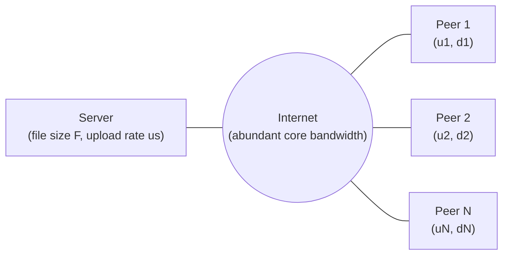
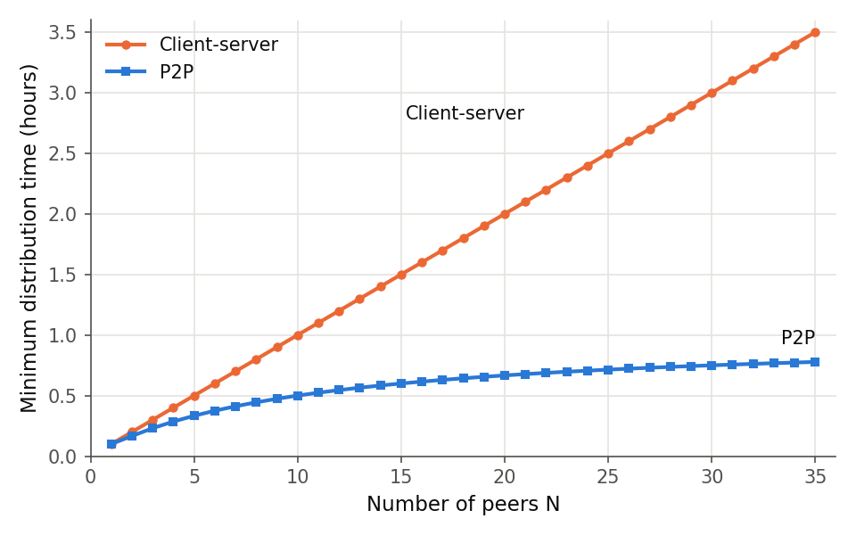
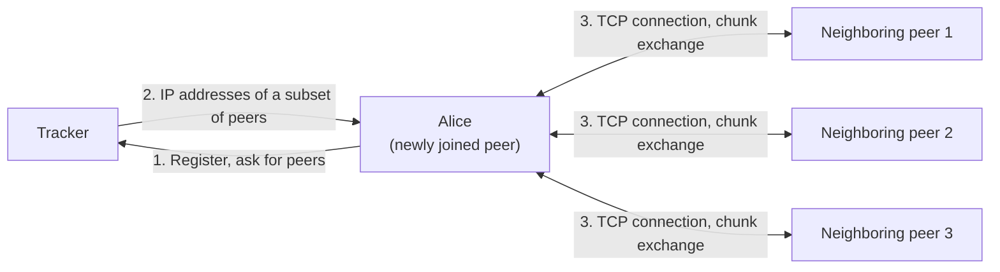
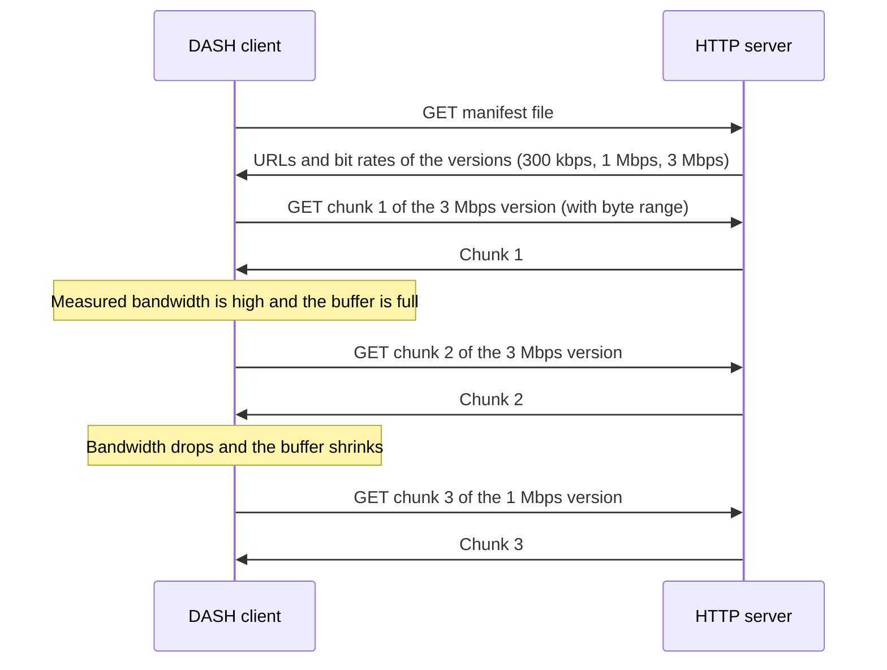
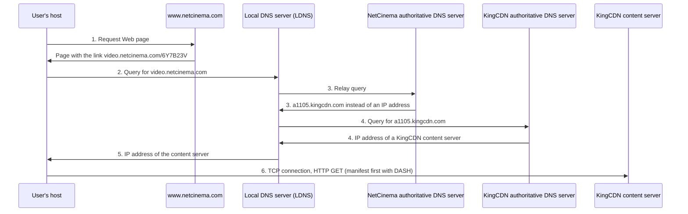
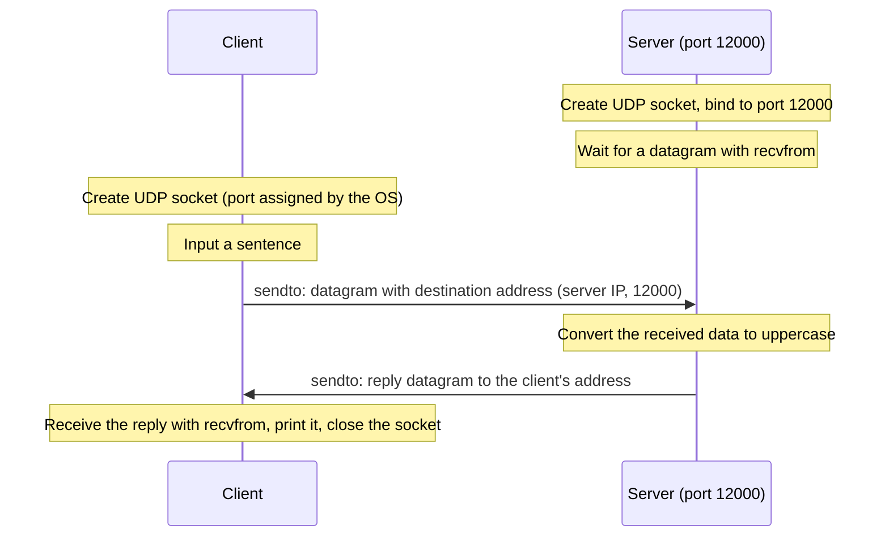
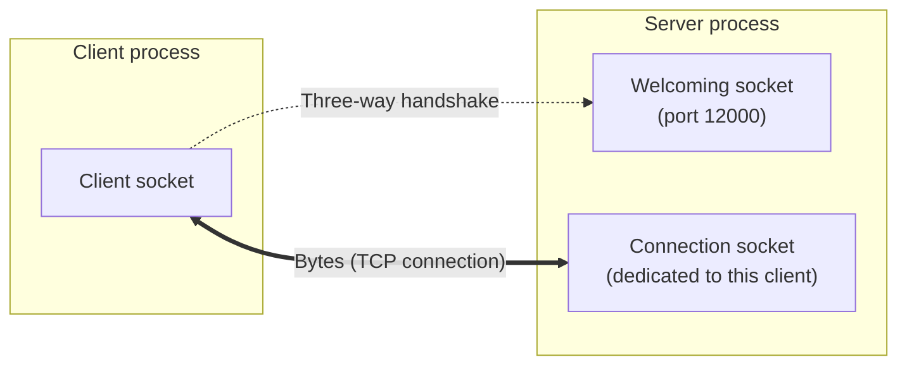
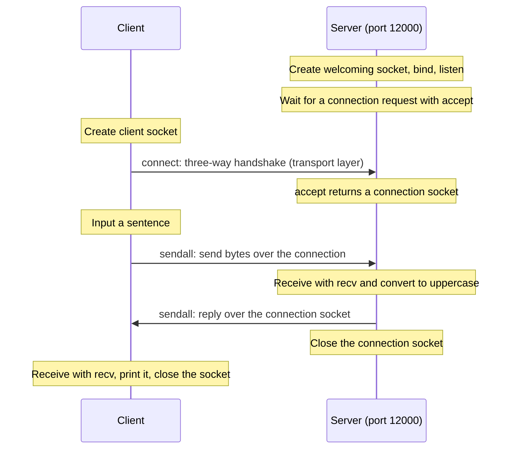

# Chapter 23 — P2P, Video Streaming, and Socket Programming

[Repository Guide](../../README.md) | [English](Concepts_Lecture.md) | [한국어](Concepts_Lecture.ko.md)

> **Last Updated:** 2026-11-18
>
> Computer Networking: A Top-Down Approach, Kurose and Ross, Ch 2; TCP/IP Protocol Suite, Forouzan, Ch 17

> **Learning Objectives:**
> 1. Derive and compute the minimum distribution times of client-server and P2P file distribution, and explain the self-scalability of P2P
> 2. Explain how BitTorrent works with trackers, chunks, rarest first, and tit-for-tat trading
> 3. Explain how HTTP streaming and DASH deliver video and on what basis DASH chooses a rate
> 4. Explain the server placement philosophies of CDNs, request interception with DNS, and cluster selection strategies
> 5. Write UDP and TCP client-server programs in Python and distinguish the roles of the welcoming socket and the connection socket
> 6. Explain the difference between iterative and concurrent servers from their measured behavior, and map the programs to the functions of the C socket interface

---

## Table of Contents

- [1. P2P File Distribution](#1-p2p-file-distribution)
  - [1.1 Client-Server Distribution and P2P Distribution](#11-client-server-distribution-and-p2p-distribution)
  - [1.2 A Model of Distribution Time](#12-a-model-of-distribution-time)
  - [1.3 Self-Scalability of the P2P Architecture](#13-self-scalability-of-the-p2p-architecture)
  - [1.4 BitTorrent](#14-bittorrent)
- [2. Video Streaming](#2-video-streaming)
  - [2.1 Internet Video](#21-internet-video)
  - [2.2 HTTP Streaming](#22-http-streaming)
  - [2.3 DASH](#23-dash)
- [3. Content Distribution Networks (CDNs)](#3-content-distribution-networks-cdns)
  - [3.1 Problems with a Single Data Center](#31-problems-with-a-single-data-center)
  - [3.2 CDNs and Server Placement Philosophies](#32-cdns-and-server-placement-philosophies)
  - [3.3 Intercepting and Redirecting Requests with DNS](#33-intercepting-and-redirecting-requests-with-dns)
  - [3.4 Cluster Selection Strategies](#34-cluster-selection-strategies)
  - [3.5 Case Studies: Netflix, YouTube, and Kankan](#35-case-studies-netflix-youtube-and-kankan)
- [4. Socket Programming](#4-socket-programming)
  - [4.1 Developing a Network Application](#41-developing-a-network-application)
  - [4.2 Sockets and the Socket Interface](#42-sockets-and-the-socket-interface)
  - [4.3 Socket Programming with UDP](#43-socket-programming-with-udp)
  - [4.4 Socket Programming with TCP](#44-socket-programming-with-tcp)
  - [4.5 Iterative and Concurrent Servers](#45-iterative-and-concurrent-servers)
  - [4.6 Mapping to the C Socket Interface](#46-mapping-to-the-c-socket-interface)
  - [4.7 Comparing the UDP and TCP Programs](#47-comparing-the-udp-and-tcp-programs)
- [Summary](#summary)
- [Self-Check Questions](#self-check-questions)

---

<br>

## 1. P2P File Distribution

### 1.1 Client-Server Distribution and P2P Distribution

The Web, e-mail, and DNS covered in Chapters 3 to 5 all employ client-server architectures with significant reliance on always-on infrastructure servers. As seen in Chapter 3, with a P2P architecture there is minimal or no reliance on always-on infrastructure servers; instead, pairs of intermittently connected hosts called **peers** communicate directly with each other. The peers are not owned by a service provider but are desktops and laptops controlled by users.

This section considers a very natural P2P application: distributing a large file from a single server to a large number of hosts (peers). The file might be a new version of an operating system, a software patch for an existing operating system or application, a music file, or a video file.

- **Client-server file distribution:** The server must send a copy of the file to each of the peers, placing an enormous burden on the server and consuming a large amount of server bandwidth.
- **P2P file distribution:** Each peer can redistribute any portion of the file it has received to any other peers, thereby assisting the server in the distribution process.

> **Definition:** **P2P file distribution** is a way of distributing a file in which peers that have received parts of the file send them on to other peers, so that the file is distributed with the upload capacity of all participating peers rather than the server alone.

Forouzan explains that the P2P paradigm does not abandon the client-server paradigm but lets the duty of a server be shared by users who want to participate. For example, instead of several clients each connecting to a server and downloading a large file in full, the server can let each client download a part of the file and let the clients share the parts with each other. While downloading or sharing a part, one computer plays the role of a client and the other the role of a server; in other words, a computer can be a client at one moment and a server at another.

### 1.2 A Model of Distribution Time

To compare client-server and P2P architectures, consider a simple quantitative model for distributing a file to a fixed set of peers. The server and the peers are connected to the Internet with access links.



*Figure 1. A model of the file distribution problem*

The notation is as follows.

| Symbol | Meaning |
|:-----|:-----|
| $`F`$ | Size of the file to be distributed (bits) |
| $`N`$ | Number of peers that want a copy of the file |
| $`u_s`$ | Upload rate of the server's access link |
| $`u_i`$ | Upload rate of the access link of the i-th peer |
| $`d_i`$ | Download rate of the access link of the i-th peer |
| $`d_{min}`$ | Download rate of the peer with the lowest download rate |

*Table 1. Notation of the distribution time model*

The **distribution time** is the time it takes to get a copy of the file to all N peers. For the analysis, assume that the Internet core has abundant bandwidth, so that all the bottlenecks are in the access networks. As seen in Chapter 1, end-to-end throughput is governed by the bottleneck link, and Kurose notes that this assumption is generally accurate. Also assume that the server and the peers are not participating in any other network applications, so all their upload and download bandwidth is devoted to distributing this file.

**Distribution time of the client-server architecture.** In the client-server architecture, none of the peers aids in distributing the file. Writing the distribution time as $`D_{cs}`$, two observations can be made.

- The server must transmit one copy of the file to each of the N peers, a total of NF bits. Since the server's upload rate is $`u_s`$, the distribution time is at least $`NF/u_s`$.
- The peer with the lowest download rate cannot obtain all F bits of the file in less than $`F/d_{min}`$ seconds. Thus the distribution time is at least $`F/d_{min}`$.

Combining the two observations gives a lower bound. Kurose shows in a homework problem that the server can schedule its transmissions so that this lower bound is actually achieved, and takes the lower bound as the actual distribution time.

```math
D_{cs} = \max\left\lbrace \frac{NF}{u_s},\ \frac{F}{d_{min}} \right\rbrace
```

For N large enough, the client-server distribution time is $`NF/u_s`$; that is, it increases linearly with the number of peers N. For example, if the number of peers increases a thousandfold from one week to the next, from a thousand to a million, the time required to distribute the file to all peers also increases a thousandfold.

**Distribution time of the P2P architecture.** In the P2P architecture, when a peer receives some file data, it can use its own upload capacity to redistribute the data to other peers. The distribution time depends on how each peer distributes portions of the file to the other peers, so the calculation is more complicated, but a simple expression for the minimum distribution time can be obtained. Writing the distribution time as $`D_{P2P}`$, three observations are made.

- At the beginning of the distribution, only the server has the file. To get the file into the community of peers, the server must send each bit of the file at least once into its access link, so the distribution time is at least $`F/u_s`$. Unlike the client-server scheme, a bit sent once by the server may not have to be sent by the server again, as the peers may redistribute it among themselves.
- As with the client-server architecture, the peer with the lowest download rate cannot obtain all F bits of the file in less than $`F/d_{min}`$ seconds.
- The total upload capacity of the system is the upload rate of the server plus the upload rates of all the peers, $`u_s + u_1 + \cdots + u_N`$. The system must deliver F bits to each of the N peers, a total of NF bits, and this cannot be done faster than the total upload capacity allows.

Combining the three observations gives the following lower bound.

```math
D_{P2P} = \max\left\lbrace \frac{F}{u_s},\ \frac{F}{d_{min}},\ \frac{NF}{u_s + \sum_{i=1}^{N} u_i} \right\rbrace
```

If each peer can redistribute a bit as soon as it receives it, there is a redistribution scheme that actually achieves this lower bound. In reality, chunks of the file rather than individual bits are redistributed, but the expression is a good approximation of the actual minimum distribution time. Kurose therefore takes this lower bound as the actual minimum distribution time.

> **Key Point:** In client-server distribution, the server alone must send NF bits, so the distribution time grows in proportion to N. In P2P distribution, upload capacity grows with every additional peer, so the denominator of the third term grows together with the numerator.

### 1.3 Self-Scalability of the P2P Architecture

Assume that all peers have the same upload rate u, and use Kurose's comparison settings: $`F/u = 1`$ hour, $`u_s = 10u`$, and $`d_{min} \ge u_s`$. That is, a peer can transmit the entire file in one hour, the server transmission rate is 10 times the peer upload rate, and the peer download rates are large enough to have no effect. The two distribution times are then as follows.

```math
D_{cs} = \frac{NF}{u_s} = \frac{N}{10}\ \text{hours}, \qquad D_{P2P} = \max\left\lbrace \frac{F}{10u},\ \frac{NF}{10u + Nu} \right\rbrace = \max\left\lbrace 0.1,\ \frac{N}{10+N} \right\rbrace \text{hours}
```



*Figure 2. Minimum distribution time of the client-server and P2P architectures versus the number of peers*

For example, with 30 peers the client-server distribution time is 30/10 = 3 hours, while the P2P distribution time is 30/40 = 0.75 hours. The client-server distribution time increases linearly and without bound as the number of peers increases. The minimum P2P distribution time, by contrast, is not only less than that of the client-server architecture for every N of 2 or more (the two are equal, 0.1 hours, only when N = 1); since N/(10 + N) only approaches 1 as N grows and never exceeds it, it is also less than one hour for any number of peers. Applications with the P2P architecture thus have **self-scalability**. This scalability is a direct consequence of peers being redistributors as well as consumers of bits.

### 1.4 BitTorrent

BitTorrent is a representative P2P protocol for file distribution. Kurose names it the most popular P2P file distribution protocol as of 2016. It was originally developed by Bram Cohen, and there are now many independent BitTorrent clients conforming to the protocol, just as there are many Web browsers conforming to HTTP.

> **Definition:** **BitTorrent** is a P2P file distribution protocol in which the peers participating in the distribution of a file exchange equal-size chunks of it with one another while a tracker keeps track of the participating peers.

**Torrent and chunks.** In BitTorrent lingo, the collection of all peers participating in the distribution of a particular file is called a **torrent**. Peers in a torrent download equal-size chunks of the file from one another, with a typical chunk size of 256 KB.

> **Definition:** A **chunk** is an equal-size piece of the file being distributed in BitTorrent, the unit that peers download and upload.

When a peer first joins a torrent, it has no chunks. Over time it accumulates more and more chunks, and while it downloads chunks it also uploads chunks to other peers. Once a peer has acquired the entire file, it may (selfishly) leave the torrent or (altruistically) remain and continue to upload chunks to other peers. Any peer may leave the torrent at any time with only a subset of the chunks and later rejoin it.

**Tracker.** Each torrent has an infrastructure node called a **tracker**. When a peer joins a torrent, it registers itself with the tracker and periodically informs the tracker that it is still in the torrent. In this manner, the tracker keeps track of the peers participating in the torrent. A torrent may have fewer than ten or more than a thousand peers participating at any instant.



*Figure 3. File distribution with BitTorrent*

When a new peer, Alice, joins the torrent, the tracker randomly selects a subset of the participating peers (say 50) and sends their IP addresses to Alice. Alice attempts to establish concurrent TCP connections with all the peers on this list, and the peers with which she succeeds in establishing a TCP connection are called **neighboring peers**. As time evolves, some of these peers may leave and other peers outside the initial 50 may attempt to establish TCP connections with Alice, so a peer's neighboring peers fluctuate over time.

At any given time, each peer has a subset of the file's chunks, with different peers having different subsets. Periodically, Alice asks each of her neighboring peers (over the TCP connections) for the list of chunks they have. If Alice has L neighbors, she obtains L lists of chunks and, with this knowledge, requests (again over the TCP connections) chunks she does not have. Alice now has two important decisions to make: which chunks to request first from her neighbors, and to which of her neighbors to send requested chunks.

**Rarest first.** In deciding which chunks to request, Alice uses a technique called rarest first. Among the chunks she does not have, she determines those that are rarest among her neighbors, that is, the chunks with the fewest repeated copies among her neighbors, and requests them first. In this manner the rarest chunks get redistributed more quickly, roughly equalizing the number of copies of each chunk in the torrent.

**Tit-for-tat trading.** To determine which requests to respond to, BitTorrent uses a clever trading algorithm. The basic idea is that Alice gives priority to the neighbors currently supplying her data at the highest rate.

1. Alice continually measures the rate at which she receives bits from each neighbor and determines the four peers feeding her bits at the highest rate. She reciprocates by sending chunks to these same four peers.
2. Every 10 seconds, she recalculates the rates and possibly modifies the set of four peers. In BitTorrent lingo, these four peers are said to be **unchoked**.
3. Every 30 seconds, she also picks one additional neighbor at random and sends it chunks. Calling this randomly chosen peer Bob, Bob is said to be **optimistically unchoked**.
4. All other neighbors besides these five peers (the four top peers and the one probing peer) are **choked**; they do not receive any chunks from Alice.

Because Alice is sending data to Bob, she may become one of Bob's top four uploaders, in which case Bob would start to send data to Alice. If the rate at which Bob sends data to Alice is high enough, Bob could in turn become one of Alice's top four uploaders. In other words, every 30 seconds Alice randomly chooses a new trading partner and initiates trading with it; if the two peers are satisfied with the trading, they put each other in their top four lists and continue trading until one of them finds a better partner. The effect is that peers capable of uploading at compatible rates tend to find each other. The random neighbor selection also allows new peers, which have nothing to trade yet, to get chunks.

This incentive mechanism for trading is often referred to as tit-for-tat. Kurose notes that, although studies have shown that the incentive scheme can be circumvented, the BitTorrent ecosystem has been wildly successful, with millions of simultaneous peers actively sharing files in hundreds of thousands of torrents. Had BitTorrent been designed without tit-for-tat or a variant, most users would likely have been **free-riders** who only download, and BitTorrent would probably not even exist now. BitTorrent has a number of other interesting mechanisms, including pieces (mini-chunks), pipelining, random first selection, endgame mode, and anti-snubbing.

| Term | Meaning |
|:-----|:-----|
| Torrent | The collection of all peers participating in the distribution of a file |
| Chunk | An equal-size piece of the file (typically 256 KB) |
| Tracker | An infrastructure node that tracks the peers in a torrent and gives new peers a list of peers |
| Neighboring peer | A peer with which a TCP connection has been established |
| Rarest first | Requesting first the chunks with the fewest copies among the neighbors |
| Unchoked | Sending chunks to the four peers feeding at the highest rate, reselected every 10 seconds |
| Optimistically unchoked | Sending chunks to one neighbor chosen at random every 30 seconds |
| Choked | Sending no chunks to the remaining neighbors |

*Table 2. Main terms of BitTorrent*

> **Note:** **Distributed hash tables.** Kurose mentions another application of P2P, the **distributed hash table (DHT)**. A DHT is a simple database whose records are distributed over the peers of a P2P system; DHTs have been widely implemented, including in BitTorrent, and have been the subject of extensive research.

---

<br>

## 2. Video Streaming

According to Kurose, streaming prerecorded video accounted for the majority of the traffic in residential ISPs in North America as of 2015; in that year, the Netflix and YouTube services alone consumed 37% and 16%, respectively, of residential ISP traffic. This section gives an overview of how popular video streaming services are implemented in today's Internet. They are implemented with application-level protocols and servers that function in some ways like a cache.

### 2.1 Internet Video

In streaming stored video applications, the underlying medium is prerecorded video, such as a movie, a television show, a prerecorded sporting event, or a user-generated video. These videos are placed on servers, and users send requests to the servers to view them on demand.

A video is a sequence of images, typically displayed at a constant rate such as 24 or 30 images per second. An uncompressed, digitally encoded image consists of an array of pixels, with each pixel encoded into a number of bits representing luminance and color. An important characteristic of video is that it can be compressed, trading off video quality with bit rate. Today's compression algorithms can compress a video to essentially any desired bit rate, and the higher the bit rate, the better the image quality and the viewing experience.

From a networking perspective, the most salient characteristic of video is its high bit rate. Compressed Internet video typically ranges from 100 kbps for low-quality video to over 3 Mbps for streaming high-definition movies, and 4K streaming envisions a bit rate of more than 10 Mbps. This translates into huge amounts of traffic and storage. For example, a single 2 Mbps video with a duration of 67 minutes consumes about 1 gigabyte of storage and traffic, as follows.

```math
2 \times 10^{6}\ \text{bps} \times (67 \times 60)\ \text{s} \div 8 = 1.005 \times 10^{9}\ \text{bytes} \approx 1\ \text{GB}
```

By far the most important performance measure for streaming video is **average end-to-end throughput**. To provide continuous playout, the network must provide the streaming application an average throughput at least as large as the bit rate of the compressed video.

Compression can also be used to create multiple versions of the same video, each at a different quality level. For example, three versions of the same video can be created at 300 kbps, 1 Mbps, and 3 Mbps, and users can decide which version to watch based on their current available bandwidth. Users with high-speed Internet connections might choose the 3 Mbps version, while users watching over 3G with a smartphone might choose the 300 kbps version.

### 2.2 HTTP Streaming

In **HTTP streaming**, the video is simply stored at an HTTP server as an ordinary file with a specific URL. When a user wants to see the video, the client establishes a TCP connection with the server and issues an HTTP GET request for that URL. The server then sends the video file within an HTTP response message as quickly as the underlying network protocols and traffic conditions allow.

On the client side, the bytes are collected in a client application buffer. Once the number of bytes in the buffer exceeds a predetermined threshold, the client application begins playback: the streaming application periodically grabs video frames from the buffer, decompresses them, and displays them on the screen. The streaming application thus displays the video while receiving and buffering the frames of later parts of the video.

HTTP streaming has been extensively deployed in practice, but it has a major shortcoming: all clients receive the same encoding of the video, despite the large variations in the bandwidth available to clients, both across different clients and over time for the same client.

### 2.3 DASH

This shortcoming led to the development of a new type of HTTP-based streaming, **DASH (Dynamic Adaptive Streaming over HTTP)**.

> **Definition:** **DASH (Dynamic Adaptive Streaming over HTTP)** is a streaming method in which a video is encoded into several versions with different bit rates and the client requests chunks of a few seconds one at a time with HTTP GET, dynamically choosing the version that suits the available bandwidth.

In DASH, the video is encoded into several versions, each with a different bit rate and quality level. The client dynamically requests chunks, video segments a few seconds long. When the available bandwidth is high, the client selects chunks from a high-rate version; when it is low, from a low-rate version. The client selects the chunks one at a time with HTTP GET request messages.

DASH allows clients with different Internet access rates to stream video at different encoding rates. Clients with low-speed 3G connections can receive a low bit-rate (low-quality) version, and clients with fiber connections a high-quality version. DASH also allows a client to adapt if the available end-to-end bandwidth changes during the session. This feature is particularly important for mobile users, whose available bandwidth typically fluctuates as they move with respect to the base stations.

**Manifest file.** With DASH, each video version is stored in the HTTP server with a different URL. The HTTP server also has a **manifest file**, which provides a URL for each version along with its bit rate. The client first requests the manifest file and learns about the various versions. It then selects one chunk at a time by specifying a URL and a byte range in an HTTP GET request message for each chunk. While downloading chunks, the client measures the received bandwidth and runs a **rate determination algorithm** to select the chunk to request next. If the client has a lot of video buffered and the measured receive bandwidth is high, it chooses a chunk from a high-bit-rate version; if it has little video buffered and the measured bandwidth is low, it chooses a chunk from a low-bit-rate version. DASH therefore allows the client to switch freely among different quality levels.



*Figure 4. A DASH client switching versions as the bandwidth changes*

> **Key Point:** HTTP streaming sends the same encoding to all clients, while DASH prepares several versions and lets the client, after reading the manifest file, choose a version for each chunk according to the measured bandwidth and the state of its buffer.

---

<br>

## 3. Content Distribution Networks (CDNs)

### 3.1 Problems with a Single Data Center

Today many Internet video companies distribute on-demand multi-Mbps streams to millions of users daily. Kurose notes, for example, that YouTube, with a library of hundreds of millions of videos, distributed hundreds of millions of video streams to users around the world every day as of 2016. Streaming all this traffic worldwide while providing continuous playout and high interactivity is clearly a challenging task.

The most straightforward approach is to build a single massive data center, store all the videos there, and stream them directly from the data center to clients worldwide. This approach has three major problems.

1. **Distant clients:** If a client is far from the data center, server-to-client packets cross many communication links and likely pass through many ISPs, some possibly on different continents. If one of these links provides a throughput lower than the video consumption rate, the end-to-end throughput will also be below the consumption rate, resulting in freezing delays for the user. As seen in Chapter 1, the end-to-end throughput of a stream is governed by the throughput of its bottleneck link, and the likelihood of this happening increases with the number of links in the path.
2. **Repeated transmission of the same data:** A popular video will likely be sent many times over the same communication links. Not only does this waste network bandwidth, but the video company also pays its provider ISP (connected to the data center) for sending the same bytes into the Internet over and over again.
3. **A single point of failure:** If the data center or its links to the Internet go down, no video streams can be distributed.

### 3.2 CDNs and Server Placement Philosophies

To meet the challenge of distributing massive amounts of video data to users distributed around the world, almost all major video-streaming companies make use of CDNs.

> **Definition:** A **CDN (Content Distribution Network)** is a network that manages servers in multiple geographically distributed locations, stores copies of videos and other Web content in them, and directs each user request to the location that will provide the best user experience.

A CDN may be a **private CDN**, owned by the content provider itself; Google's CDN, for example, distributes YouTube videos and other content. It may alternatively be a **third-party CDN** that distributes content on behalf of multiple content providers; Kurose cites Akamai, Limelight, and Level-3 as operators of third-party CDNs.

CDNs typically adopt one of two server placement philosophies.

- **Enter deep:** Pioneered by Akamai, this approach enters deep into the access networks of ISPs (Chapter 1) by deploying server clusters in access ISPs all over the world. According to Kurose, Akamai had clusters in approximately 1,700 locations as of 2016. The goal is to get close to end users, improving user-perceived delay and throughput by decreasing the number of links and routers between the end user and the CDN server from which it receives content. Because of this highly distributed design, maintaining and managing the clusters becomes challenging.
- **Bring home:** Taken by Limelight and many other CDN companies, this approach brings the ISPs home by building large clusters at a smaller number of sites (for example, tens). Instead of getting inside the access ISPs, these CDNs typically place their clusters in Internet Exchange Points (IXPs, Chapter 1). Compared with enter deep, this design typically results in lower maintenance and management overhead, possibly at the expense of higher delay and lower throughput to end users.

| Philosophy | Location of clusters | Number of clusters | Advantage | Disadvantage |
|:-----|:-----|:-----|:-----|:-----|
| Enter deep | Inside access ISPs | Many (about 1,700 for Akamai in 2016) | Close to users, so low delay and high throughput | Hard to maintain and manage |
| Bring home | IXPs | Few (tens) | Lower maintenance and management overhead | Possibly higher delay and lower throughput |

*Table 3. The two server placement philosophies of CDNs*

Once its clusters are in place, the CDN replicates content across them. The CDN may not want to place a copy of every video in each cluster, since some videos are rarely viewed or are popular only in some countries. In fact, many CDNs do not push videos to their clusters but use a simple **pull** strategy: if a client requests a video from a cluster that is not storing it, the cluster retrieves the video (from a central repository or another cluster) and stores a copy locally while streaming the video to the client. Similar to the Web caching of Chapter 3, when a cluster's storage becomes full, it removes videos that are not frequently requested.

> **Note:** **Google's network infrastructure.** Kurose presents as a case study the private network and CDN that Google had deployed by 2016 to support cloud services such as search, Gmail, and YouTube. At that time, Google's CDN had three tiers of server clusters. The first was 14 mega data centers, each with on the order of 100,000 servers, serving dynamic and personalized content such as search results and Gmail messages. The second was about 50 clusters scattered in IXPs throughout the world, each with on the order of 100-500 servers, serving static content such as YouTube videos. The third was many hundreds of enter-deep clusters inside access ISPs, each typically consisting of tens of servers in a single rack, serving static content such as the static portions of Web pages. All these data centers and clusters were networked together with Google's own private network, so except for the local ISPs, Google's cloud services were largely provided by a network infrastructure independent of the public Internet.

### 3.3 Intercepting and Redirecting Requests with DNS

When a browser in a user's host is instructed to retrieve a specific video identified by a URL, the CDN must intercept the request so that it can (1) determine a suitable CDN server cluster for that client at that time and (2) redirect the client's request to a server in that cluster. Most CDNs take advantage of the DNS of Chapter 5 to intercept and redirect requests.

A simple example illustrates how DNS is involved. Suppose a content provider, NetCinema, employs the third-party CDN company KingCDN to distribute its videos to its customers. On NetCinema's Web pages, each video is assigned a URL that includes the string "video" and a unique identifier for the video; a movie might be assigned http://video.netcinema.com/6Y7B23V, for example. Six steps then occur.

1. The user visits the Web page at NetCinema.
2. When the user clicks on the link http://video.netcinema.com/6Y7B23V, the user's host sends a DNS query for video.netcinema.com.
3. The user's local DNS server (LDNS) relays the query to an authoritative DNS server for NetCinema, which observes the string "video" in the hostname video.netcinema.com. To hand over the DNS query to KingCDN, instead of returning an IP address, the NetCinema authoritative DNS server returns to the LDNS a hostname in KingCDN's domain, for example a1105.kingcdn.com.
4. From this point on, the DNS query enters KingCDN's private DNS infrastructure. The user's LDNS sends a second query, now for a1105.kingcdn.com, and KingCDN's DNS system eventually returns the IP address of a KingCDN content server to the LDNS. It is thus within KingCDN's DNS system that the CDN server from which the client will receive its content is specified.
5. The LDNS forwards the IP address of the content-serving CDN node to the user's host.
6. Once the client receives the IP address of a KingCDN content server, it establishes a direct TCP connection with the server and issues an HTTP GET request for the video. If DASH is used, the server first sends the client a manifest file with a list of URLs, one for each version of the video, and the client dynamically selects chunks from the different versions.



*Figure 5. DNS redirecting a user's request to a CDN server*

### 3.4 Cluster Selection Strategies

At the core of any CDN deployment is a **cluster selection strategy**, a mechanism for dynamically directing clients to a server cluster or data center within the CDN. As just seen, the CDN learns the IP address of the client's LDNS server via the client's DNS lookup and must select an appropriate cluster based on this IP address. CDNs generally employ proprietary strategies; here we briefly survey a few approaches, each with its own advantages and disadvantages.

**Geographically closest cluster.** One simple strategy is to assign the client to the geographically closest cluster. Using commercial geo-location databases, each LDNS IP address is mapped to a geographic location, and when a DNS request arrives from a particular LDNS, the CDN chooses the cluster that is the fewest kilometers from the LDNS as the bird flies. This works reasonably well for a large fraction of clients, but it has the following problems.

- The geographically closest cluster may not be the closest cluster in terms of the length or number of hops of the network path.
- A problem inherent in all DNS-based approaches is that some end users are configured to use remotely located LDNSs, in which case the LDNS location may be far from the client's location.
- The strategy ignores the variation in delay and available bandwidth of Internet paths over time, always assigning the same cluster to a particular client.

**Real-time measurements.** To determine the best cluster for a client based on current traffic conditions, a CDN can instead perform periodic real-time measurements of delay and loss performance between its clusters and clients. For instance, each cluster can periodically send probes (for example, ping messages or DNS queries) to all the LDNSs around the world. One drawback of this approach is that many LDNSs are configured not to respond to such probes.

### 3.5 Case Studies: Netflix, YouTube, and Kankan

Kurose examines three highly successful large-scale deployments as they stood at the time of writing (2016). Each takes a very different approach, yet all employ the principles discussed in this section.

- **Netflix:** The Web site that handles user registration, billing, the movie catalogue, recommendations, and so on, as well as content ingestion, processing into many formats and bit rates, and uploading to the CDN, all run in the Amazon cloud, while the videos are distributed through Netflix's own private CDN with server racks in IXPs and residential ISPs. Instead of pull caching, Netflix pushes videos into its CDN servers during off-peak hours, and without DNS redirect, its software in the Amazon cloud directly tells the client the IP address of the CDN server to use and sends a manifest file. The client and that server then interact using a proprietary version of DASH with chunks about four seconds long.
- **YouTube:** Google distributes YouTube videos through its own private CDN with server clusters in many hundreds of IXP and ISP locations. Unlike Netflix, it uses pull caching and DNS redirect; most of the time the client is directed to the cluster with the lowest RTT, but sometimes it is directed to a more distant cluster to balance the load. YouTube uses HTTP streaming rather than adaptive streaming such as DASH and requires the user to select a version manually, and it uses HTTP byte-range requests to limit the flow of data after a target amount of video is prefetched, saving the bandwidth that repositioning or early termination would waste.
- **Kankan:** To significantly reduce the costs of server hardware and bandwidth of a private CDN, Kankan uses P2P delivery. A peer that wants to see a video contacts a tracker to discover other peers that have it and requests chunks from those peers in parallel, much as in BitTorrent; to ensure continuous playback, however, it preferentially requests chunks to be played back in the near future. Kankan later migrated to a hybrid CDN-P2P system, in which the client gets content from CDN servers as well as from peers in the start-up stage and streams only from peers once the P2P traffic is sufficient.

| Service | CDN | Populating content | Server selection | Streaming method |
|:-----|:-----|:-----|:-----|:-----|
| Netflix | Own private CDN (server racks in IXPs and ISPs) | Push during off-peak hours | Directly specified by software in the Amazon cloud | Proprietary version of DASH |
| YouTube | Google's private CDN | Pull caching | DNS redirect, usually to the cluster with the lowest RTT | HTTP streaming, version chosen by the user |
| Kankan | Hybrid CDN-P2P | Push to CDN servers, exchange among peers | Peers discovered through a tracker | P2P favoring chunks to be played soon |

*Table 4. Comparison of three video services*

---

<br>

## 4. Socket Programming

### 4.1 Developing a Network Application

As seen in Chapter 3, a typical network application consists of a pair of programs, a client program and a server program, residing in two different end systems. When these programs are executed, a client process and a server process are created, and these processes communicate with each other by reading from and writing to sockets. The developer's main task in creating a network application is therefore to write the code for both the client and server programs.

There are two types of network applications.

- **Open applications:** Implementations of a protocol defined in a standards document such as an RFC, sometimes called "open" because the rules specifying their operation are known to all. The client and server programs must conform to the rules of the RFC, and if different developers each write a client and a server carefully following the RFC, the two programs interoperate. Examples include a Google Chrome browser communicating with an Apache Web server and a BitTorrent client communicating with a BitTorrent tracker. Such applications should use the well-known port number associated with the protocol.
- **Proprietary applications:** Applications whose application-layer protocol has not been openly published in an RFC or elsewhere. A single developer (or team) creates both the client and server programs and has complete control over the code, but because the code does not implement an open protocol, other developers cannot write code that interoperates with the application. When developing a proprietary application, the developer must be careful to avoid using well-known port numbers.

One of the first decisions a developer must make is whether the application is to run over TCP or over UDP. TCP is connection oriented and provides a reliable byte-stream channel through which data flows between two end systems. UDP is connectionless and sends independent packets of data from one end system to the other without any guarantees about delivery.

This section examines UDP and TCP socket programming with the same simple application as Kurose.

1. The client reads a line of characters (data) from its keyboard and sends the data to the server.
2. The server receives the data and converts the characters to uppercase.
3. The server sends the modified data to the client.
4. The client receives the modified data and displays the line on its screen.

The programs are written in Python 3. Kurose chose Python because it clearly exposes the key socket concepts, and with fewer lines of code each line can be explained to a novice without difficulty. The server port number is 12000, which does not collide with the well-known ports. The outputs below were obtained by running the client and server on one computer (localhost) with Python 3.13 on macOS.

> **[Computer Programming]** In Python, `str` is a string of characters and `bytes` is a sequence of bytes. Sockets send and receive only bytes, so a string is converted to bytes with `encode()` before sending, and received bytes are converted to a string with `decode()` (the default encoding is UTF-8). The `with` statement automatically calls the socket object's `close()` when the block is left, so the socket is closed even if an error leaves the block. `input()` prints a prompt and returns the line the user types as a string.

### 4.2 Sockets and the Socket Interface

As seen in Chapter 3, processes running on different machines communicate with each other by sending messages into sockets. A process is analogous to a house and its socket to a door. The application resides on one side of the door, inside the house; the transport-layer protocol resides on the other side, in the outside world. The application developer has control of everything on the application-layer side of the socket but little control of the transport-layer side.

**Destination address.** A sending process using UDP must first attach a destination address to a packet of data before pushing it out the socket door. The destination address includes the destination host's IP address, which the routers in the Internet use to route the packet to the destination host. But because a host may be running many network application processes, each with one or more sockets, the particular socket in the destination host must also be identified. When a socket is created, an identifier called a **port number** is assigned to it, and the destination address also includes this socket's port number. The sender's source address, consisting of the IP address of the source host and the port number of the source socket, is also attached to the packet, but this is typically done automatically by the underlying operating system rather than by the UDP application code.

**Socket interface.** Forouzan explains sockets through their relation to the operating system. A computer program has sets of instructions for mathematical operations, string manipulation, and input/output, and communicating with a program running on another machine requires a new set of instructions telling the transport layer to open a connection, send and receive data, and close the connection. A set of instructions designed for interaction between two entities is called an **interface**. Among the interfaces for communication, the **socket interface** started in the early 1980s at the University of Berkeley as part of the UNIX environment. The socket interface is located between the operating system and the application programs, and an application must use the instructions defined in the socket interface to access the services of the TCP/IP protocol suite.

```text
+------------------------------------+
| Application layer                  |
+====================================+  <- socket interface
| Transport layer                    |  \
+------------------------------------+   |
| Network layer                      |   |  operating system
+------------------------------------+   |
| Data link layer                    |   |
+------------------------------------+   |
| Physical layer                     |  /
+------------------------------------+
```

*Figure 6. Relation between the operating system and the TCP/IP protocol suite*

To use the communication channel, an application program (client or server) requests the operating system to create a socket. The application program can then plug into the socket, as one plugs a plug into a socket in daily life, to send and receive data. For communication to occur, a pair of sockets, one at each end, is needed.

> **[Operating Systems]** The operating system returns an integer called a **file descriptor** for each file a process opens, and the process uses this number to request reading, writing, and closing. Forouzan explains that sockets resemble this file interface. The call that creates a socket returns an integer called a **socket descriptor**, and later calls to send, receive, and close refer to the socket by this descriptor. The buffers and protocol state attached to a socket are managed by the operating system kernel, so an application uses the transport layer only through the system calls of the socket interface.

### 4.3 Socket Programming with UDP

A UDP client and server interact in the following order. With UDP, for the server to receive and reply to the client's message, the server process must be running before the client sends its message.



*Figure 7. The client-server application using UDP*

**UDP server.** The server program `udp_server.py` is as follows.

```python
from socket import socket, AF_INET, SOCK_DGRAM

SERVER_PORT = 12000

with socket(AF_INET, SOCK_DGRAM) as server_socket:
    server_socket.bind(('', SERVER_PORT))
    print('UDP server ready on port', SERVER_PORT, flush=True)
    while True:
        message, client_address = server_socket.recvfrom(2048)
        reply = message.decode().upper()
        server_socket.sendto(reply.encode(), client_address)
        print('Replied to', client_address, flush=True)
```

- `from socket import ...`: Imports the needed names from the `socket` module, the basis of all network communication in Python.
- `socket(AF_INET, SOCK_DGRAM)`: Creates the server's socket. The first argument, `AF_INET`, is the address family and indicates that the underlying network uses IPv4; the second, `SOCK_DGRAM`, indicates that the socket is a UDP socket.
- `bind(('', SERVER_PORT))`: **Binds**, that is, assigns, port number 12000 to the server's socket. The empty string means all IP addresses of this host. Now when anyone sends a packet to port 12000 at the server's IP address, the packet is directed to this socket. In a UDP server, the code written by the application developer explicitly assigns a port number to the socket.
- `while True`: In this loop, the server receives and processes packets from clients indefinitely.
- `recvfrom(2048)`: Waits until a packet arrives; when one does, puts its data into `message` and its source address into `client_address`. `client_address` contains both the client's IP address and port number, and the server uses it like the return address on postal mail to know where to send the reply. 2048 is the size of the receive buffer.
- `message.decode().upper()`: The heart of this simple application, converting the received bytes to a string and then to uppercase.
- `sendto(reply.encode(), client_address)`: Converts the capitalized message to bytes, attaches the client's address (IP address and port number), and sends it into the server's socket. The server's address is also attached to the packet, automatically by the operating system rather than by the code. After sending the reply, the server remains in the loop, waiting for another UDP packet (from any client on any host).

**UDP client.** The client program `udp_client.py` is as follows.

```python
from socket import socket, AF_INET, SOCK_DGRAM

SERVER_ADDRESS = ('localhost', 12000)

with socket(AF_INET, SOCK_DGRAM) as client_socket:
    client_socket.settimeout(2.0)
    sentence = input('Input a sentence: ')
    client_socket.sendto(sentence.encode(), SERVER_ADDRESS)
    print('Client socket:', client_socket.getsockname())
    try:
        reply, server_address = client_socket.recvfrom(2048)
    except TimeoutError:
        print('No reply within 2 seconds')
    else:
        print('From', server_address, ':', reply.decode())
```

- `SERVER_ADDRESS`: The server's hostname (or IP address) and port number. If a hostname is used, a DNS lookup (Chapter 5) is automatically performed to get the IP address. Here localhost, meaning the same computer, is used.
- `socket(AF_INET, SOCK_DGRAM)`: Creates the client's UDP socket. The port number of the client socket is not specified when it is created; the operating system assigns it.
- `settimeout(2.0)`: Because UDP does not guarantee delivery, a 2-second time limit is set on receiving so that the client does not wait forever if no reply comes. This line is not in Kurose's minimal example.
- `sendto(sentence.encode(), SERVER_ADDRESS)`: Converts the message to bytes, attaches the destination address (server, 12000), and sends it into the socket. The operating system attaches the source address automatically. Sending a client-to-server message via a UDP socket is that simple.
- `getsockname()`: Shows the address the operating system assigned to the client socket.
- `recvfrom(2048)`: When a packet arrives from the server, puts its data into `reply` and its source address into `server_address`. The client already knows the server's address, so it does not actually need this address. If nothing arrives within 2 seconds, a `TimeoutError` is raised.

**Output.** The server was started first, and then the client was run and a sentence typed. The client's output is as follows.

```text
Input a sentence: hello from a udp client
Client socket: ('0.0.0.0', 51210)
From ('127.0.0.1', 12000) : HELLO FROM A UDP CLIENT
```

The server's output is as follows.

```text
UDP server ready on port 12000
Replied to ('127.0.0.1', 51210)
```

The operating system assigned port 51210 to the client socket (the address 0.0.0.0 means the socket is not bound to a specific address), and the client address the server learned with `recvfrom` contains the same port 51210. The server knows where to send its reply even though the client code attached no source address, because the operating system attached it.

Running the client without the server gives the following.

```text
Input a sentence: is anyone there
Client socket: ('0.0.0.0', 63366)
No reply within 2 seconds
```

UDP has no connection setup, so `sendto` succeeds without checking whether a server exists. The client can detect the problem only from the absence of a reply, and without the time limit it would wait in `recvfrom` forever. This datagram is not delivered to the server even if the server process is started later, because no socket was bound to port 12000 when the datagram arrived.

### 4.4 Socket Programming with TCP

Unlike UDP, TCP is a connection-oriented protocol. Before the client and server can send data to each other, they must handshake and establish a TCP connection. One end of the TCP connection is attached to the client socket and the other to a server socket, and the client socket address (IP address and port number) and the server socket address are associated with the connection when it is created. With the connection established, a side that wants to send data simply drops the data into the TCP connection via its socket. This differs from UDP, in which the server must attach a destination address to a packet before dropping it into the socket.

**Two kinds of server sockets.** In TCP, the client has the job of initiating contact with the server. For the server to react to the client's initial contact, it must be ready, which implies two things. First, as with UDP, the TCP server must be running as a process before the client attempts contact. Second, the server program must have a special door, more precisely a special socket, that welcomes initial contact from a client process running on an arbitrary host. In the house and door analogy, the client's initial contact can be described as "knocking on the welcoming door."

> **Definition:** A **welcoming socket** is the server-side socket that a TCP server binds to its well-known port and keeps open, the first point of contact for the connection requests of all clients.

> **Definition:** A **connection socket** is a new server-side socket that a TCP server creates for one particular client when it accepts that client's connection request.

With the server process running, the client process can initiate a TCP connection to the server. The client program creates a TCP socket, specifying the address of the server's welcoming socket, namely the IP address of the server host and the port number of the socket. After creating its socket, the client initiates a **three-way handshake** and establishes a TCP connection with the server. The three-way handshake takes place within the transport layer and is completely invisible to the client and server programs (Chapter 8).

During the three-way handshake, the client process knocks on the welcoming door of the server process. When the server hears the knocking, it creates a new door, that is, a new socket dedicated to that particular client. Students encountering TCP sockets for the first time sometimes confuse the welcoming socket, which is the initial point of contact for all clients wanting to communicate with the server, with each server-side connection socket subsequently created for communicating with each client. Forouzan calls the same two sockets the **listen socket** and the **connect socket**.



*Figure 8. The two sockets of a TCP server process*

From the application's perspective, the client's socket and the server's connection socket are directly connected by a pipe. The client process can send arbitrary bytes into its socket, and TCP guarantees that the server process will receive (through the connection socket) each byte in the order sent. TCP thus provides a reliable service between the client and server processes. Just as people can go in and out the same door, the client process both sends bytes into and receives bytes from its socket, and the server process both receives bytes from and sends bytes into its connection socket.



*Figure 9. The client-server application using TCP*

**TCP server.** The server program `tcp_server.py` is as follows.

```python
from socket import socket, AF_INET, SOCK_STREAM

SERVER_PORT = 12000

with socket(AF_INET, SOCK_STREAM) as welcoming_socket:
    welcoming_socket.bind(('', SERVER_PORT))
    welcoming_socket.listen(1)
    print('TCP server ready on port', SERVER_PORT, flush=True)
    while True:
        connection_socket, client_address = welcoming_socket.accept()
        with connection_socket:
            print('Connection socket', connection_socket.getsockname(),
                  'for client', client_address, flush=True)
            sentence = connection_socket.recv(1024).decode()
            connection_socket.sendall(sentence.upper().encode())
```

- `socket(AF_INET, SOCK_STREAM)`: `SOCK_STREAM` indicates that the socket is a TCP socket. This socket becomes the welcoming socket.
- `bind(('', SERVER_PORT))`: As in the UDP server, binds the server port number 12000 to this socket.
- `listen(1)`: Has the server listen for TCP connection requests from clients. The argument is the maximum number of queued connections.
- `accept()`: Waits until a client knocks on the door; when one does, creates a new socket dedicated to that client, the connection socket, and returns it with the client's address. A TCP connection now exists between the client's socket and the server's connection socket, and all bytes sent from one side are guaranteed not only to arrive at the other side but also to arrive in order.
- `recv(1024)`: Receives up to 1024 bytes from the connection socket. Unlike UDP's `recvfrom`, it returns no source address, because the connection socket is already connected to one client.
- `sendall(...)`: Sends the modified sentence through the connection socket. It does not build a packet or attach a destination address; it simply drops the bytes into the TCP connection.
- Leaving the `with connection_socket:` block closes the connection socket. The welcoming socket remains open, however, so another client can knock on the door and send a sentence.

**TCP client.** The client program `tcp_client.py` is as follows.

```python
from socket import socket, AF_INET, SOCK_STREAM

SERVER_ADDRESS = ('localhost', 12000)

with socket(AF_INET, SOCK_STREAM) as client_socket:
    client_socket.connect(SERVER_ADDRESS)
    print('Connected:', client_socket.getsockname(), '->', client_socket.getpeername())
    sentence = input('Input a sentence: ')
    client_socket.sendall(sentence.encode())
    reply = client_socket.recv(1024)
    print('From server:', reply.decode())
```

- `socket(AF_INET, SOCK_STREAM)`: Creates the client's TCP socket. Again, the operating system assigns the port number.
- `connect(SERVER_ADDRESS)`: The line most different from the UDP client. Before data can be sent over a TCP socket, a TCP connection must be established between the client and the server, and this line initiates it. The argument is the address of the server side of the connection; when this line is executed, the three-way handshake is performed and a TCP connection is established.
- `getsockname()`, `getpeername()`: Show the client-side and server-side addresses of the connection.
- `sendall(sentence.encode())`: Drops the sentence into the TCP connection through the client socket. Unlike with a UDP socket, no packet is explicitly created and no destination address is attached.
- `recv(1024)`: Receives bytes from the server. Leaving the block closes the socket and hence the TCP connection between the client and the server, causing the client's TCP to send the server's TCP a segment signaling the end of the connection (Chapter 8).

**Output.** The server was started and then the client was run. The client's output is as follows.

```text
Connected: ('127.0.0.1', 64545) -> ('127.0.0.1', 12000)
Input a sentence: hello from a tcp client
From server: HELLO FROM A TCP CLIENT
```

The server's output is as follows.

```text
TCP server ready on port 12000
Connection socket ('127.0.0.1', 12000) for client ('127.0.0.1', 64545)
```

Note that the address of the server's connection socket is ('127.0.0.1', 12000). The connection socket is a new socket different from the welcoming socket, but its server-side port is the same 12000 as the welcoming socket's. The server distinguishes connections by four values, the source IP address, source port, destination IP address, and destination port, so several connection sockets using the same port 12000 can exist at the same time. As stated in the note box of Chapter 3, contrary to Forouzan's description of assigning a temporary server-side port to each connection, in the TCP that Kurose describes connection sockets also keep the well-known port, and this output shows it. Demultiplexing by these four values is covered in Chapter 6.

Running the TCP client without the server raises an exception at `connect` immediately. In the following output, `...` stands for the omitted middle lines of the traceback, which show the file path and the line of code.

```text
Traceback (most recent call last):
  ...
ConnectionRefusedError: [Errno 61] Connection refused
```

The UDP client could only notice the absence of a reply, but the TCP client learns immediately, during connection setup, that the TCP of the other host refused the connection. The connection setup also serves to check whether a listening socket exists on the other side.

> **Note:** **Byte streams and recv.** TCP provides a byte-stream service and does not preserve message boundaries. Bytes the sender sends at once may not all arrive in one `recv` at the receiver, and bytes sent in several calls may arrive in one. Forouzan likewise explains that even if the server calls send once, TCP may send the data in several segments, so the receiver must call recv repeatedly until all the data have arrived. The programs in this section exchange one short sentence and call `recv` only once, but programs that exchange long data must find the end of a message with an application-layer rule such as a length field or a delimiter. Chapter 8 covers the TCP byte stream.

### 4.5 Iterative and Concurrent Servers

The TCP server of Section 4.4 handles a connection received with `accept` to completion before calling `accept` again, so it is an **iterative server**. As seen in Chapter 3, an iterative server processes one request at a time. The following server, `tcp_concurrent_server.py`, is a **concurrent server** that creates a thread for each connection to serve several clients at the same time.

```python
import threading
from socket import socket, AF_INET, SOCK_STREAM

SERVER_PORT = 12000

def serve(connection_socket, client_address):
    with connection_socket:
        sentence = connection_socket.recv(1024).decode()
        connection_socket.sendall(sentence.upper().encode())
    print('Served', client_address, flush=True)

with socket(AF_INET, SOCK_STREAM) as welcoming_socket:
    welcoming_socket.bind(('', SERVER_PORT))
    welcoming_socket.listen(5)
    print('Concurrent TCP server ready on port', SERVER_PORT, flush=True)
    while True:
        connection_socket, client_address = welcoming_socket.accept()
        worker = threading.Thread(target=serve, args=(connection_socket, client_address))
        worker.start()
```

- `serve` function: Serves one client with one connection socket. It moves into a function the work that was inside the loop of the server in Section 4.4.
- `threading.Thread(...).start()`: Each time `accept` returns a connection socket, creates and starts a new thread to handle that connection. The main thread does not wait for the connection to be handled; it returns immediately to the next `accept` to wait for another client.

> **[Operating Systems]** A **thread** is a flow of execution that runs independently within a process while sharing the process's address space and open files (including sockets). `accept` and `recv` are **blocking** calls that suspend the calling thread until there is something to process, so an iterative server with a single thread cannot serve other clients while it waits for one client. With a thread per connection, the operating system runs other threads while one thread is suspended. Forouzan's C example creates a child process with `fork` instead of a thread; the parent then closes the connect socket and waits for the next connection on the listen socket, while the child closes the listen socket and serves the client on the connect socket.

**The difference in measured behavior.** To see the difference between the two servers, two copies of the TCP client of Section 4.4 were run as follows, and the time at which each client finished was measured. Client A connects at 0 seconds and types its sentence 2 seconds later. Client B connects at 0.5 seconds and types its sentence immediately (0.1 seconds later).

| Server | Client A finished at | Client B finished at |
|:-----|:-----|:-----|
| Iterative server (`tcp_server.py`) | 2.0 s | 2.0 s |
| Concurrent server (`tcp_concurrent_server.py`) | 2.0 s | 0.6 s |

*Table 5. Measured finishing times of two clients with the iterative and concurrent servers*

With the iterative server, the server's output is as follows.

```text
TCP server ready on port 12000
Connection socket ('127.0.0.1', 12000) for client ('127.0.0.1', 64571)
Connection socket ('127.0.0.1', 12000) for client ('127.0.0.1', 64574)
```

The output of client B in this case is as follows.

```text
Connected: ('127.0.0.1', 64574) -> ('127.0.0.1', 12000)
Input a sentence: client b typed at once
From server: CLIENT B TYPED AT ONCE
```

With the iterative server, client B's `connect` succeeded at 0.5 seconds, so it printed "Connected" and sent its sentence right away, yet it received the reply only at 2.0 seconds, when A had been served. Because the three-way handshake is handled by the transport layer, the connection is established and waits in the queue of `listen` even before the server program calls `accept`, and the bytes B sent also accumulate in the connection's buffer. The server program, however, is waiting in `recv` on A's connection socket for A's sentence, so it accepts and serves B's connection only after finishing A.

With the concurrent server, the server's output is as follows.

```text
Concurrent TCP server ready on port 12000
Served ('127.0.0.1', 64604)
Served ('127.0.0.1', 64603)
```

With the concurrent server, the thread serving B runs separately from the thread waiting for A, so B (port 64604), which connected later, is served first and finishes at 0.6 seconds, while A (port 64603) finishes at 2.0 seconds, when it types its sentence.

> **Key Point:** An iterative server makes other clients wait while it serves one, so a single slow client delays all the others. A concurrent server gives each connection a separate flow of execution (a thread or a process) and serves the clients independently.

### 4.6 Mapping to the C Socket Interface

Forouzan explains the socket interface in the C language. In C, a socket is defined as a structure with five fields, whose meanings are as follows.

- **Family:** Defines the protocol group. TCP/IP uses `AF_INET` for IPv4 and `AF_INET6` for IPv6.
- **Type:** Defines the type of socket.
- **Protocol:** Defines the protocol that uses the interface; it is set to 0 for the TCP/IP protocol suite.
- **Local socket address:** The combination of the local IP address and port number.
- **Remote socket address:** The combination of the remote IP address and port number.

| Socket type | Protocol used |
|:-----|:-----|
| SOCK_STREAM | TCP |
| SOCK_DGRAM | UDP |
| SOCK_SEQPACKET | SCTP |
| SOCK_RAW | Applications that use the services of IP directly, bypassing the transport layer |

*Table 6. Socket types*

Python's `socket` module wraps the C socket functions almost directly. The main C functions introduced by Forouzan correspond to the Python code of this chapter as follows.

| C function | What it does | Python code in this chapter | Used by |
|:-----|:-----|:-----|:-----|
| `socket` | Creates a socket, fills the family, type, and protocol fields, and returns a socket descriptor | `socket(AF_INET, SOCK_DGRAM)` | All |
| `bind` | Fills the local socket address (local IP address and port) | `bind(('', SERVER_PORT))` | Servers |
| `listen` | Informs the operating system that the socket is ready to receive connection requests; the argument is the maximum number of queued requests | `listen(1)` | TCP server |
| `accept` | Blocks until a connection request arrives, then creates a new socket and fills its remote socket address | `accept()` | TCP server |
| `connect` | Fills the remote socket address and establishes a connection | `connect(SERVER_ADDRESS)` | TCP client |
| `send`, `recv` | Send to and receive from the connected peer | `sendall(...)`, `recv(1024)` | TCP |
| `sendto`, `recvfrom` | Send with the remote socket address given as an argument, and receive while obtaining the source address | `sendto(...)`, `recvfrom(2048)` | UDP |
| `close` | Closes the socket; the descriptor is no longer valid | End of the `with` block | All |
| `fork` | Duplicates the process to create a child process | `threading.Thread` (a thread instead) | Concurrent server |

*Table 7. C socket functions and the corresponding Python code of this chapter*

**Byte order.** A computer stores information in **host byte order**, which may be little-endian, storing the least significant byte at the starting address, or big-endian, storing the most significant byte at the starting address. Network programming requires information such as IP addresses and port numbers in **network byte order**, which is big-endian. In C, `htons` (host to network short) converts a 16-bit value and `htonl` (host to network long) a 32-bit value, and `ntohs` and `ntohl` convert in the opposite direction. Python's `socket` module has functions with the same names.

```python
import socket
import sys

print(sys.byteorder)
print(hex(socket.htons(12000)))
print((12000).to_bytes(2, 'big').hex())
```

The output is as follows.

```text
little
0xe02e
2ee0
```

12000 is 0x2EE0 in hexadecimal. This computer is little-endian, so `htons` returns 0xE02E with the two bytes swapped; stored in memory in little-endian order, this value places the bytes in the order 2E, E0, which is network byte order (big-endian). The last line builds 12000 directly as 2 big-endian bytes, and the bytes 2E, E0 are the order in which port 12000 appears on the network. Python's `bind`, `connect`, and `sendto` take addresses as tuples and perform this conversion internally, so the programs of this chapter never handle byte order directly.

### 4.7 Comparing the UDP and TCP Programs

| Item | UDP program | TCP program |
|:-----|:-----|:-----|
| Socket type | `SOCK_DGRAM` | `SOCK_STREAM` |
| Connection setup | None; the client sends immediately | Three-way handshake with `connect` and `accept` |
| Destination address | Attached to every `sendto` | Given once when connecting, not attached to `sendall` |
| Server sockets | One socket serves all clients | One welcoming socket and one connection socket per client |
| Learning the peer's address | `recvfrom` returns the source address of each datagram | `accept` returns the peer address of the connection |
| Client when no server exists | `sendto` succeeds and no reply comes (a time limit is needed) | `connect` fails immediately (`ConnectionRefusedError`) |
| Delivery guarantee | None | All bytes arrive in order |
| Message boundaries | One datagram is one message | A byte stream has no boundaries |

*Table 8. Comparison of the UDP and TCP programs*

---

<br>

## Summary

| Concept | Key Summary |
|:-----|:-----|
| P2P file distribution | Peers redistribute the parts they have received to other peers, sharing the server's burden. |
| Client-server distribution time | $`D_{cs} = \max\lbrace NF/u_s, F/d_{min} \rbrace`$, which grows in proportion to N when N is large. |
| P2P distribution time | $`D_{P2P} = \max\lbrace F/u_s, F/d_{min}, NF/(u_s + \sum u_i) \rbrace`$; upload capacity grows with the peers, giving self-scalability. |
| BitTorrent | A tracker tracks the peers of a torrent, and peers exchange 256 KB chunks with their neighbors. |
| Rarest first | Requesting first the chunks with the fewest copies among the neighbors evens out the number of copies of each chunk. |
| Tit-for-tat | The four peers feeding at the highest rate are unchoked and reselected every 10 seconds, and one peer is optimistically unchoked every 30 seconds. |
| Internet video | Video has a high bit rate, and continuous playout requires an average end-to-end throughput at least equal to the bit rate. |
| HTTP streaming | The video file is fetched with HTTP GET and played while it is buffered, but all clients receive the same encoding. |
| DASH | Several bit-rate versions and a manifest file let the client choose a version for each chunk based on bandwidth and buffer state. |
| CDN | Copies of content are kept in distributed clusters, and servers are placed by entering deep or bringing home. |
| DNS redirect | The content provider's authoritative DNS server returns a name in the CDN's domain, handing the query to the CDN's DNS, where the content server is chosen. |
| Cluster selection | A cluster suited to the client's LDNS is chosen by geographic proximity or by real-time measurements. |
| UDP socket programming | The server repeats `recvfrom` and `sendto` on one socket bound to a port, and the client attaches the destination address to every send. |
| TCP socket programming | The server receives connection requests on the welcoming socket and exchanges bytes on the per-client connection socket created by `accept`. |
| Iterative and concurrent servers | An iterative server handles connections one at a time, and a concurrent server gives each connection a thread or process to handle them at the same time. |
| C socket interface | `socket`, `bind`, `listen`, `accept`, `connect`, `send`, `recv`, `sendto`, `recvfrom`, and `close` correspond to Python methods, and addresses use network byte order. |

---

<br>

## Self-Check Questions

1. **Computing distribution times:** A file of size F = 15 Gbit is distributed to N peers. The server's upload rate is $`u_s`$ = 30 Mbps, and every peer has a download rate $`d_i`$ = 2 Mbps and an upload rate $`u_i`$ = 700 kbps. Find the minimum distribution times of client-server and P2P distribution for N = 10, 100, and 1000.

   <details>
   <summary>Answer</summary>

   The common term is $`F/d_{min} = (15 \times 10^{9}) / (2 \times 10^{6}) = 7500`$ seconds, and the first P2P term is $`F/u_s = 500`$ seconds.

   - **Client-server:** $`NF/u_s`$ is 5,000, 50,000, and 500,000 seconds for N = 10, 100, and 1000. Taking the larger value against 7,500 seconds gives 7,500 seconds (about 2.1 hours), 50,000 seconds (about 13.9 hours), and 500,000 seconds (about 138.9 hours).
   - **P2P:** The third term $`NF/(u_s + Nu)`$ is $`(150 \times 10^{9}) / (37 \times 10^{6}) \approx 4054`$ seconds for N = 10, $`(1.5 \times 10^{12}) / (100 \times 10^{6}) = 15000`$ seconds for N = 100, and $`(1.5 \times 10^{13}) / (730 \times 10^{6}) \approx 20548`$ seconds for N = 1000. Taking the largest of the three terms gives 7,500 seconds (about 2.1 hours), 15,000 seconds (about 4.2 hours), and about 20,548 seconds (about 5.7 hours).

   For N = 10 the download of the slowest peer is the bottleneck in both schemes, but as N grows, client-server distribution grows in proportion to N while P2P distribution grows much more slowly.

   </details>

2. **Rarest first:** Explain why a BitTorrent peer requests the rarest chunks first when requesting chunks from its neighbors.

   <details>
   <summary>Answer</summary>

   Obtaining first the chunks with few copies among the neighbors gets them redistributed more quickly, roughly equalizing the number of copies of each chunk in the torrent. If the peers holding a rare chunk leave, that chunk may become hard to obtain, whereas with even copy counts any chunk can be obtained from several peers. A peer holding chunks that others lack also has something to give trading partners, which helps it in tit-for-tat trading.

   </details>

3. **Rate selection in DASH:** A DASH client receiving chunks of the 3 Mbps version finds that its measured receive bandwidth has dropped to 1.5 Mbps and that the video left in its buffer is shrinking. If the manifest file lists versions of 300 kbps, 1 Mbps, and 3 Mbps, which version should it request for the next chunk?

   <details>
   <summary>Answer</summary>

   Continuous playout requires an average throughput at least equal to the bit rate of the video. At 1.5 Mbps the 3 Mbps version cannot be received as fast as it is played, so the buffer keeps shrinking until playback freezes. Requesting the 1 Mbps version, the highest bit rate below the measured bandwidth, leaves spare bandwidth to refill the buffer. If the buffer is nearly empty, the client may more safely choose the 300 kbps version.

   </details>

4. **The two sockets of a TCP server:** Explain why a TCP server needs two kinds of sockets, the welcoming socket and the connection socket. Why does a UDP server have no such distinction?

   <details>
   <summary>Answer</summary>

   TCP is connection oriented, so the server must keep separate connection state (bytes exchanged, buffers, and so on) for each client. The welcoming socket only receives the connection requests of all clients at the well-known port, and the connection socket that `accept` creates for each client becomes the endpoint of the TCP connection with that client. Because the welcoming socket stays open, other clients can request connections while the server communicates with one client. UDP has no connections, so the server keeps no per-client state, and since each datagram arrives with its source address, one socket can serve all clients.

   </details>

5. **UDP with the server started late:** What happens if a UDP server is started after a UDP client has sent its datagram? What is different if a TCP client runs before its server?

   <details>
   <summary>Answer</summary>

   The UDP client's `sendto` succeeds without any connection setup, but no socket is bound to port 12000 when the datagram arrives, so the datagram is not delivered to the server. The server started later never receives it, and the client, waiting for a reply, ends with a timeout if it has a time limit or waits forever if it does not. A TCP client starts the three-way handshake in `connect`, so if no server is listening, the connection is refused and the client learns of the failure immediately through `ConnectionRefusedError`.

   </details>

6. **Waiting time with an iterative server:** Client A connects to an iterative TCP server and sends nothing for 10 seconds. Meanwhile client B connects and sends its sentence immediately. When does B receive its reply? What happens with a concurrent server?

   <details>
   <summary>Answer</summary>

   The iterative server is waiting in `recv` on A's connection socket for A's data, so although B's connection has been established by the transport layer and waits in the queue, and B's sentence has arrived in the buffer, the server program cannot serve B. Only after A sends its sentence 10 seconds later and is served does the server accept B's connection, so B receives its reply after about 10 seconds. With a concurrent server, a separate thread handles B's connection, so B receives its reply right away regardless of A.

   </details>

7. **CDNs and DNS:** In the NetCinema example of Section 3.3, for which names does the user's local DNS server send queries before obtaining the IP address of the content server? On what basis does KingCDN choose the content server in this process, and what are the limitations of this method?

   <details>
   <summary>Answer</summary>

   The local DNS server first queries video.netcinema.com and then queries a1105.kingcdn.com, the name in KingCDN's domain returned by NetCinema's authoritative DNS server. The queries reaching KingCDN's DNS system come from the local DNS server, not from the user's host, so KingCDN chooses a geographically close cluster or a cluster with good measurements based on the IP address of the LDNS. If the user uses a distant LDNS, the LDNS location differs from the user's location and an unsuitable cluster may be chosen, and a geographically close cluster may not be close in terms of the network path.

   </details>
