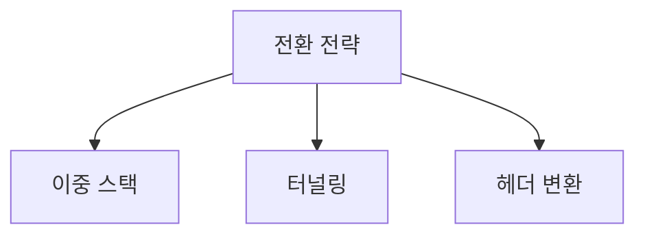
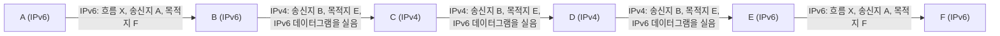
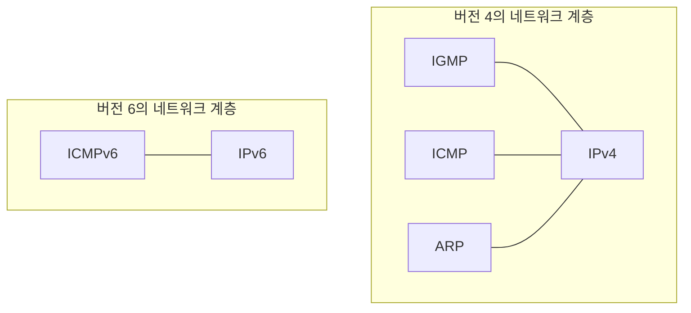
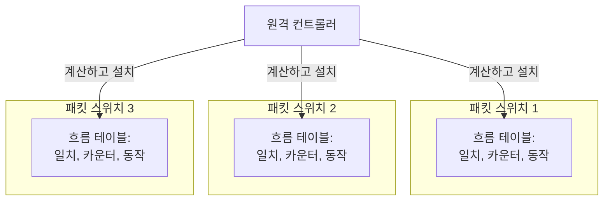
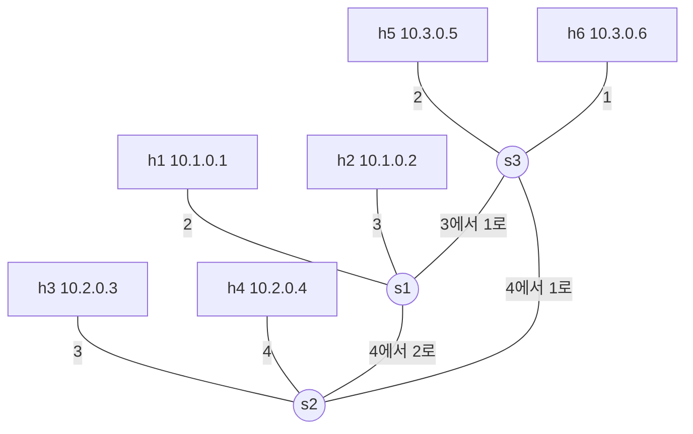

# 24장 — IPv6와 일반화된 포워딩

[레포지토리 안내](../../README.ko.md) | [English](Concepts_Lecture.md) | [한국어](Concepts_Lecture.ko.md)

> **최종 수정일:** 2026-11-18
>
> Computer Networking: A Top-Down Approach, Kurose and Ross, Ch 4; TCP/IP Protocol Suite, Forouzan, Ch 26, 27, 28

> **학습 목표:**
> 1. IPv6가 개발된 이유와 그 도입이 느린 이유를 설명할 수 있다
> 2. IPv6 주소를 완전한 형태와 축약한 형태의 콜론 16진 표기법으로 쓰고 주요 주소 유형과 블록을 식별할 수 있다
> 3. IPv6 기본 헤더의 필드, 확장 헤더, IPv6가 없앤 IPv4 필드를 설명할 수 있다
> 4. IPv4에서 IPv6로의 전환을 위한 이중 스택, 터널링, 헤더 변환 전략을 비교할 수 있다
> 5. ICMPv6의 오류, 정보, 이웃 탐색, 그룹 가입 메시지를 정리할 수 있다
> 6. 포워딩, 부하 분산, 방화벽을 위한 일치 더하기 동작 흐름 테이블 항목을 작성할 수 있다

---

## 목차

- [1. IPv6가 필요한 이유](#1-ipv6가-필요한-이유)
  - [1.1 주소 고갈과 그 밖의 동기](#11-주소-고갈과-그-밖의-동기)
  - [1.2 도입이 느린 이유](#12-도입이-느린-이유)
- [2. IPv6 주소](#2-ipv6-주소)
  - [2.1 표기법](#21-표기법)
  - [2.2 주소 공간](#22-주소-공간)
  - [2.3 세 가지 주소 유형](#23-세-가지-주소-유형)
  - [2.4 주소 공간 할당](#24-주소-공간-할당)
  - [2.5 전역 유니캐스트 주소](#25-전역-유니캐스트-주소)
  - [2.6 자동 설정과 번호 재지정](#26-자동-설정과-번호-재지정)
- [3. IPv6 데이터그램](#3-ipv6-데이터그램)
  - [3.1 기본 헤더](#31-기본-헤더)
  - [3.2 흐름 레이블](#32-흐름-레이블)
  - [3.3 IPv4에서 없어진 필드](#33-ipv4에서-없어진-필드)
  - [3.4 확장 헤더](#34-확장-헤더)
- [4. IPv4에서 IPv6로의 전환](#4-ipv4에서-ipv6로의-전환)
  - [4.1 플래그 데이는 없다](#41-플래그-데이는-없다)
  - [4.2 이중 스택](#42-이중-스택)
  - [4.3 터널링](#43-터널링)
  - [4.4 헤더 변환](#44-헤더-변환)
- [5. ICMPv6](#5-icmpv6)
  - [5.1 셋을 하나로 합친 프로토콜](#51-셋을-하나로-합친-프로토콜)
  - [5.2 오류 메시지와 정보 메시지](#52-오류-메시지와-정보-메시지)
  - [5.3 이웃 탐색과 그룹 가입](#53-이웃-탐색과-그룹-가입)
- [6. 일반화된 포워딩](#6-일반화된-포워딩)
  - [6.1 일치 더하기 동작](#61-일치-더하기-동작)
  - [6.2 흐름 테이블](#62-흐름-테이블)
  - [6.3 일치](#63-일치)
  - [6.4 동작](#64-동작)
  - [6.5 OpenFlow의 예](#65-openflow의-예)
- [개념 적용](#개념-적용)
- [요약](#요약)
- [점검 문제](#점검-문제)

---

<br>

## 1. IPv6가 필요한 이유

### 1.1 주소 고갈과 그 밖의 동기

1990년대 초 인터넷 엔지니어링 태스크 포스(IETF)는 IPv4의 후속 프로토콜 개발을 시작했다. 가장 큰 동기는 새 서브넷과 노드가 놀라운 속도로 인터넷에 연결되면서 32비트 IPv4 주소 공간이 바닥나고 있다는 인식이었다. 주소가 언제 바닥날지에 대한 추정은 크게 달랐지만, 인터넷 규모로 새 기술을 배치하는 데 오랜 시간이 걸린다는 것은 알려져 있었으므로 IP 버전 6의 개발이 일찍 시작되었다. 2011년 2월 IANA는 남아 있던 마지막 미배정 IPv4 주소 풀을 지역 등록 기관에 할당했으며, 따라서 등록 기관들이 자기 풀을 다 쓰면 더는 중앙 풀에서 주소 블록을 할당할 수 없다. (버전 5는 배치되지 않았다. 이 번호는 실험적 프로토콜 ST-2를 위한 것이었으나 ST-2는 나중에 폐기되었다.)

설계자들은 이 기회에 운용 경험을 바탕으로 IPv4의 다른 면도 고쳤다. Forouzan은 주요 변경을 다음과 같이 정리한다.

- **더 큰 주소 공간.** IPv6 주소는 128비트로, IPv4보다 $`2^{96}`$배 많은 주소를 가진다.
- **더 나은 헤더 형식.** 옵션을 고정된 기본 헤더에서 분리해 필요할 때만 넣으므로 대부분의 라우터가 옵션을 검사할 필요가 없어 포워딩이 단순하고 빨라진다.
- **새 옵션과 확장 여지.** 새 옵션이 기능을 더하고, 새 기술과 응용을 위해 프로토콜을 확장할 수 있다.
- **자원 할당 지원.** 서비스 종류 필드를 트래픽 클래스 필드와 흐름 레이블 필드로 바꾸어, 송신지가 실시간 음성과 영상 같은 트래픽에 특별한 처리를 요청할 수 있다.
- **강화된 보안 지원.** 암호화와 인증 확장 헤더가 기밀성과 무결성을 제공한다.

### 1.2 도입이 느린 이유

IPv6의 도입은 느렸다. 클래스 없는 주소 지정, DHCP의 동적 할당, NAT라는 세 가지 단기 처방이 IPv4 주소 고갈을 완화했기 때문이다(12장). Kurose는 더 넓은 교훈을 끌어낸다. 네트워크 계층 프로토콜을 바꾸기는 매우 어렵다. 새 네트워크 계층 프로토콜을 들여오는 일은 집의 기초를 바꾸는 것과 같아서, 집을 허물거나 적어도 거주자를 잠시 옮기지 않고는 하기 어렵다. 반면 새 응용 계층 프로토콜을 들여오는 일은 집에 페인트를 한 겹 더 칠하는 것과 같아서 쉽고, 색이 보기 좋으면 이웃들이 따라 한다. 따라서 인터넷 네트워크 계층의 변화는 응용 계층의 변화보다 훨씬 느린 시간 규모로 일어난다.

---

<br>

## 2. IPv6 주소

### 2.1 표기법

> **용어 정의:** **IPv6 주소(IPv6 address)** 는 IPv6에서 인터페이스 하나나 인터페이스 그룹을 식별하는 128비트(16바이트) 주소이다.

128비트를 점-십진 표기법으로 쓰면 수가 16개나 되어 너무 길다. 그래서 IPv6는 **콜론 16진 표기법(colon hexadecimal notation)** 을 쓴다. 128비트를 2바이트씩 여덟 구간으로 나누어 각 구간을 16진수 네 자리로 쓰고, 구간 사이를 콜론으로 구분한다.

```text
FDEC:BA98:7654:3210:ADBF:BBFF:2922:FFFF
```

주소의 자릿수 가운데 0이 많은 경우가 흔하므로 두 가지 축약을 허용한다.

1. **앞자리 0.** 구간의 앞자리 0은 생략할 수 있다. 0074는 74로, 000F는 F로, 0000은 0으로 쓴다. 뒷자리 0은 생략할 수 없으므로 3210은 그대로 3210이다.
2. **제로 압축.** 0으로만 이루어진 연속 구간 하나를 이중 콜론(::)으로 바꿀 수 있다.

> **용어 정의:** **제로 압축(zero compression)** 은 IPv6 주소에서 모두 0인 연속 구간 하나를 이중 콜론으로 바꾸는 축약이다.

제로 압축은 주소마다 한 번만 쓸 수 있다. 그렇지 않으면 생략한 구간의 수가 모호해진다. 0인 구간이 연속된 곳이 둘이면 그 가운데 하나, 보통 더 긴 쪽만 압축한다.

```text
Original:          FDEC:0000:0000:0000:0000:BBFF:0000:FFFF
Leading zeros:     FDEC:0:0:0:0:BBFF:0:FFFF
Zero compressed:   FDEC::BBFF:0:FFFF
```

*그림 1. IPv6 주소의 축약*

**혼합 표현.** 전환 기간에는 IPv4 주소를 IPv6 주소의 오른쪽 32비트에 넣을 수 있다. 그러면 왼쪽 여섯 구간은 콜론 16진 표기법으로, 마지막 4바이트는 점-십진 표기법으로 써서 ::FFFF:24.123.12.6처럼 나타낸다.

**CIDR 표기법.** IPv6는 계층적이고 클래스 없는 주소 지정을 쓰므로 블록을 FDEC::BBFF:0:FFFF/60처럼 접두사 길이와 함께 쓴다.

| 예제 | 축약하지 않은 형태 | 축약한 형태 |
|:--|:--|:--|
| 26.1a, 26.2a | 0000:0000:0000:0000:FFFF:FFFF:FFFF:FFFF | ::FFFF:FFFF:FFFF:FFFF |
| 26.1b, 26.2b | 0000:0000:0000:0000:0000:0000:0000:0000 | :: |
| 26.1c, 26.2c | FFFF:FFFF:FFFF:FFFF:FFFF:FFFF:FFFF:FFFF | (축약할 수 없음) |
| 26.3a | 0000:0000:FFFF:0000:0000:0000:0000:0000 | 0:0:FFFF:: |
| 26.3b | 1234:2346:0000:0000:0000:0000:0000:1111 | 1234:2346::1111 |
| 26.3c | 0000:0001:0000:0000:0000:0000:1200:1000 | 0:1::1200:1000 |
| 26.4d | AAAA:000A:00AA:0000:0000:0000:0000:1234 | AAAA:A:AA::1234 |

*표 1. 축약하지 않은 형태와 축약한 형태의 IPv6 주소*

26.3a에는 0의 연속이 둘 있는데, 길이가 두 구간과 다섯 구간이므로 더 긴 쪽을 압축한다. 축약한 주소를 펼칠 때(예제 26.4)는 먼저 각 구간의 앞자리 0을 되살리고, ::를 구간이 여덟이 되도록 필요한 만큼의 0000 구간으로 바꾼다. 1111::2222에는 구간이 둘 있으므로 ::는 여섯 구간을 나타낸다.

### 2.2 주소 공간

IPv6의 주소 공간에는 $`2^{128}`$개의 주소가 있으며, 이는 IPv4 주소 공간의 $`2^{96}`$배이다.

```text
2^128 = 340,282,366,920,938,463,463,374,607,431,768,211,456
```

Forouzan은 그 크기를 이렇게 보여 준다. 지구의 인구가 곧 $`2^{34}`$명(160억 명 이상)에 이른다고 해도 한 사람이 주소를 $`2^{94}`$개씩 가질 수 있다(예제 26.5). 매년 $`2^{60}`$개의 주소를 배정해도 다 쓰는 데 $`2^{68}`$년이 걸린다(예제 26.6). 지구의 표면은 약 $`2^{60}`$제곱미터이므로 제곱미터마다 컴퓨터를 $`2^{68}`$대씩 연결할 수 있다(예제 26.7).

### 2.3 세 가지 주소 유형

IPv6에서 목적지 주소는 세 범주 가운데 하나에 속한다.

- **유니캐스트 주소.** 컴퓨터나 라우터의 인터페이스 하나를 정의하며, 이 주소로 보낸 패킷은 그 인터페이스에 전달된다.
- **애니캐스트 주소.** 컴퓨터 그룹이 함께 쓰는 주소이며, 패킷은 그룹의 구성원 하나에게만 전달된다.
- **멀티캐스트 주소.** 역시 그룹을 정의하지만, 그룹의 모든 구성원이 패킷의 사본을 받는다.

> **용어 정의:** **애니캐스트 주소(anycast address)** 는 인터페이스 그룹이 함께 쓰는 IPv6 주소로, 이 주소로 보낸 패킷은 구성원 하나, 가장 도달하기 쉬운 구성원에게만 전달된다.

애니캐스트는 예를 들어 여러 서버가 같은 질의에 답할 수 있을 때 쓰인다. 요청의 사본 하나가 가장 도달하기 쉬운 서버 하나에만 간다. Kurose는 어떤 문서를 가진 여러 미러 사이트 가운데 가장 가까운 곳에 HTTP GET을 보내는 예를 든다. IPv6는 애니캐스트용 블록을 따로 지정하지 않으며, 애니캐스트 주소는 유니캐스트 블록에서 가져온다. IPv6에는 제한된 형태조차 브로드캐스트 주소가 전혀 없으며, 브로드캐스트는 멀티캐스트의 특수한 경우로 다룬다.

### 2.4 주소 공간 할당

IPv4 공간처럼 IPv6 공간도 용도별로 크기가 다른 블록들로 나뉘며, 대부분은 아직 배정되지 않았다. 표 2는 가장 중요한 블록들이다.

| 블록 (CIDR) | 앞 비트 | 용도 |
|:--|:--|:--|
| ::/128 | 모두 0 | 미지정 주소 |
| ::1/128 | 0들 뒤에 1 | 루프백 주소 |
| ::FFFF:0:0/96 | 0 80개, 1 16개 | IPv4 대응 주소 |
| 2000::/3 | 001 | 전역 유니캐스트 주소 |
| FC00::/7 | 1111 110 | 고유 로컬 유니캐스트 주소 |
| FE80::/10 | 1111 1110 10 | 링크 로컬 주소 |
| FF00::/8 | 1111 1111 | 멀티캐스트 주소 |

*표 2. IPv6 주소 공간의 중요한 블록*

- **미지정 주소(::).** 호스트가 자기 주소를 모르는 부트스트랩 때 송신지 주소로 쓰며, 결코 목적지가 되어서는 안 된다. IPv4의 0.0.0.0에 해당한다(12장).
- **루프백 주소(::1).** 호스트가 네트워크로 나가지 않고 자신을 시험할 때 쓴다. 블록 127.0.0.0/8 전체를 예약하는 IPv4와 달리 IPv6는 주소 하나만 예약한다.
- **IPv4 대응 주소.** 0 80개, 1 16개, 32비트 IPv4 주소로 이루어진 ::FFFF:2.13.17.14 같은 주소는 IPv4 호스트를 나타내며, IPv6 호스트가 아직 IPv4를 쓰는 호스트와 통신할 때 쓰인다(4.4절).
- **전역 유니캐스트 블록(2000::/3).** 인터넷의 유니캐스트 통신을 위한 주 블록이다. 전체 공간의 8분의 1, 즉 $`2^{128} / 2^{3} = 2^{125}`$개의 주소를 차지한다(예제 26.8).
- **고유 로컬 유니캐스트 블록(FC00::/7).** IPv4의 사설 블록처럼 사이트가 그 하위 블록을 사설로 만들어 쓸 수 있으며, 이런 목적지 주소를 가진 패킷은 인터넷에서 라우팅되지 않는다고 본다. 식별용 7비트와 1비트 뒤에 사이트가 40비트 무작위 수를 고르므로, 두 사이트가 같은 하위 블록을 고를 가능성은 매우 낮다.
- **멀티캐스트 블록(FF00::/8).** 접두사 11111111 뒤에 4비트 플래그가 그룹 주소가 영구적인지(인터넷 기관이 배정) 일시적인지(예를 들어 화상 회의가 잠시 씀)를 나타내고, 4비트 범위(scope)가 그룹이 퍼지는 범위를 나타낸다. 링크 로컬(2), 사이트 로컬(5), 조직 로컬(8), 전역(E) 등이 있다.

> **용어 정의:** **링크 로컬 주소(link-local address)** 는 호스트가 스스로 만드는 FE80::/10 블록의 IPv6 주소로, 그 인터페이스가 연결된 링크 안의 통신에서만 유효하다.

링크 로컬 주소는 10비트 접두사 1111111010, 0인 비트 54개, 64비트 인터페이스 식별자로 이루어진다. 모든 IPv6 인터페이스는 링크 로컬 주소를 하나씩 가지며, 라우터는 링크 로컬 목적지를 가진 패킷을 다른 링크로 결코 포워딩하지 않는다.

### 2.5 전역 유니캐스트 주소

전역 유니캐스트 블록의 주소는 세 단계의 계층을 가진다.

```text
|<------- n = 48 bits ------->|<-- 16 bits -->|<---------- m = 64 bits ---------->|
+-----------------------------+---------------+-----------------------------------+
|    Global routing prefix    |   Subnet ID   |        Interface identifier       |
+-----------------------------+---------------+-----------------------------------+
```

*그림 2. 권장 길이로 나눈 전역 유니캐스트 주소의 세 단계*

- **전역 라우팅 접두사(48비트).** 패킷을 인터넷을 거쳐 그 블록을 가진 ISP나 조직 같은 사이트까지 라우팅한다. 처음 3비트가 001로 고정되므로 나머지 45비트로 사이트를 $`2^{45}`$개 정의할 수 있다.
- **서브넷 식별자(16비트).** 조직 안의 서브넷을 정의하므로 조직은 서브넷을 $`2^{16}`$ = 65,536개까지 가질 수 있다.
- **인터페이스 식별자(64비트).** IPv4의 hostid 역할을 하지만, 주소는 인터페이스를 식별하므로(12장) 이 이름이 더 정확하다.

IPv4에서는 hostid와 hostid보다 긴 물리(MAC) 주소 사이에 아무 관계가 없다. IPv6에서는 인터페이스 식별자가 물리 주소를 담을 만큼 길어서 대응 과정이 필요 없다. 48비트 이더넷 MAC 주소는 두 단계로 64비트 인터페이스 식별자에 대응시킨다. 첫 바이트의 일곱째 비트(로컬/전역 비트)를 0에서 1로 바꾸고, 가운데에 16비트 FFFE(1 15개와 0 하나)를 끼워 넣는다.

```text
Ethernet MAC address:    F5-A9-23-14-7A-D2
First byte:              F5 = 11110101  ->  11110111 = F7   (seventh bit set to 1)
Insert FFFE:             F7 A9 23 | FF FE | 14 7A D2
Interface identifier:    F7A9:23FF:FE14:7AD2
```

*그림 3. 이더넷 MAC 주소를 인터페이스 식별자로 대응시키기*

**예제 26.14.** 어떤 조직이 블록 2000:1456:2474::/48을 배정받았고, 물리 주소가 F5-A9-23-14-7A-D2인 컴퓨터가 서브넷 식별자 0003인 셋째 서브넷에 있다. 전역 라우팅 접두사, 서브넷 식별자, 그림 3의 인터페이스 식별자를 합치면 주소 2000:1456:2474:0003:F7A9:23FF:FE14:7AD2가 되며, 이를 2000:1456:2474:3:F7A9:23FF:FE14:7AD2로 축약한다.

### 2.6 자동 설정과 번호 재지정

IPv4에서 호스트는 수동으로 또는 DHCP로 설정된다(12장). IPv6에서도 DHCP를 쓸 수 있지만, 호스트는 네트워크에 들어올 때 스스로 설정할 수도 있다.

1. 호스트는 10비트 링크 로컬 접두사에 0 54개를 붙이고, 인터페이스 카드에서 만든 64비트 인터페이스 식별자를 덧붙여 링크 로컬 주소를 만든다. 그림 3의 카드라면 결과는 FE80::F7A9:23FF:FE14:7AD2이다.
2. 호스트는 이웃 요청 메시지를 보내고 이웃 광고를 기다려 이 링크 로컬 주소가 유일한지 확인한다(5.3절). 서브넷의 다른 호스트가 이 주소를 쓰고 있으면 자동 설정은 실패하고, 호스트는 DHCP 같은 다른 방법을 써야 한다.
3. 주소가 유일하면 호스트는 이를 링크 안의 통신용으로 보관한다. 전역 유니캐스트 주소를 얻기 위해 호스트는 라우터 요청 메시지를 보낸다. 네트워크의 라우터는 전역 라우팅 접두사와 서브넷 식별자를 담은 라우터 광고로 응답하고, 호스트는 여기에 자기 인터페이스 식별자를 덧붙인다. 라우터가 도울 수 없으면 광고에서 (플래그로) 그렇게 알리고, 호스트는 다른 방법을 쓴다.

**번호 재지정(renumbering)** 은 사이트가 서비스 제공자를 바꿀 수 있도록 IPv6에 들어 있는 기능이다. 사이트는 제공자에게서 접두사를 받으므로 제공자를 바꾸면 접두사가 바뀐다. 사이트가 연결된 라우터는 새 접두사를 광고하면서 사이트가 이전 접두사를 잠시 더 쓰다가 끄게 할 수 있으며, 그래서 전환 기간에 사이트는 접두사를 둘 가진다. 주된 어려움은 DNS가 각 도메인 이름과 결부된 새 주소를 전파해야 한다는 점이다(5장).

---

<br>

## 3. IPv6 데이터그램

### 3.1 기본 헤더

IPv6 데이터그램은 필수인 40바이트 기본 헤더와 그 뒤의 페이로드로 이루어지며, 페이로드는 선택적 확장 헤더와 상위 계층의 데이터로 구성되어 모두 합쳐 최대 65,535바이트이다.

```text
 0 1 2 3 4 5 6 7 8 9 0 1 2 3 4 5 6 7 8 9 0 1 2 3 4 5 6 7 8 9 0 1
+-------+---------------+---------------------------------------+
|Version| Traffic class |               Flow label              |
+-------+---------------+-------+---------------+---------------+
|         Payload length        |  Next header  |   Hop limit   |
+-------------------------------+---------------+---------------+
|                         Source address                        |
|                           (128 bits)                          |
+---------------------------------------------------------------+
|                      Destination address                      |
|                           (128 bits)                          |
+---------------------------------------------------------------+
|                              Data                             |
+---------------------------------------------------------------+
```

*그림 4. IPv6 데이터그램 형식*

| 필드 | 비트 | 의미 |
|:--|:--|:--|
| 버전 | 4 | IP 버전 번호, IPv6는 6, 여기에 4를 넣어도 올바른 IPv4 데이터그램이 되지 않음 |
| 트래픽 클래스 | 8 | IPv4의 TOS 필드처럼 흐름 안의 데이터그램이나 특정 응용의 데이터그램에 주는 우선순위 |
| 흐름 레이블 | 20 | 데이터그램 흐름의 식별(3.2절) |
| 페이로드 길이 | 16 | 고정된 40바이트 헤더 뒤의 바이트 수, 부호 없는 정수 |
| 다음 헤더 | 8 | 뒤따르는 헤더, 확장 헤더나 상위 계층 프로토콜이며 IPv4 프로토콜 필드와 같은 값 사용 |
| 홉 한도 | 8 | 라우터마다 1씩 줄고 0이 되면 데이터그램을 버림, IPv4의 TTL과 같음 |
| 송신지 주소 | 128 | 원래 송신지의 주소 |
| 목적지 주소 | 128 | 최종 목적지의 주소 (소스 라우팅을 쓰면 다음 라우터의 주소) |

*표 3. IPv6 기본 헤더의 필드*

고정 필드를 모두 더하면 4 + 8 + 20 + 16 + 8 + 8 + 128 + 128 = 320비트, 정확히 40바이트이다. 트래픽 클래스로는 예를 들어 IP 음성 데이터그램을 SMTP 전자 메일보다 우선할 수 있다.

### 3.2 흐름 레이블

IPv6 명세인 RFC 2460은 흐름을 "for which the sender requests special handling, such as a non-default quality of service or real-time service"인 패킷으로 설명하며, Kurose가 이를 인용한다. 음성과 영상 전송은 흐름으로 다룰 수 있지만 파일 전송과 전자 메일은 그렇지 않을 수 있으며, 더 나은 서비스에 돈을 내는 사용자의 트래픽도 흐름일 수 있다. 흐름의 정확한 의미는 정해지지 않은 채 남았지만, 설계자들은 흐름을 구별할 필요가 생기리라고 내다보았다.

Forouzan은 라우터가 이 레이블을 쓰는 방법을 설명한다. 라우터에게 흐름은 같은 경로, 같은 자원, 같은 종류의 보안 같은 특성을 공유하는 패킷의 열이다. 흐름 레이블을 처리하는 라우터는 활성 레이블마다 항목을 두는 흐름 레이블 테이블을 가지며, 각 항목은 그 흐름에 필요한 서비스를 정의한다. 표의 정보는 홉별 옵션이나 다른 프로토콜 같은 다른 수단으로 제공된다. 가장 단순한 용도로, 라우터는 포워딩 알고리즘을 돌리는 대신 흐름 레이블 테이블에서 다음 홉을 찾아 처리를 빠르게 할 수 있으며, 이는 MPLS의 레이블과 비슷하다(13장). 두 가지 규칙이 있다. 흐름 레이블을 지원하지 않는 호스트나 라우터는 이 필드를 0으로 두거나 무시하며, 한 흐름의 모든 패킷은 송신지, 목적지, 우선순위, 옵션이 같다.

### 3.3 IPv4에서 없어진 필드

IPv6 형식을 11장의 IPv4 형식과 비교하면 더 단순하고 간결한 헤더가 보인다. IPv4의 여러 필드가 더는 없다.

- **단편화와 재조립.** IPv6는 중간 라우터에서의 단편화를 허용하지 않는다. 단편화와 재조립은 송신지와 목적지만 할 수 있다. 나가는 링크에 비해 너무 큰 데이터그램을 받은 라우터는 이를 버리고 송신자에게 Packet Too Big ICMPv6 메시지를 보내며, 송신자는 더 작은 데이터그램으로 데이터를 다시 보낸다. 송신지는 경로 MTU 발견(11장)으로 알맞은 크기를 찾으며, 그렇게 하지 않으면 인터넷에 연결된 모든 네트워크에 요구되는 최소 MTU인 1,280바이트 이하의 데이터그램을 쓴다. 시간이 많이 드는 이 작업을 라우터에서 없애면 포워딩이 크게 빨라진다.
- **헤더 체크섬.** 전송 계층 프로토콜(TCP, UDP)과 링크 계층 프로토콜(이더넷)이 이미 체크섬을 계산하므로 설계자들은 네트워크 계층의 체크섬을 중복으로 보았다. IPv4에서는 TTL이 라우터마다 바뀌어 체크섬을 홉마다 다시 계산해야 했는데, IPv6는 이 비싼 작업을 피한다.
- **옵션.** 옵션 필드는 더는 표준 헤더의 일부가 아니다. 사라진 것이 아니라, TCP나 UDP가 다음 헤더가 될 수 있듯이 가능한 다음 헤더 가운데 하나가 되었다. 옵션을 없앤 결과 헤더는 40바이트 고정 길이가 된다.

| IPv4 필드 | IPv6에서는 |
|:--|:--|
| 헤더 길이 | 없어짐, 기본 헤더의 길이가 고정 |
| 서비스 유형 | 트래픽 클래스와 흐름 레이블로 대체 |
| 전체 길이 | 페이로드 길이로 대체 |
| 식별자, 플래그, 오프셋 | 단편화 확장 헤더로 이동 |
| TTL | 홉 한도로 이름 변경 |
| 프로토콜 | 다음 헤더로 대체 |
| 헤더 체크섬 | 없어짐 |
| 옵션 | 확장 헤더로 구현 |

*표 4. IPv4 헤더 필드의 변화*

### 3.4 확장 헤더

> **용어 정의:** **확장 헤더(extension header)** 는 IPv6 기본 헤더와 상위 계층 데이터 사이에 놓이는 선택적 헤더로, 그 앞 헤더의 다음 헤더 필드가 이를 식별한다.

기본 헤더 뒤에는 여섯 종류까지의 확장 헤더가 올 수 있으며, 그 가운데 많은 것이 IPv4의 옵션이었다. 각 확장 헤더는 자기 다음 헤더 필드로 시작하므로 헤더들은 상위 계층 프로토콜로 끝나는 사슬을 이룬다.


*그림 5. 다음 헤더 필드로 이어진 확장 헤더의 사슬*

| 코드 | 다음 헤더 | 코드 | 다음 헤더 |
|:--|:--|:--|:--|
| 0 | 홉별 옵션 | 44 | 단편화 |
| 6 | TCP | 50 | 암호화 보안 페이로드 |
| 17 | UDP | 51 | 인증 |
| 43 | 소스 라우팅 | 59 | 다음 헤더 없음 |
| | | 60 | 목적지 옵션 |

*표 5. 다음 헤더 필드의 값*

- **홉별 옵션.** 송신지가 데이터그램이 방문하는 모든 라우터에 관리, 디버깅, 제어 정보 같은 정보를 전한다. 정의된 옵션은 셋이다. 정렬용으로 모든 비트가 0인 1바이트 옵션 **Pad1**, 2바이트 이상의 정렬용 **PadN**, 65,535바이트보다 긴 페이로드를 정의하는 **점보 페이로드**이다. 각 옵션의 코드에서 처음 2비트는 그 옵션을 모르는 라우터가 옵션을 건너뛸지 데이터그램을 버릴지(ICMPv6 메시지를 보낼지 포함)를 알려 주고, 셋째 비트는 옵션 값이 전송 중에 바뀔 수 있는지를 알려 준다.
- **목적지 옵션.** 송신지가 목적지에만 정보를 전하며, 중간 라우터는 이 정보에 접근할 수 없다. 지금은 Pad1과 PadN만 정의되어 있다.
- **소스 라우팅.** IPv4의 엄격한 소스 라우팅과 느슨한 소스 라우팅(11장)을 합친 것이다. 방문할 라우터를 나열하고, 남은 주소 필드가 아직 필요한 홉 수를 세며, 마스크가 엄격한 라우팅인지 느슨한 라우팅인지를 정한다. IPv4의 엄격한 소스 라우팅처럼 기본 헤더의 목적지 주소가 라우터마다 바뀐다.
- **단편화.** 단편화 오프셋, M 비트, 단편 식별자를 담으며, 원래 송신지만 단편화한다.
- **인증.** 송신자를 검증하고 데이터가 변조되지 않았음을 보장한다. 보안 매개변수 색인이 알고리즘을 정하고, 인증 데이터 필드는 비밀 키와 데이터그램에서 계산한 값을 담으며, 이때 홉 한도처럼 전송 중에 바뀌는 필드는 0으로 둔다.
- **암호화 보안 페이로드(ESP).** 기밀성을 제공하고 도청을 막는다. 보안 매개변수 색인과 암호화된 데이터를 담는다. 인증과 ESP는 IPsec의 바탕이다(26장).

| 소스 라우팅의 예 | 기본 헤더의 목적지 | 확장 헤더의 주소 | 남은 주소 |
|:--|:--|:--|:--|
| A에서 R1으로 | R1 | R2, R3, B | 3 |
| R1에서 R2로 | R2 | R1, R3, B | 2 |
| R2에서 R3으로 | R3 | R1, R2, B | 1 |
| R3에서 B로 | B | R1, R2, R3 | 0 |

*표 6. 소스 라우팅 헤더로 경로 A, R1, R2, R3, B를 따라 B에 보내는 호스트 A*

IPv4의 옵션은 IPv6에 다음과 같이 대응한다. 무연산과 옵션 끝은 Pad1과 PadN이 되었고, 경로 기록과 타임스탬프는 쓰이지 않았으므로 옮겨지지 않았으며, 소스 라우팅 옵션은 소스 라우팅 확장 헤더가 되었고, 단편화 필드는 단편화 헤더로 옮겨졌으며, 인증과 ESP는 새로 생겼다.

---

<br>

## 4. IPv4에서 IPv6로의 전환

### 4.1 플래그 데이는 없다

새 IPv6 시스템은 IPv4 데이터그램을 보내고 라우팅하고 받을 수 있도록 하위 호환되게 만들 수 있지만, 이미 배치된 IPv4 시스템은 IPv6 데이터그램을 처리할 수 없다. 한 가지 방법은 플래그 데이(flag day), 즉 인터넷의 모든 기계를 끄고 업그레이드하는 특정 날짜를 정하는 것이다. 신뢰적 전송을 NCP에서 TCP로 바꾼 지난번의 큰 전환 때도 인터넷이 매우 작았음에도 플래그 데이는 불가능하다는 것이 드러났으며, 수십억 대의 장치가 관련된 플래그 데이는 생각할 수도 없다. 따라서 전환은 부드럽게 이루어져야 하며, IETF는 세 가지 전략을 고안했다.



*그림 6. IPv4에서 IPv6로의 전환을 위한 세 전략*

### 4.2 이중 스택

> **용어 정의:** **이중 스택(dual stack)** 은 호스트나 라우터가 IPv4와 IPv6를 동시에 실행하여 어느 버전의 시스템과도 통신할 수 있게 하는 구성이다.

모든 호스트는 IPv6로 완전히 옮기기 전까지, 즉 인터넷 전체가 IPv6를 쓸 때까지 이중 스택을 실행할 것이 권장된다. 목적지에 어느 버전을 쓸지 정하기 위해 송신지는 DNS에 질의한다(5장). DNS가 IPv4 주소(A 레코드)를 돌려주면 IPv4 패킷을, IPv6 주소(AAAA 레코드)를 돌려주면 IPv6 패킷을 보낸다.

```text
+-----------------------------------------------+
|        Transport and application layers       |
+-----------------------+-----------------------+
|          IPv4         |          IPv6         |
+-----------------------+-----------------------+
|        Underlying LAN or WAN technology       |
+-----------------------------------------------+
     to IPv4 systems          to IPv6 systems
```

*그림 7. 이중 스택 호스트*

### 4.3 터널링

> **용어 정의:** **터널링(tunneling)** 은 IPv6 데이터그램 전체를 IPv4 데이터그램의 페이로드에 캡슐화하여, 두 IPv6 노드 사이의 IPv4 라우터 영역을 건너게 하는 것이다.

터널링은 실제로 가장 널리 채택된 방법이다. 그림 8의 두 IPv6 노드 B와 E가 IPv6 데이터그램을 주고받으려 하지만 그 사이에 IPv4 라우터 C와 D가 있다고 하자. 사이에 있는 IPv4 라우터들의 집합을 터널이라고 한다. 터널의 송신 쪽 IPv6 노드 B는 IPv6 데이터그램 전체를 수신 쪽 IPv6 노드 E로 주소를 지정한 IPv4 데이터그램의 데이터 필드에 넣어 C로 보낸다. IPv4 라우터들은 그 안에 IPv6 데이터그램이 있다는 사실을 모른 채 다른 IPv4 데이터그램과 똑같이 포워딩한다. E는 그 IPv4 데이터그램을 받고(E가 목적지이다), 프로토콜 번호가 IPv6 페이로드를 뜻하는 41임을 보고, IPv6 데이터그램을 꺼내어 직접 연결된 IPv6 이웃에게서 받은 것처럼 포워딩한다.



*그림 8. IPv4 라우터 C와 D를 지나 A에서 F로 IPv6 데이터그램을 터널링하는 물리적 모습*

논리적으로 보면 B와 E는 하나의 가상 링크, 즉 터널로 이어져 있다. 터널링은 IPv6 전환을 넘어서는 핵심 개념이다. 모든 것이 IP인 셀룰러 네트워크(25장)와 가상 사설망(26장)에서도 널리 쓰인다.

### 4.4 헤더 변환

헤더 변환은 인터넷의 대부분이 IPv6로 옮겨 갔지만 일부 시스템이 아직 IPv4를 쓸 때 필요하다. 송신자는 IPv6를 쓰려 하지만 수신자는 IPv6를 이해하지 못한다. 패킷이 IPv4 형식으로 수신자에 도착해야 하므로 터널링은 도움이 되지 않으며, IPv4 영역의 경계에서 변환기가 IPv6 헤더를 IPv4 헤더로 바꾼다. 변환은 IPv4 대응 주소를 써서 IPv4 주소를 얻는다. Forouzan은 규칙을 다음과 같이 나열한다.

1. IPv6 대응 주소는 오른쪽 32비트를 꺼내 IPv4 주소로 바꾼다.
2. IPv6 우선순위(트래픽 클래스) 값은 버리고, IPv4 서비스 유형 필드는 0으로 둔다.
3. IPv6 흐름 레이블은 무시한다.
4. 호환되는 확장 헤더는 옵션으로 바꾸어 IPv4 헤더에 넣으며, 일부는 버려야 할 수 있다.
5. IPv4 헤더 길이와 전체 길이를 계산해 넣고, IPv4 체크섬을 계산해 넣는다.

| 전략 | 쓰이는 상황 | 네트워크의 IPv4 부분이 보는 것 |
|:--|:--|:--|
| 이중 스택 | 전환 기간 내내, 호스트와 라우터에서 | 스택의 IPv4 쪽에서 나온 보통의 IPv4 트래픽 |
| 터널링 | IPv4 영역으로 떨어진 두 IPv6 노드 | IPv6 데이터그램을 실은 프로토콜 41의 IPv4 데이터그램 |
| 헤더 변환 | IPv6 송신자와 IPv4만 아는 수신자 | 변환기가 만든 보통의 IPv4 데이터그램 |

*표 7. 세 전환 전략의 비교*

---

<br>

## 5. ICMPv6

### 5.1 셋을 하나로 합친 프로토콜

인터넷 제어 메시지 프로토콜 버전 6(ICMPv6)은 ICMPv4(16장)의 전략과 목적을 따르지만 더 복잡하다. 버전 4의 네트워크 계층에는 IP 옆에 ICMP, ARP, IGMP의 세 보조 프로토콜이 있다. 버전 6에서는 이들이 ICMPv6 하나로 합쳐졌다.



*그림 9. 버전 4와 버전 6의 네트워크 계층*

ICMPv6는 메시지 기반이다. 그 메시지들은 오류를 보고하고, 정보를 얻고, 이웃을 탐색하고, 멀티캐스트 그룹을 관리한다. 메시지는 오류 메시지, 정보 메시지, 이웃 탐색 메시지(이웃 탐색 프로토콜, ND), 그룹 가입 메시지(멀티캐스트 수신자 탐색 프로토콜, MLD)의 네 무리로 나뉜다.

### 5.2 오류 메시지와 정보 메시지

| 유형 | 메시지 | 목적 |
|:--|:--|:--|
| 1 | 목적지 도달 불가 | 라우터가 포워딩하거나 호스트가 전달할 수 없음, 코드 0~6이 이유를 알려 줌(예: 0 경로 없음, 3 주소 도달 불가, 4 포트 도달 불가) |
| 2 | 패킷 너무 큼 | IPv6에서 새로 생김, 데이터그램이 다음 링크의 MTU보다 크며 메시지에 그 MTU를 실음 |
| 3 | 시간 초과 | 코드 0: 홉 한도가 0이 됨, 코드 1: 모든 단편이 제시간에 도착하지 않음 |
| 4 | 매개변수 문제 | 코드 0: 잘못된 헤더 필드, 코드 1: 알 수 없는 다음 헤더 유형, 코드 2: 알 수 없는 IPv6 옵션 |
| 128 | 에코 요청 | ping처럼 두 장치가 통신할 수 있는지 시험 |
| 129 | 에코 응답 | 에코 요청에 응답 |

*표 8. ICMPv6 오류 메시지와 정보 메시지*

각 오류 메시지는 실패한 데이터그램을 메시지에 들어가는 만큼 싣고, 그 데이터그램의 원래 송신지로 보내진다. ICMPv4의 발신지 억제 메시지는 없어졌고, 재지정 메시지는 이웃 탐색 무리로 옮겨졌다.

### 5.3 이웃 탐색과 그룹 가입

> **용어 정의:** **이웃 탐색(neighbor discovery)** 은 같은 링크의 노드들이 라우터를 찾고, 이웃의 링크 계층 주소를 찾고, 주소가 유일한지 확인하는 ICMPv6의 부분이다.

이웃 탐색은 ARP(19장)와 ICMPv4 라우터 탐색의 임무를 넘겨받는다. 그 메시지들은 같은 링크의 노드들이 쓴다.

| 유형 | 메시지 | 목적 |
|:--|:--|:--|
| 133 | 라우터 요청 | 호스트가 자기 데이터그램을 포워딩해 줄 라우터를 찾음 |
| 134 | 라우터 광고 | 라우터가 자신을 알리며, 써야 할 홉 한도, 기본 라우터로서의 수명, 호스트에게 주소 설정 방법을 알려 주는 플래그(M, O), MTU와 주소 접두사 같은 옵션을 실음 |
| 135 | 이웃 요청 | ARP 요청과 같은 임무, 송신자가 이웃의 IPv6 주소를 알고 링크 계층 주소가 필요함 |
| 136 | 이웃 광고 | ARP 응답과 같은 임무, 플래그가 송신자가 라우터인지(R), 요청에 대한 응답인지(S), 캐시 정보를 덮어쓰는지(O)를 알려 줌 |
| 137 | 재지정 | 라우터가 호스트에게 어떤 목적지로 가는 더 나은 첫 홉 라우터를 알려 줌 |
| 141, 142 | 역이웃 요청과 광고 | 이웃의 링크 계층 주소를 아는 노드가 그 IPv6 주소를 찾음 |

*표 9. ICMPv6 이웃 탐색 메시지*

IPv4에서 IGMP가 하는 멀티캐스트 그룹 관리(16장)는 IPv6에서 MLD가 맡는다. MLDv1은 IGMPv2에, MLDv2는 IGMPv3에 대응한다. MLDv2에는 라우터가 활성 그룹 구성원을 찾으려고 보내는 가입 질의 메시지(유형 130)와 가입 보고 메시지(유형 143)가 있다. 그 필드는 그룹 주소와 송신지 주소가 128비트라는 점을 빼면 IGMPv3의 것과 같다.

---

<br>

## 6. 일반화된 포워딩

### 6.1 일치 더하기 동작

13장의 포워딩은 목적지 기반이다. 라우터는 목적지 IP 주소를 조회하고(일치) 패킷을 출력 포트로 보낸다(동작). 그동안 여러 네트워크 계층 기능을 수행하는 미들박스가 늘어났다. NAT 장치는 IP 주소와 포트 번호를 고쳐 쓰고(12장), 방화벽은 헤더 값에 따라 트래픽을 막거나 심층 패킷 검사를 위해 패킷을 돌리며, 부하 분산기는 서비스 요청을 서버 집합 가운데 하나로 포워딩한다. 이 장치들은 2계층 스위치, 3계층 라우터와 함께 각자의 전용 하드웨어, 소프트웨어, 관리 인터페이스를 가져 네트워크 운영자에게 비용이 크다. 소프트웨어 정의 네트워킹(10장)은 이 모든 기능에 통합된 방법을 제공한다.

> **용어 정의:** **일치 더하기 동작 포워딩**(match-plus-action forwarding)은 일반화된 포워딩이라고도 하며, 패킷 스위치가 여러 계층의 여러 헤더 필드 값으로 패킷을 맞추어 일치한 항목의 동작을 적용하는 포워딩이다.

일치는 서로 다른 계층의 여러 프로토콜의 여러 헤더 필드에 대해 이루어질 수 있다. 동작은 패킷을 하나 이상의 출력 포트로 포워딩하거나, 나가는 인터페이스들에 부하를 나누거나, 헤더 값을 고쳐 쓰거나, 패킷을 막거나 버리거나, 추가 처리를 위해 특별한 서버로 보낼 수 있다. 포워딩 결정에 네트워크 계층 주소나 링크 계층 주소를 쓸 수 있으므로, 이런 장치는 라우터(3계층)나 스위치(2계층)보다 패킷 스위치라고 부르는 것이 더 정확하다.

### 6.2 흐름 테이블

> **용어 정의:** **흐름 테이블(flow table)** 은 패킷 스위치의 일치 더하기 동작 표로, 각 항목은 맞출 헤더 필드 값, 카운터, 동작 목록을 가진다.

> **용어 정의:** **OpenFlow** 는 패킷 스위치의 일치 더하기 동작 추상과, 원격 컨트롤러가 그 흐름 테이블을 프로그래밍하는 프로토콜을 정의한 표준이다.

여기서는 SDN의 핵심 추상을 명확하고 간결하게 도입한 OpenFlow 1.0을 따른다. 흐름 테이블의 각 항목에는 다음이 들어 있다.

- **헤더 필드 값.** 들어오는 패킷을 이 값과 맞춘다. 목적지 기반 포워딩처럼 하드웨어 일치는 TCAM(13장)에서 가장 빠르다. 어느 항목과도 일치하지 않는 패킷은 버리거나 추가 처리를 위해 원격 컨트롤러로 보낼 수 있다.
- **카운터.** 패킷이 항목과 일치할 때마다 갱신되며, 일치한 패킷 수나 항목이 마지막으로 갱신된 뒤 지난 시간 같은 값이다.
- **동작.** 패킷이 항목과 일치하면 취하는 동작이다. 출력 포트로 포워딩하거나, 버리거나, 여러 포트로 복사하거나, 헤더 필드를 고쳐 쓴다.



*그림 10. 원격 컨트롤러가 패킷 스위치들의 흐름 테이블을 계산하고 배포하는 구조*

흐름 테이블은 본질적으로 API, 즉 패킷 스위치의 동작을 프로그래밍하는 추상이다. 여러 스위치의 표를 조율하여 프로그래밍하면 네트워크 전체의 동작이 프로그래밍된다. 컨트롤러와 그 프로토콜은 15장의 SDN 제어 평면에서 다룬다.

### 6.3 일치

OpenFlow 1.0은 입력 포트와 세 계층에 걸친 패킷 헤더 필드 11개를 맞출 수 있으며, 이는 2장의 계층화 원칙을 의도적으로 거스른다.

| 계층 | 맞출 수 있는 필드 |
|:--|:--|
| (스위치) | 입력 포트 |
| 링크 계층 | 송신지 MAC, 목적지 MAC, 이더넷 유형, VLAN ID, VLAN 우선순위 |
| 네트워크 계층 | IP 송신지, IP 목적지, IP 프로토콜, IP 서비스 유형 |
| 전송 계층 | TCP/UDP 송신지 포트, TCP/UDP 목적지 포트 |

*표 10. OpenFlow 1.0 흐름 테이블의 패킷 일치 필드*

MAC 주소로 맞추면 OpenFlow 장치는 프레임을 포워딩하는 2계층 스위치(20장)로, IP 주소로 맞추면 데이터그램을 포워딩하는 라우터로 동작할 수 있다. 이더넷 유형은 프레임 페이로드의 상위 계층 프로토콜을 알려 주며, VLAN 필드는 가상 LAN(20장)에 관한 것이다. 최근 OpenFlow 명세에서는 맞출 수 있는 값이 12개에서 41개로 늘었다.

항목에는 와일드카드가 들어갈 수 있다. IP 주소 128.119.\*.\*는 주소가 128.119로 시작하는 모든 데이터그램과 일치한다. 각 항목에는 우선순위도 있으며, 패킷이 여러 항목과 일치하면 우선순위가 가장 높은 항목의 동작을 적용한다. 모든 헤더 필드를 맞출 수 있는 것은 아니다. OpenFlow 1.0은 TTL이나 데이터그램 길이를 맞추지 않는데, 이는 추상을 설계할 때 기능과 복잡도 사이에서 의도적으로 고른 절충이다.

### 6.4 동작

각 흐름 테이블 항목에는 0개 이상의 동작 목록이 있으며, 나열된 순서대로 수행된다. 가장 중요한 동작은 다음과 같다.

- **포워딩.** 패킷을 특정 출력 포트로 포워딩하거나, 도착한 포트를 뺀 모든 포트로 브로드캐스트하거나, 고른 포트 집합으로 멀티캐스트한다. 패킷을 캡슐화하여 원격 컨트롤러로 보낼 수도 있으며, 컨트롤러는 새 항목을 설치하고 갱신된 규칙에 따라 포워딩하도록 패킷을 스위치로 돌려보낼 수 있다.
- **버림.** 동작이 없는 항목은 일치한 패킷을 버린다는 뜻이다.
- **필드 수정.** 패킷을 포워딩하기 전에 헤더 필드 10개, 즉 IP 프로토콜을 뺀 표 10의 2, 3, 4계층 필드 모두의 값을 고쳐 쓸 수 있다.

### 6.5 OpenFlow의 예

그림 11은 Kurose의 예시 네트워크이다. 호스트 여섯과 패킷 스위치 s1, s2, s3이 있으며, 각 스위치에는 1부터 4까지 번호가 붙은 지역 인터페이스가 넷 있고, 모두 OpenFlow 컨트롤러가 제어한다.



*그림 11. 패킷 스위치 셋과 호스트 여섯으로 이루어진 네트워크, 선의 레이블은 인터페이스 번호*

**예 1: 단순 포워딩.** h5나 h6에서 h3이나 h4로 가는 패킷은 s3과 s2 사이의 링크를 피해 s3에서 s1으로, 다시 s1에서 s2로 가야 한다. 세 스위치에 항목이 필요하다.

| 스위치 | 일치 | 동작 |
|:--|:--|:--|
| s3 | IP Src = 10.3.\*.\*, IP Dst = 10.2.\*.\* | Forward(3) |
| s1 | Ingress port = 1, IP Src = 10.3.\*.\*, IP Dst = 10.2.\*.\* | Forward(4) |
| s2 | Ingress port = 2, IP Dst = 10.2.0.3 | Forward(3) |
| s2 | Ingress port = 2, IP Dst = 10.2.0.4 | Forward(4) |

*표 11. 단순 포워딩을 위한 흐름 테이블 항목*

**예 2: 부하 분산.** h3에서 10.1.\*.\*로 가는 데이터그램은 s2와 s1 사이의 직접 링크를, h4에서 10.1.\*.\*로 가는 데이터그램은 s2와 s3 사이의 링크를 거쳐 s3에서 s1으로 가야 한다. 두 흐름의 목적지가 같은 블록에 있으므로 이 동작은 목적지 기반 포워딩으로는 이룰 수 없다.

| 스위치 | 일치 | 동작 |
|:--|:--|:--|
| s2 | Ingress port = 3, IP Dst = 10.1.\*.\* | Forward(2) |
| s2 | Ingress port = 4, IP Dst = 10.1.\*.\* | Forward(1) |

*표 12. 부하 분산을 위한 s2의 흐름 테이블 항목*

s3에도 s2에서 인터페이스 4로 도착한 데이터그램을 인터페이스 3으로 s1 쪽에 포워딩하는 항목이, s1에도 데이터그램을 h1이나 h2로 포워딩하는 항목이 필요하다(점검 문제 6).

**예 3: 방화벽.** 스위치 s2는 어느 인터페이스에서든 s3에 연결된 호스트들이 보낸 트래픽만 받으려 한다.

| 스위치 | 일치 | 동작 |
|:--|:--|:--|
| s2 | IP Src = 10.3.\*.\*, IP Dst = 10.2.0.3 | Forward(3) |
| s2 | IP Src = 10.3.\*.\*, IP Dst = 10.2.0.4 | Forward(4) |

*표 13. 방화벽을 위한 s2의 흐름 테이블 항목*

s2에 다른 항목이 없다면 10.3.\*.\*에서 온 트래픽만 s2에 연결된 호스트에 이르며, 그 밖의 모든 패킷은 어느 항목과도 일치하지 않아 버려진다. 흐름 테이블로 가상 네트워크, 즉 같은 물리 스위치와 링크를 공유하면서 각자의 포워딩 동작을 가지는 논리적으로 분리된 둘 이상의 네트워크를 만들 수도 있다.

> **핵심:** 목적지 기반 포워딩은 목적지 주소만 맞추고 동작은 한 포트로 포워딩하는 것뿐인 일치 더하기 동작의 특수한 경우이다. 일반화된 포워딩은 컨트롤러가 설치한 규칙에 따라 한 종류의 장치가 라우터, 스위치, 방화벽, NAT, 부하 분산기로 동작하게 한다.

---

<br>

## 개념 적용

**T/F 점검:**

| 문장 | 판단과 근거 |
|:--|:--|
| 1234::5678::9ABC는 올바른 축약이다. | **F.** 제로 압축은 한 번만 쓸 수 있으며, 이중 콜론이 둘이면 생략한 구간의 수가 모호하다. |
| IPv6에는 브로드캐스트 주소가 없다. | **T.** 브로드캐스트는 멀티캐스트의 특수한 경우로 다룬다. |
| IPv6 라우터는 다음 링크에 너무 큰 데이터그램을 단편화한다. | **F.** 송신지만 단편화하며, 라우터는 데이터그램을 버리고 Packet Too Big 메시지를 보낸다. |
| IPv6 기본 헤더는 40바이트 고정 길이이다. | **T.** 옵션이 확장 헤더로 옮겨졌으므로 헤더 길이 필드가 없어졌다. |
| 터널링에서 터널 안의 IPv4 라우터는 IPv6 헤더를 검사한다. | **F.** IPv6 데이터그램을 실었다는 것(프로토콜 41)을 모른 채 IPv4 데이터그램을 보통처럼 포워딩한다. |
| ICMPv6는 ARP와 IGMP의 임무를 넘겨받는다. | **T.** 이웃 탐색이 ARP를, MLD가 IGMP를 대신한다. |
| OpenFlow 1.0은 데이터그램의 TTL을 맞출 수 있다. | **F.** TTL과 데이터그램 길이는 맞출 수 있는 필드가 아니다. |
| 동작이 없는 흐름 테이블 항목은 일치한 패킷을 버린다. | **T.** 버림은 빈 동작 목록으로 나타낸다. |

---

<br>

## 요약

| 개념 | 핵심 요약 |
|---------|-----------|
| 동기 | IPv4 주소 고갈이 IPv6를 낳았으며, IPv6는 헤더, 확장성, 자원 할당, 보안도 개선한다. |
| 느린 도입 | CIDR, DHCP, NAT가 필요를 늦추었고, 네트워크 계층의 변화는 본래 느리다. |
| 표기법 | 128비트 주소를 콜론으로 구분한 4자리 16진수 구간 여덟 개로 쓰며, 앞자리 0을 빼고 0의 연속 하나를 ::로 압축한다. |
| 주소 유형 | 유니캐스트는 인터페이스 하나에, 애니캐스트는 그룹의 구성원 하나에, 멀티캐스트는 모든 구성원에 닿으며, 브로드캐스트는 없다. |
| 블록 | ::는 미지정, ::1은 루프백, 2000::/3은 전역 유니캐스트, FC00::/7은 고유 로컬, FE80::/10은 링크 로컬, FF00::/8은 멀티캐스트이다. |
| 전역 유니캐스트 | 48비트 전역 라우팅 접두사, 16비트 서브넷 식별자, 64비트 인터페이스 식별자로 이루어지며, 인터페이스 식별자에는 FFFE를 끼운 MAC 주소를 담을 수 있다. |
| 자동 설정 | 호스트는 링크 로컬 주소를 만들고, 이웃 요청으로 유일성을 확인한 뒤, 라우터 광고에서 전역 접두사를 얻는다. |
| 기본 헤더 | 버전, 트래픽 클래스, 흐름 레이블, 페이로드 길이, 다음 헤더, 홉 한도, 128비트 주소 둘로 된 40바이트 고정 헤더이다. |
| 없어진 필드 | 라우터 단편화, 헤더 체크섬, 헤더 안 옵션이 포워딩을 빠르게 하려고 없어졌다. |
| 확장 헤더 | 홉별, 목적지, 소스 라우팅, 단편화, 인증, ESP 헤더가 다음 헤더 필드로 사슬을 이룬다. |
| 전환 | 이중 스택은 두 버전을 함께 실행하고, 터널링은 IPv6를 IPv4 안에 실으며(프로토콜 41), 헤더 변환은 IPv4만 아는 수신자를 위해 헤더를 바꾼다. |
| ICMPv6 | ICMP, ARP, IGMP를 오류, 정보, 이웃 탐색, MLD 그룹 가입 메시지로 합친다. |
| 일반화된 포워딩 | 패킷 스위치가 여러 계층의 헤더 필드를 맞추고 포워딩, 버림, 수정 같은 동작을 적용하며, 컨트롤러가 OpenFlow 흐름 테이블을 설치한다. |

---

<br>

## 점검 문제

1. **축약과 펼치기:** (a) 2001:0DB8:0000:0000:0008:0800:200C:417A를 축약하라. (b) FDEC::BBFF:0:FFFF를 축약하지 않은 형태로 펼쳐라.

   <details>
   <summary>정답</summary>

   (a) 앞자리 0을 빼면 2001:DB8:0:0:8:800:200C:417A이고, 0인 구간 두 개의 연속을 압축하면 2001:DB8::8:800:200C:417A이다. (b) :: 밖에 구간이 넷 보이므로 ::는 0인 구간 넷을 나타낸다. FDEC:0000:0000:0000:0000:BBFF:0000:FFFF이다.

   </details>

2. **없어진 필드:** IPv6 기본 헤더에 대응하는 필드가 없는 IPv4 헤더 필드를 들고, 각각이 없어진 이유를 설명하라.

   <details>
   <summary>정답</summary>

   기본 헤더가 40바이트로 고정되었으므로 헤더 길이가 없어졌다. 라우터가 더는 단편화하지 않고 송신지만 단편화하여 포워딩이 빨라졌으므로 식별자, 플래그, 단편화 오프셋은 단편화 확장 헤더로 옮겨졌다. 전송 계층과 링크 계층이 이미 오류를 검사하고, IPv4에서 TTL이 바뀌어 홉마다 다시 계산해야 하는 비용이 컸으므로 헤더 체크섬이 없어졌다. 옵션은 확장 헤더가 되었다. (서비스 유형, 전체 길이, TTL, 프로토콜 필드에는 대응하는 필드가 있다. 트래픽 클래스와 흐름 레이블, 페이로드 길이, 홉 한도, 다음 헤더이다.)

   </details>

3. **터널 캡슐화:** 그림 8에서 C에서 D로 가는 링크에서 보이는 송신지 주소, 목적지 주소, 프로토콜이나 다음 헤더 값을 쓰고, E가 이 데이터그램을 어떻게 처리할지 아는 방법을 설명하라.

   <details>
   <summary>정답</summary>

   C에서 D로 가는 링크의 패킷은 송신지 B, 목적지 E(터널 끝점의 IPv4 주소), 프로토콜 41인 IPv4 데이터그램이다. 그 페이로드는 흐름 X, 송신지 A, 목적지 F인 바뀌지 않은 IPv6 데이터그램이다. E는 이 IPv4 데이터그램의 목적지이므로 이를 받아, 페이로드가 IPv6 데이터그램임을 뜻하는 프로토콜 41을 보고, IPv4 헤더를 떼어 낸 뒤 IPv6 이웃에게서 온 것처럼 IPv6 데이터그램을 F 쪽으로 포워딩한다.

   </details>

4. **방화벽 규칙:** 그림 11의 스위치 s2에서 주소와 상관없이 포트 23(TELNET)으로 가는 모든 TCP 세그먼트를 버리는 흐름 테이블 항목을 쓰고, 이 항목이 다른 항목과 어떻게 상호 작용하는지 설명하라.

   <details>
   <summary>정답</summary>

   일치: IP 프로토콜 = 6(TCP), TCP 목적지 포트 = 23, 나머지 필드는 와일드카드. 동작: 없음(빈 동작 목록이 패킷을 버린다). h3으로 가는 TELNET 세그먼트는 IP Dst = 10.2.0.3 → Forward(3) 같은 항목과도 일치하고, 일치한 항목 가운데 우선순위가 가장 높은 항목의 동작이 적용되므로, 이 항목에 포워딩 항목보다 높은 우선순위를 주어야 한다.

   </details>

5. **인터페이스 식별자:** 이더넷 주소가 00-1A-2B-3C-4D-5E인 호스트의 인터페이스 식별자와 링크 로컬 주소를 구하라.

   <details>
   <summary>정답</summary>

   첫 바이트 00 = 00000000은 일곱째 비트를 1로 바꾸면 00000010 = 02가 된다. 가운데에 FFFE를 끼우면 02 1A 2B FF FE 3C 4D 5E, 즉 인터페이스 식별자 021A:2BFF:FE3C:4D5E가 된다. 링크 로컬 주소는 FE80 뒤에 0 54비트와 식별자를 붙인 FE80::21A:2BFF:FE3C:4D5E이다.

   </details>

6. **부하 분산 예의 완성:** 6.5절의 예 2에서 h4에서 10.1.\*.\*로 가는 데이터그램이 h1이나 h2에 이르도록 s3과 s1에 필요한 항목을 쓰라.

   <details>
   <summary>정답</summary>

   s3에서는 데이터그램이 s2에서 인터페이스 4로 도착해 인터페이스 3으로 s1 쪽에 나가야 한다. Ingress port = 4, IP Dst = 10.1.\*.\* → Forward(3)이다. s1에서는 h1과 h2로 가는 데이터그램이 s3에서 인터페이스 1로(h3의 흐름은 s2에서 인터페이스 4로) 도착하여 호스트로 가야 한다. IP Dst = 10.1.0.1 → Forward(2)와 IP Dst = 10.1.0.2 → Forward(3)이다. 이 두 s1 항목에는 입력 포트가 없으므로 두 흐름 모두에 쓰인다.

   </details>
