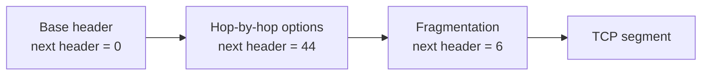
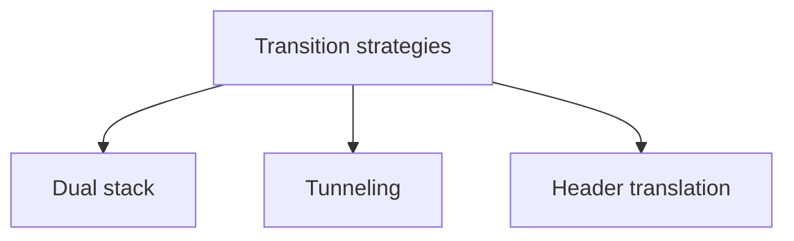
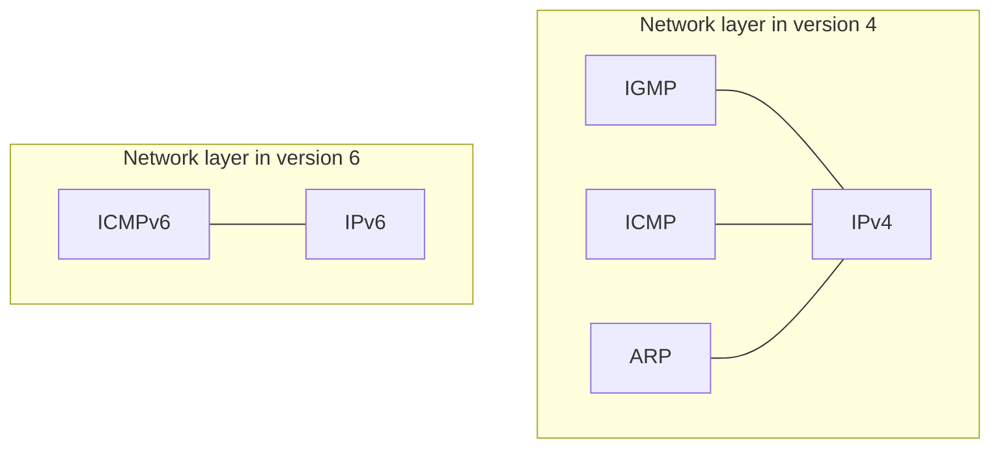
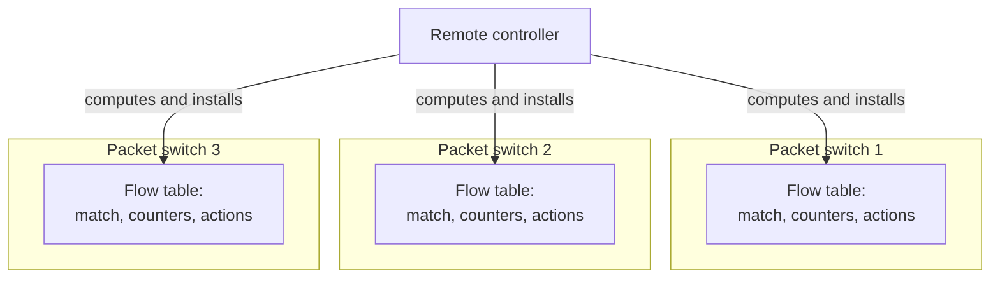
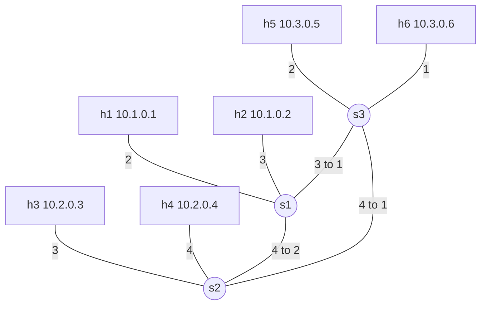

# Chapter 24 — IPv6 and Generalized Forwarding

[Repository Guide](../../README.md) | [English](Concepts_Lecture.md) | [한국어](Concepts_Lecture.ko.md)

> **Last Updated:** 2026-11-18
>
> Computer Networking: A Top-Down Approach, Kurose and Ross, Ch 4; TCP/IP Protocol Suite, Forouzan, Ch 26, 27, 28

> **Learning Objectives:**
> 1. Explain why IPv6 was developed and why its adoption has been slow
> 2. Write IPv6 addresses in full and abbreviated colon hexadecimal notation and identify the main address types and blocks
> 3. Describe the fields of the IPv6 base header, the extension headers, and the IPv4 fields that IPv6 removed
> 4. Compare the dual stack, tunneling, and header translation strategies for the transition from IPv4 to IPv6
> 5. Summarize the error, informational, neighbor-discovery, and group-membership messages of ICMPv6
> 6. Write match-plus-action flow table entries for forwarding, load balancing, and firewalling

---

## Table of Contents

- [1. Why IPv6](#1-why-ipv6)
  - [1.1 Address Depletion and Other Motivations](#11-address-depletion-and-other-motivations)
  - [1.2 Why Adoption Has Been Slow](#12-why-adoption-has-been-slow)
- [2. IPv6 Addresses](#2-ipv6-addresses)
  - [2.1 Notation](#21-notation)
  - [2.2 Address Space](#22-address-space)
  - [2.3 Three Address Types](#23-three-address-types)
  - [2.4 Address Space Allocation](#24-address-space-allocation)
  - [2.5 Global Unicast Addresses](#25-global-unicast-addresses)
  - [2.6 Autoconfiguration and Renumbering](#26-autoconfiguration-and-renumbering)
- [3. The IPv6 Datagram](#3-the-ipv6-datagram)
  - [3.1 Base Header](#31-base-header)
  - [3.2 Flow Label](#32-flow-label)
  - [3.3 Fields Removed from IPv4](#33-fields-removed-from-ipv4)
  - [3.4 Extension Headers](#34-extension-headers)
- [4. Transition from IPv4 to IPv6](#4-transition-from-ipv4-to-ipv6)
  - [4.1 No Flag Day](#41-no-flag-day)
  - [4.2 Dual Stack](#42-dual-stack)
  - [4.3 Tunneling](#43-tunneling)
  - [4.4 Header Translation](#44-header-translation)
- [5. ICMPv6](#5-icmpv6)
  - [5.1 One Protocol for Three](#51-one-protocol-for-three)
  - [5.2 Error and Informational Messages](#52-error-and-informational-messages)
  - [5.3 Neighbor Discovery and Group Membership](#53-neighbor-discovery-and-group-membership)
- [6. Generalized Forwarding](#6-generalized-forwarding)
  - [6.1 Match Plus Action](#61-match-plus-action)
  - [6.2 Flow Tables](#62-flow-tables)
  - [6.3 Match](#63-match)
  - [6.4 Action](#64-action)
  - [6.5 OpenFlow Examples](#65-openflow-examples)
- [Concept Applications](#concept-applications)
- [Summary](#summary)
- [Self-Check Questions](#self-check-questions)

---

<br>

## 1. Why IPv6

### 1.1 Address Depletion and Other Motivations

In the early 1990s, the Internet Engineering Task Force began to develop a successor to IPv4. The prime motivation was the realization that the 32-bit IPv4 address space was being used up, as new subnets and nodes were attached to the Internet at a breathtaking rate. Estimates of when addresses would run out differed widely, but deploying a new technology on the scale of the Internet was known to take a long time, so the work on IP version 6 began early. In February 2011, IANA allocated the last remaining pool of unassigned IPv4 addresses to a regional registry, so once the registries use up their pools, no more address blocks can be allocated from a central pool. (Version 5 was never deployed; the number had been intended for an experimental protocol, ST-2, which was later dropped.)

The designers also used the opportunity to revise other aspects of IPv4 on the basis of operational experience. Forouzan lists the main changes.

- **Larger address space.** An IPv6 address is 128 bits long, $`2^{96}`$ times as many addresses as IPv4.
- **Better header format.** Options are separated from a fixed base header and inserted only when needed, so most routers need not examine them, which simplifies and speeds up forwarding.
- **New options and allowance for extension.** New options add functions, and the protocol can be extended for new technologies and applications.
- **Support for resource allocation.** The type-of-service field is replaced by the traffic class and flow label fields, with which a source can request special handling, for example for real-time audio and video.
- **Support for more security.** Encryption and authentication extension headers provide confidentiality and integrity.

### 1.2 Why Adoption Has Been Slow

The adoption of IPv6 has been slow, because three short-term remedies relieved the depletion of IPv4 addresses: classless addressing, dynamic allocation by DHCP, and NAT (Chapter 12). Kurose draws a broader lesson. It is enormously difficult to change network-layer protocols: introducing a new network-layer protocol is like replacing the foundation of a house, which is hard to do without tearing the house down or at least relocating its residents. Introducing a new application-layer protocol, by contrast, is like adding a new layer of paint, which is easy, and others copy an attractive color. Changes in the Internet's network layer therefore happen on a much slower timescale than changes at the application layer.

---

<br>

## 2. IPv6 Addresses

### 2.1 Notation

> **Definition:** An **IPv6 address** is a 128-bit (16-byte) address that identifies an interface, or a group of interfaces, in IPv6.

Writing 128 bits in dotted-decimal notation would need 16 numbers, which is too long. IPv6 therefore uses **colon hexadecimal notation**: the 128 bits are divided into eight sections of 2 bytes, each written as four hexadecimal digits, and the sections are separated by colons.

```text
FDEC:BA98:7654:3210:ADBF:BBFF:2922:FFFF
```

Many digits of an address are often zeros, so two abbreviations are allowed.

1. **Leading zeros.** The leading zeros of a section can be omitted: 0074 becomes 74, 000F becomes F, and 0000 becomes 0. Trailing zeros cannot be omitted, so 3210 stays 3210.
2. **Zero compression.** One run of consecutive sections that consist only of zeros can be replaced by a double colon (::).

> **Definition:** **Zero compression** is the abbreviation of an IPv6 address that replaces one run of consecutive all-zero sections with a double colon.

Zero compression is allowed only once per address; otherwise the number of omitted sections would be ambiguous. If there are two runs of zero sections, only one of them is compressed, normally the longer one.

```text
Original:          FDEC:0000:0000:0000:0000:BBFF:0000:FFFF
Leading zeros:     FDEC:0:0:0:0:BBFF:0:FFFF
Zero compressed:   FDEC::BBFF:0:FFFF
```

*Figure 1. Abbreviating an IPv6 address*

**Mixed representation.** During the transition period an IPv4 address may be embedded in the rightmost 32 bits of an IPv6 address. The leftmost six sections are then written in colon hexadecimal notation and the last 4 bytes in dotted-decimal notation, as in ::FFFF:24.123.12.6.

**CIDR notation.** IPv6 uses hierarchical, classless addressing, so a block is written with a prefix length, as in FDEC::BBFF:0:FFFF/60.

| Example | Unabbreviated | Abbreviated |
|:--|:--|:--|
| 26.1a, 26.2a | 0000:0000:0000:0000:FFFF:FFFF:FFFF:FFFF | ::FFFF:FFFF:FFFF:FFFF |
| 26.1b, 26.2b | 0000:0000:0000:0000:0000:0000:0000:0000 | :: |
| 26.1c, 26.2c | FFFF:FFFF:FFFF:FFFF:FFFF:FFFF:FFFF:FFFF | (cannot be abbreviated) |
| 26.3a | 0000:0000:FFFF:0000:0000:0000:0000:0000 | 0:0:FFFF:: |
| 26.3b | 1234:2346:0000:0000:0000:0000:0000:1111 | 1234:2346::1111 |
| 26.3c | 0000:0001:0000:0000:0000:0000:1200:1000 | 0:1::1200:1000 |
| 26.4d | AAAA:000A:00AA:0000:0000:0000:0000:1234 | AAAA:A:AA::1234 |

*Table 1. IPv6 addresses in unabbreviated and abbreviated form*

In 26.3a there are two runs of zeros, two sections and five sections long; the longer run is compressed. To expand an abbreviated address (Example 26.4), first restore the leading zeros of each section, then replace :: with as many 0000 sections as are needed to make eight: 1111::2222 has two sections, so :: stands for six.

### 2.2 Address Space

The address space of IPv6 contains $`2^{128}`$ addresses, which is $`2^{96}`$ times the address space of IPv4.

```text
2^128 = 340,282,366,920,938,463,463,374,607,431,768,211,456
```

Forouzan illustrates the size. If the number of people on Earth soon reaches $`2^{34}`$ (more than 16 billion), each person can have $`2^{94}`$ addresses (Example 26.5). If $`2^{60}`$ addresses are assigned each year, it takes $`2^{68}`$ years to use them up (Example 26.6). The surface of the Earth is about $`2^{60}`$ square meters, so $`2^{68}`$ computers could be connected on every square meter (Example 26.7).

### 2.3 Three Address Types

In IPv6 a destination address belongs to one of three categories.

- **Unicast address.** It defines a single interface of a computer or router, and a packet sent to it is delivered to that interface.
- **Anycast address.** It is shared by a group of computers, and a packet is delivered to only one member of the group.
- **Multicast address.** It also defines a group, but every member of the group receives a copy of the packet.

> **Definition:** An **anycast address** is an IPv6 address shared by a group of interfaces, to which a packet is delivered to only one member, the most reachable one.

Anycast is used, for example, when several servers can answer an inquiry: one copy of the request reaches only the most reachable server. Kurose gives the example of sending an HTTP GET to the nearest of several mirror sites that hold a given document. IPv6 does not designate a separate block for anycast; anycast addresses are taken from the unicast block. IPv6 defines no broadcast address at all, not even a limited one; broadcasting is treated as a special case of multicasting.

### 2.4 Address Space Allocation

Like the IPv4 space, the IPv6 space is divided into blocks of different sizes for different purposes, and most of it is still unassigned. Table 2 lists the blocks that matter most.

| Block (CIDR) | Leading bits | Use |
|:--|:--|:--|
| ::/128 | all 0s | Unspecified address |
| ::1/128 | 0s ending in 1 | Loopback address |
| ::FFFF:0:0/96 | 80 zeros, 16 ones | IPv4-mapped addresses |
| 2000::/3 | 001 | Global unicast addresses |
| FC00::/7 | 1111 110 | Unique local unicast addresses |
| FE80::/10 | 1111 1110 10 | Link-local addresses |
| FF00::/8 | 1111 1111 | Multicast addresses |

*Table 2. Important blocks of the IPv6 address space*

- **Unspecified address (::).** It is used as a source address during bootstrap, when a host does not know its own address, and it must never be a destination. It corresponds to 0.0.0.0 in IPv4 (Chapter 12).
- **Loopback address (::1).** A host uses it to test itself without going into the network. Unlike IPv4, which reserves a whole block 127.0.0.0/8, IPv6 reserves a single address.
- **IPv4-mapped addresses.** An address made of 80 zeros, 16 ones, and a 32-bit IPv4 address, such as ::FFFF:2.13.17.14, represents an IPv4 host; it is used when an IPv6 host communicates with a host that still uses IPv4 (Section 4.4).
- **Global unicast block (2000::/3).** It is the main block for unicast communication in the Internet. It occupies one-eighth of the whole space, $`2^{128} / 2^{3} = 2^{125}`$ addresses (Example 26.8).
- **Unique local unicast block (FC00::/7).** A site can create and use subblocks of it privately, like the private blocks of IPv4; packets with such destination addresses are not expected to be routed in the Internet. After the 7 identifying bits and 1 more bit, a site chooses a 40-bit random number, which makes it very unlikely that two sites choose the same subblock.
- **Multicast block (FF00::/8).** After the prefix 11111111, a 4-bit flag tells whether the group address is permanent (assigned by the Internet authorities) or transient (used temporarily, for example by a teleconference), and a 4-bit scope tells how far the group extends, such as link-local (2), site-local (5), organization-local (8), or global (E).

> **Definition:** A **link-local address** is an IPv6 address in the block FE80::/10 that a host forms by itself and that is valid only for communication on the link to which the interface is attached.

A link-local address consists of the 10-bit prefix 1111111010, 54 zero bits, and a 64-bit interface identifier. Every IPv6 interface has one, and routers never forward packets with link-local destinations to other links.

### 2.5 Global Unicast Addresses

An address in the global unicast block has three levels of hierarchy.

```text
|<------- n = 48 bits ------->|<-- 16 bits -->|<---------- m = 64 bits ---------->|
+-----------------------------+---------------+-----------------------------------+
|    Global routing prefix    |   Subnet ID   |        Interface identifier       |
+-----------------------------+---------------+-----------------------------------+
```

*Figure 2. The three levels of a global unicast address with the recommended lengths*

- **Global routing prefix (48 bits).** It routes the packet through the Internet to the site, such as an ISP or an organization, that owns the block. The first 3 bits are fixed (001), so the remaining 45 bits can define $`2^{45}`$ sites.
- **Subnet identifier (16 bits).** It defines a subnet inside the organization, so an organization can have up to $`2^{16}`$ = 65,536 subnets.
- **Interface identifier (64 bits).** It plays the role of the hostid in IPv4, but the name is more accurate, because an address identifies an interface (Chapter 12).

In IPv4 there is no relation between the hostid and the physical (MAC) address, which is longer than a hostid. In IPv6 the interface identifier is long enough to embed a physical address, which removes the need for a mapping. A 48-bit Ethernet MAC address is mapped to a 64-bit interface identifier in two steps: the seventh bit of the first byte (the local/global bit) is changed from 0 to 1, and the 16 bits FFFE (15 ones followed by one zero) are inserted in the middle.

```text
Ethernet MAC address:    F5-A9-23-14-7A-D2
First byte:              F5 = 11110101  ->  11110111 = F7   (seventh bit set to 1)
Insert FFFE:             F7 A9 23 | FF FE | 14 7A D2
Interface identifier:    F7A9:23FF:FE14:7AD2
```

*Figure 3. Mapping an Ethernet MAC address to an interface identifier*

**Example 26.14.** An organization is assigned the block 2000:1456:2474::/48, and a computer with physical address F5-A9-23-14-7A-D2 is on its third subnet, whose subnet identifier is 0003. Combining the global routing prefix, the subnet identifier, and the interface identifier of Figure 3 gives the address 2000:1456:2474:0003:F7A9:23FF:FE14:7AD2, which is abbreviated 2000:1456:2474:3:F7A9:23FF:FE14:7AD2.

### 2.6 Autoconfiguration and Renumbering

In IPv4, hosts are configured manually or by DHCP (Chapter 12). In IPv6, DHCP can still be used, but a host can also configure itself when it joins a network.

1. The host creates a link-local address by taking the 10-bit link-local prefix, adding 54 zeros, and appending its 64-bit interface identifier, which it generates from its interface card. For the card of Figure 3 the result is FE80::F7A9:23FF:FE14:7AD2.
2. The host checks that this link-local address is unique by sending a neighbor solicitation message and waiting for a neighbor advertisement (Section 5.3). If another host on the subnet uses the address, autoconfiguration fails and the host must use other means, such as DHCP.
3. If the address is unique, the host keeps it for communication on the link. To obtain a global unicast address, it sends a router solicitation message. A router on the network answers with a router advertisement that contains the global routing prefix and the subnet identifier, to which the host appends its interface identifier. If the router cannot help, it says so in the advertisement (by a flag), and the host uses other means.

**Renumbering** was built into IPv6 to let a site change its service provider. A site receives its prefix from its provider, so changing providers changes the prefix. The router to which the site is connected can advertise the new prefix and let the site use the old prefix for a short time before disabling it, so during the transition the site has two prefixes. The main difficulty is that DNS must propagate the new addresses associated with each domain name (Chapter 5).

---

<br>

## 3. The IPv6 Datagram

### 3.1 Base Header

An IPv6 datagram consists of a mandatory base header of 40 bytes followed by the payload, which consists of optional extension headers and the data from the upper layer, up to 65,535 bytes in total.

```text
 0 1 2 3 4 5 6 7 8 9 0 1 2 3 4 5 6 7 8 9 0 1 2 3 4 5 6 7 8 9 0 1
+-------+---------------+---------------------------------------+
|Version| Traffic class |               Flow label              |
+-------+---------------+-------+---------------+---------------+
|         Payload length        |  Next header  |   Hop limit   |
+-------------------------------+---------------+---------------+
|                         Source address                        |
|                           (128 bits)                          |
+---------------------------------------------------------------+
|                      Destination address                      |
|                           (128 bits)                          |
+---------------------------------------------------------------+
|                              Data                             |
+---------------------------------------------------------------+
```

*Figure 4. Format of the IPv6 datagram*

| Field | Bits | Meaning |
|:--|:--|:--|
| Version | 4 | IP version number, 6 for IPv6; putting 4 here does not make a valid IPv4 datagram |
| Traffic class | 8 | Priority of datagrams within a flow or from certain applications, like the TOS field of IPv4 |
| Flow label | 20 | Identifies a flow of datagrams (Section 3.2) |
| Payload length | 16 | Number of bytes after the fixed 40-byte header, as an unsigned integer |
| Next header | 8 | Header that follows: an extension header or the upper-layer protocol, with the same values as the IPv4 protocol field |
| Hop limit | 8 | Decremented by each router; the datagram is discarded at 0, like the TTL of IPv4 |
| Source address | 128 | Address of the original source |
| Destination address | 128 | Address of the final destination (of the next router when source routing is used) |

*Table 3. Fields of the IPv6 base header*

The fixed fields add up to 4 + 8 + 20 + 16 + 8 + 8 + 128 + 128 = 320 bits, exactly 40 bytes. The traffic class can be used, for example, to give voice over IP datagrams priority over SMTP e-mail.

### 3.2 Flow Label

RFC 2460, the IPv6 specification, describes a flow as packets "for which the sender requests special handling, such as a non-default quality of service or real-time service", as Kurose quotes. Audio and video transmissions might be treated as flows, while file transfer and e-mail might not; the traffic of a user who pays for better service might also be a flow. The exact meaning of a flow was left open, but the designers foresaw the need to differentiate among flows.

Forouzan explains how a router could use the label. To a router, a flow is a sequence of packets that share the same characteristics, such as the same path, the same resources, and the same kind of security. A router that handles flow labels keeps a flow label table with an entry for each active label, which defines the services the flow requires; the information in the table is provided by other means, such as the hop-by-hop options or other protocols. In its simplest use, the router looks up the next hop in the flow label table instead of running its forwarding algorithm, which speeds up processing, much as a label does in MPLS (Chapter 13). Two rules apply: a host or router that does not support flow labels sets the field to zero or ignores it, and all packets of one flow have the same source, destination, priority, and options.

### 3.3 Fields Removed from IPv4

Comparing the IPv6 format with the IPv4 format of Chapter 11 shows a simpler, more streamlined header. Several IPv4 fields are no longer present.

- **Fragmentation and reassembly.** IPv6 does not allow fragmentation at intermediate routers; only the source and the destination can fragment and reassemble. A router that receives a datagram too large for the outgoing link drops it and sends a Packet Too Big ICMPv6 message back to the sender, which then resends the data in smaller datagrams. The source finds a suitable size with path MTU discovery (Chapter 11); if it does not, it uses datagrams of 1,280 bytes or less, the minimum MTU required of every network connected to the Internet. Removing this time-consuming operation from routers considerably speeds up forwarding.
- **Header checksum.** The transport-layer protocols (TCP, UDP) and link-layer protocols (Ethernet) already compute checksums, so the designers found the network-layer checksum redundant. Because the IPv4 TTL changes at every router, the IPv4 checksum had to be recomputed at every hop, a costly operation that IPv6 avoids.
- **Options.** The options field is no longer part of the standard header. It has not disappeared; it became one of the possible next headers, just as TCP or UDP can be the next header. Removing it gives a fixed-length 40-byte header.

| IPv4 field | In IPv6 |
|:--|:--|
| Header length | Eliminated; the base header has a fixed length |
| Service type | Replaced by the traffic class and flow label |
| Total length | Replaced by the payload length |
| Identification, flags, offset | Moved to the fragmentation extension header |
| TTL | Renamed hop limit |
| Protocol | Replaced by the next header |
| Header checksum | Eliminated |
| Options | Implemented as extension headers |

*Table 4. What happened to the fields of the IPv4 header*

### 3.4 Extension Headers

> **Definition:** An **extension header** is an optional header placed between the IPv6 base header and the upper-layer data, identified by the next header field of the header before it.

The base header can be followed by up to six kinds of extension headers, many of which were options in IPv4. Each extension header begins with its own next header field, so the headers form a chain that ends with the upper-layer protocol.



*Figure 5. A chain of extension headers linked by next header fields*

| Code | Next header | Code | Next header |
|:--|:--|:--|:--|
| 0 | Hop-by-hop options | 44 | Fragmentation |
| 6 | TCP | 50 | Encrypted security payload |
| 17 | UDP | 51 | Authentication |
| 43 | Source routing | 59 | No next header |
| | | 60 | Destination options |

*Table 5. Values of the next header field*

- **Hop-by-hop options.** The source passes information to every router the datagram visits, for example management, debugging, or control information. Three options are defined: **Pad1**, a 1-byte option of all zeros for alignment; **PadN**, for 2 or more bytes of alignment; and **jumbo payload**, which defines a payload longer than 65,535 bytes. Each option has a code whose first 2 bits tell a router that does not recognize it whether to skip it or to discard the datagram (with or without an ICMPv6 message), and whose third bit tells whether the option value may change in transit.
- **Destination options.** The source passes information to the destination only; intermediate routers may not access it. So far only Pad1 and PadN are defined.
- **Source routing.** It combines the strict and loose source routes of IPv4 (Chapter 11). It lists the routers to visit, an addresses-left field counts the hops still needed, and a mask defines whether the routing is strict or loose. As in the IPv4 strict source route, the destination address of the base header changes from router to router.
- **Fragmentation.** It carries the fragmentation offset, the M bit, and a fragment identification, and only the original source fragments.
- **Authentication.** It validates the sender and ensures that the data has not been altered. A security parameter index defines the algorithm, and the authentication data field holds the value computed from a secret key and the datagram, with the fields that change in transit (such as the hop limit) set to zero.
- **Encrypted security payload (ESP).** It provides confidentiality and guards against eavesdropping; it contains a security parameter index and the encrypted data. Authentication and ESP are the basis of IPsec (Chapter 26).

| Source routing example | Destination in base header | Addresses in the extension header | Addresses left |
|:--|:--|:--|:--|
| A to R1 | R1 | R2, R3, B | 3 |
| R1 to R2 | R2 | R1, R3, B | 2 |
| R2 to R3 | R3 | R1, R2, B | 1 |
| R3 to B | B | R1, R2, R3 | 0 |

*Table 6. Host A sends to host B along the route A, R1, R2, R3, B with the source routing header*

The options of IPv4 map onto IPv6 as follows: no-operation and end-of-option became Pad1 and PadN; record route and timestamp were not carried over because they were not used; the source route options became the source routing extension header; the fragmentation fields moved to the fragmentation header; and authentication and ESP are new.

---

<br>

## 4. Transition from IPv4 to IPv6

### 4.1 No Flag Day

New IPv6-capable systems can be made backward compatible, able to send, route, and receive IPv4 datagrams, but systems already deployed for IPv4 cannot handle IPv6 datagrams. One option would be a flag day, a given date on which all machines of the Internet are turned off and upgraded. The last major transition of this kind, from NCP to TCP for reliable transport, already showed that a flag day was not possible when the Internet was tiny; one involving billions of devices is unthinkable. The transition must therefore be smooth, and the IETF devised three strategies.



*Figure 6. Three strategies for the transition from IPv4 to IPv6*

### 4.2 Dual Stack

> **Definition:** A **dual stack** is a configuration in which a host or router runs both IPv4 and IPv6 at the same time, so that it can communicate with systems of either version.

It is recommended that all hosts run a dual stack before migrating completely to IPv6, until the whole Internet uses IPv6. To decide which version to use for a destination, the source queries DNS (Chapter 5): if DNS returns an IPv4 address (a type A record), the host sends an IPv4 packet, and if it returns an IPv6 address (a type AAAA record), the host sends an IPv6 packet.

```text
+-----------------------------------------------+
|        Transport and application layers       |
+-----------------------+-----------------------+
|          IPv4         |          IPv6         |
+-----------------------+-----------------------+
|        Underlying LAN or WAN technology       |
+-----------------------------------------------+
     to IPv4 systems          to IPv6 systems
```

*Figure 7. A dual-stack host*

### 4.3 Tunneling

> **Definition:** **Tunneling** is the encapsulation of a whole IPv6 datagram in the payload of an IPv4 datagram, so that it can cross a region of IPv4 routers between two IPv6 nodes.

Tunneling is the approach most widely adopted in practice. Suppose two IPv6 nodes, B and E in Figure 8, want to exchange IPv6 datagrams but are connected through intervening IPv4 routers C and D; the set of intervening IPv4 routers is called a tunnel. The IPv6 node at the sending side of the tunnel, B, puts the entire IPv6 datagram in the data field of an IPv4 datagram addressed to E, the IPv6 node at the receiving side, and sends it to C. The IPv4 routers forward it like any other IPv4 datagram, unaware that it contains an IPv6 datagram. E receives the IPv4 datagram (E is its destination), sees that the protocol number is 41, which indicates an IPv6 payload, extracts the IPv6 datagram, and forwards it as if it had come from a directly connected IPv6 neighbor.

```mermaid
graph LR
    A["A (IPv6)"] -->|"IPv6: flow X, source A, dest F"| B["B (IPv6)"]
    B -->|"IPv4: source B, dest E,<br/>carrying the IPv6 datagram"| C["C (IPv4)"]
    C -->|"IPv4: source B, dest E,<br/>carrying the IPv6 datagram"| D["D (IPv4)"]
    D -->|"IPv4: source B, dest E,<br/>carrying the IPv6 datagram"| E["E (IPv6)"]
    E -->|"IPv6: flow X, source A, dest F"| F["F (IPv6)"]
```



*Figure 8. Physical view of tunneling an IPv6 datagram from A to F through IPv4 routers C and D*

In the logical view, B and E are joined by a single virtual link, the tunnel. Tunneling is a key concept beyond the IPv6 transition: it is widely used in all-IP cellular networks (Chapter 25) and in virtual private networks (Chapter 26).

### 4.4 Header Translation

Header translation is needed when most of the Internet has moved to IPv6 but some systems still use IPv4. The sender wants to use IPv6, but the receiver does not understand it. Tunneling does not help here, because the packet must reach the receiver in IPv4 format, so a translator converts the IPv6 header into an IPv4 header at the border of the IPv4 region. Translation uses the IPv4-mapped address to obtain the IPv4 address. Forouzan lists the rules.

1. The IPv6 mapped address is changed to an IPv4 address by extracting the rightmost 32 bits.
2. The IPv6 priority (traffic class) value is discarded, and the IPv4 type of service field is set to zero.
3. The IPv6 flow label is ignored.
4. Compatible extension headers are converted to options and inserted into the IPv4 header; some may have to be dropped.
5. The IPv4 header length and total length are calculated and inserted, and the IPv4 checksum is calculated and inserted.

| Strategy | When it is used | What the IPv4 part of the network sees |
|:--|:--|:--|
| Dual stack | During the whole transition, at hosts and routers | Ordinary IPv4 traffic from the IPv4 half of the stack |
| Tunneling | Two IPv6 nodes separated by an IPv4 region | IPv4 datagrams with protocol 41 carrying IPv6 datagrams |
| Header translation | An IPv6 sender and an IPv4-only receiver | Ordinary IPv4 datagrams produced by the translator |

*Table 7. Comparison of the three transition strategies*

---

<br>

## 5. ICMPv6

### 5.1 One Protocol for Three

The Internet Control Message Protocol version 6 (ICMPv6) follows the strategy and purposes of ICMPv4 (Chapter 16) but is more complicated. In version 4 the network layer has three auxiliary protocols beside IP: ICMP, ARP, and IGMP. In version 6 these are combined into one protocol, ICMPv6.



*Figure 9. The network layer in version 4 and in version 6*

ICMPv6 is message-oriented: its messages report errors, get information, probe neighbors, and manage multicast groups. Its messages fall into four groups: error messages, informational messages, neighbor-discovery messages (under the Neighbor Discovery protocol, ND), and group-membership messages (under the Multicast Listener Discovery protocol, MLD).

### 5.2 Error and Informational Messages

| Type | Message | Purpose |
|:--|:--|:--|
| 1 | Destination unreachable | A router cannot forward, or a host cannot deliver, the datagram; codes 0 to 6 give the reason (for example, 0 no path, 3 address unreachable, 4 port unreachable) |
| 2 | Packet too big | New in IPv6; the datagram is larger than the MTU of the next link, and the message carries that MTU |
| 3 | Time exceeded | Code 0: the hop limit reached zero; code 1: not all fragments arrived in time |
| 4 | Parameter problem | Code 0: erroneous header field; code 1: unrecognized next header type; code 2: unrecognized IPv6 option |
| 128 | Echo request | Tests whether two devices can communicate, as in ping |
| 129 | Echo reply | Answers an echo request |

*Table 8. ICMPv6 error and informational messages*

Each error message carries as much of the failed datagram as fits in the message and is sent to the original source of that datagram. The source quench message of ICMPv4 was eliminated, and the redirection message moved to the neighbor-discovery group.

### 5.3 Neighbor Discovery and Group Membership

> **Definition:** **Neighbor discovery** is the part of ICMPv6 with which nodes on the same link find routers, find the link-layer addresses of neighbors, and check that addresses are unique.

Neighbor discovery takes over the duties of ARP (Chapter 19) and of ICMPv4's router discovery. Its messages are used by nodes on the same link.

| Type | Message | Purpose |
|:--|:--|:--|
| 133 | Router solicitation | A host looks for a router that can forward its datagrams |
| 134 | Router advertisement | A router announces itself, with the hop limit to use, its lifetime as a default router, flags (M, O) that tell hosts how to configure addresses, and options such as the MTU and the address prefix |
| 135 | Neighbor solicitation | Same duty as an ARP request: the sender knows the neighbor's IPv6 address and needs its link-layer address |
| 136 | Neighbor advertisement | Same duty as an ARP reply; flags tell whether the sender is a router (R), whether the advertisement answers a solicitation (S), and whether it overrides cached information (O) |
| 137 | Redirection | A router tells a host of a better first-hop router for a destination |
| 141, 142 | Inverse neighbor solicitation and advertisement | A node that knows a neighbor's link-layer address finds its IPv6 address |

*Table 9. ICMPv6 neighbor-discovery messages*

The management of multicast groups, done by IGMP in IPv4 (Chapter 16), is given to MLD in IPv6: MLDv1 corresponds to IGMPv2, and MLDv2 to IGMPv3. MLDv2 has a membership-query message (type 130), sent by a router to find active group members, and a membership-report message (type 143). Their fields mirror those of IGMPv3, with 128-bit group and source addresses.

---

<br>

## 6. Generalized Forwarding

### 6.1 Match Plus Action

The forwarding of Chapter 13 is destination-based: a router looks up the destination IP address (match) and sends the packet to the output port (action). Meanwhile, middleboxes that perform many network-layer functions have proliferated. NAT boxes rewrite IP addresses and port numbers (Chapter 12), firewalls block traffic based on header values or redirect packets for deep packet inspection, and load balancers forward requests for a service to one of a set of servers. Each of these devices, together with layer-2 switches and layer-3 routers, comes with its own specialized hardware, software, and management interfaces, which is costly for network operators. Software-defined networking (Chapter 10) offers a unified approach to all of these functions.

> **Definition:** **Match-plus-action forwarding** (generalized forwarding) is forwarding in which a packet switch matches a packet against values of several header fields from different layers and applies the actions of the matching entry.

The match can be made over multiple header fields of different protocols at different layers. The action can forward the packet to one or more output ports, balance load across outgoing interfaces, rewrite header values, block or drop the packet, or send it to a special server for further processing. Because forwarding decisions may use network-layer or link-layer addresses, the devices are better called packet switches than routers (layer 3) or switches (layer 2).

### 6.2 Flow Tables

> **Definition:** A **flow table** is the match-plus-action table of a packet switch; each entry holds header field values to match, counters, and a list of actions.

> **Definition:** **OpenFlow** is a standard that defines the match-plus-action abstraction of a packet switch and the protocol through which a remote controller programs its flow table.

The discussion here follows OpenFlow 1.0, which introduced the key abstractions of SDN in a clear and concise way. Each flow table entry includes the following.

- **Header field values** to which an incoming packet is matched. As in destination-based forwarding, hardware matching is fastest in TCAM (Chapter 13). A packet that matches no entry can be dropped or sent to the remote controller for more processing.
- **Counters** that are updated as packets match the entry, such as the number of matched packets and the time since the entry was last updated.
- **Actions** taken when a packet matches the entry: forward it to an output port, drop it, copy it to several ports, or rewrite header fields.



*Figure 10. A remote controller computes and distributes the flow tables of the packet switches*

The flow table is essentially an API: the abstraction through which the behavior of a packet switch can be programmed. Programming the tables of many switches in a coordinated way programs the behavior of the whole network. The controller and its protocol are the subject of the SDN control plane in Chapter 15.

### 6.3 Match

OpenFlow 1.0 can match the incoming port and eleven packet-header fields from three layers, which deliberately defies the layering principle of Chapter 2.

| Layer | Fields that can be matched |
|:--|:--|
| (Switch) | Ingress port |
| Link layer | Source MAC, destination MAC, Ethernet type, VLAN ID, VLAN priority |
| Network layer | IP source, IP destination, IP protocol, IP type of service |
| Transport layer | TCP/UDP source port, TCP/UDP destination port |

*Table 10. The packet matching fields of an OpenFlow 1.0 flow table*

Matching on MAC addresses lets an OpenFlow device act as a layer-2 switch forwarding frames (Chapter 20), and matching on IP addresses lets it act as a router forwarding datagrams. The Ethernet type gives the upper-layer protocol of the frame's payload, and the VLAN fields concern virtual LANs (Chapter 20). More recent OpenFlow specifications have grown the twelve matchable values to 41.

Entries may contain wildcards: an IP address of 128.119.\*.\* matches any datagram whose address begins with 128.119. Each entry also has a priority; if a packet matches several entries, the action of the highest-priority entry is applied. Not every header field can be matched: OpenFlow 1.0 does not match the TTL or the datagram length, a deliberate trade-off between functionality and complexity in the design of the abstraction.

### 6.4 Action

Each flow table entry has a list of zero or more actions, performed in the order listed. The most important are the following.

- **Forwarding.** The packet is forwarded to a particular output port, broadcast over all ports except the one on which it arrived, or multicast over a selected set of ports. It may also be encapsulated and sent to the remote controller, which may install new entries and return the packet to the switch for forwarding under the updated rules.
- **Dropping.** An entry with no action means that a matched packet is dropped.
- **Modify-field.** The values of ten header fields, all the layer 2, 3, and 4 fields of Table 10 except the IP protocol, may be rewritten before the packet is forwarded.

### 6.5 OpenFlow Examples

Figure 11 shows Kurose's sample network: six hosts and three packet switches s1, s2, and s3, each with four local interfaces numbered 1 to 4, all controlled by an OpenFlow controller.



*Figure 11. A network with three packet switches and six hosts; edge labels give the interface numbers*

**Example 1: simple forwarding.** Packets from h5 or h6 destined to h3 or h4 must go from s3 to s1 and then from s1 to s2, avoiding the link between s3 and s2. Three switches need entries.

| Switch | Match | Action |
|:--|:--|:--|
| s3 | IP Src = 10.3.\*.\*, IP Dst = 10.2.\*.\* | Forward(3) |
| s1 | Ingress port = 1, IP Src = 10.3.\*.\*, IP Dst = 10.2.\*.\* | Forward(4) |
| s2 | Ingress port = 2, IP Dst = 10.2.0.3 | Forward(3) |
| s2 | Ingress port = 2, IP Dst = 10.2.0.4 | Forward(4) |

*Table 11. Flow table entries for simple forwarding*

**Example 2: load balancing.** Datagrams from h3 to 10.1.\*.\* must use the direct link between s2 and s1, while datagrams from h4 to 10.1.\*.\* must go over the link between s2 and s3 and then from s3 to s1. This behavior cannot be achieved with destination-based forwarding, because both flows have destinations in the same block.

| Switch | Match | Action |
|:--|:--|:--|
| s2 | Ingress port = 3, IP Dst = 10.1.\*.\* | Forward(2) |
| s2 | Ingress port = 4, IP Dst = 10.1.\*.\* | Forward(1) |

*Table 12. Flow table entries of s2 for load balancing*

Entries are also needed at s3, to forward datagrams that arrive on interface 4 from s2 over interface 3 toward s1, and at s1, to forward the datagrams to h1 or h2 (Self-Check Question 6).

**Example 3: firewalling.** Switch s2 wants to receive, on any interface, only traffic sent from hosts attached to s3.

| Switch | Match | Action |
|:--|:--|:--|
| s2 | IP Src = 10.3.\*.\*, IP Dst = 10.2.0.3 | Forward(3) |
| s2 | IP Src = 10.3.\*.\*, IP Dst = 10.2.0.4 | Forward(4) |

*Table 13. Flow table entries of s2 for firewalling*

If s2 has no other entries, only traffic from 10.3.\*.\* reaches the hosts attached to s2; every other packet matches nothing and is dropped. Flow tables can also create virtual networks, two or more logically separate networks with their own forwarding behavior that share the same physical switches and links.

> **Key Point:** Destination-based forwarding is the special case of match plus action in which only the destination address is matched and the only action is forwarding to one port. Generalized forwarding lets one kind of device act as a router, a switch, a firewall, a NAT, or a load balancer, depending on the rules installed by the controller.

---

<br>

## Concept Applications

**True/False Check:**

| Statement | Judgment and Reason |
|:--|:--|
| 1234::5678::9ABC is a valid abbreviation. | **F.** Zero compression may be used only once; with two double colons the number of omitted sections is ambiguous. |
| IPv6 has no broadcast addresses. | **T.** Broadcasting is treated as a special case of multicasting. |
| An IPv6 router fragments a datagram that is too large for the next link. | **F.** Only the source fragments; the router drops the datagram and sends a Packet Too Big message. |
| The IPv6 base header has a fixed length of 40 bytes. | **T.** Options moved to extension headers, so the header length field was removed. |
| In tunneling, the IPv4 routers inside the tunnel examine the IPv6 header. | **F.** They forward the IPv4 datagram as usual, unaware that it carries an IPv6 datagram (protocol 41). |
| ICMPv6 takes over the duties of ARP and IGMP. | **T.** Neighbor discovery replaces ARP, and MLD replaces IGMP. |
| OpenFlow 1.0 can match the TTL of a datagram. | **F.** The TTL and datagram length are not among the matchable fields. |
| A flow table entry with no action drops the matched packet. | **T.** Dropping is expressed by an empty action list. |

---

<br>

## Summary

| Concept | Key Summary |
|---------|-----------|
| Motivation | IPv4 address depletion drove IPv6, which also improves the header, extensibility, resource allocation, and security. |
| Slow adoption | CIDR, DHCP, and NAT delayed the need, and network-layer changes are inherently slow. |
| Notation | 128-bit addresses are written as eight colon-separated 4-digit hexadecimal sections, with leading zeros dropped and one zero run compressed to ::. |
| Address types | Unicast reaches one interface, anycast one member of a group, and multicast every member, and there is no broadcast. |
| Blocks | :: is unspecified, ::1 loopback, 2000::/3 global unicast, FC00::/7 unique local, FE80::/10 link-local, and FF00::/8 multicast. |
| Global unicast | A 48-bit global routing prefix, a 16-bit subnet identifier, and a 64-bit interface identifier, which can embed a MAC address with FFFE inserted. |
| Autoconfiguration | A host forms a link-local address, checks its uniqueness with neighbor solicitation, and obtains a global prefix from a router advertisement. |
| Base header | A fixed 40-byte header with version, traffic class, flow label, payload length, next header, hop limit, and two 128-bit addresses. |
| Removed fields | Router fragmentation, the header checksum, and in-header options were removed to speed up forwarding. |
| Extension headers | Hop-by-hop, destination, source routing, fragmentation, authentication, and ESP headers are chained by next header fields. |
| Transition | Dual stack runs both versions, tunneling carries IPv6 inside IPv4 (protocol 41), and header translation converts headers for IPv4-only receivers. |
| ICMPv6 | It merges ICMP, ARP, and IGMP into error, informational, neighbor-discovery, and MLD group-membership messages. |
| Generalized forwarding | Packet switches match many header fields across layers and apply actions such as forward, drop, or modify, under OpenFlow flow tables installed by a controller. |

---

<br>

## Self-Check Questions

1. **Abbreviation and expansion:** (a) Abbreviate 2001:0DB8:0000:0000:0008:0800:200C:417A. (b) Expand FDEC::BBFF:0:FFFF to its unabbreviated form.

   <details>
   <summary>Answer</summary>

   (a) Dropping leading zeros gives 2001:DB8:0:0:8:800:200C:417A, and compressing the run of two zero sections gives 2001:DB8::8:800:200C:417A. (b) The address shows four sections besides ::, so :: stands for four zero sections: FDEC:0000:0000:0000:0000:BBFF:0000:FFFF.

   </details>

2. **Removed fields:** Name the IPv4 header fields that have no counterpart in the IPv6 base header and explain why each was removed.

   <details>
   <summary>Answer</summary>

   The header length was removed because the base header has a fixed 40 bytes. The identification, flags, and fragmentation offset moved to the fragmentation extension header, because routers no longer fragment; only the source does, which speeds up forwarding. The header checksum was removed because transport and link layers already check for errors and because recomputing it at every hop, as the changing TTL required in IPv4, was costly. The options became extension headers. (The service type, total length, TTL, and protocol fields have counterparts: traffic class and flow label, payload length, hop limit, and next header.)

   </details>

3. **Tunnel encapsulation:** In Figure 8, write the source and destination addresses and the protocol or next header value seen on the link from C to D, and explain how E knows what to do with the datagram.

   <details>
   <summary>Answer</summary>

   On the link from C to D the packet is an IPv4 datagram with source B and destination E (the IPv4 addresses of the tunnel endpoints) and protocol 41. Its payload is the unchanged IPv6 datagram with flow X, source A, and destination F. E is the destination of the IPv4 datagram, so it receives it, sees protocol 41, which means that the payload is an IPv6 datagram, removes the IPv4 header, and forwards the IPv6 datagram toward F as if it had come from an IPv6 neighbor.

   </details>

4. **Firewall rule:** Write a flow table entry for switch s2 of Figure 11 that drops all TCP segments destined to port 23 (TELNET), regardless of their addresses, and explain how it interacts with the other entries.

   <details>
   <summary>Answer</summary>

   Match: IP protocol = 6 (TCP), TCP destination port = 23, all other fields wildcards. Action: none (an empty action list drops the packet). The entry must be given a higher priority than the forwarding entries, because a TELNET segment for h3 would also match an entry such as IP Dst = 10.2.0.3 → Forward(3), and the action of the highest-priority matching entry is the one applied.

   </details>

5. **Interface identifier:** A host has the Ethernet address 00-1A-2B-3C-4D-5E. Find its interface identifier and its link-local address.

   <details>
   <summary>Answer</summary>

   The first byte 00 = 00000000 becomes 00000010 = 02 after its seventh bit is set to 1. Inserting FFFE in the middle gives 02 1A 2B FF FE 3C 4D 5E, that is, the interface identifier 021A:2BFF:FE3C:4D5E. The link-local address is FE80 followed by 54 zero bits and the identifier: FE80::21A:2BFF:FE3C:4D5E.

   </details>

6. **Completing the load-balancing example:** In Example 2 of Section 6.5, write the entries needed at s3 and at s1 so that datagrams from h4 to 10.1.\*.\* reach h1 or h2.

   <details>
   <summary>Answer</summary>

   At s3, datagrams arrive from s2 on interface 4 and must leave toward s1 on interface 3: Ingress port = 4, IP Dst = 10.1.\*.\* → Forward(3). At s1, datagrams for h1 and h2 arrive from s3 on interface 1 (and, for h3's flow, from s2 on interface 4) and must go to the hosts: IP Dst = 10.1.0.1 → Forward(2) and IP Dst = 10.1.0.2 → Forward(3). These two s1 entries need no ingress port, so they serve both flows.

   </details>
