# 25장 — 셀룰러 네트워크와 이동성

[레포지토리 안내](../../README.ko.md) | [English](Concepts_Lecture.md) | [한국어](Concepts_Lecture.ko.md)

> **최종 수정일:** 2026-11-18
>
> Computer Networking: A Top-Down Approach, Kurose and Ross, Ch 7; TCP/IP Protocol Suite, Forouzan, Ch 10

> **학습 목표:**
> 1. 2G, 3G, 4G 셀룰러 네트워크의 구조와 주요 구성 요소를 설명할 수 있다
> 2. 네트워크 계층 관점의 이동성 정도와 홈 네트워크, 외부 네트워크, 의탁 주소의 개념을 설명할 수 있다
> 3. 이동 노드로 데이터그램을 보내는 간접 라우팅과 직접 라우팅을 비교할 수 있다
> 4. 모바일 IP의 에이전트 발견, 등록, 데이터 전달 단계와 그 비효율을 설명할 수 있다
> 5. GSM에서 이동 사용자로 호를 라우팅하는 과정과 핸드오프, 앵커 MSC의 역할을 설명할 수 있다
> 6. 무선 링크와 이동성이 TCP 같은 상위 계층 프로토콜에 미치는 영향을 설명할 수 있다

---

## 목차

- [1. 셀룰러 인터넷 접속](#1-셀룰러-인터넷-접속)
  - [1.1 셀룰러 기술의 세대](#11-셀룰러-기술의-세대)
  - [1.2 2G 구조: 전화망으로의 음성 연결](#12-2g-구조-전화망으로의-음성-연결)
  - [1.3 3G 셀룰러 데이터 네트워크](#13-3g-셀룰러-데이터-네트워크)
  - [1.4 4G LTE](#14-4g-lte)
- [2. 이동성 관리의 원리](#2-이동성-관리의-원리)
  - [2.1 이동성의 정도](#21-이동성의-정도)
  - [2.2 홈 네트워크와 외부 네트워크](#22-홈-네트워크와-외부-네트워크)
  - [2.3 주소 지정](#23-주소-지정)
- [3. 이동 노드로의 라우팅](#3-이동-노드로의-라우팅)
  - [3.1 간접 라우팅](#31-간접-라우팅)
  - [3.2 직접 라우팅](#32-직접-라우팅)
- [4. 모바일 IP](#4-모바일-ip)
  - [4.1 모바일 IP의 주소와 에이전트](#41-모바일-ip의-주소와-에이전트)
  - [4.2 에이전트 발견](#42-에이전트-발견)
  - [4.3 등록](#43-등록)
  - [4.4 데이터 전달](#44-데이터-전달)
  - [4.5 모바일 IP의 비효율](#45-모바일-ip의-비효율)
- [5. 셀룰러 네트워크의 이동성 관리](#5-셀룰러-네트워크의-이동성-관리)
  - [5.1 HLR과 VLR](#51-hlr과-vlr)
  - [5.2 이동 사용자로의 호 라우팅](#52-이동-사용자로의-호-라우팅)
  - [5.3 GSM의 핸드오프](#53-gsm의-핸드오프)
  - [5.4 앵커 MSC](#54-앵커-msc)
  - [5.5 GSM과 모바일 IP의 비교](#55-gsm과-모바일-ip의-비교)
- [6. 무선과 이동성이 상위 계층에 미치는 영향](#6-무선과-이동성이-상위-계층에-미치는-영향)
- [개념 적용](#개념-적용)
- [요약](#요약)
- [점검 문제](#점검-문제)

---

<br>

## 1. 셀룰러 인터넷 접속

22장의 WiFi 핫스폿은 보통 지름 10\~100 m 정도의 좁은 영역만 덮는다. 핫스폿을 쓸 수 없는 곳에서 무선 인터넷 접속이 필요할 때 자연스러운 방법은, 세계 곳곳에 퍼져 있는 셀룰러 전화망을 음성 전화뿐 아니라 무선 인터넷 접속도 지원하도록 확장하는 것이다. 이상적으로는 충분히 빠른 속도로 접속하면서, 버스나 기차로 이동하는 동안에도 TCP 세션을 유지할 수 있는 끊김 없는 이동성을 제공해야 한다. 이 장은 무선의 첫 홉과, 그 첫 홉을 전화망이나 인터넷에 잇는 네트워크를 간략하고 높은 수준에서 다룬다.

### 1.1 셀룰러 기술의 세대

셀룰러 기술은 흔히 몇 개의 **세대(generation)** 로 나뉜다.

| 세대 | 특징 |
|:-----|:-----|
| 1G | 음성 통신만을 위해 설계된 아날로그 FDMA 시스템. 지금은 거의 사라지고 디지털 2G로 대체됨 |
| 2G | 처음에는 음성용으로 설계된 디지털 시스템. 이후 음성과 데이터(인터넷)를 모두 지원하도록 확장(2.5G) |
| 3G | 음성과 데이터를 모두 지원하되 데이터 능력과 더 빠른 무선 접속 링크를 강조 |
| 4G | LTE 기술에 기반하며, 모든 것이 IP인 코어 네트워크(all-IP core)에서 음성과 데이터를 수 Mbps 이상의 속도로 통합 제공 |

*표 1. 셀룰러 기술의 세대*

이 장은 셀룰러 네트워크 구조를 설명할 때 **GSM(Global System for Mobile Communications)** 표준의 용어를 쓴다. 1980년대 유럽은 서로 호환되지 않는 여러 아날로그 셀룰러 시스템을 대체할 범유럽 디지털 셀룰러 전화 시스템이 필요함을 인식했고, 그 결과 GSM 표준이 만들어졌다. GSM은 1990년대 초 유럽에서 크게 성공했으며, 이후 셀룰러 전화 세계를 지배하는 기술이 되었다.

### 1.2 2G 구조: 전화망으로의 음성 연결

> **용어 정의:** **셀(cell)** 은 셀룰러 네트워크가 덮는 지역을 나눈 지리적 수신 영역 하나로, 그 안의 이동 단말과 신호를 주고받는 기지국 송수신기를 하나 가진다.

**셀룰러(cellular)** 라는 이름은 셀룰러 네트워크가 덮는 지역이 흔히 육각형으로 그리는 여러 셀로 나뉜다는 데서 나왔다.

> **용어 정의:** **기지국 송수신기(base transceiver station, BTS)** 는 셀 안의 이동 단말에게 신호를 보내고 이동 단말로부터 신호를 받는 GSM의 기지국이다.

셀의 수신 영역은 BTS의 송신 전력, 사용자 장치의 송신 전력, 셀 안에서 신호를 가로막는 건물, 기지국 안테나의 높이 등 여러 요인에 따라 달라진다. 그림에서는 BTS를 셀 가운데에 두지만, 오늘날 많은 시스템은 세 셀이 만나는 모서리에 BTS를 두어 지향성 안테나를 가진 BTS 하나가 세 셀을 맡게 한다.

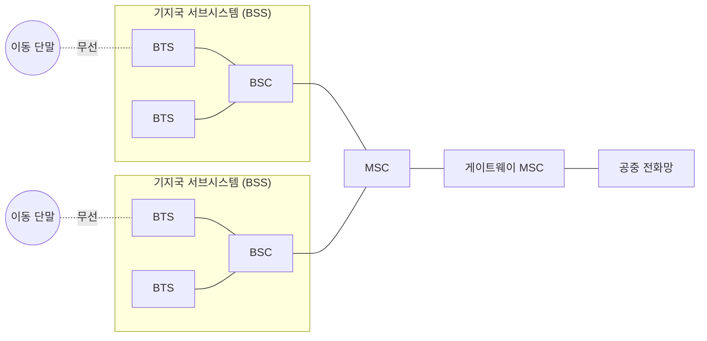

*그림 1. GSM 2G 셀룰러 네트워크의 구성 요소*

- **무선 인터페이스:** GSM 2G 표준은 무선 인터페이스에 FDM과 TDM을 결합하여 쓴다. 순수 FDM은 채널을 여러 주파수 대역으로 나누어 대역마다 통화 하나를 배정하고, 순수 TDM은 시간을 프레임과 슬롯으로 나누어 통화마다 슬롯 하나를 배정한다(1장, 18장). FDM과 TDM을 결합하면 채널을 여러 주파수 하위 대역으로 나누고, 각 하위 대역 안에서 시간을 프레임과 슬롯으로 나눈다. 채널을 F개의 하위 대역으로, 시간을 T개의 슬롯으로 나누면 $`F \times T`$개의 통화를 동시에 지원할 수 있다. GSM은 200 kHz 주파수 대역을 쓰며 대역마다 TDM 통화 여덟 개를 지원한다. GSM은 음성을 13 kbps와 12.2 kbps로 부호화한다. 18장의 케이블 접속 네트워크도 FDM과 TDM을 결합한다.
- **기지국 제어기(base station controller, BSC):** 보통 수십 개의 BTS를 맡는다. BTS의 무선 채널을 이동 가입자에게 배정하고, 이동 사용자가 있는 셀을 찾는 **페이징(paging)** 을 하며, 이동 사용자의 핸드오프(5.3절)를 수행한다. BSC와 그것이 제어하는 BTS들을 합쳐 GSM **기지국 서브시스템(base station subsystem, BSS)** 이라고 한다.
- **이동 교환 센터(mobile switching center, MSC):** 사용자 인가와 과금(예를 들어 이동 장치가 셀룰러 네트워크에 연결해도 되는지 판단), 호 설정과 해제, 핸드오프에서 중심 역할을 한다. MSC 하나는 보통 BSC를 최대 다섯 개 포함하여 MSC당 약 20만 명의 가입자를 맡는다. 셀룰러 사업자의 네트워크에는 여러 MSC가 있으며, 사업자의 셀룰러 네트워크를 더 큰 공중 전화망에 잇는 특별한 MSC를 **게이트웨이 MSC(gateway MSC)** 라고 한다.

> **참고:** GSM의 BSS(기지국 서브시스템)는 22장의 802.11 BSS(기본 서비스 세트)와 약자가 같지만 다른 개념이다.

### 1.3 3G 셀룰러 데이터 네트워크

이동 중에도 전자 메일을 읽고, 웹에 접속하고, 지도와 식당 추천 같은 위치 기반 서비스를 받고, 스트리밍 비디오를 보려면 스마트폰이 완전한 TCP/IP 프로토콜 스택을 실행하며 셀룰러 데이터 네트워크로 인터넷에 연결되어야 한다. 셀룰러 데이터 네트워크의 표준은 세대가 바뀔 때마다 새 기술과 약어가 쏟아지고, 2.5G, 3G, 3.5G, 4G의 요구 사항을 정하는 단일 공식 기관도 없어 정리하기 어렵다. 이 장은 **3GPP(3rd Generation Partnership Project)** 가 개발한 UMTS(Universal Mobile Telecommunications Service) 3G 표준과 4G 표준을 다룬다.

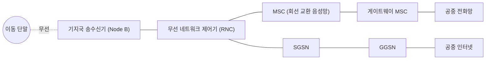

*그림 2. 3G 시스템 구조*

**3G 코어 네트워크:** 3G 코어 셀룰러 데이터 네트워크는 무선 접속 네트워크를 공중 인터넷에 연결하며, 기존 셀룰러 음성 네트워크의 구성 요소(특히 MSC)와 함께 동작한다. 기존 음성 네트워크에는 상당한 인프라와 수익성 있는 서비스가 있었으므로, 3G 데이터 서비스의 설계자들은 기존 GSM 코어 음성 네트워크를 건드리지 않고 그와 나란히 데이터 기능을 더하는 방법을 택했다. 새 데이터 서비스를 기존 음성 네트워크의 코어에 직접 통합했다면, 인터넷에서 새 기술(IPv6)과 기존 기술(IPv4)을 통합할 때(24장)와 같은 어려움을 겪었을 것이다. 3G 코어 네트워크에는 두 종류의 노드가 있다.

- **SGSN(Serving GPRS Support Node):** 자신이 연결된 무선 접속 네트워크의 이동 노드와 데이터그램을 주고받는다. 그 지역 음성 네트워크의 MSC와 상호 작용하여 사용자 인가와 핸드오프를 제공하고, 활성 이동 노드의 위치(셀) 정보를 유지하며, 무선 접속 네트워크의 이동 노드와 GGSN 사이에서 데이터그램을 전달한다. GPRS(Generalized Packet Radio Service)는 2G 네트워크의 초기 셀룰러 데이터 서비스이다.
- **GGSN(Gateway GPRS Support Node):** 여러 SGSN을 더 큰 인터넷에 연결하는 게이트웨이이다. 이동 노드에서 출발한 데이터그램이 더 큰 인터넷으로 들어가기 전에 만나는 마지막 3G 인프라이다. 외부에서 보면 GGSN은 다른 게이트웨이 라우터와 다르지 않으며, GGSN의 네트워크 안에서 일어나는 3G 노드의 이동성은 GGSN 뒤에 숨겨진다.

**3G 무선 접속 네트워크:** 3G 사용자에게 보이는 무선 첫 홉 네트워크이다. **무선 네트워크 제어기(Radio Network Controller, RNC)** 는 보통 2G의 기지국과 비슷한 여러 셀의 기지국 송수신기(3G UMTS에서는 Node B라고 부름)를 제어한다. RNC는 MSC를 거쳐 회선 교환 셀룰러 음성 네트워크에, SGSN을 거쳐 패킷 교환 인터넷에 연결된다. 따라서 3G의 음성 서비스와 데이터 서비스는 서로 다른 코어 네트워크를 쓰지만, 첫 홉과 마지막 홉의 무선 접속 네트워크는 함께 쓴다.

3G UMTS가 2G와 크게 다른 점은 GSM의 FDMA/TDMA 방식 대신 **DS-WCDMA(Direct Sequence Wideband CDMA)** 라는 CDMA 기법(22장)을 TDMA 슬롯 안에서 쓰고, TDMA 슬롯은 다시 여러 주파수에서 쓸 수 있다는 점이다. 18장의 채널 공유 방식 세 가지를 모두 쓰는 것이며, 유선 케이블 접속 네트워크(18장)와 비슷한 접근이다. WCDMA 명세의 데이터 서비스를 **HSPA(High Speed Packet Access)** 라고 하며, 최대 14 Mbps의 하향 속도를 약속한다.

### 1.4 4G LTE

3GPP가 내놓은 4G **LTE(Long-Term Evolution)** 표준은 3G보다 두 가지 중요한 혁신을 이루었다. 모든 것이 IP인 코어 네트워크와 개선된 무선 접속 네트워크이다.

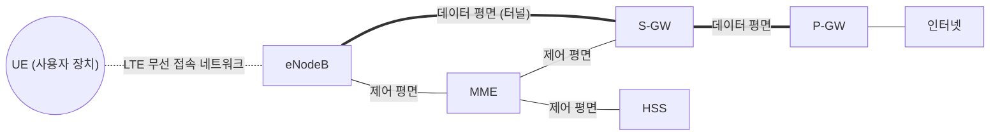

*그림 3. 4G 네트워크 구조*

4G 구조에서 중요한 관찰은 다음과 같다.

- **통일된 all-IP 네트워크 구조:** 음성 트래픽과 데이터 트래픽에 서로 다른 구성 요소와 경로를 두던 3G와 달리, 4G에서는 음성과 데이터가 모두 IP 데이터그램에 담겨 무선 장치(4G 용어로 **UE, User Equipment**)와 4G 가장자리 네트워크를 나머지 네트워크에 잇는 패킷 게이트웨이(P-GW) 사이를 오간다. 4G에서 셀룰러 네트워크의 전화망 뿌리는 사라지고 보편적인 IP 서비스가 자리 잡았다.
- **데이터 평면과 제어 평면의 분리:** IP 네트워크 계층의 데이터 평면과 제어 평면(10장)처럼, 4G 구조도 두 평면을 명확히 나눈다.
- **무선 접속 네트워크와 all-IP 코어 네트워크의 분리:** 사용자 데이터를 담은 IP 데이터그램은 4G 내부의 IP 네트워크로 UE와 게이트웨이(P-GW) 사이를 오가며, 제어 패킷도 같은 내부 네트워크로 4G의 제어 서비스 구성 요소들 사이를 오간다.

4G 구조의 주요 구성 요소는 다음과 같다.

| 구성 요소 | 역할 |
|:-----|:-----|
| eNodeB | 2G 기지국과 3G RNC(Node B)의 후손. 데이터 평면에서는 LTE 무선 접속 네트워크를 통해 UE와 P-GW 사이에서 데이터그램을 전달하며, UE의 데이터그램을 캡슐화하여 4G의 all-IP 코어 네트워크(EPC, enhanced packet core)를 거쳐 P-GW까지 터널링함. 제어 평면에서는 UE를 대신하여 등록과 이동성 신호를 처리함 |
| P-GW (Packet Data Network Gateway) | UE에 IP 주소를 배정하고 서비스 품질(QoS)을 강제함. 터널의 끝점으로서 UE와 주고받는 데이터그램을 캡슐화하고 역캡슐화함 |
| S-GW (Serving Gateway) | 데이터 평면의 이동성 기준점(anchor). 모든 UE 트래픽이 S-GW를 지나며, 과금과 합법적 감청 기능도 수행함 |
| MME (Mobility Management Entity) | 자신이 제어하는 셀에 있는 UE를 대신하여 연결 관리와 이동성 관리를 수행하며, HSS에서 UE의 가입 정보를 받음 |
| HSS (Home Subscriber Server) | 로밍 접근 능력, 서비스 품질 프로필, 인증 정보 같은 UE의 정보를 가지며, 이 정보를 UE의 홈 셀룰러 사업자에게서 얻음 |

*표 2. 4G 구조의 주요 구성 요소*

eNodeB와 P-GW 사이의 터널링은 IPv4 라우터들의 네트워크를 거쳐 두 IPv6 끝점 사이에 IPv6 데이터그램을 터널링하는 것(24장)과 비슷하다. 이 터널에는 서비스 품질 보장이 붙을 수 있다. 예를 들어 4G 네트워크는 음성 트래픽이 UE와 P-GW 사이에서 100 ms 이하의 지연과 1% 미만의 패킷 손실률을 겪도록 보장하고, TCP 트래픽에는 300 ms와 0.0001% 미만의 패킷 손실률을 보장할 수 있다.

**LTE 무선 접속 네트워크:** LTE는 하향 채널에서 주파수 분할 다중화와 시분할 다중화를 결합한 **직교 주파수 분할 다중화(orthogonal frequency division multiplexing, OFDM)** 를 쓴다. "직교"라는 말은 서로 다른 주파수 채널의 신호가 주파수 간격이 촘촘해도 서로 거의 간섭하지 않도록 만들어진다는 데서 나왔다. LTE에서 각 활성 이동 노드는 하나 이상의 주파수에서 0.5 ms 시간 슬롯을 하나 이상 배정받는다. 각 주파수에서 0.5 ms 슬롯 20개가 10 ms 프레임을 이룬다.

```text
  주파수
    f4 │    │ ## │    │    │ ## │    │    │    │ ...
    f3 │ ## │    │    │ ## │    │    │    │ ## │ ...
    f2 │    │    │ ## │    │    │ ## │    │    │ ...
    f1 │    │    │    │    │    │    │ ## │    │ ...
       └────┴────┴────┴────┴────┴────┴────┴────┴──► 시간 (한 칸 = 0.5 ms)
  ## : 한 이동 노드에 배정된 슬롯 (여기서는 8개)
```

*그림 4. 네 주파수에 걸쳐 한 이동 노드에 배정된 0.5 ms 슬롯 여덟 개*

같은 주파수든 다른 주파수든 슬롯을 더 많이 배정받을수록 이동 노드는 더 높은 전송 속도를 얻는다. 이동 노드 사이의 슬롯 배정은 1 ms마다 다시 할 수 있으며, 22장의 그림 1처럼 변조 방식을 바꾸어 전송 속도를 바꿀 수도 있다. LTE 표준은 슬롯을 어느 이동 노드에 배정할지 정하지 않으며, 장비 제조사나 사업자의 스케줄링 알고리즘이 정한다. **기회주의적 스케줄링(opportunistic scheduling)** 은 송신자와 수신자 사이의 채널 상황에 물리 계층 프로토콜을 맞추고, 채널 상황에 따라 패킷을 보낼 수신자를 골라 무선 매체를 가장 잘 쓴다. 사용자 우선순위와 계약된 서비스 수준도 하향 패킷 전송의 스케줄링에 쓸 수 있다. LTE-Advanced는 여러 채널을 묶어 이동 노드에 배정하여 수백 Mbps의 하향 대역폭을 제공한다.

> **참고:** 또 다른 4G 무선 기술인 WiMAX(World Interoperability for Microwave Access)는 LTE와 크게 다른 IEEE 802.16 표준 계열이며(20장의 무선 MAN 작업 그룹), LTE만큼 널리 보급되지는 못했다.

---

<br>

## 2. 이동성 관리의 원리

넓은 의미에서 **이동 노드(mobile node)** 는 시간이 지나면서 네트워크에 연결되는 지점이 바뀌는 노드이다. 이동성이라는 말은 컴퓨터와 전화의 세계에서 여러 뜻으로 쓰이므로, 먼저 이동성의 여러 차원을 살펴본다.

### 2.1 이동성의 정도

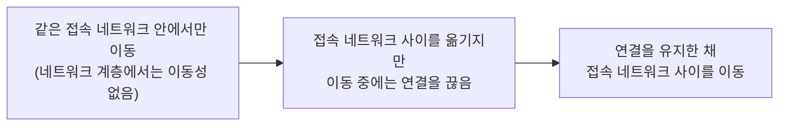

*그림 5. 네트워크 계층 관점의 이동성 정도 (오른쪽으로 갈수록 이동성이 큼)*

- **같은 접속 네트워크 안의 이동:** 건물 안에서 무선 NIC가 있는 노트북을 들고 다니는 사용자는 22장의 10.1절처럼 네트워크 계층 관점에서 이동하지 않는다. 위치와 상관없이 같은 AP와 연결되어 있다면 링크 계층 관점에서도 이동하지 않는다.
- **연결을 끊고 옮기는 이동:** 사무실이나 기숙사에서 카페나 강의실로 노트북을 들고 가서 새 위치에서 네트워크에 연결하려는 사용자는 이동하지만, 네트워크 연결 지점 사이를 옮기는 동안 연결을 유지할 필요는 없다.
- **연결을 유지하는 이동:** 시속 150 km로 고속도로를 달리며 여러 무선 접속 네트워크를 지나는 동안 원격 응용과의 TCP 연결을 끊김 없이 유지하려는 사용자는 분명히 이동한다.

이동 노드의 주소가 언제나 같아야 하는가는 실행하는 응용에 크게 달려 있다.

- **주소를 유지하면 좋은 경우:** 고속도로의 운전자처럼 TCP 연결을 끊김 없이 유지하려면 같은 IP 주소를 유지하는 편이 편리하다. 인터넷 응용은 통신 상대의 IP 주소와 포트 번호를 알아야 하므로(3장), 이동하는 동안 IP 주소를 유지할 수 있으면 이동성이 응용에 보이지 않는다. 이 투명성은 큰 가치가 있다. 응용은 바뀔 수 있는 IP 주소를 신경 쓸 필요가 없고, 같은 응용 코드가 이동 연결과 고정 연결에 모두 쓰인다. 모바일 IP(4절)가 이 투명성을 제공한다. 휴대 전화의 전화번호, 곧 전화의 네트워크 계층 주소도 사업자의 망을 옮겨 다녀도 그대로이다.
- **주소가 중요하지 않은 경우:** 사무실 노트북을 끄고 집에 가져가 다시 켜서 일하는 사용자가 주로 전자 메일, 웹 탐색 같은 클라이언트-서버 응용의 클라이언트로 쓴다면, 노트북의 IP 주소는 별로 중요하지 않다. 집의 ISP가 임시로 배정하는 주소로 충분하며, DHCP(12장)가 이 기능을 이미 제공한다.

> **참고:** **주소를 바꾸는 방법의 한계.** 이동 호스트가 새 네트워크로 갈 때마다 DHCP로 새 주소를 얻는 단순한 방법에는 단점이 있다. 설정 파일을 바꿔야 하고, 네트워크를 옮길 때마다 컴퓨터를 다시 시작해야 하며, 인터넷의 다른 호스트가 변화를 알도록 DNS 표(5장)를 고쳐야 한다. 무엇보다 연결 동안 클라이언트와 서버의 포트와 IP 주소가 그대로여야 하므로, 전송 중에 네트워크를 옮기면 데이터 교환이 끊긴다. 그래서 두 주소를 쓰는 방법(2.3절)이 더 현실적이다.

이동 사용자가 연결할 수 있는 고정 인프라가 없다면, 서로 통신 거리 안에 있는 두 사용자가 다른 네트워크 계층 인프라 없이 연결을 만들 수 있어야 한다. 이것이 22장의 애드혹 네트워킹이며, 이 장의 범위를 넘는다.

### 2.2 홈 네트워크와 외부 네트워크

이동하는 사용자가 네트워크를 옮겨 다니며 연결을 유지하는 문제는 사람에 비유할 수 있다. 부모의 집을 떠난 젊은이는 여러 기숙사와 아파트를 옮겨 다니며 주소가 자주 바뀐다. 오랜 친구가 연락하려면 어떻게 이 친구의 주소를 찾는가? 흔한 방법은 가족에게 연락하는 것이다. 이동하는 젊은이는 보통 가족에게 현재 주소를 알려 두므로, 영구적인 주소를 가진 가족의 집은 다른 사람들이 그와 통신하기 위해 처음 들르는 곳이 된다. 이후의 연락은 부모의 집으로 우편을 보내 전달받게 하는 **간접** 방식일 수도 있고, 부모에게서 얻은 주소로 직접 우편을 보내는 **직접** 방식일 수도 있다.

> **용어 정의:** **홈 네트워크(home network)** 는 노트북이나 스마트폰 같은 이동 노드의 영구적인 거처인 네트워크이다.

> **용어 정의:** **홈 에이전트(home agent)** 는 홈 네트워크 안에서 이동 노드를 대신하여 이동성 관리 기능을 수행하는 개체로, 보통 홈 네트워크에 연결된 라우터이다.

이동 전문가라면 홈 네트워크는 회사 네트워크일 것이다. 이동 노드가 회사를 떠나 다른 곳의 네트워크에 연결되면, 그 네트워크에도 이동성을 돕는 개체가 필요하다.

> **용어 정의:** **외부 네트워크(foreign network)** 는 이동 노드가 현재 머물고 있는 네트워크이며, 방문 네트워크(visited network)라고도 한다.

> **용어 정의:** **외부 에이전트(foreign agent)** 는 외부 네트워크 안에서 이동 노드의 이동성 관리 기능을 돕는 개체로, 보통 외부 네트워크에 연결된 라우터이다.

이동 전문가에게 방문 네트워크는 그가 찾아간 동료의 네트워크일 것이다. 이동 노드와 통신하려는 개체를 **상대방(correspondent)** 이라고 한다. 에이전트는 라우터 위에서 실행되는 프로세스처럼 라우터와 같은 장치에 둘 수도 있고, 네트워크의 다른 호스트나 서버에서 실행할 수도 있다. 에이전트의 기능은 응용 계층에서 수행되므로, 에이전트는 라우터이면서 호스트이다.

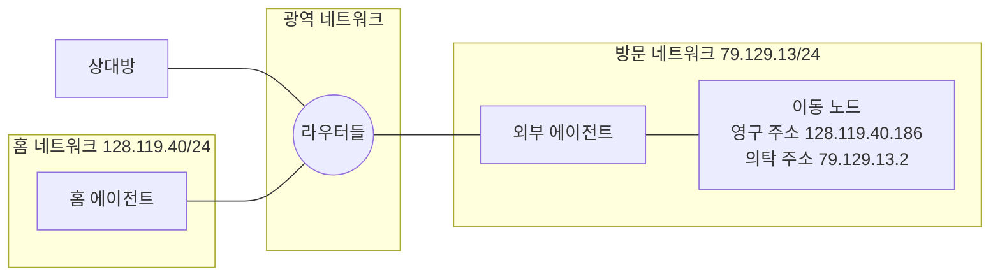

*그림 6. 이동 네트워크 구조의 기본 요소*

### 2.3 주소 지정

이동성을 응용에 투명하게 하려면 이동 노드가 네트워크를 옮겨도 주소를 유지하는 것이 바람직하다. 이동 노드가 외부 네트워크에 있을 때, 노드의 영구 주소로 오는 모든 트래픽을 외부 네트워크로 보내야 한다. 그 방법은 두 가지를 생각할 수 있다.

- **라우팅으로 알리는 방법:** 외부 네트워크가 이동 노드의 영구 주소에 대한 매우 구체적인 경로(more-specific route, 13장의 최장 접두사 일치)를 이웃 네트워크에 알리고, 이웃들이 일반적인 라우팅 갱신 절차로 이 정보를 퍼뜨린다. 이동 노드가 다른 외부 네트워크로 옮기면 새 외부 네트워크가 새 경로를 알리고 이전 외부 네트워크는 경로를 철회한다. 네트워크 계층 인프라를 크게 바꾸지 않고 두 문제를 한꺼번에 해결하지만, 확장성이 큰 단점이다. 라우터들이 잠재적으로 수백만 개의 이동 노드에 대한 포워딩 테이블 항목을 유지하고, 노드가 움직일 때마다 갱신해야 한다.
- **가장자리에서 처리하는 방법:** 인터넷 구조에서 되풀이되는 주제처럼, 이동성 기능을 네트워크 코어에서 네트워크 가장자리로 옮긴다. 실제로 채택된 방법이다. 부모가 자녀의 위치를 아는 것처럼, 홈 에이전트가 이동 노드가 머무는 외부 네트워크를 추적한다. 이를 위해 이동 노드(또는 이동 노드를 대신하는 외부 에이전트)와 홈 에이전트 사이에 위치를 갱신하는 프로토콜이 필요하다.

> **용어 정의:** **의탁 주소(care-of address, COA)** 는 이동 노드가 외부 네트워크에 머무는 동안 쓰는 임시 주소로, 주소의 네트워크 부분이 외부 네트워크의 것과 같다.

외부 에이전트를 외부 네트워크의 가장자리 라우터에 두는 것이 개념적으로 가장 단순하다. 외부 에이전트의 역할은 두 가지이다.

1. 네트워크 부분이 외부 네트워크와 같은 의탁 주소를 이동 노드에 만들어 준다. 따라서 이동 노드에는 두 주소가 있다. 하나는 **영구 주소(permanent address)**, 곧 **홈 주소(home address)** 이고(이동하는 젊은이의 가족의 집 주소에 해당), 다른 하나는 외부 주소라고도 부르는 의탁 주소이다(젊은이가 지금 사는 집의 주소에 해당). 그림 6에서 이동 노드의 영구 주소는 128.119.40.186이고, 네트워크 79.129.13/24를 방문하는 동안의 의탁 주소는 79.129.13.2이다.
2. 이동 노드가 자신의 네트워크에 머물며 주어진 의탁 주소를 가진다는 사실을 홈 에이전트에 알린다. 의탁 주소는 데이터그램을 외부 에이전트를 거쳐 이동 노드로 다시 보내는 데 쓰인다.

이동 노드가 외부 에이전트의 일을 직접 맡을 수도 있다. 예를 들어 DHCP 같은 프로토콜로 외부 네트워크에서 의탁 주소를 직접 얻고, 그 의탁 주소를 홈 에이전트에 스스로 알릴 수 있다. 이때의 의탁 주소를 **공존 의탁 주소(colocated care-of address)** 라고 한다. 공존 의탁 주소를 쓰면 이동 호스트는 외부 에이전트가 있는지 걱정하지 않고 어느 네트워크로든 옮겨 갈 수 있지만, 자신의 외부 에이전트 역할을 할 소프트웨어가 더 필요하다. 또한 홈 주소와 의탁 주소의 이중 주소 지정이 응용 프로그램에 투명해야 한다.

---

<br>

## 3. 이동 노드로의 라우팅

홈 에이전트가 의탁 주소를 아는 것은 문제의 일부만 해결한다. 이동 노드의 위치를 아는 것은 네트워크 전체의 라우터가 아니라 홈 에이전트뿐이므로, 데이터그램을 이동 노드의 영구 주소로 보내 네트워크 계층 인프라에 맡기는 것만으로는 충분하지 않다. 두 가지 방법이 있다.

### 3.1 간접 라우팅

> **용어 정의:** **간접 라우팅(indirect routing)** 은 상대방이 이동 노드의 영구 주소로 보낸 데이터그램을 홈 에이전트가 가로채 의탁 주소로 터널링하고, 외부 에이전트가 이동 노드에 전달하는 방식이다.

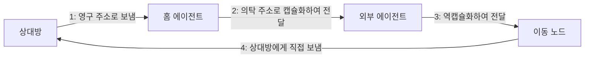

*그림 7. 이동 노드로의 간접 라우팅*

1. 상대방은 이동 노드가 홈 네트워크에 있는지 외부 네트워크에 있는지 모른 채, 데이터그램을 이동 노드의 영구 주소로 보낸다. 따라서 이동성은 상대방에게 완전히 투명하다. 데이터그램은 평소처럼 이동 노드의 홈 네트워크로 라우팅된다.
2. 홈 에이전트는 외부 에이전트와 상호 작용하여 이동 노드의 의탁 주소를 추적하는 일 외에도 중요한 일을 하나 더 한다. 홈 네트워크가 자신의 네트워크이지만 지금은 외부 네트워크에 있는 노드로 오는 데이터그램을 지켜보다가 가로챈다. 홈 에이전트는 데이터그램을 이동 노드의 의탁 주소로 외부 에이전트에 보낸다.
3. 외부 에이전트는 받은 데이터그램을 이동 노드에 전달한다.
4. 이동 노드는 상대방의 주소를 알므로, 홈 에이전트를 거치지 않고 데이터그램을 상대방에게 직접 보낸다. 출발지 주소는 자신의 영구 주소, 목적지 주소는 상대방의 주소이다.

2단계를 자세히 보면, 홈 에이전트는 네트워크 계층이 데이터그램을 외부 네트워크로 보내도록 의탁 주소를 목적지로 써야 한다. 한편 데이터그램을 받는 응용은 데이터그램이 홈 에이전트를 거쳐 왔다는 사실을 몰라야 하므로, 상대방의 데이터그램은 그대로 두어야 한다. 두 목표는 **캡슐화(encapsulation)** 로 모두 이룰 수 있다.

```text
  (a)
  ┌──────────────────────┬─────────────┐
  │ dest: 128.119.40.186 │   payload   │
  └──────────────────────┴─────────────┘

  (b)
  ┌───────────────────┬──────────────────────┬─────────────┐
  │ dest: 79.129.13.2 │ dest: 128.119.40.186 │   payload   │
  └───────────────────┴──────────────────────┴─────────────┘
```

*그림 8. 홈 에이전트의 캡슐화와 외부 에이전트의 역캡슐화*

그림 8의 (a)는 상대방이 영구 주소로 보낸 원래 데이터그램이고, (b)는 홈 에이전트가 의탁 주소를 목적지로 하는 바깥 헤더를 붙인 데이터그램이다. 외부 에이전트는 (b)에서 바깥 헤더를 떼어 (a)를 이동 노드에 전달한다.

홈 에이전트는 상대방의 원래 데이터그램 전체를 더 큰 새 데이터그램 안에 넣고, 이 큰 데이터그램을 이동 노드의 의탁 주소로 보낸다. 의탁 주소의 주인인 외부 에이전트는 이 데이터그램을 받아 역캡슐화, 곧 감싼 데이터그램에서 상대방의 원래 데이터그램을 꺼내 이동 노드에 전달한다. 이 캡슐화와 역캡슐화는 24장에서 IPv6를 IPv4 네트워크로 운반할 때 쓴 **터널링(tunneling)** 과 같은 개념이다(터널링은 26장에서도 다룬다).

간접 라우팅으로 이동성을 지원하려면 네트워크 계층에 다음 기능이 새로 필요하다.

| 기능 | 내용 |
|:-----|:-----|
| 이동 노드와 외부 에이전트 사이의 프로토콜 | 이동 노드는 외부 네트워크에 연결될 때 외부 에이전트에 등록하고, 떠날 때 등록을 해제함 |
| 외부 에이전트와 홈 에이전트 사이의 등록 프로토콜 | 외부 에이전트는 이동 노드의 의탁 주소를 홈 에이전트에 등록함. 이동 노드가 새 네트워크로 옮겨 새 의탁 주소를 등록하면 이전 등록은 처리되므로, 외부 에이전트가 의탁 주소를 명시적으로 등록 해제할 필요는 없음 |
| 홈 에이전트의 캡슐화 프로토콜 | 상대방의 원래 데이터그램을 의탁 주소로 가는 데이터그램에 넣어 전달함 |
| 외부 에이전트의 역캡슐화 프로토콜 | 감싼 데이터그램에서 상대방의 원래 데이터그램을 꺼내 이동 노드에 전달함 |

*표 3. 간접 라우팅에 필요한 네트워크 계층 기능*

이동 노드가 외부 네트워크 A에 연결되어 홈 에이전트에 A의 의탁 주소를 등록하고, 홈 에이전트를 거쳐 간접 라우팅되는 데이터그램을 받고 있는 경우를 생각한다. 이동 노드가 외부 네트워크 B로 옮겨 B의 외부 에이전트에 등록하면, B의 외부 에이전트는 홈 에이전트에 새 의탁 주소를 알린다. 이후 홈 에이전트는 데이터그램을 B로 다시 보낸다. 상대방에게 이동성은 투명하며, 이동 전후로 데이터그램은 같은 홈 에이전트를 거친다. 이동 노드가 A에서 끊긴 시점과 B에 연결되어 새 의탁 주소를 등록하는 시점 사이의 시간이 짧으면 잃는 데이터그램은 적다. 종단 간 연결은 네트워크 혼잡 때문에도 데이터그램을 잃을 수 있으므로(9장), 노드가 이동할 때 가끔 데이터그램을 잃는 것은 큰 문제가 아니다. 손실 없는 통신이 필요하면 상위 계층의 메커니즘이 혼잡으로 인한 손실이든 이동으로 인한 손실이든 복구한다.

### 3.2 직접 라우팅

> **용어 정의:** **삼각 라우팅(triangle routing)** 은 상대방과 이동 노드 사이에 더 효율적인 경로가 있는데도, 이동 노드로 가는 데이터그램이 먼저 홈 에이전트로 갔다가 외부 네트워크로 가는 간접 라우팅의 비효율이다.

간접 라우팅에서 최악의 경우, 동료의 외부 네트워크를 방문한 이동 사용자가 그 동료와 나란히 앉아 네트워크로 데이터를 주고받으면, 동료가 보낸 데이터그램은 이동 사용자의 홈 에이전트까지 갔다가 다시 외부 네트워크로 돌아온다.

> **용어 정의:** **직접 라우팅(direct routing)** 은 상대방 네트워크의 상대방 에이전트가 홈 에이전트에게 이동 노드의 의탁 주소를 물어 알아낸 뒤, 데이터그램을 의탁 주소로 직접 터널링하는 방식이다.

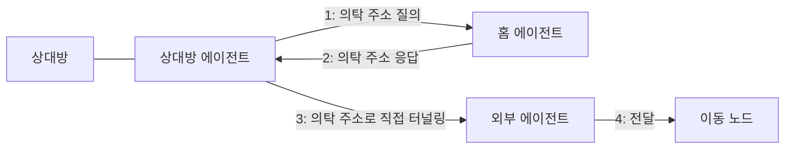

*그림 9. 이동 사용자로의 직접 라우팅*

직접 라우팅은 삼각 라우팅의 비효율을 없애지만 그 대가로 복잡도가 늘어난다. 이동 노드가 외부 에이전트의 일을 맡을 수 있는 것처럼, 상대방 자신이 상대방 에이전트의 일을 맡을 수도 있다. 직접 라우팅에는 두 가지 새로운 과제가 생긴다.

- **위치 프로토콜:** 상대방 에이전트가 홈 에이전트에게 이동 노드의 의탁 주소를 묻는 이동 사용자 위치 프로토콜이 필요하다.
- **이동 중의 전달:** 간접 라우팅에서는 이동 노드가 다른 외부 네트워크로 옮겨도 홈 에이전트의 의탁 주소만 고치면 되었다. 직접 라우팅에서는 상대방 에이전트가 세션을 시작할 때 한 번만 홈 에이전트에게 의탁 주소를 묻는다. 따라서 홈 에이전트의 의탁 주소를 고치는 것은 필요하지만, 그것만으로는 새 외부 네트워크로 데이터를 보내는 문제를 해결하지 못한다.

상대방에게 바뀐 의탁 주소를 알리는 새 프로토콜을 만드는 방법도 있지만, GSM 네트워크에서 실제로 채택된 방법은 **앵커 외부 에이전트(anchor foreign agent)** 를 쓰는 것이다.

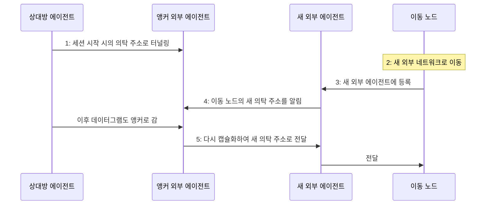

*그림 10. 직접 라우팅에서 네트워크 사이를 옮기는 이동 노드*

1. 세션이 처음 시작될 때 이동 노드가 있던 외부 네트워크의 외부 에이전트를 앵커 외부 에이전트라고 한다. 데이터는 현재 이 외부 네트워크로 전달되고 있다.
2. 이동 노드가 새 외부 네트워크로 옮긴다.
3. 이동 노드는 새 외부 에이전트에 등록한다.
4. 새 외부 에이전트는 앵커 외부 에이전트에게 이동 노드의 새 의탁 주소를 알린다.
5. 앵커 외부 에이전트는 떠난 이동 노드로 가는 캡슐화된 데이터그램을 받으면, 새 의탁 주소로 다시 캡슐화하여 이동 노드에 전달한다. 이동 노드가 나중에 또 다른 외부 네트워크로 옮기면, 새로 방문한 네트워크의 외부 에이전트가 앵커 외부 에이전트에게 연락하여 새 외부 네트워크로의 전달을 설정한다.

---

<br>

## 4. 모바일 IP

**모바일 IP(mobile IP)** 는 이동성을 지원하는 인터넷 구조와 프로토콜의 집합이다. 모바일 IP는 외부 에이전트를 쓰거나 쓰지 않는 동작, 에이전트와 이동 노드가 서로를 찾는 여러 방법, 하나 또는 여러 의탁 주소의 사용, 여러 형태의 캡슐화를 지원하는 유연하고 복잡한 표준이다. 모바일 IP 구조에는 홈 에이전트, 외부 에이전트, 의탁 주소, 캡슐화와 역캡슐화 같은 3절의 요소가 그대로 들어 있으며, 현재의 표준은 이동 노드로의 **간접 라우팅**을 쓴다.

모바일 IP 표준은 세 가지 주요 부분, 곧 이동 호스트가 원격 호스트와 통신하기 위해 거치는 세 단계로 이루어진다.

| 단계 | 내용 |
|:-----|:-----|
| 에이전트 발견 (agent discovery) | 홈 에이전트나 외부 에이전트가 이동 노드에 자신의 서비스를 알리는 프로토콜과, 이동 노드가 에이전트의 서비스를 요청하는 프로토콜 |
| 홈 에이전트에 등록 (registration) | 이동 노드나 외부 에이전트가 이동 노드의 홈 에이전트에 의탁 주소를 등록하고 등록 해제하는 프로토콜 |
| 데이터그램의 간접 라우팅 (data transfer) | 홈 에이전트가 이동 노드로 데이터그램을 전달하는 방식. 전달 규칙, 오류 처리 규칙, 여러 형태의 캡슐화를 포함 |

*표 4. 모바일 IP의 세 단계*

보안은 모바일 IP 표준 전체에서 중요하다. 예를 들어 악의적인 사용자가 홈 에이전트에 가짜 의탁 주소를 등록하면 어떤 IP 주소로 가는 모든 데이터그램이 그 사용자에게 갈 수 있으므로, 이동 노드의 인증이 반드시 필요하다. 모바일 IP의 보안 메커니즘은 26장에서 다루는 기법들을 쓴다.

### 4.1 모바일 IP의 주소와 에이전트

IP 주소는 접두사와 접미사로 이루어지며, 접두사가 호스트를 하나의 네트워크에 연결한다(12장). 예를 들어 10.3.4.24/8은 네트워크 10.0.0.0/8에 연결된 호스트를 정한다. 라우터는 접두사로 패킷을 그 네트워크에 전달하므로, 원래의 IP 주소 지정은 호스트가 한 네트워크에 붙어 있는 **고정 호스트(stationary host)** 를 전제로 한다. 곧 인터넷의 호스트는 이곳저곳 들고 다닐 수 있는 주소를 가지지 않으며, 주소는 호스트가 그 네트워크에 붙어 있을 때만 유효하다.

모바일 IP는 이동 호스트에 두 주소를 준다.

- **홈 주소:** 영구적이며 호스트를 홈 네트워크에 연결한다. 예를 들어 홈 네트워크 131.5.0.0/16의 홈 주소 131.5.24.8/16이다.
- **의탁 주소:** 임시적이며 외부 네트워크에 연결된다. 호스트가 다른 네트워크로 옮길 때마다 바뀐다. 예를 들어 외부 네트워크 14.0.0.0/8을 방문하는 동안의 의탁 주소 14.13.16.9/8이다. 이동 호스트는 외부 네트워크를 방문할 때 에이전트 발견과 등록 단계에서 의탁 주소를 받는다.

주소의 변화를 나머지 인터넷에 투명하게 하려면 홈 에이전트와 외부 에이전트가 필요하다. 홈 에이전트는 보통 이동 호스트의 홈 네트워크에 연결된 라우터로, 원격 호스트가 이동 호스트에 패킷을 보내면 이동 호스트를 대신해 그 패킷을 받아 외부 에이전트로 보낸다. 외부 에이전트는 보통 외부 네트워크에 연결된 라우터로, 홈 에이전트가 보낸 패킷을 받아 이동 호스트에 전달한다.

### 4.2 에이전트 발견

새 네트워크에 도착한 모바일 IP 노드는 외부 네트워크에 연결되든 홈 네트워크로 돌아오든 해당 외부 에이전트나 홈 에이전트를 알아내야 한다. 새 네트워크 주소를 가진 새 외부 에이전트를 발견해야 이동 노드의 네트워크 계층은 자신이 새 외부 네트워크로 옮겼음을 안다. 이동 호스트는 홈 네트워크를 떠나기 전에 홈 에이전트를, 외부 네트워크로 옮긴 뒤에는 외부 에이전트를 발견해야 하며, 이때 의탁 주소와 외부 에이전트의 주소를 함께 알아낸다. 에이전트 발견에는 두 가지 방법이 있다.

**에이전트 알림(agent advertisement):** 외부 에이전트나 홈 에이전트는 기존의 라우터 발견 프로토콜을 확장하여 자신의 서비스를 알린다. 에이전트는 연결된 모든 링크에 유형 필드가 9(라우터 알림)인 ICMP 메시지(16장)를 주기적으로 브로드캐스트한다. 이 메시지에는 라우터(곧 에이전트)의 IP 주소가 들어 있어 이동 노드가 에이전트의 IP 주소를 알 수 있다. 모바일 IP는 에이전트 알림을 위해 새 패킷 유형을 만들지 않고, ICMP 라우터 알림 패킷 뒤에 이동 에이전트 알림 확장(mobility agent advertisement extension)을 붙인다.

```text
  ICMP 라우터 알림 메시지 (type = 9) 뒤에 붙는 이동 에이전트 알림 확장

  0                8                16                             31
  ┌────────────────┬────────────────┬───────────────────────────────┐
  │  Type = 16     │    Length      │        Sequence number        │
  ├────────────────┴────────────────┼────────────────┬──────────────┤
  │       Registration lifetime     │ R B H F M G r T│   Reserved   │
  ├─────────────────────────────────┴────────────────┴──────────────┤
  │                 0 or more care-of addresses                     │
  └─────────────────────────────────────────────────────────────────┘
```

*그림 11. 이동 에이전트 알림 확장을 붙인 ICMP 라우터 알림 메시지*

확장의 중요한 필드는 다음과 같다.

| 필드 | 내용 |
|:-----|:-----|
| Type | 16 (이동 에이전트 알림 확장) |
| Length | 확장 메시지의 전체 길이 (ICMP 알림 메시지의 길이가 아님) |
| Sequence number | 메시지 번호. 수신자는 메시지 손실을 판단하는 데 씀 |
| Lifetime | 에이전트가 요청을 받아들일 초 단위 시간. 모두 1이면 무한 |
| R (등록 필요) | 이 네트워크의 이동 사용자는 외부 에이전트에 등록해야 함. 곧 DHCP 등으로 의탁 주소를 직접 얻어 스스로 외부 에이전트 역할을 할 수 없음 |
| B | 에이전트가 바빠 지금은 등록을 받지 않음 |
| H (홈 에이전트) | 에이전트가 자신이 있는 네트워크의 홈 에이전트임 |
| F (외부 에이전트) | 에이전트가 자신이 있는 네트워크의 외부 에이전트임 |
| M, G (캡슐화) | IP-in-IP 캡슐화가 아닌 다른 형태의 캡슐화(최소 캡슐화, GRE)를 쓰는지 나타냄 |
| Care-of addresses | 외부 에이전트가 제공하는 의탁 주소들의 목록. 이동 노드는 홈 에이전트에 등록할 때 이 중 하나를 고르며, 이 필드는 외부 에이전트만 씀 |

*표 5. 이동 에이전트 알림 확장의 주요 필드*

**에이전트 요청(agent solicitation):** 새 네트워크로 옮겼는데 에이전트 알림을 받지 못했거나 알림을 기다리지 않고 에이전트를 알고 싶은 이동 노드는, 유형 값이 10인 ICMP 메시지(라우터 요청)인 에이전트 요청 메시지를 브로드캐스트할 수 있다. 요청을 받은 에이전트는 이동 노드에 에이전트 알림을 유니캐스트로 직접 보내고, 이동 노드는 요청하지 않고 받은 알림과 똑같이 처리한다. 에이전트 요청도 새 패킷 유형이 아니라 ICMP 라우터 요청 패킷을 쓴다.

### 4.3 등록

외부 네트워크로 옮겨 외부 에이전트를 발견한 이동 호스트는 등록해야 한다. 등록에는 네 가지 측면이 있다.

1. 이동 호스트는 외부 에이전트에 자신을 등록해야 한다.
2. 이동 호스트는 홈 에이전트에 자신을 등록해야 한다. 보통 외부 에이전트가 이동 호스트를 대신해 한다.
3. 등록이 만료되면 이동 호스트는 등록을 갱신해야 한다.
4. 홈으로 돌아오면 이동 호스트는 등록을 취소(등록 해제)해야 한다.

외부 에이전트를 거쳐 등록하는 과정은 다음 네 단계이다.

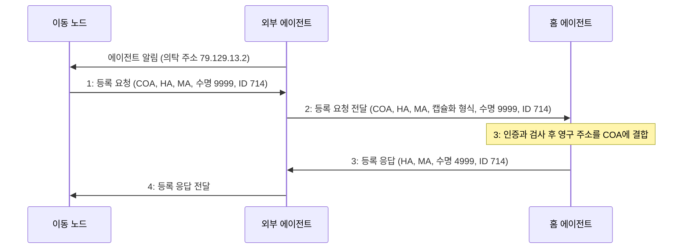

*그림 12. 에이전트 알림과 모바일 IP 등록*

1. 외부 에이전트의 알림을 받은 이동 노드는 외부 에이전트에 모바일 IP **등록 요청(registration request)** 을 보낸다. 등록 메시지는 UDP 데이터그램에 담겨 포트 434로 보내진다. 등록 메시지에는 외부 에이전트가 알린 의탁 주소(COA), 홈 에이전트의 주소(HA), 이동 노드의 영구 주소(MA), 요청하는 등록 수명, 64비트 등록 식별자가 들어 있다. 등록 수명은 등록이 유효한 초 단위 시간이며, 그 안에 홈 에이전트에서 등록을 갱신하지 않으면 등록은 무효가 된다. 등록 식별자는 순서 번호처럼 받은 등록 응답을 등록 요청과 짝짓는 데 쓰인다.
2. 외부 에이전트는 등록 메시지를 받아 이동 노드의 영구 IP 주소를 기록한다. 이제 외부 에이전트는 목적지 주소가 이동 노드의 영구 주소와 같은 데이터그램을 캡슐화하여 담은 데이터그램을 찾아야 한다는 것을 안다. 외부 에이전트는 COA, HA, MA, 요청하는 캡슐화 형식, 요청하는 등록 수명, 등록 식별자를 담은 모바일 IP 등록 메시지를 (역시 UDP 데이터그램에 담아) 홈 에이전트의 포트 434로 보낸다. 홈 에이전트는 이 중계 패킷의 출발지 주소에서 외부 에이전트의 주소를 알게 된다.
3. 홈 에이전트는 등록 요청을 받아 진정성과 정확성을 검사한다. 홈 에이전트는 이동 노드의 영구 IP 주소를 COA와 결합하며, 이후 홈 에이전트에 도착하는 이동 노드행 데이터그램은 캡슐화되어 COA로 터널링된다. 홈 에이전트는 HA, MA, 실제 등록 수명, 이 응답이 충족하는 요청의 등록 식별자를 담은 모바일 IP **등록 응답(registration reply)** 을 보낸다.
4. 외부 에이전트는 등록 응답을 받아 이동 노드에 전달한다.

이로써 등록이 끝나고 이동 노드는 영구 주소로 오는 데이터그램을 받을 수 있다. 그림 12에서 홈 에이전트는 이동 노드가 요청한 수명보다 짧은 수명을 정했다. 이동 노드가 외부 네트워크를 떠날 때 외부 에이전트가 의탁 주소를 명시적으로 등록 해제할 필요는 없다. 이동 노드가 새 네트워크(다른 외부 네트워크든 홈 네트워크든)로 옮겨 새 의탁 주소를 등록하면 자동으로 처리된다.

```text
  등록 요청
  0               8               16                              31
  ┌───────────────┬───────────────┬───────────────────────────────┐
  │   Type = 1    │     Flag      │           Lifetime            │
  ├───────────────┴───────────────┴───────────────────────────────┤
  │                         Home address                          │
  ├───────────────────────────────────────────────────────────────┤
  │                      Home agent address                       │
  ├───────────────────────────────────────────────────────────────┤
  │                        Care-of address                        │
  ├───────────────────────────────────────────────────────────────┤
  │                  Identification (64 bits)                     │
  ├───────────────────────────────────────────────────────────────┤
  │                         Extensions ...                        │
  └───────────────────────────────────────────────────────────────┘
```

*그림 13. 등록 요청의 형식*

- **Type:** 요청 메시지는 1, 응답 메시지는 3이다.
- **Flag:** 홈 에이전트가 이전 의탁 주소를 유지할지, 브로드캐스트 메시지를 터널링할지, 공존 의탁 주소를 쓰는지, 최소 캡슐화나 GRE를 쓸지 같은 전달 정보를 나타낸다. 응답에서는 이 자리에 요청의 결과(수락 또는 거부)를 나타내는 Code 필드가 온다.
- **Lifetime:** 등록이 유효한 초 단위 시간이다. 모두 0이면 등록 해제를 요청하고, 모두 1이면 수명이 무한이다.
- **Home address, Home agent address, Care-of address:** 이동 호스트의 영구(첫 번째) 주소, 홈 에이전트의 주소, 이동 호스트의 임시(두 번째) 주소이다. 응답에는 의탁 주소 필드가 필요 없다.
- **Identification:** 이동 호스트가 요청에 넣고 응답에서 되풀이되는 64비트 수로, 요청과 응답을 짝짓는다.
- **Extensions:** 홈 에이전트가 이동 노드를 인증하는 데 쓰는 가변 길이 확장이다(26장).

### 4.4 데이터 전달

에이전트 발견과 등록이 끝나면 이동 호스트는 원격 호스트와 통신할 수 있다.


*그림 14. 모바일 IP의 데이터 전달*

1. **원격 호스트에서 홈 에이전트로:** 원격 호스트는 자신의 주소를 출발지 주소로, 이동 호스트의 홈 주소를 목적지 주소로 하여 패킷을 보낸다. 곧 이동 호스트가 홈 네트워크에 있는 것처럼 보낸다. 이 패킷은 홈 에이전트가 가로챈다. 홈 에이전트는 19장의 프록시 ARP 기법으로 자신이 이동 호스트인 것처럼 응답한다.
2. **홈 에이전트에서 외부 에이전트로:** 패킷을 받은 홈 에이전트는 터널링으로 외부 에이전트에 패킷을 보낸다. IP 패킷 전체를 다른 IP 패킷 안에 넣고, 자신의 주소를 출발지로, 외부 에이전트의 주소를 목적지로 한다.
3. **외부 에이전트에서 이동 호스트로:** 외부 에이전트는 패킷을 받아 원래 패킷을 꺼낸다. 원래 패킷의 목적지 주소는 이동 호스트의 홈 주소이므로, 외부 에이전트는 등록 표에서 이동 호스트의 의탁 주소를 찾아 그 주소로 보낸다. 그렇지 않으면 패킷이 홈 네트워크로 돌아가 버린다.
4. **이동 호스트에서 원격 호스트로:** 이동 호스트는 평소처럼 자신의 홈 주소를 출발지로, 원격 호스트의 주소를 목적지로 하여 패킷을 보낸다. 패킷은 외부 네트워크에서 나가지만 이동 호스트의 홈 주소를 가진다.

이 과정에서 원격 호스트는 이동 호스트의 움직임을 전혀 모른다. 원격 호스트는 이동 호스트의 홈 주소로 패킷을 보내고, 이동 호스트의 홈 주소를 출발지로 하는 패킷을 받는다. 곧 이동 호스트의 이동은 나머지 인터넷에 완전히 투명하다.

### 4.5 모바일 IP의 비효율

모바일 IP를 쓰는 통신은 비효율적일 수 있다. 심한 경우를 **이중 횡단(double crossing, 2X)**, 덜 심한 경우를 **삼각 라우팅(triangle routing, dog-leg routing)** 이라고 한다.

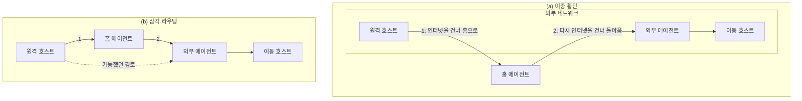

*그림 15. 모바일 IP의 이중 횡단과 삼각 라우팅*

- **이중 횡단:** 원격 호스트가 자신과 같은 네트워크(또는 사이트)로 옮겨 온 이동 호스트와 통신할 때 생긴다. 이동 호스트가 원격 호스트로 보낼 때는 지역 통신이므로 비효율이 없다. 그러나 원격 호스트가 이동 호스트로 보낼 때는 패킷이 인터넷을 두 번 건넌다. 컴퓨터는 보통 같은 지역의 다른 컴퓨터와 통신하므로(지역성의 원리), 이중 횡단의 비효율은 크다.
- **삼각 라우팅:** 원격 호스트가 자신과 같은 네트워크(또는 사이트)에 있지 않은 이동 호스트와 통신할 때 생긴다. 이동 호스트가 원격 호스트로 보낼 때는 비효율이 없다. 그러나 원격 호스트가 이동 호스트로 보낼 때는 패킷이 원격 호스트에서 홈 에이전트로 갔다가 이동 호스트로 가므로, 삼각형의 한 변 대신 두 변을 지난다.

**해결책:** 원격 호스트가 이동 호스트의 홈 주소에 의탁 주소를 **결합(binding)** 하게 하는 것이다. 예를 들어 홈 에이전트가 이동 호스트로 가는 첫 패킷을 받으면 그 패킷을 외부 에이전트로 전달하면서, 원격 호스트에 결합 갱신 패킷을 보내 이후의 패킷을 의탁 주소로 직접 보내게 할 수 있다. 원격 호스트는 이 정보를 캐시에 둔다. 이 전략의 문제는 이동 호스트가 다시 옮기면 캐시 항목이 낡는다는 점이며, 이때 홈 에이전트는 원격 호스트에 경고 패킷을 보내 변화를 알려야 한다. 이는 3.2절의 직접 라우팅과 같은 발상이다.

---

<br>

## 5. 셀룰러 네트워크의 이동성 관리

IP 네트워크보다 훨씬 오래전부터 이동성을 지원해 온 셀룰러 전화망에서 이동성을 어떻게 관리하는지, 성숙하고 널리 보급된 GSM을 예로 살펴본다. 3G와 4G의 이동성도 원리는 GSM과 비슷하다. GSM은 모바일 IP처럼 **간접 라우팅** 방식을 써서, 상대방의 호를 먼저 이동 사용자의 홈 네트워크로, 거기서 방문 네트워크로 라우팅한다.

### 5.1 HLR과 VLR

GSM 용어로 이동 사용자의 홈 네트워크는 **홈 PLMN(home public land mobile network)** 이며, 이 장에서는 간단히 홈 네트워크라고 부른다. 홈 네트워크는 이동 사용자가 가입한(매달 셀룰러 서비스 요금을 청구하는) 셀룰러 사업자이다. 방문 PLMN, 곧 방문 네트워크는 이동 사용자가 현재 머무는 네트워크이다. 실제로 사업자의 셀룰러 네트워크는 자신의 가입자에게는 홈 네트워크가 되고, 다른 사업자에 가입한 이동 사용자에게는 방문 네트워크가 된다.

- **홈 위치 등록기(home location register, HLR):** 홈 네트워크가 유지하는 데이터베이스로, 각 가입자의 영구적인 휴대 전화 번호와 가입자 프로필 정보를 담는다. 무엇보다 HLR은 가입자의 현재 위치 정보도 가진다. 이동 사용자가 다른 사업자의 셀룰러 네트워크에서 로밍하고 있으면, HLR은 그 사용자로 가는 호를 라우팅할 방문 네트워크의 주소를 얻을 수 있는 정보를 가진다.
- **홈 MSC:** 상대방이 이동 사용자에게 전화를 걸면 연락하는 홈 네트워크의 특별한 교환기이며, GSM 용어로는 게이트웨이 MSC(GMSC)이다. 이동 사용자의 라우팅 가능한 주소를 얻는 접점이다.
- **방문자 위치 등록기(visitor location register, VLR):** 방문 네트워크가 유지하는 데이터베이스로, VLR이 맡은 네트워크 부분에 현재 있는 각 이동 사용자의 항목을 가진다. 이동 사용자가 네트워크에 들어오고 나감에 따라 VLR 항목이 생기고 사라진다. VLR은 보통 방문 네트워크와 주고받는 호의 설정을 조율하는 MSC와 같은 곳에 있다.

### 5.2 이동 사용자로의 호 라우팅

방문 네트워크에 있는 GSM 이동 사용자에게 전화를 거는 간단한 과정은 다음과 같다.

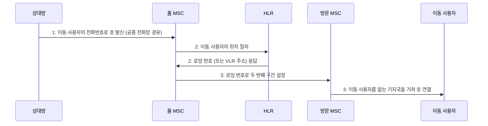

*그림 16. 이동 사용자로 호를 거는 간접 라우팅*

1. 상대방이 이동 사용자의 전화번호로 전화를 건다. 전화번호는 고정되어 있고 사용자는 움직이므로, 번호 자체는 특정 전화선이나 위치를 가리키지 않는다. 번호의 앞자리만으로 이동 사용자의 홈 네트워크를 전 세계에서 식별할 수 있다. 호는 상대방에게서 공중 전화망(PSTN)을 거쳐 이동 사용자의 홈 네트워크에 있는 홈 MSC로 라우팅된다. 이것이 호의 첫 번째 구간이다.
2. 홈 MSC는 호를 받아 HLR에 이동 사용자의 위치를 묻는다. 가장 간단한 경우 HLR은 **이동국 로밍 번호(mobile station roaming number, MSRN)**, 곧 **로밍 번호**를 돌려준다. 이 번호는 홈 네트워크와 연관된 이동 사용자의 영구 전화번호와 다르다. 로밍 번호는 이동 사용자가 방문 네트워크에 들어올 때 임시로 배정되는 일시적인 번호이며, 모바일 IP의 의탁 주소와 비슷한 역할을 하고, 의탁 주소처럼 상대방과 이동 사용자에게 보이지 않는다. HLR에 로밍 번호가 없으면 방문 네트워크의 VLR 주소를 돌려주며, 이때 홈 MSC는 VLR에 물어 로밍 번호를 얻는다.
3. 로밍 번호를 얻은 홈 MSC는 방문 네트워크의 MSC까지 호의 두 번째 구간을 설정한다. 호는 상대방에서 홈 MSC로, 홈 MSC에서 방문 MSC로, 방문 MSC에서 이동 사용자를 맡는 기지국으로 라우팅되어 연결된다.

HLR이 이동 사용자의 위치 정보를 얻는 방법은 다음과 같다. 휴대 전화가 켜지거나 새 VLR이 맡는 방문 네트워크 부분으로 들어오면, 이동 사용자는 VLR과 신호 메시지를 주고받아 방문 네트워크에 등록한다. 방문 VLR은 이동 사용자의 HLR에 위치 갱신 요청 메시지를 보내, 이동 사용자에게 연락할 수 있는 로밍 번호나 VLR의 주소(나중에 물어 번호를 얻을 수 있음)를 알린다. 이 교환 과정에서 VLR은 HLR로부터 이동 사용자의 가입 정보도 받아, 방문 네트워크가 그 사용자에게 어떤 서비스를 줄지 정한다.

### 5.3 GSM의 핸드오프

GSM에서 **핸드오프(handoff)** 는 통화 중에 이동국이 연결된 기지국을 다른 기지국으로 바꾸는 것이다(22장). 핸드오프 전에는 이동국의 호가 한 기지국(이전 기지국)을 거쳐 라우팅되고, 핸드오프 뒤에는 다른 기지국(새 기지국)을 거쳐 라우팅된다. 기지국 사이의 핸드오프는 이동국이 새 기지국과 신호를 주고받는 것뿐 아니라, 네트워크 안의 교환 지점에서 진행 중인 호의 경로를 새 기지국으로 바꾸는 것도 포함한다. 먼저 이전 기지국과 새 기지국이 같은 MSC를 쓰고 이 MSC에서 경로를 바꾸는 경우를 살펴본다.

핸드오프가 일어나는 이유는 다음과 같다.

- 현재 기지국과 이동국 사이의 신호가 나빠져 통화가 끊길 위험이 있다.
- 셀 하나가 많은 호를 처리하느라 과부하가 걸렸다. 이동국들을 덜 혼잡한 근처 셀로 핸드오프하면 혼잡을 줄일 수 있다.

기지국과 연결된 동안 이동국은 현재 기지국의 비컨 신호 세기와 자신이 들을 수 있는 근처 기지국들의 비컨 신호 세기를 주기적으로 측정하여, 초당 한두 번 현재 기지국에 보고한다. GSM의 핸드오프는 이 측정값, 근처 셀들의 현재 부하 등을 바탕으로 이전 기지국이 시작한다. GSM 표준은 기지국이 핸드오프 여부를 정하는 알고리즘을 정하지 않는다.

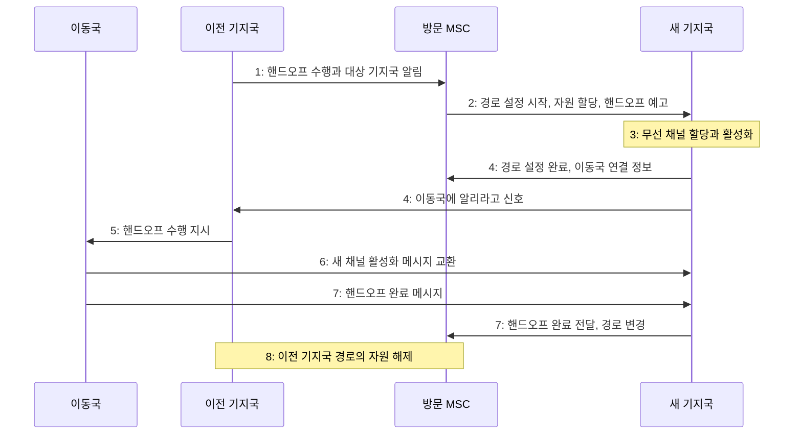

*그림 17. 같은 MSC를 쓰는 기지국 사이의 핸드오프 단계*

1. 이전 기지국이 방문 MSC에게 핸드오프를 하겠다는 것과 이동국을 넘겨줄 기지국(또는 후보 기지국들)을 알린다.
2. 방문 MSC는 새 기지국까지의 경로 설정을 시작하여 경로가 바뀐 호를 운반할 자원을 할당하고, 새 기지국에 곧 핸드오프가 일어날 것을 알린다.
3. 새 기지국은 이동국이 쓸 무선 채널을 할당하고 활성화한다.
4. 새 기지국은 방문 MSC와 이전 기지국에 방문 MSC에서 새 기지국까지의 경로가 설정되었으며 이동국에 곧 있을 핸드오프를 알려야 한다고 신호를 보낸다. 새 기지국은 이동국이 새 기지국과 연결하는 데 필요한 모든 정보를 제공한다.
5. 이동국에 핸드오프를 하라고 알린다. 이 시점까지 이동국은 네트워크가 새 기지국의 채널 할당과 방문 MSC에서 새 기지국까지의 경로 할당 같은 핸드오프 준비를 하고 있다는 것을 전혀 모른다.
6. 이동국과 새 기지국이 하나 이상의 메시지를 주고받아 새 기지국의 새 채널을 완전히 활성화한다.
7. 이동국은 새 기지국에 핸드오프 완료 메시지를 보내고, 이 메시지는 방문 MSC로 전달된다. 방문 MSC는 진행 중인 호의 경로를 새 기지국을 거쳐 이동국으로 바꾼다.
8. 이전 기지국까지의 경로에 할당되었던 자원을 해제한다.

### 5.4 앵커 MSC

이동국이 이전 기지국과 다른 MSC에 연결된 기지국으로 옮기면, 그리고 이런 MSC 사이의 핸드오프가 여러 번 일어나면 어떻게 되는가?

> **용어 정의:** **앵커 MSC(anchor MSC)** 는 호가 처음 시작될 때 이동국이 방문한 MSC로, 통화하는 동안 바뀌지 않으며 호는 언제나 홈 MSC에서 앵커 MSC를 거쳐 현재의 방문 MSC로 라우팅된다.

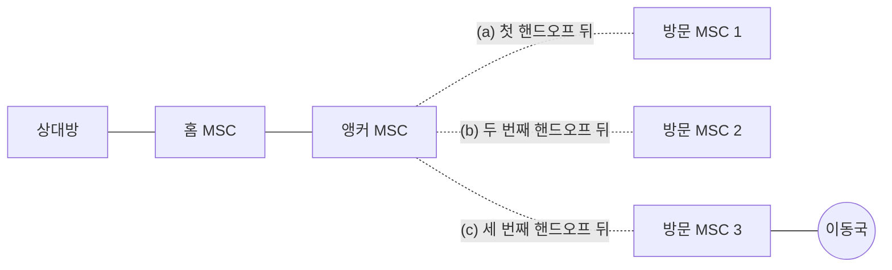

*그림 18. 앵커 MSC를 거치는 경로 변경*

통화 시간 동안 이동국이 MSC 사이를 몇 번 옮기든, 호는 홈 MSC에서 앵커 MSC로, 앵커 MSC에서 이동국이 현재 있는 방문 MSC로 라우팅된다. 이동국이 한 MSC의 수신 영역에서 다른 MSC의 수신 영역으로 옮기면, 진행 중인 호는 앵커 MSC에서 새 기지국을 가진 새 방문 MSC로 경로가 바뀐다. 따라서 상대방과 이동국 사이에는 언제나 MSC가 많아야 셋(홈 MSC, 앵커 MSC, 방문 MSC) 있다.

앵커 MSC에서 현재 MSC까지 MSC 홉 하나를 유지하는 대신, 이동국이 방문한 MSC들을 사슬처럼 이어 이동국이 새 MSC로 옮길 때마다 이전 MSC가 진행 중인 호를 새 MSC로 전달하게 할 수도 있다. 이런 MSC 사슬은 IS-41 셀룰러 네트워크에서 실제로 일어날 수 있으며, 앵커 MSC와 현재 방문 MSC 사이의 MSC를 없애는 선택적인 경로 최소화 단계를 둔다.

### 5.5 GSM과 모바일 IP의 비교

IP 네트워크와 셀룰러 네트워크는 여러 면에서 근본적으로 다르지만, 이동성을 다루는 기능 요소와 전체적인 접근 방식에는 놀랄 만큼 공통점이 많다.

| GSM 요소 | GSM 요소의 설명 | 모바일 IP 요소 |
|:-----|:-----|:-----|
| 홈 시스템 | 이동 사용자의 영구 전화번호가 속한 네트워크 | 홈 네트워크 |
| 홈 MSC (게이트웨이 MSC), HLR | 홈 MSC는 이동 사용자의 라우팅 가능한 주소를 얻는 접점이고, HLR은 홈 시스템에서 영구 전화번호, 프로필, 현재 위치, 가입 정보를 담는 데이터베이스 | 홈 에이전트 |
| 방문 시스템 | 홈 시스템이 아닌, 이동 사용자가 현재 머무는 네트워크 | 방문 네트워크 |
| 방문 MSC, VLR | 방문 MSC는 자신의 셀에 있는 이동 노드와 주고받는 호의 설정을 맡고, VLR은 방문 시스템에서 방문한 각 이동 사용자의 가입 정보를 담는 임시 데이터베이스 항목 | 외부 에이전트 |
| 이동국 로밍 번호 (MSRN) | 홈 MSC와 방문 MSC 사이의 호 구간을 위한 라우팅 가능한 주소이며, 이동 사용자와 상대방 모두에게 보이지 않음 | 의탁 주소 |

*표 6. GSM과 모바일 IP의 이동성 관리 공통점*

---

<br>

## 6. 무선과 이동성이 상위 계층에 미치는 영향

무선 네트워크는 링크 계층(페이딩, 다중 경로, 숨은 단말 같은 무선 채널의 특성 때문)과 네트워크 계층(네트워크 연결 지점을 바꾸는 이동 사용자 때문)에서 유선 네트워크와 크게 다르다. 그러면 전송 계층과 응용 계층에서도 중요한 차이가 있는가? 네트워크 계층은 유선이든 무선이든 상위 계층에 같은 최선형 전달 서비스를 제공하므로 차이는 작을 것 같다. 실제로 TCP와 UDP는 무선 링크가 있는 네트워크에서도 동작한다. 그러나 전송 프로토콜, 특히 TCP는 유선 네트워크와 무선 네트워크에서 성능이 매우 다를 수 있으며, 차이는 바로 성능에서 나타난다.

TCP는 송신자와 수신자 사이의 경로에서 잃거나 손상된 세그먼트를 재전송한다(8장). 이동 사용자의 경우 손실은 네트워크 혼잡(라우터 버퍼 넘침) 때문일 수도 있고, 핸드오프(예를 들어 세그먼트를 이동 노드의 새 연결 지점으로 다시 보내는 지연) 때문일 수도 있다. 어느 경우든 수신자가 송신자에게 보내는 TCP의 ACK는 세그먼트가 온전하게 도착하지 않았다는 사실만 알려 줄 뿐, 그 손실이 혼잡 때문인지, 핸드오프 중에 일어났는지, 비트 오류가 감지되어서인지 알려 주지 않는다. 송신자는 어느 경우든 세그먼트를 재전송하고, 혼잡 제어 측면에서도 똑같이 혼잡 윈도우를 줄인다(9장). 곧 TCP는 혼잡 윈도우를 무조건 줄임으로써, 세그먼트 손실이 손상이나 핸드오프가 아니라 혼잡 때문이라고 암묵적으로 가정한다.

그러나 22장에서 본 것처럼 무선 네트워크에서는 비트 오류가 유선 네트워크보다 훨씬 흔하다. 비트 오류나 핸드오프로 손실이 생겼다면 라우터 버퍼가 비어 있고 패킷이 혼잡 없이 종단 간 경로를 흐르고 있을 수 있으므로, TCP 송신자가 혼잡 윈도우를 줄여 전송 속도를 낮출 이유가 없다. 이 문제를 다루는 방법은 크게 세 가지이다.

| 방법 | 내용 |
|:-----|:-----|
| 지역 복구 (local recovery) | 비트 오류가 일어난 곳(예: 무선 링크)에서 그때 복구함. 22장의 802.11 ARQ나, ARQ와 FEC를 함께 쓰는 더 정교한 방법 |
| 무선 링크를 아는 TCP 송신자 | 지역 복구에서는 TCP 송신자가 세그먼트가 무선 링크를 지난다는 것을 모름. 대신 TCP 송신자와 수신자가 무선 링크의 존재를 알고, 유선 네트워크에서 일어난 혼잡 손실과 무선 링크에서 일어난 손상이나 손실을 구별하여, 유선 네트워크의 혼잡 손실에만 혼잡 제어로 대응함 |
| 연결 분할 (split connection) | 이동 사용자와 다른 끝점 사이의 종단 간 연결을 두 개의 전송 계층 연결, 곧 이동 호스트에서 무선 액세스 포인트까지의 연결과 무선 액세스 포인트에서 다른 통신 끝점(유선 호스트)까지의 연결로 나눔. 무선 구간의 전송 계층은 표준 TCP 연결일 수도 있고, UDP 위에서 특별히 설계한 오류 복구 프로토콜일 수도 있음. 셀룰러 데이터 네트워크에서는 분할 TCP 연결이 널리 쓰이며 성능을 크게 높임 |

*표 7. 무선 환경의 TCP 문제를 다루는 세 가지 방법*

응용 계층에서 중요한 고려 사항은 무선 링크, 특히 셀룰러 무선 링크의 대역폭이 비교적 낮은 경우가 많아 대역폭을 귀한 자원으로 다루어야 한다는 점이다. 예를 들어 4G 전화의 웹 브라우저에 콘텐츠를 보내는 웹 서버는 유선 연결의 브라우저에 주는 것만큼 이미지가 많은 콘텐츠를 제공하지 못할 수 있다. 한편 무선 링크가 가능하게 하는 이동성은 위치 인식(location-aware)과 상황 인식(context-aware) 응용 같은 다양한 응용을 가능하게 한다.

---

<br>

## 개념 적용

**T/F 점검:**

| 문장 | 판단과 근거 |
|:-----|:-----|
| GSM은 FDM과 TDM을 결합하므로, 주파수 하위 대역 F개와 시간 슬롯 T개로 $`F \times T`$개의 통화를 동시에 지원한다. | **T.** GSM은 200 kHz 대역마다 TDM 통화 여덟 개를 지원한다. |
| 3G에서는 음성과 데이터가 서로 다른 코어 네트워크를 쓰지만 무선 접속 네트워크는 함께 쓴다. | **T.** RNC가 MSC와 SGSN에 모두 연결된다. |
| 4G LTE에서는 음성이 IP 데이터그램에 담기지 않고 별도의 회선 교환망으로 전달된다. | **F.** 4G는 all-IP 구조이므로 음성과 데이터가 모두 IP 데이터그램에 담긴다. |
| 간접 라우팅에서 상대방은 이동 노드의 의탁 주소를 알아야 한다. | **F.** 상대방은 영구 주소로 보내며, 의탁 주소는 홈 에이전트와 외부 에이전트만 안다. |
| 간접 라우팅에서 이동 노드가 상대방에게 보내는 데이터그램도 홈 에이전트를 거친다. | **F.** 이동 노드는 상대방의 주소를 알므로 직접 보낸다. |
| 홈 에이전트는 상대방의 원래 데이터그램을 의탁 주소로 가는 새 데이터그램에 캡슐화한다. | **T.** 외부 에이전트가 역캡슐화하여 원래 데이터그램을 이동 노드에 전달한다. |
| 직접 라우팅은 삼각 라우팅을 없애지만 이동 사용자 위치 프로토콜이 필요하다. | **T.** 상대방 에이전트가 홈 에이전트에게 의탁 주소를 물어야 한다. |
| 모바일 IP의 에이전트 알림은 새로운 패킷 유형을 정의한다. | **F.** ICMP 라우터 알림 메시지에 이동 에이전트 알림 확장을 붙인다. |
| 모바일 IP 등록 메시지는 TCP 연결로 보낸다. | **F.** UDP 데이터그램에 담아 포트 434로 보낸다. |
| 이중 횡단은 원격 호스트와 이동 호스트가 같은 네트워크에 있을 때 생긴다. | **T.** 원격 호스트가 보낸 패킷이 홈 에이전트를 거쳐 인터넷을 두 번 건넌다. |
| GSM에서 로밍 번호는 상대방에게 보이며, 상대방은 그 번호로 전화를 건다. | **F.** 상대방은 영구 전화번호로 걸며, 로밍 번호는 상대방과 이동 사용자 모두에게 보이지 않는다. |
| GSM의 핸드오프는 이동국이 시작한다. | **F.** 이동국의 측정 보고와 근처 셀의 부하 등을 바탕으로 이전 기지국이 시작한다. |
| 앵커 MSC를 쓰면 상대방과 이동국 사이의 MSC는 많아야 셋이다. | **T.** 홈 MSC, 앵커 MSC, 현재 방문 MSC이다. |
| TCP는 무선 링크의 비트 오류로 생긴 손실에도 혼잡 윈도우를 줄인다. | **T.** TCP는 손실의 원인을 구별하지 못하고 혼잡 때문이라고 가정한다. |

---

<br>

## 요약

| 개념 | 핵심 요약 |
|:-----|:-----|
| 셀룰러 세대 | 1G 아날로그 음성에서 2G 디지털 음성, 데이터를 강조한 3G를 거쳐 all-IP 코어의 4G LTE로 발전했다. |
| 2G GSM 구조 | 셀마다 BTS가 있고, BSC가 여러 BTS를 맡아 BSS를 이루며, MSC가 인가, 호 설정, 핸드오프를 맡고, 무선 인터페이스는 FDM과 TDM을 결합한다. |
| 3G 구조 | 기존 음성망과 나란히 SGSN과 GGSN의 데이터 코어를 두고, RNC가 Node B들을 제어하며, 무선 접속에 WCDMA를 쓴다. |
| 4G LTE | eNodeB, S-GW, P-GW, MME, HSS로 이루어진 all-IP 구조이며, 데이터 평면과 제어 평면을 나누고 하향 채널에 OFDM을 쓴다. |
| 이동성의 정도 | 같은 접속 네트워크 안의 이동, 연결을 끊고 옮기는 이동, 연결을 유지하는 이동으로 나뉘며, 주소 유지의 필요성은 응용에 달려 있다. |
| 홈 네트워크와 외부 네트워크 | 이동 노드는 홈 네트워크의 영구 주소와 외부 네트워크의 의탁 주소를 가지며, 홈 에이전트와 외부 에이전트가 이동성을 관리한다. |
| 간접 라우팅 | 상대방은 영구 주소로 보내고, 홈 에이전트가 의탁 주소로 터널링하며, 외부 에이전트가 역캡슐화하여 전달한다. 삼각 라우팅의 비효율이 있다. |
| 직접 라우팅 | 상대방 에이전트가 의탁 주소를 물어 직접 터널링하며, 이동 중의 전달은 앵커 외부 에이전트로 해결한다. |
| 모바일 IP | 에이전트 발견(ICMP 알림과 요청), 등록(UDP 포트 434의 요청과 응답), 간접 라우팅에 의한 데이터 전달의 세 단계로 이루어진다. |
| 모바일 IP의 비효율 | 원격 호스트가 같은 네트워크에 있으면 이중 횡단, 아니면 삼각 라우팅이 생기며, 의탁 주소를 원격 호스트에 결합하여 줄일 수 있다. |
| GSM의 호 라우팅 | 홈 MSC가 HLR에서 로밍 번호를 얻어 방문 MSC까지 두 번째 구간을 설정하는 간접 라우팅이며, VLR이 HLR에 위치를 갱신한다. |
| GSM 핸드오프와 앵커 MSC | 이전 기지국이 시작하는 여덟 단계로 경로를 바꾸며, MSC 사이의 핸드오프는 앵커 MSC를 거치므로 MSC가 많아야 셋이다. |
| 상위 계층에 미치는 영향 | TCP는 무선 손실을 혼잡으로 오인하여 속도를 낮추므로, 지역 복구, 무선을 아는 TCP, 연결 분할로 대응한다. |

---

<br>

## 점검 문제

1. **간접 라우팅의 경로:** 상대방이 외부 네트워크에 있는 이동 노드(영구 주소 128.119.40.186, 의탁 주소 79.129.13.2)에게 데이터그램을 보낸다. 데이터그램이 이동 노드에 도착하기까지의 경로와 각 구간에서 바깥쪽 IP 헤더의 목적지 주소를 쓰라. 이동 노드의 응답은 어떤 경로로 가는가?

   <details>
   <summary>정답</summary>

   상대방은 목적지를 영구 주소 128.119.40.186으로 하여 보내므로 데이터그램은 홈 네트워크로 라우팅되고 홈 에이전트가 가로챈다. 홈 에이전트는 원래 데이터그램 전체를 목적지가 의탁 주소 79.129.13.2인 새 데이터그램에 캡슐화하여 외부 에이전트로 보낸다. 외부 에이전트는 역캡슐화하여 목적지가 128.119.40.186인 원래 데이터그램을 이동 노드에 전달한다. 이동 노드의 응답은 출발지를 영구 주소, 목적지를 상대방 주소로 하여 홈 에이전트를 거치지 않고 상대방에게 직접 간다.

   </details>

2. **직접 라우팅과 상대방 에이전트:** 직접 라우팅에 상대방 에이전트가 필요한 이유와, 이동 노드가 세션 도중 다른 외부 네트워크로 옮겼을 때 데이터가 전달되는 방법을 설명하라.

   <details>
   <summary>정답</summary>

   직접 라우팅에서는 데이터그램을 홈 에이전트를 거치지 않고 의탁 주소로 직접 보내야 하므로, 누군가가 홈 에이전트에게 의탁 주소를 물어 알아내고 데이터그램을 의탁 주소로 터널링해야 한다. 이 일을 상대방 에이전트(또는 상대방 자신)가 한다. 상대방 에이전트는 세션을 시작할 때 한 번만 의탁 주소를 물으므로, 이동 노드가 옮기면 홈 에이전트의 의탁 주소를 고치는 것만으로는 부족하다. 처음 외부 네트워크의 외부 에이전트를 앵커 외부 에이전트로 두고, 이동 노드가 새 외부 에이전트에 등록하면 새 외부 에이전트가 앵커에게 새 의탁 주소를 알린다. 앵커는 계속 받는 데이터그램을 새 의탁 주소로 다시 캡슐화하여 전달한다.

   </details>

3. **모바일 IP 등록:** 외부 에이전트를 거쳐 모바일 IP 등록을 하는 네 단계를 쓰고, 등록 식별자의 역할을 설명하라.

   <details>
   <summary>정답</summary>

   (1) 외부 에이전트의 알림을 받은 이동 노드가 COA, 홈 에이전트 주소, 영구 주소, 요청 수명, 64비트 등록 식별자를 담은 등록 요청을 UDP 포트 434로 외부 에이전트에 보낸다. (2) 외부 에이전트는 영구 주소를 기록하고 요청을 홈 에이전트의 포트 434로 전달한다. (3) 홈 에이전트는 진정성과 정확성을 검사한 뒤 영구 주소를 COA에 결합하고, 실제 수명과 같은 등록 식별자를 담은 등록 응답을 보낸다. (4) 외부 에이전트가 응답을 이동 노드에 전달한다. 등록 식별자는 순서 번호처럼 받은 등록 응답을 해당 등록 요청과 짝짓는 데 쓰인다.

   </details>

4. **앵커 MSC:** 통화 도중 이동국이 서로 다른 MSC가 맡는 지역 세 곳을 차례로 옮겨 MSC 사이의 핸드오프가 세 번 일어났다. 세 번째 핸드오프 뒤 호는 어떤 MSC들을 거치는가? MSC를 사슬처럼 잇는 방식과 비교하라.

   <details>
   <summary>정답</summary>

   호는 홈 MSC에서 앵커 MSC(호가 시작될 때 방문한 MSC)로, 앵커 MSC에서 현재 방문 MSC(세 번째 핸드오프 뒤의 MSC)로 라우팅된다. 핸드오프 횟수와 관계없이 상대방과 이동국 사이의 MSC는 홈 MSC, 앵커 MSC, 현재 방문 MSC의 많아야 셋이다. 사슬 방식이라면 이전 MSC가 새 MSC로 호를 넘기므로 핸드오프가 세 번이면 앵커 뒤에 방문했던 MSC들이 모두 경로에 남아 MSC의 수가 늘어나며, 이를 줄이려면 별도의 경로 최소화 단계가 필요하다.

   </details>

5. **이중 횡단과 삼각 라우팅:** 이중 횡단과 삼각 라우팅이 각각 언제 생기는지 설명하고, 둘 중 어느 쪽이 더 심각한지 이유와 함께 쓰라.

   <details>
   <summary>정답</summary>

   이중 횡단은 원격 호스트가 자신과 같은 네트워크로 옮겨 온 이동 호스트와 통신할 때 생기며, 원격 호스트가 보낸 패킷이 홈 에이전트까지 인터넷을 건넜다가 다시 건너 돌아온다. 삼각 라우팅은 원격 호스트와 이동 호스트가 서로 다른 네트워크에 있을 때 생기며, 패킷이 삼각형의 한 변 대신 두 변(원격 호스트에서 홈 에이전트, 홈 에이전트에서 이동 호스트)을 지난다. 컴퓨터는 주로 같은 지역의 컴퓨터와 통신하므로(지역성의 원리) 이중 횡단이 자주 일어나고, 지역 안에서 끝날 통신이 인터넷을 두 번 건너므로 이중 횡단이 더 심각하다.

   </details>

6. **TCP와 무선 손실:** 무선 링크의 비트 오류로 세그먼트가 손실되면 TCP의 성능이 왜 나빠지는가? 연결 분할 방식이 이 문제를 어떻게 줄이는지 설명하라.

   <details>
   <summary>정답</summary>

   TCP 송신자는 ACK로 세그먼트가 도착하지 않았다는 사실만 알 수 있고 원인을 구별하지 못하므로, 모든 손실을 혼잡으로 여겨 혼잡 윈도우를 줄인다. 무선 비트 오류로 인한 손실이면 네트워크에 혼잡이 없는데도 전송 속도를 낮추어 처리량이 불필요하게 떨어진다. 연결 분할 방식은 종단 간 연결을 이동 호스트와 무선 액세스 포인트 사이의 연결, 액세스 포인트와 유선 호스트 사이의 연결로 나눈다. 무선 구간의 손실은 무선 구간의 연결이 처리하므로, 유선 구간의 TCP는 무선 손실 때문에 혼잡 윈도우를 줄이지 않는다.

   </details>

7. **FDM/TDM 용량:** GSM처럼 200 kHz 대역마다 TDM 통화 여덟 개를 지원하는 시스템에 5 MHz의 스펙트럼이 있다. 동시에 지원할 수 있는 통화는 최대 몇 개인가?

   <details>
   <summary>정답</summary>

   5 MHz를 200 kHz 대역으로 나누면 5,000 / 200 = 25개의 하위 대역이 생긴다. 하위 대역마다 TDM 통화가 여덟 개이므로 $`F \times T = 25 \times 8 = 200`$개의 통화를 동시에 지원할 수 있다.

   </details>
