# Chapter 25 — Cellular Networks and Mobility

[Repository Guide](../../README.md) | [English](Concepts_Lecture.md) | [한국어](Concepts_Lecture.ko.md)

> **Last Updated:** 2026-11-18
>
> Computer Networking: A Top-Down Approach, Kurose and Ross, Ch 7; TCP/IP Protocol Suite, Forouzan, Ch 10

> **Learning Objectives:**
> 1. Explain the architecture and main components of 2G, 3G, and 4G cellular networks
> 2. Explain the degrees of mobility from the network layer's point of view and the concepts of home network, foreign network, and care-of address
> 3. Compare indirect and direct routing of datagrams to a mobile node
> 4. Explain the agent discovery, registration, and data transfer phases of Mobile IP and its inefficiencies
> 5. Explain how GSM routes calls to a mobile user, how handoffs work, and the role of the anchor MSC
> 6. Explain the impact of wireless links and mobility on higher-layer protocols such as TCP

---

## Table of Contents

- [1. Cellular Internet Access](#1-cellular-internet-access)
  - [1.1 Generations of Cellular Technology](#11-generations-of-cellular-technology)
  - [1.2 2G Architecture: Voice Connections to the Telephone Network](#12-2g-architecture-voice-connections-to-the-telephone-network)
  - [1.3 3G Cellular Data Networks](#13-3g-cellular-data-networks)
  - [1.4 4G LTE](#14-4g-lte)
- [2. Principles of Mobility Management](#2-principles-of-mobility-management)
  - [2.1 Degrees of Mobility](#21-degrees-of-mobility)
  - [2.2 Home Networks and Foreign Networks](#22-home-networks-and-foreign-networks)
  - [2.3 Addressing](#23-addressing)
- [3. Routing to a Mobile Node](#3-routing-to-a-mobile-node)
  - [3.1 Indirect Routing](#31-indirect-routing)
  - [3.2 Direct Routing](#32-direct-routing)
- [4. Mobile IP](#4-mobile-ip)
  - [4.1 Addresses and Agents in Mobile IP](#41-addresses-and-agents-in-mobile-ip)
  - [4.2 Agent Discovery](#42-agent-discovery)
  - [4.3 Registration](#43-registration)
  - [4.4 Data Transfer](#44-data-transfer)
  - [4.5 Inefficiency in Mobile IP](#45-inefficiency-in-mobile-ip)
- [5. Managing Mobility in Cellular Networks](#5-managing-mobility-in-cellular-networks)
  - [5.1 HLR and VLR](#51-hlr-and-vlr)
  - [5.2 Routing Calls to a Mobile User](#52-routing-calls-to-a-mobile-user)
  - [5.3 Handoffs in GSM](#53-handoffs-in-gsm)
  - [5.4 The Anchor MSC](#54-the-anchor-msc)
  - [5.5 GSM versus Mobile IP](#55-gsm-versus-mobile-ip)
- [6. Impact of Wireless and Mobility on Higher Layers](#6-impact-of-wireless-and-mobility-on-higher-layers)
- [Concept Applications](#concept-applications)
- [Summary](#summary)
- [Self-Check Questions](#self-check-questions)

---

<br>

## 1. Cellular Internet Access

The WiFi hotspots of Chapter 22 usually cover only a small area, between 10 and 100 meters in diameter. A natural way to provide wireless Internet access where no hotspot is available is to extend the cellular telephone networks found throughout the world so that they support wireless Internet access as well as voice telephony. Ideally, such access would be reasonably fast and would provide seamless mobility, letting users keep their TCP sessions while traveling on a bus or a train. This chapter gives a brief, high-level view of the wireless first hop and of the network that connects it to the telephone network or the Internet.

### 1.1 Generations of Cellular Technology

Cellular technology is often classified into several **generations**.

| Generation | Features |
|:-----|:-----|
| 1G | Analog FDMA systems designed exclusively for voice; now almost extinct, replaced by digital 2G |
| 2G | Digital systems originally designed for voice; later extended (2.5G) to support data (Internet) as well as voice |
| 3G | Support voice and data, with an emphasis on data capabilities and faster radio access links |
| 4G | Based on LTE technology, providing integrated voice and data at multi-megabit speeds over an all-IP core network |

*Table 1. Generations of cellular technology*

This chapter uses the terminology of the **GSM (Global System for Mobile Communications)** standards to describe cellular network architecture. In the 1980s, Europeans recognized the need for a pan-European digital cellular telephony system to replace the numerous incompatible analog cellular systems, which led to the GSM standard. GSM was deployed with great success in Europe in the early 1990s and has since become the dominant technology of the cellular telephone world.

### 1.2 2G Architecture: Voice Connections to the Telephone Network

> **Definition:** A **cell** is one geographic coverage area into which the region of a cellular network is partitioned, containing one base transceiver station that exchanges signals with the mobile stations in it.

The term **cellular** comes from the fact that the region covered by a cellular network is partitioned into a number of cells, usually drawn as hexagons.

> **Definition:** A **base transceiver station (BTS)** is the GSM base station that transmits signals to and receives signals from the mobile stations in its cell.

The coverage area of a cell depends on many factors, including the transmitting power of the BTS, the transmitting power of the user devices, obstructing buildings in the cell, and the height of the base station antennas. Figures show the BTS in the middle of the cell, but many systems today place the BTS at the corner where three cells meet, so that one BTS with directional antennas serves three cells.

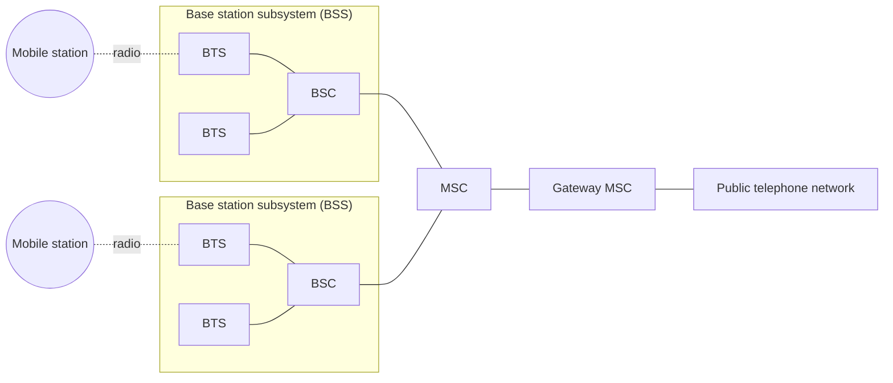

*Figure 1. Components of the GSM 2G cellular network architecture*

- **Air interface:** The GSM 2G standard uses combined FDM and TDM for the air interface. Pure FDM partitions the channel into frequency bands with one call per band, and pure TDM partitions time into frames and slots with one slot per call (Chapters 1 and 18). Combined FDM/TDM partitions the channel into frequency sub-bands and, within each sub-band, partitions time into frames and slots. If the channel is partitioned into F sub-bands and time into T slots, the channel can support $`F \times T`$ simultaneous calls. GSM uses 200 kHz frequency bands, each supporting eight TDM calls. GSM encodes speech at 13 kbps and 12.2 kbps. The cable access network of Chapter 18 also combines FDM and TDM.
- **Base station controller (BSC):** It typically serves several tens of BTSs. It allocates BTS radio channels to mobile subscribers, performs **paging** (finding the cell in which a mobile user resides), and performs handoffs of mobile users (Section 5.3). A BSC and the BTSs it controls together form a GSM **base station subsystem (BSS)**.
- **Mobile switching center (MSC):** It plays the central role in user authorization and accounting (for example, determining whether a mobile device may connect to the cellular network), call establishment and teardown, and handoff. A single MSC typically contains up to five BSCs, giving about 200,000 subscribers per MSC. A provider's network has several MSCs, and the special MSCs that connect the provider's cellular network to the larger public telephone network are called **gateway MSCs**.

> **Note:** The GSM BSS (base station subsystem) has the same acronym as the 802.11 BSS (basic service set) of Chapter 22, but it is a different concept.

### 1.3 3G Cellular Data Networks

To read e-mail, access the Web, use location-based services such as maps and restaurant recommendations, and watch streaming video while on the go, a smartphone must run a full TCP/IP protocol stack and connect to the Internet through the cellular data network. Cellular data standards are hard to sort out, because each generation brings new technologies and acronyms and no single official body sets the requirements for 2.5G, 3G, 3.5G, or 4G. This chapter covers the UMTS (Universal Mobile Telecommunications Service) 3G standards and the 4G standards developed by the **3GPP (3rd Generation Partnership Project)**.

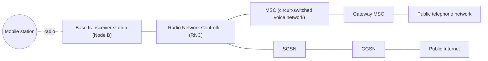

*Figure 2. 3G system architecture*

**3G core network:** The 3G core cellular data network connects radio access networks to the public Internet and interoperates with components of the existing cellular voice network, in particular the MSC. Given the considerable infrastructure and profitable services of the existing voice network, the designers of 3G data services left the existing GSM core voice network untouched and added data functionality in parallel with it. Integrating the new data services directly into the core of the existing voice network would have raised the same difficulties as integrating new (IPv6) and legacy (IPv4) technologies in the Internet (Chapter 24). The 3G core network has two kinds of nodes.

- **SGSN (Serving GPRS Support Node):** It delivers datagrams to and from the mobile nodes in the radio access network to which it is attached. It interacts with the MSC of the area's voice network to provide user authorization and handoff, maintains location (cell) information about active mobile nodes, and forwards datagrams between mobile nodes in the radio access network and a GGSN. GPRS (Generalized Packet Radio Service) is an early cellular data service of 2G networks.
- **GGSN (Gateway GPRS Support Node):** A gateway connecting multiple SGSNs to the larger Internet. It is the last piece of 3G infrastructure that a datagram originating at a mobile node encounters before entering the larger Internet. To the outside world, a GGSN looks like any other gateway router, and the mobility of the 3G nodes within its network is hidden behind it.

**3G radio access network:** This is the wireless first-hop network that a 3G user sees. A **Radio Network Controller (RNC)** typically controls several cell base transceiver stations, similar to 2G base stations (called Node Bs in 3G UMTS). The RNC connects both to the circuit-switched cellular voice network through an MSC and to the packet-switched Internet through an SGSN. Thus, although 3G voice and data services use different core networks, they share a common first-hop and last-hop radio access network.

A significant difference of 3G UMTS from 2G is that, instead of GSM's FDMA/TDMA scheme, it uses a CDMA technique (Chapter 22) called **DS-WCDMA (Direct Sequence Wideband CDMA)** within TDMA slots, and the TDMA slots are in turn available on multiple frequencies. This uses all three channel-sharing approaches of Chapter 18 and is similar to the approach of wired cable access networks (Chapter 18). The data service associated with the WCDMA specification is called **HSPA (High Speed Packet Access)** and promises downlink data rates of up to 14 Mbps.

### 1.4 4G LTE

The 4G **LTE (Long-Term Evolution)** standard put forward by the 3GPP has two important innovations over 3G: an all-IP core network and an enhanced radio access network.

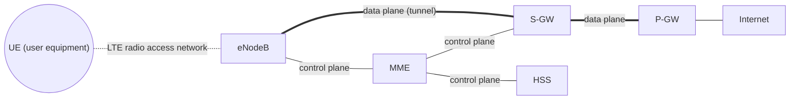

*Figure 3. 4G network architecture*

The important observations about the 4G architecture are as follows.

- **A unified, all-IP network architecture:** Unlike 3G, with separate components and paths for voice and data traffic, 4G carries both voice and data in IP datagrams between the wireless device (the **UE, User Equipment**, in 4G terms) and the packet gateway (P-GW) that connects the 4G edge network to the rest of the network. With 4G, the telephony roots of cellular networks have disappeared in favor of universal IP service.
- **Separation of the data plane and control plane:** Like the data and control planes of the IP network layer (Chapter 10), the 4G architecture clearly separates the two planes.
- **Separation of the radio access network and the all-IP core network:** IP datagrams carrying user data are forwarded between the UE and the gateway (P-GW) over a 4G-internal IP network, and control packets are exchanged over the same internal network among the 4G control service components.

The principal components of the 4G architecture are as follows.

| Component | Role |
|:-----|:-----|
| eNodeB | The descendant of the 2G base station and the 3G RNC (Node B); in the data plane, it forwards datagrams between the UE (over the LTE radio access network) and the P-GW, encapsulating UE datagrams and tunneling them to the P-GW through the all-IP enhanced packet core (EPC); in the control plane, it handles registration and mobility signaling on behalf of the UE |
| P-GW (Packet Data Network Gateway) | Allocates IP addresses to UEs and enforces quality of service (QoS); as a tunnel endpoint, it encapsulates and decapsulates datagrams to and from UEs |
| S-GW (Serving Gateway) | The data-plane mobility anchor point; all UE traffic passes through it, and it also performs charging/billing and lawful traffic interception |
| MME (Mobility Management Entity) | Performs connection and mobility management on behalf of the UEs in the cells it controls, receiving UE subscription information from the HSS |
| HSS (Home Subscriber Server) | Contains UE information such as roaming access capabilities, QoS profiles, and authentication information, obtained from the UE's home cellular provider |

*Table 2. Principal components of the 4G architecture*

The tunneling between the eNodeB and the P-GW is similar to tunneling IPv6 datagrams between two IPv6 endpoints through a network of IPv4 routers (Chapter 24). These tunnels may carry QoS guarantees. For example, a 4G network may guarantee that voice traffic experiences no more than 100 ms of delay between UE and P-GW and a packet loss rate below 1 percent, and that TCP traffic gets 300 ms and a packet loss rate below 0.0001 percent.

**LTE radio access network:** On the downstream channel, LTE uses **orthogonal frequency division multiplexing (OFDM)**, a combination of frequency division multiplexing and time division multiplexing. The term orthogonal comes from the fact that the signals on different frequency channels are created so that they interfere very little with each other even when the channel frequencies are tightly spaced. In LTE, each active mobile node is allocated one or more 0.5 ms time slots on one or more channel frequencies. At each frequency, twenty 0.5 ms slots form a 10 ms frame.

```text
  frequency
    f4 │    │ ## │    │    │ ## │    │    │    │ ...
    f3 │ ## │    │    │ ## │    │    │    │ ## │ ...
    f2 │    │    │ ## │    │    │ ## │    │    │ ...
    f1 │    │    │    │    │    │    │ ## │    │ ...
       └────┴────┴────┴────┴────┴────┴────┴────┴──► time (one cell = 0.5 ms)
  ## : slots allocated to one mobile node (eight here)
```

*Figure 4. Eight 0.5 ms slots allocated to one mobile node across four frequencies*

The more slots a mobile node is allocated, whether on the same frequency or on different frequencies, the higher the transmission rate it achieves. Slots can be reallocated among mobile nodes as often as once every millisecond, and the modulation scheme can also be changed to change the transmission rate, as in Figure 1 of Chapter 22. The LTE standard does not mandate which mobile nodes get which slots; the scheduling algorithms of the equipment vendor or network operator decide. **Opportunistic scheduling** matches the physical-layer protocol to the channel conditions between sender and receiver and chooses the receivers to which packets are sent according to channel conditions, making the best use of the wireless medium. User priorities and contracted levels of service can also be used in scheduling downstream packet transmissions. LTE-Advanced provides downstream bandwidths of hundreds of Mbps by allocating aggregated channels to a mobile node.

> **Note:** Another 4G wireless technology, WiMAX (World Interoperability for Microwave Access), is a family of IEEE 802.16 standards (the wireless MAN working group of Chapter 20) that differs significantly from LTE and has not enjoyed LTE's widespread deployment.

---

<br>

## 2. Principles of Mobility Management

In the broadest sense, a **mobile node** is one that changes its point of attachment to the network over time. Because the term mobility has many meanings in the computer and telephony worlds, the dimensions of mobility are considered first.

### 2.1 Degrees of Mobility

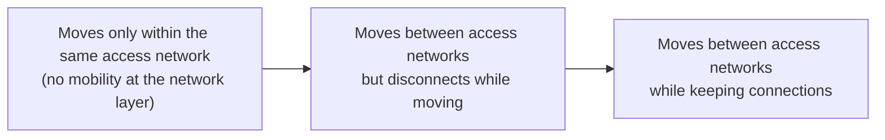

*Figure 5. Degrees of mobility from the network layer's point of view (mobility increases to the right)*

- **Movement within the same access network:** A user carrying a laptop with a wireless NIC around a building is not mobile from the network layer's perspective, as in Section 10.1 of Chapter 22. If the user stays associated with the same AP regardless of location, the user is not mobile even from the link layer's perspective.
- **Movement with disconnection:** A user who takes a laptop from an office or dormitory to a café or classroom and wants to connect to the network in the new location is mobile, but does not need to keep a connection while moving between points of attachment.
- **Movement keeping connections:** A user driving at 150 km/h on a highway, passing through several wireless access networks while wanting to keep an uninterrupted TCP connection to a remote application, is definitely mobile.

Whether a mobile node's address must always stay the same depends strongly on the applications being run.

- **When keeping the address helps:** For the driver who wants to keep an uninterrupted TCP connection, keeping the same IP address is convenient. An Internet application needs the IP address and port number of the remote entity (Chapter 3), so if the mobile entity keeps its IP address as it moves, mobility is invisible to the application. This transparency is valuable: the application need not worry about a changing IP address, and the same code serves mobile and nonmobile connections. Mobile IP (Section 4) provides this transparency. The phone number of a mobile phone, essentially the phone's network-layer address, also stays the same as it travels from one provider's network to another.
- **When the address does not matter:** A user who turns off an office laptop, takes it home, and powers it up to work there mostly as a client of client-server applications such as e-mail and Web browsing does not much care about the laptop's IP address. An address temporarily allocated by the home ISP is fine, and DHCP (Chapter 12) already provides this.

> **Note:** **Limits of changing the address.** The simple approach of having a mobile host obtain a new address with DHCP whenever it moves to a new network has drawbacks. The configuration files must be changed, the computer must be rebooted each time it moves, and the DNS tables (Chapter 5) must be revised so that other hosts in the Internet learn of the change. Above all, the ports and IP addresses of the client and server must stay constant for the duration of a connection, so moving during a transmission interrupts the data exchange. Using two addresses (Section 2.3) is therefore more feasible.

If there is no fixed infrastructure to which a mobile user can connect, two users within communication range of each other need to establish a connection without any other network-layer infrastructure. This is the ad hoc networking of Chapter 22 and is beyond the scope of this chapter.

### 2.2 Home Networks and Foreign Networks

The problem of a mobile user keeping connections while moving between networks can be compared to a person. A young adult who moves out of the family home lives in a series of dormitories and apartments, often changing addresses. How can an old friend who wants to get in touch find the current address? A common way is to contact the family. A mobile young adult usually registers the current address with the family, so the family home, with its permanent address, becomes the first place others go to communicate with the mobile adult. Later communication may be **indirect**, with mail sent to the parents' home and forwarded, or **direct**, with mail sent directly to the address obtained from the parents.

> **Definition:** A **home network** is the network that is the permanent home of a mobile node such as a laptop or smartphone.

> **Definition:** A **home agent** is the entity within the home network that performs mobility management functions on behalf of the mobile node, usually a router attached to the home network.

For a mobile professional, the home network might be the company network. When the mobile node leaves the company and attaches to a network elsewhere, that network also needs an entity that helps with mobility.

> **Definition:** A **foreign network** is the network in which the mobile node currently resides, also called the visited network.

> **Definition:** A **foreign agent** is the entity within the foreign network that helps the mobile node with mobility management functions, usually a router attached to the foreign network.

For a mobile professional, the visited network might be that of a colleague being visited. The entity wishing to communicate with the mobile node is called the **correspondent**. Agents may be collocated with routers, for example as processes running on routers, or may run on other hosts or servers in the network. The agent functions are performed in the application layer, so an agent is both a router and a host.

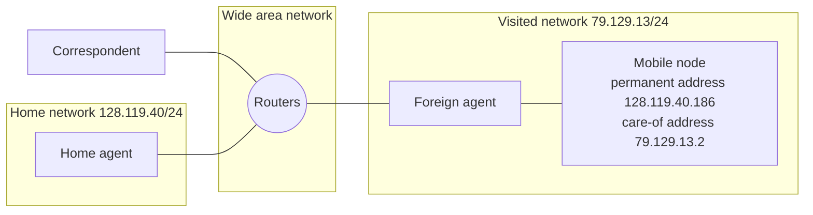

*Figure 6. Initial elements of a mobile network architecture*

### 2.3 Addressing

To make mobility transparent to applications, it is desirable for a mobile node to keep its address as it moves between networks. When the mobile node resides in a foreign network, all traffic addressed to its permanent address must be routed to the foreign network. Two ways of doing this can be considered.

- **Announcing through routing:** The foreign network advertises to its neighbors a highly specific route (more-specific route, longest prefix matching of Chapter 13) to the mobile node's permanent address, and the neighbors propagate this information through the normal routing-update procedure. When the mobile node moves to another foreign network, the new foreign network advertises a new route and the old one withdraws its route. This solves two problems at once without significant changes to the network-layer infrastructure, but scalability is a major drawback: routers would have to maintain forwarding table entries for potentially millions of mobile nodes and update them as the nodes move.
- **Handling it at the edge:** As a recurring theme of Internet architecture, mobility functionality is pushed from the network core to the network edge. This is the approach adopted in practice. Just as parents track their child's location, the home agent tracks the foreign network in which the mobile node resides. A protocol between the mobile node (or a foreign agent representing it) and the home agent is needed to update the location.

> **Definition:** A **care-of address (COA)** is the temporary address that a mobile node uses while residing in a foreign network, whose network portion matches that of the foreign network.

The conceptually simplest approach is to locate foreign agents at the edge routers of the foreign network. A foreign agent has two roles.

1. It creates for the mobile node a care-of address whose network portion matches the foreign network. The mobile node thus has two addresses: its **permanent address**, or **home address** (analogous to the family home of the mobile youth), and its care-of address, sometimes called the foreign address (analogous to the address of the house where the youth now lives). In Figure 6, the permanent address of the mobile node is 128.119.40.186, and while visiting network 79.129.13/24 its care-of address is 79.129.13.2.
2. It informs the home agent that the mobile node resides in its network with the given care-of address. The care-of address is used to reroute datagrams to the mobile node through the foreign agent.

The mobile node can also take on the responsibilities of the foreign agent itself. For example, it can obtain a care-of address in the foreign network with a protocol such as DHCP and inform the home agent of it on its own. A care-of address obtained this way is called a **colocated care-of address**. With a colocated care-of address, the mobile host can move to any network without worrying about the availability of a foreign agent, but it needs extra software to act as its own foreign agent. The dual addressing of home address and care-of address must also be transparent to the application programs.

---

<br>

## 3. Routing to a Mobile Node

Having the home agent know the care-of address solves only part of the problem. Only the home agent, not the network-wide routers, knows the mobile node's location, so simply addressing a datagram to the mobile node's permanent address and handing it to the network-layer infrastructure is not enough. There are two approaches.

### 3.1 Indirect Routing

> **Definition:** **Indirect routing** is the approach in which the home agent intercepts datagrams sent by a correspondent to the mobile node's permanent address and tunnels them to the care-of address, and the foreign agent delivers them to the mobile node.

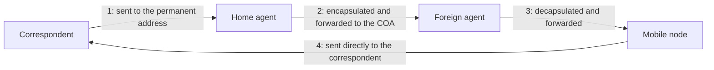

*Figure 7. Indirect routing to a mobile node*

1. The correspondent addresses the datagram to the mobile node's permanent address, unaware of whether the mobile node is in its home network or visiting a foreign network. Mobility is thus completely transparent to the correspondent. The datagram is routed as usual to the mobile node's home network.
2. Besides interacting with a foreign agent to track the mobile node's care-of address, the home agent has another important job. It watches for arriving datagrams addressed to nodes whose home network is its own but that currently reside in a foreign network, and intercepts them. The home agent forwards the datagram to the foreign agent using the mobile node's care-of address.
3. The foreign agent forwards the received datagram to the mobile node.
4. Since the mobile node knows the correspondent's address, it sends its datagrams directly to the correspondent without going through the home agent, using its own permanent address as the source address and the correspondent's address as the destination.

Looking at step 2 in more detail, the home agent must use the care-of address as the destination so that the network layer routes the datagram to the foreign network. On the other hand, the application receiving the datagram should be unaware that it was forwarded through the home agent, so the correspondent's datagram should be left intact. Both goals are met by **encapsulation**.

```text
  (a)
  ┌──────────────────────┬─────────────┐
  │ dest: 128.119.40.186 │   payload   │
  └──────────────────────┴─────────────┘

  (b)
  ┌───────────────────┬──────────────────────┬─────────────┐
  │ dest: 79.129.13.2 │ dest: 128.119.40.186 │   payload   │
  └───────────────────┴──────────────────────┴─────────────┘
```

*Figure 8. Encapsulation by the home agent and decapsulation by the foreign agent*

In Figure 8, (a) is the original datagram that the correspondent sent to the permanent address, and (b) is the datagram to which the home agent has added an outer header whose destination is the care-of address. The foreign agent removes the outer header from (b) and delivers (a) to the mobile node.

The home agent places the correspondent's entire original datagram inside a new, larger datagram and sends this larger datagram to the mobile node's care-of address. The foreign agent, which owns the care-of address, receives it and decapsulates it, that is, extracts the correspondent's original datagram from the encapsulating datagram and forwards it to the mobile node. This encapsulation and decapsulation is the same concept as the **tunneling** used to carry IPv6 over IPv4 networks in Chapter 24 (tunneling is also covered in Chapter 26).

Supporting mobility with indirect routing requires the following new network-layer functionality.

| Functionality | Content |
|:-----|:-----|
| Mobile-node-to-foreign-agent protocol | The mobile node registers with the foreign agent when attaching to the foreign network and deregisters when it leaves |
| Foreign-agent-to-home-agent registration protocol | The foreign agent registers the mobile node's COA with the home agent; it need not explicitly deregister the COA, because the registration of a new COA when the node moves takes care of it |
| Home-agent encapsulation protocol | Encapsulates the correspondent's original datagram in a datagram addressed to the COA and forwards it |
| Foreign-agent decapsulation protocol | Extracts the correspondent's original datagram from the encapsulating datagram and forwards it to the mobile node |

*Table 3. Network-layer functionality required for indirect routing*

Consider the case in which the mobile node is attached to foreign network A, has registered a COA in A with its home agent, and is receiving datagrams routed indirectly through its home agent. When the mobile node moves to foreign network B and registers with B's foreign agent, that agent informs the home agent of the new COA. From then on, the home agent reroutes datagrams to B. Mobility is transparent to the correspondent, since datagrams go through the same home agent before and after the move. As long as the time between the mobile node's disconnection from A and its registration of a new COA in B is short, few datagrams are lost. End-to-end connections can also lose datagrams to network congestion (Chapter 9), so occasional loss when a node moves is by no means a catastrophic problem. If loss-free communication is required, upper-layer mechanisms recover from loss, whether it results from congestion or from mobility.

### 3.2 Direct Routing

> **Definition:** **Triangle routing** is the inefficiency of indirect routing in which datagrams addressed to the mobile node are routed first to the home agent and then to the foreign network, even when a much more efficient route exists between the correspondent and the mobile node.

In the worst case of indirect routing, a mobile user visiting a colleague's foreign network sits side by side with the colleague and exchanges data over the network, and the colleague's datagrams travel to the mobile user's home agent and back again to the foreign network.

> **Definition:** **Direct routing** is the approach in which a correspondent agent in the correspondent's network learns the mobile node's care-of address by querying the home agent and then tunnels datagrams directly to the care-of address.

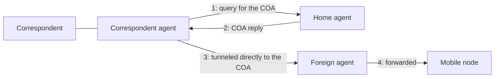

*Figure 9. Direct routing to a mobile user*

Direct routing removes the inefficiency of triangle routing, at the cost of additional complexity. Just as the mobile node can perform the function of the foreign agent, the correspondent itself can perform the function of the correspondent agent. Direct routing introduces two new challenges.

- **Location protocol:** A mobile-user location protocol is needed for the correspondent agent to query the home agent for the mobile node's COA.
- **Forwarding while moving:** With indirect routing, when the mobile node moved to another foreign network, only the COA at the home agent had to be updated. With direct routing, the correspondent agent queries the home agent for the COA only once, at the start of the session. Updating the COA at the home agent, though necessary, is therefore not enough to route data to the mobile node's new foreign network.

One could create a new protocol to notify the correspondent of the changing COA, but the solution adopted in practice in GSM networks uses an **anchor foreign agent**.

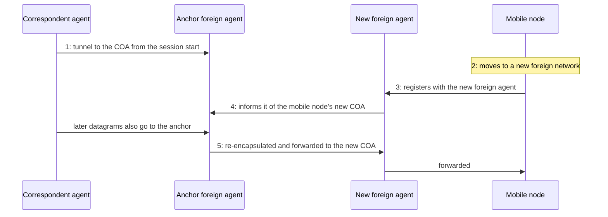

*Figure 10. A mobile node moving between networks with direct routing*

1. The foreign agent in the foreign network where the mobile node was located when the session first started is called the anchor foreign agent. Data are currently being forwarded to this foreign network.
2. The mobile node moves to a new foreign network.
3. The mobile node registers with the new foreign agent.
4. The new foreign agent provides the anchor foreign agent with the mobile node's new COA.
5. When the anchor foreign agent receives an encapsulated datagram for the departed mobile node, it re-encapsulates the datagram and forwards it to the mobile node using the new COA. If the mobile node later moves yet again, the foreign agent in the newly visited network contacts the anchor foreign agent to set up forwarding to that network.

---

<br>

## 4. Mobile IP

**Mobile IP** is the set of Internet architecture and protocols for supporting mobility. It is a flexible and complex standard, supporting operation with or without a foreign agent, several ways for agents and mobile nodes to discover each other, the use of single or multiple care-of addresses, and several forms of encapsulation. The Mobile IP architecture contains the elements of Section 3, such as home agents, foreign agents, care-of addresses, and encapsulation and decapsulation, and the current standard uses **indirect routing** to the mobile node.

The Mobile IP standard consists of three main pieces, that is, three phases that a mobile host goes through to communicate with a remote host.

| Phase | Content |
|:-----|:-----|
| Agent discovery | Protocols for a home or foreign agent to advertise its services to mobile nodes, and for mobile nodes to solicit the services of an agent |
| Registration with the home agent | Protocols for the mobile node or foreign agent to register and deregister COAs with the mobile node's home agent |
| Indirect routing of datagrams (data transfer) | The manner in which the home agent forwards datagrams to mobile nodes, including forwarding rules, rules for handling errors, and several forms of encapsulation |

*Table 4. The three phases of Mobile IP*

Security is prominent throughout the Mobile IP standard. For example, authentication of the mobile node is clearly needed, because a malicious user who registered a bogus care-of address with a home agent could have all datagrams addressed to an IP address redirected to itself. Mobile IP achieves security with the techniques covered in Chapter 26.

### 4.1 Addresses and Agents in Mobile IP

An IP address consists of a prefix and a suffix, and the prefix associates a host with a network (Chapter 12). For example, 10.3.4.24/8 defines a host attached to network 10.0.0.0/8. Routers use the prefix to deliver a packet to that network, so the original IP addressing assumes a **stationary host** attached to one network. That is, a host in the Internet does not have an address it can carry from place to place; the address is valid only while the host is attached to that network.

Mobile IP gives a mobile host two addresses.

- **Home address:** It is permanent and associates the host with its home network. An example is the home address 131.5.24.8/16 on the home network 131.5.0.0/16.
- **Care-of address:** It is temporary and associated with the foreign network, and it changes as the host moves from one network to another. An example is the care-of address 14.13.16.9/8 while visiting the foreign network 14.0.0.0/8. A mobile host receives its care-of address during the agent discovery and registration phases when it visits a foreign network.

Making the change of address transparent to the rest of the Internet requires a home agent and a foreign agent. The home agent is usually a router attached to the mobile host's home network; when a remote host sends a packet to the mobile host, it receives the packet on the mobile host's behalf and sends it to the foreign agent. The foreign agent is usually a router attached to the foreign network; it receives the packets sent by the home agent and delivers them to the mobile host.

### 4.2 Agent Discovery

A Mobile IP node arriving at a new network, whether attaching to a foreign network or returning to its home network, must learn the identity of the corresponding foreign or home agent. It is the discovery of a new foreign agent with a new network address that lets the mobile node's network layer learn that it has moved into a new foreign network. A mobile host must discover its home agent before it leaves its home network and a foreign agent after it moves to a foreign network, learning the care-of address together with the foreign agent's address. Agent discovery can be done in two ways.

**Agent advertisement:** A foreign or home agent advertises its services using an extension of the existing router discovery protocol. The agent periodically broadcasts on all links to which it is connected an ICMP message (Chapter 16) with a type field of 9 (router advertisement). This message contains the IP address of the router (that is, the agent), letting the mobile node learn the agent's IP address. Mobile IP does not define a new packet type for agent advertisement; it appends a mobility agent advertisement extension to the ICMP router advertisement packet.

```text
  Mobility agent advertisement extension appended to an ICMP router advertisement (type = 9)

  0                8                16                             31
  ┌────────────────┬────────────────┬───────────────────────────────┐
  │  Type = 16     │    Length      │        Sequence number        │
  ├────────────────┴────────────────┼────────────────┬──────────────┤
  │       Registration lifetime     │ R B H F M G r T│   Reserved   │
  ├─────────────────────────────────┴────────────────┴──────────────┤
  │                 0 or more care-of addresses                     │
  └─────────────────────────────────────────────────────────────────┘
```

*Figure 11. ICMP router advertisement message with the mobility agent advertisement extension*

The important fields of the extension are as follows.

| Field | Content |
|:-----|:-----|
| Type | 16 (mobility agent advertisement extension) |
| Length | Total length of the extension message (not the length of the ICMP advertisement message) |
| Sequence number | Message number; the recipient uses it to determine whether a message has been lost |
| Lifetime | Number of seconds the agent will accept requests; all 1s means infinite |
| R (registration required) | A mobile user in this network must register with a foreign agent; it cannot obtain a COA itself, for example with DHCP, and act as its own foreign agent |
| B | The agent is busy and does not accept registrations at the moment |
| H (home agent) | The agent is a home agent for the network in which it resides |
| F (foreign agent) | The agent is a foreign agent for the network in which it resides |
| M, G (encapsulation) | Whether a form of encapsulation other than IP-in-IP (minimal encapsulation, GRE) is used |
| Care-of addresses | List of care-of addresses provided by the foreign agent; the mobile node chooses one when registering with its home agent, and only a foreign agent uses this field |

*Table 5. Important fields of the mobility agent advertisement extension*

**Agent solicitation:** A mobile node that has moved to a new network and has not received an agent advertisement, or that wants to learn about agents without waiting for one, can broadcast an agent solicitation message, which is simply an ICMP message with type value 10 (router solicitation). An agent receiving the solicitation unicasts an agent advertisement directly to the mobile node, which then proceeds as if it had received an unsolicited advertisement. Agent solicitation also uses the ICMP router solicitation packet rather than a new packet type.

### 4.3 Registration

A mobile host that has moved to a foreign network and discovered the foreign agent must register. Registration has four aspects.

1. The mobile host must register itself with the foreign agent.
2. The mobile host must register itself with its home agent. This is normally done by the foreign agent on behalf of the mobile host.
3. The mobile host must renew its registration if it has expired.
4. The mobile host must cancel its registration (deregister) when it returns home.

Registration through the foreign agent involves the following four steps.

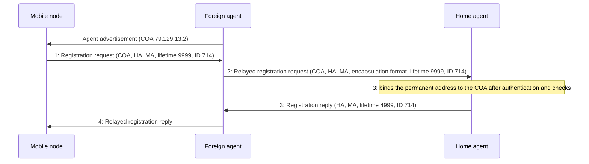

*Figure 12. Agent advertisement and Mobile IP registration*

1. Having received a foreign agent advertisement, the mobile node sends a Mobile IP **registration request** to the foreign agent. The registration message is carried in a UDP datagram sent to port 434. It carries a COA advertised by the foreign agent, the address of the home agent (HA), the permanent address of the mobile node (MA), the requested lifetime of the registration, and a 64-bit registration identification. The registration lifetime is the number of seconds that the registration is valid; if it is not renewed at the home agent within that time, the registration becomes invalid. The registration identifier acts like a sequence number and matches a received registration reply with a registration request.
2. The foreign agent receives the registration message and records the mobile node's permanent IP address. It now knows that it should look for datagrams containing an encapsulated datagram whose destination address matches the permanent address of the mobile node. The foreign agent then sends a Mobile IP registration message (again in a UDP datagram) to port 434 of the home agent, containing the COA, HA, MA, requested encapsulation format, requested registration lifetime, and registration identification. The home agent learns the foreign agent's address from the source address of this relayed packet.
3. The home agent receives the registration request and checks its authenticity and correctness. It binds the mobile node's permanent IP address to the COA; from then on, datagrams arriving at the home agent for the mobile node are encapsulated and tunneled to the COA. The home agent sends a Mobile IP **registration reply** containing the HA, MA, the actual registration lifetime, and the registration identification of the request being satisfied.
4. The foreign agent receives the registration reply and forwards it to the mobile node.

Registration is then complete, and the mobile node can receive datagrams sent to its permanent address. In Figure 12, the home agent specifies a lifetime smaller than the one requested by the mobile node. A foreign agent need not explicitly deregister a COA when a mobile node leaves its network; this happens automatically when the mobile node moves to a new network (another foreign network or its home network) and registers a new COA.

```text
  Registration request
  0               8               16                              31
  ┌───────────────┬───────────────┬───────────────────────────────┐
  │   Type = 1    │     Flag      │           Lifetime            │
  ├───────────────┴───────────────┴───────────────────────────────┤
  │                         Home address                          │
  ├───────────────────────────────────────────────────────────────┤
  │                      Home agent address                       │
  ├───────────────────────────────────────────────────────────────┤
  │                        Care-of address                        │
  ├───────────────────────────────────────────────────────────────┤
  │                  Identification (64 bits)                     │
  ├───────────────────────────────────────────────────────────────┤
  │                         Extensions ...                        │
  └───────────────────────────────────────────────────────────────┘
```

*Figure 13. Format of a registration request*

- **Type:** 1 for a request message and 3 for a reply message.
- **Flag:** Defines forwarding information, such as whether the home agent should retain the prior care-of address, tunnel broadcast messages, whether a colocated care-of address is used, and whether minimal encapsulation or GRE should be used. In a reply, a Code field in this position shows the result of the request (acceptance or denial).
- **Lifetime:** The number of seconds the registration is valid. All 0s requests deregistration, and all 1s means an infinite lifetime.
- **Home address, Home agent address, Care-of address:** The permanent (first) address of the mobile host, the address of the home agent, and the temporary (second) address of the mobile host. A reply does not need the care-of address field.
- **Identification:** A 64-bit number inserted into the request by the mobile host and repeated in the reply, matching a request with a reply.
- **Extensions:** Variable-length extensions that let the home agent authenticate the mobile node (Chapter 26).

### 4.4 Data Transfer

After agent discovery and registration, a mobile host can communicate with a remote host.

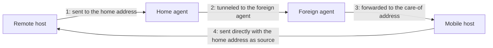

*Figure 14. Data transfer in Mobile IP*

1. **From remote host to home agent:** The remote host sends a packet with its own address as the source and the mobile host's home address as the destination, as though the mobile host were in its home network. The home agent intercepts this packet, pretending to be the mobile host by means of the proxy ARP technique of Chapter 19.
2. **From home agent to foreign agent:** The home agent sends the received packet to the foreign agent by tunneling. It encapsulates the whole IP packet inside another IP packet, with its own address as the source and the foreign agent's address as the destination.
3. **From foreign agent to mobile host:** The foreign agent receives the packet and removes the original packet. Since the destination address of the original packet is the mobile host's home address, the foreign agent consults a registry table to find the mobile host's care-of address and sends the packet to it. Otherwise, the packet would just be sent back to the home network.
4. **From mobile host to remote host:** The mobile host sends packets as it normally does, with its home address as the source and the remote host's address as the destination. Although the packet comes from the foreign network, it carries the mobile host's home address.

Throughout this process the remote host is unaware of any movement by the mobile host. It sends packets to the mobile host's home address and receives packets whose source is the mobile host's home address. The movement of the mobile host is thus completely transparent to the rest of the Internet.

### 4.5 Inefficiency in Mobile IP

Communication with Mobile IP can be inefficient. The severe case is called **double crossing (2X)**, and the moderate case **triangle routing (dog-leg routing)**.

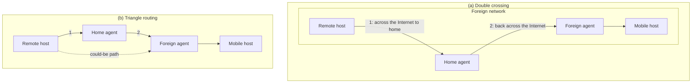

*Figure 15. Double crossing and triangle routing in Mobile IP*

- **Double crossing:** It occurs when a remote host communicates with a mobile host that has moved to the same network (or site) as the remote host. When the mobile host sends a packet to the remote host, there is no inefficiency, since the communication is local. When the remote host sends a packet to the mobile host, however, the packet crosses the Internet twice. Since a computer usually communicates with other local computers (the principle of locality), the inefficiency of double crossing is significant.
- **Triangle routing:** It occurs when the remote host communicates with a mobile host that is not attached to the same network (or site) as the remote host. When the mobile host sends a packet to the remote host, there is no inefficiency. When the remote host sends a packet to the mobile host, however, the packet goes from the remote host to the home agent and then to the mobile host, traveling two sides of a triangle instead of one.

**Solution:** The remote host can **bind** the care-of address to the mobile host's home address. For example, when the home agent receives the first packet for a mobile host, it forwards the packet to the foreign agent and can also send an update binding packet to the remote host so that future packets are sent to the care-of address. The remote host keeps this information in a cache. The problem with this strategy is that the cache entry becomes outdated once the mobile host moves, and the home agent must then send a warning packet to inform the remote host of the change. This is the same idea as the direct routing of Section 3.2.

---

<br>

## 5. Managing Mobility in Cellular Networks

This section examines how cellular telephony networks, which have supported mobility far longer than IP networks, manage it, using the mature and widely deployed GSM as the case study. Mobility in 3G and 4G networks is similar in principle to that in GSM. Like Mobile IP, GSM adopts **indirect routing**, first routing the correspondent's call to the mobile user's home network and from there to the visited network.

### 5.1 HLR and VLR

In GSM terminology the mobile user's home network is the **home PLMN (home public land mobile network)**, called simply the home network here. The home network is the cellular provider with which the mobile user has a subscription (the provider that bills the user for monthly cellular service). The visited PLMN, or visited network, is the network in which the mobile user currently resides. In practice, a provider's cellular network serves as the home network for its subscribers and as a visited network for mobile users subscribed to other providers.

- **Home location register (HLR):** A database maintained by the home network that contains the permanent cell phone number and subscriber profile information for each subscriber. Importantly, the HLR also contains information about the current locations of these subscribers. If a mobile user is roaming in another provider's cellular network, the HLR has enough information to obtain an address in the visited network to which a call to the user should be routed.
- **Home MSC:** The special switch in the home network that a correspondent contacts when placing a call to a mobile user, called the Gateway MSC (GMSC) in GSM terminology. It is the point of contact for obtaining the routable address of the mobile user.
- **Visitor location register (VLR):** A database maintained by the visited network that contains an entry for each mobile user currently in the part of the network served by the VLR. VLR entries come and go as mobile users enter and leave the network. A VLR is usually collocated with the MSC that coordinates the setup of calls to and from the visited network.

### 5.2 Routing Calls to a Mobile User

A simple case of placing a call to a mobile GSM user in a visited network proceeds as follows.

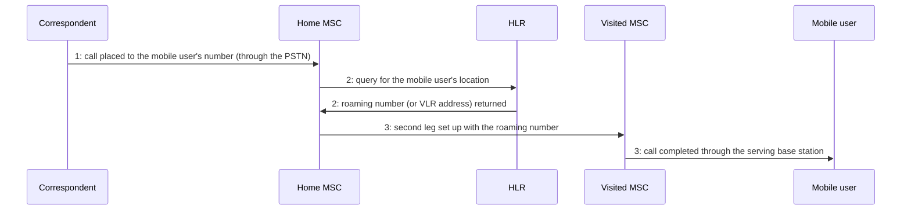

*Figure 16. Placing a call to a mobile user with indirect routing*

1. The correspondent dials the mobile user's phone number. Since the phone number is fixed while the user moves, the number itself does not refer to a particular telephone line or location. The leading digits of the number are sufficient to identify the mobile's home network globally. The call is routed from the correspondent through the public telephone network (PSTN) to the home MSC in the mobile's home network. This is the first leg of the call.
2. The home MSC receives the call and queries the HLR for the location of the mobile user. In the simplest case, the HLR returns the **mobile station roaming number (MSRN)**, or simply the **roaming number**. This number differs from the mobile's permanent phone number, which is associated with the home network. The roaming number is ephemeral: it is temporarily assigned to a mobile when it enters a visited network. It plays a role similar to the care-of address in Mobile IP and, like the COA, is invisible to the correspondent and the mobile. If the HLR does not have the roaming number, it returns the address of the VLR in the visited network, and the home MSC then queries the VLR for the roaming number.
3. Given the roaming number, the home MSC sets up the second leg of the call to the MSC in the visited network. The call is completed, routed from the correspondent to the home MSC, from there to the visited MSC, and from there to the base station serving the mobile user.

The HLR obtains location information as follows. When a mobile phone is switched on or enters a part of a visited network covered by a new VLR, the mobile registers with the visited network by exchanging signaling messages with the VLR. The visited VLR in turn sends a location update request message to the mobile's HLR, informing it of the roaming number at which the mobile can be reached or of the address of the VLR (which can later be queried for the number). As part of this exchange, the VLR also obtains subscriber information about the mobile from the HLR and determines what services the visited network should give the mobile user.

### 5.3 Handoffs in GSM

In GSM, a **handoff** occurs when a mobile station changes its association from one base station to another during a call (Chapter 22). Before the handoff, the mobile's call is routed through one base station (the old base station), and after it, through another (the new base station). A handoff between base stations involves not only the mobile transmitting to and receiving from a new base station but also rerouting the ongoing call from a switching point within the network to the new base station. The case in which the old and new base stations share the same MSC and the rerouting occurs at this MSC is examined first.

A handoff may occur for the following reasons.

- The signal between the current base station and the mobile has deteriorated so much that the call is in danger of being dropped.
- A cell has become overloaded, handling a large number of calls. Handing off mobiles to less congested nearby cells relieves this congestion.

While associated with a base station, a mobile periodically measures the strength of the beacon signal from its current base station and from nearby base stations that it can hear, and reports the measurements to its current base station once or twice a second. Handoff in GSM is initiated by the old base station based on these measurements, the current loads in nearby cells, and other factors. The GSM standard does not specify the algorithm a base station uses to decide whether to perform a handoff.

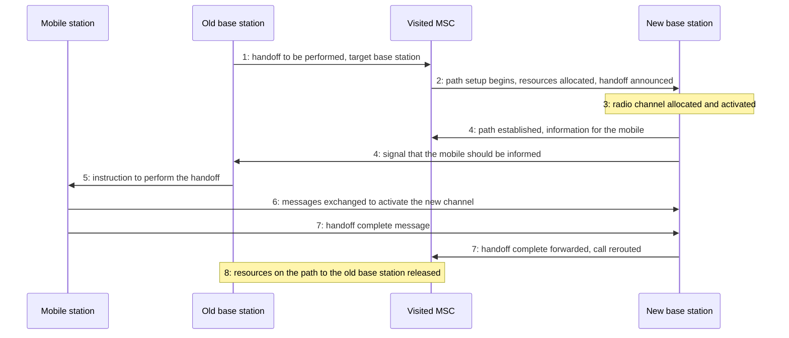

*Figure 17. Steps of a handoff between base stations with a common MSC*

1. The old base station informs the visited MSC that a handoff is to be performed and of the base station (or set of candidate base stations) to which the mobile is to be handed off.
2. The visited MSC initiates path setup to the new base station, allocating the resources needed to carry the rerouted call, and signals the new base station that a handoff is about to occur.
3. The new base station allocates and activates a radio channel for use by the mobile.
4. The new base station signals back to the visited MSC and the old base station that the path from the visited MSC to the new base station has been established and that the mobile should be informed of the impending handoff. The new base station provides all the information the mobile will need to associate with it.
5. The mobile is informed that it should perform a handoff. Up to this point, the mobile has been unaware that the network has been laying the groundwork for a handoff, such as allocating a channel in the new base station and a path from the visited MSC to it.
6. The mobile and the new base station exchange one or more messages to fully activate the new channel in the new base station.
7. The mobile sends a handoff complete message to the new base station, which forwards it up to the visited MSC. The visited MSC then reroutes the ongoing call to the mobile through the new base station.
8. The resources allocated along the path to the old base station are released.

### 5.4 The Anchor MSC

What happens when the mobile moves to a base station associated with a different MSC from the old one, and when such inter-MSC handoffs occur more than once?

> **Definition:** The **anchor MSC** is the MSC visited by the mobile station when a call first begins; it remains unchanged during the call, and the call is always routed from the home MSC through the anchor MSC to the current visited MSC.

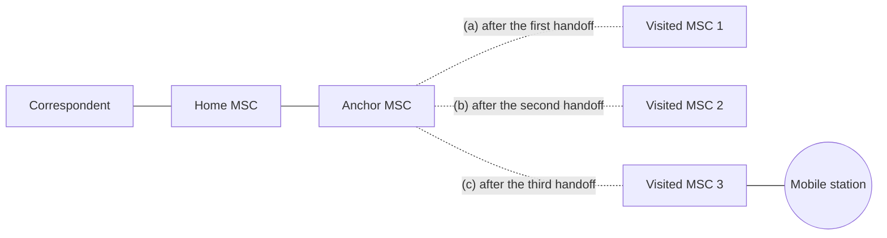

*Figure 18. Rerouting through the anchor MSC*

Throughout the call and regardless of the number of inter-MSC transfers, the call is routed from the home MSC to the anchor MSC and then from the anchor MSC to the visited MSC where the mobile is currently located. When a mobile moves from the coverage area of one MSC to another, the ongoing call is rerouted from the anchor MSC to the new visited MSC containing the new base station. Thus, at all times there are at most three MSCs (the home MSC, the anchor MSC, and the visited MSC) between the correspondent and the mobile.

Instead of keeping a single MSC hop from the anchor MSC to the current MSC, the MSCs visited by the mobile could simply be chained, with the old MSC forwarding the ongoing call to the new MSC each time the mobile moves. Such MSC chaining can in fact occur in IS-41 cellular networks, with an optional path minimization step that removes the MSCs between the anchor MSC and the current visited MSC.

### 5.5 GSM versus Mobile IP

Although IP and cellular networks are fundamentally different in many ways, they share a surprising number of functional elements and overall approaches in handling mobility.

| GSM element | Comment on the GSM element | Mobile IP element |
|:-----|:-----|:-----|
| Home system | Network to which the mobile user's permanent phone number belongs | Home network |
| Home MSC (gateway MSC), HLR | The home MSC is the point of contact for obtaining a routable address of the mobile user, and the HLR is the database in the home system containing the permanent phone number, profile, current location, and subscription information | Home agent |
| Visited system | Network other than the home system where the mobile user currently resides | Visited network |
| Visited MSC, VLR | The visited MSC sets up calls to and from mobile nodes in its cells, and the VLR is a temporary database entry in the visited system containing subscription information for each visiting mobile user | Foreign agent |
| Mobile station roaming number (MSRN) | Routable address for the call segment between the home MSC and the visited MSC, visible to neither the mobile nor the correspondent | Care-of address |

*Table 6. Commonalities between GSM and Mobile IP mobility management*

---

<br>

## 6. Impact of Wireless and Mobility on Higher Layers

Wireless networks differ significantly from wired ones at the link layer (because of wireless channel characteristics such as fading, multipath, and hidden terminals) and at the network layer (because of mobile users who change their points of attachment). Are there important differences at the transport and application layers as well? Since the network layer provides the same best-effort delivery service to upper layers in wired and wireless networks, the differences might seem minor. Indeed, TCP and UDP do operate in networks with wireless links. However, transport protocols, and TCP in particular, can perform very differently in wired and wireless networks, and it is in performance that the differences appear.

TCP retransmits segments that are lost or corrupted on the path between sender and receiver (Chapter 8). For mobile users, loss can result from network congestion (router buffer overflow) or from handoff (for example, delays in rerouting segments to a mobile's new point of attachment). In all cases, TCP's receiver-to-sender ACK indicates only that a segment was not received intact; it does not tell the sender whether the loss was due to congestion, occurred during handoff, or resulted from detected bit errors. The sender retransmits the segment in every case and, for congestion control, likewise decreases its congestion window (Chapter 9). By unconditionally decreasing its congestion window, TCP implicitly assumes that segment loss results from congestion rather than corruption or handoff.

As seen in Chapter 22, however, bit errors are much more common in wireless networks than in wired ones. When a loss is due to bit errors or handoff, router buffers may be empty and packets may be flowing along the end-to-end path unimpeded by congestion, so there is no reason for the TCP sender to decrease its congestion window and its sending rate. There are three broad classes of approaches to this problem.

| Approach | Content |
|:-----|:-----|
| Local recovery | Recovers from bit errors when and where they occur (for example, on the wireless link), as in the 802.11 ARQ of Chapter 22 or more sophisticated approaches that use both ARQ and FEC |
| TCP sender awareness of wireless links | In local recovery, the TCP sender is unaware that its segments cross a wireless link; instead, the TCP sender and receiver can be aware of the wireless link, distinguish congestive losses in the wired network from corruption or loss on the wireless link, and invoke congestion control only for congestive wired-network losses |
| Split connection | Breaks the end-to-end connection between the mobile user and the other end point into two transport-layer connections, one from the mobile host to the wireless access point and one from the access point to the other end point (a wired host); the wireless part can use a standard TCP connection or a specially tailored error recovery protocol over UDP; split TCP connections are widely used in cellular data networks and improve performance significantly |

*Table 7. Three approaches to the TCP problem in wireless settings*

At the application layer, an important consideration is that wireless links, especially cellular ones, often have relatively low bandwidth, so bandwidth must be treated as a scarce commodity. For example, a Web server serving content to a browser on a 4G phone may not be able to provide the same image-rich content it gives to a browser on a wired connection. On the other hand, the mobility that wireless links enable makes possible a rich set of location-aware and context-aware applications.

---

<br>

## Concept Applications

**True/False Check:**

| Statement | Judgment and Reason |
|:-----|:-----|
| Since GSM combines FDM and TDM, F frequency sub-bands and T time slots support $`F \times T`$ simultaneous calls. | **T.** GSM supports eight TDM calls in each 200 kHz band. |
| In 3G, voice and data use different core networks but share the radio access network. | **T.** The RNC connects to both the MSC and the SGSN. |
| In 4G LTE, voice is not carried in IP datagrams but over a separate circuit-switched network. | **F.** 4G is all-IP, so both voice and data are carried in IP datagrams. |
| With indirect routing, the correspondent must know the mobile node's care-of address. | **F.** The correspondent sends to the permanent address; only the home and foreign agents know the care-of address. |
| With indirect routing, datagrams from the mobile node to the correspondent also go through the home agent. | **F.** The mobile node knows the correspondent's address and sends directly. |
| The home agent encapsulates the correspondent's original datagram in a new datagram addressed to the care-of address. | **T.** The foreign agent decapsulates it and delivers the original datagram to the mobile node. |
| Direct routing removes triangle routing but requires a mobile-user location protocol. | **T.** The correspondent agent must ask the home agent for the care-of address. |
| Mobile IP agent advertisement defines a new packet type. | **F.** It appends a mobility agent advertisement extension to the ICMP router advertisement message. |
| Mobile IP registration messages are sent over a TCP connection. | **F.** They are carried in UDP datagrams sent to port 434. |
| Double crossing occurs when the remote host and the mobile host are in the same network. | **T.** The remote host's packets cross the Internet twice through the home agent. |
| In GSM, the roaming number is visible to the correspondent, who dials it. | **F.** The correspondent dials the permanent number; the roaming number is visible to neither the correspondent nor the mobile user. |
| A GSM handoff is initiated by the mobile station. | **F.** It is initiated by the old base station based on the mobile's measurement reports, the loads of nearby cells, and so on. |
| With an anchor MSC, there are at most three MSCs between the correspondent and the mobile station. | **T.** They are the home MSC, the anchor MSC, and the current visited MSC. |
| TCP decreases its congestion window even for losses caused by bit errors on a wireless link. | **T.** TCP cannot distinguish the causes of loss and assumes congestion. |

---

<br>

## Summary

| Concept | Key Summary |
|:-----|:-----|
| Cellular generations | Cellular technology evolved from 1G analog voice through 2G digital voice and data-oriented 3G to 4G LTE with an all-IP core. |
| 2G GSM architecture | Each cell has a BTS, a BSC serves several BTSs to form a BSS, the MSC handles authorization, call setup, and handoff, and the air interface combines FDM and TDM. |
| 3G architecture | A data core of SGSNs and GGSNs runs in parallel with the existing voice network, an RNC controls the Node Bs, and the radio access uses WCDMA. |
| 4G LTE | It is an all-IP architecture of eNodeB, S-GW, P-GW, MME, and HSS that separates the data and control planes and uses OFDM on the downstream channel. |
| Degrees of mobility | Mobility ranges from movement within one access network, through movement with disconnection, to movement keeping connections, and the need to keep the address depends on the application. |
| Home and foreign networks | A mobile node has a permanent address in its home network and a care-of address in the foreign network, and home and foreign agents manage its mobility. |
| Indirect routing | The correspondent sends to the permanent address, the home agent tunnels to the care-of address, and the foreign agent decapsulates and delivers; it suffers from triangle routing. |
| Direct routing | A correspondent agent learns the care-of address and tunnels directly, and forwarding during movement is handled with an anchor foreign agent. |
| Mobile IP | It consists of three phases: agent discovery (ICMP advertisement and solicitation), registration (request and reply on UDP port 434), and data transfer by indirect routing. |
| Inefficiency of Mobile IP | Double crossing occurs if the remote host is in the same network, triangle routing otherwise, and binding the care-of address at the remote host reduces it. |
| GSM call routing | The home MSC obtains the roaming number from the HLR and sets up the second leg to the visited MSC by indirect routing, and the VLR updates the location at the HLR. |
| GSM handoff and anchor MSC | Eight steps initiated by the old base station reroute the call, and inter-MSC handoffs go through the anchor MSC, so there are at most three MSCs. |
| Impact on higher layers | TCP mistakes wireless losses for congestion and slows down, which is addressed by local recovery, wireless-aware TCP, and split connections. |

---

<br>

## Self-Check Questions

1. **Path under indirect routing:** A correspondent sends a datagram to a mobile node in a foreign network (permanent address 128.119.40.186, care-of address 79.129.13.2). Give the path of the datagram until it reaches the mobile node and the destination address of the outermost IP header on each segment. What path does the mobile node's reply take?

   <details>
   <summary>Answer</summary>

   The correspondent sends with destination 128.119.40.186, the permanent address, so the datagram is routed to the home network and intercepted by the home agent. The home agent encapsulates the entire original datagram in a new datagram whose destination is the care-of address 79.129.13.2 and sends it to the foreign agent. The foreign agent decapsulates it and delivers the original datagram, with destination 128.119.40.186, to the mobile node. The mobile node's reply, with its permanent address as source and the correspondent's address as destination, goes directly to the correspondent without passing through the home agent.

   </details>

2. **Direct routing and the correspondent agent:** Explain why direct routing needs a correspondent agent and how data are delivered when the mobile node moves to another foreign network during a session.

   <details>
   <summary>Answer</summary>

   In direct routing, datagrams must be sent directly to the care-of address without passing through the home agent, so someone must ask the home agent for the care-of address and tunnel datagrams to it. The correspondent agent (or the correspondent itself) does this. Since the correspondent agent asks for the care-of address only once, at the start of the session, updating the COA at the home agent is not enough when the mobile node moves. The foreign agent of the first foreign network is kept as the anchor foreign agent; when the mobile node registers with a new foreign agent, that agent informs the anchor of the new care-of address. The anchor re-encapsulates the datagrams it keeps receiving and forwards them to the new care-of address.

   </details>

3. **Mobile IP registration:** Give the four steps of Mobile IP registration through a foreign agent, and explain the role of the registration identification.

   <details>
   <summary>Answer</summary>

   (1) Having received the foreign agent's advertisement, the mobile node sends the foreign agent a registration request on UDP port 434 containing the COA, the home agent address, the permanent address, the requested lifetime, and a 64-bit registration identification. (2) The foreign agent records the permanent address and relays the request to port 434 of the home agent. (3) The home agent checks authenticity and correctness, binds the permanent address to the COA, and sends a registration reply containing the actual lifetime and the same registration identification. (4) The foreign agent forwards the reply to the mobile node. The registration identification acts like a sequence number, matching a received registration reply with its registration request.

   </details>

4. **Anchor MSC:** During a call, a mobile station moves in turn through three areas served by different MSCs, so three inter-MSC handoffs occur. Through which MSCs is the call routed after the third handoff? Compare with chaining the MSCs.

   <details>
   <summary>Answer</summary>

   The call is routed from the home MSC to the anchor MSC (the MSC visited when the call began) and from the anchor MSC to the current visited MSC (the MSC after the third handoff). Regardless of the number of handoffs, there are at most three MSCs between the correspondent and the mobile: the home MSC, the anchor MSC, and the current visited MSC. With chaining, the old MSC passes the call to the new MSC each time, so after three handoffs all the MSCs visited after the anchor remain on the path and the number of MSCs grows, requiring a separate path minimization step to reduce it.

   </details>

5. **Double crossing and triangle routing:** Explain when double crossing and triangle routing each occur, and state with a reason which one is more severe.

   <details>
   <summary>Answer</summary>

   Double crossing occurs when a remote host communicates with a mobile host that has moved to the remote host's own network; the remote host's packets cross the Internet to the home agent and cross it again on the way back. Triangle routing occurs when the remote host and the mobile host are in different networks; packets travel two sides of a triangle (remote host to home agent, home agent to mobile host) instead of one. Computers communicate mostly with local computers (the principle of locality), so double crossing happens often, and communication that should stay local crosses the Internet twice, which makes double crossing more severe.

   </details>

6. **TCP and wireless loss:** Why does TCP performance suffer when segments are lost to bit errors on a wireless link? Explain how the split-connection approach reduces this problem.

   <details>
   <summary>Answer</summary>

   The TCP sender learns from ACKs only that a segment did not arrive and cannot distinguish the cause, so it treats every loss as congestion and decreases its congestion window. If the loss was caused by wireless bit errors, the sender slows down even though the network is not congested, and throughput drops needlessly. The split-connection approach breaks the end-to-end connection into a connection between the mobile host and the wireless access point and one between the access point and the wired host. Losses on the wireless part are handled by the wireless connection, so TCP on the wired part does not decrease its congestion window because of wireless losses.

   </details>

7. **FDM/TDM capacity:** A system that, like GSM, supports eight TDM calls in each 200 kHz band has 5 MHz of spectrum. What is the maximum number of simultaneous calls?

   <details>
   <summary>Answer</summary>

   Dividing 5 MHz into 200 kHz bands gives 5,000 / 200 = 25 sub-bands. Each sub-band carries eight TDM calls, so $`F \times T = 25 \times 8 = 200`$ calls can be supported simultaneously.

   </details>
