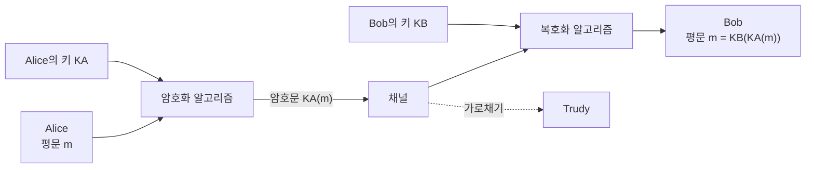
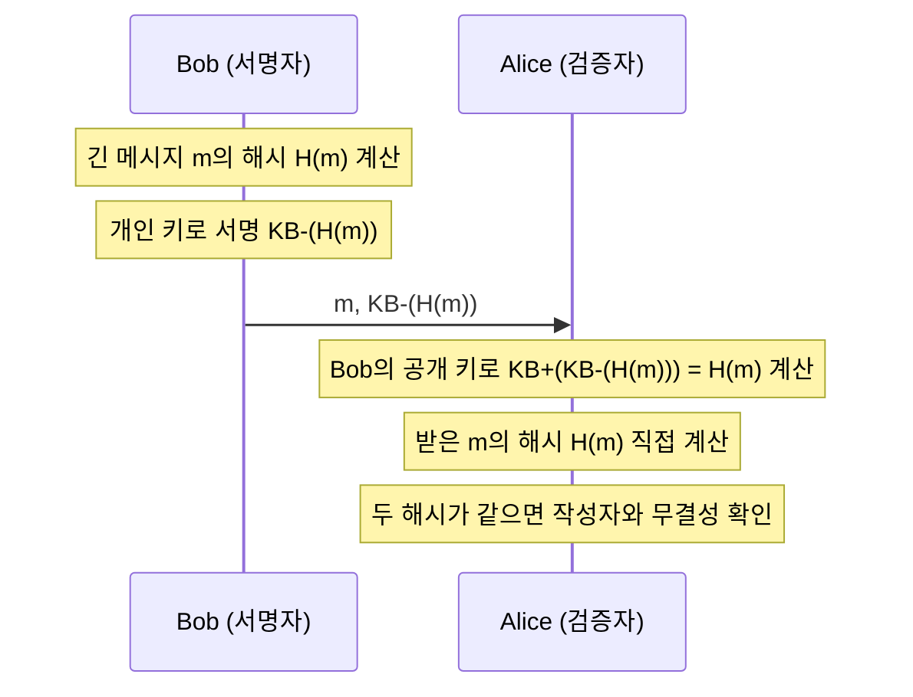
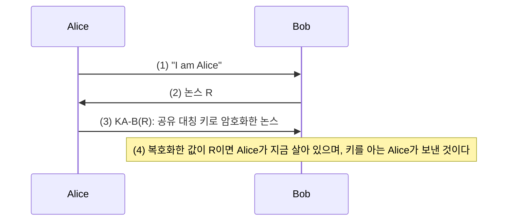
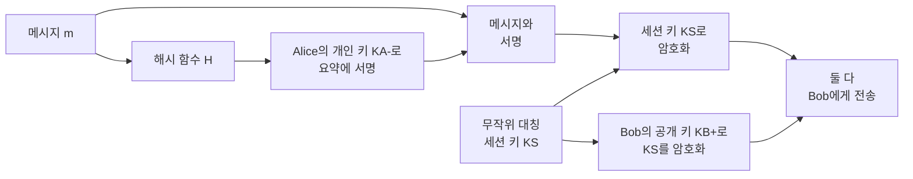
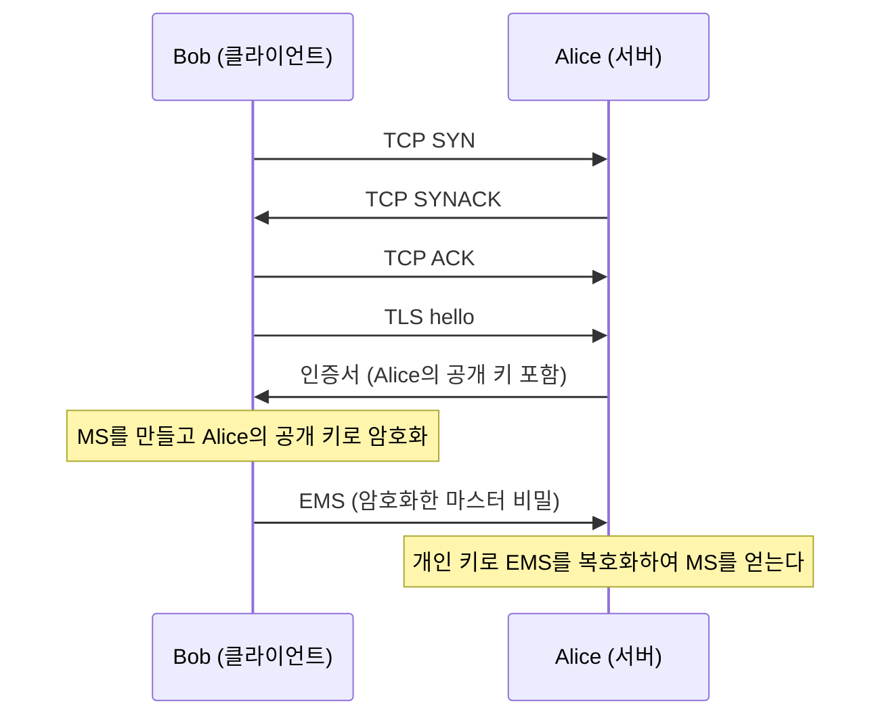
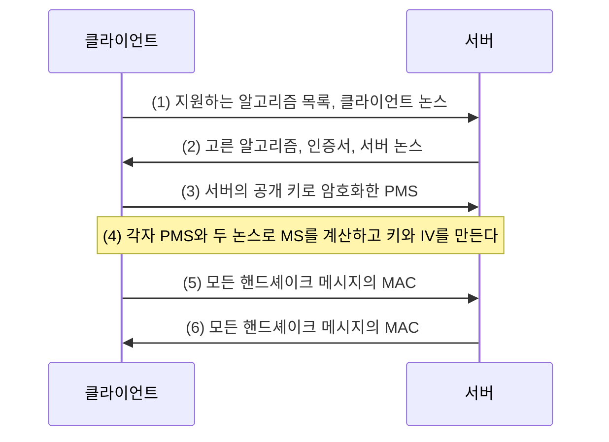
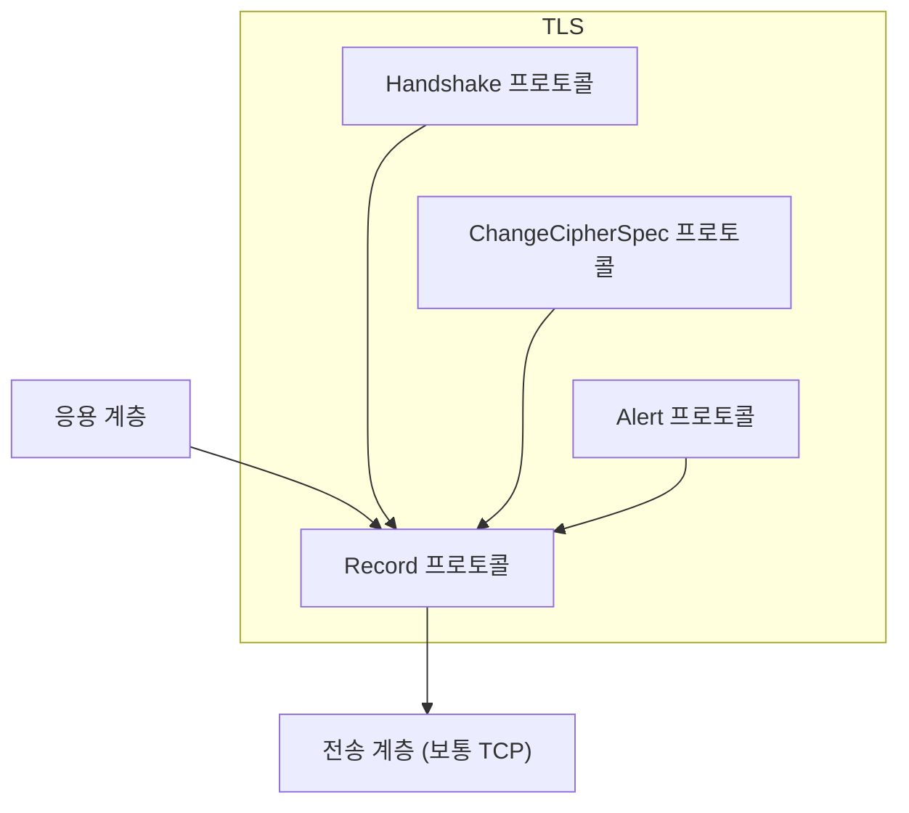
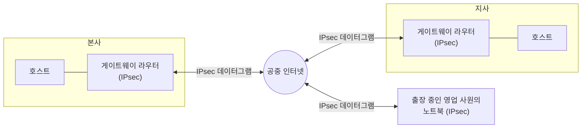
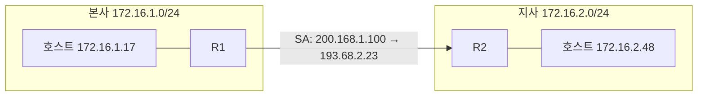
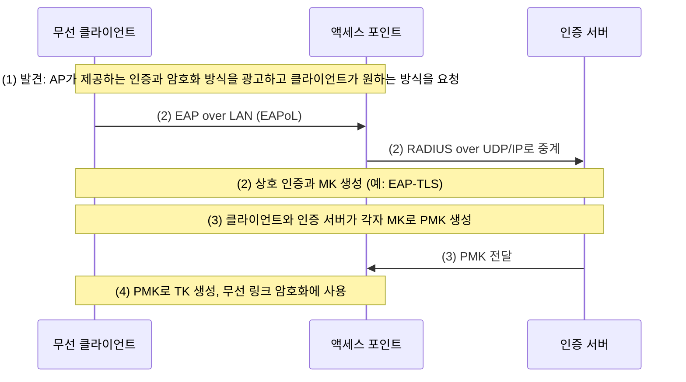

# 26장 — 네트워크 보안

[레포지토리 안내](../../README.ko.md) | [English](Concepts_Lecture.md) | [한국어](Concepts_Lecture.ko.md)

> **최종 수정일:** 2026-11-27
>
> Computer Networking: A Top-Down Approach, Kurose and Ross, Ch 8; TCP/IP Protocol Suite, Forouzan, Ch 29, 30

> **학습 목표:**
> 1. 안전한 통신의 네 가지 속성과 침입자가 할 수 있는 공격을 설명할 수 있다
> 2. 대칭 키 암호(블록 암호와 CBC)와 공개 키 암호(RSA)의 원리를 설명하고 작은 예를 계산할 수 있다
> 3. 해시 함수, 메시지 인증 코드, 전자 서명, 인증서의 역할을 구별할 수 있다
> 4. 논스를 이용한 종단점 인증과 TLS의 핸드셰이크와 레코드 보호 과정을 설명할 수 있다
> 5. IPsec의 보안 연관과 ESP 데이터그램, 터널링 방식과 VPN 프로토콜을 비교할 수 있다
> 6. WEP의 약점과 802.11i, 방화벽과 침입 탐지 시스템의 동작을 설명할 수 있다

---

## 목차

- [1. 네트워크 보안의 개요](#1-네트워크-보안의-개요)
  - [1.1 안전한 통신의 네 가지 속성](#11-안전한-통신의-네-가지-속성)
  - [1.2 침입자의 능력과 실제의 Alice와 Bob](#12-침입자의-능력과-실제의-alice와-bob)
  - [1.3 보안 목표와 공격의 분류](#13-보안-목표와-공격의-분류)
- [2. 암호화의 원리](#2-암호화의-원리)
  - [2.1 암호 시스템의 구성 요소](#21-암호-시스템의-구성-요소)
  - [2.2 고전 암호](#22-고전-암호)
  - [2.3 침입자가 가진 정보에 따른 공격](#23-침입자가-가진-정보에-따른-공격)
  - [2.4 블록 암호](#24-블록-암호)
  - [2.5 암호 블록 연결(CBC)](#25-암호-블록-연결cbc)
  - [2.6 공개 키 암호](#26-공개-키-암호)
  - [2.7 RSA](#27-rsa)
  - [2.8 세션 키](#28-세션-키)
  - [2.9 Diffie-Hellman 키 합의](#29-diffie-hellman-키-합의)
- [3. 메시지 무결성과 전자 서명](#3-메시지-무결성과-전자-서명)
  - [3.1 메시지 무결성 문제](#31-메시지-무결성-문제)
  - [3.2 암호학적 해시 함수](#32-암호학적-해시-함수)
  - [3.3 메시지 인증 코드](#33-메시지-인증-코드)
  - [3.4 전자 서명](#34-전자-서명)
  - [3.5 공개 키 인증과 인증 기관](#35-공개-키-인증과-인증-기관)
- [4. 종단점 인증](#4-종단점-인증)
- [5. 전자 메일 보안](#5-전자-메일-보안)
- [6. TLS](#6-tls)
  - [6.1 TCP 연결을 안전하게 하기](#61-tcp-연결을-안전하게-하기)
  - [6.2 단순화한 TLS](#62-단순화한-tls)
  - [6.3 실제 TLS 핸드셰이크](#63-실제-tls-핸드셰이크)
  - [6.4 연결 종료](#64-연결-종료)
  - [6.5 TLS를 이루는 네 프로토콜](#65-tls를-이루는-네-프로토콜)
- [7. IPsec과 VPN](#7-ipsec과-vpn)
  - [7.1 네트워크 계층 보안과 VPN](#71-네트워크-계층-보안과-vpn)
  - [7.2 AH와 ESP](#72-ah와-esp)
  - [7.3 보안 연관](#73-보안-연관)
  - [7.4 IPsec 데이터그램](#74-ipsec-데이터그램)
  - [7.5 전송 모드와 터널 모드](#75-전송-모드와-터널-모드)
  - [7.6 IPsec이 제공하는 서비스](#76-ipsec이-제공하는-서비스)
  - [7.7 IKE: IPsec의 키 관리](#77-ike-ipsec의-키-관리)
- [8. 터널링](#8-터널링)
- [9. VPN 프로토콜의 비교](#9-vpn-프로토콜의-비교)
- [10. 무선 LAN 보안](#10-무선-lan-보안)
  - [10.1 WEP](#101-wep)
  - [10.2 IEEE 802.11i](#102-ieee-80211i)
- [11. 방화벽과 침입 탐지 시스템](#11-방화벽과-침입-탐지-시스템)
  - [11.1 방화벽](#111-방화벽)
  - [11.2 전통적인 패킷 필터](#112-전통적인-패킷-필터)
  - [11.3 상태 기반 패킷 필터](#113-상태-기반-패킷-필터)
  - [11.4 응용 게이트웨이](#114-응용-게이트웨이)
  - [11.5 침입 탐지 시스템](#115-침입-탐지-시스템)
- [개념 적용](#개념-적용)
- [요약](#요약)
- [점검 문제](#점검-문제)
- [참고 문헌](#참고-문헌)

---

<br>

## 1. 네트워크 보안의 개요

### 1.1 안전한 통신의 네 가지 속성

네트워크 보안을 논의할 때는 관례적으로 두 연인 Alice와 Bob, 그리고 침입자 Trudy를 등장시킨다. Alice는 불안전한 매체로 통신하면서도 자기가 보낸 메시지를 Bob만 이해하기를 원한다. Trudy는 Alice가 Bob에게 보내는 것을 무엇이든 가로챌 수 있다. Bob은 받은 메시지를 실제로 Alice가 보냈는지 확인하고 싶고, Alice는 자기가 통신하는 상대가 실제로 Bob인지 확인하고 싶다. 두 사람은 메시지 내용이 전송 중에 바뀌지 않았기를 바라며, 애초에 통신할 수 있기를, 곧 누구도 통신에 필요한 자원의 접근을 막지 않기를 바란다. 이로부터 안전한 통신이 갖추어야 할 속성을 정리할 수 있다.

> **용어 정의:** **기밀성(confidentiality)** 은 송신자와 의도한 수신자만 전송된 메시지의 내용을 이해할 수 있어야 한다는 속성이다.

도청자가 메시지를 가로챌 수 있으므로, 기밀성을 얻으려면 가로챈 메시지를 이해할 수 없도록 메시지를 어떻게든 암호화해야 한다. 기밀성은 안전한 통신이라는 말에서 가장 흔히 떠올리는 의미이며, 2절에서 다룬다.

> **용어 정의:** **메시지 무결성(message integrity)** 은 통신 내용이 전송 중에 악의로든 우연으로든 바뀌지 않았음을 보장하는 속성이다.

신뢰적 전송과 데이터 링크 프로토콜의 체크섬 기법을 확장하여 메시지 무결성을 제공할 수 있으며, 3절에서 다룬다.

> **용어 정의:** **종단점 인증(end-point authentication)** 은 송신자와 수신자가 각각 통신 상대의 신원, 곧 상대가 스스로 주장하는 그 사람이나 그것임을 확인할 수 있어야 한다는 속성이다.

얼굴을 마주 보는 통신에서는 눈으로 상대를 알아보므로 이 문제가 쉽게 풀린다. 상대를 볼 수 없는 매체로 메시지를 주고받으면 인증이 그리 간단하지 않다. 예를 들어 사용자가 메일함에 접근할 때 메일 서버는 그 사용자가 주장하는 그 사람인지 어떻게 확인하는가? 4절에서 다룬다.

네 번째 속성은 **운영 보안(operational security)** 이다. 오늘날 거의 모든 조직은 공중 인터넷에 연결된 네트워크를 가지므로 그 네트워크가 침해될 수 있다. 공격자는 네트워크의 호스트에 웜을 심거나, 기업 비밀을 빼내거나, 내부 네트워크 구성을 알아내거나, 서비스 거부 공격을 할 수 있다. 조직의 네트워크와 공중 네트워크 사이에서 패킷의 출입을 통제하는 방화벽과, 깊은 패킷 검사를 하여 관리자에게 수상한 활동을 알리는 침입 탐지 시스템이 이런 공격에 대응한다. 11절에서 다룬다.

### 1.2 침입자의 능력과 실제의 Alice와 Bob

Alice와 Bob은 안전하게 데이터를 주고받기 위해 TCP의 송신자와 수신자가 제어 세그먼트와 데이터 세그먼트를 주고받듯이 제어 메시지와 데이터 메시지를 주고받는다. 이 메시지의 전부나 일부는 보통 암호화된다. 1장에서 보았듯이 침입자는 다음을 할 수 있다.

- **도청(eavesdropping):** 채널의 제어 메시지와 데이터 메시지를 엿보고 기록한다.
- **메시지나 메시지 내용의 수정, 삽입, 삭제.**

적절한 대책이 없으면 이 능력만으로 침입자는 통신을 엿보거나(비밀번호와 데이터를 훔칠 수 있다), 다른 개체로 가장하거나, 진행 중인 세션을 가로채거나, 시스템 자원을 과부하시켜 정당한 사용자의 서비스를 거부하는 등 다양한 공격을 할 수 있다.

인터넷에서 Alice와 Bob은 두 종단 시스템의 사람 사용자일 수도 있고, 웹 서버에 신용카드 번호를 보내는 전자 상거래 참여자나 은행과 거래하는 고객일 수도 있다. 안전한 통신이 필요한 당사자가 네트워크 기반 구조 자체의 일부일 수도 있다. DNS(5장), 라우팅 정보를 주고받는 라우팅 데몬(14장, 15장), 네트워크 관리 응용(17장)도 두 당사자 사이의 안전한 통신이 필요하다. DNS 조회, 라우팅 계산, 네트워크 관리 기능에 능동적으로 끼어들 수 있는 침입자는 인터넷에 큰 혼란을 일으킬 수 있다.

### 1.3 보안 목표와 공격의 분류

Forouzan은 정보 보안의 세 가지 목표를 기밀성, 무결성, **가용성(availability)** 으로 정리한다. 가용성은 조직이 만들고 저장한 정보를 권한 있는 개체가 필요할 때 쓸 수 있어야 한다는 목표이다. 정보는 쓸 수 없으면 소용이 없으며, 고객이 계좌에 접근할 수 없는 은행을 생각하면 가용성의 상실이 기밀성이나 무결성의 상실만큼 해롭다는 것을 알 수 있다. 세 목표는 다음 공격으로 위협받는다.

| 위협받는 목표 | 공격 | 설명 |
|:-----|:-----|:-----|
| 기밀성 | 스누핑(snooping) | 데이터에 허가 없이 접근하거나 가로챈다. 암호화로 막는다. |
| 기밀성 | 트래픽 분석(traffic analysis) | 데이터가 암호화되어 있어도 송수신자의 주소나 요청과 응답의 쌍 같은 정보를 관찰하여 거래의 성격을 추측한다. |
| 무결성 | 수정(modification) | 가로챈 정보를 자기에게 유리하게 바꾸거나, 메시지를 지우거나 늦춘다. |
| 무결성 | 가장(masquerading) | 다른 사람으로 행세한다. 스푸핑이라고도 한다. |
| 무결성 | 재전송(replaying) | 사용자가 보낸 메시지의 사본을 얻어 나중에 다시 보낸다. |
| 무결성 | 부인(repudiation) | 통신 당사자인 송신자나 수신자가 나중에 메시지를 보낸 사실이나 받은 사실을 부인한다. |
| 가용성 | 서비스 거부(denial of service) | 가짜 요청을 대량으로 보내거나 응답을 가로채어 지워 시스템의 서비스를 느리게 하거나 중단시킨다. |

*표 1. 보안 목표와 그것을 위협하는 공격*

> **[정보보호]** 기밀성, 무결성, 가용성을 묶어 흔히 CIA라 부르며, 이 장의 암호 기법(대칭 키 암호, 공개 키 암호, 해시, 전자 서명)과 인증, 접근 제어는 정보보호에서 깊이 다루는 주제이다. 이 장은 이 도구들이 네트워크의 각 계층에서 어떻게 쓰이는지에 초점을 맞춘다.

---

<br>

## 2. 암호화의 원리

### 2.1 암호 시스템의 구성 요소

암호 기법을 쓰면 송신자가 데이터를 위장하여 침입자가 가로챈 데이터에서 아무 정보도 얻지 못하게 할 수 있고, 수신자는 위장된 데이터에서 원래 데이터를 복원할 수 있다.



*그림 1. 암호 시스템의 구성 요소*

Alice의 원래 메시지(예를 들어 "Bob, I love you. Alice")를 **평문(plaintext)** 이라 한다. Alice는 **암호화 알고리즘**으로 평문을 암호화하여 침입자가 이해할 수 없어 보이는 **암호문(ciphertext)** 을 만든다. 흥미롭게도 인터넷에서 쓰는 많은 현대 암호 시스템에서는 암호화 기법 자체가 공개되어 표준화되어 있으며, 잠재적 침입자도 알 수 있다. 그렇다면 침입자가 복호화하지 못하게 막는 비밀 정보가 있어야 하며, 그것이 **키(key)** 이다.

Alice는 숫자나 문자의 열인 키 $`K_A`$ 를 암호화 알고리즘에 입력한다. 암호화 알고리즘은 키와 평문 $`m`$ 을 입력받아 암호문 $`K_A(m)`$ 을 만든다. Bob은 키 $`K_B`$ 를 복호화 알고리즘에 입력하여 $`K_B(K_A(m)) = m`$ 으로 평문을 복원한다. **대칭 키 시스템**에서는 Alice와 Bob의 키가 같고 비밀이다. **공개 키 시스템**에서는 키의 쌍을 쓰며, 하나는 Bob과 Alice가 모두 알고(실제로는 온 세상이 안다) 다른 하나는 Bob이나 Alice 가운데 한 사람만 안다.

> **용어 정의:** **대칭 키 암호(symmetric key cryptography)** 는 송신자와 수신자가 암호화와 복호화에 같은 비밀 키를 쓰는 암호 방식이다.

### 2.2 고전 암호

**카이사르 암호(Caesar cipher):** 영어 텍스트의 각 글자를 알파벳에서 $`k`$ 글자 뒤의 글자로 바꾼다(z 다음은 a로 돌아간다). $`k = 3`$ 이면 평문의 a는 d, b는 e가 되며, $`k`$ 값이 키이다. 평문 "bob, i love you. alice"는 암호문 "ere, l oryh brx. dolfh"가 된다. 암호문은 의미 없어 보이지만, 카이사르 암호를 쓴다는 것을 알면 가능한 키 값이 25개뿐이므로 금방 깨진다.

**단일 문자 치환 암호(monoalphabetic cipher):** 일정한 규칙(모든 글자를 $`k`$ 만큼 이동) 대신, 각 글자가 서로 다른 고유한 대체 글자를 갖는 한 어떤 글자든 다른 어떤 글자로 바꿀 수 있다. 가능한 글자 짝짓기가 25가지가 아니라 26!(약 $`10^{26}`$)가지이므로 모든 짝짓기를 시도하는 무차별 대입은 실행할 수 없다. 그러나 평문 언어의 통계를 분석하면 쉽게 깨진다. 예를 들어 영어 텍스트에서는 e와 t가 가장 자주 나오는 글자이고(각각 글자 출현의 13%와 9%), "in", "it", "the", "ion", "ing" 같은 두세 글자 조합이 자주 나온다. 침입자가 메시지 내용에 관해 조금이라도 알면 더 쉽다. Trudy가 "bob"과 "alice"라는 이름이 암호문에 나온다는 것을 확실히 안다면 26개 글자 짝 가운데 7개를 곧바로 알아내어, 무차별 대입으로 확인해야 할 경우의 수를 $`10^9`$ 배 줄일 수 있다.

**다중 문자 치환 암호(polyalphabetic cipher):** 여러 단일 문자 치환 암호를 쓰되, 평문의 위치에 따라 정해진 암호를 쓴다. 그래서 같은 글자도 평문의 위치에 따라 다르게 암호화될 수 있다. 예를 들어 두 카이사르 암호 C1($`k = 5`$)과 C2($`k = 19`$)를 C1, C2, C2, C1, C2의 반복 패턴으로 쓰면, 평문 "bob, i love you."는 "ghu, n etox dhz."가 된다. 첫 b는 C1로, 둘째 b는 C2로 암호화되어 서로 다른 글자가 된다. 이때 키는 두 카이사르 키($`k = 5`$, $`k = 19`$)와 패턴 C1, C2, C2, C1, C2를 모두 아는 것이다.

**전치 암호(transposition cipher):** 앞의 암호들은 한 기호를 다른 기호로 바꾼다. Forouzan은 기호는 그대로 두고 위치만 바꾸는 **전치 암호**도 설명한다. Alice가 "Enemy attacks tonight"를 Bob에게 보내려면, 평문을 다섯 열의 표에 행 단위로 쓰고 마지막 행은 z로 채운다(enemy / attac / kston / ightz). 이어서 키 3 1 4 5 2로 열의 순서를 바꾸어 새 표의 첫째 열은 원래 표의 셋째 열, 둘째 열은 첫째 열, 셋째 열은 넷째 열, 넷째 열은 다섯째 열, 다섯째 열은 둘째 열이 되게 하고, 새 표를 열 단위로 읽어 암호문 ETTHEAKIMAOTYCNZNTSG를 얻는다. Bob은 같은 키로 세 단계를 거꾸로 수행한다. 암호문을 열 단위로 쓰고, 원래의 열 순서를 되돌린 뒤, 표를 행 단위로 읽는다.

### 2.3 침입자가 가진 정보에 따른 공격

Trudy가 암호를 깨기가 얼마나 쉬운지는 Trudy가 가진 정보에 따라 세 가지 시나리오로 나뉜다.

- **암호문 단독 공격(ciphertext-only attack):** 침입자가 가로챈 암호문만 가지고 평문 내용에 관한 확실한 정보는 없다. 통계 분석이 이 공격을 돕는다.
- **기지 평문 공격(known-plaintext attack):** 침입자가 (평문, 암호문)의 짝 일부를 안다. 앞의 예에서 "bob"과 "alice"가 들어 있음을 안다면 a, l, i, c, e, b, o의 짝을 알아낼 수 있다.
- **선택 평문 공격(chosen-plaintext attack):** 침입자가 평문 메시지를 골라 그에 대응하는 암호문을 얻을 수 있다. 지금까지의 단순한 암호라면 Trudy가 Alice에게 "The quick brown fox jumps over the lazy dog"를 보내게 할 수 있을 때 암호를 완전히 깰 수 있다. 그러나 더 정교한 암호 기법에서는 선택 평문 공격이 가능하다고 해서 반드시 암호가 깨지는 것은 아니다.

### 2.4 블록 암호

오늘날의 대칭 키 암호는 크게 스트림 암호와 블록 암호로 나뉜다. 스트림 암호는 10절의 무선 LAN 보안에서 보고, 여기서는 PGP, TLS, IPsec 같은 많은 인터넷 보안 프로토콜이 쓰는 블록 암호를 다룬다.

> **용어 정의:** **블록 암호(block cipher)** 는 메시지를 $`k`$ 비트의 블록으로 나누고, 각 블록을 일대일 대응으로 $`k`$ 비트의 암호문 블록으로 바꾸는 대칭 키 암호이다.

$`k = 3`$ 인 예로 블록 암호의 원리를 본다. 3비트 입력(평문)을 3비트 출력(암호문)으로 바꾸는 대응의 하나는 표 2와 같다. 입력마다 출력이 다르므로 일대일 대응이다.

| 입력 | 출력 | 입력 | 출력 |
|:-----|:-----|:-----|:-----|
| 000 | 110 | 100 | 011 |
| 001 | 111 | 101 | 010 |
| 010 | 101 | 110 | 000 |
| 011 | 100 | 111 | 001 |

*표 2. 3비트 블록 암호의 한 대응*

이 블록 암호는 메시지를 3비트 블록으로 나누어 각 블록을 표대로 암호화하므로, 메시지 010110001111은 101000111001이 된다. 이런 대응은 가능한 모든 입력($`2^3 = 8`$개)의 순열이므로 모두 8! = 40,320가지이며, 각 대응을 하나의 키로 볼 수 있다. 무차별 대입은 모든 대응으로 복호화해 보는 것인데, 40,320개쯤은 데스크톱 PC로 금방 시도할 수 있다. 그래서 블록 암호는 $`k = 64`$ 비트 이상의 훨씬 큰 블록을 쓴다. 일반적인 $`k`$ 비트 블록 암호의 가능한 대응은 $`(2^k)!`$ 가지로, $`k = 64`$ 만 되어도 천문학적인 수이다.

그러나 모든 입력과 출력의 대응을 미리 정한 완전한 표의 블록 암호는 구현하기 어렵다. $`k = 64`$ 이면 Alice와 Bob은 $`2^{64}`$ 개의 입력 값을 가진 표를 유지해야 하고, 키를 바꿀 때마다 표를 다시 만들어야 한다. 그래서 블록 암호는 보통 무작위로 순열한 표를 흉내 내는 함수를 쓴다. 예를 들어 64비트 블록을 8비트씩 8조각으로 나누어 각 조각을 다룰 만한 크기의 8비트 대 8비트 표($`T_1, \ldots, T_8`$)로 바꾸고, 8개의 출력 조각을 다시 64비트 블록으로 합친 뒤 64비트의 위치를 뒤섞는다. 이 출력을 다시 입력으로 넣어 이 과정을 $`n`$ 라운드 반복하면 64비트 암호문 블록이 나온다. 라운드를 반복하는 목적은 각 입력 비트가 최종 출력 비트의 대부분에 영향을 주게 하는 것이다(한 라운드만 쓰면 한 입력 비트는 64개 출력 비트 가운데 8개에만 영향을 준다). 이 블록 암호의 키는 8개의 순열 표이다(뒤섞는 함수는 공개되어 있다고 가정한다).

오늘날 널리 쓰이는 블록 암호로는 DES(Data Encryption Standard), 3DES, AES(Advanced Encryption Standard)가 있다. 모두 미리 정한 표 대신 이와 비슷한(더 복잡하고 암호마다 고유한) 함수를 쓰며, 키는 비트열이다. DES는 64비트 블록과 56비트 키를 쓰고, AES는 128비트 블록과 128, 192, 256비트 키를 쓴다. 알고리즘의 키가 내부의 작은 표의 대응과 순열을 결정한다. 이 암호들에 대한 무차별 대입은 모든 키로 복호화해 보는 것이며, 키 길이가 $`n`$ 이면 가능한 키는 $`2^n`$ 개이다. 교재가 인용하는 NIST의 추정에 따르면 56비트 DES를 1초에 깨는(곧 $`2^{56}`$ 개의 키를 1초에 모두 시도하는) 기계로도 128비트 AES 키를 깨는 데는 약 149조 년이 걸린다.

Forouzan은 이런 함수를 이루는 구성 요소를 설명한다. **P-박스(P-box, permutation box)** 는 전치 암호가 문자의 위치를 바꾸듯 비트의 위치를 바꾸며, 비트 수를 그대로 두거나 늘리거나 줄일 수 있다. **S-박스(S-box, substitution box)** 는 비트에 대한 작은 치환 암호로, 입력과 출력의 비트 수가 다를 수 있다. 배타적 논리합 연산은 $`n`$ 비트 데이터 조각과 $`n`$ 비트 키를 합치며, 보통 키가 쓰이는 유일한 단위이다. 순환 이동, 교환(워드 길이의 절반만큼의 순환 이동), 분할과 결합 연산은 비트를 더 뒤섞는다.

### 2.5 암호 블록 연결(CBC)

네트워크 응용에서는 보통 긴 메시지나 데이터 스트림을 암호화해야 한다. 메시지를 $`k`$ 비트 블록으로 잘라 각 블록을 독립적으로 암호화하면 미묘하지만 중요한 문제가 생긴다. 둘 이상의 평문 블록이 같을 수 있기 때문이다. 예를 들어 여러 블록의 평문이 "HTTP/1.1"일 수 있다. 같은 평문 블록에 대해 블록 암호는 당연히 같은 암호문을 만들므로, 공격자는 같은 암호문 블록을 보고 평문을 추측할 수 있고, 프로토콜 구조에 관한 지식을 더해 메시지 전체를 복호화할 수도 있다.

이 문제를 풀려면 암호문에 무작위성을 섞어 같은 평문 블록이 서로 다른 암호문 블록이 되게 한다. $`i`$ 번째 평문 블록을 $`m(i)`$, 암호문 블록을 $`c(i)`$, 두 비트열의 배타적 논리합(XOR)을 $`a \oplus b`$, 키가 $`S`$ 인 블록 암호 암호화를 $`K_S`$ 라 하자. 송신자는 블록마다 새 $`k`$ 비트 난수 $`r(i)`$ 를 만들어 $`c(i) = K_S(m(i) \oplus r(i))`$ 를 계산하고 $`c(1), r(1), c(2), r(2), \ldots`$ 를 보낸다. 수신자는 $`m(i) = K_S(c(i)) \oplus r(i)`$ 로 평문을 복원한다. 여기서 $`K_S(c(i))`$ 는 키 $`S`$ 로 복호화한 값을 뜻한다. $`r(i)`$ 는 평문으로 보내므로 Trudy가 엿볼 수 있지만, 키를 모르므로 평문을 얻을 수 없다. 표 2의 암호로 평문 010010010을 그대로 암호화하면 101101101이 되어 세 블록이 같다는 사실이 드러난다. 난수 $`r(1) = 001`$, $`r(2) = 111`$, $`r(3) = 100`$ 을 쓰면 암호문은 100, 010, 000으로 모두 다르다. 그러나 이 방법은 암호 비트마다 난수 비트를 하나씩 더 보내야 하므로 대역폭이 두 배로 든다.

> **용어 정의:** **암호 블록 연결(cipher block chaining, CBC)** 은 첫 블록에만 무작위 초기화 벡터를 섞고, 이후의 각 평문 블록에는 바로 앞의 암호문 블록을 XOR한 뒤 블록 암호로 암호화하는 방식이다.

1. 메시지(또는 데이터 스트림)를 암호화하기 전에 송신자는 **초기화 벡터(initialization vector, IV)** 라는 $`k`$ 비트 난수를 만든다. 이를 $`c(0)`$ 이라 하고 수신자에게 평문으로 보낸다.
2. 첫 블록에 대해 $`c(1) = K_S(m(1) \oplus c(0))`$ 를 계산하여 보낸다.
3. $`i`$ 번째 블록에 대해 $`c(i) = K_S(m(i) \oplus c(i-1))`$ 를 계산하여 보낸다.

수신자는 $`c(i)`$ 를 키로 복호화하여 $`s(i) = m(i) \oplus c(i-1)`$ 을 얻고, $`c(i-1)`$ 을 알므로 $`m(i) = s(i) \oplus c(i-1)`$ 로 평문을 복원한다. 같은 평문 블록이라도 암호문은 (거의 항상) 달라지고, IV를 평문으로 보내도 키를 모르는 침입자는 복호화할 수 없으며, 덧붙는 블록은 IV 하나뿐이므로 수백 개 블록의 긴 메시지에서 대역폭 증가는 무시할 만하다.

```text
 Plaintext m(i):    010         010         010
 XORed with:        c(0)=001    c(1)=100    c(2)=000
 m(i) ⊕ c(i-1):     011         110         010
 Encrypt (Table 2): c(1)=100    c(2)=000    c(3)=101
```

*그림 2. 표 2의 블록 암호와 IV 001로 수행한 CBC 암호화*

CBC는 보안 프로토콜을 설계할 때 중요한 결과를 낳는다. 프로토콜 안에 IV를 송신자에서 수신자로 배포하는 메커니즘을 두어야 한다는 것이다. 6절의 TLS는 핸드셰이크에서 IV를 만들어 낸다.

### 2.6 공개 키 암호

카이사르 암호의 시대부터 1970년대까지 2,000년이 넘는 동안, 암호 통신에는 두 당사자가 공통의 비밀, 곧 암호화와 복호화에 쓰는 대칭 키를 공유해야 했다. 그런데 두 당사자가 키에 합의하려면 (아마도 안전한) 통신이 필요하다는 어려움이 있다. 네트워크로 연결된 세상에서는 당사자들이 한 번도 만나지 않고 네트워크로만 대화할 수 있다. 1976년에 Diffie와 Hellman은 미리 공유한 비밀 키 없이 암호 통신을 할 수 있는 알고리즘(Diffie-Hellman 키 교환)을 보였고, 이것이 오늘날 공개 키 암호 시스템의 출발점이 되었다.

> **용어 정의:** **공개 키 암호(public key cryptography)** 는 수신자가 온 세상에 공개하는 공개 키와 자기만 아는 개인 키의 쌍을 가지고, 송신자는 수신자의 공개 키로 암호화하며 수신자는 자기 개인 키로 복호화하는 암호 방식이다.

Bob의 공개 키와 개인 키를 각각 $`K_B^+`$, $`K_B^-`$ 로 쓴다. Alice는 Bob의 공개 키를 가져와 표준화된 암호화 알고리즘으로 메시지 $`m`$ 을 암호화하여 $`K_B^+(m)`$ 을 만들고, Bob은 개인 키와 복호화 알고리즘으로 $`K_B^-(K_B^+(m))`$ 을 계산한다. $`K_B^-(K_B^+(m)) = m`$ 이 되도록 키를 고르는 방법이 있으며, 두 키의 순서를 바꾸어도 $`K_B^-(K_B^+(m)) = K_B^+(K_B^-(m)) = m`$ 이 성립한다. 이렇게 Alice는 비밀 키를 배포하지 않고도 Bob의 공개 키로 Bob에게 비밀 메시지를 보낼 수 있다.

두 가지 걱정이 생긴다. 첫째, 침입자는 Bob의 공개 키와 암호화 알고리즘을 모두 알므로 원하는 메시지를 암호화해 보는 선택 평문 공격을 할 수 있다. 따라서 침입자가 Bob의 개인 키를 알아내거나 Alice의 메시지를 추측하는 것이 불가능하거나 거의 불가능하도록 키를 고르고 암호화해야 한다. 둘째, Bob의 암호화 키가 공개되어 있으므로 Alice를 사칭하는 사람을 포함해 누구나 Bob에게 암호화된 메시지를 보낼 수 있다. 공유 비밀 키에서는 송신자가 비밀 키를 안다는 사실이 송신자를 암묵적으로 식별했지만 공개 키에서는 그렇지 않으므로, 송신자를 메시지에 묶으려면 3절의 전자 서명이 필요하다.

### 2.7 RSA

창안자 Rivest, Shamir, Adleman의 이름을 딴 **RSA 알고리즘**은 공개 키 암호와 거의 같은 뜻으로 쓰일 만큼 널리 쓰인다. RSA는 모듈러 $`n`$ 연산을 많이 쓴다. $`x \bmod n`$ 은 $`x`$ 를 $`n`$ 으로 나눈 나머지이며(예를 들어 $`19 \bmod 5 = 4`$), 다음 성질이 덧셈, 뺄셈, 곱셈을 편하게 한다.

```math
\begin{aligned}
[(a \bmod n) + (b \bmod n)] \bmod n &= (a + b) \bmod n \\
[(a \bmod n) - (b \bmod n)] \bmod n &= (a - b) \bmod n \\
[(a \bmod n) \cdot (b \bmod n)] \bmod n &= (a \cdot b) \bmod n
\end{aligned}
```

셋째 성질에서 $`(a \bmod n)^d \bmod n = a^d \bmod n`$ 이 나온다. 메시지는 비트 패턴이고 모든 비트 패턴은 (패턴의 길이와 함께) 하나의 정수로 나타낼 수 있으므로(예를 들어 1001은 9), RSA로 메시지를 암호화하는 것은 그 정수를 암호화하는 것과 같다.

Bob은 다음 단계로 공개 키와 개인 키를 만든다.

1. 큰 소수 $`p`$ 와 $`q`$ 를 고른다. 클수록 깨기 어렵지만 부호화와 복호화에 시간이 더 걸린다. 교재에 따르면 RSA Laboratories는 $`p`$ 와 $`q`$ 의 곱이 1,024비트 정도가 되도록 권장한다.
2. $`n = pq`$, $`z = (p-1)(q-1)`$ 을 계산한다.
3. $`n`$ 보다 작고 $`z`$ 와 1 말고는 공약수가 없는(서로소인) 수 $`e`$ 를 고른다.
4. $`ed - 1`$ 이 $`z`$ 로 나누어떨어지는, 곧 $`ed \bmod z = 1`$ 인 수 $`d`$ 를 찾는다.
5. 공개 키 $`K_B^+`$ 는 $`(n, e)`$, 개인 키 $`K_B^-`$ 는 $`(n, d)`$ 이다.

Alice가 정수 $`m`$($`m < n`$)으로 나타낸 비트 패턴을 보내려면 암호문 $`c = m^e \bmod n`$ 을 계산하여 보내고, Bob은 개인 키로 $`m = c^d \bmod n`$ 을 계산하여 복호화한다.

> **용어 정의:** **RSA** 는 두 큰 소수의 곱 $`n`$ 과 지수 $`e`$, $`d`$ 로 공개 키 $`(n, e)`$ 와 개인 키 $`(n, d)`$ 를 만들고, $`m^e \bmod n`$ 으로 암호화하고 $`c^d \bmod n`$ 으로 복호화하는 공개 키 암호 알고리즘이다.

간단한 예로 Bob이 $`p = 5`$, $`q = 7`$ 을 고르면(안전하기에는 너무 작다) $`n = 35`$, $`z = 24`$ 이다. 5와 24는 공약수가 없으므로 $`e = 5`$ 를 고르고, $`5 \cdot 29 - 1 = 144`$ 가 24로 나누어떨어지므로 $`d = 29`$ 를 고른다. Bob은 $`n = 35`$ 와 $`e = 5`$ 를 공개하고 $`d = 29`$ 를 비밀로 지킨다. Alice가 글자 l, o, v, e를 보내되 각 글자를 1부터 26 사이의 수(a는 1, z는 26)로 보고 글자마다 따로 암호화하면 표 3과 같다.

| 평문 글자 | m | $`m^e`$ | 암호문 $`c = m^e \bmod n`$ | 복호화 $`c^d \bmod n`$ |
|:-----|:-----|:-----|:-----|:-----|
| l | 12 | 248,832 | 17 | 12 |
| o | 15 | 759,375 | 15 | 15 |
| v | 22 | 5,153,632 | 22 | 22 |
| e | 5 | 3,125 | 10 | 5 |

*표 3. e = 5, d = 29, n = 35인 RSA의 암호화와 복호화*

이 장난감 예에서도 $`c^d`$ 는 수십 자리의 매우 큰 수가 되므로, 실제로는 큰 소수를 고르는 방법, $`e`$ 와 $`d`$ 를 고르는 방법, 큰 수의 거듭제곱을 계산하는 방법이 중요한 실무 문제이다.

> **참고:** Forouzan은 $`z`$ 를 $`\phi`$ 로, 평문을 $`P`$ 로, 암호문을 $`C`$ 로 써서 $`C = P^e \bmod n`$, $`P = C^d \bmod n`$ 으로 나타낸다. 그 작은 예는 $`p = 7`$, $`q = 11`$ 을 써서 $`n = 77`$, $`\phi = 60`$ 이다. $`13 \times 37 = 481 = 8 \times 60 + 1`$ 이므로 $`e = 13`$ 에 대해 $`d = 37`$ 이고, 평문 5는 암호문 $`5^{13} \bmod 77 = 26`$ 이 되며 $`26^{37} \bmod 77 = 5`$ 로 복호화된다.

**RSA가 동작하는 이유:** 암호화 뒤 복호화의 결과는 $`(m^e \bmod n)^d \bmod n = m^{ed} \bmod n`$ 이다. $`p`$ 와 $`q`$ 가 서로 다른 소수이고 $`n = pq`$, $`z = (p-1)(q-1)`$ 일 때, $`ed \bmod z = 1`$ 이면 $`0 \le m < n`$ 인 모든 $`m`$ 에 대해 $`m^{ed} \bmod n = m`$ 이 성립한다는 정수론의 결과가 있다. 따라서 복호화하면 원래 값 $`m`$ 이 나온다. 같은 이유로 거듭제곱의 순서를 바꾸어 $`d`$ 로 먼저 올린 뒤 $`e`$ 로 올려도 $`(m^d \bmod n)^e \bmod n = m^{de} \bmod n = m`$ 이 되며, 이 성질이 3절의 전자 서명을 가능하게 한다.

> **[이산수학]** 위의 정수론 결과는 페르마의 소정리와 중국인의 나머지 정리에서 나온다. $`ed = 1 + kz`$ 이면 $`m^{ed} = m \cdot (m^{z})^k`$ 이고, $`m`$ 이 $`p`$ 의 배수가 아니면 페르마의 소정리로 $`m^{p-1} \equiv 1 \pmod p`$ 이므로 $`m^{ed} \equiv m \pmod p`$ 이며, $`m`$ 이 $`p`$ 의 배수이면 양변이 모두 0이다. $`q`$ 에 대해서도 같으므로 두 합동을 합치면 $`m^{ed} \equiv m \pmod n`$ 이다.

> **참고:** Kurose와 Ross는 이 정수론 결과를 더 일반적인 형태, 곧 $`x^y \bmod n`$ 이 $`x^{(y \bmod z)} \bmod n`$ 과 같다는 형태로 제시한다. 이 일반형은 $`x`$ 가 $`n`$ 과 서로소일 때 성립하지만, 그렇지 않으면 성립하지 않을 수 있다. 예를 들어 $`p = 5`$, $`q = 7`$ ($`n = 35`$, $`z = 24`$) 일 때 $`5^{24} \bmod 35 = 15`$ 이지만 $`5^{(24 \bmod 24)} \bmod 35 = 1`$ 이다. RSA에 필요한 특수한 경우, 곧 지수가 $`ed \bmod z = 1`$ 을 만족하는 $`ed`$ 인 경우는 위 상자에서 보인 대로 $`0 \le m < n`$ 인 모든 $`m`$ 에 대해 성립한다.

RSA의 안전성은 공개된 $`n`$ 을 소수 $`p`$ 와 $`q`$ 로 빠르게 인수분해하는 알고리즘이 알려져 있지 않다는 사실에 기댄다. $`p`$ 와 $`q`$ 를 알면 공개된 $`e`$ 로 비밀 키 $`d`$ 를 쉽게 계산할 수 있다. 그러나 빠른 인수분해 알고리즘이 존재하지 않는다는 것이 증명된 것은 아니므로, 이런 의미에서 RSA의 안전성은 보장된 것이 아니다.

### 2.8 세션 키

RSA의 거듭제곱은 시간이 많이 드는 연산이다. 교재에 따르면 DES는 소프트웨어에서 RSA보다 적어도 100배, 하드웨어에서 1,000\~10,000배 빠르다. 그래서 실무에서는 RSA를 대칭 키 암호와 함께 쓴다.

> **용어 정의:** **세션 키(session key)** 는 많은 데이터를 대칭 키 암호로 암호화하기 위해 한 통신 세션 동안 쓰는 대칭 키로, 보통 공개 키 암호로 암호화하여 상대에게 전달한다.

Alice가 Bob에게 많은 데이터를 암호화하여 보내려면, 먼저 데이터를 암호화할 세션 키 $`K_S`$ 를 고른다. Alice는 Bob의 공개 키로 세션 키를 암호화하여($`c = (K_S)^e \bmod n`$) 보내고, Bob은 이를 복호화하여 세션 키를 얻는다. 이제 두 사람은 세션 키로 DES나 AES 같은 대칭 키 암호를 써서 데이터를 주고받는다. 공개 키 암호는 짧은 세션 키 하나에만 쓰므로 느린 연산이 문제 되지 않는다.

### 2.9 Diffie-Hellman 키 합의

2.6절에서 Diffie와 Hellman이 1976년에 미리 합의한 비밀 키 없이 암호 통신을 하는 방법을 보였다고 했다. Forouzan은 이 방법을 두 당사자가 키를 나누어 주는 제3자 없이 둘 사이에서 대칭 세션 키를 만드는 방법으로 소개한다. Kurose와 Ross는 Diffie-Hellman이 임의 길이의 메시지를 암호화하는 데는 쓸 수 없어 RSA만큼 다재다능하지는 않지만, 메시지를 암호화할 대칭 세션 키를 정하는 데는 쓸 수 있다고 설명한다.

> **용어 정의:** **Diffie-Hellman 키 합의(Diffie-Hellman key agreement)** 는 두 당사자가 공개되어도 되는 값만 주고받아 공유 대칭 세션 키를 만드는 방법으로, 키 자체는 네트워크로 전송되지 않는다.

키를 만들기 전에 두 당사자는 두 수 $`p`$ 와 $`g`$ 를 정하는데, 이 두 수는 비밀일 필요가 없고 인터넷으로 보내도 된다. 절차는 다음과 같다.

1. Alice는 $`0 \le x \le p - 1`$ 인 큰 난수 $`x`$ 를 골라 $`R_1 = g^x \bmod p`$ 를 계산한다.
2. Alice는 $`R_1`$ 을 Bob에게 보낸다. $`x`$ 자체는 보내지 않는다.
3. Bob은 $`0 \le y \le p - 1`$ 인 다른 큰 난수 $`y`$ 를 골라 $`R_2 = g^y \bmod p`$ 를 계산한다.
4. Bob은 $`R_2`$ 를 Alice에게 보내며, 역시 $`y`$ 는 보내지 않는다.
5. Alice는 $`K = (R_2)^x \bmod p`$ 를, Bob은 $`K = (R_1)^y \bmod p`$ 를 계산한다.

2.7절의 모듈러 산술 성질에 따라 두 사람은 같은 값을 얻으며, 이것이 그 세션의 대칭 키이다.

```math
K = (g^{y} \bmod p)^{x} \bmod p = (g^{x} \bmod p)^{y} \bmod p = g^{xy} \bmod p
```

Bob은 $`x`$ 를, Alice는 $`y`$ 를 끝내 알지 못하며, 네트워크로는 공개된 $`p`$, $`g`$ 와 함께 $`R_1`$, $`R_2`$ 만 오간다. 작은 수로 만든 장난감 예(실제로는 매우 큰 값)로 $`g = 7`$, $`p = 23`$ 이라 하자. Alice는 $`x = 3`$ 을 골라 $`R_1 = 7^3 \bmod 23 = 21`$ 을 보내고, Bob은 $`y = 6`$ 을 골라 $`R_2 = 7^6 \bmod 23 = 4`$ 를 보낸다. Alice는 $`K = 4^3 \bmod 23 = 18`$ 을, Bob은 $`K = 21^6 \bmod 23 = 18`$ 을 계산하며, 둘 다 $`7^{18} \bmod 23 = 18`$ 과 같다.

> **주의:** 기본 교환은 상대가 누구인지 어느 쪽에도 알려 주지 않으므로, Forouzan은 침입자가 두 당사자와 각각 따로 교환을 하는 중간자 공격에 취약하다고 지적한다. 그래서 Diffie-Hellman을 바탕으로 한 프로토콜은 인증을 더한다. 스테이션 간(station-to-station) 프로토콜은 공개 키 인증서를 쓰고, IKE의 1단계(7.7절)는 Diffie-Hellman 교환 뒤 양쪽이 메시지에 서명한다.

---

<br>

## 3. 메시지 무결성과 전자 서명

### 3.1 메시지 무결성 문제

Bob이 Alice가 보냈다고 믿는 메시지(암호화되었을 수도 평문일 수도 있다)를 받았다. 이 메시지를 인증하려면 Bob은 두 가지를 확인해야 한다.

1. 메시지가 실제로 Alice에게서 왔다.
2. 메시지가 Bob에게 오는 동안 변조되지 않았다.

예를 들어 OSPF 같은 링크 상태 라우팅(14장, 15장)에서 각 라우터는 자기에게 직접 연결된 이웃과 그 비용의 목록을 담은 링크 상태 메시지를 다른 모든 라우터에 브로드캐스트한다. Trudy는 잘못된 링크 상태 정보를 담은 가짜 메시지를 퍼뜨려 라우팅을 공격할 수 있다. 그래서 라우터 B는 라우터 A의 링크 상태 메시지를 받으면 실제로 A가 만들었고 전송 중에 누구도 변조하지 않았는지 확인해야 한다.

### 3.2 암호학적 해시 함수

해시 함수는 입력 $`m`$ 을 받아 고정 길이의 문자열 $`H(m)`$ 을 계산한다. 인터넷 체크섬(6장)과 CRC(18장)도 이 정의를 만족한다.

> **용어 정의:** **암호학적 해시 함수(cryptographic hash function)** 는 $`H(x) = H(y)`$ 인 서로 다른 두 메시지 $`x`$ 와 $`y`$ 를 찾는 것이 계산상 불가능하다는 성질을 추가로 만족하는 해시 함수이다.

이 성질은 침입자가 해시로 보호된 메시지를 다른 메시지로 바꿔치기할 수 없다는 뜻이다. 송신자가 만든 (m, H(m))이 있을 때 침입자는 같은 해시 값을 갖는 다른 메시지 $`y`$ 의 내용을 위조할 수 없다.

인터넷 체크섬 같은 단순한 체크섬은 암호학적 해시 함수로 쓰기에 부족하다. 1의 보수 연산 대신, 각 글자를 바이트로 보고 4바이트씩 끊어 바이트 자리마다 더하는 체크섬을 생각한다. Bob이 Alice에게 100.99달러를 빚졌다는 차용증 "IOU100.99BOB"을 보내면, 이 글자들의 ASCII 값(16진수)은 49 4F 55 31 30 30 2E 39 39 42 4F 42이다.

```text
 Message IOU100.99BOB            Message IOU900.19BOB
 I  O  U  1   49 4F 55 31       I  O  U  9   49 4F 55 39
 0  0  .  9   30 30 2E 39       0  0  .  1   30 30 2E 31
 9  B  O  B   39 42 4F 42       9  B  O  B   39 42 4F 42
 Checksum     B2 C1 D2 AC       Checksum     B2 C1 D2 AC
```

*그림 3. 체크섬이 같은 서로 다른 두 메시지*

"IOU100.99BOB"과 "IOU900.19BOB"은 체크섬이 같다. 원래 데이터가 주어지면 같은 체크섬을 가진 다른 데이터를 쉽게 찾을 수 있으므로, 이 체크섬은 앞의 요구 조건을 어긴다.

널리 쓰이는 해시 알고리즘으로 Ron Rivest의 **MD5**와 **SHA-1(Secure Hash Algorithm)** 이 있다. MD5는 패딩(1 하나와 충분한 수의 0을 덧붙임), 원래 길이의 64비트 표현 덧붙이기, 누산기 초기화, 메시지의 16워드 블록을 네 라운드로 처리하는 반복의 네 단계로 128비트 해시를 계산한다. SHA-1은 MD5의 전신인 MD4와 비슷한 원리로 160비트 메시지 다이제스트를 만들며, 출력이 더 길어 더 안전하다.

### 3.3 메시지 인증 코드

해시 함수로 메시지 무결성을 얻는 첫 시도는 다음과 같다.

1. Alice는 메시지 $`m`$ 을 만들고 해시 $`H(m)`$ 을 계산한다.
2. $`H(m)`$ 을 $`m`$ 에 덧붙여 확장 메시지 $`(m, H(m))`$ 을 Bob에게 보낸다.
3. Bob은 확장 메시지 $`(m, h)`$ 를 받아 $`H(m)`$ 을 계산하고, $`H(m) = h`$ 이면 이상이 없다고 결론짓는다.

이 방법은 분명히 결함이 있다. Trudy가 자기가 Alice라고 주장하는 가짜 메시지 $`m'`$ 을 만들고 $`H(m')`$ 을 계산하여 $`(m', H(m'))`$ 을 보내면 Bob의 3단계 검사를 통과한다. 메시지 무결성을 얻으려면 해시 함수에 더해 Alice와 Bob이 공유하는 비밀 $`s`$ 가 필요하며, 이 비트열을 **인증 키(authentication key)** 라 한다.

> **용어 정의:** **메시지 인증 코드(message authentication code, MAC)** 는 메시지 $`m`$ 에 공유 비밀인 인증 키 $`s`$ 를 이어 붙인 $`m + s`$ 의 해시 $`H(m + s)`$ 로, 키를 아는 수신자가 메시지의 출처와 무결성을 확인하는 데 쓴다.

1. Alice는 메시지 $`m`$ 에 $`s`$ 를 이어 붙여 $`m + s`$ 를 만들고 해시 $`H(m + s)`$, 곧 MAC을 계산한다.
2. MAC을 메시지에 덧붙여 확장 메시지 $`(m, H(m + s))`$ 를 Bob에게 보낸다.
3. Bob은 확장 메시지 $`(m, h)`$ 를 받아, $`s`$ 를 알고 있으므로 MAC $`H(m + s)`$ 를 계산하고, $`H(m + s) = h`$ 이면 이상이 없다고 결론짓는다.

여기서 MAC(message authentication code)은 링크 계층의 MAC(medium access control)과 다르다는 점에 주의해야 한다. MAC의 좋은 점은 암호화 알고리즘이 필요 없다는 것이다. 링크 상태 라우팅처럼 기밀성은 필요 없고 메시지 무결성만 중요한 많은 응용에서, 복잡한 암호화 알고리즘 없이 메시지를 인증할 수 있다. 오늘날 가장 널리 쓰이는 MAC 표준은 MD5나 SHA-1과 함께 쓰는 **HMAC**이며, 데이터와 인증 키를 해시 함수에 두 번 통과시킨다.

남은 문제는 공유 인증 키를 어떻게 배포하는가이다. 링크 상태 라우팅에서는 자율 시스템의 각 라우터에 비밀 인증 키를 배포해야 한다(모든 라우터가 같은 키를 써도 된다). 관리자가 각 라우터를 직접 찾아가 설정할 수도 있고, 각 라우터가 공개 키를 가지고 있다면 인증 키를 라우터의 공개 키로 암호화하여 네트워크로 보낼 수도 있다. 15장에서 보았듯이 OSPF는 MAC으로 메시지 무결성을 지킨다.

### 3.4 전자 서명

> **용어 정의:** **전자 서명(digital signature)** 은 문서의 소유자나 작성자를 나타내거나 문서 내용에 대한 동의를 나타내기 위해, 서명자의 개인 키로 만든 검증 가능하고 위조할 수 없는 값이다.

손으로 하는 서명처럼 전자 서명도 **검증할 수 있어야** 하고(어떤 사람이 서명한 문서는 실제로 그 사람이 서명했음을 증명할 수 있어야 한다) **위조할 수 없어야** 한다(그 사람만 그 문서에 서명할 수 있어야 한다). MAC은 서명이 될 수 없다. Bob이 자기 키를 붙인 MAC으로 서명하면 Alice가 서명을 검증하려면 그 키의 사본이 필요하고, 그러면 그 키가 더 이상 Bob만의 것이 아니기 때문이다.

공개 키 암호에서는 공개 키와 개인 키가 모두 Bob만의 것이므로 전자 서명에 알맞다. Bob이 문서 $`m`$ 에 서명하려면 자기 개인 키로 $`K_B^-(m)`$ 을 계산한다. 개인 키로 서명하는 것이 이상해 보일 수 있지만, 암호화와 복호화는 수학적 연산(RSA에서는 $`e`$ 나 $`d`$ 로 거듭제곱)일 뿐이고 Bob의 목표는 내용을 숨기는 것이 아니라 검증 가능하고 위조할 수 없게 서명하는 것이다.

Alice가 $`m`$ 과 $`K_B^-(m)`$ 을 가지고 있으면, Bob의 공개 키 $`K_B^+`$ 를 서명에 적용하여 $`K_B^+(K_B^-(m))`$ 을 계산하고 그 결과가 $`m`$ 과 정확히 일치함을 보일 수 있다. 서명한 사람은 $`K_B^+(K_B^-(m)) = m`$ 이 되는 개인 키 $`K_B^-`$ 를 써야 했고, 공개 키를 안다고 개인 키를 알 수 있는 것은 아니므로 그 개인 키를 아는 사람은 키 쌍을 만든 Bob뿐이다(Bob이 개인 키를 남에게 주거나 도둑맞지 않았다고 가정한다). 또 원래 문서가 $`m'`$ 으로 바뀌면 Bob이 $`m`$ 에 대해 만든 서명은 $`m'`$ 에 대해 유효하지 않으므로, 전자 서명은 메시지 무결성도 제공한다.

메시지 전체를 암호화하여 서명하면 계산 부담이 크므로, 실제로는 메시지의 해시에 서명한다. Bob은 $`K_B^-(H(m))`$ 을 계산하여 평문 메시지와 함께 보낸다. $`H(m)`$ 은 보통 원래 메시지보다 훨씬 작으므로 서명에 드는 계산이 크게 줄어든다.



*그림 4. 해시에 서명하는 전자 서명의 생성과 검증*

MAC과 전자 서명은 모두 메시지에서 출발하지만 다르다. MAC은 메시지에 인증 키를 붙여 해시하므로 공개 키 암호도 대칭 키 암호도 쓰지 않는다. 전자 서명은 메시지의 해시를 개인 키로 암호화하므로, 아래에서 보는 인증 기관을 포함한 **공개 키 기반 구조(public key infrastructure, PKI)** 가 필요한 더 무거운 기법이다. 5절의 PGP는 전자 서명으로, 15장의 OSPF와 6절, 7절의 TLS와 IPsec은 MAC으로 메시지 무결성을 지킨다.

### 3.5 공개 키 인증과 인증 기관

전자 서명의 중요한 응용은 어떤 공개 키가 특정 개체의 것임을 인증하는 **공개 키 인증**이다. IPsec과 TLS를 비롯한 많은 보안 프로토콜이 이를 쓴다.

인터넷으로 주문을 받는 피자 가게 주인 Alice를 생각한다. 피자를 좋아하는 Bob은 집 주소와 피자 종류를 담은 평문 메시지에 전자 서명(메시지 해시에 한 서명)을 붙여 보내 자기가 주문했음을 증명한다. Alice는 공개 키 서버나 메일에서 Bob의 공개 키를 얻어 서명을 검증한다. 그런데 Trudy가 자기가 Bob이라고 하며 Bob의 집 주소로 피자를 주문하면서 자기(Trudy의) 공개 키를 함께 보내고, 자기 개인 키로 만든 서명을 붙였다고 하자. Alice는 그 공개 키를 Bob의 것으로 믿고 서명을 검증하므로 Bob이 주문했다고 결론짓고, Bob은 주문하지 않은 피자를 받게 된다.

이처럼 공개 키 암호가 쓸모 있으려면 통신 상대의 실제 공개 키를 가지고 있는지 확인할 수 있어야 한다.

> **용어 정의:** **인증 기관(certification authority, CA)** 은 개체의 신원을 확인하고, 그 개체의 공개 키를 신원에 묶는 인증서를 만들어 자기 서명을 붙여 발급하는 기관이다.

1. CA는 개체(사람, 라우터 등)가 스스로 주장하는 그 개체인지 확인한다. 인증 절차가 정해져 있지는 않으므로, CA가 충분히 엄격하게 신원을 확인했다고 믿어야 한다. 공개 키에 연결된 신원은 그 CA와 CA의 신원 확인 방법을 믿을 수 있는 만큼만 믿을 수 있다.
2. 신원을 확인하면 CA는 개체의 공개 키를 그 신원에 묶는 **인증서(certificate)** 를 만든다. 인증서에는 공개 키와 그 주인에 관한 전역적으로 유일한 식별 정보(사람의 이름이나 IP 주소)가 들어가며, CA가 인증서에 전자 서명을 한다.

이제 Bob은 주문할 때 CA가 서명한 자기 인증서를 함께 보내고, Alice는 CA의 공개 키로 인증서가 유효한지 확인한 뒤 거기서 Bob의 공개 키를 꺼낸다. ITU와 IETF가 모두 CA의 표준을 개발했으며, ITU X.509는 인증 서비스와 인증서의 구체적인 문법을 정한다.

---

<br>

## 4. 종단점 인증

> **용어 정의:** **종단점 인증 프로토콜(end-point authentication protocol)** 은 컴퓨터 네트워크로 메시지를 주고받으며 한 당사자가 다른 당사자에게 자기 신원을 증명하는 절차로, 보통 두 당사자가 다른 프로토콜로 통신하기 전에 실행된다.

Alice가 Bob에게 자기를 인증하려 한다. 단순한 프로토콜부터 시작하여 Trudy가 깨는 방법을 보고 점차 강화한다. Kurose와 Ross는 이 단계를 ap(authentication protocol) 1.0부터 4.0까지로 부른다.

| 프로토콜 | 동작 | Trudy의 공격 |
|:-----|:-----|:-----|
| ap1.0 | Alice가 "I am Alice"라는 메시지만 보낸다. | Bob은 메시지를 보낸 사람을 볼 수 없으므로 Trudy도 같은 메시지를 보내면 된다. |
| ap2.0 | Alice가 자기의 잘 알려진 IP 주소를 출발지로 한 데이터그램에 "I am Alice"를 담아 보낸다. | Trudy는 운영체제를 조작하여 출발지 주소를 Alice의 주소로 위조한 데이터그램을 만들 수 있다(IP 스푸핑). |
| ap3.0 | Alice가 자기 비밀 암호를 함께 보낸다. | Trudy가 Alice의 통신을 엿보아 암호를 알아내면, 같은 메시지를 다시 보내는 재전송 공격을 할 수 있다. |
| ap3.1 | Alice가 Bob과 공유하는 대칭 키로 암호를 암호화하여 보낸다. | 암호화된 암호를 녹음해 두었다가 그대로 다시 보내면(재전송 공격) Bob은 여전히 속는다. |
| ap4.0 | Bob이 한 번만 쓰는 수(논스)를 보내고, Alice는 그 논스를 공유 대칭 키로 암호화하여 돌려준다. | 논스가 매번 새로우므로 녹음해 둔 응답을 다시 써도 통하지 않는다. |

*표 4. 종단점 인증 프로토콜의 발전*

ap3.1의 문제는 Bob이 Alice가 지금 살아 있는지(녹음을 재생하는 것이 아닌지)를 확인하지 못한다는 것이다. 이를 해결하는 것이 논스이다.

> **용어 정의:** **논스(nonce)** 는 한 프로토콜에서 평생 한 번만 쓰는 수로, 상대가 지금 살아서 응답하고 있음을 확인하는 데 쓴다.



*그림 5. 논스를 쓰는 종단점 인증 프로토콜 ap4.0*

Bob은 받은 메시지를 복호화하여 보낸 논스와 같으면 Alice를 인증한다. 메시지를 만든 사람은 Alice와 Bob이 공유하는 대칭 키 $`K_{A-B}`$ 를 아는 Alice이며, 방금 보낸 논스 R을 암호화했으므로 Alice는 지금 살아 있다. TLS(6절)와 802.11i(10절)도 논스로 재전송 공격을 막는다.

---

<br>

## 5. 전자 메일 보안

보안 서비스는 인터넷의 위쪽 네 계층 어디에서나 제공할 수 있다. 응용 계층의 예로 Alice가 Bob에게 보내는 전자 메일(4장)을 안전하게 만드는 시스템을 설계한다.

**기밀성:** Alice가 Bob의 공개 키로 메시지 전체를 암호화하면 기밀성은 얻지만, 공개 키 암호는 긴 메시지에 비효율적이다. 그래서 Alice는 (1) 무작위 대칭 세션 키 $`K_S`$ 를 고르고, (2) 메시지 $`m`$ 을 세션 키로 암호화하고, (3) 세션 키를 Bob의 공개 키 $`K_B^+`$ 로 암호화한 뒤, (4) 암호화한 메시지와 암호화한 세션 키를 이어 붙여 보낸다. Bob은 개인 키로 세션 키를 얻은 뒤 세션 키로 메시지를 복호화한다.

**송신자 인증과 메시지 무결성:** 기밀성은 신경 쓰지 않고 송신자 인증과 무결성만 원하면 3.4절의 전자 서명을 쓴다. Alice는 (1) 메시지에 해시 함수 $`H`$ 를 적용하여 다이제스트를 얻고, (2) 그 결과를 개인 키 $`K_A^-`$ 로 서명하고, (3) 암호화하지 않은 원래 메시지와 서명을 이어 붙여 보낸다. Bob은 Alice의 공개 키로 서명을 풀어 자기가 계산한 해시와 비교한다.

**세 가지 모두:** 기밀성, 송신자 인증, 메시지 무결성을 모두 원하면 두 방법을 합친다. Alice는 먼저 메시지에 서명하여 메시지와 서명을 묶은 뒤, 그 묶음 전체를 세션 키로 암호화하고 세션 키를 Bob의 공개 키로 암호화하여 보낸다. 이때 Alice는 Bob의 공개 키를, Bob은 Alice의 공개 키를 가져야 하므로, 공개 키를 안전하게 배포하는 데 3.5절의 CA를 흔히 쓴다.



*그림 6. Alice가 기밀성, 송신자 인증, 메시지 무결성을 제공하는 연산*

Bob은 이 단계를 거꾸로 밟는다. 자기 개인 키 $`K_B^-`$ 로 $`K_S`$ 를 되찾고, $`K_S`$ 로 묶음을 복호화한 뒤, 받은 메시지에 대해 직접 계산한 해시와 비교하여 Alice의 공개 키 $`K_A^+`$ 로 서명을 검증한다.

**PGP:** 1991년 Phil Zimmermann이 만든 **PGP(Pretty Good Privacy)** 는 이 설계와 본질적으로 같은 전자 메일 암호화 방식이다. 교재에 따르면 버전에 따라 메시지 다이제스트에 MD5나 SHA를, 대칭 키 암호에 CAST, 3DES, IDEA를, 공개 키 암호에 RSA를 쓴다. PGP를 설치하면 사용자의 공개 키 쌍이 만들어지며, 공개 키는 웹 사이트나 공개 키 서버에 올리고 개인 키는 암호로 보호한다. 사용자는 메시지에 서명만 하거나, 암호화만 하거나, 서명과 암호화를 모두 할 수 있다. PGP는 공개 키 인증에 일반적인 CA 대신 **신뢰의 웹(web of trust)** 을 쓴다. Alice는 자기가 믿는 키와 사용자 이름의 쌍을 직접 인증할 수 있고, 다른 사용자가 더 많은 키를 보증하도록 신뢰한다고 말할 수 있다. PGP는 클라이언트와 서버의 응용 코드만으로 동작하므로 인터넷에서 널리 쓰인 최초의 보안 기술 가운데 하나였다.

---

<br>

## 6. TLS

### 6.1 TCP 연결을 안전하게 하기

인터넷 상거래가 커지면서 신용카드 번호 같은 민감한 정보를 웹으로 보낼 일이 많아졌다. 암호화가 없으면 침입자가 주문을 가로채 결제 정보를 얻을 수 있고, 데이터 무결성이 없으면 주문 내용이 바뀔 수 있으며, 서버 인증이 없으면 가짜 상점이 고객을 속일 수 있다. TCP에 기밀성, 데이터 무결성, 종단점 인증의 보안 서비스를 더한 것이 SSL(Secure Sockets Layer)이며, SSL 버전 3을 조금 고친 것이 IETF가 표준화한 **TLS(Transport Layer Security)** 이다. 이 절에서는 둘을 함께 TLS라 부른다.

> **용어 정의:** **TLS(Transport Layer Security)** 는 TCP 위에서 동작하며, 핸드셰이크로 서버를 인증하고 세션 키를 정한 뒤 응용 데이터를 레코드 단위로 암호화하고 MAC으로 보호하는 전송 계층 보안 프로토콜이다.

TLS는 HTTP 위의 거래(HTTPS)를 보호하는 데 흔히 쓰이지만, TCP를 안전하게 만들므로 TCP 위에서 동작하는 어떤 응용도 쓸 수 있다. TLS는 TCP의 API와 비슷한 소켓 API를 제공하므로, 응용은 TLS 라이브러리를 포함하기만 하면 된다. 기술적으로 TLS는 응용 계층에 있지만, 개발자의 관점에서는 보안 서비스가 더해진 TCP 서비스를 제공하는 전송 프로토콜이다(3장의 응용이 요구하는 전송 서비스에서 언급한 보안이 이것이다).

### 6.2 단순화한 TLS

먼저 "거의 TLS(almost-TLS)"라 부를 단순한 형태로 전체 그림을 잡는다. 클라이언트 Bob과 서버 Alice가 통신하며, Alice는 개인 키와 공개 키의 쌍, 그리고 자기 신원을 공개 키에 묶은 인증서를 가지고 있다. 거의 TLS는 핸드셰이크, 키 유도, 데이터 전송의 세 단계로 이루어진다.

**핸드셰이크:** Bob은 (a) Alice와 TCP 연결을 맺고, (b) Alice가 실제로 Alice인지 확인하고, (c) TLS 세션에 필요한 모든 대칭 키를 만드는 데 쓸 마스터 비밀 키를 Alice에게 보내야 한다. TCP 연결이 맺어지면 Bob은 hello 메시지를 보내고, Alice는 공개 키가 든 인증서로 응답한다. 인증서는 CA가 인증했으므로 Bob은 그 공개 키가 Alice의 것임을 안다. Bob은 이 세션에만 쓸 **마스터 비밀(master secret, MS)** 을 만들고 Alice의 공개 키로 암호화한 EMS(encrypted master secret)를 보낸다. Alice는 개인 키로 EMS를 복호화하여 MS를 얻는다. 이제 Bob과 Alice만 MS를 안다.



*그림 7. 단순화한 TLS의 핸드셰이크*

**키 유도:** 원칙적으로는 MS를 이후의 모든 암호화와 무결성 검사의 대칭 세션 키로 쓸 수 있다. 그러나 Alice와 Bob이 서로 다른 키를 쓰고, 암호화와 무결성 검사에도 서로 다른 키를 쓰는 편이 더 안전하다고 본다. 그래서 두 사람은 MS로 네 개의 키를 만든다.

- $`E_B`$: Bob에서 Alice로 가는 데이터의 세션 암호화 키
- $`M_B`$: Bob에서 Alice로 가는 데이터의 세션 MAC 키
- $`E_A`$: Alice에서 Bob으로 가는 데이터의 세션 암호화 키
- $`M_A`$: Alice에서 Bob으로 가는 데이터의 세션 MAC 키

MS를 단순히 네 조각으로 나누어 네 키를 만들 수도 있다(실제 TLS는 조금 더 복잡하다).

**데이터 전송:** TCP는 바이트 스트림 프로토콜이므로, TLS가 응용 데이터를 그때그때 암호화하여 TCP에 넘기는 방법을 생각할 수 있다. 그러면 무결성 검사를 위한 MAC을 어디에 두는가? TCP 세션이 끝날 때까지 기다렸다가 전체 데이터의 무결성을 확인할 수는 없다. 그래서 TLS는 데이터 스트림을 **레코드(record)** 로 나누고, 레코드마다 무결성 검사를 위한 MAC을 붙인 뒤 레코드와 MAC을 함께 암호화한다. Bob은 레코드 데이터와 키 $`M_B`$ 를 해시 함수에 넣어 MAC을 만들고, 레코드와 MAC을 세션 암호화 키 $`E_B`$ 로 암호화하여 TCP에 넘긴다.

이 방법도 메시지 스트림 전체의 무결성을 완전히 지키지는 못한다. TCP 세그먼트를 삽입, 삭제, 교체할 수 있는 중간자 Trudy가 Bob이 보낸 두 세그먼트를 가로채 순서를 바꾸고, (암호화되지 않은) TCP 순서 번호를 고쳐 Alice에게 보낸다고 하자. 각 세그먼트가 레코드 하나를 담는다면, Alice의 TCP는 아무 문제가 없다고 보고 두 레코드를 TLS에 넘기고, TLS는 두 레코드를 복호화하여 각각의 MAC으로 무결성을 확인한 뒤 응용 계층에 넘긴다. 그러나 Alice가 받은 바이트 스트림은 레코드의 순서가 뒤바뀌어 올바르지 않다.

해결책은 **순서 번호**이다. Bob은 0부터 시작하여 보내는 TLS 레코드마다 1씩 늘리는 순서 번호 카운터를 유지한다. 순서 번호를 레코드 자체에 넣지는 않지만, MAC을 계산할 때 포함한다. 곧 MAC은 데이터, MAC 키 $`M_B`$, 현재 순서 번호의 해시이다. Alice는 Bob의 순서 번호를 따라가며 MAC 계산에 알맞은 순서 번호를 넣어 레코드의 무결성을 확인하므로, Trudy가 세그먼트의 순서를 바꾸거나 다시 보내면 MAC 검사에서 걸린다.

```text
+--------+---------+--------+--------------------------------+---------+
|  Type  | Version | Length |              Data              |   MAC   |
+--------+---------+--------+--------------------------------+---------+
 |<----- not encrypted ----->|<--------- encrypted with E_B -------------->|
```

*그림 8. TLS 레코드의 형식*

TLS 레코드는 형식(type), 버전(version), 길이(length), 데이터(data), MAC 필드로 이루어지며, 앞의 세 필드는 암호화하지 않는다. 형식 필드는 레코드가 핸드셰이크 메시지인지 응용 데이터인지를 나타내며, TLS 연결을 닫는 데도 쓴다. 받는 쪽의 TLS는 길이 필드로 들어오는 TCP 바이트 스트림에서 TLS 레코드를 꺼낸다.

### 6.3 실제 TLS 핸드셰이크

TLS는 특정한 대칭 키 알고리즘, 공개 키 알고리즘, MAC을 강제하지 않고, 핸드셰이크 단계에서 Alice와 Bob이 암호 알고리즘에 합의하게 한다. 또 핸드셰이크에서 두 사람은 세션 키($`E_B`$, $`M_B`$, $`E_A`$, $`M_A`$)를 만드는 데 쓰는 논스를 서로 보낸다. 실제 핸드셰이크의 단계는 다음과 같다.

1. 클라이언트는 자기가 지원하는 암호 알고리즘의 목록과 **클라이언트 논스**를 보낸다.
2. 서버는 목록에서 대칭 알고리즘(예를 들어 AES), 공개 키 알고리즘(예를 들어 특정 키 길이의 RSA), MAC 알고리즘을 골라, 그 선택과 인증서와 **서버 논스**를 돌려보낸다.
3. 클라이언트는 인증서를 확인하여 서버의 공개 키를 꺼내고, **사전 마스터 비밀(pre-master secret, PMS)** 을 만들어 서버의 공개 키로 암호화하여 보낸다.
4. 클라이언트와 서버는 표준이 정한 같은 키 유도 함수로 PMS와 두 논스에서 각자 마스터 비밀(MS)을 계산한다. MS를 잘라 두 개의 암호화 키와 두 개의 MAC 키를 만든다. 고른 대칭 암호가 3DES나 AES처럼 CBC를 쓰면 연결의 양쪽에 하나씩 두 개의 초기화 벡터도 MS에서 얻는다. 이후 클라이언트와 서버 사이의 모든 메시지는 암호화되고 MAC으로 인증된다.
5. 클라이언트는 자기가 보내고 받은 모든 핸드셰이크 메시지의 MAC을 보낸다.
6. 서버는 자기가 보내고 받은 모든 핸드셰이크 메시지의 MAC을 보낸다.

마지막 두 단계는 핸드셰이크의 변조를 막는다. 1단계에서 클라이언트는 보통 강한 알고리즘과 약한 알고리즘을 섞은 목록을 제시하는데, 이 목록은 아직 알고리즘과 키가 정해지지 않았으므로 평문으로 간다. 중간자 Trudy가 목록에서 강한 알고리즘을 지워 클라이언트가 약한 알고리즘을 고르게 만들 수 있다. 5단계에서 클라이언트가 자기가 보내고 받은 핸드셰이크 메시지를 이어 붙인 것의 MAC을 보내면, 서버는 이를 자기가 받고 보낸 핸드셰이크 메시지의 MAC과 비교하여 다르면 연결을 끊는다. 서버도 6단계에서 같은 확인을 클라이언트에게 하게 한다.

**논스의 역할:** 순서 번호만으로는 세션 안의 세그먼트 재전송은 막지만 **연결 재전송 공격(connection replay attack)** 은 막지 못한다. Trudy가 Alice와 Bob 사이의 모든 메시지를 엿보았다가 다음 날 Bob으로 가장하여 Bob이 전날 보낸 메시지를 그대로 다시 보낸다고 하자. Alice가 논스를 쓰지 않으면 전날과 똑같은 메시지 열로 응답하고, 각 메시지는 무결성 검사를 통과하므로 Alice는 의심하지 않는다. Alice가 전자 상거래 서버라면 Bob이 같은 물건을 두 번째로 주문했다고 생각할 것이다. 논스를 쓰면 Alice는 TCP 세션마다 다른 논스를 보내므로 두 날의 암호화 키가 달라지고, Trudy가 재생한 레코드는 무결성 검사에 실패한다. 정리하면 TLS에서 논스는 연결 재전송 공격을, 순서 번호는 진행 중인 세션 안의 개별 패킷 재전송을 막는다.



*그림 9. 실제 TLS 핸드셰이크*

### 6.4 연결 종료

Bob이나 Alice가 TLS 세션을 끝내려 할 때, 단순히 하부의 TCP 연결을 끝내는(Bob이 TCP FIN 세그먼트를 보내는) 방법을 생각할 수 있다. 그러나 이렇게 하면 **절단 공격(truncation attack)** 의 여지가 생긴다. Trudy가 진행 중인 TLS 세션 중간에 끼어들어 TCP FIN으로 세션을 일찍 끝내면, Alice는 Bob의 데이터 일부만 받았는데도 모두 받았다고 생각한다. 해결책은 레코드의 형식 필드로 그 레코드가 TLS 세션을 끝내는 것인지를 나타내는 것이다. 형식 필드는 평문으로 가지만 수신자가 레코드의 MAC으로 인증한다. 이렇게 하면 Alice가 종료 레코드를 받기 전에 TCP FIN을 받았을 때 이상이 있음을 안다.

### 6.5 TLS를 이루는 네 프로토콜

Forouzan은 SSL과 TLS를 두 계층의 네 프로토콜로 설명한다.



*그림 10. TLS를 이루는 네 프로토콜*

- **Record 프로토콜:** 운반자이다. 다른 세 프로토콜의 메시지와 응용 계층에서 온 데이터를 실어 나르며, Record 프로토콜의 메시지는 전송 계층(보통 TCP)의 페이로드가 된다.
- **Handshake 프로토콜:** Record 프로토콜이 쓸 보안 매개변수를 정한다. 암호 집합을 정하고, 키와 보안 매개변수를 제공하며, 서버를 클라이언트에게(필요하면 클라이언트를 서버에게) 인증한다.
- **ChangeCipherSpec 프로토콜:** 협상한 보안 매개변수를 실제로 쓰기 시작하는 시점을 알린다.
- **Alert 프로토콜:** 오류와 비정상 상황을 알린다.

Forouzan은 **세션**과 **연결**도 구별한다. 세션은 클라이언트와 서버 사이의 연관으로, 세션이 맺어지면 두 당사자는 세션 식별자, (필요하면) 서로를 인증하는 인증서, 암호 집합, 그리고 메시지 인증과 암호화의 키를 만드는 데 쓸 마스터 비밀 같은 공통 정보를 가진다. 데이터를 주고받으려면 세션만으로는 부족하고 연결도 맺어야 한다. 두 당사자는 연결마다 두 난수를 교환하고 마스터 비밀로 인증과 기밀성에 필요한 키와 매개변수를 만든다. 한 세션에는 여러 연결이 있을 수 있으며, 연결은 같은 세션 안에서 끊었다가 다시 맺을 수 있다.

---

<br>

## 7. IPsec과 VPN

### 7.1 네트워크 계층 보안과 VPN

**IPsec(IP security)** 은 네트워크 계층에서 보안을 제공하며, 호스트와 라우터를 포함한 두 네트워크 계층 개체 사이의 IP 데이터그램을 보호한다. 두 개체 사이에 네트워크 계층 기밀성이 있으면, 송신 개체는 보내는 모든 데이터그램의 페이로드를 암호화한다. 페이로드는 TCP 세그먼트, UDP 세그먼트, ICMP 메시지 등 무엇이든 될 수 있으므로, 전자 메일, 웹 페이지, TCP 핸드셰이크 메시지, ICMP와 SNMP 같은 관리 메시지까지 모두 제3자에게 숨겨진다. 그래서 네트워크 계층 보안은 "전면적인 보호(blanket coverage)"를 제공한다고 한다. IPsec은 기밀성 말고도 **출발지 인증**, **데이터 무결성**, **재전송 공격 방지**를 제공한다.

> **참고:** Forouzan은 응용 계층과 전송 계층의 보안이 있는데도 네트워크 계층 보안이 필요한 이유를 셋으로 든다. 모든 클라이언트 서버 프로그램이 응용 계층에서 보호되는 것은 아니고, 모든 응용이 TLS로 보호되는 TCP를 쓰는 것도 아니며(UDP를 쓰는 프로그램도 있다), 라우팅 프로토콜처럼 IP의 서비스를 직접 쓰는 응용도 있기 때문이다.

여러 지역에 걸친 기관은 자기 호스트와 서버가 안전하고 기밀하게 데이터를 주고받을 수 있는 자기만의 IP 네트워크를 원한다. 이를 위해 라우터, 링크, DNS 기반 구조까지 공중 인터넷과 완전히 분리된 물리 네트워크를 따로 깔 수 있으며, 이를 **사설 네트워크(private network)** 라 한다. 그러나 사설 네트워크는 물리 기반 구조를 사고 설치하고 유지해야 하므로 비용이 매우 크다.

> **용어 정의:** **가상 사설 네트워크(virtual private network, VPN)** 는 기관의 사무실 사이 트래픽을 물리적으로 분리된 네트워크 대신 공중 인터넷으로 보내되, 공중 인터넷에 들어가기 전에 암호화하여 사설 네트워크처럼 기밀성을 얻는 네트워크이다.



*그림 11. 본사, 지사, 출장 중인 영업 사원을 잇는 VPN*

그림 11의 기관에서 본사 안이나 지사 안의 두 호스트는 보통의 IPv4(IPsec 없이)로 통신한다. 그러나 두 호스트가 공중 인터넷을 지나는 경로로 통신하면 트래픽은 인터넷에 들어가기 전에 암호화된다. 예를 들어 본사의 호스트가 호텔에 있는 영업 사원에게 IP 데이터그램을 보내면, 본사의 게이트웨이 라우터는 이 IPv4 데이터그램을 IPsec 데이터그램으로 바꾸어 인터넷으로 보낸다. IPsec 데이터그램은 전통적인 IPv4 헤더를 가지므로 공중 인터넷의 라우터들은 이를 보통의 IPv4 데이터그램처럼 처리한다. 그러나 IPsec 데이터그램의 페이로드에는 IPsec 처리에 쓰는 IPsec 헤더가 있고, 페이로드는 암호화되어 있다. 데이터그램이 영업 사원의 노트북에 도착하면 노트북의 운영체제가 페이로드를 복호화하고(데이터 무결성 확인 같은 다른 보안 서비스도 제공한다) 복호화한 페이로드를 상위 계층(TCP나 UDP)에 넘긴다.

### 7.2 AH와 ESP

IPsec 프로토콜 모음에는 두 주요 프로토콜이 있다.

> **용어 정의:** **AH(Authentication Header) 프로토콜** 은 IP 데이터그램에 출발지 인증과 데이터 무결성을 제공하지만 기밀성은 제공하지 않는 IPsec 프로토콜이다.

> **용어 정의:** **ESP(Encapsulating Security Payload) 프로토콜** 은 IP 데이터그램에 출발지 인증, 데이터 무결성, 기밀성을 모두 제공하는 IPsec 프로토콜이다.

출발지 IPsec 개체(보통 호스트나 라우터)는 목적지 개체에 보안 데이터그램을 보낼 때 AH나 ESP 가운데 하나를 쓴다. VPN을 비롯한 IPsec 응용에서는 기밀성이 중요한 경우가 많으므로 ESP가 AH보다 훨씬 널리 쓰인다.

Forouzan에 따르면 AH는 해시 함수와 대칭(비밀) 키로 메시지 다이제스트를 만들어 인증 헤더에 넣는다. AH를 담은 IP 데이터그램은 IP 헤더의 프로토콜 필드 값이 51로 바뀌고, 원래 프로토콜 값은 AH 안의 다음 헤더(next header) 필드에 보관한다. 다이제스트는 전송 중에 바뀌는 IP 헤더 필드(예를 들어 TTL)를 뺀 IP 데이터그램 전체에 대해 계산한다.

```text
+---------------+---------------+-------------------------------+
|  Next header  | Payload length|           Reserved            |
+---------------+---------------+-------------------------------+
|                 Security parameter index (SPI)                |
+---------------------------------------------------------------+
|                        Sequence number                        |
+---------------------------------------------------------------+
|              Authentication data (digest, variable)           |
+---------------------------------------------------------------+
```

*그림 12. AH의 형식*

- **Next header(8비트):** IP 데이터그램이 운반하는 페이로드의 종류(TCP, UDP, ICMP, OSPF 등)이다.
- **Payload length(8비트):** 이름과 달리 페이로드의 길이가 아니라 인증 헤더의 길이를 4바이트 단위로 나타낸다(처음 8바이트는 빼고 센다).
- **Security parameter index(32비트):** 가상 회선 식별자와 같은 역할을 하며, 보안 연관(7.3절)이라는 한 연결 동안 보내는 모든 패킷에서 같다.
- **Sequence number(32비트):** 데이터그램의 순서 정보를 주어 재전송 공격을 막는다. 패킷을 다시 보내도 순서 번호는 되풀이하지 않으며, $`2^{32}`$ 에 이르면 돌아가지 않고 새 연결을 맺어야 한다.
- **Authentication data:** 전송 중에 바뀌는 필드를 뺀 IP 데이터그램 전체에 해시 함수를 적용한 결과이다.

ESP를 담은 IP 데이터그램은 프로토콜 필드 값이 50이며, 원래 프로토콜 값은 ESP 트레일러의 다음 헤더 필드에 보관한다. ESP의 인증 데이터는 패킷 끝에 붙으므로 계산이 더 쉽다.

### 7.3 보안 연관

> **용어 정의:** **보안 연관(security association, SA)** 은 IPsec 데이터그램을 보내기 전에 출발지 개체와 목적지 개체 사이에 만드는 단방향의 네트워크 계층 논리 연결로, 그 연결에 쓰는 암호화와 인증의 방식과 키 같은 상태 정보를 담는다.

SA는 출발지에서 목적지로 가는 한 방향(simplex)의 논리 연결이므로, 두 개체가 서로에게 보안 데이터그램을 보내려면 방향마다 하나씩 두 SA가 필요하다. 그림 11의 기관에 본사, 지사, $`n`$ 명의 영업 사원이 있고, 본사와 지사 사이와 본사와 각 영업 사원 사이에 양방향 IPsec 트래픽이 있다면, 본사와 지사의 게이트웨이 라우터 사이에 SA가 2개, 본사 게이트웨이 라우터와 각 영업 사원의 노트북 사이에 2개씩 있으므로 SA는 모두 $`2 + 2n`$ 개이다. 다만 게이트웨이 라우터와 노트북이 인터넷으로 보내는 트래픽이 모두 IPsec으로 보호되는 것은 아니다. 본사의 호스트가 공중 인터넷의 웹 서버에 접근하면 게이트웨이 라우터는 보통의 IPv4 데이터그램을 내보낸다.



*그림 13. 라우터 R1에서 R2로 가는 보안 연관*

그림 13에서 라우터 R1은 R1에서 R2로 가는 SA에 대해 다음 상태 정보를 유지한다.

- SA의 32비트 식별자인 **보안 매개변수 색인(security parameter index, SPI)**
- SA의 출발지 인터페이스(200.168.1.100)와 목적지 인터페이스(193.68.2.23)
- 쓸 암호화 방식(예를 들어 CBC를 쓰는 3DES)과 암호화 키
- 무결성 검사 방식(예를 들어 MD5를 쓰는 HMAC)과 인증 키

R1은 이 SA로 IPsec 데이터그램을 만들 때마다 이 상태 정보로 데이터그램을 인증하고 암호화하는 방법을 정한다. R2도 같은 상태 정보를 유지하며, 이 SA로 도착한 IPsec 데이터그램을 인증하고 복호화하는 데 쓴다. IPsec 개체는 흔히 많은 SA의 상태 정보를 유지하며(그림 11의 본사 게이트웨이 라우터는 $`2 + 2n`$ 개), 모든 SA의 상태 정보를 운영체제 커널의 자료 구조인 **보안 연관 데이터베이스(security association database, SAD)** 에 저장한다.

### 7.4 IPsec 데이터그램

IPsec에는 **터널 모드**와 **전송 모드**의 두 패킷 형식이 있다. VPN에 더 알맞은 터널 모드가 더 널리 쓰이므로, 먼저 ESP를 쓰는 터널 모드를 본다. R1이 본사 네트워크의 호스트 172.16.1.17에서 지사 네트워크의 호스트 172.16.2.48로 가는 보통의 IPv4 데이터그램을 받으면, 다음 순서로 이 "원래 IPv4 데이터그램"을 IPsec 데이터그램으로 바꾼다.

1. 원래 IPv4 데이터그램(원래 헤더 필드 포함)의 뒤에 **ESP 트레일러**를 붙인다.
2. 그 결과를 SA가 정한 알고리즘과 키로 암호화한다.
3. 암호화한 것의 앞에 **ESP 헤더**를 붙인다. 이 묶음을 교재는 "enchilada"라 부른다.
4. SA가 정한 알고리즘과 키로 묶음 전체에 대한 인증 MAC을 만든다.
5. MAC을 묶음의 뒤에 붙여 페이로드를 만든다.
6. 모든 IPv4 헤더 필드를 갖춘(보통 20바이트) 새 IP 헤더를 만들어 페이로드 앞에 붙인다.

```text
 ┌──────────┬────────────┬──────────────────────────┬─────────────┬──────────┐
 │  New IP  │ ESP header │  Original IP datagram    │ ESP trailer │ ESP MAC  │
 │  header  │ SPI, seq.  │ (orig. header + payload) │ padding,    │          │
 │          │ number     │                          │ pad length, │          │
 │          │            │                          │ next header │          │
 └──────────┴────────────┴──────────────────────────┴─────────────┴──────────┘
                         │<─────────────── encrypted ─────────────>│
            │<──────────────── authenticated (MAC coverage) ──────>│
```

*그림 14. 터널 모드의 IPsec(ESP) 데이터그램*

결과는 전통적인 IPv4 헤더 필드 뒤에 페이로드가 오는 온전한 IPv4 데이터그램이다. 다만 페이로드에는 ESP 헤더, 원래 IP 데이터그램, ESP 트레일러, ESP 인증 필드가 들어 있고, 원래 데이터그램과 ESP 트레일러는 암호화되어 있다. 원래 데이터그램의 출발지 주소 172.16.1.17과 목적지 주소 172.16.2.48은 IPsec 패킷의 페이로드 안에 암호화되어 들어간다. 새 IP 헤더의 출발지와 목적지 주소는 터널 양 끝의 라우터 인터페이스인 200.168.1.100과 193.68.2.23이다. 새 IPv4 헤더의 프로토콜 번호는 TCP나 UDP가 아니라 ESP를 쓰는 IPsec 데이터그램임을 나타내는 50이다. R1이 보낸 IPsec 데이터그램은 R2에 이를 때까지 공중 인터넷의 많은 라우터를 지나는데, 그 라우터들은 이 데이터그램이 IPsec으로 암호화된 데이터를 운반한다는 사실을 전혀 모른 채 보통의 데이터그램처럼 처리한다.

- **ESP 트레일러:** 패딩(padding), 패드 길이(pad length), 다음 헤더(next header)의 세 필드로 이루어진다. 블록 암호는 암호화할 메시지가 블록 길이의 정수배여야 하므로, 의미 없는 바이트인 패딩을 넣어 원래 데이터그램과 패드 길이, 다음 헤더를 합친 길이가 블록의 정수배가 되게 한다. 패드 길이는 수신자가 지워야 할 패딩의 양이고, 다음 헤더는 페이로드 데이터의 종류(예를 들어 UDP)이다.
- **ESP 헤더:** 평문으로 가며 SPI와 순서 번호의 두 필드로 이루어진다. SPI는 수신자에게 데이터그램이 속한 SA를 알려 주며, 수신자는 SPI로 SAD를 찾아 알맞은 인증과 복호화의 알고리즘과 키를 정한다. 순서 번호는 재전송 공격을 막는 데 쓴다.
- **ESP MAC:** 묶음 전체(ESP 헤더, 그리고 암호화한 원래 데이터그램과 ESP 트레일러)에 대해 계산한다.

R2는 IPsec 데이터그램을 받으면 목적지 IP 주소가 자기 자신이므로 데이터그램을 처리한다. 가장 왼쪽 IP 헤더의 프로토콜 필드가 50이므로 IPsec ESP 처리를 적용한다.

1. SPI로 데이터그램이 속한 SA를 찾는다.
2. 묶음의 MAC을 계산하여 ESP MAC 필드의 값과 일치하는지 확인한다. 일치하면 묶음이 R1에게서 왔고 변조되지 않았음을 안다.
3. 순서 번호 필드로 데이터그램이 새로운 것인지(재전송된 것이 아닌지) 확인한다.
4. SA에 연결된 복호화 알고리즘과 키로 암호화된 부분을 복호화한다.
5. 패딩을 지우고 원래의 보통 IP 데이터그램을 꺼낸다.
6. 원래 데이터그램을 지사 네트워크의 최종 목적지 쪽으로 전달한다.

R1이 본사 네트워크의 호스트에게서 본사 밖으로 가는 (보호되지 않은) 데이터그램을 받으면, 이를 IPsec 데이터그램으로 바꿔야 하는지, 바꾼다면 SAD의 어느 SA를 써야 하는지를 어떻게 아는가? IPsec 개체는 SAD와 함께 **보안 정책 데이터베이스(security policy database, SPD)** 를 유지한다. SPD는 출발지 IP 주소, 목적지 IP 주소, 프로토콜 종류에 따라 어떤 데이터그램을 IPsec으로 처리해야 하는지, 처리한다면 어느 SA를 써야 하는지를 정한다. SPD는 도착한 데이터그램을 "무엇을" 할지, SAD는 "어떻게" 할지를 정한다고 할 수 있다.

### 7.5 전송 모드와 터널 모드

> **용어 정의:** **터널 모드(tunnel mode)** 는 IPsec이 원래 IP 헤더를 포함한 IP 패킷 전체를 보호하고 그 앞에 새 IP 헤더를 붙이는 동작 방식으로, 보통 두 라우터 사이나 호스트와 라우터 사이에서 쓴다.

Forouzan은 두 모드를 다음과 같이 비교한다.

| 항목 | 전송 모드 | 터널 모드 |
|:-----|:-----|:-----|
| 보호하는 것 | 전송 계층에서 네트워크 계층으로 넘어오는 것(IP 페이로드)만 | 원래 IP 헤더를 포함한 IP 패킷 전체 |
| IP 헤더 | 원래 IP 헤더를 보호하지 않으며, IPsec 헤더와 트레일러를 붙인 뒤에 IP 헤더를 붙인다 | 원래 IP 헤더를 보호하고, 정보가 다른 새 IP 헤더를 붙인다 |
| 계층 사이의 위치 | IPsec 계층이 전송 계층과 네트워크 계층 사이에 온다 | 네트워크 계층에서 IPsec 계층으로 갔다가 다시 새 네트워크 계층으로 간다 |
| 주된 쓰임 | 호스트와 호스트 사이(종단 간)의 데이터 보호 | 두 라우터 사이, 호스트와 라우터 사이(VPN) |

*표 5. IPsec의 전송 모드와 터널 모드*

터널 모드에서는 원래 패킷 전체가 보낸 쪽과 받는 쪽 사이에서 마치 가상의 터널을 지나듯이 보호된다.

### 7.6 IPsec이 제공하는 서비스

R1과 R2 사이의 경로 어딘가에 있는 중간자 Trudy의 관점에서 IPsec의 서비스를 본다. Trudy는 SA가 쓰는 인증 키와 암호화 키를 모른다고 가정한다.

- **기밀성:** Trudy는 원래 데이터그램을 볼 수 없다. 데이터뿐 아니라 프로토콜 번호, 출발지 IP 주소, 목적지 IP 주소도 숨겨진다. Trudy가 아는 것은 데이터그램이 172.16.1.0/24의 어떤 호스트에서 출발하여 172.16.2.0/24의 어떤 호스트로 간다는 것뿐이며, TCP, UDP, ICMP 가운데 무엇을 운반하는지, HTTP인지 SMTP인지도 모른다. 이 기밀성은 TLS보다 훨씬 더 나아간다.
- **데이터 무결성:** Trudy가 SA의 데이터그램 비트를 뒤집어 변조하면, 그 데이터그램은 R2에서 MAC을 이용한 무결성 검사에 실패한다.
- **출발지 인증:** Trudy가 출발지 200.168.1.100, 목적지 193.68.2.23인 IPsec 데이터그램을 만들어 R1으로 가장하면, 이 데이터그램도 R2의 무결성 검사에 실패한다.
- **재전송 공격 방지:** IPsec은 순서 번호를 쓰므로 Trudy는 재전송 공격에 성공할 수 없다.

### 7.7 IKE: IPsec의 키 관리

종단점이 두 라우터처럼 몇 개뿐인 VPN에서는 관리자가 SA 정보(암호화와 인증의 알고리즘과 키, SPI)를 종단점의 SAD에 직접 입력할 수 있다. 그러나 수백, 수천 개의 IPsec 라우터와 호스트로 이루어진 큰 VPN에서 이런 수동 입력은 비현실적이므로, IPsec은 **IKE(Internet Key Exchange)** 프로토콜로 SA를 자동으로 만든다.

IKE는 TLS의 핸드셰이크와 비슷한 점이 있다. 각 IPsec 개체는 공개 키가 든 인증서를 가지며, 두 개체는 인증서를 교환하고, 인증과 암호화의 알고리즘을 협상하고, IPsec SA의 세션 키를 만들 키 재료를 안전하게 교환한다. TLS와 달리 IKE는 두 단계로 이 일을 한다.

- **1단계:** 두 쌍의 메시지를 교환한다. 첫 교환에서 두 쪽은 Diffie-Hellman으로 라우터 사이에 양방향 **IKE SA**를 만든다. 이 IKE SA는 앞의 IPsec SA와 전혀 다른 것으로, 두 라우터 사이에 인증되고 암호화된 채널을 제공한다. 이 교환에서 IKE SA의 암호화와 인증 키, 그리고 2단계에서 IPsec SA의 키를 계산하는 데 쓸 마스터 비밀이 정해진다. 이 단계에서는 RSA 공개 키와 개인 키를 쓰지 않으므로 어느 쪽도 개인 키로 서명하여 신원을 드러내지 않는다. 둘째 교환에서 두 쪽은 메시지에 서명하여 서로에게 신원을 드러내지만, 메시지가 보호된 IKE SA 채널로 가므로 수동적인 도청자에게는 신원이 드러나지 않는다. 이 단계에서 IPsec SA가 쓸 암호화와 인증 알고리즘도 협상한다.
- **2단계:** 두 쪽은 방향마다 하나씩 SA를 만들며, 2단계가 끝나면 두 SA의 암호화와 인증 세션 키가 양쪽에 정해진다.

IKE를 두 단계로 나누는 주된 이유는 계산 비용이다. 2단계에는 공개 키 암호가 없으므로, IKE는 비교적 적은 계산으로 두 IPsec 개체 사이에 많은 SA를 만들 수 있다.

---

<br>

## 8. 터널링

> **용어 정의:** **터널링(tunneling)** 은 한 프로토콜의 패킷 전체를 다른 프로토콜(흔히 IP)의 패킷 페이로드에 캡슐화하여, 중간 네트워크가 바깥 헤더만 보고 전달하게 하는 기법이다.

터널의 입구는 원래 패킷에 바깥 헤더를 씌우고, 출구는 바깥 헤더를 벗겨 원래 패킷을 꺼낸다. 중간의 라우터들은 바깥 헤더만 보고 패킷을 전달하므로, 원래 패킷의 형식이나 주소를 이해할 필요가 없다. 앞선 장들과 이 장에서 이미 몇 가지 터널을 보았다. 24장의 IPv6 데이터그램을 IPv4 네트워크로 보내는 터널, 16장의 멀티캐스트 패킷을 멀티캐스트를 지원하지 않는 WAN으로 보내는 터널, 25장의 홈 에이전트가 이동 노드의 의탁 주소(care-of address)로 데이터그램을 보내는 터널, 7.4절의 IPsec 터널 모드가 모두 같은 원리이다.

```text
 Original packet:      [ Original IP header | TCP | Data ]
                                  │
                       encapsulated at the tunnel entrance
                                  ▼
 Packet in the tunnel: [ Outer IP header | Tunnel header | Original IP header | TCP | Data ]
                       │<───── outer part ─────>│<─────── inner (original packet) ──────>│
```

*그림 15. 터널링에 의한 패킷의 캡슐화*

대표적인 터널링 방식은 다음과 같다.

- **IP-in-IP:** IP 데이터그램을 다른 IP 데이터그램의 페이로드에 그대로 캡슐화하는 가장 단순한 방식이며, 별도의 터널 헤더가 없다[1].
- **GRE(Generic Routing Encapsulation):** 임의의 네트워크 계층 프로토콜을 다른 네트워크 계층 프로토콜 위로 캡슐화하는 범용 방식이다. 바깥 헤더와 안쪽 패킷 사이에 GRE 헤더가 들어간다[2].
- **L2TP(Layer Two Tunneling Protocol):** 계층 2의 PPP 프레임(21장)을 터널로 운반하는 프로토콜이다[3]. L2TP 자체는 암호화를 제공하지 않으며, L2TP를 IPsec으로 보호하면 IPsec이 터널에 인증, 기밀성, 무결성, 재전송 방지를 더한다[4].
- **IPsec 터널 모드:** 7.4절처럼 원래 IP 데이터그램 전체를 암호화하고 인증하여 새 IP 헤더를 붙인다. 터널링에 보안을 함께 제공한다.

> **주의:** 터널링 자체는 보안을 뜻하지 않는다. IP-in-IP와 GRE는 패킷을 캡슐화할 뿐 암호화나 인증을 하지 않으므로, VPN처럼 기밀성이 필요하면 IPsec이나 TLS 같은 보안 프로토콜과 함께 써야 한다.

---

<br>

## 9. VPN 프로토콜의 비교

VPN은 보안 터널을 만드는 계층과 방식에 따라 여러 프로토콜로 구현한다.

| 방식 | 동작 계층 | 터널로 운반하는 것 | 보호 방법 |
|:-----|:-----|:-----|:-----|
| IPsec | 네트워크 계층 | IP 데이터그램(터널 모드에서는 원래 데이터그램 전체) | AH나 ESP, 보안 연관(SA), IKE로 키 교환. SA에 예를 들어 CBC를 쓰는 3DES와 MD5를 쓰는 HMAC을 지정 |
| TLS 기반 VPN | 전송 계층(TLS) 위 | TLS 레코드에 담은 트래픽 | TLS 핸드셰이크로 인증서 기반 인증과 키 합의, 레코드마다 암호화와 MAC. OpenVPN이 이런 TLS 기반 방식의 예이다[5] |
| L2TP/IPsec | 데이터 링크 계층의 터널(L2TP)을 네트워크 계층의 IPsec으로 보호 | PPP 프레임[3] | L2TP 터널에 IPsec이 인증, 기밀성, 무결성, 재전송 방지를 더함[4] |
| WireGuard | 네트워크 계층(계층 3) | IP 패킷을 UDP로 | Curve25519 정적 키, NoiseIK 핸드셰이크, UDP 위의 ChaCha20Poly1305 인증 암호화[5] |

*표 6. VPN 프로토콜의 비교*

> **[정보보호]** 표 6의 보호 방법은 모두 2\~4절의 도구를 조합한 것이다. 대칭 키 암호(3DES, AES, ChaCha20)가 기밀성을, MAC이나 인증 암호화가 무결성을, 인증서나 정적 공개 키와 키 교환(IKE, TLS 핸드셰이크, Diffie-Hellman 계열 핸드셰이크)이 종단점 인증과 세션 키 합의를 맡는다.

---

<br>

## 10. 무선 LAN 보안

무선 네트워크에서는 프레임을 실은 전파가 기지국과 호스트가 있는 건물 너머까지 퍼지므로 보안이 특히 중요하다(22장). 원래의 802.11 규격에는 심각한 보안 결함이 여럿 있다는 데 이견이 거의 없다.

### 10.1 WEP

> **용어 정의:** **WEP(Wired Equivalent Privacy)** 는 원래의 802.11 규격이 정한 보안 메커니즘으로, 호스트와 액세스 포인트가 공유하는 대칭 키와 프레임마다 바뀌는 초기화 벡터로 RC4 스트림 암호를 써서 인증과 암호화를 제공하려 했다.

1999년에 설계된 WEP는 이름처럼 유선 네트워크 수준의 보안을 제공하려 했다. WEP는 키 관리 알고리즘을 정하지 않으므로, 호스트와 액세스 포인트가 대역 밖 방법으로 키에 합의했다고 가정한다. 인증은 다음과 같다.

1. 무선 호스트가 액세스 포인트에 인증을 요청한다.
2. 액세스 포인트는 128바이트 논스 값으로 응답한다.
3. 무선 호스트는 액세스 포인트와 공유하는 대칭 키로 논스를 암호화한다.
4. 액세스 포인트는 호스트가 암호화한 논스를 복호화하여 처음 보낸 논스와 같으면 호스트를 인증한다.

**암호화:** 호스트와 액세스 포인트는 40비트 비밀 대칭 키 $`K_S`$ 를 안다. 여기에 24비트 초기화 벡터(IV)를 덧붙여 한 프레임을 암호화할 64비트 키를 만든다. IV는 프레임마다 바뀌므로 프레임마다 다른 64비트 키로 암호화한다. 먼저 데이터 페이로드의 4바이트 CRC를 계산하고, 페이로드와 CRC를 RC4 스트림 암호로 암호화한다. RC4는 64비트 키 $`(K_S, IV)`$ 를 받아 키 값의 스트림 $`k_1^{IV}, k_2^{IV}, \ldots`$ 를 만들고, $`i`$ 번째 데이터 바이트 $`d_i`$ 와 $`i`$ 번째 키 값을 XOR하여 암호문 바이트를 만든다. IV는 각 WEP 프레임의 헤더에 평문으로 실리며, 수신자는 공유 키에 IV를 덧붙여 같은 키 스트림을 만들어 복호화한다.

```math
c_i = d_i \oplus k_i^{IV}, \qquad d_i = c_i \oplus k_i^{IV}
```

**WEP의 약점:**

- **IV의 재사용:** RC4를 올바르게 쓰려면 같은 64비트 키를 두 번 쓰면 안 된다. 그러나 $`K_S`$ 가 거의 바뀌지 않으므로 고유한 키는 IV의 수인 $`2^{24}`$ 개뿐이다. IV를 무작위로 고르면 $`n`$ 개의 프레임 가운데 같은 IV가 한 번 이상 쓰였을 확률은 아래의 생일 문제 계산으로 구하며, 12,000프레임만 보내도 약 98.6%이다. 1KB 프레임을 11 Mbps로 보내면 12,000프레임은 약 9초면 다 나간다. 또 IV가 평문으로 가므로 도청자는 같은 IV가 다시 쓰이는 것을 바로 안다.
- **선택 평문 공격:** Trudy가 (IP 스푸핑 등으로) Alice에게 내용을 아는 파일 $`d_1, d_2, \ldots`$ 를 보내게 하고 암호문 $`c_1, c_2, \ldots`$ 를 관찰하면, $`d_i \oplus c_i = k_i^{IV}`$ 로 그 IV의 키 스트림을 계산할 수 있다. 다음에 같은 IV가 쓰이면 Trudy는 키 스트림을 알고 있으므로 메시지를 복호화할 수 있다.
- **약한 무결성 검사:** WEP 프레임의 CRC는 페이로드의 비트 변화를 검출하려는 것이지만, 공격자가 암호화된 내용을 바꾸고 바꾼 내용의 CRC를 계산하여 넣으면 수신자는 그 프레임을 받아들인다. 내용의 변조를 검출하려면 3절의 메시지 무결성 기법이 필요하다.
- RC4의 약한 키에 관한 알려진 약점을 이용하는 공격도 있다.

가능한 IV가 $`2^{24}`$ 개이므로, 0부터 센 $`i`$ 번째 프레임이 앞선 $`i`$ 개 프레임의 IV를 피할 확률은 $`1 - i/2^{24}`$ 이다. 따라서 $`n`$ 개의 프레임 가운데 IV가 한 번 이상 겹칠 확률은 다음과 같다.

```math
P(n) = 1 - \prod_{i=0}^{n-1} \left(1 - \frac{i}{2^{24}}\right) \approx 1 - e^{-n(n-1)/2^{25}}
```

$`n = 12{,}000`$ 이면 지수가 약 4.29이므로 $`P \approx 1 - 0.0137 = 0.986`$ 이다.

> **참고:** Kurose와 Ross는 12,000프레임 뒤 이 확률이 99%를 넘는다고 쓴다. 위 계산으로는 12,000프레임에서 약 98.6%이고 약 12,430프레임부터 99%를 넘으므로, IV가 몇 초 안에 겹친다는 결론은 달라지지 않는다.

### 10.2 IEEE 802.11i

802.11i는 WEP보다 훨씬 강한 암호화, 확장할 수 있는 인증 방법, 키 분배 메커니즘을 제공하는 새 표준으로 2004년에 최종 승인되었다. 802.11i는 액세스 포인트(AP)가 통신할 수 있는 **인증 서버(authentication server)** 를 둔다. 인증 서버를 AP와 분리하면 인증 서버 하나가 여러 AP를 지원할 수 있어, (흔히 민감한) 인증과 접근 결정을 서버 하나에 모으고 AP의 비용과 복잡도를 낮출 수 있다. 802.11i는 네 단계로 동작한다.



*그림 16. IEEE 802.11i의 네 단계*

1. **발견(discovery):** AP는 자기 존재와 무선 클라이언트에게 제공할 수 있는 인증과 암호화 방식을 광고하고, 클라이언트는 원하는 인증과 암호화 방식을 요청한다. 클라이언트는 아직 인증되지 않았고 암호화 키도 없으므로, 원격 호스트와 통신하려면 몇 단계가 더 필요하다.
2. **상호 인증과 마스터 키(master key, MK) 생성:** 인증은 무선 클라이언트와 인증 서버 사이에서 이루어지며, AP는 둘 사이에서 메시지를 중계한다. **EAP(Extensible Authentication Protocol)** 가 클라이언트와 인증 서버 사이의 요청 응답 메시지 형식을 정한다. EAP 메시지는 무선 링크에서 EAPoL(EAP over LAN)로 캡슐화되고, AP에서 꺼내어 RADIUS 프로토콜로 다시 캡슐화되어 UDP/IP로 인증 서버에 간다. 802.11i는 특정 인증 방법을 강제하지 않지만 흔히 EAP-TLS를 쓰며, EAP-TLS는 3절과 비슷한 공개 키 기법(논스 암호화와 메시지 다이제스트 포함)으로 클라이언트와 인증 서버가 서로를 인증하고 두 쪽이 모두 아는 MK를 만들게 한다.
3. **쌍별 마스터 키(pairwise master key, PMK) 생성:** MK는 클라이언트와 인증 서버만 아는 공유 비밀이며, 두 쪽은 각자 MK로 둘째 키인 PMK를 만든다. 인증 서버는 PMK를 AP에 보낸다. 이제 클라이언트와 AP는 공유 키를 가지고 서로를 인증했다. WEP에서는 키 분배 문제를 전혀 다루지 않았다는 점과 대조된다.
4. **임시 키(temporal key, TK) 생성:** 클라이언트와 AP는 PMK로 통신에 쓸 추가 키를 만들며, 그 가운데 TK는 무선 링크로 보내는 데이터의 링크 수준 암호화에 쓴다. 802.11i는 AES 기반 암호화를 비롯한 여러 암호화 방식을 제공한다.

---

<br>

## 11. 방화벽과 침입 탐지 시스템

네트워크 관리자의 관점에서 세상은 조직 네트워크에 속하여 내부 자원에 비교적 자유롭게 접근해야 하는 사람들과, 네트워크 자원 접근을 꼼꼼히 검사해야 하는 그 밖의 모든 사람으로 나뉜다. 컴퓨터 네트워크에서 드나드는 트래픽을 검사하고, 기록하고, 버리거나 전달하는 운영 장비가 방화벽, 침입 탐지 시스템(IDS), 침입 방지 시스템(IPS)이다.

### 11.1 방화벽

> **용어 정의:** **방화벽(firewall)** 은 조직의 내부 네트워크를 인터넷 전체로부터 격리하여, 일부 패킷은 통과시키고 나머지는 막는 하드웨어와 소프트웨어의 조합이다.

방화벽에는 세 가지 목표가 있다.

- **밖에서 안으로, 안에서 밖으로 가는 모든 트래픽이 방화벽을 지난다.** 큰 조직은 여러 단계의 방화벽이나 분산 방화벽을 쓰기도 하지만, 네트워크의 접속 지점 한 곳에 방화벽을 두면 보안 접근 정책을 관리하고 적용하기 쉽다.
- **지역 보안 정책이 정한 허가된 트래픽만 통과한다.**
- **방화벽 자체는 침투될 수 없다.** 방화벽도 네트워크에 연결된 장비이므로, 제대로 설계하거나 설치하지 않으면 침해되어 거짓 안전감만 줄 수 있으며, 이는 방화벽이 없는 것보다 나쁘다.

방화벽은 전통적인 패킷 필터, 상태 기반 필터, 응용 게이트웨이의 세 종류로 나뉜다. 24장과 15장에서 본 것처럼 오늘날 방화벽은 라우터에 구현하고 SDN으로 원격 제어하는 경우도 많다.

### 11.2 전통적인 패킷 필터

조직은 보통 내부 네트워크를 ISP(그리고 더 큰 공중 인터넷)에 잇는 게이트웨이 라우터를 가지며, 내부 네트워크를 드나드는 모든 트래픽이 이 라우터를 지나므로 이곳에서 패킷 필터링을 한다.

> **용어 정의:** **패킷 필터(packet filter)** 는 각 데이터그램을 따로따로 검사하여, 관리자가 정한 규칙에 따라 통과시킬지 버릴지 정하는 방화벽이다.

필터링 결정은 보통 다음을 기준으로 한다.

- IP 출발지 주소나 목적지 주소
- IP 데이터그램의 프로토콜 종류 필드(TCP, UDP, ICMP, OSPF 등)
- TCP나 UDP의 출발지 포트와 목적지 포트
- TCP 플래그 비트(SYN, ACK 등)
- ICMP 메시지 유형
- 네트워크를 나가는 데이터그램과 들어오는 데이터그램에 대한 서로 다른 규칙
- 라우터 인터페이스마다 다른 규칙

관리자는 조직의 정책에 따라 방화벽을 설정하며, 정책은 보안뿐 아니라 사용자 생산성과 대역폭 사용도 고려한다. 웹 서버가 130.207.244.203에 있는 조직 네트워크 130.207/16의 정책과 필터 설정의 예는 표 7과 같다.

| 정책 | 방화벽 설정 |
|:-----|:-----|
| 외부 웹 접근을 허용하지 않는다. | 임의의 IP 주소의 포트 80으로 나가는 패킷을 모두 버린다. |
| 조직의 공개 웹 서버로 가는 것을 빼고 들어오는 TCP 연결을 허용하지 않는다. | 130.207.244.203의 포트 80으로 가는 것을 빼고 들어오는 TCP SYN 패킷을 모두 버린다. |
| 웹 라디오가 가용 대역폭을 다 쓰지 않게 한다. | DNS 패킷을 빼고 들어오는 UDP 패킷을 모두 버린다. |
| 네트워크가 smurf 서비스 거부 공격에 이용되지 않게 한다. | 브로드캐스트 주소(예를 들어 130.207.255.255)로 가는 ICMP ping 패킷을 모두 버린다. |
| 네트워크가 traceroute로 탐색되지 않게 한다. | 나가는 ICMP TTL 만료 트래픽을 모두 버린다. |

*표 7. 조직 네트워크의 정책과 그에 대응하는 필터 규칙*

외부 주소만으로 정책을 정하면 출발지 주소를 위조한 데이터그램을 막지 못한다. 필터링은 TCP ACK 비트의 설정 여부로도 할 수 있다. 8장에서 보았듯이 모든 TCP 연결의 첫 세그먼트는 ACK 비트가 0이고 나머지 세그먼트는 모두 1이다. 따라서 외부 클라이언트가 내부 서버로 연결을 시작하지 못하게 하려면 들어오는 세그먼트 가운데 ACK 비트가 0인 것을 모두 걸러 내면 된다. 이 정책은 외부에서 시작하는 TCP 연결은 모두 막고 내부에서 시작하는 연결은 허용한다.

방화벽 규칙은 라우터에서 **접근 제어 목록(access control list, ACL)** 으로 구현하며, 라우터의 인터페이스마다 자기 목록을 가진다. 규칙은 인터페이스를 지나는 각 데이터그램에 위에서 아래로 차례로 적용된다. 조직 222.22/16이 외부 ISP와 연결되는 인터페이스의 ACL의 예는 표 8과 같다.

| 동작 | 출발지 주소 | 목적지 주소 | 프로토콜 | 출발지 포트 | 목적지 포트 | 플래그 비트 |
|:-----|:-----|:-----|:-----|:-----|:-----|:-----|
| 허용 | 222.22/16 | 222.22/16 밖 | TCP | > 1023 | 80 | 모두 |
| 허용 | 222.22/16 밖 | 222.22/16 | TCP | 80 | > 1023 | ACK |
| 허용 | 222.22/16 | 222.22/16 밖 | UDP | > 1023 | 53 | |
| 허용 | 222.22/16 밖 | 222.22/16 | UDP | 53 | > 1023 | |
| 거부 | 모두 | 모두 | 모두 | 모두 | 모두 | 모두 |

*표 8. 라우터 인터페이스의 접근 제어 목록*

처음 두 규칙은 내부 사용자가 웹을 이용하게 한다. 첫 규칙은 목적지 포트가 80인 TCP 패킷이 조직 네트워크를 나가게 하고, 둘째 규칙은 출발지 포트가 80이고 ACK 비트가 설정된 TCP 패킷이 들어오게 한다. 외부 출발지가 내부 호스트와 TCP 연결을 맺으려 하면 출발지 포트나 목적지 포트가 80이더라도 연결이 막힌다. 다음 두 규칙은 DNS 패킷이 드나들게 한다. 정리하면 이 목록은 조직 안에서 시작한 웹 트래픽과 DNS 트래픽을 빼고 모든 트래픽을 막는다.

### 11.3 상태 기반 패킷 필터

전통적인 패킷 필터는 각 패킷을 따로 판단한다. 표 8의 목록은 꽤 엄격하지만, 밖에서 들어오는 ACK = 1이고 출발지 포트가 80인 패킷은 모두 통과시킨다. 공격자는 이런 패킷으로 형식이 잘못된 패킷을 보내 내부 시스템을 망가뜨리거나, 서비스 거부 공격을 하거나, 내부 네트워크를 탐색할 수 있다. ACK 패킷까지 막으면 내부 사용자가 웹을 쓸 수 없다.

> **용어 정의:** **상태 기반 필터(stateful filter)** 는 진행 중인 TCP 연결을 연결 표에 기록하고 추적하여, 그 지식을 필터링 결정에 쓰는 패킷 필터이다.

방화벽은 3방향 핸드셰이크(SYN, SYNACK, ACK)를 관찰하여 새 연결의 시작을, FIN 패킷을 보고 연결의 끝을 알 수 있다. 연결에 한동안(예를 들어 60초) 활동이 없으면 연결이 끝났다고 (보수적으로) 가정할 수도 있다. 연결 표에는 출발지 주소, 목적지 주소, 출발지 포트, 목적지 포트가 기록된다. 상태 기반 필터는 접근 제어 목록에 "연결 확인" 열을 더하여, 표 8의 둘째와 넷째 규칙처럼 밖에서 들어오는 응답 패킷에는 연결 표를 확인하게 한다.

예를 들어 공격자가 출발지 포트 80과 ACK 플래그를 설정한 형식이 잘못된 패킷을 출발지 IP 주소 150.23.23.155, 출발지 포트 12543으로 조직 네트워크에 보낸다고 하자. 방화벽은 목록이 이 패킷에 대해 연결 표를 확인하라고 하므로 연결 표를 보고, 이 패킷이 진행 중인 TCP 연결의 일부가 아니므로 버린다. 반면 내부 사용자가 외부 웹 사이트에 접속하면 사용자가 먼저 TCP SYN 세그먼트를 보내므로 그 연결이 연결 표에 기록되고, 웹 서버가 돌려보내는 패킷(ACK 비트가 반드시 설정된다)은 연결 표에서 해당 연결을 찾을 수 있으므로 통과한다.

### 11.4 응용 게이트웨이

패킷 수준의 필터링은 IP 주소, 포트 번호, ACK 비트 같은 IP와 TCP, UDP 헤더 내용으로 거친 필터링을 한다. 그러나 조직이 IP 주소가 아니라 제한된 내부 사용자 집합에게만 Telnet 서비스를 허용하고, 그 사용자들이 외부로 Telnet 세션을 만들기 전에 먼저 인증하게 하고 싶다면 어떻게 하는가? 사용자의 신원은 응용 계층 데이터이고 IP, TCP, UDP 헤더에 없으므로, 이런 일은 전통적인 필터와 상태 기반 필터의 능력을 넘어선다.

> **용어 정의:** **응용 게이트웨이(application gateway)** 는 들어오고 나가는 모든 응용 데이터가 거쳐 가야 하는 응용별 서버로, IP와 TCP, UDP 헤더 너머의 응용 데이터를 보고 정책을 결정한다.

제한된 내부 사용자만 외부로 Telnet하게 하고 외부 클라이언트는 모두 안으로 Telnet하지 못하게 하는 정책은, 라우터의 패킷 필터와 Telnet 응용 게이트웨이를 조합하여 구현할 수 있다. 라우터의 필터는 응용 게이트웨이의 IP 주소에서 시작하는 것을 빼고 모든 Telnet 연결을 막아, 나가는 모든 Telnet 연결이 응용 게이트웨이를 거치게 한다. 외부로 Telnet하려는 내부 사용자는 먼저 응용 게이트웨이와 Telnet 세션을 맺는다. 게이트웨이의 응용은 사용자 ID와 암호를 묻고, 사용자가 외부로 Telnet할 권한이 있는지 확인한다. 권한이 없으면 연결을 끊고, 있으면 (1) 연결할 외부 호스트의 이름을 묻고, (2) 게이트웨이와 외부 호스트 사이에 Telnet 세션을 맺고, (3) 사용자에게서 온 데이터를 외부 호스트로, 외부 호스트에서 온 데이터를 사용자에게 중계한다. 즉 Telnet 응용 게이트웨이는 사용자 인가를 하면서 Telnet 서버와 클라이언트의 역할을 함께 한다. 2단계는 게이트웨이가 외부로 시작하는 연결이므로 필터가 허용한다. 내부 네트워크에는 흔히 Telnet, HTTP, FTP, 전자 메일을 위한 여러 응용 게이트웨이가 있으며, 조직의 메일 서버와 웹 캐시도 응용 게이트웨이이다.

응용 게이트웨이에는 단점도 있다. 응용마다 다른 게이트웨이가 필요하고, 모든 데이터가 게이트웨이를 거쳐 중계되므로 성능 손실이 있으며(같은 게이트웨이를 여러 사용자나 응용이 쓰면 특히 문제이다), 클라이언트 소프트웨어가 게이트웨이에 연락하는 방법과 연결할 외부 서버를 게이트웨이에 알리는 방법을 알아야 한다.

### 11.5 침입 탐지 시스템

패킷 필터(전통적인 것과 상태 기반인 것)는 IP, TCP, UDP, ICMP의 헤더 필드만 검사한다. 많은 공격을 탐지하려면 헤더 너머 패킷이 운반하는 실제 응용 데이터까지 보는 **깊은 패킷 검사(deep packet inspection)** 가 필요하다. 응용 게이트웨이도 깊은 패킷 검사를 하지만 특정 응용에 대해서만 한다. 그래서 지나가는 모든 패킷의 헤더를 검사하면서 깊은 패킷 검사도 하는 장치가 필요하다.

> **용어 정의:** **침입 탐지 시스템(intrusion detection system, IDS)** 은 지나가는 패킷의 헤더와 내용을 검사하여 악의적일 수 있는 트래픽을 발견하면 경보를 만드는 장치이며, 수상한 트래픽을 직접 걸러 내는 장치는 침입 방지 시스템(IPS)이라 한다.

두 시스템의 기술적으로 흥미로운 부분은 경보를 보내느냐 패킷을 버리느냐가 아니라 수상한 트래픽을 탐지하는 방법이므로, 둘을 함께 IDS라 부른다. IDS는 네트워크 지도 작성, 포트 스캔, TCP 스택 스캔, 서비스 거부 대역폭 범람 공격, 웜과 바이러스, 운영체제와 응용의 취약점 공격 같은 다양한 공격을 탐지할 수 있다(1장).

조직은 네트워크에 하나 이상의 IDS 센서를 둘 수 있다. 여러 센서는 보통 함께 동작하여 수상한 트래픽 정보를 중앙 IDS 처리기에 보내고, 처리기는 정보를 모아 필요하면 관리자에게 경보를 보낸다. 예를 들어 조직이 네트워크를 패킷 필터와 응용 게이트웨이로 보호하고 IDS 센서로 감시하는 고보안 구역과, 패킷 필터로만 보호하지만 IDS 센서로 감시하는 저보안 구역인 **DMZ(demilitarized zone)** 로 나눌 수 있다. DMZ에는 공개 웹 서버와 책임 DNS 서버처럼 외부와 통신해야 하는 서버를 둔다. 센서를 여러 개 두는 이유는, IDS가 깊은 패킷 검사를 하면서 지나가는 각 패킷을 수만 개의 시그니처와 비교해야 하므로 처리량이 크기 때문이다. 센서를 더 안쪽에 두면 각 센서는 조직 트래픽의 일부만 보므로 처리를 따라가기 쉽다.

IDS는 크게 두 종류로 나뉜다.

- **시그니처 기반 IDS(signature-based IDS):** 공격 시그니처의 방대한 데이터베이스를 유지한다. 각 시그니처는 한 침입 활동에 관한 규칙의 집합으로, 한 패킷의 특징(출발지와 목적지 포트 번호, 프로토콜 종류, 페이로드의 특정 비트열)의 목록일 수도 있고 일련의 패킷에 관한 것일 수도 있다. 시그니처는 보통 알려진 공격을 연구하는 숙련된 보안 엔지니어가 만들며, 관리자가 조직에 맞게 고치거나 직접 추가할 수 있다. 이미 알려진 공격만 탐지할 수 있다는 한계가 있다.
- **이상 기반 IDS(anomaly-based IDS):** 정상 운영 중의 트래픽을 관찰하여 트래픽 프로파일을 만들고, 통계적으로 이상한 패킷 흐름(예를 들어 ICMP 패킷 비율이 지나치게 높거나 포트 스캔과 ping 스윕이 갑자기 급증함)을 찾는다. 이전의 공격 지식에 기대지 않으므로 새로운 공격을 탐지할 가능성이 있지만, 정상 트래픽과 통계적으로 이상한 트래픽을 구별하는 일은 매우 어렵다. 지금까지 배치된 IDS는 대부분 시그니처 기반이며 일부가 이상 기반 기능을 포함한다.

**Snort**는 공개 소스 IDS로, 수십만 곳에 배치되어 있다. 다음은 Snort 시그니처의 예이다.

```text
alert icmp $EXTERNAL_NET any -> $HOME_NET any
(msg:"ICMP PING NMAP"; dsize: 0; itype: 8;)
```

이 시그니처는 외부(`$EXTERNAL_NET`)에서 조직 네트워크(`$HOME_NET`)로 들어오는 ICMP 패킷 가운데 Type 8(ping, 16장의 에코 요청)이고 페이로드가 비어 있는(dsize = 0) 패킷과 일치한다. nmap은 이런 특징을 가진 ping 패킷을 만들므로, 이 시그니처는 nmap의 ping 스윕을 탐지하도록 설계되었다. 일치하는 패킷이 있으면 Snort는 "ICMP PING NMAP"이라는 메시지를 담은 경보를 만든다. 새 공격이 나타나면 보통 몇 시간 안에 Snort 사용자 공동체가 공격 시그니처를 만들어 배포한다.

---

<br>

## 개념 적용

**T/F 점검:**

| 문장 | 판단과 근거 |
|:-----|:-----|
| 현대 암호 시스템의 안전성은 암호화 알고리즘을 비밀로 지키는 데서 나온다. | **F.** 많은 알고리즘은 공개되고 표준화되어 있으며, 안전성은 비밀로 지키는 키에서 나온다. |
| CBC에서는 같은 평문 블록이 나와도 암호문 블록이 (거의 항상) 다르다. | **T.** 각 평문 블록을 앞 암호문 블록과 XOR한 뒤 암호화하므로 같은 평문 블록도 다른 입력이 된다. |
| RSA에서 Bob은 자기 공개 키로 메시지에 서명한다. | **F.** 서명은 Bob만 아는 개인 키로 하며, 누구나 Bob의 공개 키로 서명을 검증한다. |
| MAC을 만들려면 공개 키 암호가 필요하다. | **F.** MAC은 메시지와 공유 인증 키를 이어 붙여 해시할 뿐이며 암호화 알고리즘이 필요 없다. |
| 논스를 쓰는 ap4.0은 녹음해 둔 응답을 재생하는 공격을 막는다. | **T.** 논스는 한 번만 쓰이므로 이전에 녹음한 응답은 새 논스에 대한 올바른 응답이 아니다. |
| TLS 레코드의 순서 번호는 레코드 안에 평문으로 실려 간다. | **F.** 순서 번호는 레코드에 넣지 않고 MAC 계산에만 포함하며, 수신자가 순서 번호를 따라가며 확인한다. |
| 터널 모드의 ESP 데이터그램에서 원래 출발지와 목적지 IP 주소는 경로의 라우터들이 볼 수 있다. | **F.** 원래 데이터그램은 암호화되어 있고, 바깥 헤더에는 터널 양 끝 게이트웨이의 주소만 있다. |
| IP-in-IP와 GRE 터널은 운반하는 패킷을 자동으로 암호화한다. | **F.** 두 방식은 캡슐화만 하며, 기밀성이 필요하면 IPsec 같은 보안 프로토콜을 함께 써야 한다. |
| WEP에서는 IV가 24비트뿐이어서 같은 키 스트림이 금방 다시 쓰인다. | **T.** 고유한 64비트 키가 $`2^{24}`$ 개뿐이므로 약 12,000프레임이면 IV가 겹칠 확률이 98%를 넘는다. |
| 전통적인 패킷 필터는 각 패킷을 진행 중인 TCP 연결과 관련지어 판단한다. | **F.** 전통적인 패킷 필터는 각 패킷을 따로 판단하며, 연결을 추적하는 것은 상태 기반 필터이다. |

---

<br>

## 요약

| 개념 | 핵심 요약 |
|:-----|:-----|
| 안전한 통신의 속성 | 기밀성, 메시지 무결성, 종단점 인증, 운영 보안이 필요하며, 침입자는 도청하고 메시지를 수정, 삽입, 삭제할 수 있다. |
| 보안 목표와 공격 | 기밀성은 스누핑과 트래픽 분석, 무결성은 수정, 가장, 재전송, 부인, 가용성은 서비스 거부로 위협받는다. |
| 대칭 키 암호 | 송신자와 수신자가 같은 비밀 키를 쓰며, 고전 암호는 통계 분석으로 깨지고 현대 블록 암호(DES, 3DES, AES)는 큰 블록과 긴 키를 쓴다. |
| CBC | 첫 블록에 IV를, 이후 블록에 앞 암호문 블록을 XOR하여 같은 평문 블록이 다른 암호문이 되게 한다. |
| 공개 키 암호와 RSA | 공개 키로 암호화하고 개인 키로 복호화하며, RSA는 $`c = m^e \bmod n`$, $`m = c^d \bmod n`$ 이고 안전성은 인수분해의 어려움에 기댄다. |
| 세션 키 | 느린 공개 키 암호로 대칭 세션 키만 전달하고, 데이터는 빠른 대칭 키 암호로 암호화한다. |
| Diffie-Hellman 키 합의 | 두 당사자가 $`g^x \bmod p`$ 와 $`g^y \bmod p`$ 를 주고받아 둘 다 $`g^{xy} \bmod p`$ 를 세션 키로 계산하며, 인증이 없으면 중간자 공격에 취약하다. |
| 해시와 MAC | 암호학적 해시는 충돌을 찾기 어려워야 하며, MAC은 메시지와 공유 인증 키의 해시로 출처와 무결성을 확인한다. |
| 전자 서명과 CA | 메시지 해시를 개인 키로 서명하여 검증 가능하고 위조할 수 없게 하며, CA가 공개 키를 신원에 묶는 인증서를 발급한다. |
| 종단점 인증 | IP 주소나 암호만으로는 스푸핑과 재전송 공격에 약하며, 논스를 공유 키로 암호화하게 하면 상대가 지금 살아 있음을 확인할 수 있다. |
| 전자 메일 보안 | 세션 키와 수신자의 공개 키로 기밀성을, 송신자의 전자 서명으로 인증과 무결성을 얻으며 PGP가 이 설계를 따른다. |
| TLS | 핸드셰이크로 알고리즘과 논스를 교환해 마스터 비밀과 네 키를 만들고, 레코드마다 순서 번호를 포함한 MAC과 암호화로 보호하며, 종료는 레코드 형식으로 알린다. |
| IPsec | AH(인증과 무결성)와 ESP(기밀성 포함)를 단방향 SA 위에서 쓰며, 터널 모드는 원래 데이터그램 전체를 암호화하고 새 IP 헤더를 붙인다. |
| IKE | 두 단계로 인증된 IKE SA를 만들고 그 위에서 방향마다 IPsec SA를 만든다. |
| 터널링과 VPN | 패킷을 다른 패킷에 캡슐화하는 터널링(IP-in-IP, GRE, L2TP)은 그 자체로 보안이 아니며, IPsec, TLS 기반 VPN, L2TP/IPsec, WireGuard가 보호를 더한다. |
| 무선 LAN 보안 | WEP는 짧은 IV와 CRC 때문에 취약하며, 802.11i는 인증 서버, EAP, MK, PMK, TK의 네 단계로 강한 인증과 키 분배를 제공한다. |
| 방화벽과 IDS | 패킷 필터, 상태 기반 필터, 응용 게이트웨이가 트래픽을 통제하고, IDS는 깊은 패킷 검사로 시그니처 기반이나 이상 기반 탐지를 한다. |

---

<br>

## 점검 문제

1. **RSA 계산:** $`p = 3`$, $`q = 11`$, $`e = 7`$ 로 RSA 키를 만든다. $`n`$, $`z`$, $`d`$ 를 구하고, 메시지 $`m = 4`$ 를 암호화한 뒤 다시 복호화하라.

   <details>
   <summary>정답</summary>

   $`n = 3 \times 11 = 33`$, $`z = 2 \times 10 = 20`$ 이다. 7과 20은 서로소이므로 $`e = 7`$ 을 쓸 수 있고, $`7d \bmod 20 = 1`$ 인 $`d`$ 는 3이다($`7 \times 3 = 21`$). 공개 키는 (33, 7), 개인 키는 (33, 3)이다. 암호문은 $`4^7 \bmod 33 = 16384 \bmod 33 = 16`$ 이고, 복호화하면 $`16^3 \bmod 33 = 4096 \bmod 33 = 4`$ 로 원래 메시지가 나온다.

   </details>

2. **CBC 계산:** 표 2의 3비트 블록 암호로 평문 101 101 000을 IV 110의 CBC로 암호화하라. CBC 없이 블록마다 따로 암호화한 결과와 비교하라.

   <details>
   <summary>정답</summary>

   $`c(1) = K_S(101 \oplus 110) = K_S(011) = 100`$, $`c(2) = K_S(101 \oplus 100) = K_S(001) = 111`$, $`c(3) = K_S(000 \oplus 111) = K_S(111) = 001`$ 이므로 암호문은 100 111 001이다. 블록마다 따로 암호화하면 010 010 110이 되어 첫 두 블록이 같으므로 평문의 첫 두 블록이 같다는 사실이 드러나지만, CBC에서는 두 암호문 블록이 다르다.

   </details>

3. **재전송 공격과 논스:** ap3.1이 재전송 공격에 약한 이유와 ap4.0의 논스가 이를 막는 방법을 설명하라.

   <details>
   <summary>정답</summary>

   ap3.1에서 Alice는 공유 키로 암호화한 암호를 보내지만, 그 메시지는 매번 같다. Trudy가 암호화된 메시지를 녹음해 두었다가 나중에 그대로 보내면, Bob은 복호화한 암호가 맞으므로 Trudy를 Alice로 인증한다. Bob은 상대가 지금 살아 있는지 확인할 방법이 없다. ap4.0에서 Bob은 매번 새 논스 R을 보내고 Alice는 그 R을 공유 키로 암호화하여 돌려준다. 키를 모르는 Trudy는 새 R에 대한 올바른 응답을 만들 수 없고, 녹음한 이전 응답은 다른 논스에 대한 것이므로 통하지 않는다.

   </details>

4. **터널 모드에서 보이는 주소:** 그림 13의 R1과 R2 사이에서 ESP 터널 모드로 보호된 데이터그램을 공중 인터넷의 중간 라우터가 본다. 중간 라우터가 볼 수 있는 IP 주소와 볼 수 없는 IP 주소, 그리고 새 IP 헤더의 프로토콜 번호를 쓰라.

   <details>
   <summary>정답</summary>

   중간 라우터는 새 IP 헤더의 출발지 200.168.1.100과 목적지 193.68.2.23, 곧 터널 양 끝의 게이트웨이 인터페이스 주소만 본다. 원래 데이터그램의 출발지 172.16.1.17과 목적지 172.16.2.48은 암호화된 원래 데이터그램 안에 있으므로 볼 수 없다. 원래 데이터그램이 TCP인지 UDP인지도 볼 수 없다. 새 IP 헤더의 프로토콜 번호는 ESP를 나타내는 50이다.

   </details>

5. **AH와 ESP의 선택:** (a) 라우팅 갱신 메시지가 변조되지 않았는지만 확인하면 되고 내용은 숨길 필요가 없는 경우, (b) 지사 사이의 업무 데이터를 엿보지 못하게 해야 하는 VPN의 경우, 각각 AH와 ESP 가운데 무엇을 쓰면 되는가?

   <details>
   <summary>정답</summary>

   (a)는 출발지 인증과 데이터 무결성만 필요하므로 AH로 충분하다. AH는 전송 중에 바뀌는 필드를 뺀 데이터그램 전체의 다이제스트로 무결성을 확인한다. (b)는 기밀성이 필요하므로 출발지 인증, 무결성, 기밀성을 모두 제공하는 ESP를 써야 하며, VPN에는 보통 ESP 터널 모드를 쓴다.

   </details>

6. **패킷 필터 규칙:** 조직 네트워크 130.207/16에서 (a) 내부 호스트가 외부 웹 서버(포트 80)에 접속하는 것은 허용하고, (b) 외부에서 시작하는 TCP 연결은 모두 막으려 한다. 표 8과 같은 형식으로 필요한 규칙을 쓰고, 이 규칙이 외부에서 오는 ACK 비트가 설정된 패킷을 어떻게 다루는지 설명하라.

   <details>
   <summary>정답</summary>

   허용: 출발지 130.207/16, 목적지 130.207/16 밖, TCP, 출발지 포트 > 1023, 목적지 포트 80, 플래그 모두. 허용: 출발지 130.207/16 밖, 목적지 130.207/16, TCP, 출발지 포트 80, 목적지 포트 > 1023, 플래그 ACK. 거부: 나머지 모두. 외부에서 연결을 시작하는 첫 세그먼트는 ACK 비트가 0이므로 둘째 규칙에 맞지 않아 막힌다. 그러나 전통적인 패킷 필터는 출발지 포트 80과 ACK 비트가 설정된 패킷이면 실제 연결의 일부가 아니어도 통과시키므로, 이를 막으려면 연결 표를 확인하는 상태 기반 필터가 필요하다.

   </details>

7. **TLS의 순서 번호와 논스:** TLS에서 순서 번호와 논스는 각각 어떤 공격을 막는가? 순서 번호만 있으면 어떤 공격이 가능한지 예를 들어 설명하라.

   <details>
   <summary>정답</summary>

   순서 번호는 MAC 계산에 들어가므로 진행 중인 세션 안에서 레코드의 순서를 바꾸거나, 지우거나, 다시 보내는 공격을 막는다. 논스는 연결 재전송 공격을 막는다. 순서 번호만 있으면 Trudy가 Bob과 Alice 사이의 모든 메시지를 녹음해 두었다가 다음 날 Bob으로 가장하여 똑같이 보낼 수 있다. 각 연결의 순서 번호는 0부터 다시 시작하므로 재생한 레코드도 무결성 검사를 통과하고, 전자 상거래 서버는 같은 주문을 두 번 처리한다. 논스를 쓰면 연결마다 키가 달라지므로 재생한 레코드는 검사에 실패한다.

   </details>

---

<br>

## 참고 문헌

1. C. Perkins, "IP Encapsulation within IP," RFC 2003, Oct. 1996. [Online]. Available: https://www.rfc-editor.org/rfc/rfc2003
2. D. Farinacci, T. Li, S. Hanks, D. Meyer, and P. Traina, "Generic Routing Encapsulation (GRE)," RFC 2784, Mar. 2000. [Online]. Available: https://www.rfc-editor.org/rfc/rfc2784
3. W. Townsley et al., "Layer Two Tunneling Protocol 'L2TP'," RFC 2661, Aug. 1999. [Online]. Available: https://www.rfc-editor.org/rfc/rfc2661
4. B. Patel, B. Aboba, W. Dixon, G. Zorn, and S. Booth, "Securing L2TP using IPsec," RFC 3193, Nov. 2001. [Online]. Available: https://www.rfc-editor.org/rfc/rfc3193
5. J. A. Donenfeld, "WireGuard: Next Generation Kernel Network Tunnel," in *Proc. Network and Distributed System Security Symp. (NDSS)*, 2017.
