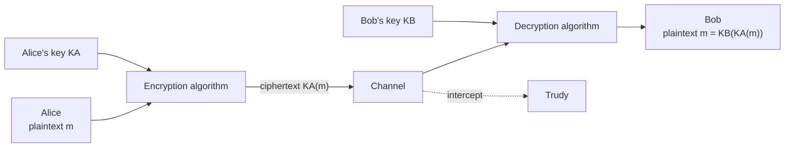
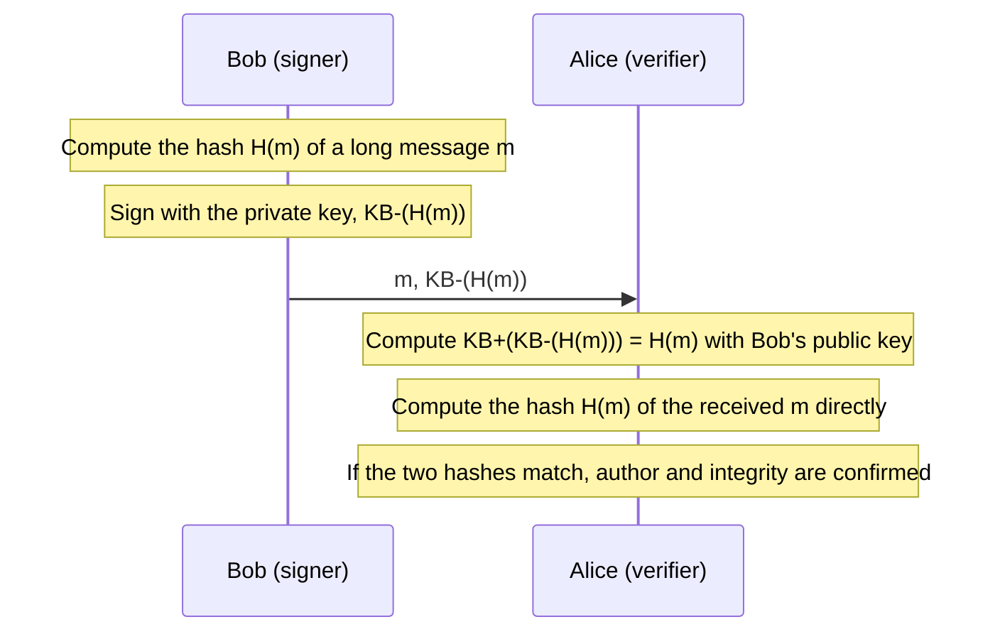
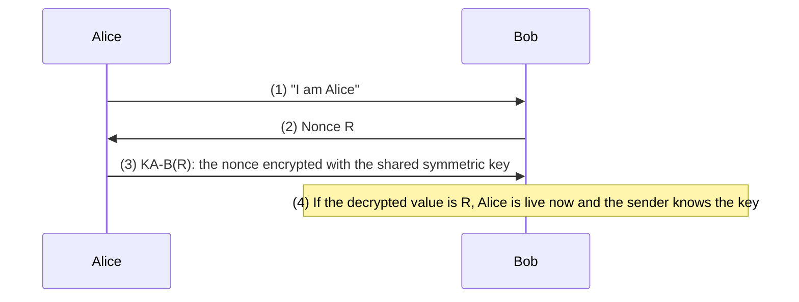
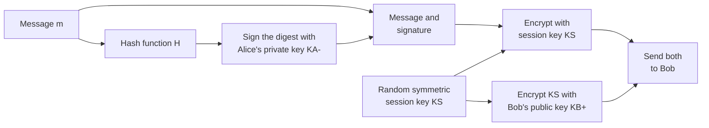
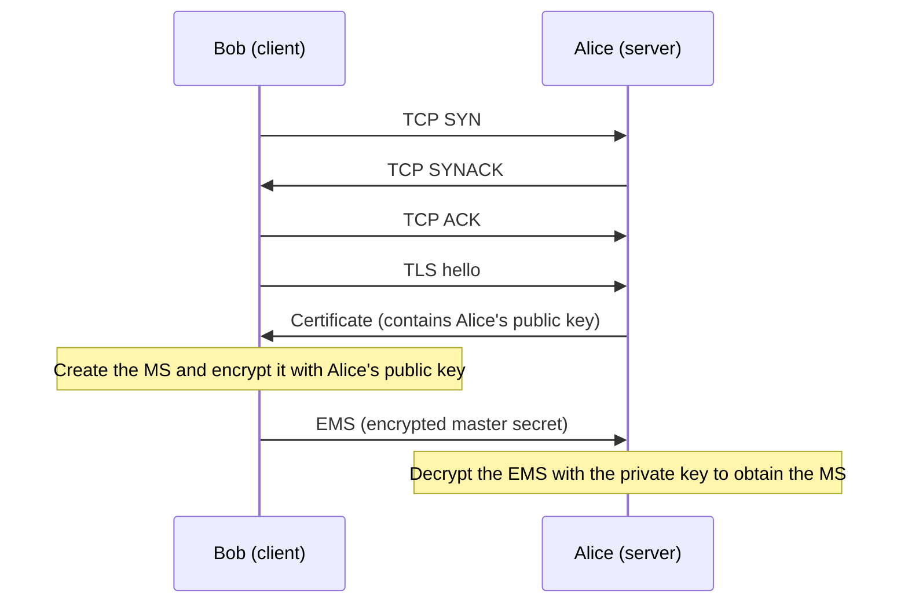
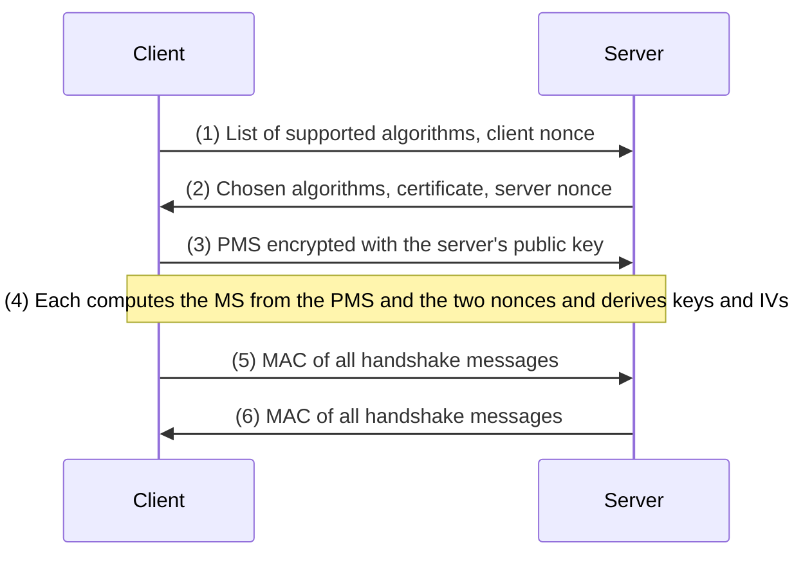
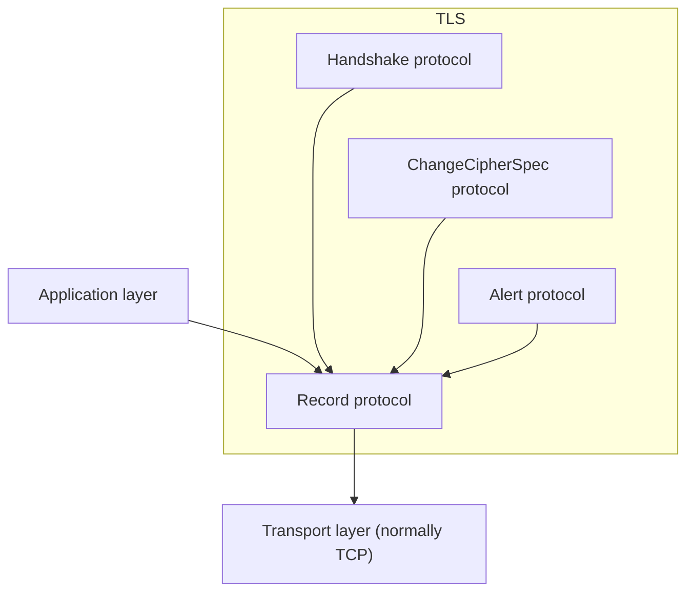
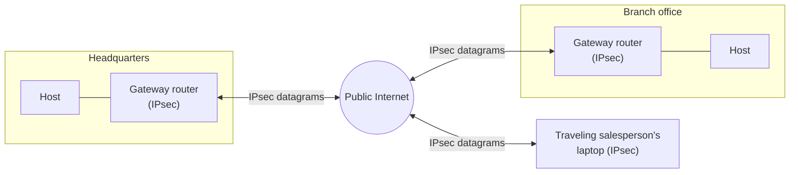
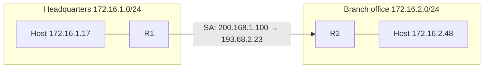
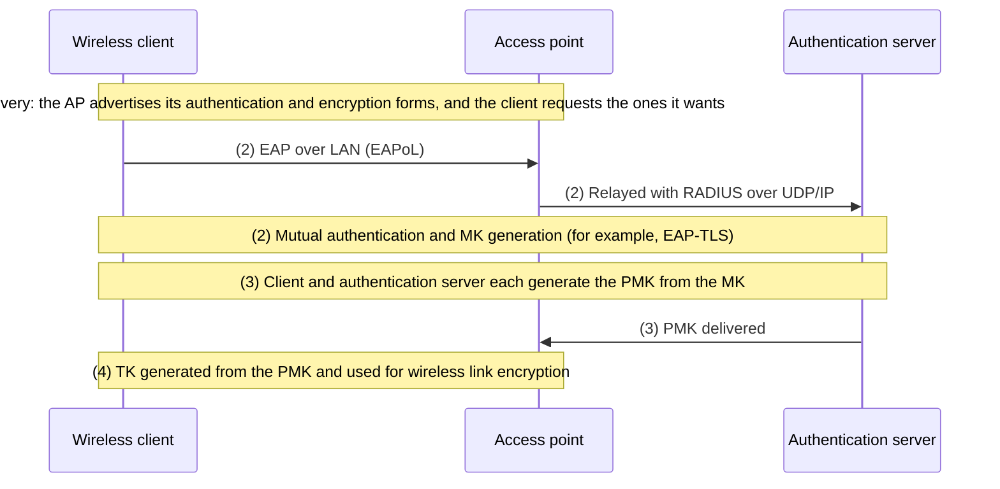

# Chapter 26 — Network Security

[Repository Guide](../../README.md) | [English](Concepts_Lecture.md) | [한국어](Concepts_Lecture.ko.md)

> **Last Updated:** 2026-11-18
>
> Computer Networking: A Top-Down Approach, Kurose and Ross, Ch 8; TCP/IP Protocol Suite, Forouzan, Ch 29, 30

> **Learning Objectives:**
> 1. Explain the four properties of secure communication and the attacks an intruder can mount
> 2. Explain the principles of symmetric key cryptography (block ciphers and CBC) and public key cryptography (RSA), and compute small examples
> 3. Distinguish the roles of hash functions, message authentication codes, digital signatures, and certificates
> 4. Explain end-point authentication with nonces and the handshake and record protection of TLS
> 5. Compare IPsec security associations and ESP datagrams, tunneling methods, and VPN protocols
> 6. Explain the weaknesses of WEP, 802.11i, and the operation of firewalls and intrusion detection systems

---

## Table of Contents

- [1. What Is Network Security](#1-what-is-network-security)
  - [1.1 Four Properties of Secure Communication](#11-four-properties-of-secure-communication)
  - [1.2 What an Intruder Can Do, and the Real Alice and Bob](#12-what-an-intruder-can-do-and-the-real-alice-and-bob)
  - [1.3 Security Goals and a Classification of Attacks](#13-security-goals-and-a-classification-of-attacks)
- [2. Principles of Cryptography](#2-principles-of-cryptography)
  - [2.1 Components of a Cryptographic System](#21-components-of-a-cryptographic-system)
  - [2.2 Classical Ciphers](#22-classical-ciphers)
  - [2.3 Attacks by the Information the Intruder Has](#23-attacks-by-the-information-the-intruder-has)
  - [2.4 Block Ciphers](#24-block-ciphers)
  - [2.5 Cipher Block Chaining (CBC)](#25-cipher-block-chaining-cbc)
  - [2.6 Public Key Cryptography](#26-public-key-cryptography)
  - [2.7 RSA](#27-rsa)
  - [2.8 Session Keys](#28-session-keys)
  - [2.9 Diffie-Hellman Key Agreement](#29-diffie-hellman-key-agreement)
- [3. Message Integrity and Digital Signatures](#3-message-integrity-and-digital-signatures)
  - [3.1 The Message Integrity Problem](#31-the-message-integrity-problem)
  - [3.2 Cryptographic Hash Functions](#32-cryptographic-hash-functions)
  - [3.3 Message Authentication Codes](#33-message-authentication-codes)
  - [3.4 Digital Signatures](#34-digital-signatures)
  - [3.5 Public Key Certification and Certification Authorities](#35-public-key-certification-and-certification-authorities)
- [4. End-Point Authentication](#4-end-point-authentication)
- [5. Securing E-Mail](#5-securing-e-mail)
- [6. TLS](#6-tls)
  - [6.1 Securing TCP Connections](#61-securing-tcp-connections)
  - [6.2 A Simplified TLS](#62-a-simplified-tls)
  - [6.3 The Real TLS Handshake](#63-the-real-tls-handshake)
  - [6.4 Connection Closure](#64-connection-closure)
  - [6.5 The Four Protocols of TLS](#65-the-four-protocols-of-tls)
- [7. IPsec and VPNs](#7-ipsec-and-vpns)
  - [7.1 Network-Layer Security and VPNs](#71-network-layer-security-and-vpns)
  - [7.2 AH and ESP](#72-ah-and-esp)
  - [7.3 Security Associations](#73-security-associations)
  - [7.4 The IPsec Datagram](#74-the-ipsec-datagram)
  - [7.5 Transport Mode and Tunnel Mode](#75-transport-mode-and-tunnel-mode)
  - [7.6 Services Provided by IPsec](#76-services-provided-by-ipsec)
  - [7.7 IKE: Key Management in IPsec](#77-ike-key-management-in-ipsec)
- [8. Tunneling](#8-tunneling)
- [9. Comparison of VPN Protocols](#9-comparison-of-vpn-protocols)
- [10. Wireless LAN Security](#10-wireless-lan-security)
  - [10.1 WEP](#101-wep)
  - [10.2 IEEE 802.11i](#102-ieee-80211i)
- [11. Firewalls and Intrusion Detection Systems](#11-firewalls-and-intrusion-detection-systems)
  - [11.1 Firewalls](#111-firewalls)
  - [11.2 Traditional Packet Filters](#112-traditional-packet-filters)
  - [11.3 Stateful Packet Filters](#113-stateful-packet-filters)
  - [11.4 Application Gateways](#114-application-gateways)
  - [11.5 Intrusion Detection Systems](#115-intrusion-detection-systems)
- [Concept Applications](#concept-applications)
- [Summary](#summary)
- [Self-Check Questions](#self-check-questions)
- [References](#references)

---

<br>

## 1. What Is Network Security

### 1.1 Four Properties of Secure Communication

Discussions of network security conventionally feature two lovers, Alice and Bob, and an intruder, Trudy. Alice wants only Bob to be able to understand the messages she sends, even though they communicate over an insecure medium. Trudy may intercept whatever Alice sends to Bob. Bob wants to be sure that a message he receives was actually sent by Alice, and Alice wants to make sure that the person she is communicating with is actually Bob. They want the contents of their messages not to be altered in transit, and they want to be able to communicate in the first place, that is, no one should deny them access to the resources needed to communicate. From this, the properties that secure communication should have can be identified.

> **Definition:** **Confidentiality** is the property that only the sender and the intended receiver should be able to understand the contents of a transmitted message.

Because eavesdroppers may intercept a message, confidentiality requires that the message be somehow encrypted so that an intercepted message cannot be understood. Confidentiality is probably the most commonly perceived meaning of secure communication and is covered in Section 2.

> **Definition:** **Message integrity** is the property that ensures that the content of a communication is not altered in transit, either maliciously or by accident.

Message integrity can be provided by extending the checksumming techniques of reliable transport and data link protocols, and it is covered in Section 3.

> **Definition:** **End-point authentication** is the property that the sender and the receiver should each be able to confirm the identity of the other party, that is, that the other party is who or what it claims to be.

Face-to-face human communication solves this problem easily by visual recognition. When parties exchange messages over a medium where they cannot see each other, authentication is not so simple. For example, when a user wants to access an inbox, how does the mail server verify that the user is the person he or she claims to be? Section 4 covers this.

The fourth property is **operational security**. Almost all organizations today have networks attached to the public Internet, so these networks can be compromised. Attackers can deposit worms into hosts on the network, obtain corporate secrets, map internal network configurations, or launch denial-of-service attacks. Firewalls, which sit between the organization's network and the public network and control packet access to and from it, and intrusion detection systems, which perform deep packet inspection and alert administrators to suspicious activity, counter these attacks. Section 11 covers them.

### 1.2 What an Intruder Can Do, and the Real Alice and Bob

To exchange data securely, Alice and Bob exchange control messages and data messages, much as TCP senders and receivers exchange control segments and data segments. All or some of these messages are typically encrypted. As seen in Chapter 1, an intruder can do the following.

- **Eavesdropping:** sniff and record control and data messages on the channel.
- **Modification, insertion, or deletion of messages or message content.**

Unless appropriate countermeasures are taken, these capabilities alone let an intruder mount a wide variety of attacks: snooping on communication (possibly stealing passwords and data), impersonating another entity, hijacking an ongoing session, or denying service to legitimate users by overloading system resources.

In the Internet, Alice and Bob may be human users at two end systems, or participants in electronic commerce, such as someone sending a credit card number to a web server or a customer interacting with a bank. The parties needing secure communication may themselves be part of the network infrastructure. DNS (Chapter 5), routing daemons that exchange routing information (Chapters 14 and 15), and network management applications (Chapter 17) all require secure communication between two parties. An intruder that could actively interfere with DNS lookups, routing computations, or network management functions could wreak havoc in the Internet.

### 1.3 Security Goals and a Classification of Attacks

Forouzan summarizes the three goals of information security as confidentiality, integrity, and **availability**. Availability is the goal that information created and stored by an organization be available to authorized entities when it is needed. Information is useless if it is not available, and imagining a bank whose customers cannot access their accounts shows that losing availability is as harmful as losing confidentiality or integrity. The three goals are threatened by the following attacks.

| Goal threatened | Attack | Description |
|:-----|:-----|:-----|
| Confidentiality | Snooping | Unauthorized access to or interception of data; prevented by encryption. |
| Confidentiality | Traffic analysis | Even if data is encrypted, guessing the nature of a transaction by observing information such as the addresses of sender and receiver or pairs of requests and responses. |
| Integrity | Modification | Changing intercepted information to one's own benefit, or deleting or delaying messages. |
| Integrity | Masquerading | Impersonating somebody else; also called spoofing. |
| Integrity | Replaying | Obtaining a copy of a message sent by a user and later sending it again. |
| Integrity | Repudiation | A party to the communication, the sender or the receiver, later denying having sent or received a message. |
| Availability | Denial of service | Slowing down or interrupting the service of a system by sending many bogus requests or by intercepting and deleting responses. |

*Table 1. Security goals and the attacks that threaten them*

> **[Information Security]** Confidentiality, integrity, and availability are often called the CIA triad, and the cryptographic techniques of this chapter (symmetric key cryptography, public key cryptography, hashes, digital signatures), authentication, and access control are studied in depth in information security. This chapter focuses on how these tools are used at each layer of the network.

---

<br>

## 2. Principles of Cryptography

### 2.1 Components of a Cryptographic System

Cryptographic techniques let a sender disguise data so that an intruder gains no information from intercepted data, while the receiver can recover the original data from the disguised data.



*Figure 1. Components of a cryptographic system*

Alice's message in its original form (for example, "Bob, I love you. Alice") is called the **plaintext**. Alice encrypts the plaintext with an **encryption algorithm**, producing a **ciphertext** that looks unintelligible to any intruder. Interestingly, in many modern cryptographic systems used in the Internet, the encryption technique itself is published and standardized and is available to everyone, even a potential intruder. There must therefore be some secret information that prevents an intruder from decrypting, and that is the **key**.

Alice provides a key $`K_A`$, a string of numbers or characters, to the encryption algorithm. The algorithm takes the key and the plaintext $`m`$ and produces the ciphertext $`K_A(m)`$. Bob provides a key $`K_B`$ to the decryption algorithm and recovers the plaintext as $`K_B(K_A(m)) = m`$. In **symmetric key systems**, Alice's and Bob's keys are identical and secret. In **public key systems**, a pair of keys is used: one is known to both Bob and Alice (indeed to the whole world), and the other is known only to Bob or to Alice.

> **Definition:** **Symmetric key cryptography** is a method of encryption in which the sender and the receiver use the same secret key both to encrypt and to decrypt.

### 2.2 Classical Ciphers

**Caesar cipher:** Each letter of English text is replaced by the letter $`k`$ letters later in the alphabet (with wraparound, so z is followed by a). With $`k = 3`$, plaintext a becomes d and b becomes e, and the value of $`k`$ is the key. The plaintext "bob, i love you. alice" becomes the ciphertext "ere, l oryh brx. dolfh". The ciphertext looks like gibberish, but if one knows that the Caesar cipher is used, there are only 25 possible keys, so it is broken quickly.

**Monoalphabetic cipher:** Instead of a regular pattern (shifting every letter by $`k`$), any letter can be substituted for any other letter, as long as each letter has a unique substitute. There are 26! (about $`10^{26}`$) possible pairings of letters rather than 25, so a brute-force attack trying all pairings is infeasible. Statistical analysis of the plaintext language, however, breaks it easily. For example, e and t are the most frequent letters in English text (13 percent and 9 percent of letter occurrences), and two- and three-letter combinations such as "in", "it", "the", "ion", and "ing" occur often. It is even easier if the intruder knows something about the contents. If Trudy knew for certain that the names "bob" and "alice" appear in the ciphertext, she could immediately determine 7 of the 26 letter pairings, reducing the possibilities to be checked by brute force by a factor of $`10^9`$.

**Polyalphabetic cipher:** Several monoalphabetic ciphers are used, with a specific one encoding the letter at each position of the plaintext. The same letter may therefore be encoded differently depending on its position. For example, if two Caesar ciphers C1 ($`k = 5`$) and C2 ($`k = 19`$) are used in the repeating pattern C1, C2, C2, C1, C2, the plaintext "bob, i love you." becomes "ghu, n etox dhz." The first b is encrypted with C1 and the second with C2, giving different letters. Here the key is the knowledge of both Caesar keys ($`k = 5`$, $`k = 19`$) and the pattern C1, C2, C2, C1, C2.

**Transposition cipher:** The ciphers above substitute one symbol for another. Forouzan also describes the **transposition cipher**, which keeps the symbols but changes their positions. To send "Enemy attacks tonight" to Bob, Alice writes the plaintext row by row into a table of five columns, padding the last row with z (enemy / attac / kston / ightz). She then permutes the columns with the key 3 1 4 5 2, so that the first column of the new table is the third column of the old one, the second is the first, the third is the fourth, the fourth is the fifth, and the fifth is the second, and she reads the new table column by column to obtain the ciphertext ETTHEAKIMAOTYCNZNTSG. Bob performs the three steps in reverse order with the same key: he writes the ciphertext column by column, restores the original column order, and reads the table row by row.

### 2.3 Attacks by the Information the Intruder Has

How easy it is for Trudy to break a cipher depends on what information she has, giving three scenarios.

- **Ciphertext-only attack:** The intruder has only the intercepted ciphertext, with no certain information about the plaintext. Statistical analysis helps in this attack.
- **Known-plaintext attack:** The intruder knows some (plaintext, ciphertext) pairings. In the example above, knowing that "bob" and "alice" appear reveals the pairings for a, l, i, c, e, b, and o.
- **Chosen-plaintext attack:** The intruder can choose a plaintext message and obtain its ciphertext. For the simple ciphers so far, if Trudy could get Alice to send "The quick brown fox jumps over the lazy dog," she could completely break the cipher. For more sophisticated techniques, however, a chosen-plaintext attack does not necessarily mean that the cipher can be broken.

### 2.4 Block Ciphers

Today's symmetric key ciphers fall into two broad classes, stream ciphers and block ciphers. Stream ciphers appear with wireless LAN security in Section 10; this section covers block ciphers, which are used by many Internet security protocols, including PGP, TLS, and IPsec.

> **Definition:** A **block cipher** is a symmetric key cipher that breaks a message into blocks of $`k`$ bits and maps each block, by a one-to-one mapping, to a $`k`$-bit ciphertext block.

Let us see the principle with $`k = 3`$. One possible mapping of 3-bit inputs (plaintext) to 3-bit outputs (ciphertext) is shown in Table 2. Each input has a different output, so the mapping is one-to-one.

| Input | Output | Input | Output |
|:-----|:-----|:-----|:-----|
| 000 | 110 | 100 | 011 |
| 001 | 111 | 101 | 010 |
| 010 | 101 | 110 | 000 |
| 011 | 100 | 111 | 001 |

*Table 2. One mapping of a 3-bit block cipher*

This block cipher breaks a message into 3-bit blocks and encrypts each according to the table, so the message 010110001111 becomes 101000111001. Such a mapping is a permutation of all possible inputs ($`2^3 = 8`$ of them), so there are 8! = 40,320 mappings, and each mapping can be viewed as a key. A brute-force attack tries decrypting with every mapping, and 40,320 of them can be tried quickly on a desktop PC. Block ciphers therefore use much larger blocks of $`k = 64`$ bits or more. The number of possible mappings of a general $`k`$-bit block cipher is $`(2^k)!`$, astronomical even for $`k = 64`$.

A full-table block cipher with predetermined mappings between all inputs and outputs is, however, hard to implement. With $`k = 64`$, Alice and Bob would need to keep a table with $`2^{64}`$ input values and regenerate it every time they changed keys. Block ciphers therefore typically use functions that simulate randomly permuted tables. For example, a 64-bit block is broken into 8 chunks of 8 bits, each chunk is processed by an 8-bit to 8-bit table of manageable size ($`T_1, \ldots, T_8`$), the 8 output chunks are reassembled into a 64-bit block, and the positions of the 64 bits are scrambled. This output is fed back to the input, and after $`n`$ such rounds a 64-bit ciphertext block results. The purpose of the rounds is to make each input bit affect most of the final output bits (with only one round, an input bit would affect only 8 of the 64 output bits). The key of this block cipher is the eight permutation tables (assuming the scramble function is public).

Popular block ciphers today include DES (Data Encryption Standard), 3DES, and AES (Advanced Encryption Standard). All of them use similar (more complicated and cipher-specific) functions rather than predetermined tables, and their keys are bit strings. DES uses 64-bit blocks and a 56-bit key, and AES uses 128-bit blocks and keys of 128, 192, or 256 bits. The key of an algorithm determines the mappings and permutations of its internal mini-tables. A brute-force attack on these ciphers tries decrypting with every key, and with a key length of $`n`$ there are $`2^n`$ possible keys. According to the NIST estimate cited by the textbook, a machine that could crack 56-bit DES in one second (that is, try all $`2^{56}`$ keys in one second) would take approximately 149 trillion years to crack a 128-bit AES key.

Forouzan describes the components from which such functions are built. A **P-box** (permutation box) transposes bits just as a transposition cipher transposes characters, and it may keep, expand, or compress the number of bits. An **S-box** (substitution box) is a miniature substitution cipher for bits whose numbers of inputs and outputs may differ. An exclusive-or operation combines an $`n`$-bit piece of data with an $`n`$-bit key and is normally the only unit where the key is applied. Circular shifts, swaps (circular shifts by half the word length), and split and combine operations rearrange the bits further.

### 2.5 Cipher Block Chaining (CBC)

Networking applications typically need to encrypt long messages or data streams. Chopping a message into $`k`$-bit blocks and encrypting each block independently causes a subtle but important problem: two or more plaintext blocks can be identical. For example, the plaintext of several blocks could be "HTTP/1.1". For identical plaintext blocks a block cipher of course produces identical ciphertext, so an attacker seeing identical ciphertext blocks could guess the plaintext and, with knowledge of the protocol structure, might even decrypt the entire message.

To solve this, randomness is mixed into the ciphertext so that identical plaintext blocks produce different ciphertext blocks. Let $`m(i)`$ be the $`i`$-th plaintext block, $`c(i)`$ the $`i`$-th ciphertext block, $`a \oplus b`$ the exclusive-or (XOR) of two bit strings, and $`K_S`$ block-cipher encryption with key $`S`$. The sender creates a new $`k`$-bit random number $`r(i)`$ for each block, computes $`c(i) = K_S(m(i) \oplus r(i))`$, and sends $`c(1), r(1), c(2), r(2), \ldots`$. The receiver recovers the plaintext as $`m(i) = K_S(c(i)) \oplus r(i)`$, where $`K_S(c(i))`$ denotes decryption with key $`S`$. Trudy can sniff $`r(i)`$, which is sent in the clear, but she cannot obtain the plaintext without the key. Encrypting the plaintext 010010010 directly with the cipher of Table 2 gives 101101101, revealing that the three blocks are identical. With the random numbers $`r(1) = 001`$, $`r(2) = 111`$, and $`r(3) = 100`$, the ciphertext is 100, 010, 000, all different. However, this method requires sending a random bit for every cipher bit, doubling the bandwidth.

> **Definition:** **Cipher block chaining (CBC)** is a method that mixes a random initialization vector into only the first block and XORs each subsequent plaintext block with the preceding ciphertext block before encrypting it with the block cipher.

1. Before encrypting the message (or data stream), the sender generates a $`k`$-bit random string called the **initialization vector (IV)**. It is denoted $`c(0)`$ and sent to the receiver in the clear.
2. For the first block, the sender computes and sends $`c(1) = K_S(m(1) \oplus c(0))`$.
3. For the $`i`$-th block, the sender computes and sends $`c(i) = K_S(m(i) \oplus c(i-1))`$.

The receiver decrypts $`c(i)`$ with the key to obtain $`s(i) = m(i) \oplus c(i-1)`$ and, knowing $`c(i-1)`$, recovers the plaintext as $`m(i) = s(i) \oplus c(i-1)`$. Even identical plaintext blocks give (almost always) different ciphertexts; an intruder who does not know the key cannot decrypt even though the IV is sent in the clear; and the only overhead is the single IV block, which negligibly increases the bandwidth of long messages of hundreds of blocks.

```text
 Plaintext m(i):    010         010         010
 XORed with:        c(0)=001    c(1)=100    c(2)=000
 m(i) ⊕ c(i-1):     011         110         010
 Encrypt (Table 2): c(1)=100    c(2)=000    c(3)=101
```

*Figure 2. CBC encryption with the block cipher of Table 2 and IV 001*

CBC has an important consequence for the design of secure protocols: the protocol must include a mechanism to distribute the IV from sender to receiver. TLS in Section 6 derives the IVs during its handshake.

### 2.6 Public Key Cryptography

For more than 2,000 years, from the time of the Caesar cipher until the 1970s, encrypted communication required the two parties to share a common secret, the symmetric key used for encryption and decryption. The difficulty is that agreeing on the key requires (presumably secure) communication. In a networked world, the parties may never meet and may communicate only over the network. In 1976 Diffie and Hellman demonstrated an algorithm (Diffie-Hellman key exchange) for communicating with encryption without a shared secret key known in advance, which became the starting point of today's public key cryptography systems.

> **Definition:** **Public key cryptography** is a method in which the receiver has a pair of keys, a public key available to the whole world and a private key known only to the receiver, so that the sender encrypts with the receiver's public key and the receiver decrypts with the private key.

Bob's public and private keys are written $`K_B^+`$ and $`K_B^-`$. Alice fetches Bob's public key and encrypts her message $`m`$ with a standardized encryption algorithm to obtain $`K_B^+(m)`$, and Bob computes $`K_B^-(K_B^+(m))`$ with his private key and the decryption algorithm. Keys can be chosen so that $`K_B^-(K_B^+(m)) = m`$, and the order of the keys can be interchanged: $`K_B^-(K_B^+(m)) = K_B^+(K_B^-(m)) = m`$. In this way Alice can send Bob a secret message using his public key without either of them distributing any secret key.

Two worries arise. First, the intruder knows both Bob's public key and the encryption algorithm, so she can mount a chosen-plaintext attack by encrypting any messages she likes. Keys must therefore be chosen and encryption done so that it is impossible, or nearly so, for an intruder to determine Bob's private key or to guess Alice's message. Second, since Bob's encryption key is public, anyone, including someone claiming to be Alice, can send Bob an encrypted message. With a shared secret key, the sender's knowledge of the key implicitly identified the sender, but this is not the case with public keys, so the digital signatures of Section 3 are needed to bind a sender to a message.

### 2.7 RSA

The **RSA algorithm**, named after its founders Rivest, Shamir, and Adleman, is so widely used that it has become almost synonymous with public key cryptography. RSA makes extensive use of modulo-$`n`$ arithmetic. $`x \bmod n`$ is the remainder of $`x`$ divided by $`n`$ (for example, $`19 \bmod 5 = 4`$), and the following facts make addition, subtraction, and multiplication convenient.

```math
\begin{aligned}
[(a \bmod n) + (b \bmod n)] \bmod n &= (a + b) \bmod n \\
[(a \bmod n) - (b \bmod n)] \bmod n &= (a - b) \bmod n \\
[(a \bmod n) \cdot (b \bmod n)] \bmod n &= (a \cdot b) \bmod n
\end{aligned}
```

The third fact gives $`(a \bmod n)^d \bmod n = a^d \bmod n`$. A message is a bit pattern, and every bit pattern can be represented uniquely by an integer (together with its length; for example, 1001 is 9), so encrypting a message with RSA is equivalent to encrypting that integer.

Bob generates his public and private keys with the following steps.

1. Choose two large prime numbers $`p`$ and $`q`$. The larger they are, the harder RSA is to break, but the longer encoding and decoding take. According to the textbook, RSA Laboratories recommends that the product of $`p`$ and $`q`$ be on the order of 1,024 bits.
2. Compute $`n = pq`$ and $`z = (p-1)(q-1)`$.
3. Choose a number $`e`$, less than $`n`$, that has no common factors other than 1 with $`z`$ (that is, relatively prime to $`z`$).
4. Find a number $`d`$ such that $`ed - 1`$ is exactly divisible by $`z`$, that is, $`ed \bmod z = 1`$.
5. The public key $`K_B^+`$ is $`(n, e)`$, and the private key $`K_B^-`$ is $`(n, d)`$.

To send a bit pattern represented by the integer $`m`$ ($`m < n`$), Alice computes and sends the ciphertext $`c = m^e \bmod n`$, and Bob decrypts by computing $`m = c^d \bmod n`$ with his private key.

> **Definition:** **RSA** is a public key cryptography algorithm that forms a public key $`(n, e)`$ and a private key $`(n, d)`$ from the product $`n`$ of two large primes and exponents $`e`$ and $`d`$, encrypting by $`m^e \bmod n`$ and decrypting by $`c^d \bmod n`$.

As a simple example, if Bob chooses $`p = 5`$ and $`q = 7`$ (far too small to be secure), then $`n = 35`$ and $`z = 24`$. Since 5 and 24 have no common factors, he chooses $`e = 5`$, and since $`5 \cdot 29 - 1 = 144`$ is exactly divisible by 24, he chooses $`d = 29`$. Bob makes $`n = 35`$ and $`e = 5`$ public and keeps $`d = 29`$ secret. If Alice sends the letters l, o, v, and e, interpreting each as a number from 1 to 26 (a is 1, z is 26) and encrypting each letter separately, the result is as in Table 3.

| Plaintext letter | m | $`m^e`$ | Ciphertext $`c = m^e \bmod n`$ | Decryption $`c^d \bmod n`$ |
|:-----|:-----|:-----|:-----|:-----|
| l | 12 | 248,832 | 17 | 12 |
| o | 15 | 759,375 | 15 | 15 |
| v | 22 | 5,153,632 | 22 | 22 |
| e | 5 | 3,125 | 10 | 5 |

*Table 3. RSA encryption and decryption with e = 5, d = 29, n = 35*

Even in this toy example, $`c^d`$ becomes an enormous number with dozens of digits, so how to choose large primes, how to choose $`e`$ and $`d`$, and how to exponentiate large numbers are important practical issues.

> **Note:** Forouzan writes $`z`$ as $`\phi`$, the plaintext as $`P`$, and the ciphertext as $`C`$, so that $`C = P^e \bmod n`$ and $`P = C^d \bmod n`$. Its small example uses $`p = 7`$ and $`q = 11`$, so $`n = 77`$ and $`\phi = 60`$. With $`e = 13`$, $`d = 37`$, since $`13 \times 37 = 481 = 8 \times 60 + 1`$, and the plaintext 5 becomes the ciphertext $`5^{13} \bmod 77 = 26`$, which decrypts back to $`26^{37} \bmod 77 = 5`$.

**Why RSA works:** Encryption followed by decryption gives $`(m^e \bmod n)^d \bmod n = m^{ed} \bmod n`$. There is a number-theoretic result that if $`p`$ and $`q`$ are distinct primes, $`n = pq`$, $`z = (p-1)(q-1)`$, and $`ed \bmod z = 1`$, then $`m^{ed} \bmod n = m`$ for every $`m`$ with $`0 \le m < n`$. Decryption therefore yields the original value $`m`$. For the same reason, reversing the order of exponentiation, raising to $`d`$ first and then to $`e`$, also gives $`(m^d \bmod n)^e \bmod n = m^{de} \bmod n = m`$, a property that makes the digital signatures of Section 3 possible.

> **[Discrete Mathematics]** The number-theoretic result above follows from Fermat's little theorem and the Chinese remainder theorem. If $`ed = 1 + kz`$, then $`m^{ed} = m \cdot (m^{z})^k`$; if $`m`$ is not a multiple of $`p`$, Fermat's little theorem gives $`m^{p-1} \equiv 1 \pmod p`$, so $`m^{ed} \equiv m \pmod p`$, and if $`m`$ is a multiple of $`p`$, both sides are 0. The same holds for $`q`$, and combining the two congruences gives $`m^{ed} \equiv m \pmod n`$.

> **Note:** Kurose and Ross state the number-theoretic result in a more general form: $`x^y \bmod n`$ equals $`x^{(y \bmod z)} \bmod n`$. This general form holds when $`x`$ is relatively prime to $`n`$, but it can fail otherwise. For example, with $`p = 5`$ and $`q = 7`$ ($`n = 35`$, $`z = 24`$), $`5^{24} \bmod 35 = 15`$ while $`5^{(24 \bmod 24)} \bmod 35 = 1`$. The special case that RSA needs, an exponent $`ed`$ with $`ed \bmod z = 1`$, holds for every $`m`$ with $`0 \le m < n`$, as the box above shows.

The security of RSA relies on the fact that no algorithm is known for quickly factoring the public value $`n`$ into the primes $`p`$ and $`q`$. If one knew $`p`$ and $`q`$, one could easily compute the secret key $`d`$ from the public value $`e`$. It has not been proved, however, that no fast factoring algorithm exists, so in this sense the security of RSA is not guaranteed.

### 2.8 Session Keys

The exponentiation required by RSA is a time-consuming process. According to the textbook, DES is at least 100 times faster than RSA in software and 1,000-10,000 times faster in hardware. RSA is therefore used in practice in combination with symmetric key cryptography.

> **Definition:** A **session key** is a symmetric key used during one communication session to encrypt large amounts of data with a symmetric key cipher, and it is usually delivered to the other party encrypted with public key cryptography.

If Alice wants to send Bob a large amount of encrypted data, she first chooses a session key $`K_S`$ for encrypting the data. She encrypts the session key with Bob's public key ($`c = (K_S)^e \bmod n`$) and sends it, and Bob decrypts it to obtain the session key. The two then exchange data with a symmetric key cipher such as DES or AES using the session key. Public key cryptography is used only for the one short session key, so its slowness is not a problem.

### 2.9 Diffie-Hellman Key Agreement

Section 2.6 mentioned that Diffie and Hellman showed in 1976 how two parties can communicate with encryption without a secret key agreed on in advance. Forouzan presents their method as a way for two parties to create a symmetric session key between themselves without a third party that distributes keys. Kurose and Ross note that Diffie-Hellman is not as versatile as RSA, since it cannot be used to encrypt messages of arbitrary length, but that it can be used to establish a symmetric session key, which then encrypts the messages.

> **Definition:** **Diffie-Hellman key agreement** is a method by which two parties create a shared symmetric session key by exchanging only values that may be made public, so that the key itself never travels over the network.

Before creating a key, the two parties choose two numbers $`p`$ and $`g`$, which need not be secret and can be sent over the Internet. The procedure is as follows.

1. Alice chooses a large random number $`x`$ with $`0 \le x \le p - 1`$ and computes $`R_1 = g^x \bmod p`$.
2. Alice sends $`R_1`$ to Bob. She does not send $`x`$ itself.
3. Bob chooses another large random number $`y`$ with $`0 \le y \le p - 1`$ and computes $`R_2 = g^y \bmod p`$.
4. Bob sends $`R_2`$ to Alice, again without $`y`$.
5. Alice computes $`K = (R_2)^x \bmod p`$, and Bob computes $`K = (R_1)^y \bmod p`$.

By the modular arithmetic facts of Section 2.7, both obtain the same value, which is the symmetric key for the session.

```math
K = (g^{y} \bmod p)^{x} \bmod p = (g^{x} \bmod p)^{y} \bmod p = g^{xy} \bmod p
```

Bob never learns $`x`$, and Alice never learns $`y`$; only $`R_1`$ and $`R_2`$, together with the public $`p`$ and $`g`$, travel over the network. As a toy example with small numbers (real values are very large), let $`g = 7`$ and $`p = 23`$. Alice chooses $`x = 3`$ and sends $`R_1 = 7^3 \bmod 23 = 21`$, and Bob chooses $`y = 6`$ and sends $`R_2 = 7^6 \bmod 23 = 4`$. Alice computes $`K = 4^3 \bmod 23 = 18`$, Bob computes $`K = 21^6 \bmod 23 = 18`$, and both equal $`7^{18} \bmod 23 = 18`$.

> **Caution:** The basic exchange does not tell either party who is on the other side, and Forouzan notes that it is prone to a man-in-the-middle attack, in which an intruder runs a separate exchange with each party. Protocols built on Diffie-Hellman therefore add authentication: the station-to-station protocol uses public key certificates, and phase 1 of IKE (Section 7.7) has both sides sign their messages after the Diffie-Hellman exchange.

---

<br>

## 3. Message Integrity and Digital Signatures

### 3.1 The Message Integrity Problem

Bob receives a message (which may be encrypted or in plaintext) that he believes was sent by Alice. To authenticate this message, Bob needs to verify two things.

1. The message actually originated from Alice.
2. The message was not tampered with on its way to Bob.

For example, in link-state routing such as OSPF (Chapters 14 and 15), each router broadcasts to all other routers a link-state message listing its directly connected neighbors and their costs. Trudy can attack the routing by distributing bogus messages with incorrect link-state information. So when router B receives a link-state message from router A, it must verify that A actually created the message and that no one tampered with it in transit.

### 3.2 Cryptographic Hash Functions

A hash function takes an input $`m`$ and computes a fixed-size string $`H(m)`$. The Internet checksum (Chapter 6) and CRCs (Chapter 18) meet this definition.

> **Definition:** A **cryptographic hash function** is a hash function with the additional property that it is computationally infeasible to find any two different messages $`x`$ and $`y`$ such that $`H(x) = H(y)`$.

This property means that an intruder cannot substitute one message for another message protected by the hash. Given (m, H(m)) created by the sender, an intruder cannot forge the contents of another message $`y`$ with the same hash value.

A simple checksum such as the Internet checksum makes a poor cryptographic hash function. Instead of one's complement arithmetic, consider a checksum that treats each character as a byte and adds the bytes position by position in 4-byte chunks. If Bob sends Alice an IOU, "IOU100.99BOB", saying he owes her 100.99 dollars, the ASCII values of these letters (in hexadecimal) are 49 4F 55 31 30 30 2E 39 39 42 4F 42.

```text
 Message IOU100.99BOB            Message IOU900.19BOB
 I  O  U  1   49 4F 55 31       I  O  U  9   49 4F 55 39
 0  0  .  9   30 30 2E 39       0  0  .  1   30 30 2E 31
 9  B  O  B   39 42 4F 42       9  B  O  B   39 42 4F 42
 Checksum     B2 C1 D2 AC       Checksum     B2 C1 D2 AC
```

*Figure 3. Two different messages with the same checksum*

"IOU100.99BOB" and "IOU900.19BOB" have the same checksum. Given the original data, it is easy to find other data with the same checksum, so this checksum violates the requirement above.

Widely used hash algorithms include Ron Rivest's **MD5** and **SHA-1 (Secure Hash Algorithm)**. MD5 computes a 128-bit hash in four steps: padding (adding a one followed by enough zeros), appending a 64-bit representation of the original length, initializing an accumulator, and a loop that processes the message's 16-word blocks in four rounds. SHA-1, based on principles similar to those of MD4, the predecessor of MD5, produces a 160-bit message digest, and its longer output makes it more secure.

### 3.3 Message Authentication Codes

A first attempt to obtain message integrity with a hash function is as follows.

1. Alice creates a message $`m`$ and computes the hash $`H(m)`$.
2. She appends $`H(m)`$ to $`m`$ and sends the extended message $`(m, H(m))`$ to Bob.
3. Bob receives an extended message $`(m, h)`$, computes $`H(m)`$, and concludes that everything is fine if $`H(m) = h`$.

This approach is obviously flawed. Trudy can create a bogus message $`m'`$ in which she claims to be Alice, compute $`H(m')`$, and send $`(m', H(m'))`$, which passes Bob's check in step 3. To obtain message integrity, Alice and Bob need, in addition to the hash function, a shared secret $`s`$; this bit string is called the **authentication key**.

> **Definition:** A **message authentication code (MAC)** is the hash $`H(m + s)`$ of a message $`m`$ concatenated with a shared secret authentication key $`s`$, which a receiver who knows the key uses to verify the origin and integrity of the message.

1. Alice concatenates $`s`$ with the message $`m`$ to create $`m + s`$ and computes the hash $`H(m + s)`$, the MAC.
2. She appends the MAC to the message and sends the extended message $`(m, H(m + s))`$ to Bob.
3. Bob receives an extended message $`(m, h)`$ and, knowing $`s`$, computes the MAC $`H(m + s)`$; if $`H(m + s) = h`$, he concludes that everything is fine.

Note that this MAC (message authentication code) is not the same as the MAC of the link layer (medium access control). A nice feature of a MAC is that it requires no encryption algorithm. In many applications, such as link-state routing, where confidentiality is not needed and only message integrity matters, messages can be authenticated without complex encryption algorithms. The most popular MAC standard today is **HMAC**, used with either MD5 or SHA-1, which runs the data and the authentication key through the hash function twice.

There remains the issue of distributing the shared authentication key. In link-state routing, the secret authentication key must be distributed to each router in the autonomous system (all routers may use the same key). The administrator can configure each router in person, or, if each router has a public key, encrypt the authentication key with the router's public key and send it over the network. As seen in Chapter 15, OSPF protects message integrity with MACs.

### 3.4 Digital Signatures

> **Definition:** A **digital signature** is a verifiable and nonforgeable value, made with the signer's private key, that indicates the owner or creator of a document or signifies agreement with its contents.

Like a handwritten signature, a digital signature must be **verifiable** (it must be possible to prove that a document signed by an individual was actually signed by that individual) and **nonforgeable** (only that individual could have signed it). A MAC cannot serve as a signature: if Bob signed with a MAC using his key, Alice would need a copy of the key to verify the signature, and the key would then no longer be unique to Bob.

In public key cryptography, both the public and private keys are unique to Bob, which makes it well suited to digital signatures. To sign a document $`m`$, Bob computes $`K_B^-(m)`$ with his private key. Signing with a private key may seem odd, but encryption and decryption are only mathematical operations (exponentiation to $`e`$ or $`d`$ in RSA), and Bob's goal is not to hide the contents but to sign in a verifiable and nonforgeable way.

If Alice has $`m`$ and $`K_B^-(m)`$, she can apply Bob's public key $`K_B^+`$ to the signature, compute $`K_B^+(K_B^-(m))`$, and show that the result exactly matches $`m`$. Whoever signed must have used a private key $`K_B^-`$ such that $`K_B^+(K_B^-(m)) = m`$, and knowing the public key does not reveal the private key, so the only one who knows it is Bob, who generated the key pair (assuming Bob has not given the private key away or had it stolen). Moreover, if the original document is modified to $`m'`$, the signature Bob created for $`m`$ is not valid for $`m'`$, so digital signatures also provide message integrity.

Signing a whole message by encryption is computationally expensive, so in practice the hash of the message is signed. Bob computes $`K_B^-(H(m))`$ and sends it along with the plaintext message. $`H(m)`$ is generally much smaller than the original message, so the computation required to create the signature is greatly reduced.



*Figure 4. Creating and verifying a digital signature on a hash*

MACs and digital signatures both start with a message, but they differ. A MAC hashes the message with an authentication key appended, involving neither public key nor symmetric key encryption. A digital signature encrypts the hash of the message with a private key, so it is a heavier technique that requires a **public key infrastructure (PKI)**, including the certification authorities described below. PGP in Section 5 protects message integrity with digital signatures, while OSPF in Chapter 15 and TLS and IPsec in Sections 6 and 7 use MACs.

### 3.5 Public Key Certification and Certification Authorities

An important application of digital signatures is **public key certification**, certifying that a public key belongs to a specific entity. Many security protocols, including IPsec and TLS, use it.

Consider Alice, who runs a pizza business and takes orders over the Internet. Bob, a pizza lover, sends a plaintext message with his home address and the type of pizza, together with a digital signature (a signature on the hash of the message) proving that he placed the order. Alice obtains Bob's public key from a public key server or an e-mail message and verifies the signature. Now suppose Trudy claims to be Bob, orders a pizza to Bob's home address, includes her own (Trudy's) public key, and attaches a signature created with her own private key. Alice verifies the signature, believing the public key to be Bob's, concludes that Bob placed the order, and Bob receives a pizza he never ordered.

For public key cryptography to be useful, one must therefore be able to verify that one has the actual public key of the entity one wants to communicate with.

> **Definition:** A **certification authority (CA)** is an organization that verifies the identity of an entity and issues a certificate, signed by the CA, that binds the entity's public key to that identity.

1. A CA verifies that an entity (a person, a router, and so on) is who it says it is. There are no mandated procedures for certification, so one must trust the CA to have performed suitably rigorous identity verification. The identity associated with a public key can be trusted only to the extent that the CA and its verification techniques can be trusted.
2. Once it has verified the identity, the CA creates a **certificate** that binds the entity's public key to the identity. The certificate contains the public key and globally unique identifying information about its owner (a human name or an IP address), and the CA digitally signs the certificate.

Now Bob sends his CA-signed certificate with his order, and Alice uses the CA's public key to check the validity of the certificate and extract Bob's public key. Both the ITU and the IETF have developed standards for CAs, and ITU X.509 specifies an authentication service and a specific syntax for certificates.

---

<br>

## 4. End-Point Authentication

> **Definition:** An **end-point authentication protocol** is a procedure by which one party proves its identity to another by exchanging messages over a computer network, usually run before the two parties communicate with some other protocol.

Alice wants to authenticate herself to Bob. Let us start with a simple protocol, see how Trudy breaks it, and strengthen it step by step. Kurose and Ross call these steps ap (authentication protocol) 1.0 to 4.0.

| Protocol | Operation | Trudy's attack |
|:-----|:-----|:-----|
| ap1.0 | Alice simply sends the message "I am Alice." | Bob cannot see who sent the message, so Trudy can just send the same message. |
| ap2.0 | Alice sends "I am Alice" in a datagram whose source is her well-known IP address. | Trudy can manipulate her operating system to create a datagram with Alice's address as the forged source (IP spoofing). |
| ap3.0 | Alice also sends her secret password. | If Trudy eavesdrops on Alice's communication and learns the password, she can mount a replay attack by sending the same message again. |
| ap3.1 | Alice sends her password encrypted with a symmetric key she shares with Bob. | If Trudy records the encrypted password and sends it again unchanged (a replay attack), Bob is still fooled. |
| ap4.0 | Bob sends a number used only once (a nonce), and Alice returns the nonce encrypted with the shared symmetric key. | The nonce is new each time, so reusing a recorded response does not work. |

*Table 4. Evolution of end-point authentication protocols*

The problem with ap3.1 is that Bob cannot verify that Alice is live now (and not a recording being played back). The nonce solves this.

> **Definition:** A **nonce** is a number that a protocol uses only once in a lifetime, used to confirm that the other party is live and responding now.



*Figure 5. End-point authentication protocol ap4.0 with a nonce*

Bob decrypts the received message and authenticates Alice if it equals the nonce he sent. The creator of the message is Alice, who knows the symmetric key $`K_{A-B}`$ shared by Alice and Bob, and since she encrypted the nonce R just sent, Alice is live. TLS (Section 6) and 802.11i (Section 10) also use nonces to prevent replay attacks.

---

<br>

## 5. Securing E-Mail

Security services can be provided at any of the top four layers of the Internet. As an application-layer example, let us design a system that secures an e-mail (Chapter 4) that Alice sends to Bob.

**Confidentiality:** If Alice encrypts the whole message with Bob's public key, she obtains confidentiality, but public key encryption is inefficient for long messages. So Alice (1) selects a random symmetric session key $`K_S`$, (2) encrypts her message $`m`$ with the session key, (3) encrypts the session key with Bob's public key $`K_B^+`$, and (4) concatenates the encrypted message and the encrypted session key and sends them. Bob obtains the session key with his private key and then decrypts the message with the session key.

**Sender authentication and message integrity:** If confidentiality is not a concern and only sender authentication and integrity are wanted, the digital signatures of Section 3.4 are used. Alice (1) applies a hash function $`H`$ to her message to obtain a digest, (2) signs the result with her private key $`K_A^-`$, and (3) concatenates the original unencrypted message with the signature and sends them. Bob applies Alice's public key to the signature and compares the result with the hash he computes himself.

**All three:** If confidentiality, sender authentication, and message integrity are all wanted, the two methods are combined. Alice first signs the message, bundling the message with its signature, then encrypts the whole bundle with a session key and encrypts the session key with Bob's public key. Alice must then have Bob's public key and Bob must have Alice's, so the CAs of Section 3.5 are commonly used to distribute public keys securely.



*Figure 6. Operations by which Alice provides confidentiality, sender authentication, and message integrity*

Bob reverses the steps: he recovers $`K_S`$ with his private key $`K_B^-`$, decrypts the bundle with $`K_S`$, and verifies the signature with Alice's public key $`K_A^+`$ by comparing the result with the hash he computes over the received message.

**PGP:** **PGP (Pretty Good Privacy)**, written by Phil Zimmermann in 1991, is an e-mail encryption scheme whose design is in essence the same as this one. According to the textbook, depending on the version, it uses MD5 or SHA for the message digest, CAST, triple-DES, or IDEA for symmetric key encryption, and RSA for public key encryption. When PGP is installed, it creates a public key pair for the user; the public key can be posted on a web site or placed on a public key server, and the private key is protected by a password. The user can sign a message, encrypt it, or both sign and encrypt it. For public key certification, PGP uses a **web of trust** instead of conventional CAs: Alice can certify any key and username pair she believes belong together, and she can say that she trusts another user to vouch for more keys. Requiring only client and server application code, PGP was one of the first security technologies to be broadly used in the Internet.

---

<br>

## 6. TLS

### 6.1 Securing TCP Connections

As Internet commerce grew, sensitive information such as credit card numbers came to be sent over the web more and more. Without encryption, an intruder could intercept an order and obtain payment information; without data integrity, the order could be altered; without server authentication, a fake store could deceive customers. TCP enhanced with the security services of confidentiality, data integrity, and end-point authentication is SSL (Secure Sockets Layer), and a slightly modified version of SSL version 3, standardized by the IETF, is **TLS (Transport Layer Security)**. This section calls both TLS.

> **Definition:** **TLS (Transport Layer Security)** is a transport-layer security protocol running over TCP that authenticates the server and establishes session keys in a handshake, and then encrypts application data in records protected by MACs.

TLS is often used to secure transactions over HTTP (HTTPS), but because it secures TCP, any application running over TCP can use it. TLS provides a socket API similar to TCP's, so an application only needs to include the TLS libraries. Technically TLS resides in the application layer, but from the developer's perspective it is a transport protocol providing TCP's services enhanced with security services (this is the security mentioned among the transport services that applications require in Chapter 3).

### 6.2 A Simplified TLS

Let us first get the big picture with a simplified version called "almost-TLS." Client Bob communicates with server Alice, who has a private/public key pair and a certificate binding her identity to her public key. Almost-TLS has three phases: handshake, key derivation, and data transfer.

**Handshake:** Bob needs to (a) establish a TCP connection with Alice, (b) verify that Alice is actually Alice, and (c) send Alice a master secret key that will be used to generate all the symmetric keys needed for the TLS session. Once the TCP connection is established, Bob sends a hello message, and Alice responds with her certificate, which contains her public key. Since a CA certified the certificate, Bob knows the public key belongs to Alice. Bob generates a **master secret (MS)** used only for this session, encrypts it with Alice's public key to create the EMS (encrypted master secret), and sends the EMS. Alice decrypts the EMS with her private key to obtain the MS. Now only Bob and Alice know the MS.



*Figure 7. Handshake of the simplified TLS*

**Key derivation:** In principle, the MS could be used as the symmetric session key for all subsequent encryption and integrity checking. It is considered safer, however, for Alice and Bob to use different keys from each other and different keys for encryption and for integrity checking. So both use the MS to generate four keys.

- $`E_B`$: session encryption key for data sent from Bob to Alice
- $`M_B`$: session MAC key for data sent from Bob to Alice
- $`E_A`$: session encryption key for data sent from Alice to Bob
- $`M_A`$: session MAC key for data sent from Alice to Bob

The four keys could be made simply by slicing the MS into four pieces (real TLS is a little more complicated).

**Data transfer:** Since TCP is a byte-stream protocol, one might have TLS encrypt application data on the fly and pass it to TCP. Where then would the MAC for the integrity check go? One cannot wait until the end of the TCP session to verify the integrity of all the data. So TLS breaks the data stream into **records**, appends a MAC to each record for integrity checking, and encrypts the record and MAC together. Bob inputs the record data and the key $`M_B`$ into a hash function to create the MAC, encrypts the record and MAC with the session encryption key $`E_B`$, and passes the result to TCP.

This approach still does not fully protect the integrity of the whole message stream. Suppose Trudy, a woman-in-the-middle able to insert, delete, and replace TCP segments, captures two segments sent by Bob, reverses their order, adjusts the (unencrypted) TCP sequence numbers, and sends them to Alice. If each segment carries exactly one record, Alice's TCP thinks everything is fine and passes the two records to TLS, which decrypts them, verifies each with its MAC, and passes them to the application layer. But the byte stream Alice receives is not correct, because the records are in reverse order.

The solution is **sequence numbers**. Bob maintains a sequence number counter that starts at zero and is incremented for each TLS record he sends. He does not put the sequence number in the record itself but includes it in the MAC calculation; that is, the MAC is a hash of the data, the MAC key $`M_B`$, and the current sequence number. Alice tracks Bob's sequence numbers and includes the appropriate one in the MAC calculation when verifying a record, so if Trudy reorders or replays segments, the MAC check catches it.

```text
+--------+---------+--------+--------------------------------+---------+
|  Type  | Version | Length |              Data              |   MAC   |
+--------+---------+--------+--------------------------------+---------+
 |<----- not encrypted ----->|<--------- encrypted with E_B -------------->|
```

*Figure 8. Format of a TLS record*

A TLS record consists of type, version, length, data, and MAC fields, and the first three fields are not encrypted. The type field indicates whether the record is a handshake message or application data, and it is also used to close the TLS connection. TLS at the receiving end uses the length field to extract TLS records from the incoming TCP byte stream.

### 6.3 The Real TLS Handshake

TLS does not mandate a specific symmetric key algorithm, public key algorithm, or MAC; it lets Alice and Bob agree on cryptographic algorithms during the handshake. In the handshake the two also send each other nonces, which are used in creating the session keys ($`E_B`$, $`M_B`$, $`E_A`$, $`M_A`$). The steps of the real handshake are as follows.

1. The client sends a list of the cryptographic algorithms it supports, along with a **client nonce**.
2. From the list, the server chooses a symmetric algorithm (for example, AES), a public key algorithm (for example, RSA with a specific key length), and a MAC algorithm, and sends back its choices, its certificate, and a **server nonce**.
3. The client verifies the certificate, extracts the server's public key, generates a **pre-master secret (PMS)**, encrypts it with the server's public key, and sends it.
4. Using the same key derivation function specified by the standard, the client and server each compute the master secret (MS) from the PMS and the two nonces. The MS is sliced into two encryption keys and two MAC keys. When the chosen symmetric cipher uses CBC, as 3DES and AES do, two initialization vectors, one for each side of the connection, are also obtained from the MS. From then on, all messages between client and server are encrypted and authenticated with the MAC.
5. The client sends a MAC of all the handshake messages it has sent and received.
6. The server sends a MAC of all the handshake messages it has sent and received.

The last two steps protect the handshake from tampering. In step 1, the client typically offers a list mixing strong and weak algorithms, and this list is sent in cleartext because no algorithms or keys have been agreed on yet. Trudy, as a woman-in-the-middle, could delete the strong algorithms from the list, forcing the client to choose a weak one. In step 5, the client sends a MAC of the concatenation of the handshake messages it sent and received, and the server compares it with the MAC of the handshake messages it received and sent, terminating the connection if they differ. In step 6 the server lets the client make the same check.

**The role of nonces:** Sequence numbers prevent the replay of segments within a session, but not a **connection replay attack**. Suppose Trudy sniffs all messages between Alice and Bob and the next day masquerades as Bob, sending Alice exactly the sequence of messages Bob sent the day before. If Alice does not use nonces, she responds with exactly the same sequence of messages as the day before, and each message passes the integrity check, so Alice suspects nothing. If Alice is an e-commerce server, she will think that Bob is placing a second order for the same thing. With nonces, Alice sends a different nonce for each TCP session, so the encryption keys differ on the two days and the records replayed by Trudy fail the integrity checks. In summary, in TLS nonces defend against the connection replay attack, and sequence numbers defend against replaying individual packets during an ongoing session.



*Figure 9. The real TLS handshake*

### 6.4 Connection Closure

When Bob or Alice wants to end a TLS session, one might simply terminate the underlying TCP connection (Bob sending a TCP FIN segment). But this leaves room for a **truncation attack**: Trudy gets in the middle of an ongoing TLS session and ends it early with a TCP FIN, so Alice thinks she received all of Bob's data when she actually received only part of it. The solution is to indicate in the type field of a record whether it terminates the TLS session. The type field is sent in the clear, but the receiver authenticates it with the record's MAC. Then, if Alice receives a TCP FIN before receiving a closure record, she knows something is wrong.

### 6.5 The Four Protocols of TLS

Forouzan describes SSL and TLS as four protocols in two layers.



*Figure 10. The four protocols that make up TLS*

- **Record protocol:** The carrier. It carries the messages of the other three protocols and the data coming from the application layer, and its messages are payloads of the transport layer (normally TCP).
- **Handshake protocol:** Provides the security parameters used by the Record protocol. It establishes a cipher set, provides keys and security parameters, and authenticates the server to the client (and, if needed, the client to the server).
- **ChangeCipherSpec protocol:** Signals the moment at which the negotiated security parameters start to be used.
- **Alert protocol:** Reports errors and abnormal conditions.

Forouzan also distinguishes a **session** from a **connection**. A session is an association between a client and a server; once it is established, the two parties share common information such as the session identifier, the certificates authenticating each of them (if needed), the cipher suite, and a master secret used to create the keys for message authentication and encryption. Exchanging data requires a connection as well as a session: for each connection, the two parties exchange two random numbers and use the master secret to create the keys and parameters needed for authentication and privacy. A session can contain many connections, and a connection can be terminated and reestablished within the same session.

---

<br>

## 7. IPsec and VPNs

### 7.1 Network-Layer Security and VPNs

**IPsec (IP security)** provides security at the network layer, securing IP datagrams between any two network-layer entities, including hosts and routers. With network-layer confidentiality between two entities, the sending entity encrypts the payloads of all datagrams it sends. The payload may be a TCP segment, a UDP segment, an ICMP message, or anything else, so e-mail, web pages, TCP handshake messages, and management messages such as ICMP and SNMP are all hidden from third parties. Network-layer security is therefore said to provide "blanket coverage." Besides confidentiality, IPsec provides **source authentication**, **data integrity**, and **replay-attack prevention**.

> **Note:** Forouzan gives three reasons why network-layer security is needed even though there is security at the application and transport layers: not all client/server programs are protected at the application layer, not all applications use TCP protected by TLS (some use UDP), and some applications, such as routing protocols, use the services of IP directly.

An institution spread over several geographical regions often wants its own IP network so that its hosts and servers can exchange data securely and confidentially. It could deploy a physical network completely separate from the public Internet, including routers, links, and a DNS infrastructure; this is called a **private network**. A private network, however, is very costly, since the institution must purchase, install, and maintain its own physical infrastructure.

> **Definition:** A **virtual private network (VPN)** is a network that sends an institution's inter-office traffic over the public Internet instead of a physically separate network, but encrypts it before it enters the public Internet, obtaining confidentiality like a private network.



*Figure 11. A VPN connecting headquarters, a branch office, and a traveling salesperson*

In the institution of Figure 11, two hosts within headquarters or within the branch office communicate with plain IPv4 (without IPsec). But when two hosts communicate over a path that traverses the public Internet, the traffic is encrypted before it enters the Internet. For example, when a host in headquarters sends an IP datagram to a salesperson in a hotel, the headquarters gateway router converts the IPv4 datagram into an IPsec datagram and forwards it into the Internet. The IPsec datagram has a traditional IPv4 header, so the routers of the public Internet process it like an ordinary IPv4 datagram. But its payload includes an IPsec header used for IPsec processing, and the payload is encrypted. When the datagram arrives at the salesperson's laptop, the laptop's operating system decrypts the payload (and provides other security services such as verifying data integrity) and passes the unencrypted payload to the upper-layer protocol (TCP or UDP).

### 7.2 AH and ESP

The IPsec protocol suite has two principal protocols.

> **Definition:** The **AH (Authentication Header) protocol** is an IPsec protocol that provides source authentication and data integrity for IP datagrams but not confidentiality.

> **Definition:** The **ESP protocol** (Encapsulating Security Payload) is an IPsec protocol that provides source authentication, data integrity, and confidentiality for IP datagrams.

When a source IPsec entity (typically a host or router) sends secure datagrams to a destination entity, it uses either AH or ESP. Because confidentiality is often critical for VPNs and other IPsec applications, ESP is much more widely used than AH.

According to Forouzan, AH creates a message digest with a hash function and a symmetric (secret) key and inserts it in the authentication header. In an IP datagram carrying AH, the protocol field of the IP header is replaced by the value 51, and the original protocol value is kept in the next header field inside the AH. The digest is computed over the entire IP datagram except the IP header fields that change during transmission (for example, TTL).

```text
+---------------+---------------+-------------------------------+
|  Next header  | Payload length|           Reserved            |
+---------------+---------------+-------------------------------+
|                 Security parameter index (SPI)                |
+---------------------------------------------------------------+
|                        Sequence number                        |
+---------------------------------------------------------------+
|              Authentication data (digest, variable)           |
+---------------------------------------------------------------+
```

*Figure 12. Format of the AH*

- **Next header (8 bits):** The type of payload carried by the IP datagram (TCP, UDP, ICMP, OSPF, and so on).
- **Payload length (8 bits):** Despite its name, not the length of the payload but the length of the authentication header in 4-byte multiples (not counting the first 8 bytes).
- **Security parameter index (32 bits):** Plays the role of a virtual circuit identifier and is the same for all packets sent during one connection called a security association (Section 7.3).
- **Sequence number (32 bits):** Provides ordering information for a sequence of datagrams and prevents replay. The sequence number is not repeated even if a packet is retransmitted, and it does not wrap around after reaching $`2^{32}`$; a new connection must be established.
- **Authentication data:** The result of applying a hash function to the entire IP datagram except the fields that change in transit.

In an IP datagram carrying ESP, the protocol field value is 50, and the original protocol value is kept in the next header field of the ESP trailer. The authentication data of ESP is added at the end of the packet, which makes its calculation easier.

### 7.3 Security Associations

> **Definition:** A **security association (SA)** is a unidirectional network-layer logical connection created between a source entity and a destination entity before sending IPsec datagrams, holding state information such as the encryption and authentication methods and keys used on that connection.

An SA is a simplex logical connection from source to destination, so if two entities want to send secure datagrams to each other, two SAs are needed, one in each direction. If the institution of Figure 11 has headquarters, a branch office, and $`n`$ salespersons, with bidirectional IPsec traffic between headquarters and the branch office and between headquarters and each salesperson, there are 2 SAs between the headquarters and branch gateway routers and 2 between the headquarters gateway router and each salesperson's laptop, for $`2 + 2n`$ SAs in all. Not all traffic the gateway routers and laptops send into the Internet is IPsec protected, however: when a host in headquarters accesses a web server in the public Internet, the gateway router emits an ordinary IPv4 datagram.



*Figure 13. A security association from router R1 to R2*

In Figure 13, router R1 maintains the following state information for the SA from R1 to R2.

- A 32-bit identifier for the SA, the **security parameter index (SPI)**
- The origin interface of the SA (200.168.1.100) and its destination interface (193.68.2.23)
- The type of encryption to be used (for example, 3DES with CBC) and the encryption key
- The type of integrity check (for example, HMAC with MD5) and the authentication key

Whenever R1 constructs an IPsec datagram for this SA, it uses this state information to determine how to authenticate and encrypt the datagram. R2 maintains the same state information and uses it to authenticate and decrypt IPsec datagrams arriving on the SA. An IPsec entity often maintains state information for many SAs (the headquarters gateway router of Figure 11 has $`2 + 2n`$), and it stores the state information for all its SAs in its **security association database (SAD)**, a data structure in the operating system kernel.

### 7.4 The IPsec Datagram

IPsec has two packet forms, **tunnel mode** and **transport mode**. Tunnel mode, being more appropriate for VPNs, is more widely deployed, so let us first look at tunnel mode with ESP. When R1 receives an ordinary IPv4 datagram from host 172.16.1.17 in the headquarters network destined for host 172.16.2.48 in the branch-office network, it converts this "original IPv4 datagram" into an IPsec datagram as follows.

1. Append an **ESP trailer** to the back of the original IPv4 datagram (including its original header fields).
2. Encrypt the result with the algorithm and key specified by the SA.
3. Append an **ESP header** to the front of the encrypted quantity; the textbook calls this package the "enchilada."
4. Create an authentication MAC over the whole package with the algorithm and key specified by the SA.
5. Append the MAC to the back of the package, forming the payload.
6. Create a brand new IP header with all the classic IPv4 header fields (normally 20 bytes) and put it in front of the payload.

```text
 ┌──────────┬────────────┬──────────────────────────┬─────────────┬──────────┐
 │  New IP  │ ESP header │  Original IP datagram    │ ESP trailer │ ESP MAC  │
 │  header  │ SPI, seq.  │ (orig. header + payload) │ padding,    │          │
 │          │ number     │                          │ pad length, │          │
 │          │            │                          │ next header │          │
 └──────────┴────────────┴──────────────────────────┴─────────────┴──────────┘
                         │<─────────────── encrypted ─────────────>│
            │<──────────────── authenticated (MAC coverage) ──────>│
```

*Figure 14. An IPsec (ESP) datagram in tunnel mode*

The result is a bona fide IPv4 datagram with the traditional IPv4 header fields followed by a payload. The payload, however, contains an ESP header, the original IP datagram, an ESP trailer, and an ESP authentication field, with the original datagram and the ESP trailer encrypted. The original source address 172.16.1.17 and destination address 172.16.2.48 are included, encrypted, in the payload of the IPsec packet. The source and destination addresses of the new IP header are the router interfaces at the two ends of the tunnel, 200.168.1.100 and 193.68.2.23. The protocol number in the new IPv4 header is not that of TCP or UDP but 50, designating an IPsec datagram using ESP. The IPsec datagram R1 sends passes through many routers of the public Internet before reaching R2, and those routers process it like an ordinary datagram, completely oblivious to the fact that it carries IPsec-encrypted data.

- **ESP trailer:** Consists of three fields: padding, pad length, and next header. Block ciphers require the message to be encrypted to be an integer multiple of the block length, so padding (meaningless bytes) is inserted so that the original datagram plus pad length and next header is an integer number of blocks. The pad length tells the receiver how much padding to remove, and the next header identifies the type of the payload data (for example, UDP).
- **ESP header:** Sent in the clear and consists of two fields, the SPI and the sequence number. The SPI tells the receiver to which SA the datagram belongs, and the receiver indexes its SAD with the SPI to determine the appropriate authentication and decryption algorithms and keys. The sequence number is used to defend against replay attacks.
- **ESP MAC:** Calculated over the whole package (the ESP header, and the original datagram and ESP trailer in encrypted form).

When R2 receives the IPsec datagram, it sees that the destination IP address is R2 itself, so it processes the datagram. Because the protocol field of the leftmost IP header is 50, it applies IPsec ESP processing.

1. It uses the SPI to determine to which SA the datagram belongs.
2. It calculates the MAC of the package and verifies that it matches the value in the ESP MAC field. If so, it knows the package came from R1 and was not tampered with.
3. It checks the sequence number field to verify that the datagram is fresh (not a replayed datagram).
4. It decrypts the encrypted unit with the decryption algorithm and key associated with the SA.
5. It removes the padding and extracts the original, plain IP datagram.
6. It forwards the original datagram toward its ultimate destination in the branch-office network.

When R1 receives an (unsecured) datagram from a host in the headquarters network destined outside headquarters, how does it know whether to convert it into an IPsec datagram and, if so, which SA of its SAD to use? Along with the SAD, an IPsec entity maintains a **security policy database (SPD)**. The SPD indicates, as a function of source IP address, destination IP address, and protocol type, which datagrams are to be IPsec processed and, for those, which SA should be used. In a sense, the SPD indicates "what" to do with an arriving datagram, and the SAD indicates "how" to do it.

### 7.5 Transport Mode and Tunnel Mode

> **Definition:** **Tunnel mode** is the IPsec mode of operation that protects the entire IP packet, including the original IP header, and puts a new IP header in front of it; it is normally used between two routers or between a host and a router.

Forouzan compares the two modes as follows.

| Item | Transport mode | Tunnel mode |
|:-----|:-----|:-----|
| What is protected | Only what is delivered from the transport layer to the network layer (the IP payload) | The entire IP packet, including the original IP header |
| IP header | The original IP header is not protected; the IP header is added after the IPsec header and trailer | The original IP header is protected, and a new IP header with different information is added |
| Position between layers | The IPsec layer comes between the transport layer and the network layer | The flow goes from the network layer to the IPsec layer and back to a new network layer |
| Main use | Host-to-host (end-to-end) protection of data | Between two routers, or between a host and a router (VPNs) |

*Table 5. Transport mode and tunnel mode of IPsec*

In tunnel mode, the entire original packet is protected between sender and receiver as if it passed through an imaginary tunnel.

### 7.6 Services Provided by IPsec

Consider the services of IPsec from the perspective of Trudy, a woman-in-the-middle somewhere on the path between R1 and R2. Assume that Trudy does not know the authentication and encryption keys used by the SA.

- **Confidentiality:** Trudy cannot see the original datagram. Not only the data but also the protocol number, the source IP address, and the destination IP address are hidden. All Trudy knows is that the datagram originated from some host in 172.16.1.0/24 and is destined for some host in 172.16.2.0/24; she does not know whether it carries TCP, UDP, or ICMP, or whether it is HTTP or SMTP. This confidentiality goes much further than TLS.
- **Data integrity:** If Trudy tampers with a datagram in the SA by flipping some of its bits, the datagram fails the integrity check using the MAC at R2.
- **Source authentication:** If Trudy masquerades as R1 by creating an IPsec datagram with source 200.168.1.100 and destination 193.68.2.23, this datagram also fails the integrity check at R2.
- **Replay-attack prevention:** IPsec uses sequence numbers, so Trudy cannot succeed with a replay attack.

### 7.7 IKE: Key Management in IPsec

In a VPN with only a few end points, such as two routers, the administrator can manually enter the SA information (encryption and authentication algorithms and keys, and SPIs) into the SADs of the end points. Such manual keying is impractical for a large VPN of hundreds or thousands of IPsec routers and hosts, so IPsec creates SAs automatically with the **IKE (Internet Key Exchange)** protocol.

IKE has some similarities with the TLS handshake. Each IPsec entity has a certificate containing its public key, and the two entities exchange certificates, negotiate authentication and encryption algorithms, and securely exchange key material for creating the session keys of the IPsec SAs. Unlike TLS, IKE does this in two phases.

- **Phase 1:** Two pairs of messages are exchanged. In the first exchange, the two sides use Diffie-Hellman to create a bidirectional **IKE SA** between the routers. This IKE SA is entirely different from the IPsec SAs above; it provides an authenticated and encrypted channel between the two routers. In this exchange the encryption and authentication keys of the IKE SA are established, along with a master secret used later in phase 2 to compute the keys of the IPsec SAs. RSA public and private keys are not used in this step, so neither side reveals its identity by signing with its private key. In the second exchange, both sides reveal their identities to each other by signing their messages, but the identities are not revealed to a passive sniffer because the messages go over the secured IKE SA channel. In this exchange the two sides also negotiate the encryption and authentication algorithms to be used by the IPsec SAs.
- **Phase 2:** The two sides create an SA in each direction, and at the end of phase 2 the encryption and authentication session keys of the two SAs are established on both sides.

The primary motivation for having two phases in IKE is computational cost. Since phase 2 involves no public key cryptography, IKE can create many SAs between two IPsec entities with relatively little computation.

---

<br>

## 8. Tunneling

> **Definition:** **Tunneling** is a technique that encapsulates an entire packet of one protocol in the payload of a packet of another protocol (often IP), so that intermediate networks forward it by looking only at the outer header.

The tunnel entrance wraps the original packet in an outer header, and the tunnel exit removes the outer header and extracts the original packet. The intermediate routers forward the packet by its outer header only, so they need not understand the format or addresses of the original packet. Earlier chapters and this chapter have already shown several tunnels: the tunnel that carries IPv6 datagrams across an IPv4 network in Chapter 24, the tunnel that carries multicast packets across WANs without multicast support in Chapter 16, the tunnel by which a home agent forwards datagrams to a mobile node's care-of address in Chapter 25, and the IPsec tunnel mode of Section 7.4 all follow the same principle.

```text
 Original packet:      [ Original IP header | TCP | Data ]
                                  │
                       encapsulated at the tunnel entrance
                                  ▼
 Packet in the tunnel: [ Outer IP header | Tunnel header | Original IP header | TCP | Data ]
                       │<───── outer part ─────>│<─────── inner (original packet) ──────>│
```

*Figure 15. Encapsulation of a packet by tunneling*

The main tunneling methods are as follows.

- **IP-in-IP:** The simplest method, which encapsulates an IP datagram directly in the payload of another IP datagram, with no separate tunnel header[1].
- **GRE (Generic Routing Encapsulation):** A general method for encapsulating an arbitrary network-layer protocol over another network-layer protocol. A GRE header is placed between the outer header and the inner packet[2].
- **L2TP (Layer Two Tunneling Protocol):** A protocol that carries layer-2 PPP frames (Chapter 21) through a tunnel[3]. L2TP itself provides no encryption; when L2TP is secured with IPsec, IPsec adds tunnel authentication, confidentiality, integrity, and replay protection[4].
- **IPsec tunnel mode:** As in Section 7.4, it encrypts and authenticates the entire original IP datagram and adds a new IP header, providing security together with tunneling.

> **Caution:** Tunneling by itself does not mean security. IP-in-IP and GRE only encapsulate packets without encrypting or authenticating them, so when confidentiality is needed, as in a VPN, they must be combined with a security protocol such as IPsec or TLS.

---

<br>

## 9. Comparison of VPN Protocols

VPNs are implemented with several protocols, depending on the layer at which the secure tunnel is built and on how it is built.

| Method | Layer of operation | What the tunnel carries | Protection |
|:-----|:-----|:-----|:-----|
| IPsec | Network layer | IP datagrams (in tunnel mode, the entire original datagram) | AH or ESP, security associations (SAs), key exchange with IKE; an SA specifies, for example, 3DES with CBC and HMAC with MD5 |
| TLS-based VPN | Above the transport layer (TLS) | Traffic carried in TLS records | Certificate-based authentication and key agreement in the TLS handshake, encryption and a MAC for each record; OpenVPN is an example of such a TLS-based approach[5] |
| L2TP/IPsec | A data-link-layer tunnel (L2TP) protected by network-layer IPsec | PPP frames[3] | IPsec adds authentication, confidentiality, integrity, and replay protection to the L2TP tunnel[4] |
| WireGuard | Network layer (layer 3) | IP packets over UDP | Curve25519 static keys, the NoiseIK handshake, and ChaCha20Poly1305 authenticated encryption over UDP[5] |

*Table 6. Comparison of VPN protocols*

> **[Information Security]** The protection methods in Table 6 all combine the tools of Sections 2-4. Symmetric key ciphers (3DES, AES, ChaCha20) provide confidentiality, MACs or authenticated encryption provide integrity, and certificates or static public keys together with key exchange (IKE, the TLS handshake, Diffie-Hellman-style handshakes) provide end-point authentication and session key agreement.

---

<br>

## 10. Wireless LAN Security

In wireless networks, radio waves carrying frames propagate far beyond the building containing the base station and hosts, so security is particularly important (Chapter 22). There is near-universal agreement that the original 802.11 specification contains a number of serious security flaws.

### 10.1 WEP

> **Definition:** **WEP (Wired Equivalent Privacy)** is the security mechanism defined by the original 802.11 specification, which tried to provide authentication and encryption with the RC4 stream cipher, using a symmetric key shared by a host and an access point and an initialization vector that changes with each frame.

Designed in 1999, WEP was meant, as its name suggests, to provide security comparable to that of wired networks. WEP does not specify a key management algorithm, so the host and the access point are assumed to have agreed on the key by an out-of-band method. Authentication is carried out as follows.

1. A wireless host requests authentication by an access point.
2. The access point responds with a 128-byte nonce value.
3. The wireless host encrypts the nonce with the symmetric key it shares with the access point.
4. The access point decrypts the host-encrypted nonce and authenticates the host if it matches the nonce originally sent.

**Encryption:** The host and the access point know a 40-bit secret symmetric key $`K_S`$. A 24-bit initialization vector (IV) is appended to it to create a 64-bit key used to encrypt a single frame. The IV changes from frame to frame, so each frame is encrypted with a different 64-bit key. First a 4-byte CRC is computed over the data payload, and the payload and CRC are encrypted with the RC4 stream cipher. Given the 64-bit key $`(K_S, IV)`$, RC4 produces a stream of key values $`k_1^{IV}, k_2^{IV}, \ldots`$, and the $`i`$-th data byte $`d_i`$ is XORed with the $`i`$-th key value to give the ciphertext byte. The IV is carried in the clear in the header of each WEP frame, and the receiver appends the IV to the shared key to generate the same key stream and decrypt.

```math
c_i = d_i \oplus k_i^{IV}, \qquad d_i = c_i \oplus k_i^{IV}
```

**Weaknesses of WEP:**

- **Reuse of IVs:** Proper use of RC4 requires that the same 64-bit key never be used twice. But $`K_S`$ rarely changes, so there are only $`2^{24}`$ unique keys, as many as there are IVs. If IVs are chosen randomly, the probability that some IV has been used more than once among $`n`$ frames is given by the birthday-problem calculation below, and after only 12,000 frames it is about 98.6%. Sending 1-KB frames at 11 Mbps, 12,000 frames go out in about 9 seconds. Moreover, since the IV is sent in the clear, an eavesdropper knows at once when an IV is reused.
- **Chosen-plaintext attack:** If Trudy (using IP spoofing, for example) gets Alice to send a file of known contents $`d_1, d_2, \ldots`$ and observes the ciphertext $`c_1, c_2, \ldots`$, she can compute the key stream of that IV as $`d_i \oplus c_i = k_i^{IV}`$. The next time the same IV is used, Trudy knows the key stream and can decrypt the message.
- **Weak integrity check:** The CRC in a WEP frame is meant to detect altered bits in the payload, but if an attacker changes the encrypted content, computes the CRC over the substituted content, and inserts it, the receiver accepts the frame. Detecting content tampering requires the message integrity techniques of Section 3.
- There are also attacks exploiting a known weakness of RC4 with certain weak keys.

With $`2^{24}`$ possible IVs, the $`i`$-th frame (counting from 0) avoids the IVs of the $`i`$ earlier frames with probability $`1 - i/2^{24}`$, so the probability of at least one repeat among $`n`$ frames is as follows.

```math
P(n) = 1 - \prod_{i=0}^{n-1} \left(1 - \frac{i}{2^{24}}\right) \approx 1 - e^{-n(n-1)/2^{25}}
```

For $`n = 12{,}000`$ the exponent is about 4.29, so $`P \approx 1 - 0.0137 = 0.986`$.

> **Note:** Kurose and Ross put this probability at more than 99 percent after 12,000 frames. The calculation above gives about 98.6% at 12,000 frames and first exceeds 99% at about 12,430 frames, so the conclusion that an IV repeats within seconds is unchanged.

### 10.2 IEEE 802.11i

802.11i is a new standard, ratified in 2004, that provides much stronger encryption than WEP, an extensible set of authentication methods, and a key distribution mechanism. 802.11i defines an **authentication server** with which the access point (AP) can communicate. Separating the authentication server from the AP lets one authentication server serve many APs, centralizing the (often sensitive) decisions about authentication and access in a single server and keeping AP costs and complexity low. 802.11i operates in four phases.



*Figure 16. The four phases of IEEE 802.11i*

1. **Discovery:** The AP advertises its presence and the forms of authentication and encryption it can provide to wireless clients, and the client requests the forms of authentication and encryption it wants. The client has not yet been authenticated and has no encryption key, so several more steps are needed before it can communicate with a remote host.
2. **Mutual authentication and master key (MK) generation:** Authentication takes place between the wireless client and the authentication server, with the AP relaying messages between them. The **EAP (Extensible Authentication Protocol)** defines the request/response message formats between the client and the authentication server. EAP messages are encapsulated with EAPoL (EAP over LAN) on the wireless link, decapsulated at the AP, and re-encapsulated with the RADIUS protocol for transmission over UDP/IP to the authentication server. 802.11i does not mandate a particular authentication method, but EAP-TLS is often used; it uses public key techniques similar to those of Section 3 (including nonce encryption and message digests) to let the client and the authentication server authenticate each other and derive an MK known to both.
3. **Pairwise master key (PMK) generation:** The MK is a shared secret known only to the client and the authentication server, each of which uses it to generate a second key, the PMK. The authentication server sends the PMK to the AP. The client and AP now share a key and have authenticated each other, in contrast to WEP, which did not address the key distribution problem at all.
4. **Temporal key (TK) generation:** With the PMK, the client and AP generate additional keys for communication, among which the TK is used for link-level encryption of data sent over the wireless link. 802.11i provides several forms of encryption, including an AES-based scheme.

---

<br>

## 11. Firewalls and Intrusion Detection Systems

From a network administrator's point of view, the world divides into the people who belong to the organization's network and should access its internal resources relatively freely, and everyone else, whose access to network resources must be carefully scrutinized. In computer networks, the operational devices that check, log, drop, or forward traffic entering and leaving are firewalls, intrusion detection systems (IDSs), and intrusion prevention systems (IPSs).

### 11.1 Firewalls

> **Definition:** A **firewall** is a combination of hardware and software that isolates an organization's internal network from the Internet at large, allowing some packets to pass and blocking others.

A firewall has three goals.

- **All traffic from outside to inside, and vice versa, passes through the firewall.** Large organizations may use multiple levels of firewalls or distributed firewalls, but locating a firewall at a single access point to the network makes it easier to manage and enforce a security access policy.
- **Only authorized traffic, as defined by the local security policy, is allowed to pass.**
- **The firewall itself is immune to penetration.** A firewall is itself a device connected to the network; if not designed or installed properly, it can be compromised and provide only a false sense of security, which is worse than no firewall at all.

Firewalls fall into three categories: traditional packet filters, stateful filters, and application gateways. As seen in Chapters 24 and 15, firewalls today are also frequently implemented in routers and controlled remotely with SDN.

### 11.2 Traditional Packet Filters

An organization typically has a gateway router connecting its internal network to its ISP (and hence to the larger public Internet). All traffic leaving and entering the internal network passes through this router, and this is where packet filtering occurs.

> **Definition:** A **packet filter** is a firewall that examines each datagram in isolation and decides, by rules set by the administrator, whether to let it pass or drop it.

Filtering decisions are typically based on the following.

- IP source or destination address
- The protocol type field of the IP datagram (TCP, UDP, ICMP, OSPF, and so on)
- TCP or UDP source and destination ports
- TCP flag bits (SYN, ACK, and so on)
- ICMP message type
- Different rules for datagrams leaving and entering the network
- Different rules for different router interfaces

An administrator configures the firewall according to the organization's policy, which may take user productivity and bandwidth usage into account as well as security. Examples of policies and filter settings for an organization's network 130.207/16, with a web server at 130.207.244.203, are given in Table 7.

| Policy | Firewall setting |
|:-----|:-----|
| No outside web access. | Drop all outgoing packets to any IP address, port 80. |
| No incoming TCP connections, except those for the organization's public web server. | Drop all incoming TCP SYN packets to any IP except 130.207.244.203, port 80. |
| Prevent web radios from eating up the available bandwidth. | Drop all incoming UDP packets except DNS packets. |
| Prevent the network from being used for a smurf denial-of-service attack. | Drop all ICMP ping packets going to a broadcast address (for example, 130.207.255.255). |
| Prevent the network from being tracerouted. | Drop all outgoing ICMP TTL-expired traffic. |

*Table 7. Policies of an organization's network and the corresponding filtering rules*

Basing a policy on external addresses alone provides no protection against datagrams whose source addresses have been spoofed. Filtering can also be based on whether the TCP ACK bit is set. As seen in Chapter 8, the first segment of every TCP connection has the ACK bit set to 0, and all other segments have it set to 1. So to prevent external clients from initiating connections to internal servers, it suffices to filter all incoming segments with the ACK bit set to 0. This policy kills all TCP connections originating from outside but permits connections originating inside.

Firewall rules are implemented in routers with **access control lists (ACLs)**, each router interface having its own list. The rules are applied to each datagram passing through the interface from top to bottom. An example ACL for the interface connecting organization 222.22/16 to its external ISPs is shown in Table 8.

| Action | Source address | Destination address | Protocol | Source port | Destination port | Flag bit |
|:-----|:-----|:-----|:-----|:-----|:-----|:-----|
| Allow | 222.22/16 | Outside of 222.22/16 | TCP | > 1023 | 80 | Any |
| Allow | Outside of 222.22/16 | 222.22/16 | TCP | 80 | > 1023 | ACK |
| Allow | 222.22/16 | Outside of 222.22/16 | UDP | > 1023 | 53 | |
| Allow | Outside of 222.22/16 | 222.22/16 | UDP | 53 | > 1023 | |
| Deny | All | All | All | All | All | All |

*Table 8. An access control list for a router interface*

The first two rules let internal users surf the web: the first lets any TCP packet with destination port 80 leave the organization's network, and the second lets any TCP packet with source port 80 and the ACK bit set enter it. If an external source attempts to establish a TCP connection with an internal host, the connection is blocked even if the source or destination port is 80. The next two rules let DNS packets enter and leave. In summary, this list blocks all traffic except web traffic initiated within the organization and DNS traffic.

### 11.3 Stateful Packet Filters

A traditional packet filter judges each packet in isolation. The list of Table 8 is fairly restrictive, yet it lets through any packet arriving from outside with ACK = 1 and source port 80. Attackers could use such packets to crash internal systems with malformed packets, to carry out denial-of-service attacks, or to map the internal network. Blocking ACK packets as well would prevent internal users from surfing the web.

> **Definition:** A **stateful filter** is a packet filter that records and tracks ongoing TCP connections in a connection table and uses this knowledge in its filtering decisions.

The firewall can observe the beginning of a new connection by seeing the three-way handshake (SYN, SYNACK, ACK) and the end of a connection by seeing a FIN packet. It can also (conservatively) assume that a connection is over when there has been no activity on it for, say, 60 seconds. The connection table records the source address, destination address, source port, and destination port. A stateful filter adds a "check connection" column to its access control list, so that for reply packets coming from outside, as in the second and fourth rules of Table 8, the connection table is checked.

For example, suppose an attacker sends a malformed packet with source port 80 and the ACK flag set into the organization's network, from source IP address 150.23.23.155 and source port 12543. The list tells the firewall to check the connection table for this packet, so the firewall checks it, sees that the packet is not part of an ongoing TCP connection, and drops it. In contrast, when an internal user visits an external web site, the user first sends a TCP SYN segment, so the connection is recorded in the connection table, and the packets the web server sends back (which necessarily have the ACK bit set) pass, because the corresponding connection is found in the table.

### 11.4 Application Gateways

Packet-level filtering performs coarse-grained filtering on the contents of IP, TCP, and UDP headers, such as IP addresses, port numbers, and the ACK bit. But what if an organization wants to provide a Telnet service only to a restricted set of internal users (not IP addresses) and wants those users to authenticate themselves before creating Telnet sessions to the outside world? The identity of users is application-layer data not included in IP, TCP, or UDP headers, so such tasks are beyond the capabilities of traditional and stateful filters.

> **Definition:** An **application gateway** is an application-specific server through which all application data, inbound and outbound, must pass, and which makes policy decisions based on application data beyond the IP, TCP, and UDP headers.

A policy that lets only a restricted set of internal users Telnet outside and prevents all external clients from Telneting inside can be implemented by combining a packet filter in the router with a Telnet application gateway. The router's filter blocks all Telnet connections except those originating from the IP address of the application gateway, forcing all outbound Telnet connections to pass through the gateway. An internal user who wants to Telnet outside first sets up a Telnet session with the application gateway. The application in the gateway prompts for a user ID and password and checks whether the user has permission to Telnet outside. If not, it terminates the connection; if so, it (1) prompts for the name of the external host, (2) sets up a Telnet session between the gateway and the external host, and (3) relays data from the user to the external host and from the external host to the user. The Telnet application gateway thus performs user authorization while acting as both a Telnet server and a Telnet client. The filter permits step 2 because the gateway initiates that connection to the outside. Internal networks often have several application gateways, for Telnet, HTTP, FTP, and e-mail, and an organization's mail server and web cache are application gateways too.

Application gateways have disadvantages. A different gateway is needed for each application; there is a performance penalty, since all data is relayed through the gateway (a particular concern when many users or applications share the same gateway); and the client software must know how to contact the gateway and how to tell it which external server to connect to.

### 11.5 Intrusion Detection Systems

Packet filters, traditional and stateful, inspect only the header fields of IP, TCP, UDP, and ICMP. Detecting many types of attacks requires **deep packet inspection**, looking beyond the header fields into the actual application data the packets carry. Application gateways also perform deep packet inspection, but only for a specific application. So a device is needed that examines the headers of all passing packets and also performs deep packet inspection.

> **Definition:** An **intrusion detection system (IDS)** is a device that examines the headers and contents of passing packets and generates alerts when it observes potentially malicious traffic; a device that filters out suspicious traffic directly is called an intrusion prevention system (IPS).

The technically interesting aspect of both systems is not whether they send alerts or drop packets but how they detect suspicious traffic, so both are collectively called IDSs. An IDS can detect a wide range of attacks, including network mapping, port scans, TCP stack scans, DoS bandwidth-flooding attacks, worms and viruses, and attacks on operating system and application vulnerabilities (Chapter 1).

An organization may deploy one or more IDS sensors in its network. Multiple sensors typically work in concert, sending information about suspicious traffic to a central IDS processor, which integrates the information and sends alarms to administrators when appropriate. For example, an organization can partition its network into a high-security region, protected by a packet filter and an application gateway and monitored by IDS sensors, and a lower-security region called the **DMZ (demilitarized zone)**, protected only by the packet filter but also monitored by IDS sensors. The DMZ holds servers that need to communicate with the outside world, such as the public web server and the authoritative DNS server. Multiple sensors are used because an IDS must do deep packet inspection and compare each passing packet with tens of thousands of signatures, which is a heavy load; sensors placed further downstream each see only a fraction of the organization's traffic and can keep up more easily.

IDSs fall into two broad classes.

- **Signature-based IDS:** Maintains an extensive database of attack signatures. Each signature is a set of rules pertaining to an intrusion activity; it may be a list of characteristics of a single packet (source and destination port numbers, protocol type, a specific string of bits in the payload) or may relate to a series of packets. Signatures are normally created by skilled security engineers who research known attacks, and administrators can tailor or add signatures for their organization. Such an IDS can detect only known attacks.
- **Anomaly-based IDS:** Creates a traffic profile by observing traffic in normal operation and then looks for statistically unusual packet streams (for example, an inordinate percentage of ICMP packets or a sudden exponential growth in port scans and ping sweeps). It does not rely on previous knowledge of attacks, so it can potentially detect new attacks, but distinguishing normal traffic from statistically unusual traffic is extremely hard. Most IDS deployments to date are primarily signature-based, with some including anomaly-based features.

**Snort** is an open-source IDS with hundreds of thousands of deployments. The following is an example of a Snort signature.

```text
alert icmp $EXTERNAL_NET any -> $HOME_NET any
(msg:"ICMP PING NMAP"; dsize: 0; itype: 8;)
```

This signature matches any ICMP packet entering the organization's network (`$HOME_NET`) from outside (`$EXTERNAL_NET`) that is of type 8 (ping, the echo request of Chapter 16) and has an empty payload (dsize = 0). nmap generates ping packets with these characteristics, so this signature is designed to detect nmap ping sweeps. When a packet matches, Snort generates an alert containing the message "ICMP PING NMAP". Typically within a few hours of a new attack, the Snort community writes and releases an attack signature for it.

---

<br>

## Concept Applications

**True/False Check:**

| Statement | Judgment and Reason |
|:-----|:-----|
| The security of modern cryptographic systems comes from keeping the encryption algorithm secret. | **F.** Many algorithms are published and standardized; security comes from the key, which is kept secret. |
| With CBC, identical plaintext blocks give (almost always) different ciphertext blocks. | **T.** Each plaintext block is XORed with the preceding ciphertext block before encryption, so identical plaintext blocks become different inputs. |
| In RSA, Bob signs a message with his public key. | **F.** Signing uses Bob's private key, known only to him, and anyone verifies the signature with Bob's public key. |
| Creating a MAC requires public key cryptography. | **F.** A MAC only hashes the message concatenated with a shared authentication key and needs no encryption algorithm. |
| ap4.0 with a nonce prevents attacks that play back a recorded response. | **T.** A nonce is used only once, so a previously recorded response is not a correct response to a new nonce. |
| The sequence number of a TLS record is carried in the record in the clear. | **F.** The sequence number is not put in the record but only included in the MAC calculation, and the receiver tracks it to verify. |
| In a tunnel-mode ESP datagram, the routers on the path can see the original source and destination IP addresses. | **F.** The original datagram is encrypted, and the outer header holds only the addresses of the gateways at the two ends of the tunnel. |
| IP-in-IP and GRE tunnels automatically encrypt the packets they carry. | **F.** Both only encapsulate; when confidentiality is needed, a security protocol such as IPsec must be used with them. |
| In WEP, the IV is only 24 bits, so the same key stream is soon reused. | **T.** There are only $`2^{24}`$ unique 64-bit keys, so after about 12,000 frames the probability of a repeated IV exceeds 98%. |
| A traditional packet filter judges each packet in relation to ongoing TCP connections. | **F.** A traditional packet filter judges each packet in isolation; tracking connections is what a stateful filter does. |

---

<br>

## Summary

| Concept | Key Summary |
|:-----|:-----|
| Properties of secure communication | Confidentiality, message integrity, end-point authentication, and operational security are needed, and an intruder can eavesdrop and modify, insert, or delete messages. |
| Security goals and attacks | Confidentiality is threatened by snooping and traffic analysis, integrity by modification, masquerading, replaying, and repudiation, and availability by denial of service. |
| Symmetric key cryptography | Sender and receiver use the same secret key; classical ciphers fall to statistical analysis, and modern block ciphers (DES, 3DES, AES) use large blocks and long keys. |
| CBC | XORing the IV into the first block and the preceding ciphertext block into later blocks makes identical plaintext blocks encrypt differently. |
| Public key cryptography and RSA | Encrypt with the public key and decrypt with the private key; RSA uses $`c = m^e \bmod n`$ and $`m = c^d \bmod n`$, and its security relies on the difficulty of factoring. |
| Session keys | The slow public key cryptography delivers only a symmetric session key, and the data is encrypted with a fast symmetric key cipher. |
| Diffie-Hellman key agreement | Two parties exchange $`g^x \bmod p`$ and $`g^y \bmod p`$ and both compute $`g^{xy} \bmod p`$ as a session key; without authentication it is open to a man-in-the-middle attack. |
| Hashes and MACs | A cryptographic hash must make collisions hard to find, and a MAC, the hash of a message with a shared authentication key, verifies origin and integrity. |
| Digital signatures and CAs | Signing the message hash with a private key makes a signature verifiable and nonforgeable, and a CA issues certificates binding public keys to identities. |
| End-point authentication | IP addresses or passwords alone are vulnerable to spoofing and replay, and having the nonce encrypted with a shared key confirms that the other party is live now. |
| E-mail security | A session key and the receiver's public key give confidentiality, and the sender's digital signature gives authentication and integrity; PGP follows this design. |
| TLS | The handshake exchanges algorithms and nonces to create the master secret and four keys, records are protected with encryption and a MAC that includes a sequence number, and closure is signaled by the record type. |
| IPsec | AH (authentication and integrity) and ESP (adding confidentiality) run over unidirectional SAs, and tunnel mode encrypts the entire original datagram and adds a new IP header. |
| IKE | In two phases, an authenticated IKE SA is created, and over it an IPsec SA is created in each direction. |
| Tunneling and VPNs | Tunneling, which encapsulates packets in other packets (IP-in-IP, GRE, L2TP), is not security by itself, and IPsec, TLS-based VPNs, L2TP/IPsec, and WireGuard add protection. |
| Wireless LAN security | WEP is vulnerable because of its short IV and CRC, and 802.11i provides strong authentication and key distribution in four phases with an authentication server, EAP, the MK, the PMK, and the TK. |
| Firewalls and IDSs | Packet filters, stateful filters, and application gateways control traffic, and IDSs use deep packet inspection for signature-based or anomaly-based detection. |

---

<br>

## Self-Check Questions

1. **RSA calculation:** Create RSA keys with $`p = 3`$, $`q = 11`$, and $`e = 7`$. Find $`n`$, $`z`$, and $`d`$, then encrypt the message $`m = 4`$ and decrypt it again.

   <details>
   <summary>Answer</summary>

   $`n = 3 \times 11 = 33`$ and $`z = 2 \times 10 = 20`$. Since 7 and 20 are relatively prime, $`e = 7`$ can be used, and the $`d`$ with $`7d \bmod 20 = 1`$ is 3 ($`7 \times 3 = 21`$). The public key is (33, 7), and the private key is (33, 3). The ciphertext is $`4^7 \bmod 33 = 16384 \bmod 33 = 16`$, and decryption gives $`16^3 \bmod 33 = 4096 \bmod 33 = 4`$, the original message.

   </details>

2. **CBC calculation:** Encrypt the plaintext 101 101 000 with the 3-bit block cipher of Table 2 in CBC with IV 110. Compare with encrypting each block separately without CBC.

   <details>
   <summary>Answer</summary>

   $`c(1) = K_S(101 \oplus 110) = K_S(011) = 100`$, $`c(2) = K_S(101 \oplus 100) = K_S(001) = 111`$, and $`c(3) = K_S(000 \oplus 111) = K_S(111) = 001`$, so the ciphertext is 100 111 001. Encrypting each block separately gives 010 010 110, whose first two blocks are identical, revealing that the first two plaintext blocks are identical; with CBC the two ciphertext blocks differ.

   </details>

3. **Replay attacks and nonces:** Explain why ap3.1 is vulnerable to replay attacks and how the nonce of ap4.0 prevents them.

   <details>
   <summary>Answer</summary>

   In ap3.1 Alice sends her password encrypted with the shared key, but the message is the same every time. If Trudy records the encrypted message and later sends it unchanged, Bob decrypts a correct password and authenticates Trudy as Alice; Bob has no way to check that the other party is live now. In ap4.0 Bob sends a new nonce R each time, and Alice returns R encrypted with the shared key. Trudy, who does not know the key, cannot produce a correct response to the new R, and a recorded earlier response is for a different nonce, so it does not work.

   </details>

4. **Addresses visible in tunnel mode:** An intermediate router in the public Internet sees a datagram protected with ESP tunnel mode between R1 and R2 of Figure 13. Write the IP addresses the intermediate router can and cannot see, and the protocol number of the new IP header.

   <details>
   <summary>Answer</summary>

   The intermediate router sees only the source 200.168.1.100 and destination 193.68.2.23 of the new IP header, the addresses of the gateway interfaces at the two ends of the tunnel. It cannot see the original source 172.16.1.17 and destination 172.16.2.48, which are inside the encrypted original datagram, nor whether the original datagram is TCP or UDP. The protocol number of the new IP header is 50, indicating ESP.

   </details>

5. **Choosing AH or ESP:** Which of AH and ESP should be used (a) when it suffices to verify that routing update messages have not been tampered with and their contents need not be hidden, and (b) in a VPN that must keep business data between branch offices from being snooped?

   <details>
   <summary>Answer</summary>

   (a) needs only source authentication and data integrity, so AH suffices; AH verifies integrity with a digest over the entire datagram except the fields that change in transit. (b) needs confidentiality, so ESP, which provides source authentication, integrity, and confidentiality, must be used, and VPNs usually use ESP tunnel mode.

   </details>

6. **Packet filter rules:** For the organization network 130.207/16, (a) internal hosts should be allowed to reach external web servers (port 80), and (b) all TCP connections initiated from outside should be blocked. Write the needed rules in the format of Table 8, and explain how these rules treat packets from outside with the ACK bit set.

   <details>
   <summary>Answer</summary>

   Allow: source 130.207/16, destination outside of 130.207/16, TCP, source port > 1023, destination port 80, flag any. Allow: source outside of 130.207/16, destination 130.207/16, TCP, source port 80, destination port > 1023, flag ACK. Deny: everything else. The first segment of a connection initiated from outside has the ACK bit set to 0, so it does not match the second rule and is blocked. However, a traditional packet filter lets through any packet with source port 80 and the ACK bit set even if it is not part of a real connection, so blocking such packets requires a stateful filter that checks a connection table.

   </details>

7. **Sequence numbers and nonces in TLS:** Which attacks do sequence numbers and nonces each prevent in TLS? Give an example of an attack that is possible with sequence numbers alone.

   <details>
   <summary>Answer</summary>

   Sequence numbers enter the MAC calculation, so they prevent reordering, deleting, or replaying records within an ongoing session. Nonces prevent the connection replay attack. With sequence numbers alone, Trudy could record all messages between Bob and Alice and, the next day, masquerade as Bob and send them again exactly. The sequence numbers of each connection start again from 0, so the replayed records pass the integrity checks, and an e-commerce server processes the same order twice. With nonces, the keys differ for each connection, so replayed records fail the checks.

   </details>

---

<br>

## References

1. C. Perkins, "IP Encapsulation within IP," RFC 2003, Oct. 1996. [Online]. Available: https://www.rfc-editor.org/rfc/rfc2003
2. D. Farinacci, T. Li, S. Hanks, D. Meyer, and P. Traina, "Generic Routing Encapsulation (GRE)," RFC 2784, Mar. 2000. [Online]. Available: https://www.rfc-editor.org/rfc/rfc2784
3. W. Townsley et al., "Layer Two Tunneling Protocol 'L2TP'," RFC 2661, Aug. 1999. [Online]. Available: https://www.rfc-editor.org/rfc/rfc2661
4. B. Patel, B. Aboba, W. Dixon, G. Zorn, and S. Booth, "Securing L2TP using IPsec," RFC 3193, Nov. 2001. [Online]. Available: https://www.rfc-editor.org/rfc/rfc3193
5. J. A. Donenfeld, "WireGuard: Next Generation Kernel Network Tunnel," in *Proc. Network and Distributed System Security Symp. (NDSS)*, 2017.
